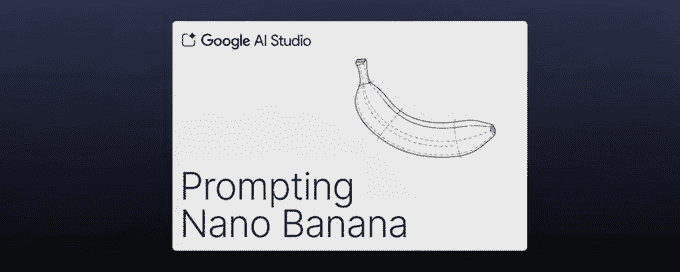
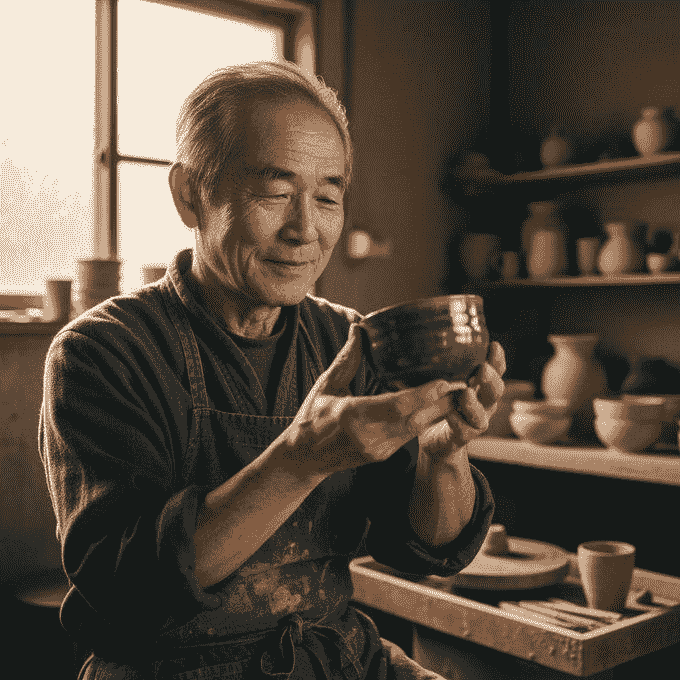
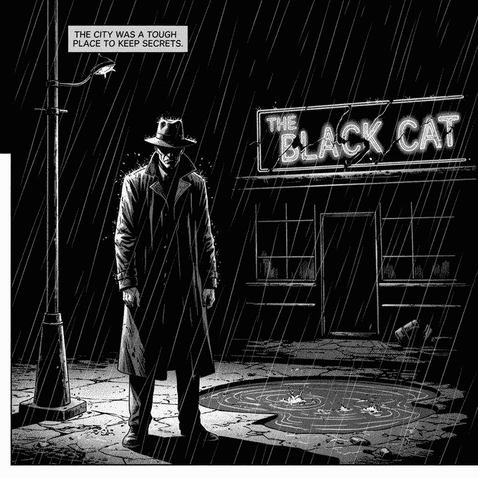

# 20250904-谷歌官方提示词指南：Nano Banana模型的6个超实用技巧

> 来源：[https://aigcreative.feishu.cn/docx/XeD9dQIzaofDbgxdPXAcLoylnzh](https://aigcreative.feishu.cn/docx/XeD9dQIzaofDbgxdPXAcLoylnzh)

Google AI Studio 最新推出的 Nano Banana 模型，也称为 Gemini 2.5 Flash Image，以其独特的本地多模态架构，在单一步骤中高效地处理文本与图像，为创意界带来了革命性的变化。该模型不仅能够从简单到复杂的文本描述生成高质量图像，还支持图像编辑、多图像组合、逻辑推理以及精确的文本渲染。



文章中详细提供了六种不同场景的文本提示模板，包括真实场景、风格化插画、产品模拟、极简设计、连续艺术以及文本渲染，旨在帮助用户掌握如何通过精确的文本提示引导 AI 模型创造出符合预期的视觉作品。这一系列的创新应用，不仅为艺术家、设计师提供了无限的创意灵感，也为电子商务、广告和品牌推广等领域提供了前所未有的便利。

认识Nano Banana（又名Gemini 2.5 Flash Image）：我们最新、最快、最高效的模型。其原生多模态架构可一步处理文本与图像，解锁对话式编辑、多图像合成、逻辑推理等强大功能。

你可通过[官方文档](https://ai.google.dev/gemini-api/docs/image-generation)中的代码尝试这些功能，或直接在Google AI Studio（访问ai.studio/banana）中立即创作。

**以下是核心功能：**

+   **文本转图像**：通过简单或复杂的文本描述生成高质量图像。

+   **图像+文本转图像（编辑）**：提供一张图像，通过文本提示添加、移除或修改元素，调整风格或颜色。

+   **多图像转图像（合成与风格迁移）**：使用多张输入图像合成新场景，或迁移某张图像的风格至另一张。

+   **迭代优化**：通过多轮对话逐步优化图像，微调直至完美。

+   **文本渲染**：生成包含清晰且排版工整文本的图像，适用于logo、图表和海报。

本指南将教你如何编写提示语与指令，以最大化发挥Gemini 2.5 Flash的性能。一切始于一个基本原则：

> **描述场景，而非罗列关键词**。模型的核心优势在于深度语言理解能力。一段叙事性、描述性的段落，几乎总能生成比零散关键词列表更优质、更连贯的图像。

---

# 从文本生成图像

最常见的图像生成方式是描述你想看到的内容。

## 1. 真实场景

生成写实图像时，可像摄影师一样思考。提及相机角度、镜头类型、光线和细节，能引导模型生成更真实的结果。

> **模板**：一张[拍摄类型]的写实[主体]图，[动作或表情]，置于[环境]中。场景由[光线描述]照亮，营造[氛围]的氛围。使用[相机/镜头参数]拍摄，突出[关键纹理与细节]。图像为[长宽比]格式。

> **示例提示**：一张写实特写肖像，拍摄对象是一位日本老年陶艺师，他脸上布满阳光刻下的深纹，带着温暖而睿智的微笑。他正专注检查一个刚上釉的茶碗。场景设定在他阳光斑驳的质朴工作坊内。柔和的“黄金时段”光线从窗户洒入，照亮黏土细腻的纹理。使用85mm人像镜头拍摄，背景呈柔和虚化（散景）。整体氛围宁静而专业。竖版肖像比例。

```
from google import genai
from google.genai import types
from PIL import Image
from io import BytesIO
client = genai.Client()
# 从文本提示生成图像
response = client.models.generate_content(
    model=&quot;gemini-2.5-flash-image-preview&quot;,
    contents=&quot;A photorealistic close-up portrait of an elderly Japanese ceramicist with deep, sun-etched wrinkles and a warm, knowing smile. He is carefully inspecting a freshly glazed tea bowl. The setting is his rustic, sun-drenched workshop with pottery wheels and shelves of clay pots in the background. The scene is illuminated by soft, golden hour light streaming through a window, highlighting the fine texture of the clay and the fabric of his apron. Captured with an 85mm portrait lens, resulting in a soft, blurred background (bokeh). The overall mood is serene and masterful.&quot;,
)
image_parts = [
    part.inline_data.data
    for part in response.candidates[0].content.parts
    if part.inline_data
]
if image_parts:
    image = Image.open(BytesIO(image_parts[0]))
    image.save(&#x27;photorealistic_example.png&#x27;)
    image.show()
```



（注：示例提示对应生成“一位日本老年陶艺师的写实特写肖像……”）

---

## 2. 风格化插画与贴纸

若需为项目创作贴纸、图标或素材，明确指定风格，若需要白色背景记得额外说明。

> **模板**：一张[风格]风格的[主体]贴纸，具备[关键特征]与[调色板]。设计采用[线条风格]与[阴影风格]。背景需为白色。

> **示例提示**：一张卡哇伊风格的快乐小熊猫贴纸，小熊猫戴着迷你竹制帽子，正啃食一片绿色竹叶。设计采用粗线条清晰轮廓、简单赛璐璐阴影与明亮调色板。背景必须为白色。

```
from google import genai
from google.genai import types
from PIL import Image
from io import BytesIO
client = genai.Client()
# 从文本提示生成图像
response = client.models.generate_content(
    model=&quot;gemini-2.5-flash-image-preview&quot;,
    contents=&quot;A kawaii-style sticker of a happy red panda wearing a tiny bamboo hat. It&#x27;s munching on a green bamboo leaf. The design features bold, clean outlines, simple cel-shading, and a vibrant color palette. The background must be white.&quot;,
)
image_parts = [
    part.inline_data.data
    for part in response.candidates[0].content.parts
    if part.inline_data
]
if image_parts:
    image = Image.open(BytesIO(image_parts[0]))
    image.save(&#x27;red_panda_sticker.png&#x27;)
    image.show()
```


（注：示例提示对应生成“卡哇伊风格的快乐小熊猫贴纸……”）

---

## 3. 图像中精准文本

Gemini擅长渲染文本。明确指定文本内容、字体风格（描述性）及整体设计。

> **模板**：为[品牌/概念]创作一张[图像类型]，包含文本“[需渲染文本]”，字体为[字体风格]。设计应[风格描述]，采用[配色方案]。

> **示例提示**：为名为“每日研磨”的咖啡店创作现代极简风logo。文本需使用简洁粗体无衬线字体。设计包含一个与文本无缝融合的简化咖啡豆图标。配色方案为黑白。

```
from google import genai
from google.genai import types
from PIL import Image
from io import BytesIO
client = genai.Client()
# 从文本提示生成图像
response = client.models.generate_content(
    model=&quot;gemini-2.5-flash-image-preview&quot;,
    contents=&quot;Create a modern, minimalist logo for a coffee shop called &#x27;The Daily Grind&#x27;. The text should be in a clean, bold, sans-serif font. The design should feature a simple, stylized icon of a coffee bean seamlessly integrated with the text. The color scheme is black and white.&quot;,
)
image_parts = [
    part.inline_data.data
    for part in response.candidates[0].content.parts
    if part.inline_data
]
if image_parts:
    image = Image.open(BytesIO(image_parts[0]))
    image.save(&#x27;logo_example.png&#x27;)
    image.show()
```


（注：示例提示对应生成“为‘每日研磨’咖啡店创作的现代极简风logo……”）

---

## 4. 产品模型与商业摄影

为电商、广告或品牌推广生成干净专业的产品图。

> **模板**：一张高分辨率、影棚布光的[产品描述]产品图，置于[背景材质/描述]上。采用[布光方案，如三点柔光箱]以[布光目的]。相机角度为[角度类型]，突出[特定特征]。超写实风格，关键细节[关键细节]清晰对焦。[长宽比]。

> **示例提示**：一张高分辨率、影棚布光的哑光黑色极简陶瓷咖啡杯产品图，置于抛光水泥表面。采用三点柔光箱布光，营造柔和漫射高光并消除生硬阴影。相机角度为微仰45度，突出其简洁线条。超写实风格，咖啡杯口升腾的蒸汽清晰对焦。方形图像。

```
from google import genai
from google.genai import types
from PIL import Image
from io import BytesIO
client = genai.Client()
# 从文本提示生成图像
response = client.models.generate_content(
    model=&quot;gemini-2.5-flash-image-preview&quot;,
    contents=&quot;A high-resolution, studio-lit product photograph of a minimalist ceramic coffee mug in matte black, presented on a polished concrete surface. The lighting is a three-point softbox setup designed to create soft, diffused highlights and eliminate harsh shadows. The camera angle is a slightly elevated 45-degree shot to showcase its clean lines. Ultra-realistic, with sharp focus on the steam rising from the coffee. Square image.&quot;,
)
image_parts = [
    part.inline_data.data
    for part in response.candidates[0].content.parts
    if part.inline_data
]
if image_parts:
    image = Image.open(BytesIO(image_parts[0]))
    image.save(&#x27;product_mockup.png&#x27;)
    image.show()
```


（注：示例提示对应生成“高分辨率影棚布光的哑光黑色极简陶瓷咖啡杯产品图……”）

---

## 5. 极简与负空间设计

适合为网站、演示文稿或需叠加文本的营销素材创作背景图。

> **模板**：一张极简构图，画面中仅有一个[主体]，位于画面[右下/左上等]位置。背景为大片[颜色]空白画布，形成显著负空间。光线柔和细腻。[长宽比]。

> **示例提示**：一张极简构图，画面右下仅有一片精致的红色枫叶。背景为大片米白色空白画布，为文本预留显著负空间。光线从左上柔和漫射。方形图像。

```
from google import genai
from google.genai import types
from PIL import Image
from io import BytesIO
client = genai.Client()
# 从文本提示生成图像
response = client.models.generate_content(
    model=&quot;gemini-2.5-flash-image-preview&quot;,
    contents=&quot;A minimalist composition featuring a single, delicate red maple leaf positioned in the bottom-right of the frame. The background is a vast, empty off-white canvas, creating significant negative space for text. Soft, diffused lighting from the top left. Square image.&quot;,
)
image_parts = [
    part.inline_data.data
    for part in response.candidates[0].content.parts
    if part.inline_data
]
if image_parts:
    image = Image.open(BytesIO(image_parts[0]))
    image.save(&#x27;minimalist_design.png&#x27;)
    image.show()
```


（注：示例提示对应生成“极简构图的红色枫叶图……”）

---

## 6. 连续艺术（漫画分镜/分镜脚本）

逐格创作引人入胜的视觉叙事，适用于分镜脚本、漫画条或任何连续艺术形式，关键是清晰描述场景。

> **模板**：一张[艺术风格]的漫画单格。前景为[角色描述与动作]。背景为[场景细节]。分镜包含[对话/标题框]，文本为“[文本]”。光线营造[氛围]的情绪。[长宽比]。

> **示例提示**：一张高对比度黑白墨水绘制的粗粝黑色电影风格漫画单格。前景中，一位穿 trench coat（风衣）的侦探站在闪烁的街灯下，雨水浸透双肩。背景里，荒凉酒吧的霓虹招牌倒映在水洼中。顶部标题框写着“在这座城市，秘密难以留存”。光线强烈，营造戏剧而阴郁的氛围。横版比例。

```
from google import genai
from google.genai import types
from PIL import Image
from io import BytesIO
client = genai.Client()
# 从文本提示生成图像
response = client.models.generate_content(
    model=&quot;gemini-2.5-flash-image-preview&quot;,
    contents=&quot;A single comic book panel in a gritty, noir art style with high-contrast black and white inks. In the foreground, a detective in a trench coat stands under a flickering streetlamp, rain soaking his shoulders. In the background, the neon sign of a desolate bar reflects in a puddle. A caption box at the top reads \&quot;The city was a tough place to keep secrets.\&quot; The lighting is harsh, creating a dramatic, somber mood. Landscape.&quot;,
)
image_parts = [
    part.inline_data.data
    for part in response.candidates[0].content.parts
    if part.inline_data
]
if image_parts:
    image = Image.open(BytesIO(image_parts[0]))
    image.save(&#x27;comic_panel.png&#x27;)
    image.show()
```



（注：示例提示对应生成“粗粝黑色电影风格的漫画单格……”）

总的来说，经过一下午的试用，我觉得Nano Banana这类新的AI模型，正在促使我们改变与AI协作的方式。

我们或许可以逐渐摆脱“关键词思维”，尝试像与人沟通一样，用更完整、更生动的语言去描述我们的想法。当你把场景、情绪和氛围都交代清楚之后，会发现出图的成功率和满意度确实会高很多。

这不仅仅是一个工具，更像是一个需要我们去学习如何有效沟通的合作者。

<https://aigcreative.feishu.cn/sync/K4Gvd9vUQsy9Oubwqaeclu0Fnbg>

# 知识库动态