# 20251202-进阶必修课！谷歌Nano Banana Pro的10大核心技巧

> 来源：[https://aigcreative.feishu.cn/docx/TBO1dYHwZojzt5xjgeDcp1RqnRt](https://aigcreative.feishu.cn/docx/TBO1dYHwZojzt5xjgeDcp1RqnRt)

> 如果说之前的 AI 绘图模型是在模拟艺术，那么 Google 最新的 Nano Banana Pro 则是在理解物理世界。

> 这**篇由 Google** **DeepMind** 开发者布道师撰写的指南，含金量极高。它彻底摒弃了玄学的“咒语”逻辑，转而强调自然语言的意图理解和结构化的提示工程。

> 全文干货满满，涵盖了从视觉合成到逻辑推理的 10 大核心技巧。特别是关于如何利用 AI 进行维度转换（2D转3D）和精准文本控制的部分，令我印象深刻。创意猎人认为这是每一位数字创作者的必修课。

> 以下是创意猎人对于原文的精译，建议配合Gemini 3、 AI Studio 实操练习。

> 作者：Guillaume Vernade，Google DeepMind Gemini 开发者布道师

> 整理：AIGC创意猎人。

Nano-Banana Pro 代表了较上一代模型的重大**飞跃，从“趣**味性”生图转向了“功能性”的专业资产生产。它在文本渲染、角色一致性、视觉合成、世界知识（搜索）和高分辨率（4K）输出方面表现出色。

本指南紧随开发者指南之后，介绍如何开始使用 AI Studio 和 API，涵盖了核心功能以及如何高效地进行提示（Prompting）。

**本文包含以下内容：**

1.  提示词（Prompting）黄金法则

1.  文本渲染、信息图表与视觉合成

1.  角色一致性与病毒式缩略图

1.  基于 Google 搜索的真实性（Grounding）

1.  高级编辑、修复与上色

1.  维度转换（2D ↔ 3D）

1.  高分辨率与纹理

1.  思考与推理

1.  单次生成故事板与概念艺术

1.  结构控制与布局指导

1.  下一步做什么？

# 00. 提示词（Prompting）黄金法则

Nano-Banana Pro 是一个“会思考”的模型。

它不仅仅是匹配关键词；它理解意图、物理规律和构图。为了获得最佳效果，请停止使用“**标签堆砌**”（例如：dog, park, 4k, realistic），开始像一位创意总监那样行事。

## 0.1 编辑，而非重新生成（Edit, Don't Re-roll）

该模型非常擅长理解对话式的修改。如果一张图片有 80% 是正确的，不要从头开始生成一张新的。相反，只需提出你需要的具体修改建议。

> **示例：**“很棒，但把灯光改成日落，并把文字改成霓虹蓝。”

## 0.2 使用自然语言和完整句子

像给人类艺术家下达简报（Brief）一样与模型交谈。使用正确的语法和描述性形容词。

> ❌ **错误：** “Cool car, neon, city, night, 8k.”（酷车，霓虹，城市，夜晚，8k。）

> ✅ **正确：** “A cinematic wide shot of a futuristic sports car speeding through a rainy Tokyo street at night. The neon signs reflect off the wet pavement and the car's metallic chassis.”（一个电影感的广角镜头，展示了一辆未来派跑车在夜晚雨后的东京街道上飞驰。霓虹灯的招牌倒映在湿漉漉的路面和汽车的金属底盘上。）

## 0.3 具体且具有描述性

模糊的提示只会产生通用的结果。定义主体、环境、灯光和情绪。

> **主体：** 不要只说“一个女人”，要说“一位穿着复古香奈儿风格套装的优雅老妇人”。

> **材质感：** 描述纹理。“哑光表面”、“拉丝钢”、“柔软的天鹅绒”、“揉皱的纸”。

## 0.4 提供语境（“为什么”或“给谁看”）

因为模型会“思考”，提供语境有助于它做出符合逻辑的艺术决策。

> **示例：** “为一本巴西高端美食食谱创作一张三明治的图片。”（模型会推断出专业的摆盘、浅景深和完美的布光）。

# 01.文本渲染、信息图表与视觉合成

Nano-Banana Pro 在渲染清晰、风格化的文本以及将复杂信息合成为视觉格式方面拥有 SOTA（最先进）的能力。

**最佳实践：**

> **压缩：** 要求模型将密集的文本或 PDF “压缩”成视觉辅助材料。

> **风格：** 指定你想要“精美的编辑风格”、“技术图解”还是“手绘白板”风格。

> **引用：** 明确指定你想要放在引号中的文本。

**提示词示例：**

> **财报信息图（数据摄入）：**

[输入 Google 最新财报的 PDF]

“生成一张清晰、现代的信息图表，总结这份财报中的关键财务亮点。包括‘收入增长’和‘净利润’的图表，并在一个风格化的引用框中突出 CEO 的关键语录。”

（注：需上传 PDF）

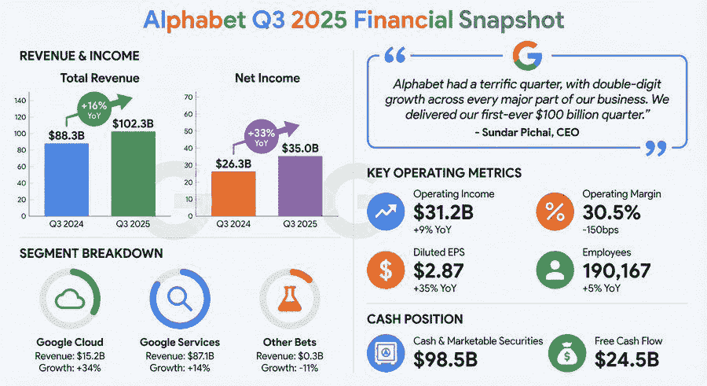

> **复古信息图：**

> “制作一张复古的、1950 年代风格的信息图表，介绍美国路边餐厅（Diner）的历史。包括‘食物’、‘点唱机’和‘装饰’等不同板块。确保所有文字清晰易读，并具有符合该时期的风格。”

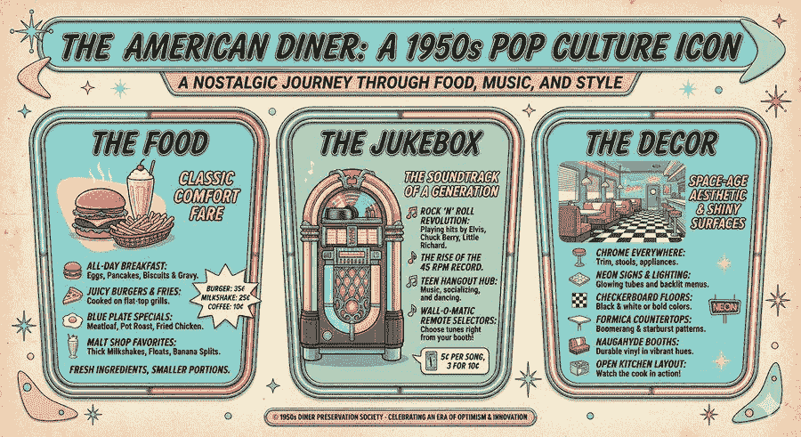

> **技术图纸：**

> “创建一张正交蓝图，描述这座建筑的平面图、立面图和剖面图。用技术建筑字体清晰地标记‘北立面’和‘主入口’。格式为 16:9。”

>

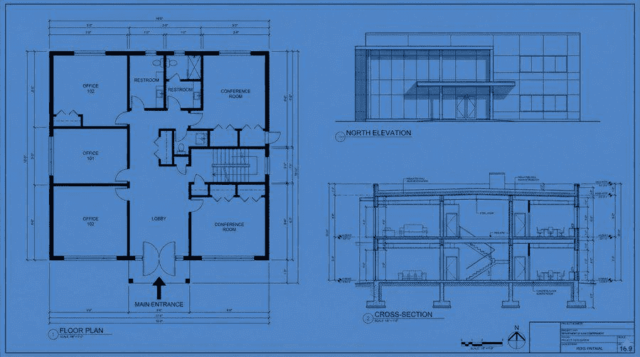

> **白板总结（教育用）：**

> “将‘Transformer 神经网络架构’的概念总结为一张适合大学讲座的手绘白板图。用不同颜色的记号笔区分编码器（Encoder）和解码器（Decoder）模块，并加上清晰的‘自注意力（Self-Attention）’和‘前馈（Feed Forward）’标签。”

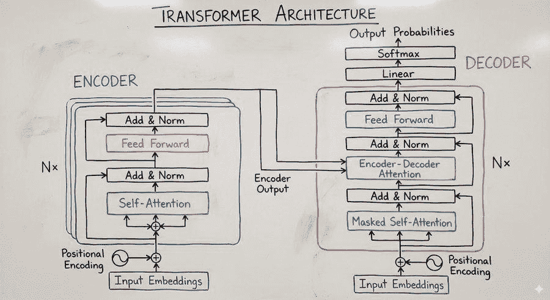

# 02.角色一致性与病毒式缩略图

Nano-Banana Pro 支持多达 14 张参考图片（其中 6 张可达高保真度）。这使得“身份锁定（Identity Locking）”成为可能——即将特定的人物或角色放入新场景中而不发生面部变形。

**最佳实践：**

> **身份锁定：** 明确声明：“保持人物的面部特征与图 1 完全一致。”

> **表情/动作：** 描述情绪或姿势的变化，同时保持身份不变。

> **病毒式构图：** 一次性将主体与大胆的图形和文字结合起来。

**提示词示例：**

> “病毒式缩略图”（身份 + 文字 + 图形）：

> **“使用图 **1 中的人物设计一个病毒式视频缩略图。面**部一****致性****：保****持人**物**的面**部特征与图 1 完全一致，但改变他们的表情，使其看起来兴奋和惊讶。动作：将人物放在左侧，手指指向画面的右侧。主体：在右侧放置一张高质量的美味牛油果吐司图片。图形：添加一个粗大的黄色箭头，连接人物的手指和吐司。文字：在中间覆盖巨大的波普风格文字：‘3分钟搞定!’（Done in 3 mins!）。使用粗白色轮廓和投影。背景：模糊、明亮的厨房背景。高饱和度和对比度。”

> （注：需上传参考图片）

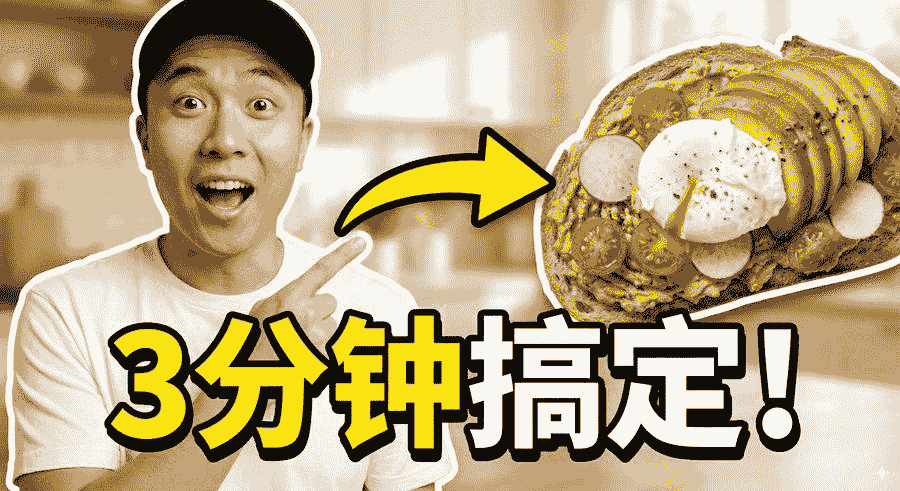

> “毛茸茸的朋友”场景（群体一致性）：

[输入 3 张不同毛绒生物的图片]

“创作一个有趣的 10 部分故事，讲述这 3 个毛茸茸的朋友去热带度假的故事。故事全程惊险刺激，情绪跌宕起伏，最后以一个幸福的时刻结束。保持所有 3 个角色的服装和身份一致，但他们在所有 10 张图片中的表情和角度应有所变化。确保每张图片中每个角色只出现一次。”

（注：需上传参考图片）

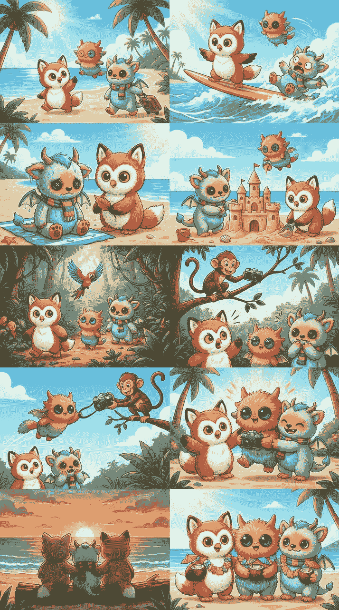

> **品牌资产生成：**

[输入 1 张产品图片]

“创作 9 张令人惊艳的时尚大片，就像它们来自获奖的时尚社论一样。使用此参考图作为品牌风格，但在系列中增加细微差别和多样性，以传达专业的设计触感。请逐一生成九张图片。”

（注：需上传参考图片）

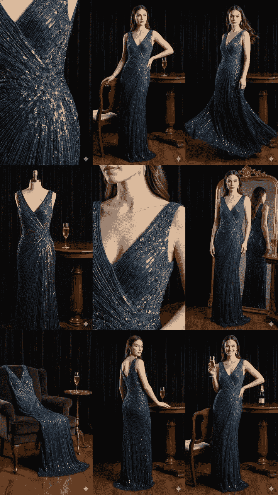

# 03.基于 Google 搜索的真实性（Grounding）

Nano-Banana Pro 利用 Google 搜索基于实时数据、当前事件或事实验证来生成图像，从而减少关于时效性话题的幻觉。

**最佳实践：**

> 要求可视化动态数据（天气、股票、新闻）。

> 模型在生成图像之前会先“思考”（推理）搜索结果。

**提示词示例：**

> **事件可视化：**

“根据当前的旅游趋势，生成一张 2025 年美国国家公园最佳游览时间的信息图表。”

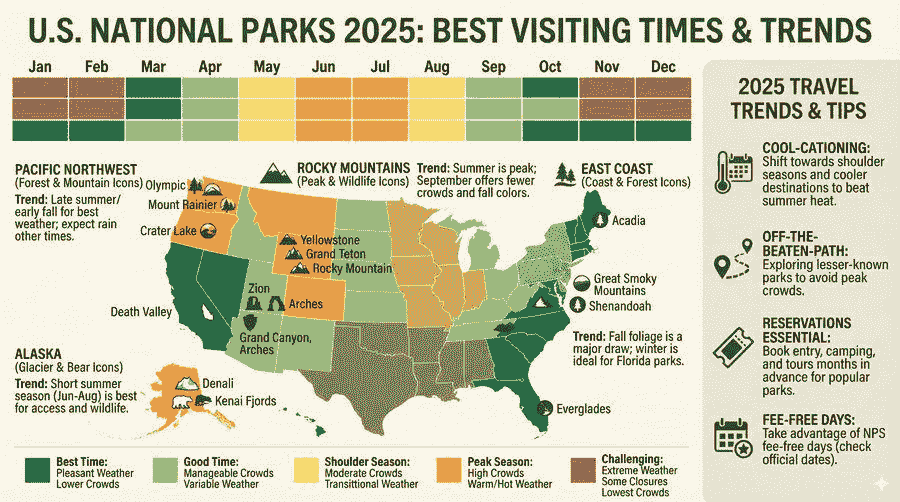

# 04.高级编辑、修复与上色

该模型擅长通过对话式提示进行复杂编辑。

这包括“重绘（In-painting）”（移除/添加物体）、“修复（Restoration）”（修复老照片）、“上色（Colorization）”（漫画/黑白照片）和“风格转换（Style Swapping）”。

**最佳实践：**

> **语义指令：** 你不需要手动遮罩（mask）；只需自然地告诉模型要改变什么。

> **物理理解：** 你可以要求复杂的改变，如“在这个杯子里装满液体”，以测试物理生成能力。

**提示词示例：**

> **物体移除与重绘：**

“从这张照片的背景中移除游客，并用符合周围环境的逻辑纹理（鹅卵石和店面）填充该空间。”

（注：需上传照片）

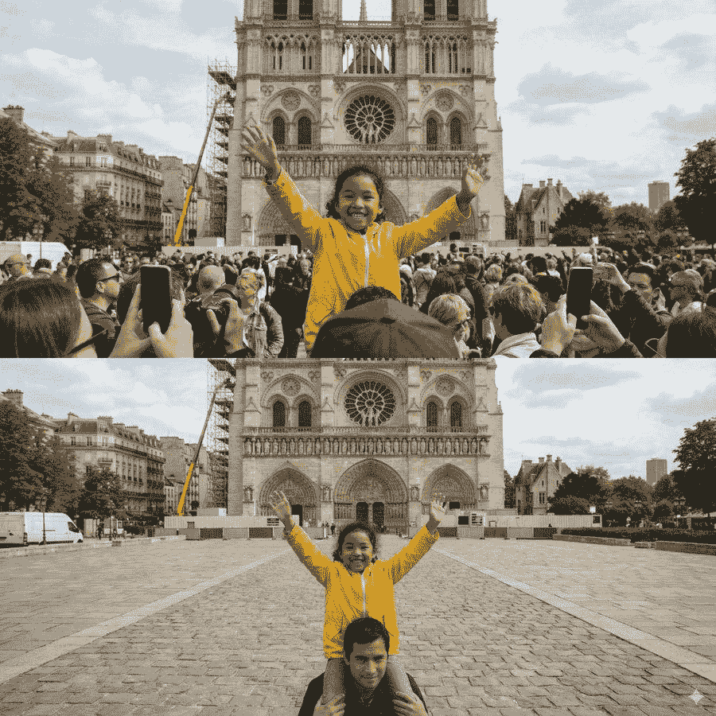

> **漫画/连环画上色：**

[输入黑白漫画格]

“给这个漫画格上色。使用充满活力的动漫风格调色板。确保能量束的光效是发光的霓虹蓝，角色的服装与他们的官方配色一致。”

（注：需上传图片）

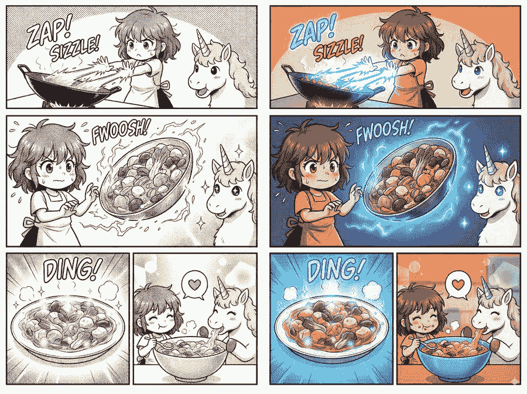

> 本地化（文字翻译 + 文化适配）：

[输入伦敦公交车站广告的图片]

“采用这个概念并将其本地化为东京的场景，包括将标语翻译成日语。将背景改为夜晚熙熙攘攘的涩谷街道。”

（注：需上传图片）

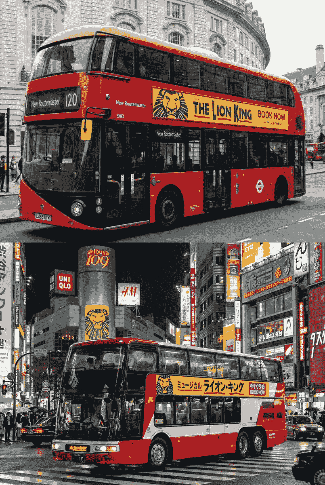

> **光照/季节控制：**

[输入夏天的房子图片]

“将此场景变为冬季。保持房屋建筑完全不变，但在屋顶和院子里添加积雪，并将光线改为寒冷、阴沉的下午。”

（注：需上传图片）

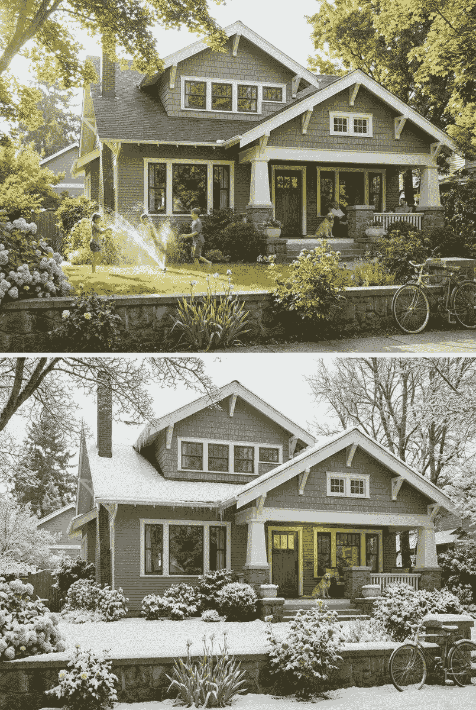

# 05.维度转换（2D ↔ 3D）

一个强大的新功能是将 2D 图纸翻译成 3D 可视化，反之亦然。这对于室内设计师、建筑师和模因（Meme）创作者来说非常理想。

**提示词示例：**

> 2D 平面图转 3D 室内设计板：

**“根**据**上传****的 **2D 平面图，生成一张专业的单图室内设计演示板。布局：拼贴画形式，上方是一张大的主图（起居区的广角透视），下方是三张较小的图（主卧、家庭办公室和 3D 俯视平面图）。风格：所有图片均应用现代极简风格，搭配暖色橡木地板和米白色墙壁。质量：照片级逼真渲染，柔和的自然光。”

（注：需上传平面图）

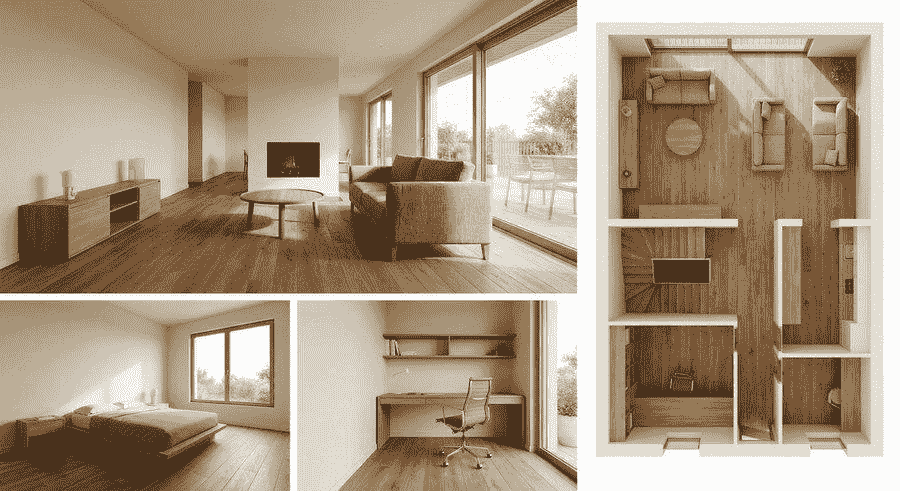

> 2D 转 3D 梗图（Meme）转换：

“将‘This is Fine’（这就很好/着火的狗）梗图变成逼真的 3D 渲染图。保持构图完全相同，但让狗看起来像一个毛绒玩具，火看起来像逼真的火焰。”

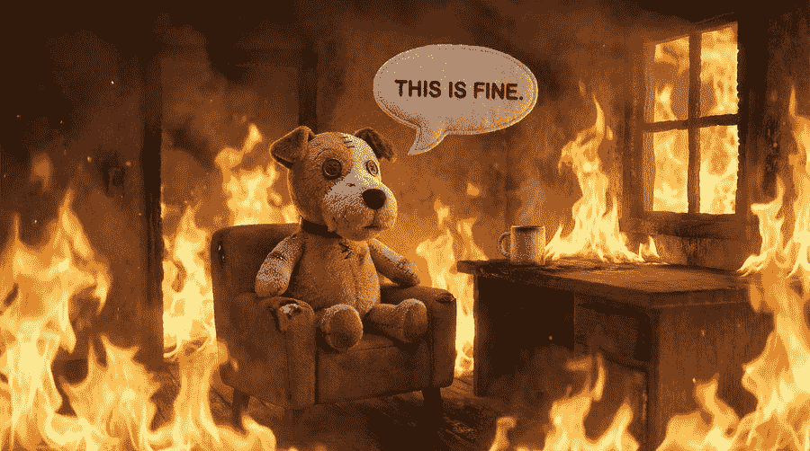

# 06.高分辨率与纹理

Nano-Banana Pro 支持原生 1K 到 4K 图像生成。这对于细节纹理或大幅面打印特别有用。

**最佳实践：**

> 如果你的 API/界面允许，明确要求高分辨率（2K 或 4K）。

> 描述高保真细节（瑕疵、表面纹理）。

**提示词示例：**

> **4K 纹理生成：**

“利用原生高保真输出，打造一个令人叹为观止的、充满氛围感的长满苔藓的森林地面环境。驾驭复杂的光效和细腻的纹理，确保每一缕苔藓和光束都以适合 4K 壁纸的像素级完美分辨率渲染。”

> **复杂逻辑（思考模式）：**

“制作一张超写实的美食芝士汉堡信息图，对其进行解构，以展示烤布里欧修面包（brioche bun）的纹理、肉饼的焦脆外壳以及芝士融化时的光泽。标注每一层的风味特征。”

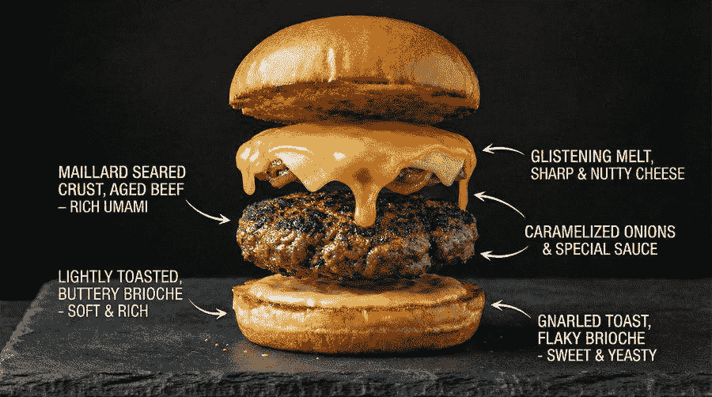

# 07.思考与推理

Nano-Banana Pro 默认采用“思考”过程，生成中间思维图像（不收费）以在渲染最终输出之前优化构图。这允许进行数据分析和解决视觉问题。

**提示词示例：**

> **解方程：**

“在白板上求解复数域 C 中的 log_{x^2+1}(x^4-1)=2。清晰展示步骤。”

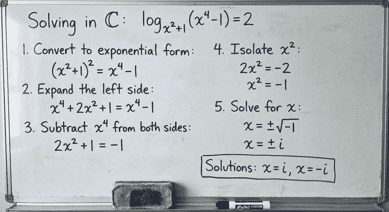

> **视觉推理：**

“分析这张房间的照片，并生成一张‘之前’的照片，展示该房间在施工期间的样子，显示框架和未完工的干墙。”

（注：需上传图片）

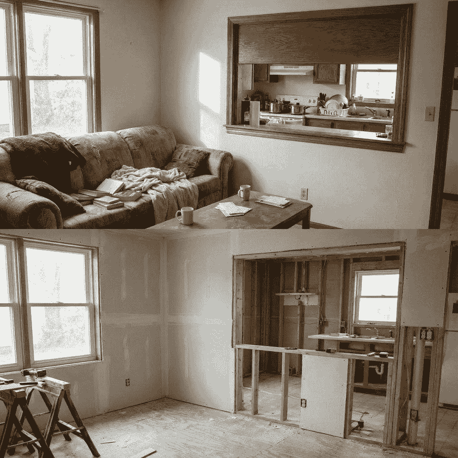

# 08.单次生成故事板与概念艺术

你可以在没有网格的情况下生成连续艺术或故事板，确保在单次会话中实现连贯的叙事流。这在“电影概念艺术”（例如：即将上映电影的伪造泄露图）中也很流行。

**提示词示例：**

> “创作一个令人着迷的 9 部分故事，包含 9 张图片，讲述一男一女在一个获奖的豪华行李箱广告中的故事。故事应该有情绪的起伏，最后以那位女士与 Logo 的优雅镜头结束。女士和男士的身份及其服装必须全程保持一致，但可以而且应该从不同的角度和距离展示他们。请逐一生成图片。确保每张图片都是 16:9 的横向格式。”

# 09.结构控制与布局指导

输入图像不仅限于角色参考或要编辑的主体。你可以使用它们来严格控制最终输出的构图和布局。对于需要将餐巾纸草图、线框图或特定网格布局转化为完善资产的设计师来说，这是一个颠覆性的功能。

**最佳实践：**

> **草稿与素描：** 上传手绘草图，精确定义文本和物体应放置的位置。

> **线框图：** 使用现有布局或线框图的截图来生成高保真 UI 模型。

> **网格：** 使用网格图像强制模型为基于图块的游戏或 LED 显示屏生成资产。

**提示词示例：**

> **从草图到最终广告：**

“按照这张草图为 [产品] 制作一个广告。”

（注：需上传草图）

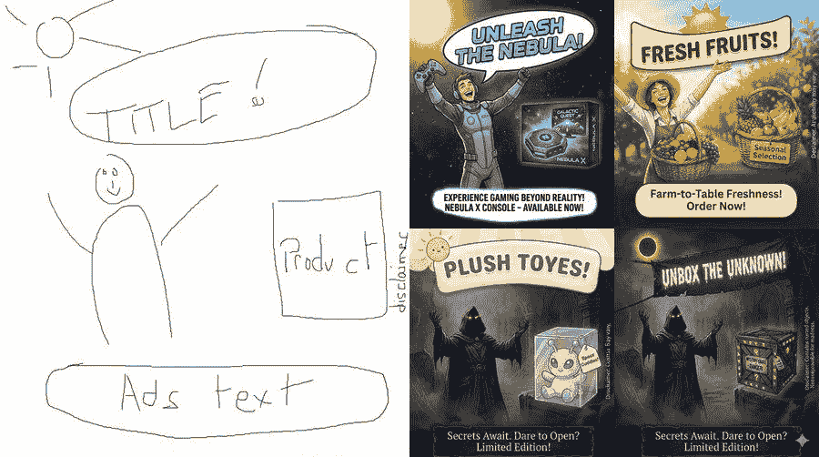

> **基于线框图的 UI 模型：**

“按照这些准则为 [产品] 创建一个模型（Mock-up）。”

（注：需上传线框图）

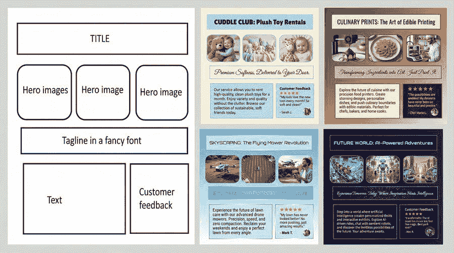

> **像素艺术与 LED 显示屏：**

“生成一个独角兽的像素艺术精灵（sprite），使其完美适配这张 64x64 的网格图像。使用高对比度颜色。”（提示：开发人员随后可以通过编程提取每个单元格的中心颜色，以驱动连接的 64x64 LED 矩阵显示屏）。

（注：需上传网格图像）

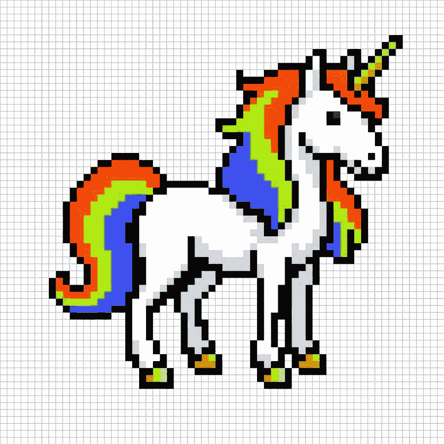

> **精灵图（Sprites）：**

“一个女人在无人机上做后空翻的精灵图（Sprite sheet），3x3 网格，序列，逐帧动画，正方形宽高比。完全遵循所附参考图像的结构。”

（提示：你可以随后提取每个单元格并制作成 gif），在 Colab 中尝试

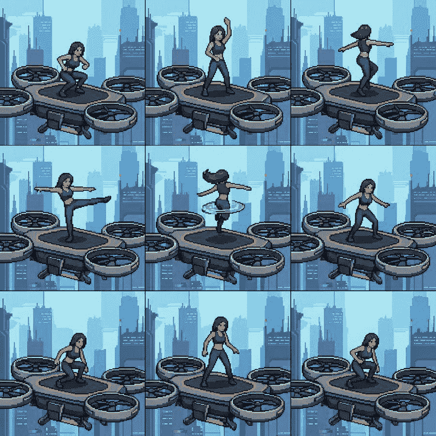

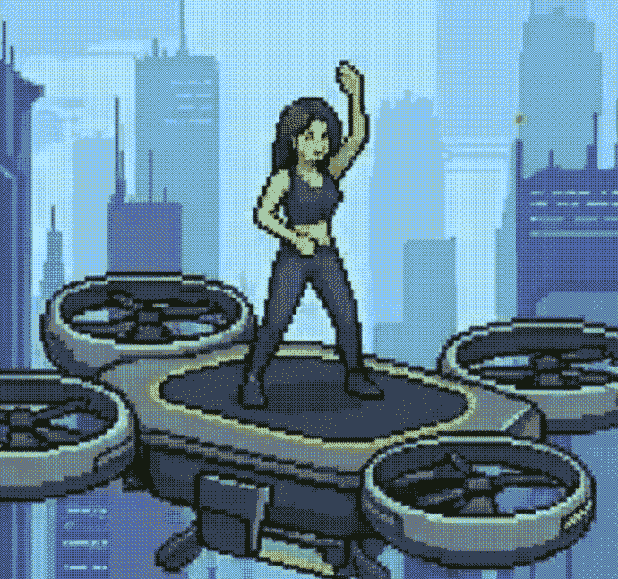

# 10.下一步做什么？

现在你已经掌握了提示词的基础知识，以下是你如何开始构建：

+   **在 UI 中实验：** Google AI Studio 是测试提示词和参数的最快方式。

+   在应用库（App Gallery）中查看真正酷炫的 Nano-banana 驱动的应用。

+   Vibe-code 你的梦想应用： 在 AI Studio Build 中将你最好的提示词转化为一个可以轻松与朋友分享的应用程序。

+   **构建应用程序：** 准备好写代码了吗？查看开发者指南或 Gemini API Cookbook 获取指南和代码片段。

+   **技术深潜：** 阅读完整的 Gemini API 文档，了解有关速率限制、定价和集成的详细信息。

看完是不是收获满满？

按照惯例，我们用一张图来总结一下今天的分享：

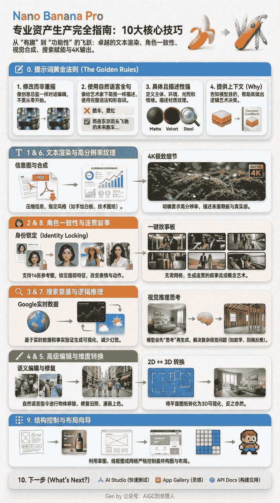

更多精彩内容，

我们下期见~~