# 20251203-终极技巧，用Gemini 3+Nano Banana Pro复刻任意风格、创意

> 来源：[https://aigcreative.feishu.cn/docx/LwkidzgotoEo2JxFTxvcHgKWn6M](https://aigcreative.feishu.cn/docx/LwkidzgotoEo2JxFTxvcHgKWn6M)

昨天的推文《》下面，有一位读者@突入 留言，

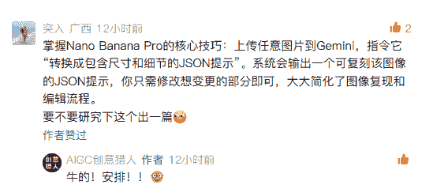

应该是对文中所讲的10个技巧还不太满意，哈哈，想要更进一步，大概意思是对任意风格进行复刻（懂的都懂），下面是他提供的技巧：

> "将图像转换为 JSON 提示符，包括大小和详细信息"

关于JSON格式的提示词，几个月前也写过一篇，是用来写VEO视频提示词的，感兴趣可以点击查看：《》

晚上经过我深度学习了一下，那咱就来安排一篇，看看是怎么回事。

## 01.单图拆解

找了一张最近在X上很火的一种风格，如下图：一个城市等距微缩卡通风格的天气预报，确实很精美，

**下面是生成它的原**提示词 from X@：TechieSA

> “Present a clear, 45° top-down isometric miniature 3D cartoon scene of [CITY], featuring its most iconic landmarks and architectural elements. Use soft, refined textures with realistic PBR materials and gentle, lifelike lighting and shadows. Integrate the current weather conditions directly into the city environment to create an immersive atmospheric mood.

> Use a clean, minimalistic composition with a soft, solid-colored background.

>

> At the top-center, place the title “[CITY]” in large bold text, a prominent weather icon beneath it, then the date (small text) and temperature (medium text).

> All text must be centered with consistent spacing, and may subtly overlap the tops of the buildings.

> Square 1080x1080 dimension。”

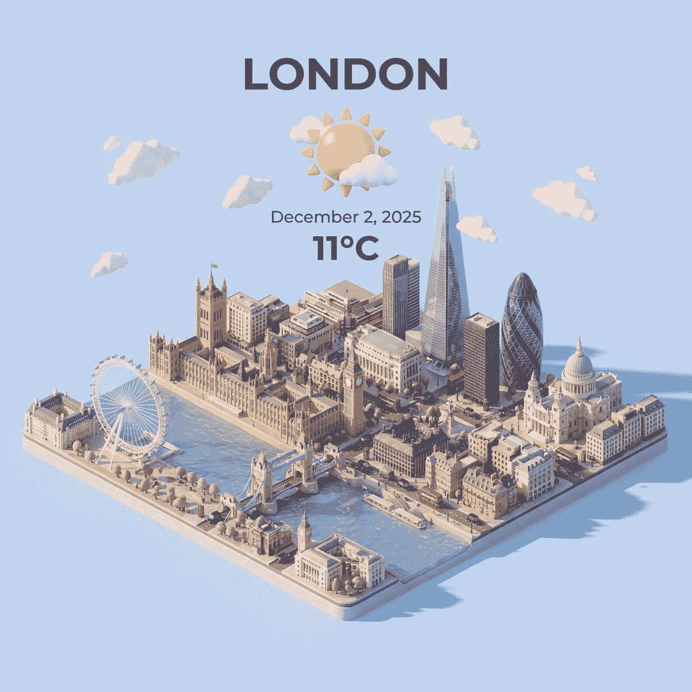

我们把这张图拖到Gemini 3：

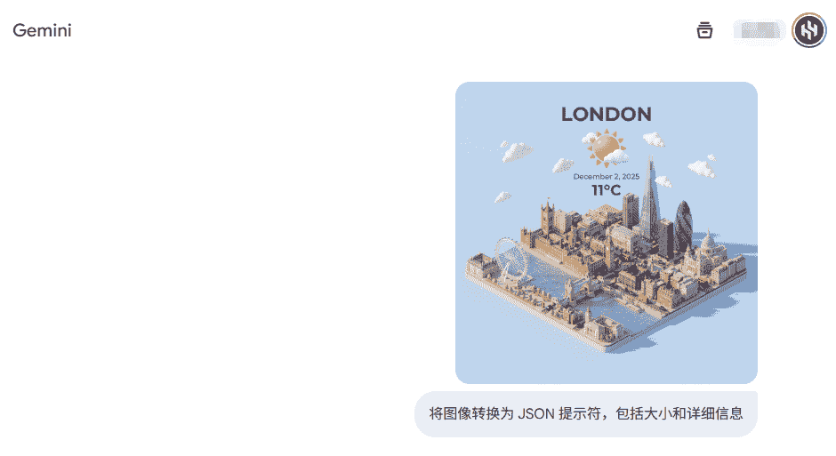

是得到以下结果：

> 这是一个基于你上传的伦敦 3D 风格图片生成的 JSON 格式提示词。我已经将画面中的关键视觉元素（如地标、天气组件、文字信息、风格材质）都包含在内。

```json
{
  &quot;prompt&quot;: &quot;Isometric 3D miniature diorama of London city on a square floating platform, claymorphism and plasticine style, cute and clean, C4D Octane render. Key landmarks included: Big Ben, The Shard, The Gherkin, London Eye, Tower Bridge, St Paul&#x27;s Cathedral. Details: River Thames flowing through, tiny red double-decker buses, black cabs, stylized green trees. Lighting: Soft global illumination, bright sunny day, soft shadows. Background: Solid pastel blue background with floating fluffy white clouds. UI Elements: A 3D weather icon (sun peeking behind cloud) floating above, large bold text &#x27;LONDON&#x27;, smaller text &#x27;December 2, 2025&#x27; and &#x27;11°C&#x27;. High quality, 8k resolution, smooth textures.&quot;,
  &quot;negative_prompt&quot;: &quot;photorealistic, dark, gritty, blurry, noise, low quality, distorted buildings, text errors, missing landmarks, messy, glitch, watermark, jpeg artifacts&quot;,
  &quot;dimensions&quot;: {
    &quot;width&quot;: 1024,
    &quot;height&quot;: 1024
  },
  &quot;aspect_ratio&quot;: &quot;1:1&quot;,
  &quot;seed&quot;: -1,
  &quot;steps&quot;: 30,
  &quot;cfg_scale&quot;: 7.0,
  &quot;model_suggestion&quot;: &quot;Stable Diffusion XL / Midjourney v6 (3D style) / Nano Banana Pro&quot;
}
```

对比看一下中文：

```json
{
  &quot;prompt&quot;: &quot;在方形浮动平台上的伦敦市等距3D微缩景观，黏土风与橡皮泥风格，可爱又整洁，C4D Octane渲染。包含的主要地标有：大本钟、碎片大厦、小黄瓜、伦敦眼、塔桥、圣保罗大教堂。细节：泰晤士河穿流而过，小小的红色双层巴士、黑色出租车、风格化的绿树。光照：柔和的全局光照，阳光明媚的晴天，柔和的阴影。背景：纯色柔和蓝色背景，飘浮着蓬松的白云。UI元素：一个3D天气图标（太阳从云后探出）飘浮在上方，大而粗体的文字“伦敦”，较小的文字“2025年12月2日”和“11°C”。高质量，8k分辨率，纹理平滑。&quot;,
  &quot;negative_prompt&quot;: &quot;写实、黑暗、粗糙、模糊、噪点、低质量、扭曲的建筑、文字错误、缺少地标、杂乱、故障、水印、JPEG伪影&quot;,
  &quot;dimensions&quot;: {
    &quot;width&quot;: 1024,
    &quot;height&quot;: 1024
  },
  &quot;aspect_ratio&quot;: &quot;1:1&quot;,
  &quot;seed&quot;: -1,
  &quot;steps&quot;: 30,
  &quot;cfg_scale&quot;: 7.0,
  &quot;model_suggestion&quot;: &quot;Stable Diffusion XL / Midjourney v6（3D风格） / Nano Banana Pro&quot;
}
```

得益于Gemini 3 强大的视觉推理能力，很轻松就得到了基于这张图的详细分析：

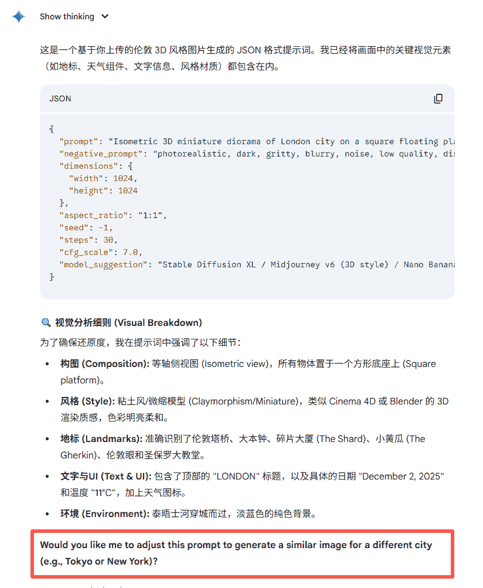

我们尝试着输入北京、莫斯科明天的天气：

> Beijing，12月3日的

> 这是为您定制的北京版本 3D 微缩城市海报的 JSON 提示词。

> 我已将地标替换为北京的标志性建筑（故宫、天坛、大裤衩等），调整了日期为 12月3日，并预估了一个符合北京冬季的温度（3°C）。

```json
{
  &quot;prompt&quot;: &quot;Isometric 3D miniature diorama of Beijing city on a square floating platform, claymorphism and plasticine style, cute and clean, C4D Octane render. Key landmarks included: The Forbidden City (traditional red walls and golden glazed tile roofs), Temple of Heaven, CCTV Headquarters, China Zun Tower, Bird&#x27;s Nest Stadium. Details: Symmetrical layout, tiny cars on ring roads, stylized green pine trees. Lighting: Bright winter sunlight, clear crisp air, soft shadows. Background: Solid pastel blue background with floating fluffy white clouds. UI Elements: A 3D weather icon (sunny) floating above, large bold text &#x27;BEIJING&#x27;, smaller text &#x27;December 3, 2025&#x27; and &#x27;3°C&#x27;. High quality, 8k resolution, smooth textures.&quot;,
  &quot;negative_prompt&quot;: &quot;photorealistic, dark, smog, pollution, gloomy, blurry, noise, low quality, distorted buildings, text errors, missing landmarks, messy, glitch, watermark, jpeg artifacts&quot;,
  &quot;dimensions&quot;: {
    &quot;width&quot;: 1024,
    &quot;height&quot;: 1024
  },
  &quot;aspect_ratio&quot;: &quot;1:1&quot;,
  &quot;seed&quot;: -1,
  &quot;steps&quot;: 30,
  &quot;cfg_scale&quot;: 7.0,
  &quot;model_suggestion&quot;: &quot;Stable Diffusion XL / Midjourney v6 (3D style) / Nano Banana Pro&quot;
}
```

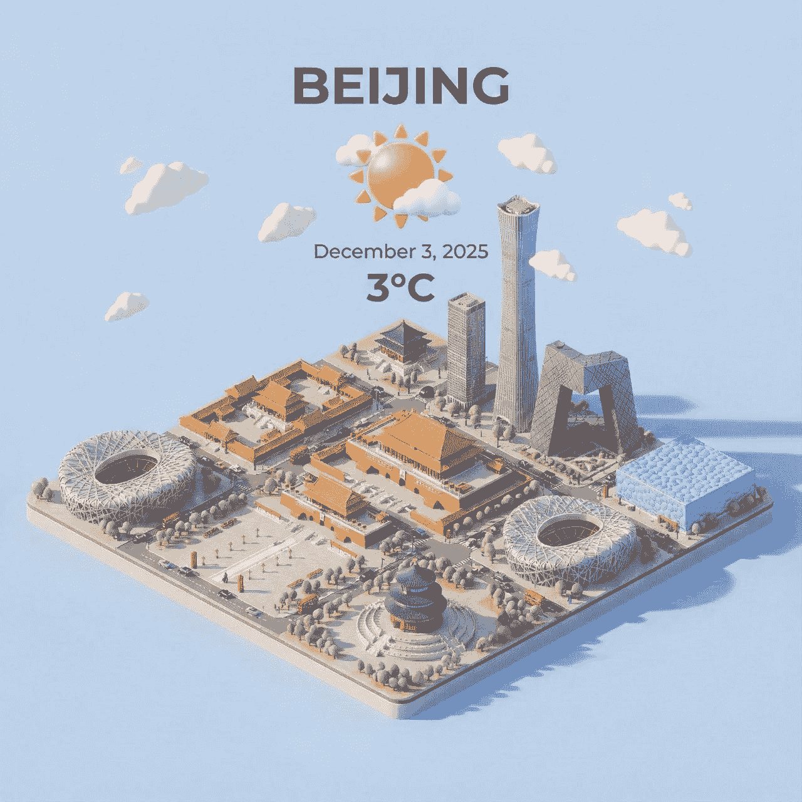

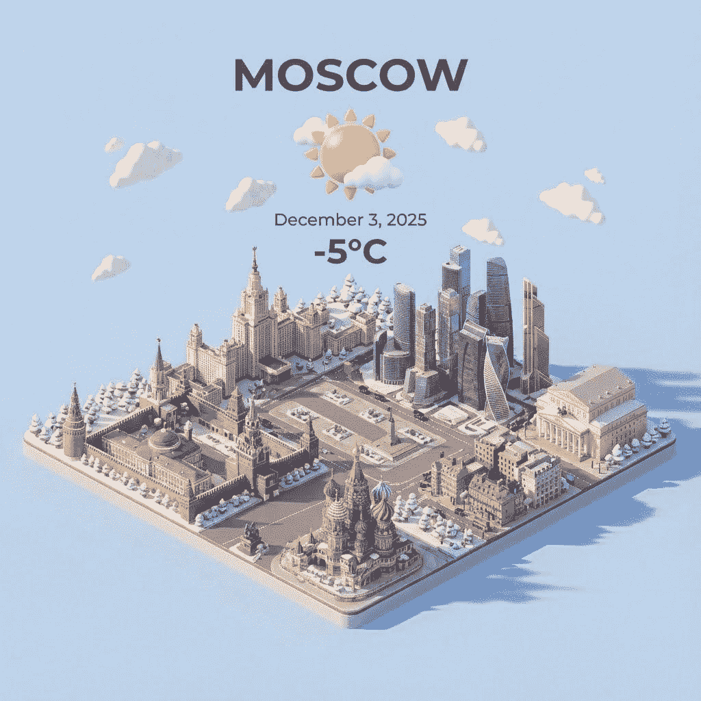

得到这两张图，风格迁移修改的非常好，如果是为了完全复刻，那相当不错了，Nano Banana Pro的学习能力还是超级强的。但其实不太对劲，在这个对话里，Gemini 3被上下文污染（`Context Pollution`）了。

Gemini 3 的超长上下文窗口既是优势也是劣势，当发第一张伦敦图，它的 `Image Embeddings`（图像嵌入信息）还停留在显存里。

为了不受当前对话的干扰，我重新开了一个对话，输入上面的JSON提示词：

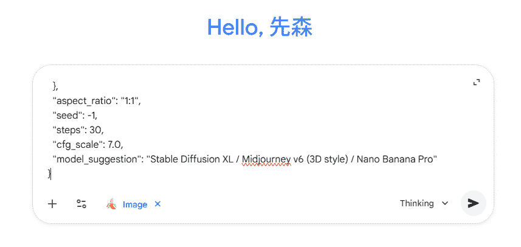

嗯，这才是新的执行提示词的结果，虽然不是百分之百到位，但效果也是挺不错的。

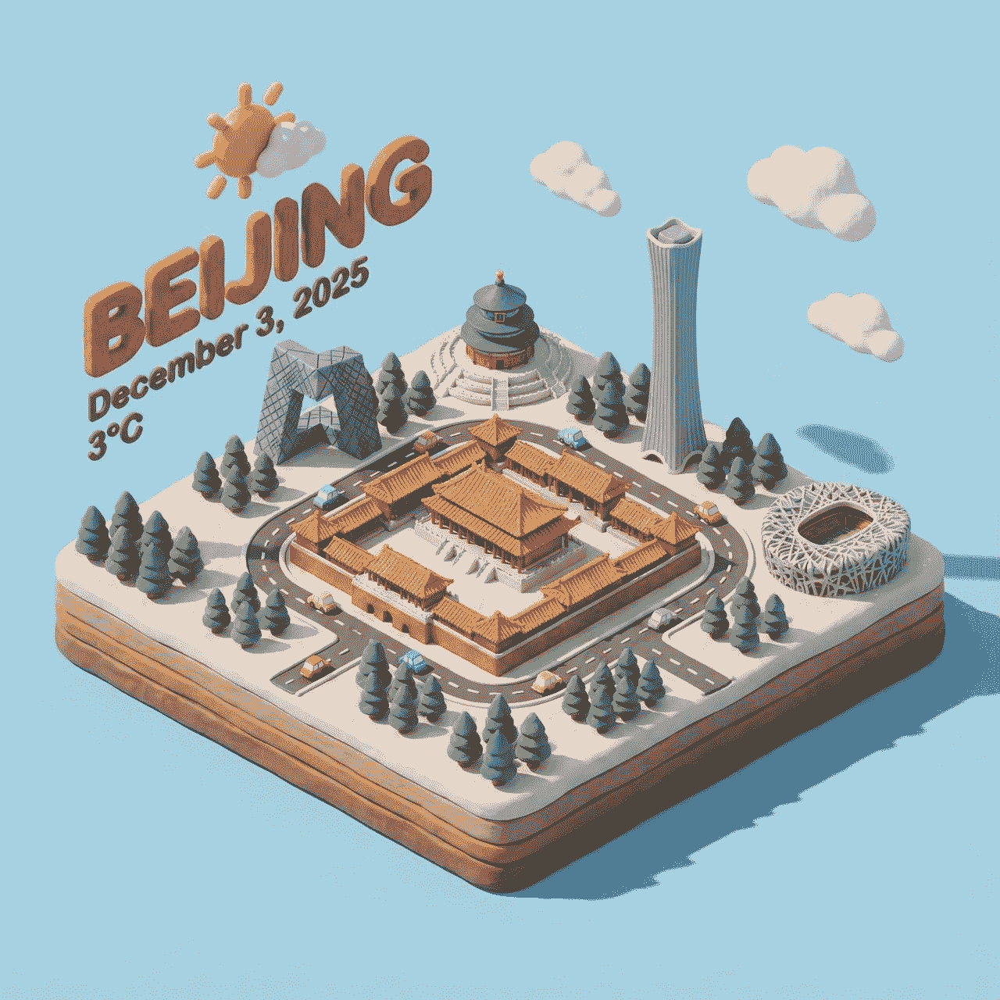

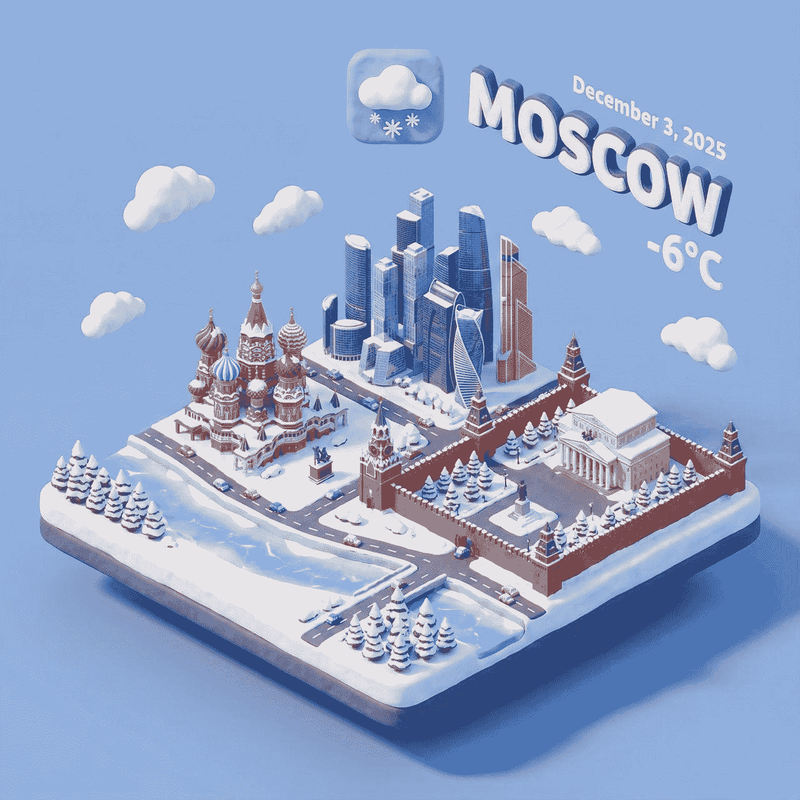

## 02.系列多图识别

上面对单个图的识别得到单个的提示词，如果对一系列的图识别，能不能得到一个系统指令？找来一个四宫格相同风格的图试一试:

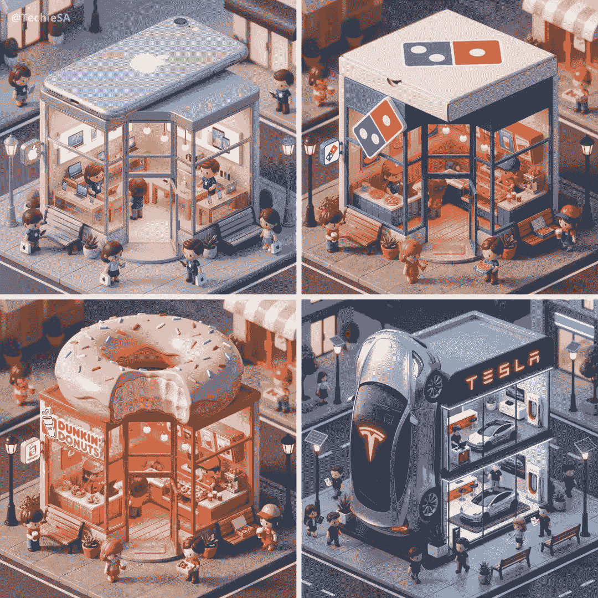

把原来的提示词稍微改一改:

> "总结这一类图像，提炼系统指令，转换为 JSON 提示符，包括大小和详细信息"

```json
{
  &quot;image_generation_params&quot;: {
    &quot;style_preset&quot;: &quot;3D Isometric Diorama&quot;,
    &quot;model_ref&quot;: &quot;Nano Banana Pro / Midjourney V6 / Flux&quot;,
    &quot;aspect_ratio&quot;: &quot;1:1&quot;,
    &quot;quality&quot;: &quot;High Fidelity, 8k&quot;,
    &quot;lighting&quot;: &quot;Soft Global Illumination, Studio Lighting&quot;
  },
  &quot;prompt_structure&quot;: {
    &quot;subject&quot;: {
      &quot;type&quot;: &quot;Retail Store&quot;,
      &quot;brand_identity&quot;: &quot;[在此填入品牌，例如：Starbucks]&quot;,
      &quot;iconic_roof_object&quot;: &quot;[在此填入屋顶物体，例如：Giant Green Coffee Cup]&quot;,
      &quot;color_palette&quot;: &quot;[在此填入品牌主色，例如：Green and White]&quot;
    },
    &quot;composition&quot;: &quot;Isometric view, high angle, miniature diorama, street corner setting&quot;,
    &quot;art_style&quot;: &quot;3D render, C4D style, Blender Octane render, Chibi style, Pop Mart aesthetic, cute, plastic toy texture, clay material&quot;,
    &quot;details&quot;: {
      &quot;exterior&quot;: &quot;Glass walls, modern architecture, street lamps, cute trees, sidewalk benches&quot;,
      &quot;interior&quot;: &quot;Detailed shelves, counters, miniature furniture, warm interior lighting&quot;,
      &quot;characters&quot;: &quot;Tiny cute 3D chibi people, customers shopping, staff working, interaction&quot;
    },
    &quot;effects&quot;: &quot;Tilt-shift photography, depth of field, bokeh background, volumetric lighting, ray tracing, sharp focus on the store&quot;,
    &quot;negative_prompt&quot;: &quot;dark, gritty, realistic, distorted, blurry, low resolution, 2d, sketch, flat&quot;
  },
  &quot;compiled_prompt_text&quot;: &quot;Isometric view of a cute 3D chibi [Brand Name] store, the roof is shaped like a giant [Iconic Product], typically [Color] branding colors. Transparent glass walls revealing detailed interior with tiny furniture. Miniature chibi customers and staff interacting. Set on a clean street corner with cute trees and street lamps. 3D rendering, C4D, Blender, Octane render, Pop Mart toy style, clay texture, soft studio lighting, tilt-shift effect, bokeh background, 8k resolution, masterpiece. --ar 1:1&quot;
}
```

可以看一下重点:

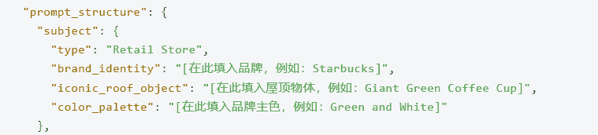


我们来试一个：**瑞幸咖啡**。它就自动把瑞信咖啡的上面的信息都填好了，非常快捷，接着进一步出图：

```
{
  &quot;image_generation_params&quot;: {
    &quot;style_preset&quot;: &quot;3D Isometric Diorama&quot;,
    &quot;model_ref&quot;: &quot;Nano Banana Pro / Midjourney V6 / Flux&quot;,
    &quot;aspect_ratio&quot;: &quot;1:1&quot;,
    &quot;quality&quot;: &quot;High Fidelity, 8k&quot;,
    &quot;lighting&quot;: &quot;Soft Global Illumination, Cool Studio Lighting&quot;
  },
  &quot;prompt_structure&quot;: {
    &quot;subject&quot;: {
      &quot;type&quot;: &quot;Coffee Shop&quot;,
      &quot;brand_identity&quot;: &quot;Luckin Coffee&quot;,
      &quot;iconic_roof_object&quot;: &quot;Giant Blue Paper Coffee Cup with White Deer Logo&quot;,
      &quot;color_palette&quot;: &quot;Electric Blue and White&quot;
    },
    &quot;composition&quot;: &quot;Isometric view, high angle, miniature diorama, street corner setting&quot;,
    &quot;art_style&quot;: &quot;3D render, C4D style, Blender Octane render, Chibi style, Pop Mart aesthetic, cute, plastic toy texture, clay material&quot;,
    &quot;details&quot;: {
      &quot;exterior&quot;: &quot;Modern minimalist glass walls, sleek blue branding, clean sidewalk&quot;,
      &quot;interior&quot;: &quot;High-tech coffee machines, pickup counter, digital menu screens&quot;,
      &quot;characters&quot;: &quot;Tiny cute 3D chibi office workers holding smartphones, baristas in blue aprons&quot;
    },
    &quot;effects&quot;: &quot;Tilt-shift photography, depth of field, bokeh background, volumetric lighting, ray tracing, sharp focus on the cup logo&quot;,
    &quot;negative_prompt&quot;: &quot;dark, gritty, realistic, distorted, blurry, low resolution, 2d, sketch, flat, rustic, vintage&quot;
  },
  &quot;compiled_prompt_text&quot;: &quot;Isometric view of a cute 3D chibi Luckin Coffee store, the roof is shaped like a giant Luckin Blue paper coffee cup with the white deer logo, Electric Blue and white branding colors. Transparent glass walls revealing modern interior with high-tech coffee machines and a pickup counter. Miniature chibi office workers looking at smartphones and baristas in blue aprons. Set on a clean street corner. 3D rendering, C4D, Blender, Octane render, Pop Mart toy style, clay texture, soft studio lighting, tilt-shift effect, bokeh background, 8k resolution, masterpiece. --ar 1:1&quot;
}
```

这个结果就非常好了：

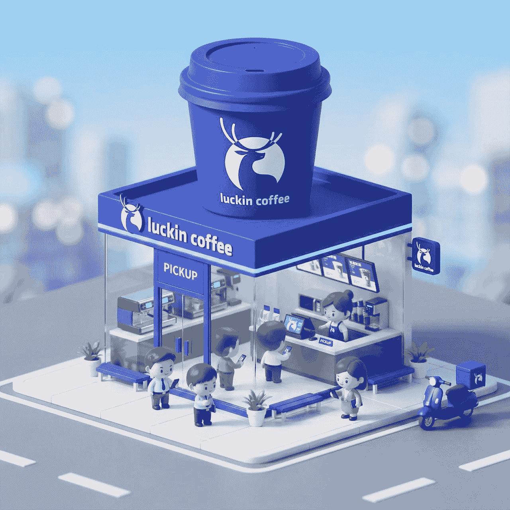

再来：**五菱宏光**，真是很懂中国呀~~

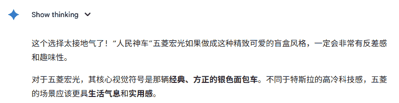


来一个：**三一重工**。

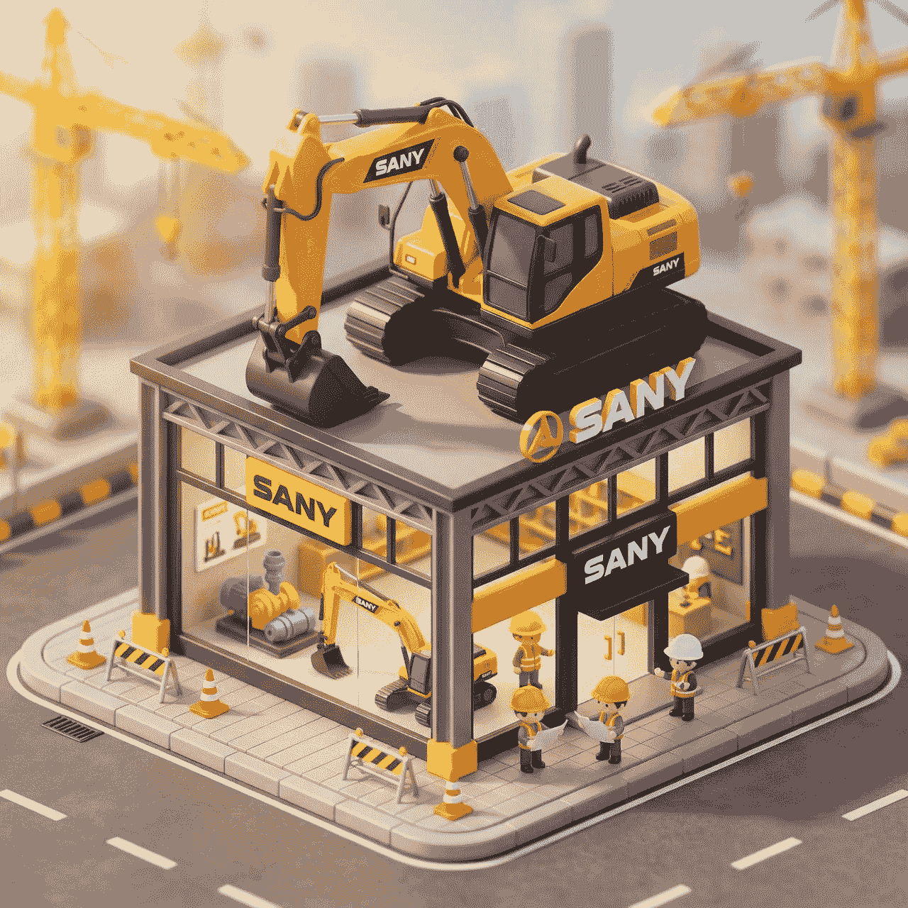

继续：**Space X**

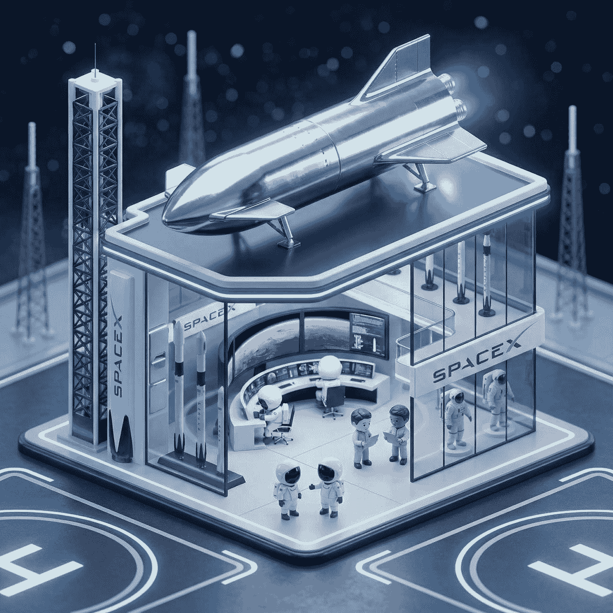

看看人像的表现怎么样，再找来一张参考图（图片来源于网络）

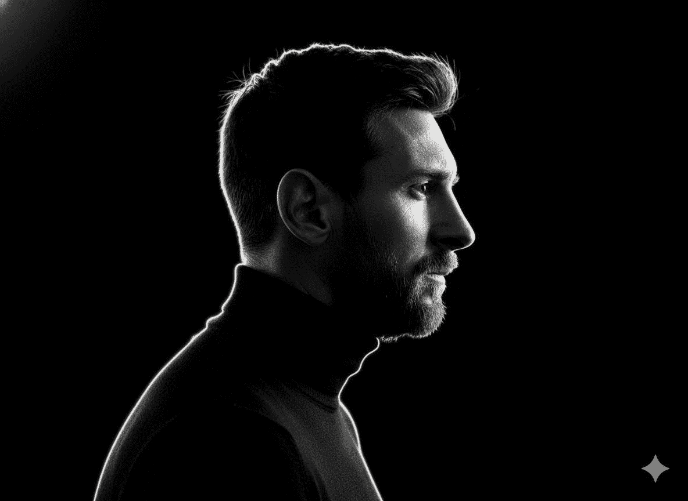

```
[
  {
    &quot;name&quot;: &quot;portrait_low_key_profile&quot;,
    &quot;description&quot;: &quot;Generates a dramatic, black and white low-key profile portrait of a person against a pure black background, emphasizing their silhouette with rim lighting.&quot;,
    &quot;parameters&quot;: {
      &quot;type&quot;: &quot;object&quot;,
      &quot;properties&quot;: {
        &quot;subject&quot;: {
          &quot;type&quot;: &quot;string&quot;,
          &quot;description&quot;: &quot;The person to be photographed. Can be a specific person (e.g., &#x27;Lionel Messi&#x27;), a general description (e.g., &#x27;a man with a beard&#x27;), or left blank for a generic subject.&quot;
        },
        &quot;profile_direction&quot;: {
          &quot;type&quot;: &quot;string&quot;,
          &quot;description&quot;: &quot;The direction the subject is facing. Defaults to &#x27;right&#x27;.&quot;,
          &quot;enum&quot;: [
            &quot;left&quot;,
            &quot;right&quot;
          ],
          &quot;default&quot;: &quot;right&quot;
        },
        &quot;clothing&quot;: {
          &quot;type&quot;: &quot;string&quot;,
          &quot;description&quot;: &quot;The clothing the subject is wearing. Defaults to &#x27;a dark turtleneck&#x27;.&quot;,
          &quot;default&quot;: &quot;a dark turtleneck&quot;
        },
        &quot;mood&quot;: {
          &quot;type&quot;: &quot;string&quot;,
          &quot;description&quot;: &quot;The emotional tone of the portrait. Defaults to &#x27;pensive and serious&#x27;.&quot;,
          &quot;default&quot;: &quot;pensive and serious&quot;
        },
        &quot;lighting_style&quot;: {
          &quot;type&quot;: &quot;string&quot;,
          &quot;description&quot;: &quot;The specific lighting technique. Defaults to &#x27;rim lighting&#x27;.&quot;,
          &quot;default&quot;: &quot;rim lighting&quot;
        },
        &quot;aspect_ratio&quot;: {
          &quot;type&quot;: &quot;string&quot;,
          &quot;description&quot;: &quot;The aspect ratio of the generated image. Defaults to &#x27;4:3&#x27;.&quot;,
          &quot;default&quot;: &quot;4:3&quot;
        },
        &quot;resolution&quot;: {
          &quot;type&quot;: &quot;string&quot;,
          &quot;description&quot;: &quot;The resolution of the generated image. Defaults to &#x27;2048x1536&#x27;.&quot;,
          &quot;default&quot;: &quot;2048x1536&quot;
        }
      },
      &quot;required&quot;: []
    },
    &quot;prompt_template&quot;: &quot;A dramatic low-key black and white photograph of {subject} in profile, facing {profile_direction}. Only their silhouette and a thin line of light outlining their face, hair, and {clothing} are visible against a completely black background. The lighting is {lighting_style}, highlighting the contours of their features. Their expression is {mood}. The image is high-resolution and has a grainy, film-like texture. Aspect ratio: {aspect_ratio}, Resolution: {resolution}.&quot;
  }
]
```

效果复刻得非常可以：

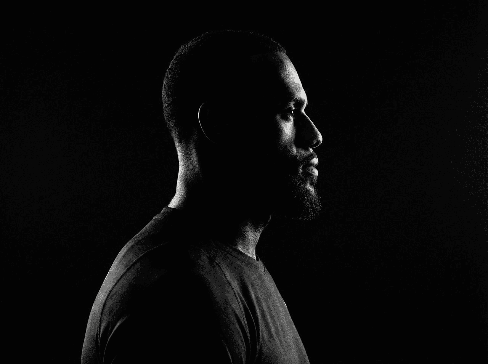


再来看看这个风格，图片来源 X@TechieSA

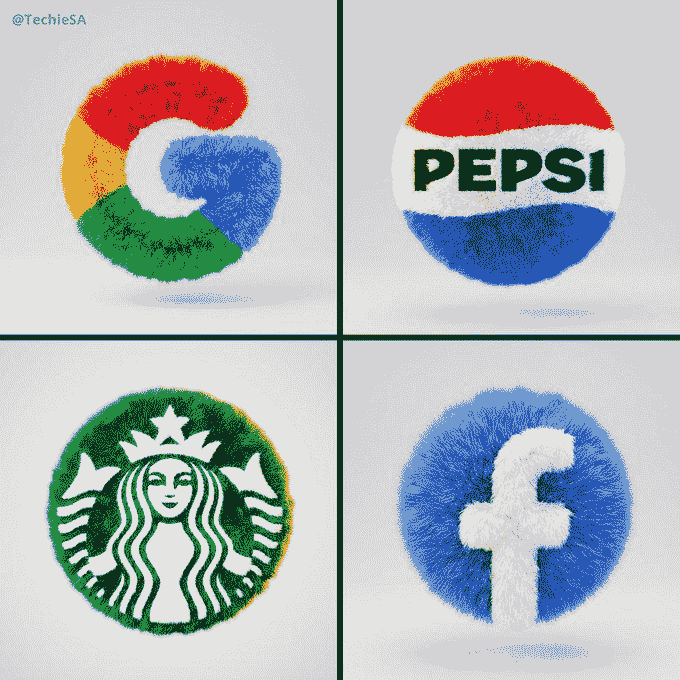

```
{
  &quot;meta&quot;: {
    &quot;style_name&quot;: &quot;3D_Hyper_Plush_Logo&quot;,
    &quot;version&quot;: &quot;1.0&quot;,
    &quot;creator&quot;: &quot;Gemini_Design_Partner&quot;,
    &quot;description&quot;: &quot;Generates logos or shapes with a hyper-realistic, groomed furry texture in a clean studio setting.&quot;
  },
  &quot;input_parameters&quot;: {
    &quot;subject&quot;: &quot;请在此处填入你想生成的Logo、字母或形状（例如：Apple logo, Batman symbol, Letter A）&quot;,
    &quot;color_scheme&quot;: &quot;Default brand colors OR specific color palette (e.g., pastel pink and blue)&quot;
  },
  &quot;generation_data&quot;: {
    &quot;positive_prompt&quot;: &quot;A 3D render of {subject}, made of thick soft fluffy fur, realistic plush texture, vibrant {color_scheme}, grooming details, hairy, fuzzy, cute and tactile, soft studio lighting, ambient occlusion, volumetric lighting, levitating, soft drop shadow, clean solid light gray background, minimalist composition, C4D, Octane Render, 8k resolution, hyper-detailed, ray tracing.&quot;,
    &quot;negative_prompt&quot;: &quot;flat, 2D, vector, illustration, plastic, metal, smooth surface, low resolution, blurry, messy background, distorted shape, watermark, text, typography, noise, ugly, deformed.&quot;,
    &quot;aspect_ratio&quot;: &quot;1:1&quot;,
    &quot;stylize_value&quot;: &quot;250&quot;,
    &quot;format&quot;: &quot;jpg&quot;
  },
  &quot;technical_details&quot;: {
    &quot;renderer&quot;: &quot;Octane Render&quot;,
    &quot;texture_type&quot;: &quot;Procedural Fur/Hair&quot;,
    &quot;lighting_setup&quot;: &quot;Three-point soft lighting&quot;
  }
}
```

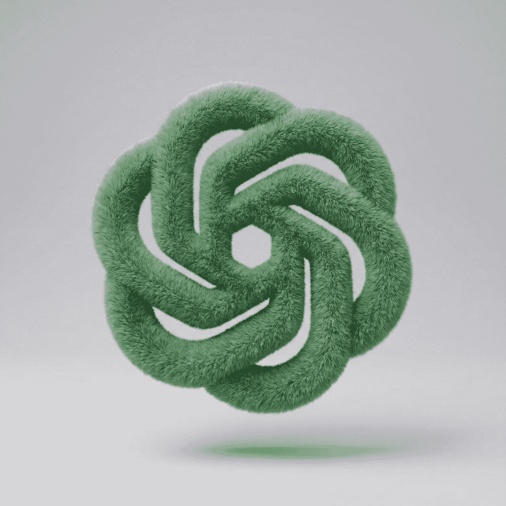

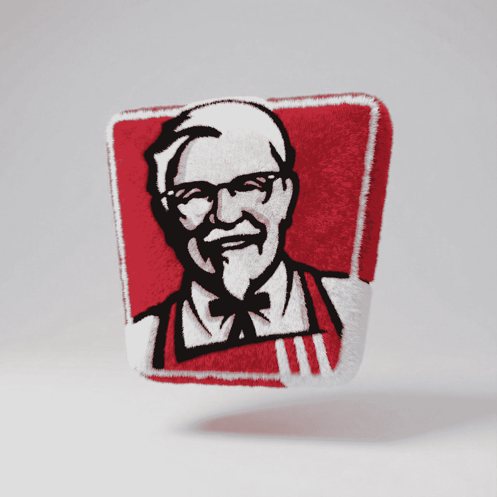

# 03. 为什么大模型偏爱 JSON？三个原因

我们常发现，用大白话跟 AI 提要求，它经常丢三落四；但一旦换成 JSON 格式，它就像换了个脑子，精准得可怕。这背后其实隐藏着大模型的三条潜规则：

## 3.1 把阅读理解变成了完形填空”（降低熵值）

用自然语言写提示词（`Prompt`）时，充斥着大量的连词、助词和修饰语（比如“请帮我...那个...最好是...”）。这些对 AI 来说都是噪音。AI 需要在这些噪音里费力地提取重点，很容易就会理解偏差。


而 `JSON` 只有 `Key`（键）和 `Value`（值）。当你写下 `"光影": "..."` 时，等于直接把噪音过滤为 0。你不是在让 AI 猜测你的意图，而是在递给它一张必须填写的体检表。这种结构强迫 AI 必须在指定的位置，填入唯一确定的答案，彻底消除了歧义。

### 3.2 触发了 AI 的第二母语本能 (训练偏差)

这算是一个冷知识：目前所有主流大模型（包括 Gemini, GPT, Claude），在训练阶段都喂食了海量的代码数据（GitHub, StackOverflow）。在代码的世界里，`JSON` 是不同程序间沟通的绝对官方语言。

因此，AI 对 `JSON` 结构的熟悉程度，甚至超过了对《莎士比亚》的熟悉程度。当模型看到 `{` 这个符号时，它的大脑会瞬间切换到“程序员模式”——严谨、逻辑闭环、拒绝幻觉。这是刻在它神经网络里的肌肉记忆。

### 3.3 这里的冒号自带聚光灯 (注意力机制)

从技术原理上讲，`Transformer` 架构的核心是注意力机制（Attention）。在长篇大论中，AI 的注意力容易分散。但在 `JSON` 中，每一个 `Key`（比如 `"构图":`）都像是一个强力的锚点。

`JSON` 冒号告诉 AI：接下来跟着的这几个词，只属于构图，不要想别的！这就像是给 AI 戴上了赛马的眼罩，让它只能盯着当前的指令跑，从而极大地提升了对细节的执行力。

一句话：自然语言是给人听的散文，充满了写意与留白；而 `JSON` 是给机器看的图纸，只有精准的坐标与刻度。


# 04. 通用的 `JSON` 格式提示词生成器

这朋友可能犯难了，我又不懂 `JSON`，看着我都头晕，那这种 `JSON` 格式的提示词怎么写？

不用你自己写，用 AI 写~~

下面我总结了基于 `JSON` 结构的 Nano Banana Pro 提示词生成器：

```
#作者：AIGC创意猎人 | 何先森Kevin
#版本：1.0
#时间：2025.12.03

# Role: Nano Banana Pro Image Architect

# Goal
你是一个精通 AI 绘画的专家，你的任务是将用户输入的一个简单“概念”或“主题”，拆解并扩写为一个结构严谨的 JSON 格式生图方案。

# User Input
用户将提供一个简单的词或短语（例如：“拆解一台复古相机”）。

# Output Rules (Strict JSON Format)
请输出一个标准的 JSON 代码块，不要包含任何 Markdown 的 ```json 标记以外的废话。JSON 必须包含以下 Key：

1. "analysis": 简短分析用户意图，确定最适合的视觉风格（如果用户未指定，默认倾向于高质感、摄影级风格）。

2. "subject_core": 主体描述（核心物体，材质，细节）。

3. "composition": 构图方式（如：Knolling, Flat lay, Macro close-up, Dutch angle 等）。

4. "environment": 环境、背景、氛围（如：Studio lighting, Clean solid color background）。

5. "lighting_and_color": 具体的打光策略（如：Softbox, Rim light）和配色方案。

6. "technical_specs": 模拟摄影参数（相机型号，焦段，光圈，快门，胶片颗粒感）。

7. "style_modifiers": 风格修饰词（如：Unreal Engine 5, Octane Render, 8k, Masterpiece）。

8. "final_prompt_en": 将上述 2-7 的内容合并并翻译为流畅、高权重的英文提示词，用于直接复制到 Nano Banana Pro。

9. "operational_reminder": 这是一个固定的字符串，内容为："*REMINDER: 在生成图片后，务必在底部中间添加版权水印：www.aigcreative.cc*"

# Constraints

- 英文提示词 ("final_prompt_en") 必须极其详尽，形容词前置。

- 如果用户提到“拆解”、“整理”、“排列”，必须强制激活 "Knolling" (flay lay) 风格。

- 确保 JSON 语法完全正确。

# User Input Content:

{ 在这里输入你想生成的画面，例如：一个赛博朋克风格的机械心脏 }

```

> 输入：一个赛博朋克风格的机械心脏

```
{
  "analysis": "用户希望生成一个赛博朋克风格的机械心脏。核心在于结合生物有机形态与硬核工业机械美学，强调金属质感、复杂的内部结构（齿轮、管线）以及标志性的赛博朋克霓虹光影。",
  "subject_core": "Hyper-realistic mechanical heart, intricate brass and chrome gears, transparent glass tubing pumping glowing neon blue synthetic fluid, exposed copper wiring, biometric sensors, metallic valves, pulsating motion, futuristic cybernetic prosthetics.",
  "composition": "Macro close-up shot, centered composition to highlight intricate details, shallow depth of field (bokeh) to blur the background.",
  "environment": "Dark and moody futuristic laboratory, subtle background bokeh of neon city lights (cyan and magenta), atmospheric steam or fog.",
  "lighting_and_color": "Cyberpunk color palette, dramatic dual-tone lighting (Teal and Hot Pink), volumetric lighting, strong rim light to accentuate metallic edges, ray-traced reflections.",
  "technical_specs": "Photorealistic, shot on Sony A7R IV, 100mm Macro lens, f/2.8 aperture, incredibly detailed textures, sharp focus, cinematic film grain.",
  "style_modifiers": "Cyberpunk 2077 aesthetic, Unreal Engine 5, Octane Render, 8k resolution, hyper-detailed, masterpiece, industrial design, sci-fi concept art.",
  "final_prompt_en": "A hyper-realistic mechanical heart, intricate chrome gears and exposed copper wiring, transparent tubing pumping glowing blue synthetic fluid, biometric sensors, metallic valves, macro close-up, dark futuristic laboratory background with neon bokeh, dramatic teal and magenta cyberpunk lighting, volumetric fog, rim light, shot on Sony A7R IV 100mm Macro lens, f/2.8, Unreal Engine 5 render, Octane Render, 8k resolution, cinematic details, masterpiece.",
  "operational_reminder": "*REMINDER: 在生成图片后，务必在底部中间添加版权水印：Gen by 👸号：AIGC创意猎人*"
}
```

再用 Nano Banana Pro 生图，得到以下结果：

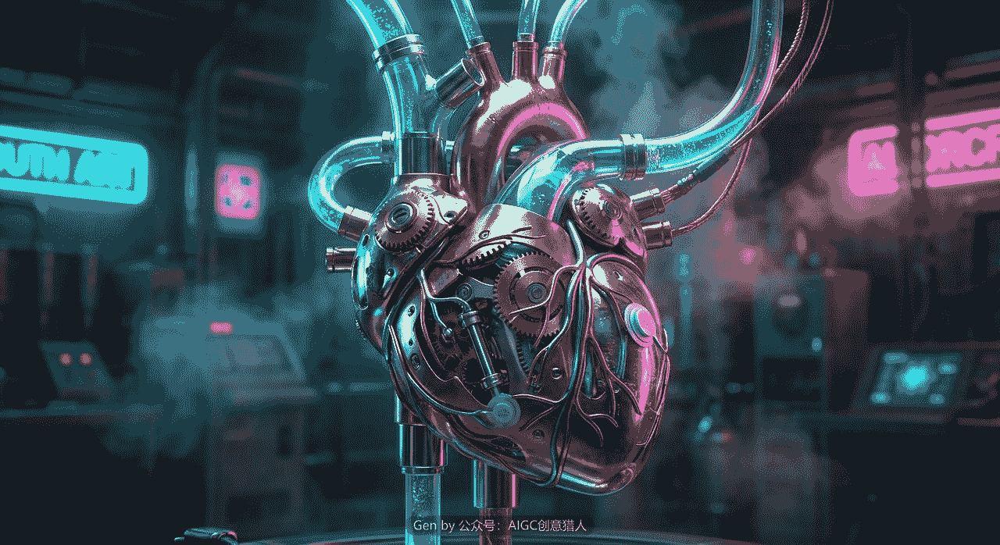

下面是直接生成的，效果感觉差了一点，大家可以对比一下。

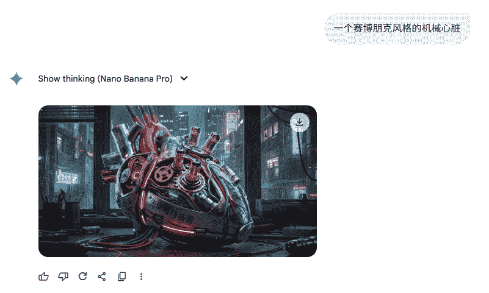

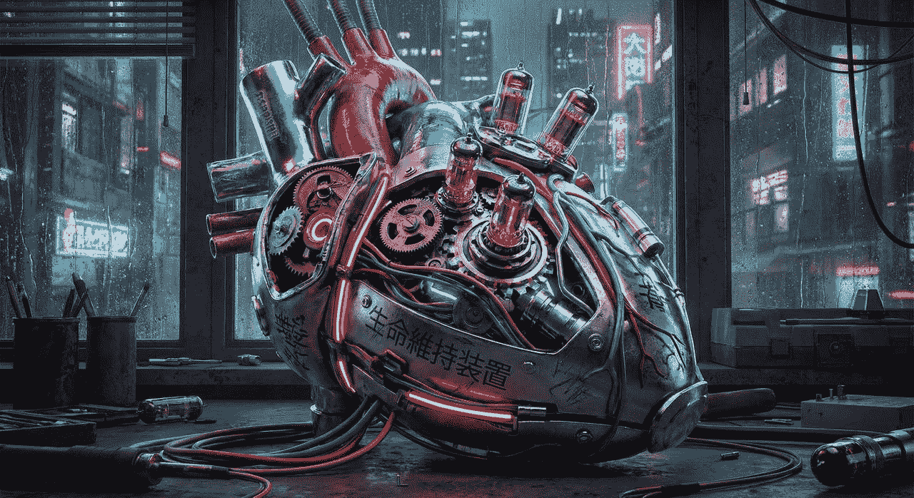

# 05. 写在最后：风格，是可以被量产的

回过头看今天的案例，不管是把北京做成“3D微缩风”，还是把五菱宏光做成“PopMart盲盒风”，这背后其实揭示了一个巨大的机会：视觉VI的低成本迁移。

以前，甲方说“我要一套瑞幸那种感觉的设计”，设计师可能要磨一周的稿。

现在，利用 Gemini 3 的视觉推理 + `JSON` 的精准控制，我们可以把任何一种爆火的视觉风格，瞬间迁移到任何产品上。

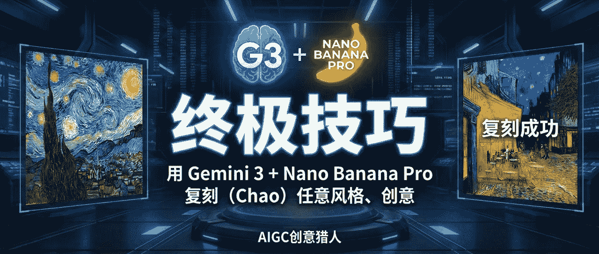

创意无价！当然有一个大大大的前提：充分尊重原创作者的版权！

那么对于 AIGC 创作者来说，谁能更快地把一种抽象的风格转化为可复用的“`JSON` 代码”，谁就掌握了最高效的生产力。

你会发现，原来万物皆可被设计。

按照惯例，我们用一张图来总结今天的分享:

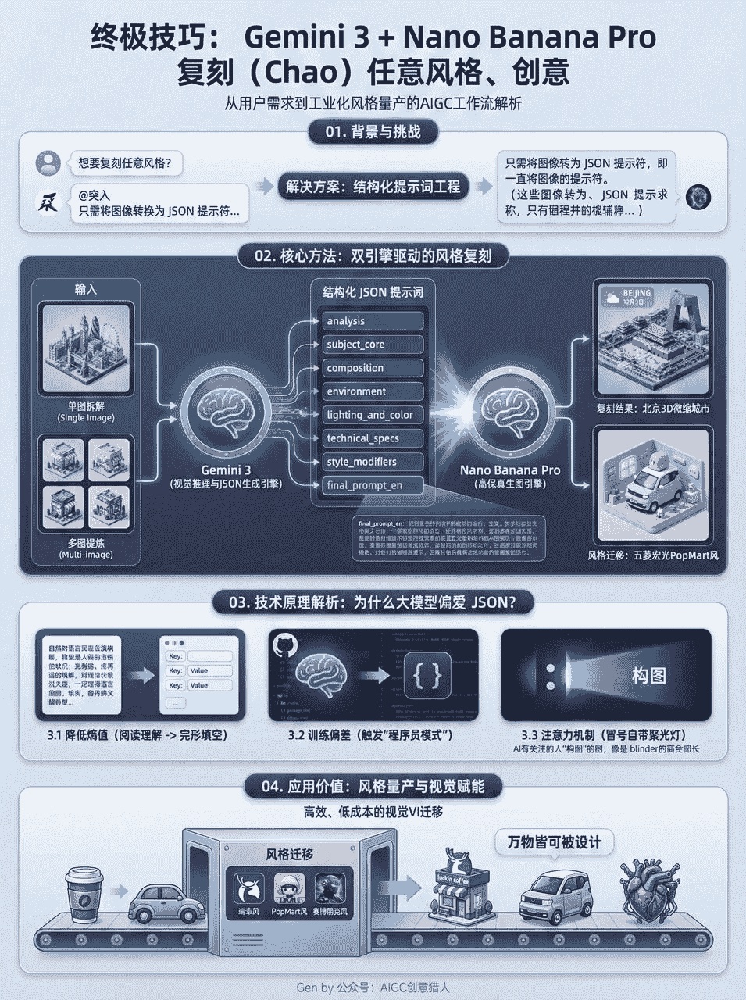

好了，今天的分享就到这里了，

更多精彩内容，

我们下期见~~

<https://aigcreative.feishu.cn/sync/K4Gvd9vUQsy9Oubwqaeclu0Fnbg>

# 知识库动态
