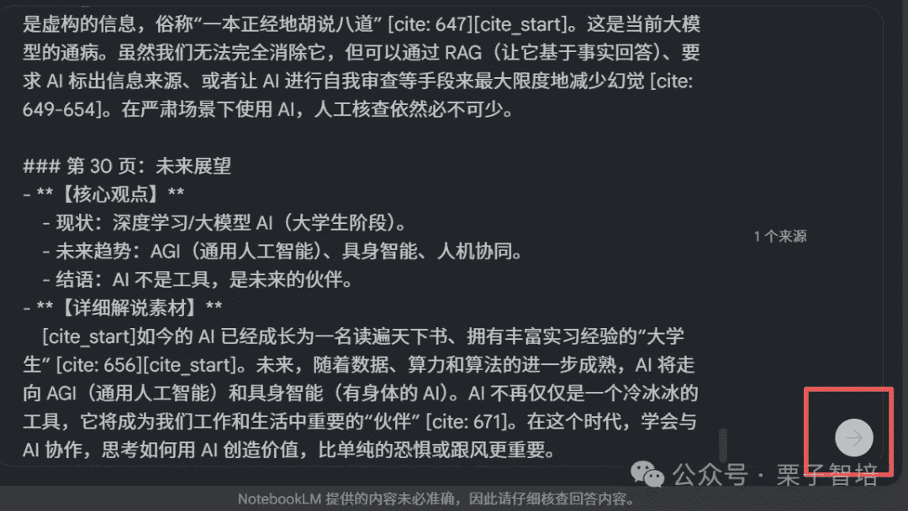
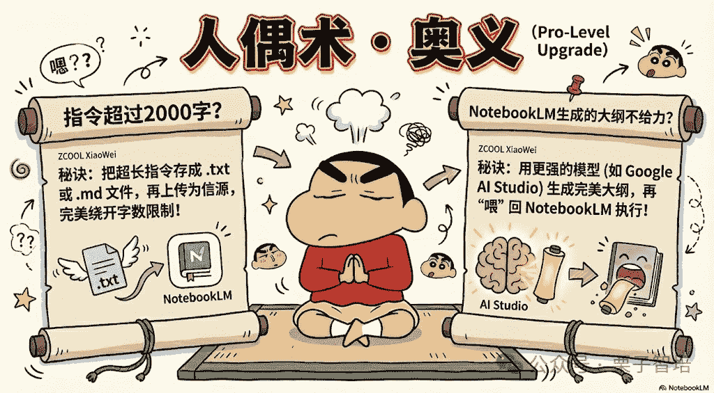
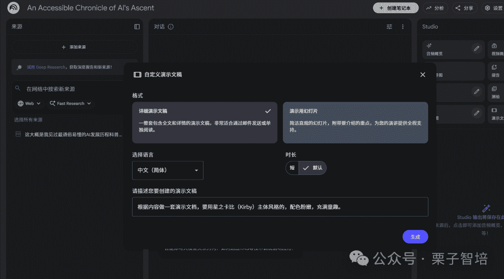
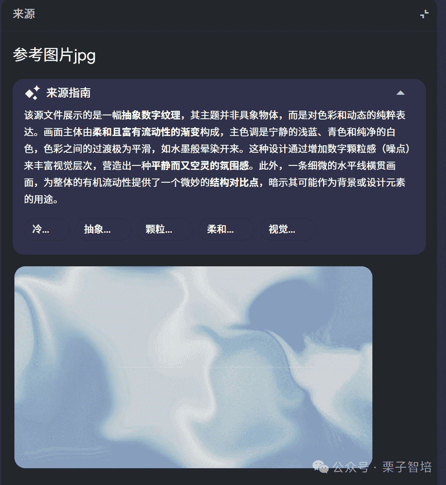
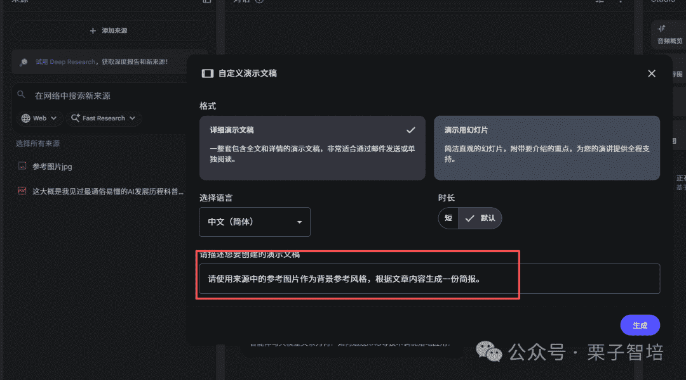
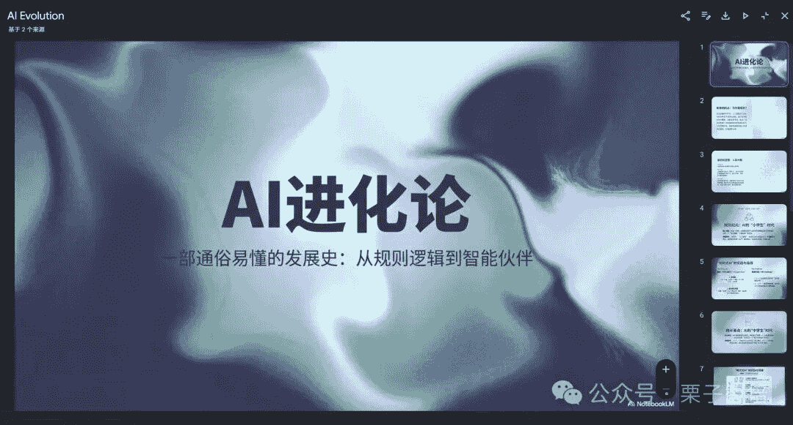
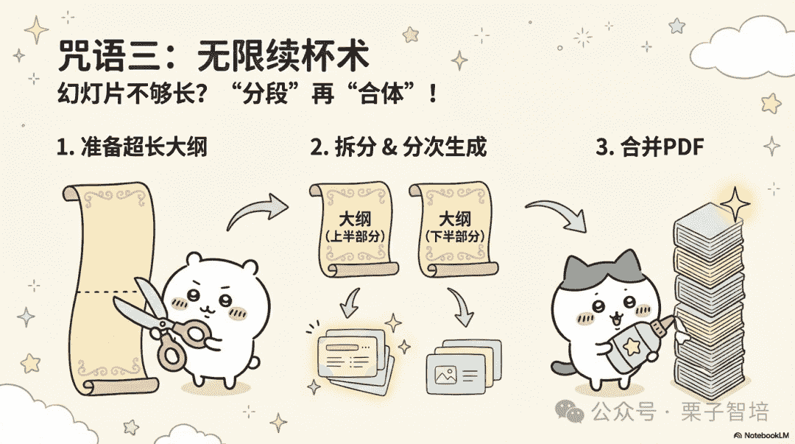
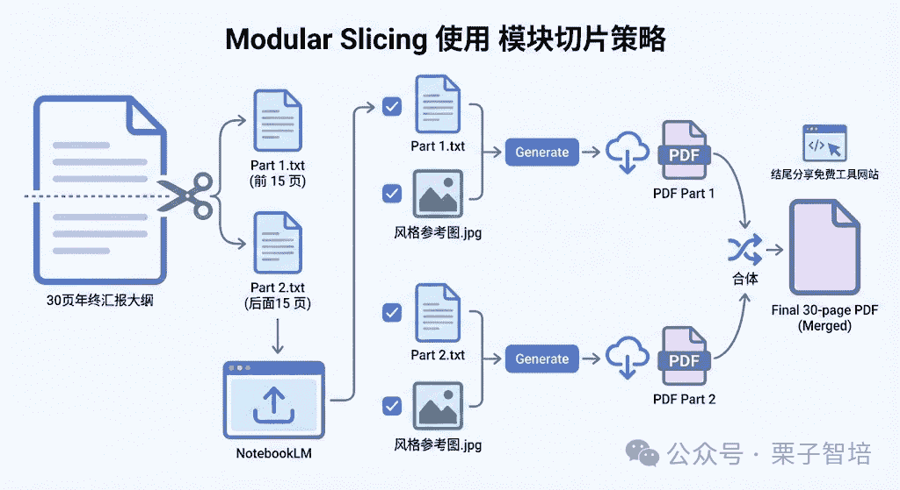
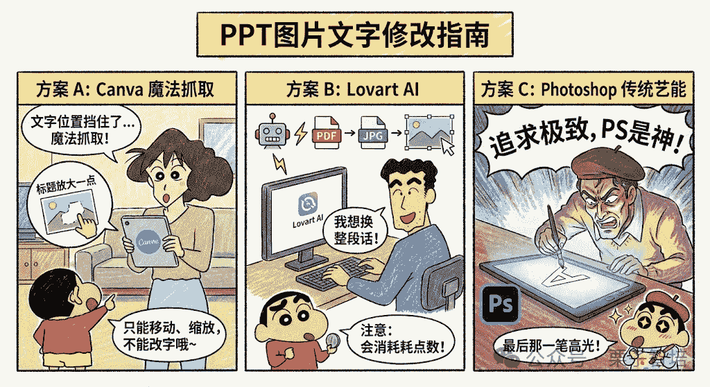
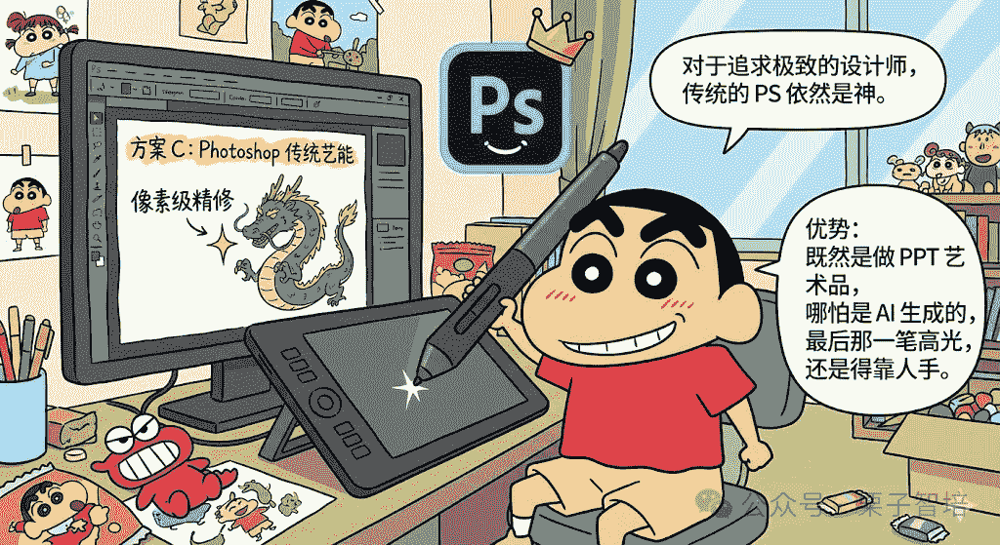

# 20251208-NotebookLM 简报模式的 4 大进阶策略，让 AI 替你把 PPT 卷到天花板

> 来源：[https://aigcreative.feishu.cn/docx/EnLRdsUH3oiuXNx9ql0cLFcmn4c](https://aigcreative.feishu.cn/docx/EnLRdsUH3oiuXNx9ql0cLFcmn4c)

> 原文链接： https://mp.weixin.qq.com/s/5fCnulSML6hK2JKc5oK_cw

> 来源：公众号：栗子智培

还记得前两天我给大家安利的 Google 神器 NotebookLM 吗？

(🔗 别[再倍速看视频了，我用 NotebookLM 把](https://mp.weixin.qq.com/s?__biz=MzE5MTkyNDI3Ng==&mid=2247484141&idx=1&sn=6cd14bb45bfbf5bedd8cc71213c11eb0&scene=21#wechat_redirect) 1 小时干货变成了 3 分钟笔记。 还没看的朋友戳这里回顾)

当时我说，它是“信息降噪”的神器，能把几万字的 PDF 瞬间变成人话。但在这两天的深度“折腾”中，我发现自己还是低估了它。

很多人（包括之前的我）只把它当作一个“超级阅读器”。

但在挖掘了它最新的“简报模式”后，我发现它完全可以变成一个“超级创作者”。

唯一的痛点是：默认生成的 PPT，往往风格无法符合喜好，且内容完全不可控，像个黑盒。

为了解决这些问题，我翻遍了外网教程，结合我自己的多次尝试，总结出了“一套掌控 AI”的终极工作流。今天，就把这套压箱底的“四大禁术”分享给你们。

### 01 禁术一：拒绝黑盒，用“文件”接管大纲

直接点击 NotebookLM 的“生成简报”，就像是在赌博。你永远不知道它会**把哪句话做成标题，把**哪段话漏掉。而且，NotebookLM 的对话框单次输入有 2000 字的限制 ，如果你想写一个非常详细的 Prompt（比如规定生成的ppt每一页的排版、配色、字号），根本写不下。

字数超过限制

要想解决这个问题，我们得换个思路：不跟它废话，直接甩给它一本执行手册。

策略：不要把 Prompt 写在对话框里，而是把 Prompt 写进文件里。

秘法图

NotebookLM 的强项是检索（RAG），它对“来源文件”的可读取字数超级大。所以，我们可以把超长的指令、详细的大纲，全部打包成一个 .txt 文件上传。

**详细操作步骤： **（下方有视频教程）

1.  1. **借用“外挂”： **先把你的 PDF 投喂给 ChatGPT/Gemini，让更强的大模型为你规划一份极度精确的大纲。 这里我专门写了一套“简报战略顾问”级的提示词，让 AI 不只是写大纲，而是先帮你做“需求确定”，再输出“深度脚本”。

Prompt 参考（ **完整版见文末 **）： "# Role 你现在是我的“简报战略顾问”兼“NotebookLM 提示词......组合拳，制作出专业级演示文稿...

(Prompt 会引导 AI 进行三阶段协作：需求诊断 -> 大纲迭代 -> 终极产物交付)"

1.  2. **打包指令： **复制生成的大纲（包含每一页的详细解说素材），保存为一个 .txt 文件，命名为 大纲.txt 。

1.  3. **关键步骤： **把这个 .txt 上传到 NotebookLM。在准备生成简报时， 只勾选这一个文件作为信源 。

1.  4. **一键触发： **在对话框里只需要输入一句极短的指令：“请严格按照来源中的指令生成 PPT”。

完整操作示范

这样，NotebookLM 就会乖乖地“照着剧本演”，不仅逻辑满分，还完美绕过了字数限制，想写多详细的 Prompt 都可以！

### 02 禁术二：风格注入，一句咒语“整容”

这是我最近发现的最炸裂的技巧。NotebookLM 的“自定义指令”框，其实是一个“视觉代码”输入口。

#### Level 1：文字咒语（Text Prompt）

你可以直接告诉它具体的 IP 或艺术流派。

实战案例：星之卡比风格的AI文章讲解

我扔给它一篇前段时间很火的《AI发展历程科普详文》，然后在自定义框里输入：

“根据内容做一套演示文档，要用星之卡比(Kirby)主体风格的，配色粉嫩，充满童趣。”（末尾有风格模板分享）

notebooklm提示词输入图

结果？简直是“降维打击”！NotebookLM 不仅把背景色调成了标志性的粉色，还自动生成了标题《AI卡比的奇幻冒险》。 更绝的是配图：它把 AI 的发展史变成了一场通关游戏。

+   讲“规则式AI”时，配图是像素风的卡比在读《规则》书；

+   讲“机器学习”时，卡比变成了正在刷题的中学生；

+   讲“大模型幻觉”时，配了一张卡比指着鱼说“这是一只鸟”的滑稽画作。 每一页的插图都精准对应了 AI 发展的不同阶段，把枯燥的技术概念瞬间变成了童话故事。

生成展示效果

#### Level 2：视觉投喂 —— 真正的终极技巧

单纯用文字描述风格有时很苍白，更狠的招是直接“喂图”。

**操作步骤：**

1.  1. 找图上传： 去相关的设计素材网站（文末我有常用的网站分享），找一张你最喜欢的 PPT 风格封面图，直接上传到 NotebookLM 的来源区。

1.

1.  2. 风格确认：这步非常关键！当你上传图片后，点击打开这张图，你会发现 NotebookLM 已经自动生成了一段对你这个参考照片的风格分析，这意味着它已经读懂了你的审美。

1.

notebooklm分析图片

1.  3. 引用生成：确认它看懂后，在生成简报的自定义框里输入："请使用来源中的参考图片作为背景参考风格，根据文章内容生成一份简报。”

notebooklm提示词输入图

**最终结果： **AI 不是简单地把这张图贴在每一页背景上，而是学习了它的设计语言。你会发现，虽然每一页都沿用了那种“水墨渐变”的质感，但具体的纹理、色块分布在每一页都有微妙的变化，既统一又灵动，完全是设计师级别的排版。

生成展示效果

### 03 禁术三：无限分身，突破页数“天花板”

NotebookLM 目前生成简报有一个限制（通常在15 页左右）。如果你要做一个30页的长汇报，怎么办？

策略： 分段生成法。

千万不要一次性让它生成全文。结合我们在“禁术一”里生成的全篇大纲，我们可以玩一个“分身术”：

**具体操作步骤：**

1.  1. 拆解： 将大纲拆分为 Part 1.txt (前 15 页), Part 2.txt ( 后面15 页)。

1.  2. 上传： 把这两个文件都上传到 NotebookLM。

1.  3. 分批生成：

+   第一轮：只勾选 Part 1.txt + 风格参考图.jpg -> 生成 -> 保存 PDF。

+   第二轮：只勾选 Part 2.txt + 风格参考图.jpg -> 生成 -> 保存 PDF。

为什么要这么搞？ **这不**只是为了绕过页数限制，更重要的是为了“保持一致性” 。 因为我们使用了同一张“风格参考图”（或同一段风格提示词），AI 在生成第二部分时，会严格沿用第一部分的设计语言（配色、字体、版式）。 当你把这两份 PDF 合并在一起时，就像是同一个设计师一次性做出来的，完全看不出拼接的痕迹。

1.  4. 合体： 最后用在线工具把 PDF 合并（结尾分享免费工具网站）。

方法流程图

### 04 禁术四：后期修整，打破“死图”限制

这是很多人放弃用 AI 做 PPT 的原因：NotebookLM 生成的每一页其实是一张“图片”，里面的字是死的，没法改。

但办法总比困难多，这里有三套不同段位的解决方案，总有一款适合你。

三大方法

#### 方案 A：Canva 魔法抓取（适合排版微调）

如果你觉得文字位置挡住了关键画面，或者想把标题放大一点。

**操作步骤：**

1. 导入 Canva 后，点击图片，选择“编辑照片” -> “魔法抓取”。

2. Canva 会把文字从背景中“扣”出来，变成独立的图层。

3. **局限： **只能移动、缩放，不能修改文字内容（比如改错别字）。

#### 方案 B：Lovart AI (适合改字换句)

如果你想把标题的某个字，或者替换整段话。

**操作步骤：**

1. 使用 Lovart（需先将 PDF 转为 JPG 上传）。

2. 点击“编辑元素”，AI 会识别图中的文字，并将其转化为“可编辑的文本框”。

3. **优势： **真正实现了对“死图”内容的修改。

4. **注意： **会消耗点数。

#### 方案 C：Photoshop 传统艺能（适合像素级精修）

对于追求极致的设计师，传统的 PS 依然是神。

1.  1. **优势： **既然是做 PPT 艺术品，哪怕是 AI 生成的，最后那一笔高光，还是得靠人手。

### **写在最后：风格，是可以被量产的**

从“被动接收”到“主动掌控”，这就是 AI 时代的新·二八定律：

+   80% 的人只会在框里输入“帮我做一个 PPT”，然后抱怨 AI 做得烂。

+   20% 的人懂得用结构化提示词控制逻辑，用参考图控制审美，用后期工具控制细节。

NotebookLM 只是一个引擎，而你，才是那个握着方向盘的赛车手。

### **🎁 独家资源交付**

为了让大家直接上手，我把文中提到的所有工具和素材都打包好了（放在夸克网盘）：

1.  1. 【大纲生成专用 Prompt 完整版】：复制到各个ai对话框就能用，专治 AI 逻辑混乱。

1.  2. 【国内外ip以及通用风格指令库】：包含星之卡比、赛博朋克、极简苹果风等。

1.  3. 【风格灵感网站清单】：我去哪里找好看的封面图？这几个宝藏网站都在里面。

1.  4. 【NotebookLM 进阶 PPT 教程】：文中提到的那个 PPT 原件，讲得更细致。

1.  5. 【后期神器直达】：包含免费PDF编辑工具的入口链接。

<https://aigcreative.feishu.cn/sync/K4Gvd9vUQsy9Oubwqaeclu0Fnbg>

# 知识库动态