# 20251213-Nano Banana Pro图解谷歌2025年度热搜报告：过去这一年我们经历了什么？

> 来源：[https://aigcreative.feishu.cn/docx/Ri9AdqzzCompfYx5fXuciIvOnQb](https://aigcreative.feishu.cn/docx/Ri9AdqzzCompfYx5fXuciIvOnQb)

> https://trends.withgoogle.com/year-in-search/2025/

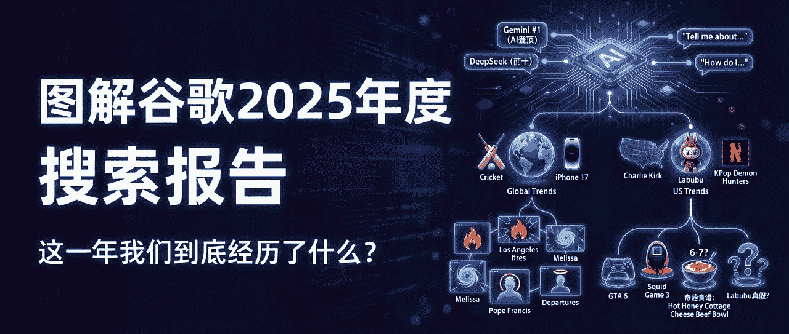

大家好。

又**到了每年年底的这个时候，Google的年度热搜报告（Year** in Search）也终于出来了。感兴趣可以直接去官网查看，网址：https://trends.withgoogle.com/year-in-search/2025/

或者也可以接着往下看：

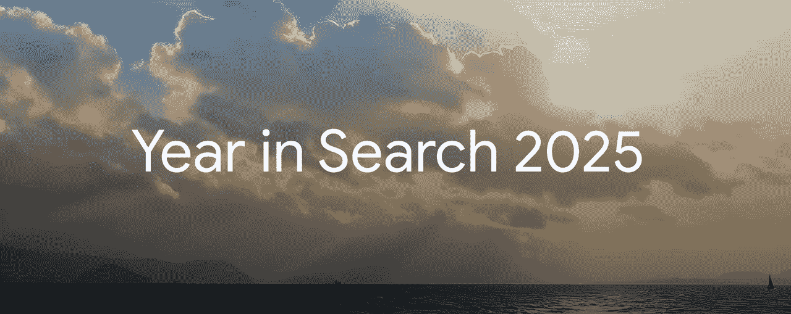

这次我拿到这份2025年的数据，真的哪怕是一个小小的搜索词都不想漏掉，因为它们凑在一起，就是我们过去这365天的真实生活。

最近疯狂的在研究Nano Banana Pro，如何更好的出图，出下面这种系列的图？

刚好可以拿谷歌2025年度搜索的数据练练手，先看看下面整体结果，整体一致性非常不错，超出预期!

出的每一页图都很精美~~

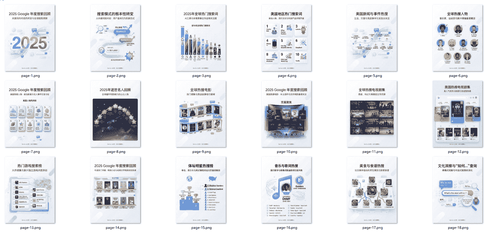

[图解谷歌2025年度搜索榜单 by 公众号：AIGC创意猎人.pdf](https://aigcreative.feishu.cn/wiki/IP3xwfa2iiYdInk1Mn0cCjSBnef)DF原文档【创意猎人飞书AI知识库】链接：

下面我们一起来看一看，通过谷歌全球用户的搜索，我们能从中洞察到哪些趋势？

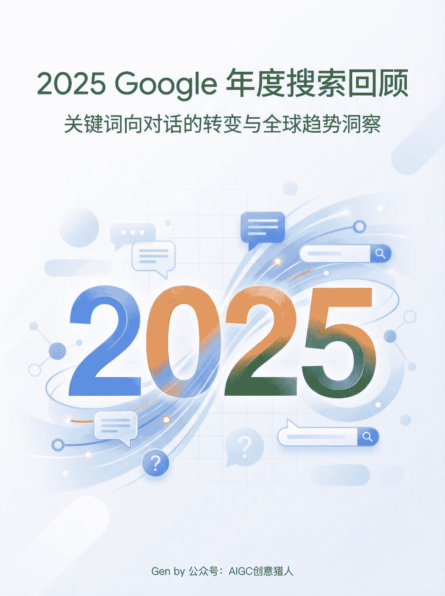

说实话，今年的数据量有点大，但我不想删减，我想跟大家好好聊聊这里面的每一个细节，因为每一个名字背后都是故事。

# 01.搜索方式变了，我们在跟机器“交心”

首先有个变化特别明显，咱们现在用Google的方式变了。以前是输关键词，现在更像是聊天。

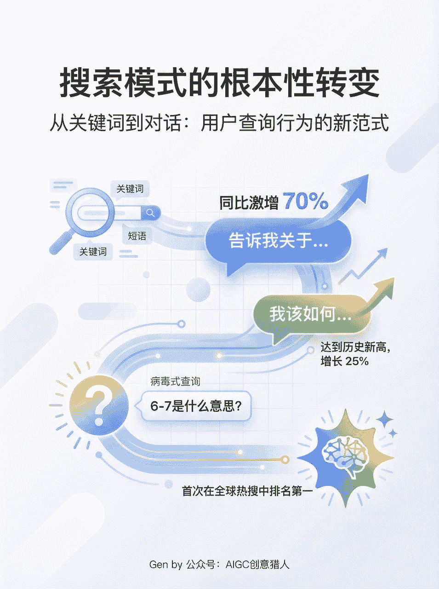

数据说，以 **"Tell me abou**t..."（告诉我关于...）开头的搜索涨了70%，"How do I..."（我该怎么...）这种实操问题也创了新高。大家甚至会问 "What's the deal with 6-7?" 这种像是在问朋友的大白话。

这也难怪，全球热搜第一名就是 **Gemini**，这是第一次有AI工具登顶。**DeepSeek** 也冲进了全球前十和美国前七。

看来2025年，我们都习惯了把AI当成生活助手。

# **02.全球都在看什么？**

看看全球榜单，体育迷简直疯了。

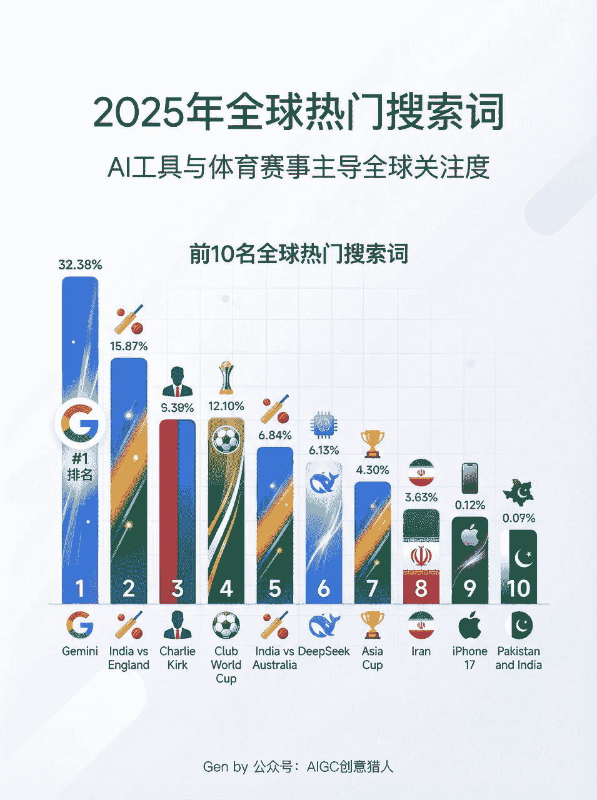

前十里有好几个都是板球，India** vs Engl**and、India vs Au**stralia，还有 Asi**a Cup（亚洲杯）和 Pakistan and India 的对决，以及 Club World Cup（世俱杯）。

当然，还有那个老生常谈的话题 **iPhone 17**，在这个榜单里依然坚挺。还有 **Iran**（伊朗）也备受关注。

到了美国这边，画风突变。

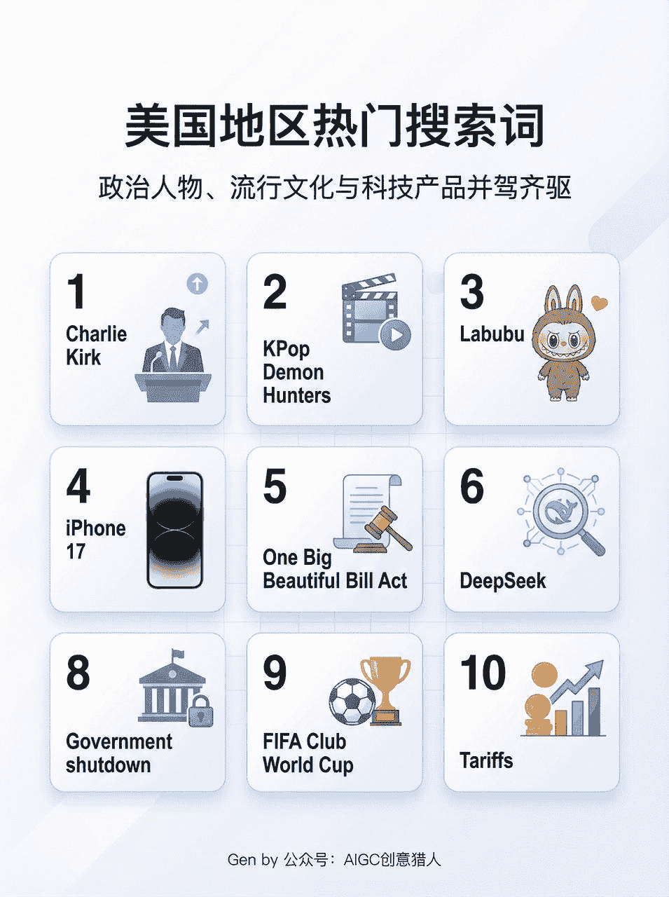

**Charlie Kirk** 这个名字霸榜了，**Labubu** 这个玩偶居然冲到了第三，还有 Netflix 的电影 KPop Demon Hunters。

ZZ方面，大家都在搜 One Big B**eautiful Bill **Act 这个法案，还有 Zohran Mam**dani 这位**新当选的纽约市长。Government shutdown（政府停摆）、FIFA Club World Cup 和 Tariffs（关税）也都挤进了前十。

# 03.那些让我们无法忽视的大新闻

这一年的新闻，说实话，看着挺沉重的。

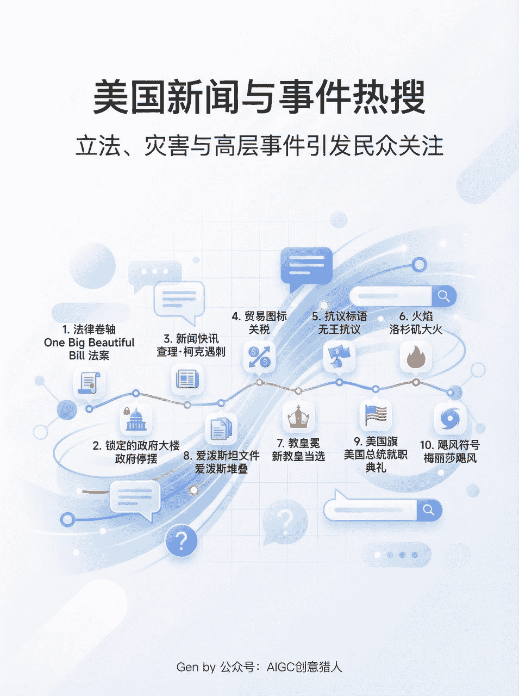

美国这边，除了刚才说的那个名字很长的法案和政府停摆，最让人震惊的莫过于 Charlie Kirk assassination（查理·柯克遇刺）事件，还有与之相关的 No Kings protest（无王抗议）。

天灾也没放过我们，Los Angeles fires（洛杉矶大火）和 Hurricane Melissa（梅丽莎飓风）让很多人心碎。

ZZ大事件还有 **U.S. Presiden****tial Inaugur**ation（总统就**职典礼）和再次被翻出来的 Ep****stein files（**爱泼斯坦文件）。宗教界也是大地震，Pope Francis（方济各）离世后，New Pope chosen（新教皇选举）成了焦点，大家都在关注新教皇 Pope Leo XIV。

# **04.人来人往，聚散离合**

说到人，今年大家都在搜谁？

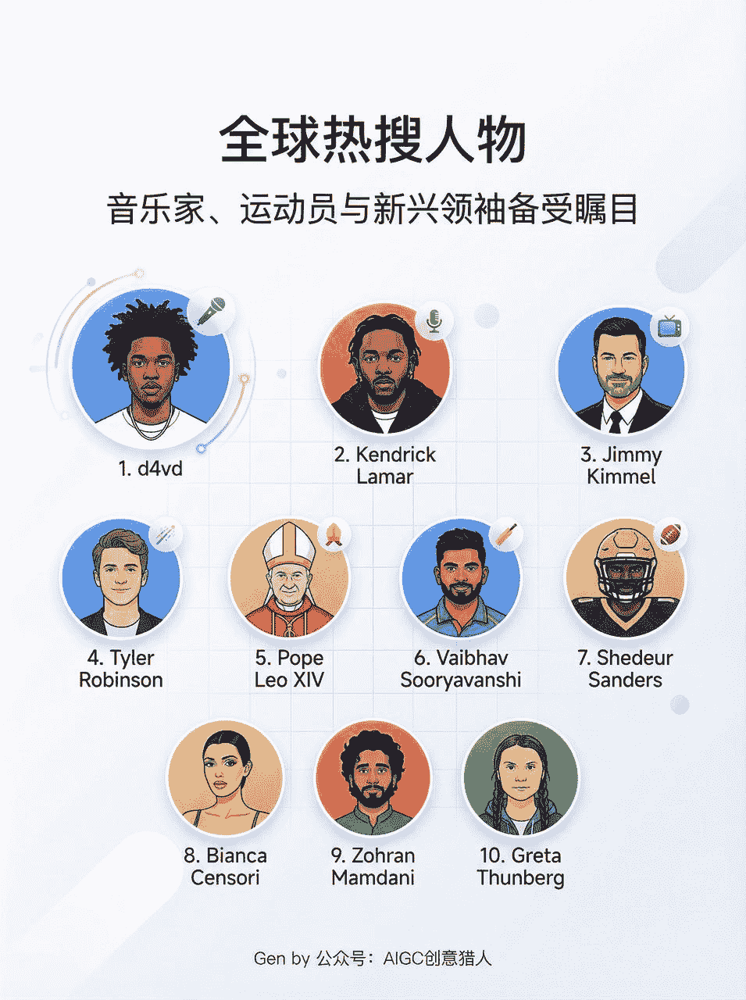

全球范围内，歌手 **d4vd** 和 **Kendrick Lamar** 热度很高，主持人 **Jimmy Kimmel** 也是常客。

新闻人物方面，除了刚才提到的 **Pope Leo XIV** 和 **Zohran Mamdani**，还有 **Tyler Robinson** 和 **Bianca Censori**。体育界出了个板球神童 Vaibhav Soo**ryavanshi，还有美式足**球运动员 S**hedeur Sanders**。环保少女 Greta Thunberg 也依然在榜。

美国这边的名单稍微有点不同：

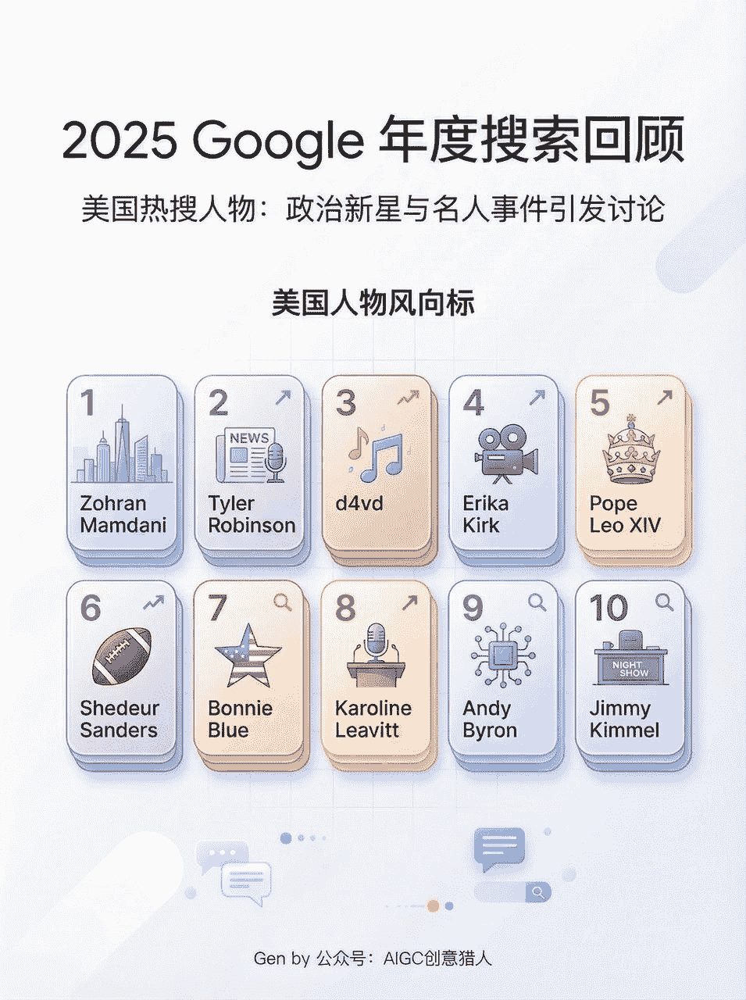

除了上面提到的，还有 **Erika Kirk**、**Bonnie Blue**、Kar**oline Leav**itt 和 Andy Byron。

最让人难受的是逝者这份名单。

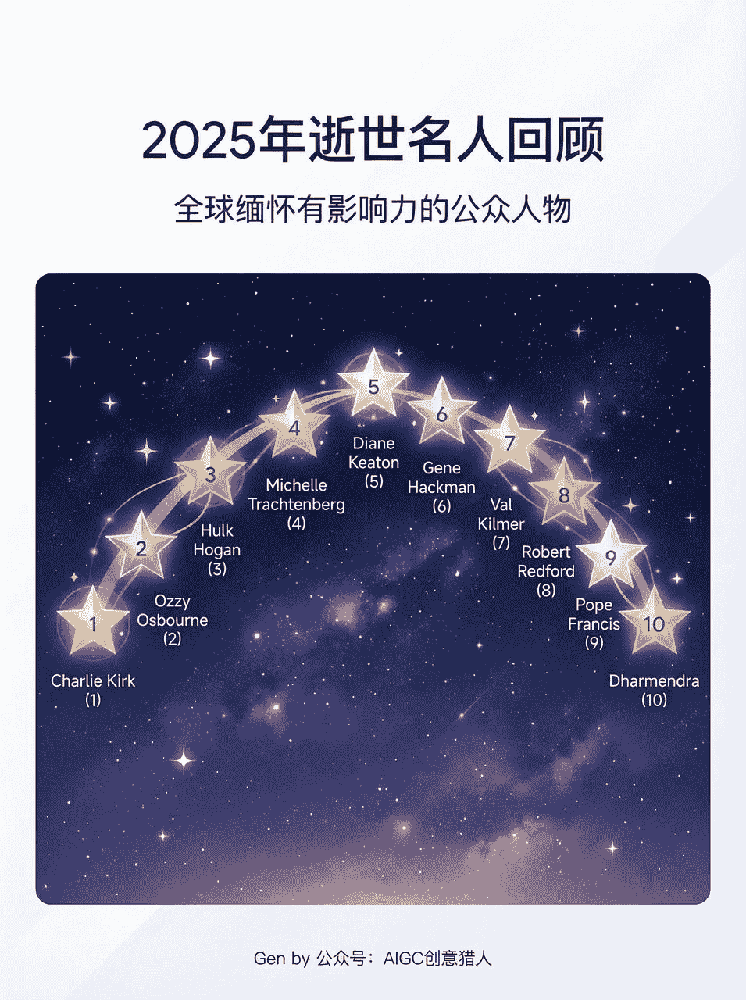

今年我们送别了太多熟面孔。

**Charlie Kirk**、摇滚老炮 **Ozzy Osbourne**、摔角传奇 **Hulk Hogan**。

影视圈的损失更是巨大，M**ichelle Trac**h**tenberg、Dian**e** Keaton、Ge**n**e Hackman、Val **Kilmer、Ro**bert Redfo**rd，还有宝莱坞传奇 Dharmendra。

当然，还有全世界都在悼念的 **Pope Francis**。

# 05.娱乐生活：电影、电视与游戏

哪怕生活再累，剧还是要追的。

电影方面：

全球都在看 **Anora**、**Superman**（超人）和那个争议巨大的 **Minecraft Movie**。漫威的 **Thunderbolts***（雷霆特工队），还有 **Sinners**、**Happy Gilmore 2**、**Weapons**。

恐怖片 Final Desti**nation: Bloodl**ines（死神来了：血统）和 28 Years Later（28年后）也上榜了。

当然，少不了阿汤哥的 **Mission: Impossible -** The Final Reckoning。

美国观众口味差不多，但也多了一些特供：

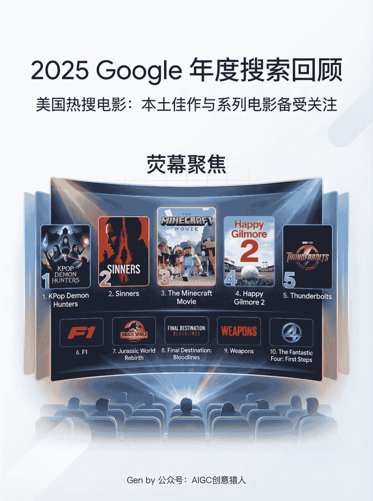

比如 KPop Demo**n **Hunters 是第一名，还有 F1、Jurassic World Rebirth（侏罗纪世界重生）和 The Fantastic Four: First Steps。

电视剧这边，Netflix 依然强势。

全球都在搜 Mon**ster: The Ed** Gein St**ory 和 Squ**id Game 3**（鱿鱼游戏3）。Sev**erance（人生切割术）**和 White Lot**u**s（白莲花）热度**不减**。新剧 Adolesce**nce**、Plurib**us、American Primeval、Alien: Earth 和 Landman 也都在榜单上。

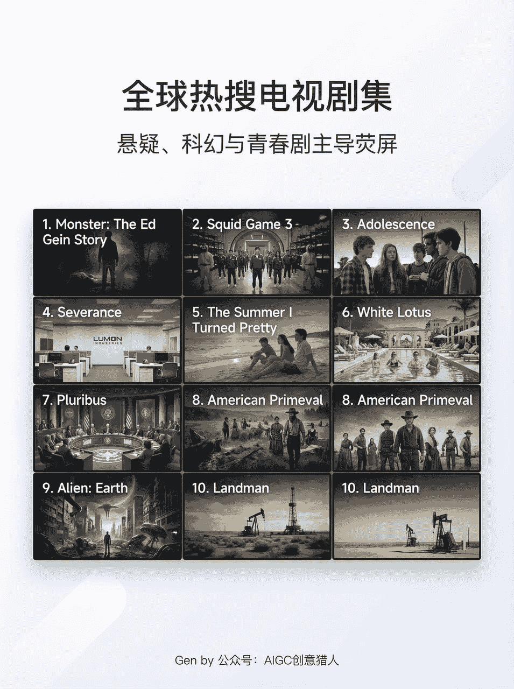

美国榜单里还多了 T**he Hunti**n**g Wives**、**The P**itt、MobLand、Andor（安多）和 IT: Welcome To Derry。看得出大家口味挺杂的。

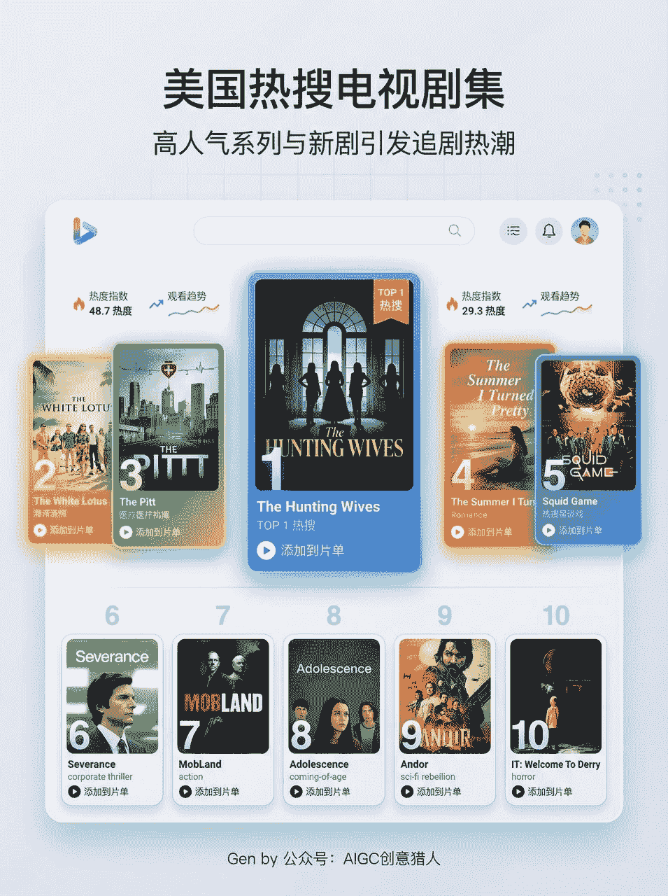

游戏迷们今年在搜啥？

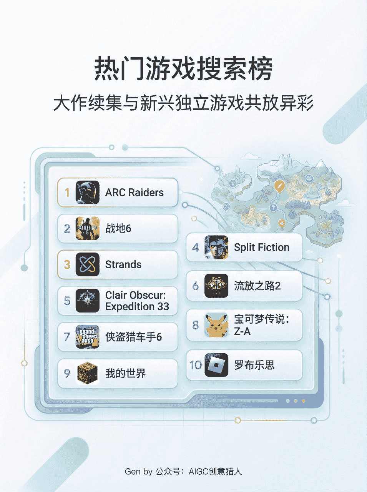

**ARC Raiders** 和 **Battlefield 6** 很火。还有一个叫 **Strands** 的填字游戏居然排到了第三。

**Split Fiction**、C**lair Obscur: Ex**pedition 33、Path of Exile 2、Pokémon Legends: Z-A 都在列。

当然，还有那个永远在路上的 Grand T**heft Auto** 6，**以及老面孔 **Minecraft 和 Roblox。

# **06.书单、运动员和音乐**

今年读书的人也不少，很多都是被 BookTok 带火的。

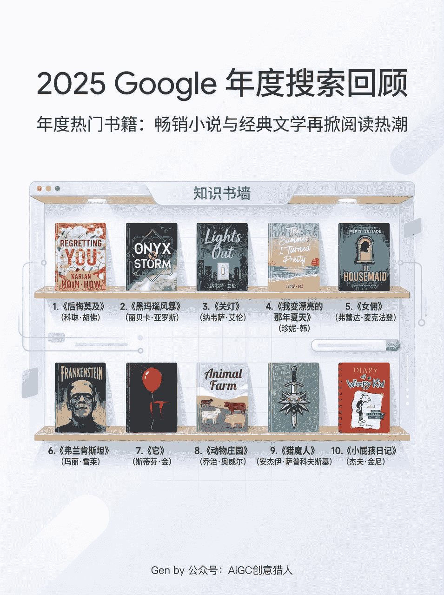

**Colleen Hoover**** 的 Regrett****ing You、Re**becca Yarros **的 Onyx Storm、**Navessa Allen 的 Lights Out。Jenny Han 的 The Summer I Turned Pretty 和 Freida McFadden 的 The Housemaid 也很火。

**经典文学居然回潮了，Ma****ry**** Shelley 的 ****Frankenstei**n、Stephen King 的 It、George Orwell 的 Animal Farm，甚至 Andrzej Sapkowski 的 The Witcher 和 Jeff Kinney 的 Diary of a Wimpy Kid 都进了前十。

体育明星方面，拳击手 Terence **Crawford 和高尔**夫名将 Rory McIlroy 全球关注。

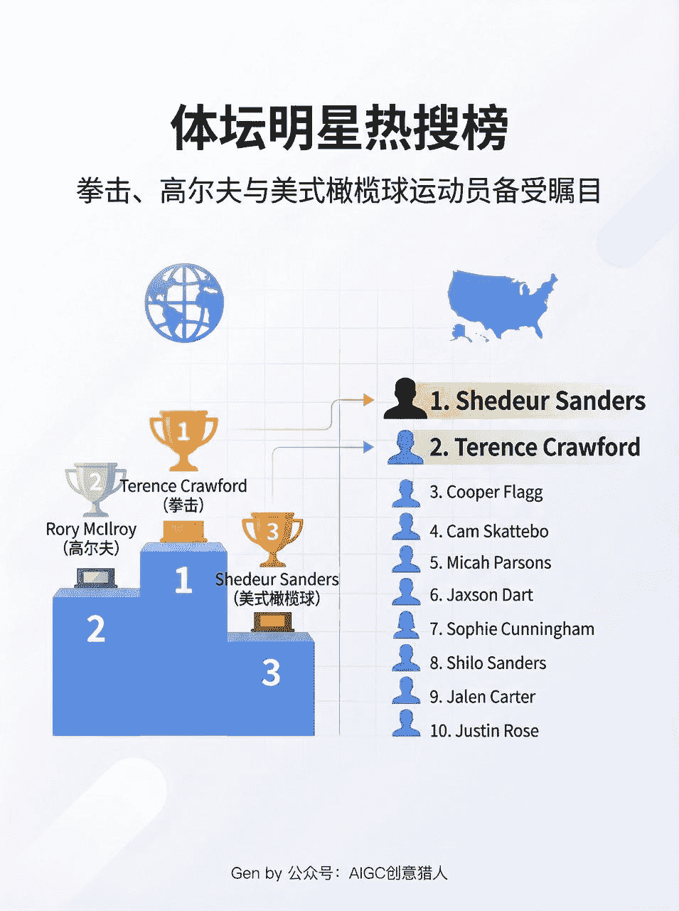

**美国这边，Sanders 家族**的 S**hedeur Sander**s 和 Shilo Sanders 都是热搜。

还有 **Cooper Flagg**、**Cam Skattebo**、**Micah Parsons**、**Jaxson Dart**、S**ophie Cunnin**gha**m、Jalen Car**ter 和 Justin Rose。

音乐方面，刚才说了 **d4vd** 是最火**的音乐人。大家哼**歌搜曲（Hum to Search）最多的是 KPop Demon Hunters 里的 "Golden"。

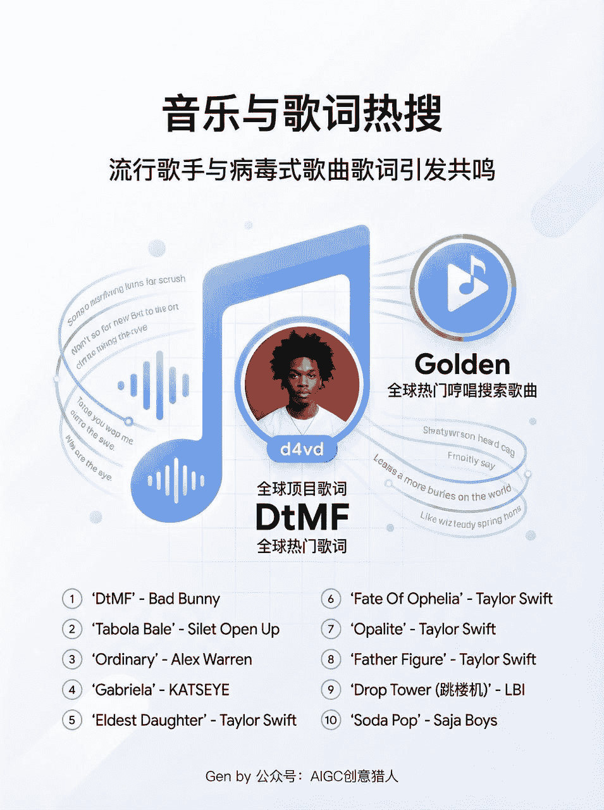

**歌词搜索**更有意思，Bad Bunny 的 DtMF 排第一。

**Silet Open **Up 的 Tabola Bal**e、Alex W**arren 的 Ord**inary、KA**TSEYE 的 Gabriela 都在前列。

**Taylor Swift 虽然**没**发新专辑（假设），但她的歌词霸**榜**了：Eldes**t** Daughter、Fat**e Of Ophelia、Opalite、Fath**er Figur**e。还有 LBI 的 Drop Tower (跳楼机) 和 Saja Boys 的 Soda Pop。

# **07.最后，聊聊吃和文化**

民以食为天，今年的食谱热搜简直是“这也能吃”系列。

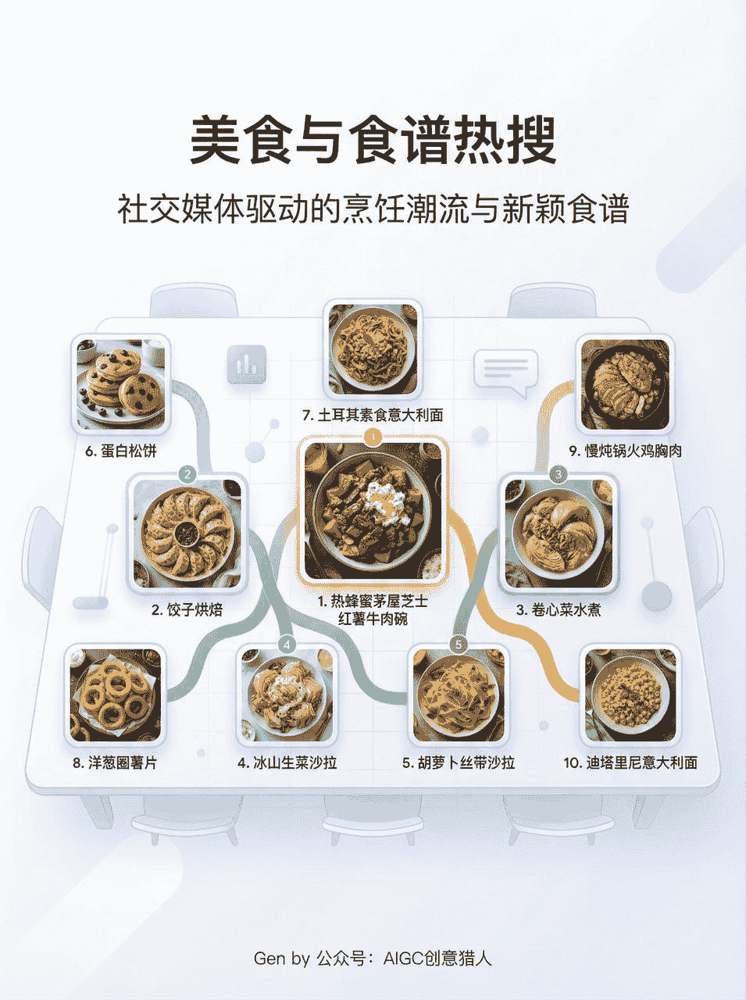

第一名是 **Hot Honey Cottage Cheese Sw**eet Potato Beef Bowl（热蜂蜜茅屋芝士红薯牛肉碗），这名字长得我都念不过来。

还有 **Dumpling Bake**（烤饺子）、**Cabbage Boil**（水煮卷心菜）、Iceberg Lettuce Salad（冰山生菜沙拉）、Carrot Ribbon Salad（胡萝卜丝沙拉）。

大家还搜了 **Protein Muffins**（蛋白松饼）、Vegetarian Turkish Pasta（素食**土耳其面）、Onion Ri**ng Chips（洋葱圈薯片）、Crockpot Turkey Breast（慢炖锅火鸡胸）和 Ditalini Pasta。

# 08.最后，有些文化梗真的很有趣。

大家都在问 "Why do kids say 67"，原来是跟 Skrilla 的歌有关。

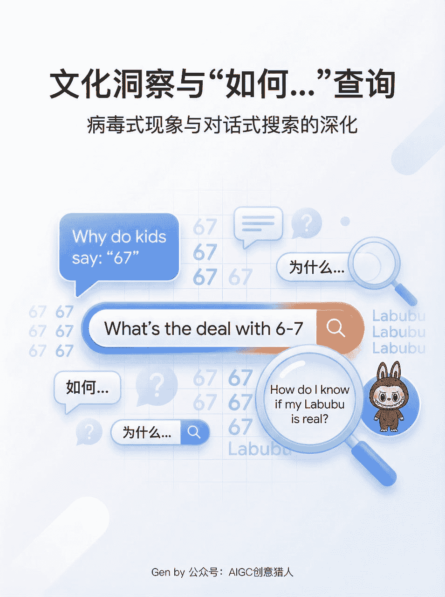

**还有大家都买了 Labubu，所以** "How do I know if my Labubu is real?"（怎么辨别 Labubu 真假）成了热门问题。当然，还有那个 "What's the deal with 6-7"。

看完了这份不删减的榜单，我是真的觉得，2025年大家过得挺丰富多彩的。

有对AI的好奇，有对局势的关心，有对娱乐的狂热，也有对一碗奇怪牛肉饭的执着。

这就是我们的2025。

不知道谷歌搜索这里面，哪些词是你贡献的？

按照惯例，我们用一张图来总结今天的分享:

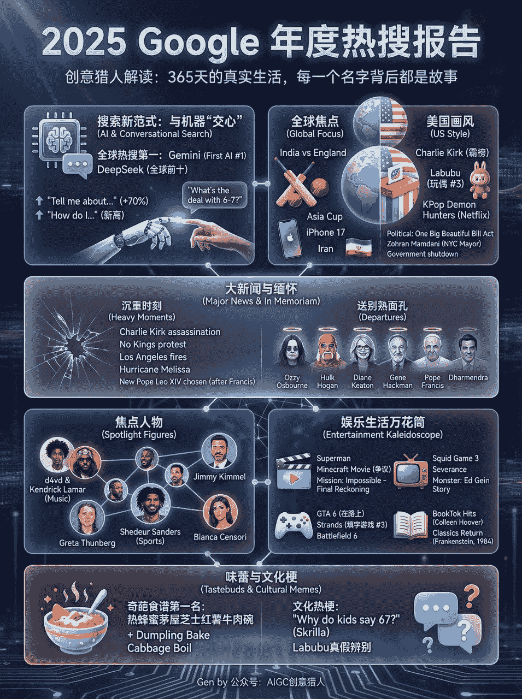

更多精彩内容，

我们下期见

<https://aigcreative.feishu.cn/sync/K4Gvd9vUQsy9Oubwqaeclu0Fnbg>

# 知识库动态