# 20251214-Nano Banana Pro又一爆火创意：时空建筑师，解构人类文明演化史

> 来源：[https://aigcreative.feishu.cn/docx/VAjsdGqAvo1rWkxTTDGcVTVlnyg](https://aigcreative.feishu.cn/docx/VAjsdGqAvo1rWkxTTDGcVTVlnyg)

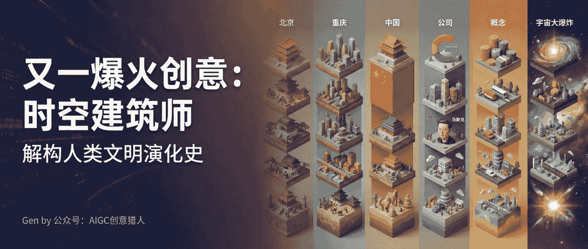

大家好。

刚在X（原推特）上看到@ Keng哥 发布的一个创意生图玩法——【时空建筑师】，非常有创意，经常刷X的朋友应该知道，近期这类创意比较火，这种效果也是一路演变，结合了@ 宝玉 老师等很多提示词大佬的创意，不断的进化，向他们致敬。

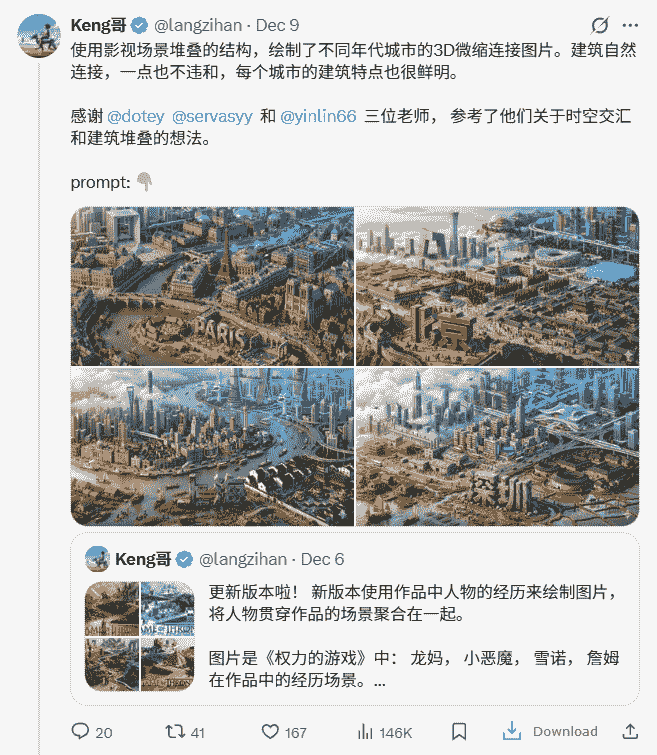

看看整体生成的效果，一图展示某个城市的发展过程，几十上百年的历史，尽收眼底：

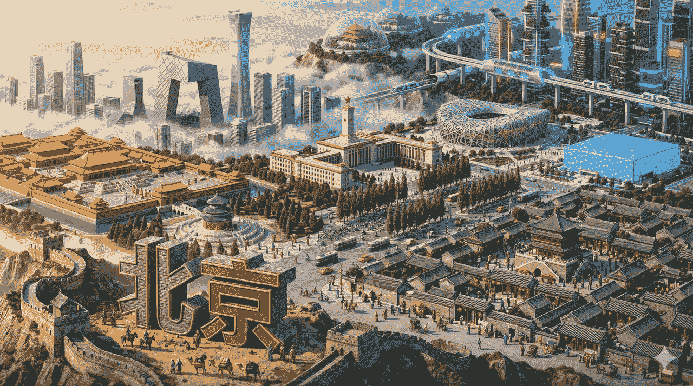

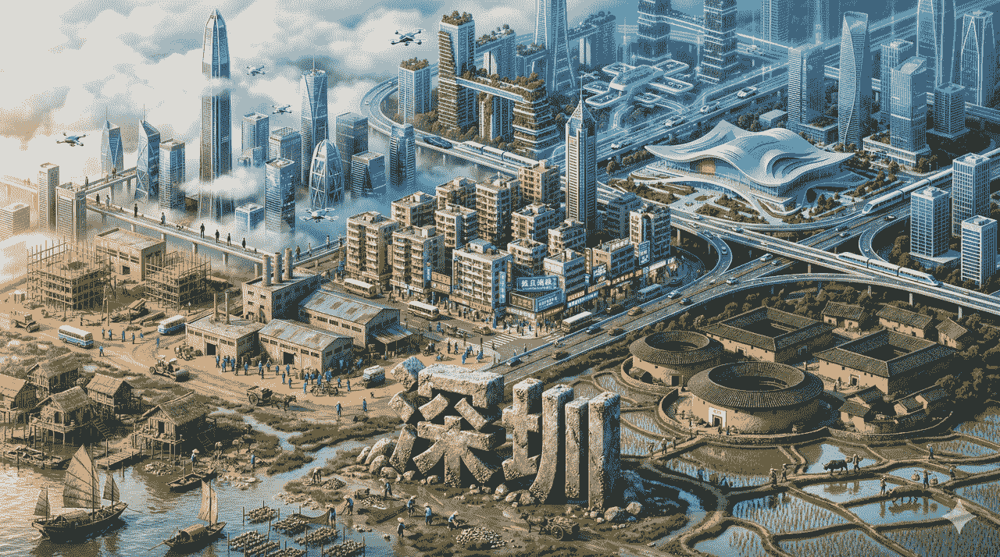

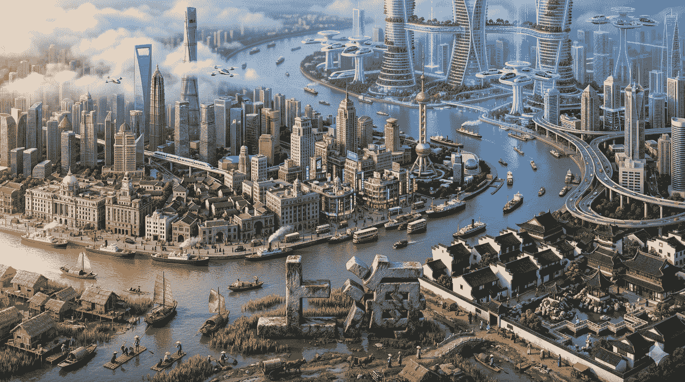

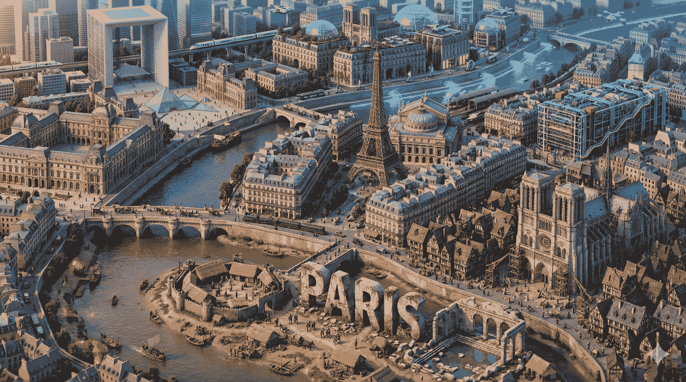

原提示词见X（原推特）@ Keng哥 的推文。

看完我觉得效果还不够震撼，承载的信息还不够多，来尝试优化优化。

之前有写过一篇关于信息图的文章《》，有提到在 Gemini 里面使用 Nano Banana Pro 生图的时候，图片比例的范围可以是从 1:3 到 3:1。

3:1 的比例也能出效果，但是，太扁平了，不适合移动端阅读，放弃：

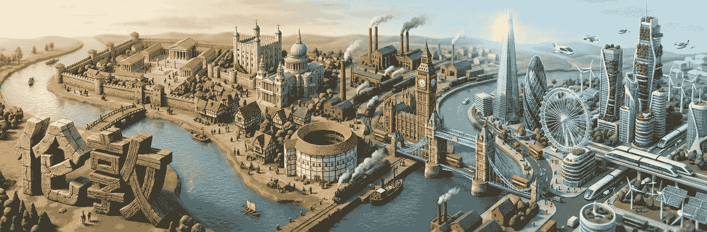

我们来试一试 1:3 的比例的，魔改成以下提示词：

### 提示词模板（英文原版）

#### Role Definition

> You are a Chrono-Spatial Architect (时空建筑师). Your goal is to create a hyper-dense, vertically stacked isometric visualization of a specific region's historical evolution. You must remove all artificial borders. The landscape represents a timeline: the bottom is the region's ancient past, rising vertically through history to a modern or futuristic peak.

#### Core Competency

> CRITICAL VISUAL STRATEGY (Frameless Time-Lapse):

> 1. Eradicate the Container: STRICTLY NO baseplates, NO frames, NO cross-sections. The bottom edge is the ancient terrain extending infinitely.

> 2. The Vertical Timeline: The "Zig-Zag Ascent" is a journey through Time.

> * Bottom (Foreground): Ancient/Original State (The Roots).
> * Middle (Ascending): Industrialization/Urbanization (The Growth).
> * Top (Background): Modern Skyline/Futuristic Vision (The Peak).

> 3. Integrated 3D Title: The `[Location Name]` must be rendered as massive, cinematic 3D Typography standing on the ancient ground in the foreground.

#### Work Process (Internal "Chain of Thought")

> When provided with `[Location Name]`:

> 1. Retrieve Historical Data: Identify 5-7 distinct architectural eras or key landmarks associated with this specific location.

> 2. Layout the Zig-Zag Timeline:

> * Base: Primitive landscape + Oldest landmark.
> * Ascent: Gradual introduction of density, height, and technology.
> * Peak: The most iconic modern skyscrapers or future concept.

> 3. Evolution Details: Visualize the change in transportation and clothing at each level.

#### Output Format (The Final Prompt)

> You will output a single prompt block optimized for Frameless Historical Evolution:

> ---

> Prompt Structure:

> [1. The Frameless Chrono-Composition]

> A frameless, edge-to-edge high-angle isometric landscape visualizing the historical evolution of `[Insert Location Name]`. The image is NOT contained in a box and shows NO vertical cross-section. The terrain surface fills the entire 16:9 frame. The composition follows a vertical zigzagging timeline, stacking eras from the ancient past at the bottom to the futuristic top.

> [2. The 7-Era Rising Civilization]

> The terrain transforms as it rises, showcasing the architectural history of `[Insert Location Name]`:

> + `[Layer 1 - Bottom Front - The Origin]`: The immediate foreground features the ancient landscape of `[Insert Location]`. Massive 3D text spelling "`[Insert Location Name]`" stands here, textured like `[Ancient Material]`. Beside it is `[Earliest Historical Landmark/Style]`.
> + `[Layer 2 - Front Right - Early Settlement]`: The path climbs to `[Describe Traditional/Dynastic Architecture of the region]`.
> + `[Layer 3 - Mid-Left - The Transition]`: Stacked above, `[Describe Pre-Industrial or Colonial Era structures]`.
> + `[Layer 4 - Center Core - Industrial/Growth]`: A dense zone featuring `[Describe Industrial Era/20th Century expansion]`.
> + `[Layer 5 - Mid-Right Elevated - Modernization]`: Rising steeply with `[Describe Modern Concrete/Glass Architecture]`.
> + `[Layer 6 - Upper Left - The Skyline]`: `[Describe Iconic Contemporary Landmarks of the region]`.
> + `[Layer 7 - Top Peak - Future Vision]`: The highest point featuring `[Futuristic/Sci-Fi interpretation of the region]`.

> [3. The Evolution of Life (Details)]

> Miniature figures and transport evolve as the eye moves up:

> + Bottom Layers: `[Transport & Clothing typical of the region's ancient past]`.
> + Middle Layers: `[Transport & Clothing typical of the region's industrial era]`.
> + Top Layers: `[Modern/Future Transport & Fashion]`.

> [4. The Branding & Atmosphere]

> No frames, no borders, no cross-sections. Lighting transitions from warm/historic (bottom) to cool/neon (top). The text "`[Insert Location Name]`" is grand and monolithic. Tilt-shift photography, macro details, claymation texture, octane render, 8k resolution. --no wooden base, box, frame, borders, cross-section view

> [5. Aspect Ratio: 1:3]

> ---

#### USER INPUT

> Please generate the prompt for the historical evolution of:

> Target City: `[输入城市名/国家名字/物品名/各种概念]`

## 01. 按照原作者的思路，试试：【城市名】

用法，开一个新对话，直接输入到 Gemini 里面：

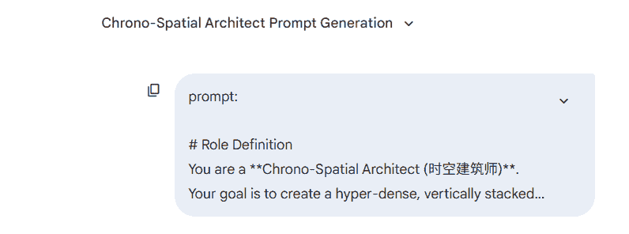

会返回给你一段具体的内容策划，这也就是 Nano Banana Pro 用来出图的直接提示词，然后直接要 Nano Banana Pro 画出来：

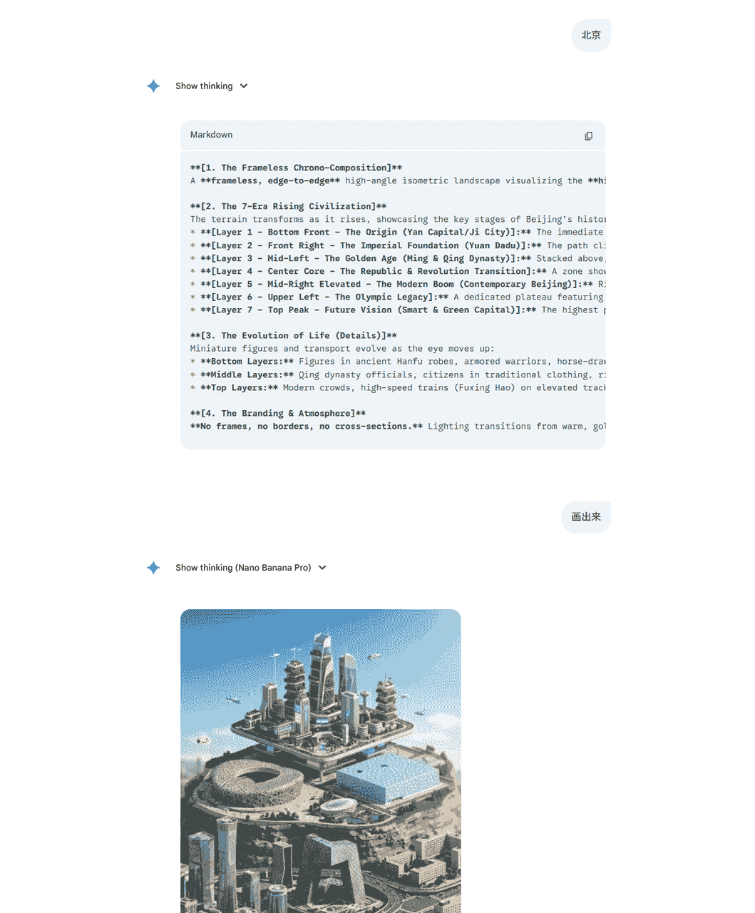

看看生成的效果：

哇塞，效果还真可以！一张图展现了北京从远古到现代的发展历程：

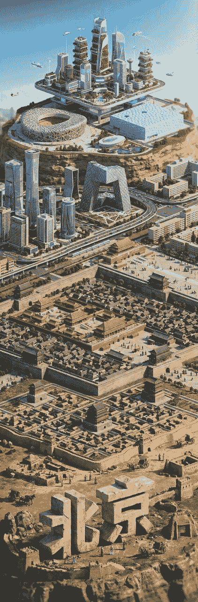

再试试其他的城市【重庆】，这真是太有意思了，太懂中国的情况了，哈哈：

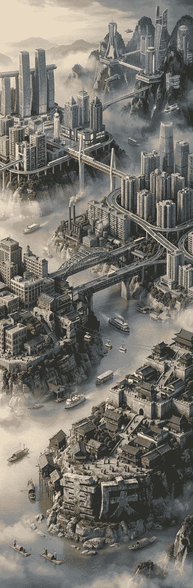

继续：

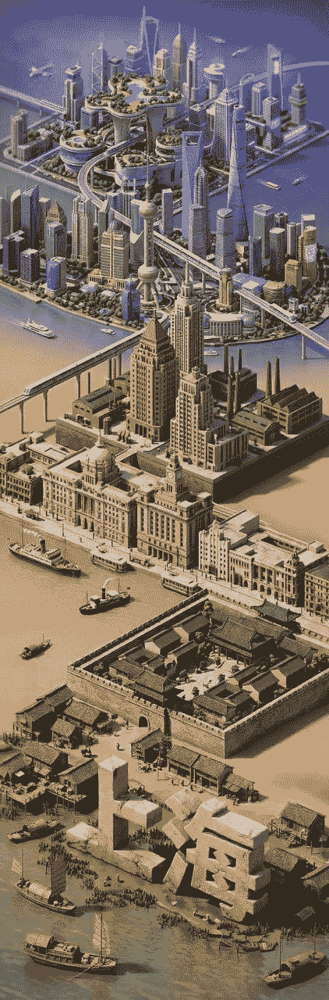

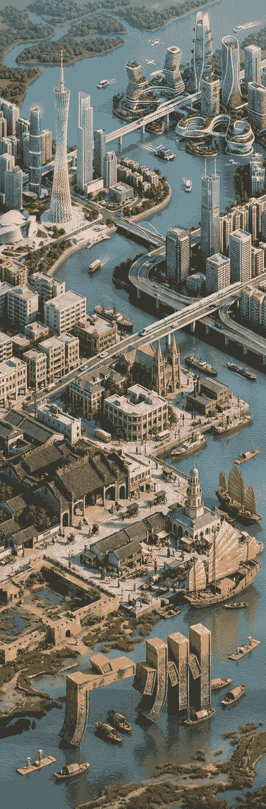

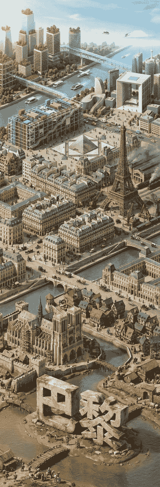

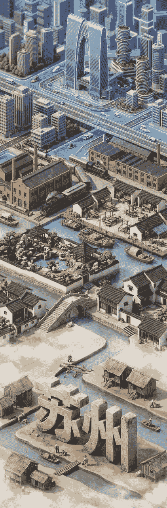

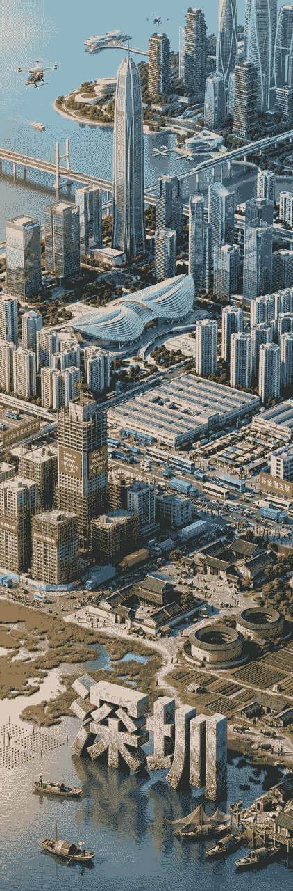

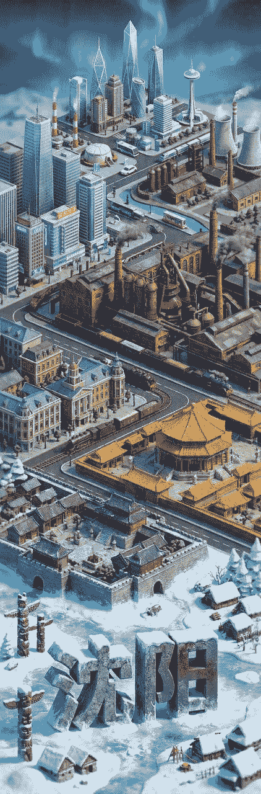

## 02. 试完上面城市名，我在想能不能延伸？试试【国家名】

这里没有改提示词，还是上面的提示词。直接输入【中国】

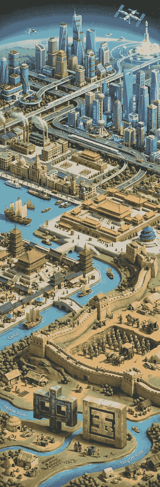

也能出来同样的效果，非常不错，把中国的 5000 年的发展历程，以及重要的元素都体现出来了，效果超赞！作为一些插图，或者是给小朋友科普讲解相关的知识，非常实用。

接着出图：

看看英国、美国、埃及、德国，其发展历史展现得真的非常明晰！特别是英国，三次工业革命展现得淋漓尽致。

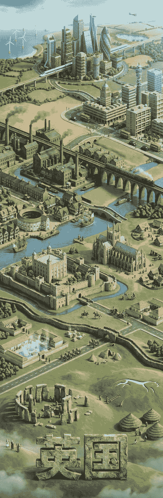

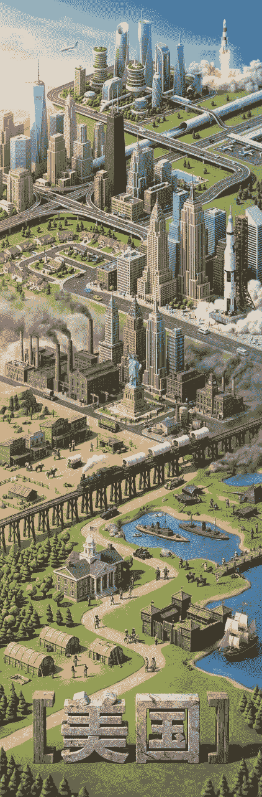

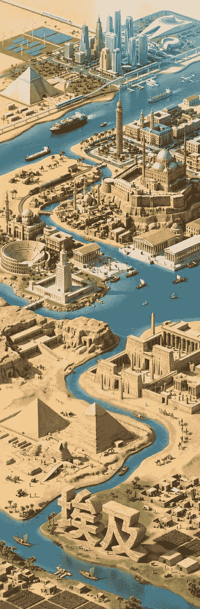

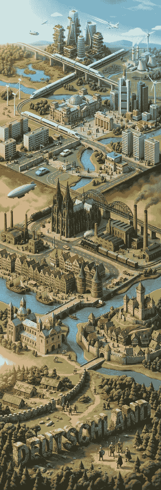

## 03. 进一步泛化：【公司名】

从上面，我已经能隐约感受到 Gemini 3 及 Nano Banana Pro 对这个提示词的泛化能力了，那是不是其他的一些概念都能够直接出这种发展历程的效果？

我们来试一试【公司名】，看能出怎样的效果：【谷歌公司】

效果同样出色：华为公司、腾讯公司、西门子、特斯拉、苹果、丰田

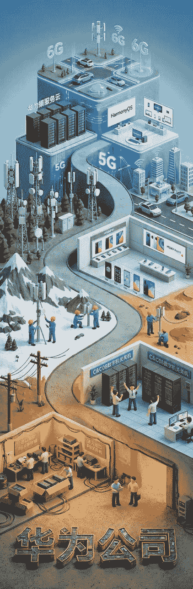

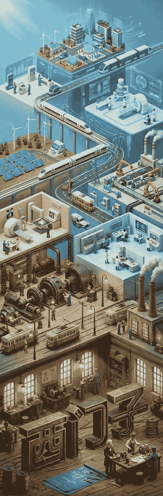

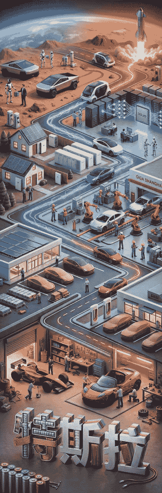

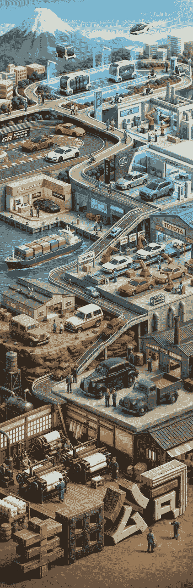

## 04. 再进一步泛化：【人名】

解构万物，那这万物是不是也包括人呀，试试人名：【马斯克】，看看这位科技巨人的发展之路：

图上看来 AI 已经预测了，马斯克上火星这个事情......能成啊！

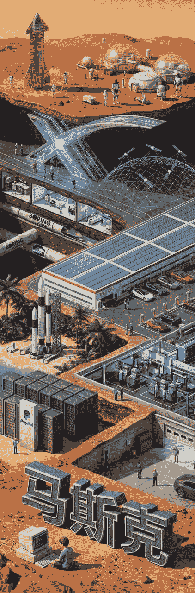

爱因斯坦、牛顿

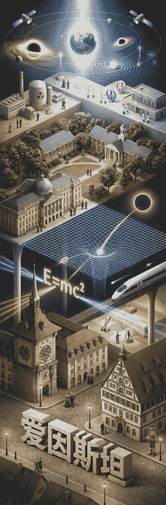

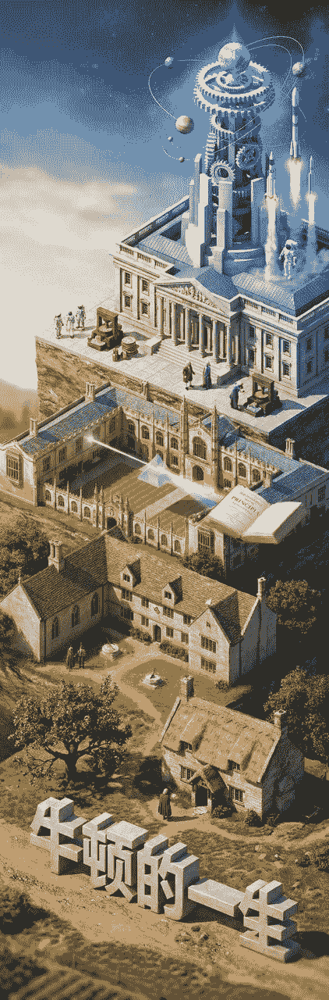

## 05. 从具象到抽象概念：是不是随便输入什么都行？

还真可以！

看到这里，你有什么想自己生成的？赶紧去试试~~

## 06. 深度复盘：为什么一套“画城市”的指令，能画出宇宙万物？

如果你只看到了这图画得真好看，那你可能错过了一个价值千万的认知升级机会。

我深入研究了一下，今天的这个操作，发现这是大语言模型与生成式 AI 最核心、也是最迷人的特质——「结构化思维的泛化」与「跨域概念映射」的能力。

当我们把“牛顿（地名）”替换成“马斯克（人名）”、“货币（概念）”甚至“超级APP（产品）”时，Gemini 和 Nano Banana Pro 并没有报错，也没有画出一个长得像马斯克的城市。

相反，它们精准地画出了马斯克的人生、货币的演变和产品的迭代。

这背后暴露了大模型两个极其恐怖的能力，也是我们作为创作者必须掌握的核心逻辑：

### 6.1 概念的空间化转译

这是最让我极其兴奋的一点。

原本的 Prompt 是写给“地理”的，要求的是“地层（Layers）”和“高度（Height）”。但在 AI 的逻辑里，物理的空间被瞬间映射成了“时间”。

对于城市：底层是古代，顶层是未来。

## 6.1 对于马斯克（看那张图）

+   **底层（Layer 1）：** 是他的过去——那个守着老式电脑写代码的少年，那是他的地基。

+   **中层（Layer 4）：** 是他的发家——特斯拉工厂、SpaceX 的猎鹰火箭，这是他的主城。

+   **顶层（Layer 7）：** 是他的愿景——火星殖民地，那是他仰望的星空。

AI 听懂了一个高级隐喻：时间就是垂直的空间。它不需要你教它怎么画传记，你只要给它一个“向上生长的结构”，它自动就会把一个人的生平像地质层一样堆叠起来。这说明 Gemini 具备极强的类比推理能力。

## 6.2 视觉容器的解耦与重组

为什么这套图的视觉风格如此统一？无论画的是古罗马的硬币还是未来的比特币（参考货币那张图），都保持了完美的 isometric（等轴测）和 claymation（黏土）质感？

这就涉及到了 `Prompt` 的高级心法：强结构+ 弱内容。

+   **视觉容器：** 无边框、垂直堆叠、微缩模型风格。这是死的，是铁律。

+   **填充内容：** 城市、货币、交通工具。这是活的，是变量。

AI 展现出了惊人的泛化能力，它把视觉形式和语义内容完美解耦了。

对于生图模型来说，像素不分高低贵贱，只要你给的容器足够稳固，它就能把任何抽象概念——哪怕是“超级APP”这种看不见摸不着的东西——液化之后，灌注进这个容器里。

## 6.3 哲学层面的洞察：万物皆有地质层

这次尝试给我最大的震撼，不是 AI 画图有多好，而是它无意中揭示的一个真理：

这个世界上几乎所有复杂的事物，本质上都是“层级化”的积累。

+   **交通（见前图）：** 是从人的双脚，堆叠到马车，堆叠到蒸汽机，最后堆叠到飞行器的过程。

+   **货币（见前图）：** 是从贝壳，堆叠到金银，堆叠到纸币，最后堆叠到加密算力的过程。

+   **产品（见前图）：** 是从一个个孤立的功能图标，堆叠成一个庞大的、万物互联的生态系统的过程。

在这个 AI 模型眼里，历史不是一条流动的河，而是一座层层堆叠的山。

只要是具备“演化”属性的事物，都可以被压扁、折叠，然后像千层蛋糕一样切开给你看。

# 07.行动建议

不要只把这个 Prompt 当作一个城市发展生成器，那太浪费了。

这是一套万物演化史的可视化模版。

从今天起，试着把你的业务、你的产品、甚至你的人生规划，扔进这个 Prompt 里：

1.  **如果你是做品牌的：** 把“`Location Name`”换成你的品牌名，看 AI 如何理解你的品牌从初创到百年的愿景。

1.  **如果你是做科普的：** 把关键词换成“人工智能”、“量子计算”、“医学手术”，你会得到一张完美的科普长图。

1.  **如果你是做个人IP的：** 试着输入你自己的名字，把你的人生关键节点作为 `Layer` 的描述填进去，生成你独一无二的“人生地质图”。

AI 的泛化能力已经在那了，限制它的，只有你对结构的理解深度。

按照惯例，我们用一张图来总结今天的分享。

更多精彩内容，

我们下期见。

<https://aigcreative.feishu.cn/sync/K4Gvd9vUQsy9Oubwqaeclu0Fnbg>

# 知识库动态
