# 20260120-十大类，50+个最值得尝试的Nano Banana Pro高阶提示词

> 来源：[https://aigcreative.feishu.cn/docx/QHIOdTbrwokmgBxGus6cPKt6nxf](https://aigcreative.feishu.cn/docx/QHIOdTbrwokmgBxGus6cPKt6nxf)

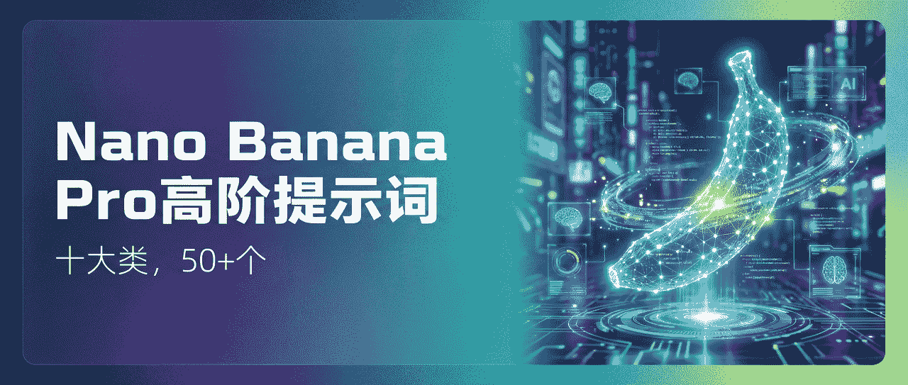

大家好，我是创意猎人。

前两天还在跟团队内部聊，Nano Banana Pro 确实很强，但很多人也就是拿来随便画两笔，真的有点浪费。其实它跟高端相机一个道理，全是自动挡也能拍，但想出好片子，还得懂点“参数”调节。

我趁着周末的时间又彻底盘了一遍。

我把这几十个最实用的提示词整理了一下，分了十个类，从修图、摄影到设计都有。只要配合正确的提示词，Nano Banana Pro 能产出惊人的效果。

你不也就是图个方便嘛？这些都是我试过好用的，建议你直接收藏，下次用到的时候复制粘贴改改就能用。

直接看干货。

# 01.工作室级 AI 照片编辑提示词

这一组主要是用来微调图片的，重点是保持真实感，别修得跟假人似的。

> **局部编辑 / 选择与优化**：仅选择并优化场景中的主体。处理过程需保留所有边缘，同时提升细节可见度，并对形状进行微调，但严禁触碰周围区域。光影元素需保持原本的真实感。主体需要温和的调整以显得更突出，同时保持整张图像的逼真度。

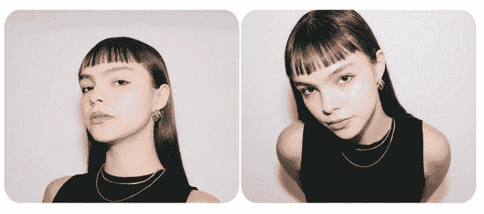

> **摄像机角度调整**：需将摄像机移动至原位置上方 15 度处，以半俯视角度重现同一场景。场景需保持光效和配色方案的一致性，同时艺术家需确保新视角展现出逼真的景深、阴影及正确的透视关系。

> **改变焦点 / 景深**：摄影师需重新构图，使前景物体清晰锐利，而背景元素则淡化为专业的柔焦效果。主体应通过浅景深获得显著突出，同时保留图像原始的色彩与光线。

> **调色**：为胶片应用源自当代电影风格的精致色彩处理。图像应呈现柔和的青色阴影和暖色高光，且不影响肤色的自然外观。图像需要温和的对比度增强，以实现适合高端品牌需求的干净精致外观。

> **光照转换（日转夜）**：整个场景需从白天转变为真实的夜间环境。场景需要柔和的月光高光，配合冷色调阴影、温暖的人造光源及细腻的反射效果。氛围应营造出真实的体验，将观众带入故事之中。

> **光照转换（散景效果）**：主体需保持完全清晰，而背景应转变为梦幻柔和的散景。摄像机应使用圆形光斑，配合暖色调和柔和的光晕，以实现电影般的夜景人像效果。

# 02.产品摄影提示词

这块我用的最多，做电商图或者发朋友圈都很合适，关键是光影得自然。

> 在美女模特的特写中展示这条**项链**，聚焦于下颚线、锁骨及项链的光泽，配以柔和的电影级布光。

> 将这款**奢华腕表**放置在玻璃底座上，使其接受轮廓光照射，同时演播室环境采用优质的高对比度照明。

> **香氛蜡烛**出现在舒适的家居环境中，接受温暖阳光的照射，在木质表面投下柔和的阴影。

> **无线耳机**出现在现代电商摄影中，背景为浅灰色，产生逼真且清晰的阴影。

> **护肤乳液**静置于天然石材表面，窗光营造出带有水疗元素的宁静氛围。

> **游戏鼠标**位于充满未来感的全息空间内，该空间具有发光元素和设计流畅的金属表面。

# 03.信息图表提示词

如果你需要做PPT或者说明书，这组提示词能帮你省不少事。

> **绿色排毒冰沙分解图**：任务要求我创建一个信息图，通过原料、营养价值及混合顺序来演示制作绿色排毒冰沙的过程。

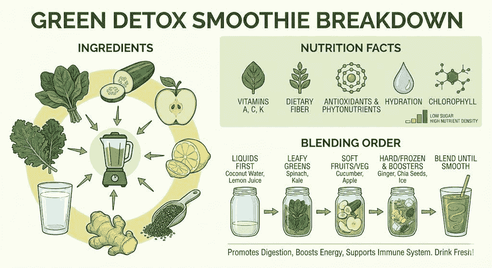

> **初学者瑜伽体式指南**：开发一个信息图，通过简单易懂的绘图展示五个基本瑜伽体式，并提供身体摆放位置及呼吸技巧的说明。

> **咖啡豆对比**：对比阿拉比卡和罗布斯塔咖啡豆，需要制作一个信息图，展示它们的风味概况、咖啡因含量、地理原产地及推荐冲泡技术。

> **护肤流程信息图**：创建一个可视化简单晨间护肤流程的信息图，包含步骤、推荐产品及每个阶段的时间安排。

> **太阳系速览**：该信息图展示太阳系中的所有行星，显示其基本特征，包括尺寸、与太阳的距离、轨道周期及其他有趣信息。

> **初学者预算技巧**：任务要求创建一个信息图，通过展示储蓄信息、支出细节、目标设定及日常财务实践的版块，介绍五种基本的预算方法。

# 04.故事板 / 视觉叙事 / 场景可视化

这组适合做品牌策划的朋友，能快速出一些看起来很成体系的方案图。

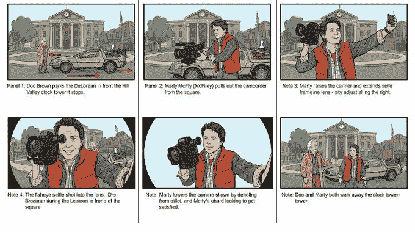

> 该标志的品牌套件需包含配色方案、推荐字体组合、基础图标备选方案及基础社交媒体页眉设计。

> NovaEdge Systems 作为现代科技初创公司的完整品牌识别套件，包含所有必要元素，包括不同版本的标志、配色方案、字体选择、图标集、设计元素及排列原则。设计呈现干净、未来主义、极简的美学风格。

> 设计团队需创建官方品牌样机，在名片、信纸、信封、社交媒体横幅及演示幻灯片上展示标志。工作室应采用柔和的演播室设计风格。

> FluxBeam Labs 的完整视觉识别系统需要开发，包括关于留白要求、品牌使用规则、品牌网格组织、图案创建及数字与印刷布局模板的具体指南。

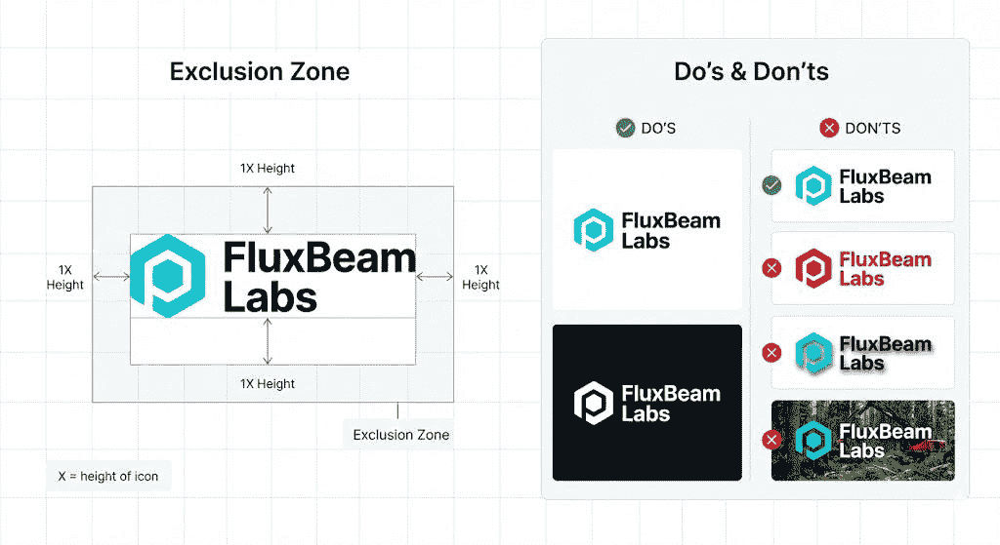

> 设计需要高分辨率样机，在霓虹灯标牌、包装盒、服饰、文具及贴纸上展示 Skyline Robotics 品牌，采用充满活力的年轻化设计风格。

> 项目要求为 LumaCraft Studio 创建基础品牌识别，包括更新后的标志设计、单色版本、品牌标记、社交媒体内容及基础周边商品设计概念。

# 05.UI/UX 及网页设计提示词

做UI的时候，有时候就缺个灵感，用这个跑一下，大概的布局框架就有了。

> 一款**移动旅行规划应用**需要三个主要设计元素，包括主页仪表板、行程屏幕及预订屏幕。主页仪表板应显示即将到来的旅行，提供常用功能的快速入口，并显示简单的地图预览。行程屏幕应显示每日安排，包含图标、备注及供用户查看的时间轴。预订屏幕应通过过滤器展示航班和酒店选择，显示价格比较卡片，直到用户找到首选选项并点击立即预订按钮。

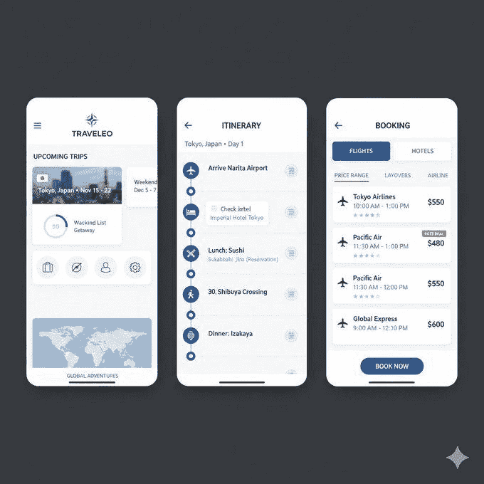

> 开发一个**仪表板界面**，作为生产力 SaaS 平台的主界面。设计需要一个左侧边栏，包含导航元素，如仪表板、任务、日历、分析及设置。界面顶部包含搜索功能、通知区域及用户个人资料图标。主要区域应显示概览面板，展示关键绩效指标（已完成任务、工作时长及即将到来的截止日期）、日历小部件及带有状态标签的任务列表。设计应采用现代用户界面风格，结合圆角卡片、柔和阴影及简单的数据呈现元素。设计应使用冷色调配色方案，包括蓝色和灰色，拥有清晰的图标及元素间足够的空间，以构建专业且透气的设计结构。

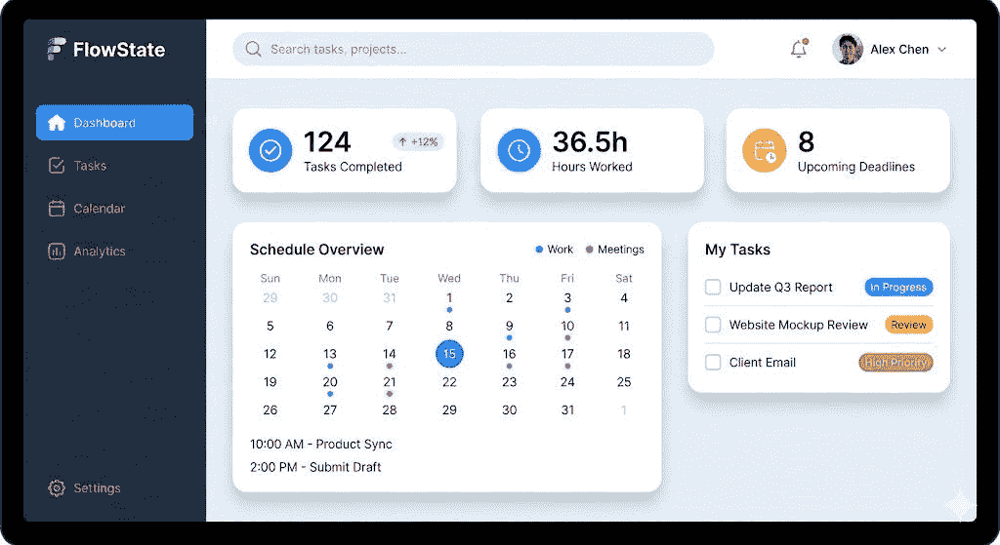

# 06.多语言图像编辑

这个功能其实挺实用的，特别是做跨境或者外贸的朋友，改个菜单、海报很方便。

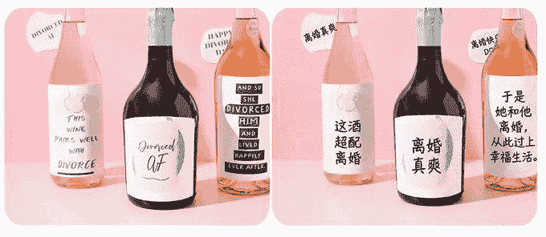

> **菜单板翻译**：需将此咖啡馆菜单板上的所有英文内容翻译成泰文，同时保持其原始设计元素及视觉组件。

> 文本需转换为更具人性化的版本，并在整个文档中保持原语言。输出需匹配输入长度，同时在简短回复中避免过多的解释。

> **海报语言转换**：要求将此电影海报上的所有英文内容翻译成西班牙文，同时保留原始设计元素及文本排列。

> **产品标签翻译**：过程要求将所有化妆品瓶标完全从英文转换为中文，同时保持统一的设计元素、图标位置及间距。

# 07.字体排印标志

如果你对Logo没什么头绪，可以试试这些描述，几何感和手写感的都有。

> **几何科技字标**：设计 6 个使用干净几何字形的未来主义字标标志。每个标志的设计过程要求通过使用不同形状（包括三角形、圆形及六边形）来创建字母。设计采用极简风格，包含单线元素、科技美学元素及贯穿白色背景的黑色矢量线条。

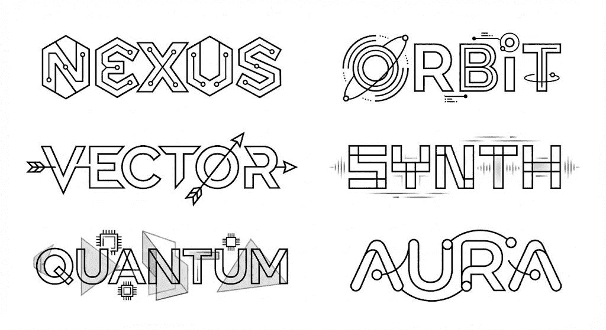

> **有机书法标志**：设计过程包括创建五个使用流畅书法灵感设计的文字标志。作者应手工创建每个单词，使用笔刷般的笔触产生不同的线条宽度并生成富有表现力的动势。设计应使用黑色笔触，与白色背景形成高对比度。设计通过其简单而精致且富有创意的元素展现自我。

> **粗体块状字母标志集**：设计要求七个使用厚重块状字母的粗体排印标志。设计元素包括字母变形、堆叠、切割、合并及负空间。每个标志的设计需创造出符合当代设计标准的强烈印象。设计特征为位于白色表面上的扁平黑色矢量图。

> 设计要求六个字标标志，应以柔和的圆角字母为特征，创造友好俏皮的设计。文本需要额外的个性元素，包括跳动的基线、拉伸的字母及可爱的曲线。设计特征为出现在维持完全简洁的白色表面上的极简黑色矢量图。

# 08.数学与推理提示词

这部分挺有意思，主要是用来生成那种教学用的白板图，虽然用得少，但关键时刻能救急。

> **勾股定理（视觉解释）**：白板风格的插图通过包含带标签的三角形及顺序注释的基本图表来展示勾股定理。

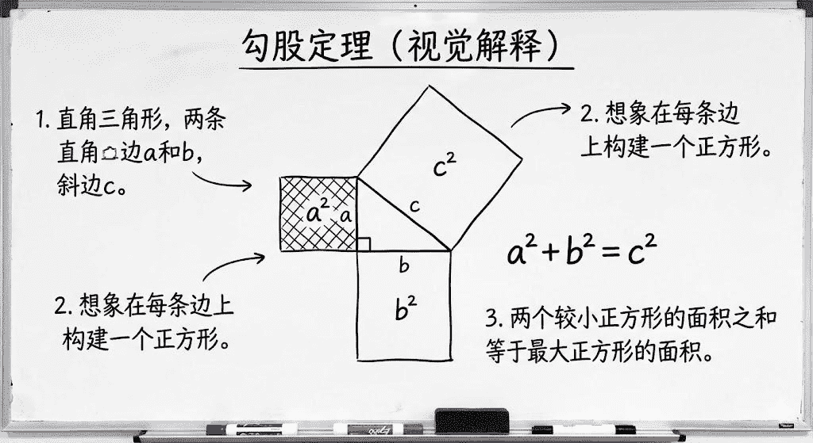

> **利率如何运作（逻辑 + 数学）**：白板演示通过公式展示、箭头连接、基本图表显示及说明性计算示例来演示复利运算。

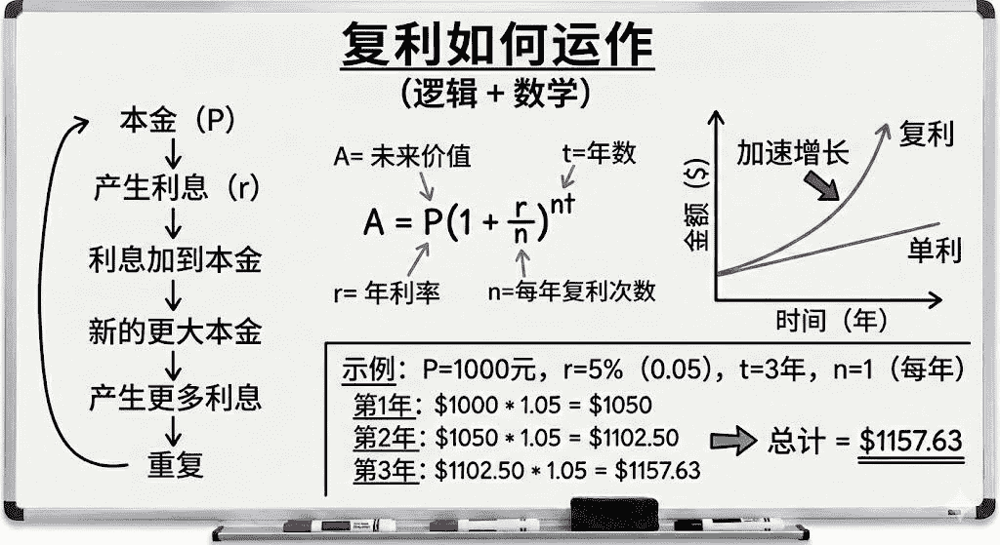

> **分数变得简单（视觉推理）**：白板风格的信息图应通过形状、网格的视觉表示及手写笔记来解释不同分母的分数加法。

# 09.文本艺术渲染提示词

就是那种很有艺术感的文字海报，衍纸风格出来的效果特别显质感。

> **衍纸艺术作品**通过优雅流畅的书法字体展示单词 DREAM，使用紫色、粉色、洋红色及白色的卷曲纸条。相互堆叠的纸卷产生深度效果，并在深灰色纹理表面投下柔和的阴影及光线反射，复制了原始设计的精细设计元素。

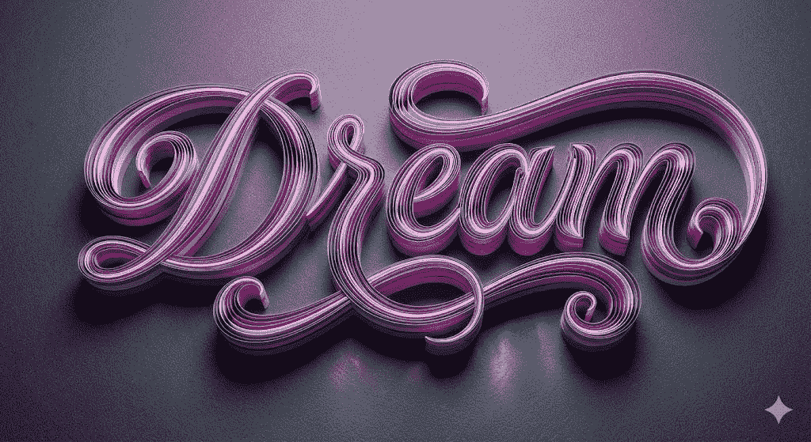

> 艺术家创作了一幅**衍纸艺术作品**，使用紧密卷曲的紫色、粉色、洋红色及白色纸条形成单词 INSPIRE，通过优雅的曲线模仿奢华的书法书写。立体纸层产生柔和阴影，出现在深灰色纹理表面上，复制了原始作品中的优雅设计元素及装饰图案。

> **衍纸设计**展示了由紫色、粉色、洋红色及白色纸条制成的复杂漩涡图案，通过精致的书法字体形成单词 CREATE。凸起的纸质元素通过其柔和的阴影效果产生深度，出现在深灰色纹理背景上，复制了原始艺术作品中的细节图案。

# 10.更改宽高比提示词

这个就是硬需求了，把图改成适合发Instagram或者做banner的比例，人物位置还不会跑偏。

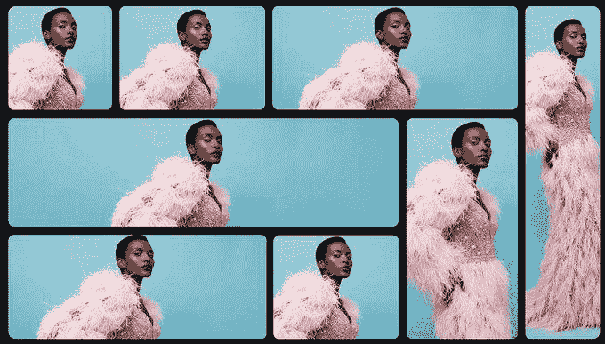

1.  通过缩减背景将宽高比更改为 **1:1**。角色保持其绝对位置，不显示任何变动。

1.  通过缩减背景将宽高比更改为 **4:3**。角色保持其绝对位置，不显示任何变动。

1.  通过背景缩减将宽高比更改为 **5:3**。角色保持其绝对位置，维持不变。

1.  通过缩减背景将宽高比更改为 **2.39:1**。角色保持其绝对位置，维持不变。

1.  通过缩减背景将宽高比更改为 **4:1**。角色保持其绝对位置，维持不变。

1.  通过背景缩减将宽高比更改为 **9:16**。角色保持其绝对位置，维持不变。

提示词清单大概就是这些。

其实分享这些，也不是让你死记硬背。Nano Banana Pro这个模型，非常智能，灵活度很高。我给你的是个模版，比如那个“产品摄影”里的“奢华腕表”，你完全可以换成“运动跑鞋”或者“机械键盘”，只要保留后面的光影描述，出来的效果通常都不会差。

这些提示词就当是个参考手册，存在手机里，哪天没灵感了或者想偷个懒，拿出来改改就能用。

---

按照惯例，用一张图来总结今天的分享：

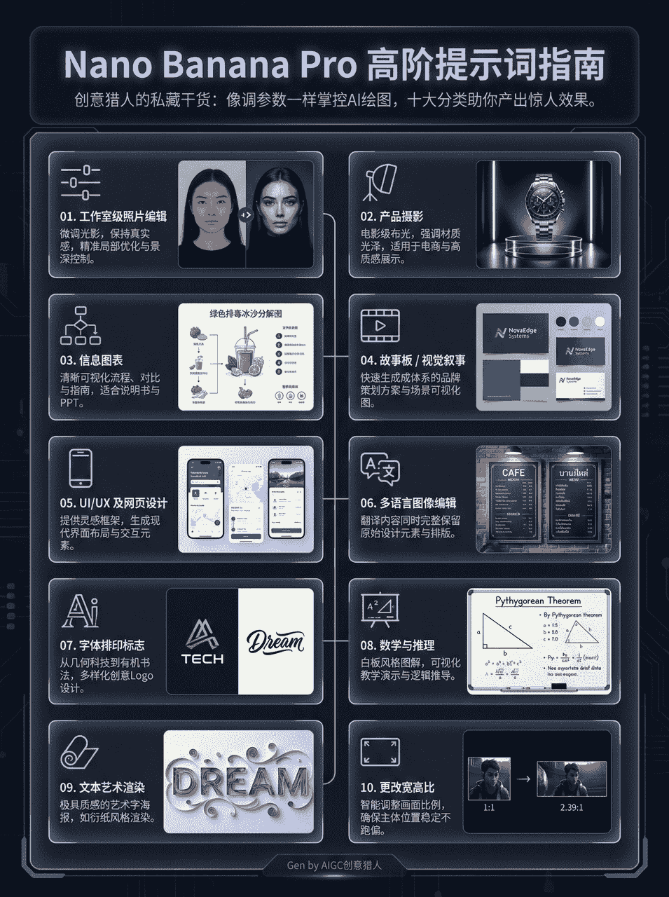

更多精彩内容，

我们下期见。

<https://aigcreative.feishu.cn/sync/K4Gvd9vUQsy9Oubwqaeclu0Fnbg>

# 知识库动态