# 表情包2-动态

> 来源：[https://aigcreative.feishu.cn/docx/Oo1ndCLRkoORWpxTyNscFCEUnVg](https://aigcreative.feishu.cn/docx/Oo1ndCLRkoORWpxTyNscFCEUnVg)

> 来源：👸号-机器之能

> 链接：https://mp.weixin.qq.com/s/uxS_juW35vSejDUi0iKmfA

> 以大模型、AIGC为代表的人工智能浪潮已经在悄然改变着我们生活及工作方式，但绝大部分人依然不知道该如何使用。

> 因此，我们推出了「AI在用」专栏，通过直观、有趣且简洁的人工智能使用案例，来具体介绍AI使用方法，并激发大家思考。

> 我们也欢迎读者投稿亲自实践的创新型用例。

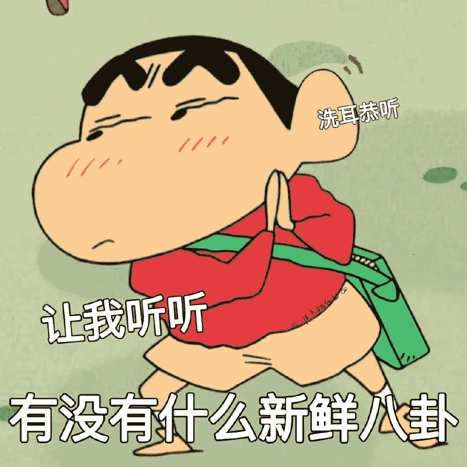

>

年轻人不能失去表情包，就像西方不能失去耶路撒冷。

在这个「提笔忘字、张嘴词穷」的年代，表情包成了我们交流的「暗号」。

于是，我们四处搜刮搞笑表情包，一有新库存，就忍不住拉出来遛遛。

今天咱们就来挑战，用 AI 制作动态表情包，让你感受一下——

什么叫「万物皆可表情包」！

流程就两步：

+   AI 生图

+   制作动图

+

用到的工具：

+   Midjourney（或即梦、腾讯元宝、奇域 AI）

+   Animate Drawing

#    1、AI 生成 Q 版图片（附咒语）

首先，使用 AI 绘图工具，生成一张可爱或搞笑的图片。

制作 Q 版表情包，还是 Midjourney 最好使。

小编为大家整理了一堆 Q 版表情包 MJ「咒语」，拿走不谢：

**咒语 1：**A cute little pig, face close-up, expression close-up, full body Piggy expressions and movements, exaggerated movements, happy, angry, sad,Surprised, happy, etc., various emotions, white background, a version,Sticker art design, ultra-high definition, 8k, nine-square layout —ar 3:4 —niji 5

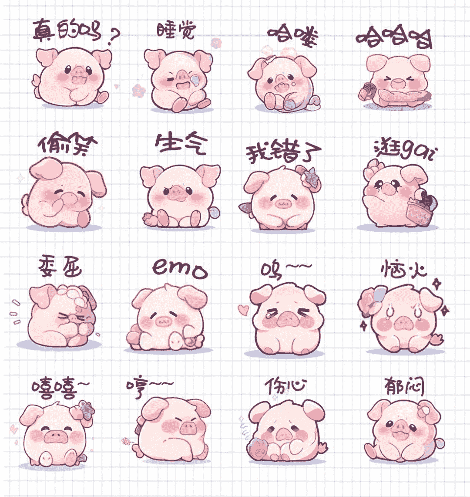

**咒语 2：**anime dog stickers group 16, White West Highland White Terrier, Yellow bowtie, in the style of dark yellow and beige, dynamic action sequences, sketch fab, white, hallyu, happenings,gemstone —ar 1:1— niji 5

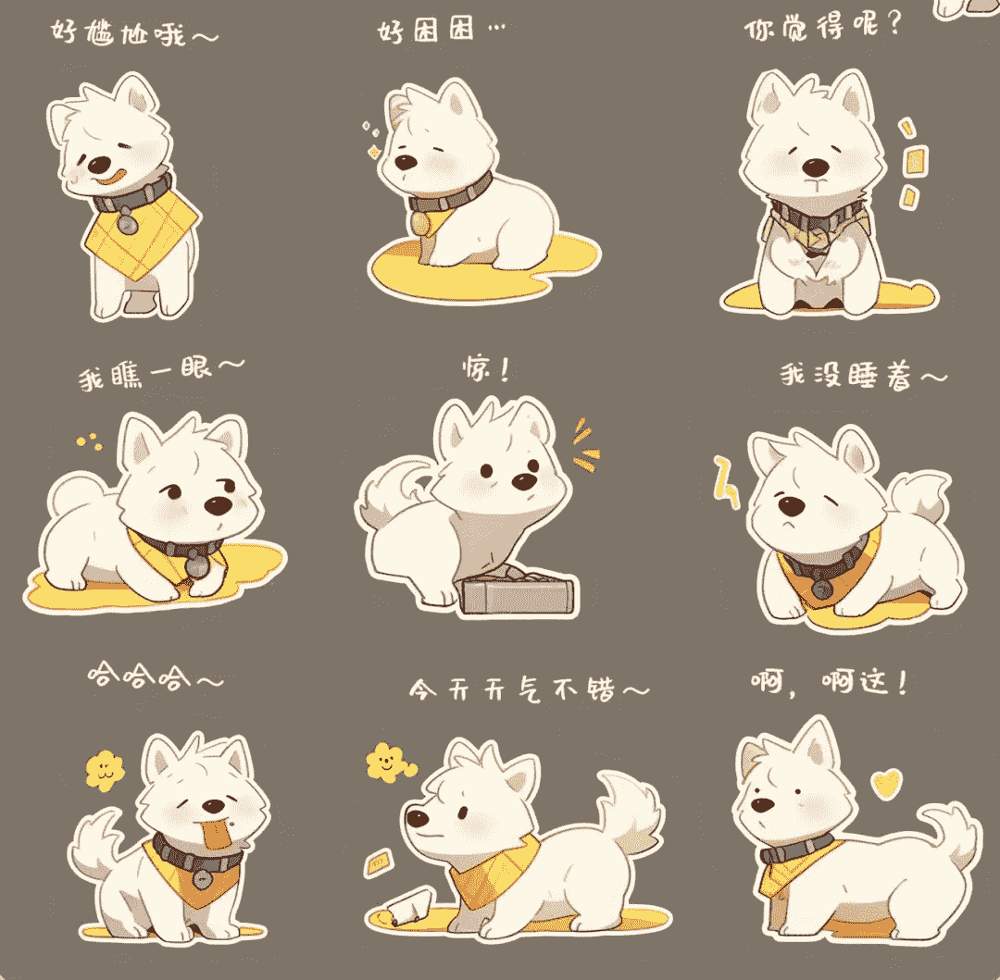

**咒语 3：**chinese girl, red , qipao, multiple poss different expressions of theand expressive, line drawing ,cute, Q version, emoticons_happy, angry, sad, cry, cue, expecting, laughing, disppointed ,etc],white background, flat color, illustration, three by three grid —s 250 —ar 1:1 —niji6

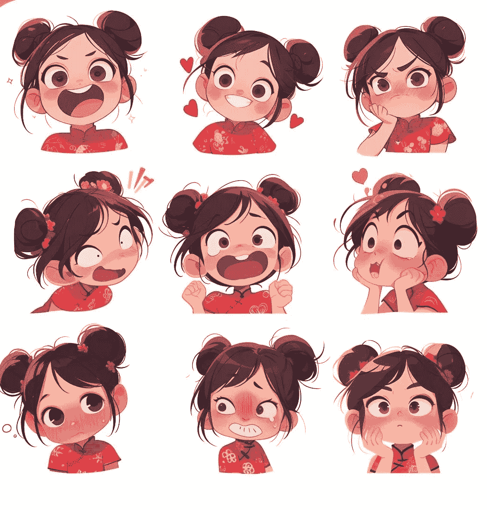

当然，大家也可以使用 Midjourney「平替」—— 即梦或者腾讯元宝。

例如，小编用即梦生成一张可爱小女孩的插画。

提示词：可爱的穿裤子的小女孩，快乐的表情，全身，卡通风格，全身。

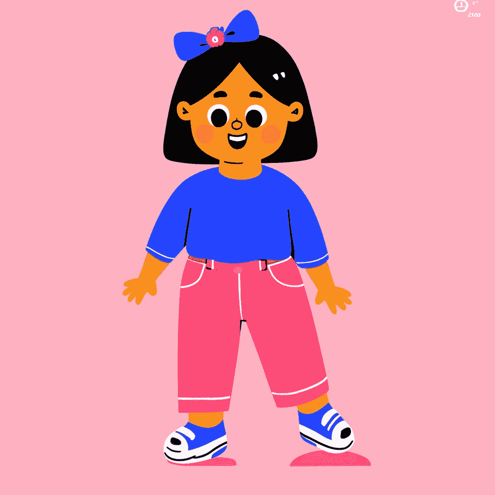

虽然过于抽象，但胜在胳膊和腿界限分明，便于后期操作。

# **2、让图片动起来**

接下来，就要让图片动起来。

我们用到的工具是 Animate Drawing。

Animate Drawing 链接：

https://sketch.metademolab.com/

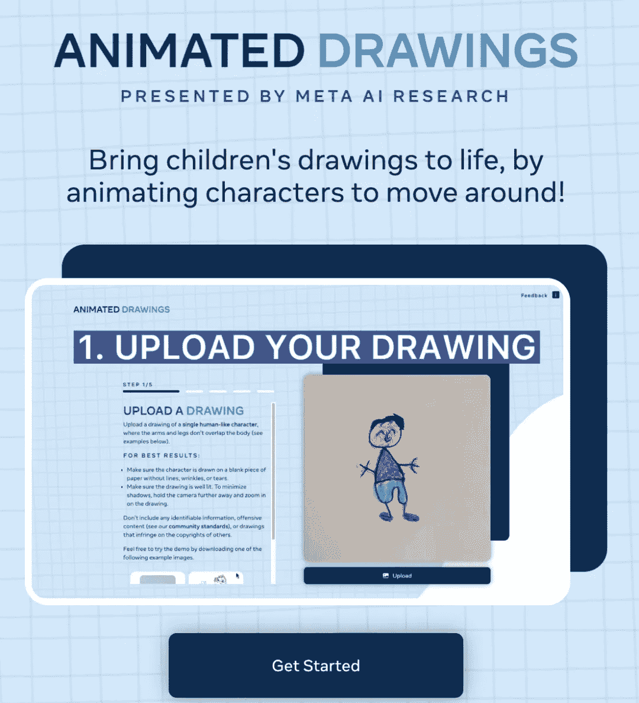

这是 Meta AI 出品的一款神器，可以让涂鸦即刻变动画。

首先，访问上述链接，上传生成的图片。

为了保证最佳生成效果，上传的图片最好满足以下要求：

+   图片中的主角，胳膊和腿儿不能与身体重叠；

+   背景是白色或纯色，没有多余线条、皱纹或眼泪。

+   图片画质要清晰，主角不能过小，不要有阴影。

+   不要使用任何可识别信息、冒犯性内容或侵犯他人版权的图画。

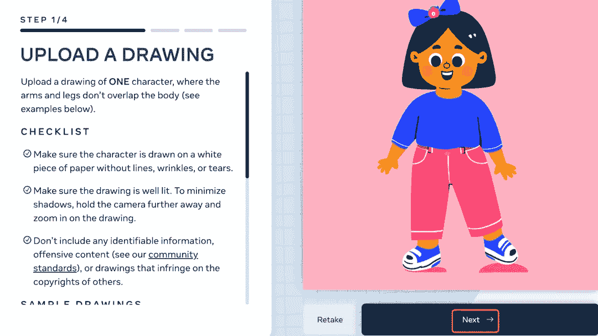

其次，剪裁人物主体，调整框的大小以确保它紧贴人物。

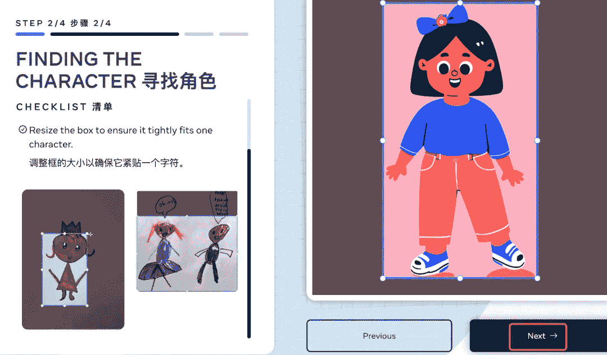

然后，分离角色和背景。如果 AI 无法正确识别，我们可以用「钢笔」和「橡皮擦」按钮手动微调。

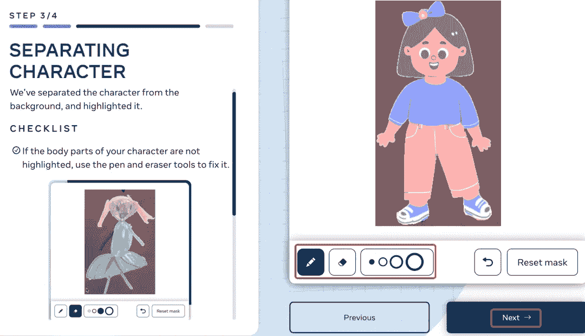

接着，拖动关节点来自定义角色主体的动作。如果角色没有胳膊，则将肘部和腕部的关节点拖远，它仍然可以制作动画。

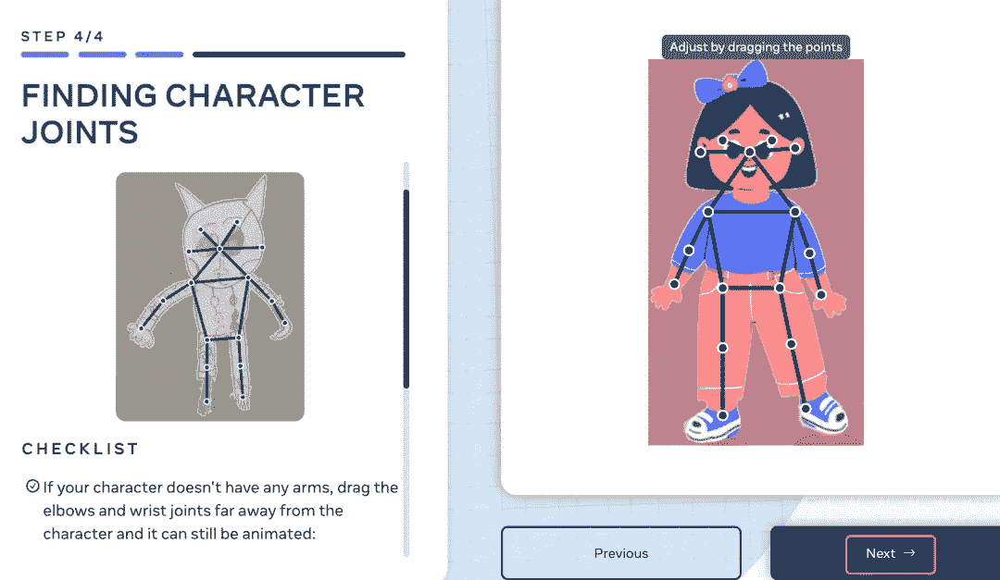

我们也可以使用官方提供的 32 种动画模版，包括走、跑、跳以及其他各种奇葩的姿势。

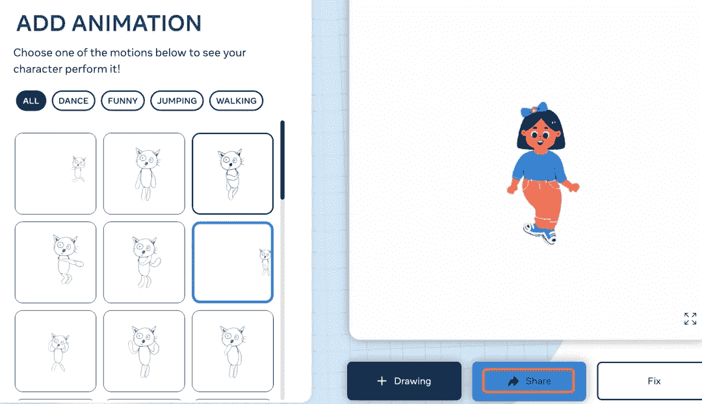

最后下载保存。

不过，Animate Drawing 生成的是个 mp4 格式的视频。我们可以去🛰️小程序上搜「视频转动图」类的小工具，将其转成 gif 动图。

上效果：

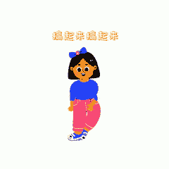

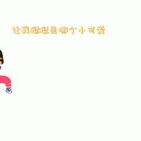

来呀，斗图呀～

<https://aigcreative.feishu.cn/sync/K4Gvd9vUQsy9Oubwqaeclu0Fnbg>