# Midjourney 又变强了！一文详解新功能 Style Reference

> 来源：[https://aigcreative.feishu.cn/docx/HfzidUWHioAkn7xHWedcpMNCnFf](https://aigcreative.feishu.cn/docx/HfzidUWHioAkn7xHWedcpMNCnFf)

> 来源：优设

> 原文：https://www.uisdc.com/style-reference

大家好我是花生~

没错今天依旧是 [Midjourney](https://www.uisdc.com/tag/midjourney)[ 的相关内容， 因为它又推出了](https://www.uisdc.com/tag/style-reference)一个非常重要的新功能—— Style Reference （风格参考），可以学习一张图像的风格并生成相似新图像。 新功能的用法是怎样的？与 Image Prompt 垫图又有什么区别呢？一起来看看吧~

#### 一、 Style Reference 使用介绍

如果说[ Style Tuner](https://www.uisdc.com/style-tuner) 让我们能探索出更多独特的新风格，那么 Style Reference 就让复制某种特定风格变得更加容易，作用类似于 SD 里的 controlnet reference 及 ip-adapter。它的具体使用步骤如下：

①首先在上传需要学习风格的图像，方法是双击提示词输入框左侧的 “+” 图标，然后按 Enter 发送出去；

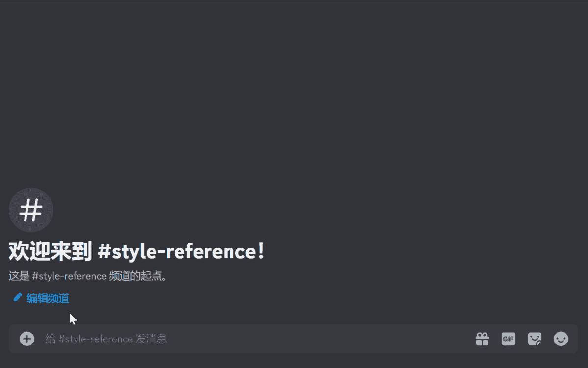

②图像上传成功后，启用 /imagine 输入提示词，然后加上 Style Reference 对应的后缀参数 --sref，空格，并粘贴上传的图像链接，即 --sref urlA。--sref 支持添加多个图像链接，不同链接间用空格间隔，比如 --sref urlA urlB urlC；Style Reference 目前仅支持在 V6 和 Niji V6 模型中使用，所以提示词中一定要记得加 --v 6 或者 -- niji 6。

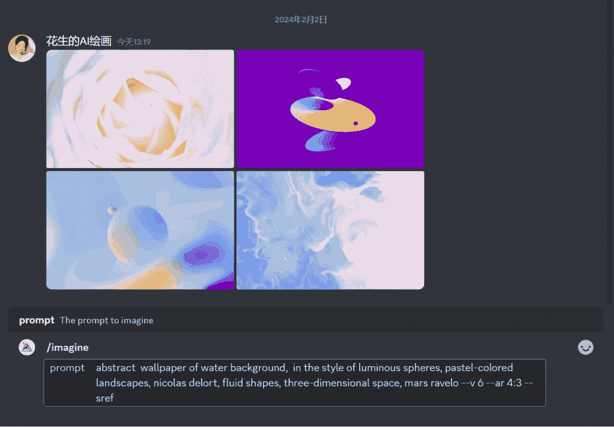

③按 Enter 将图像发送出去后，等待片刻就能看到风格学习的结果。可以看出启用 Style Reference 生成的图像与原图在风格、材质等细节上非常相似。

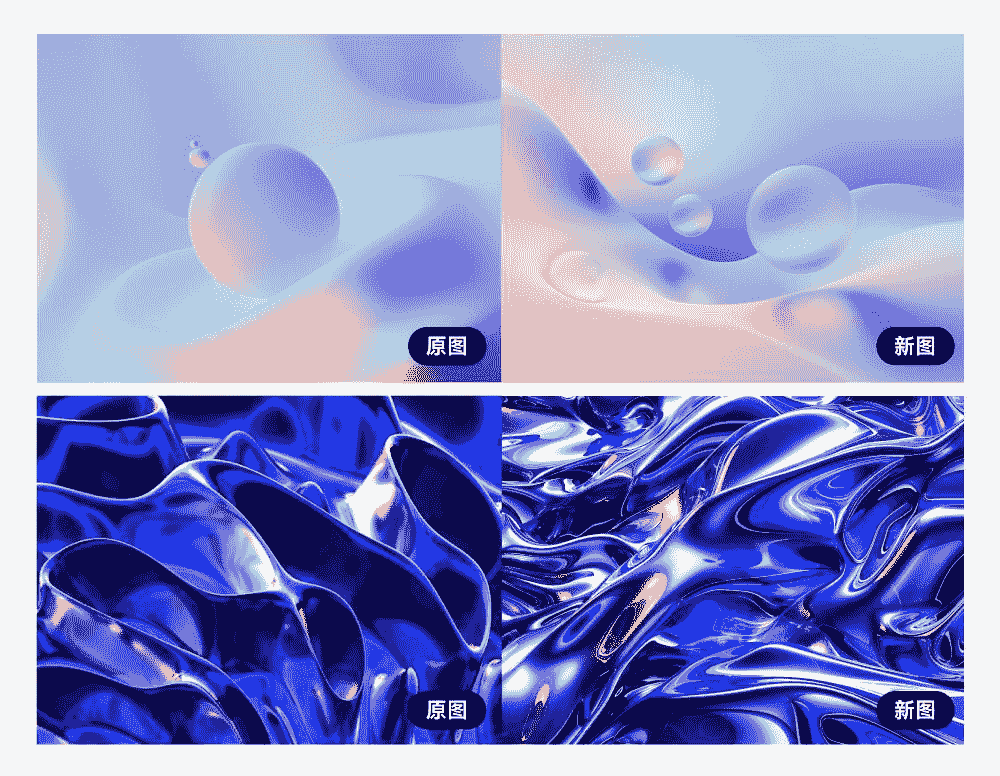

④--sref 可以与 --sw （style weight）参数搭配使用，用来调节风格强度。--sw 默认值为 100，数值范围 0-1000；数值越高，生成的图像与参考图像的风格就越相似；数值越低，画面就越接近提示词直出的效果。经过测试，个人觉得数值在 250 左右效果较好，超过 500 画面容易出现扭曲变形。

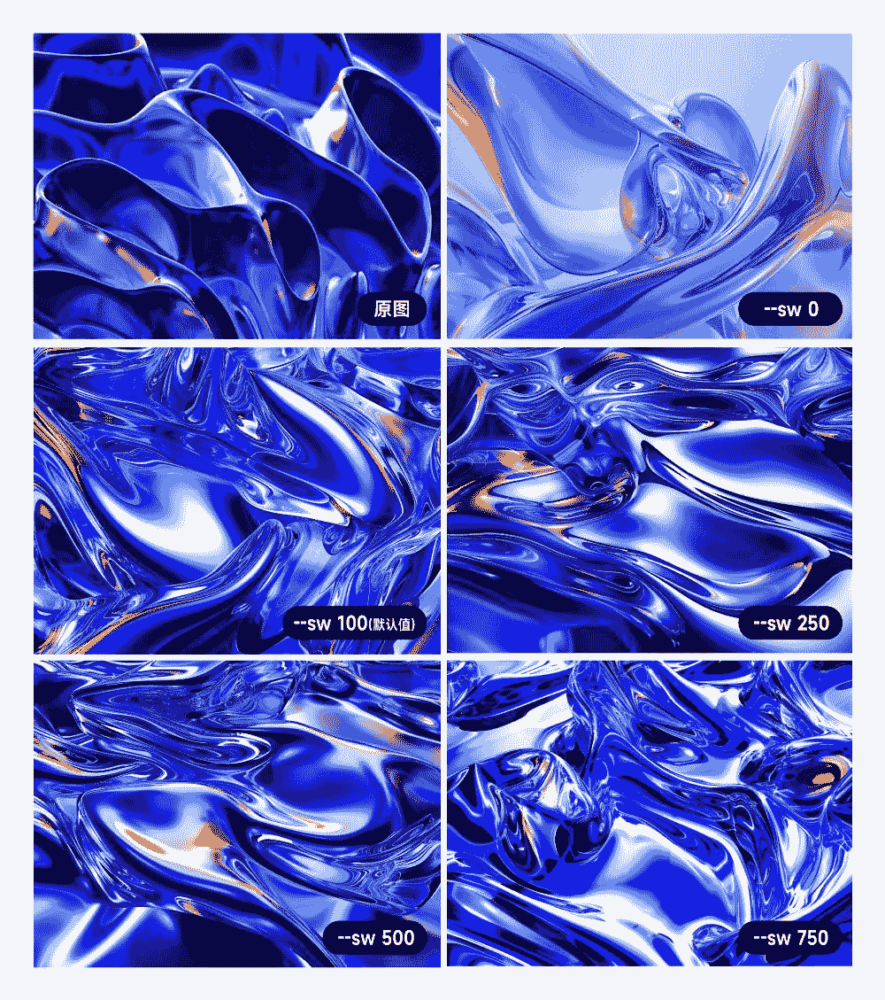

⑤此外 --sref 参数支持调节不同图像的权重，方法是在图像链接后加上双半角冒号和数值，比如：--sref urlA::2 urlB::3 urlC::5；此处的权重是相对的，即 2:3:5 的效果与 4:6:10 是一样的。

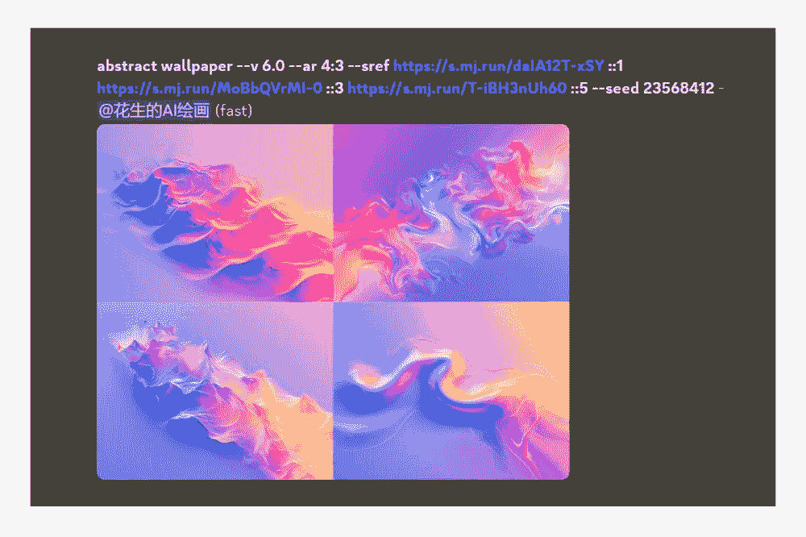

下面是同一组提示词在三张图像以不同 sw 比重下生成的效果，差别还是挺明显的。当 urlC 比重最大时,生成的图像和它一样在周围有大面积的留白；当 urlA 比重最大时，新图像里有层层叠叠的白色烟雾，模仿的正是 urlA 中花瓣的颜色和形态特征。由此我们也可以得知，调节图像间的 sw 比重可以get更多样的风格，并且其中一些风格的美感明显优于其他的风格，使用此功能时我们可以多做seek。

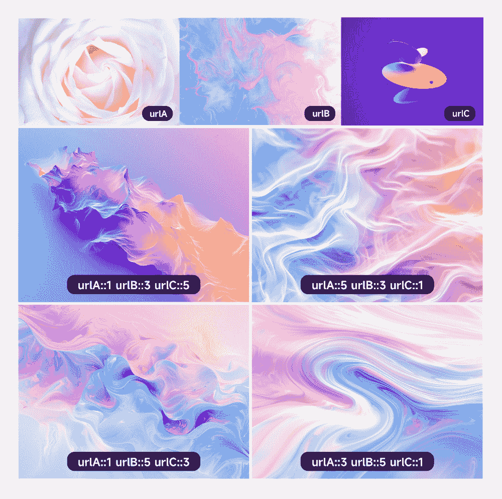

#### 二、与 Image Prompt 垫图的区别

Style Reference 推出后就有人在问它和 Image Prompt 垫图有什么区别，想必很多小partner也有同样的疑问。针对这个问题，我也生成了多组图像进行对比测试，得出的结论是二者在功能上是非常相似的，都可以提取图像在风格形式上的特征，生成与之相似的新图像，不过在具体的learning内容上还是有区别的。

Style Reference 更倾向于学习图像在美学风格和氛围上的特征，而 Image Prompt 则会学习垫图在内容元素、色彩以及构图等方面的特征，如下图中的三张插画，虽然看起来都是扁平风格，但多生成几组图像后会发现，使用垫图生成的图像在颜色上与原图更相似，并且人物也大多是蓝色外套、黄色裤子，与原图的人物一样，而用 --sref 生成的图像只是在画风上与原图保持一致，人物和装饰元素的细节则与原图有很多differ。

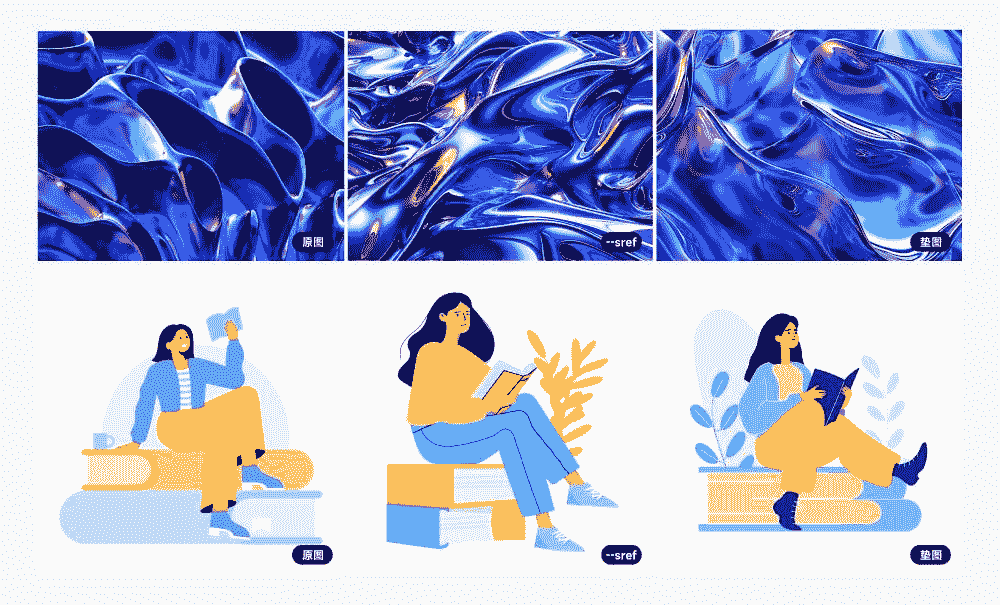

接下来的两组对比会更加明显。在人物照片对比组中，垫图生成的人物feature、姿势动作与原图更像；--sref 则在内容上更灵活多变，但风格与原图一样是温柔的棕色系。在抽象壁纸对比组中，sref 更好地保留了物体的磨砂质感与柔和的氛围；而垫图则构图上与原图更相似，并且受clue词影响带有水质感。

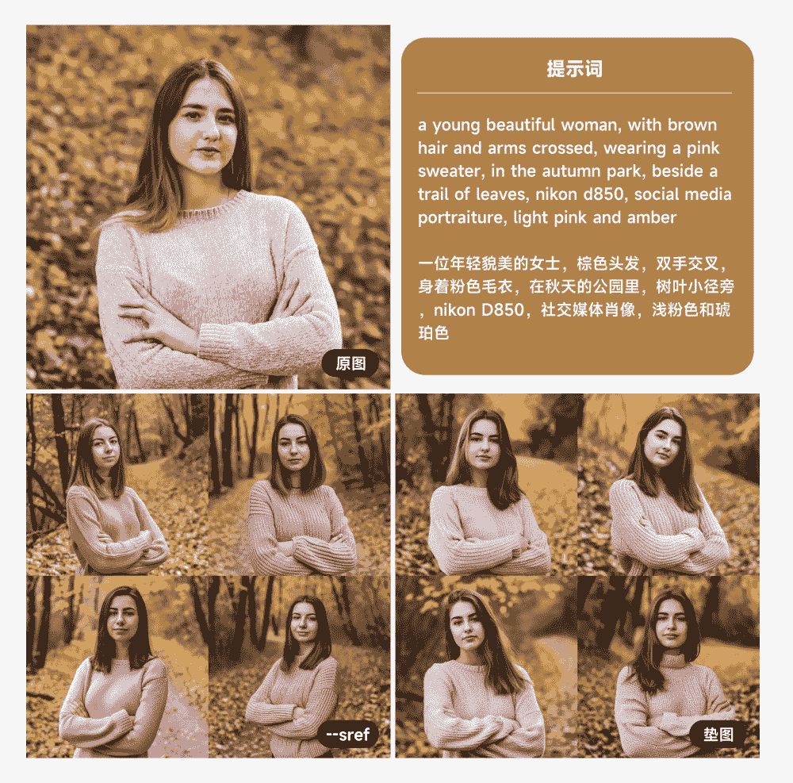

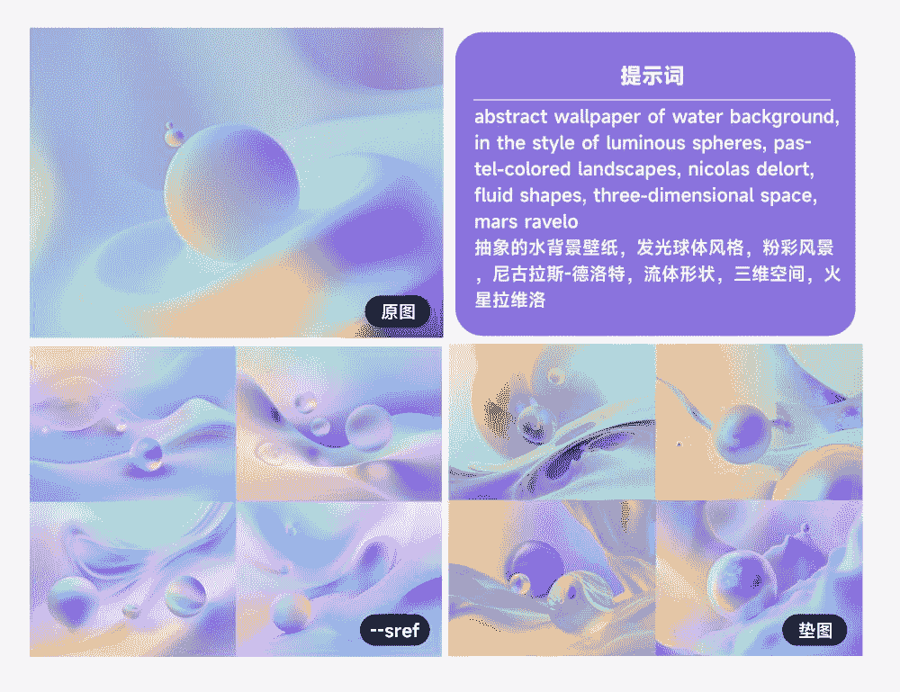

因此我的建议是，如果你想让生成的图像与某张图像很相似，就用 Image Prompt，它能复制原图的细节特征，比如元素、构图、颜色等；如果你只是想模仿一张图像的美学风格，就使用 Style Reference，它能更好地模仿材质、氛围上的特征，而且不用担心原图的特征会干扰新图像的生成。

另一点需要注意的是，提示词会很大程度影响 Style Reference 的效果。如果提示词详细地描述了原图的内容，那么 Style Reference 和 Image Prompt 都能很好的复制原图风格；如果是很简单的描述，那么 Style Reference 将会与原图有很大的不同，而 Image Prompt 则可以一定程度上保留原图在构图、元素上的特征

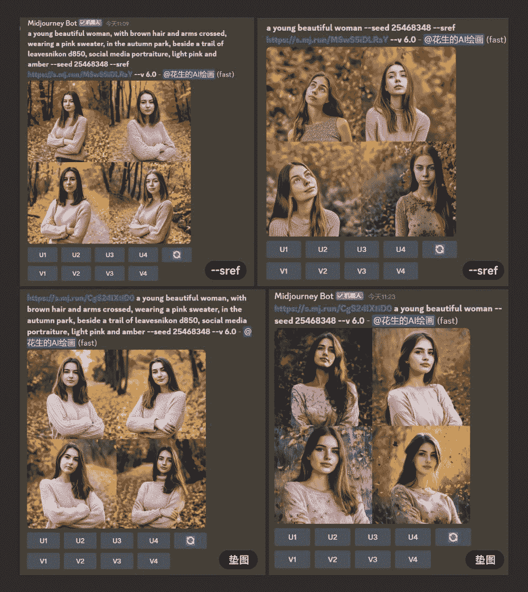

此外 Style Reference 和 Image Prompt 是可以同时使用的，写提示词时依旧是 Image Prompt 垫图链接位于句首，Style Reference 图像链接跟在 --sref 参数之后。二者同时使用可能获得更好的结果，但也可能会让图像质量更差。

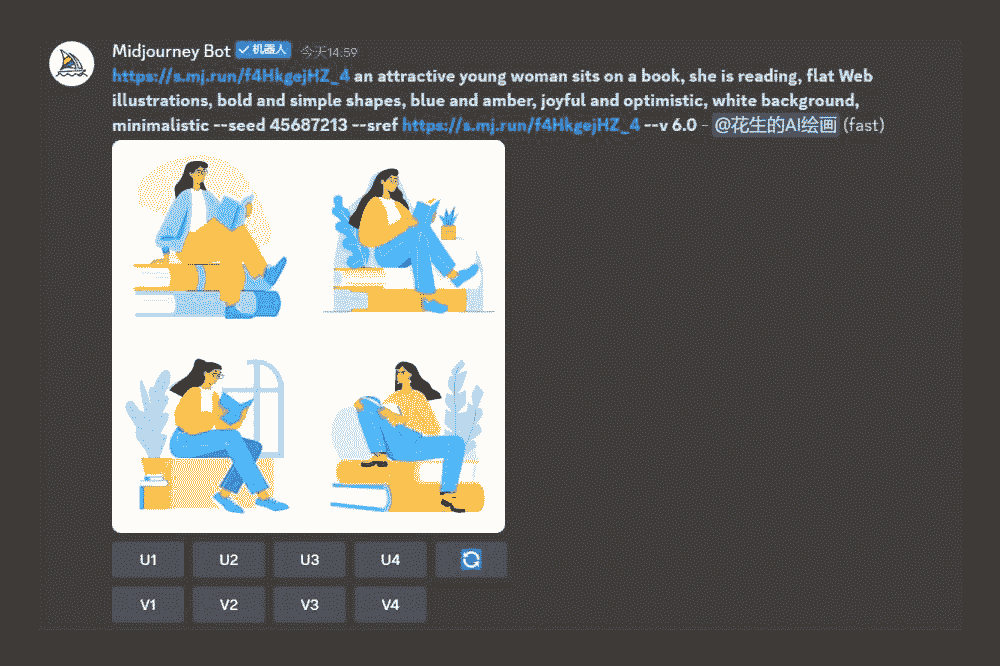

以上就是对 Midjourney 新功能 Style Reference（风格参考）的相关解析，这是一个 Alpha 功能，所以未来可能会有变化。官方还宣布会在稍后上线 Character Reference 功能，以解决大家一直以来都很关心的人物形象一致性的问题，我们也可以期待一下。

<https://aigcreative.feishu.cn/sync/K4Gvd9vUQsy9Oubwqaeclu0Fnbg>