# Midjourney V6 更新角色一致性命令 "--cref "

> 来源：[https://aigcreative.feishu.cn/docx/RtAqdrr2qouSZCxjQm2cZGbqnbe](https://aigcreative.feishu.cn/docx/RtAqdrr2qouSZCxjQm2cZGbqnbe)

> 作者：努力的五花肉         公众号：RaDesign

> 链接：https://mp.weixin.qq.com/s/X7N8fHpwuV9fDeMjgvOoEw

**产房传喜信，生**了！ 新的功能命令“ --cref ”，试图使角色与“人物参考”图像相匹配，注意：本次命令更新依附于 Midjourney V6 测试阶段，后续更新正式版前会有所变动。

# **官方说明**官方给出了如何使用的方法，它的用途以及高级功能。

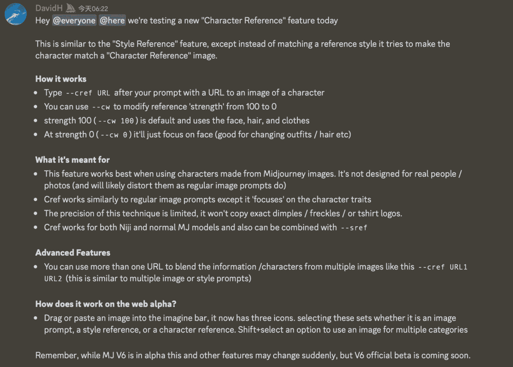

** 它是如何工作的 **· 在你的提示后键入 **--cref URL**，其中 **URL**** 是一个角**色图像的网址· 你可以使用 --cw 来修改参考的 '强度'，从0到100 - 强度100 (--cw 100) 是默认值，使用面部、头发和服装 在强度0 (--cw 0) 下，它将仅关注面部 (适用于更改服装/发型等)

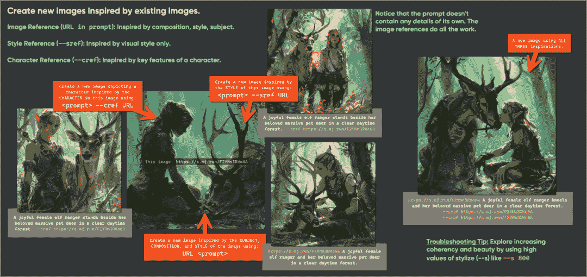

**

它的用途** · 这个功能在使用由 Midjo**urney 图像制作的角色****时效果最佳。**· 它不适用于真实的人物/照片 (并且可能像常规图像提示一样扭曲它们) Cref 的工作方式类似于常规图像提示，只是它“专注于”角色特征 · 这种技术的精度有限，它不会复制精确的酒窝/雀斑/或T恤标志。Cref适用于 Niji 和普通 MJ 模型，也可以与 --sref 结合使用

高级功能 你可以使用多个 URL 来混合信息/来自多个图像的角色，就像这样 --cref URL1 URL2 (这类似于多图像或风格提示)

它在网页 alpha（测试最初版） 上是如何工作的 · 拖动或粘贴图像到想象栏，现在有三个图标。选择这些图标设置它是一个图像提示，一个风格参考，还是一个角色参考。

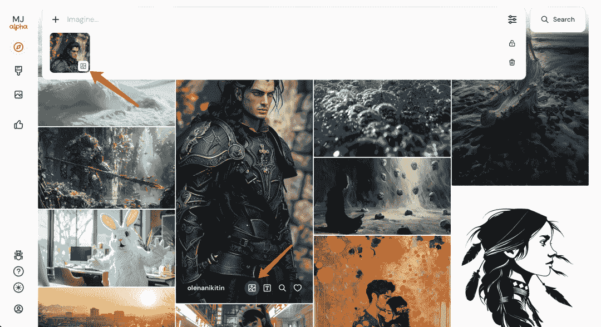

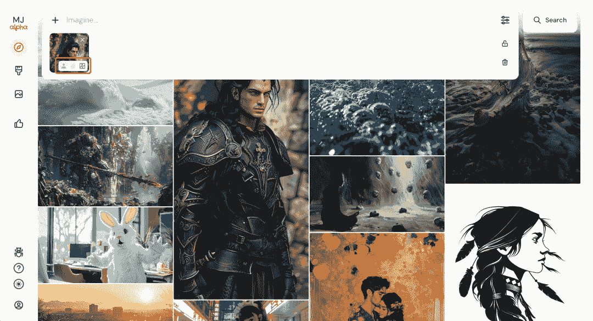

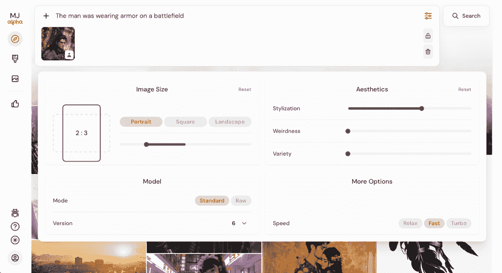

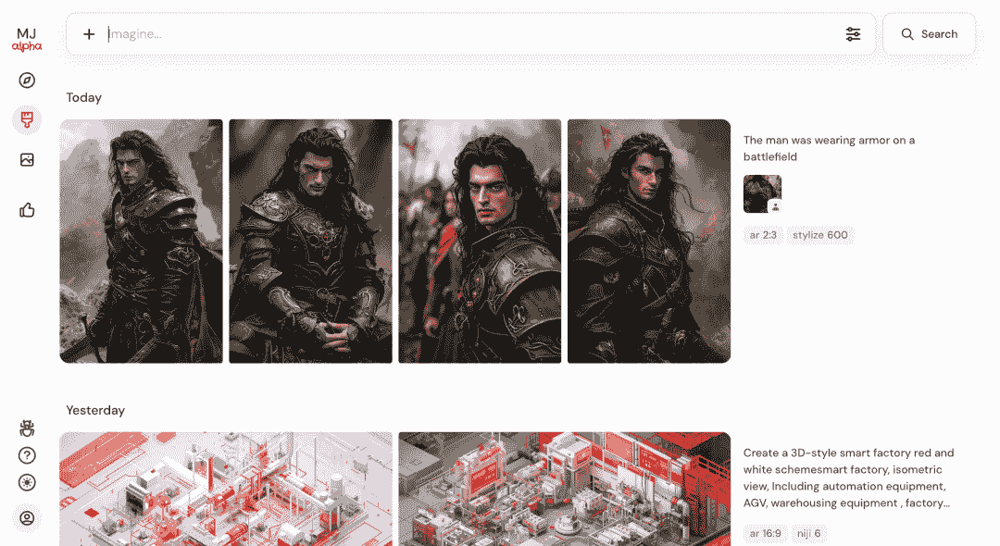

我随机在MJ网页社区里选了一张图片，点击箭头下方的图片 icon 按钮（图1），在上方输入栏里选择这三个按钮（图2 红框里第一个就是角色参考，点击一下图标）加上描述词，调整设置（图3），回车即可实现人物面部不变，场景变化（图4）。

· 按住 Shift 键选择一个选项以将图像用于多个类别请记住，虽然 MJ V6 还处于 alpha 测试阶段，但这个和其他功能可能会突然更改，但 V6 官方 beta 版本即将推出。

# **频道说明** 该频道详细说明了用法以及出现的问题。 地址链接：

https://discord.com/channels/662267976984297473/1216877089286787222

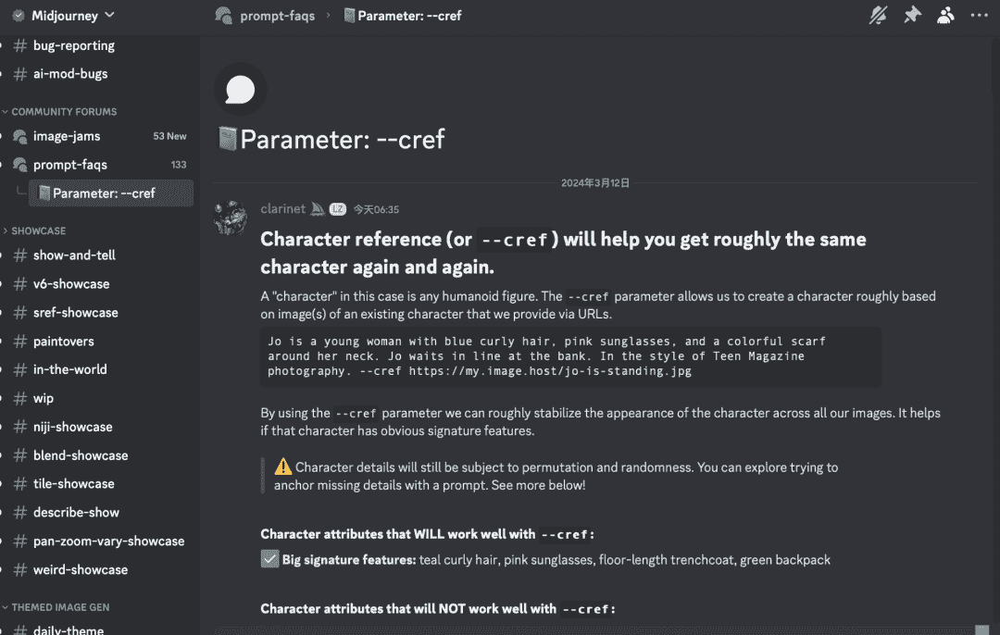

## ** 1.角色参考（或--cref）**将帮助您在不同图像中获得大致相同的角色

在**这种情**况下，“角色”是指任何类人物形象。--cref 参**数允许**我们根据我们通过 URL 提供的现有角色图像来创建大致相似的角色。例子：Jo is a young woman with blue curly hair, pink sunglasses, and a colorful scarf around her neck. Jo waits in line at the bank. In the style of Teen Magazine photography. --cref https://my.image.host/jo-is-standing.jpg 翻译：乔（Jo）是一位年轻女子，头发蓝色卷曲，戴着粉红色的太阳镜，脖子上系着一条五颜六色的围巾。乔正在银行排队等候。以青少年杂志摄影的风格。

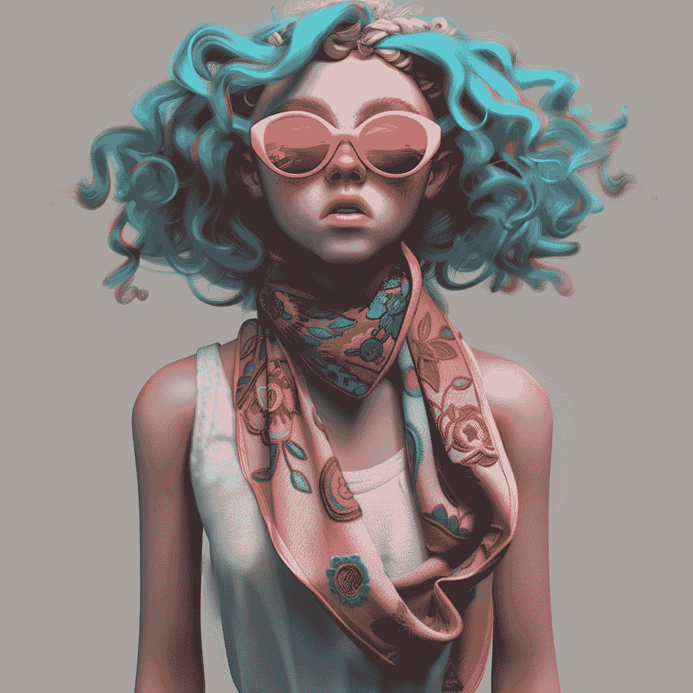

通**过使用** --cref 参**数，我**们可**以在所有**图像中大致稳定角色的外观。如果角色具有明显的特征，则会有所帮助。注意：角色细节仍将受到 排列 和 随机性 的影响。您可以尝试使用提示来锚定缺失的细节。请参阅下面的更多信息！

角色属性对于 --cref 参数效果良好的包括：· 显著的标志性特征：蓝绿色卷曲头发、粉红色太阳镜、及膝风衣、绿色背包角色属性对于 --cref 参数效果不佳的包括：· 细小的细节：一个银色吊坠项链，上面有八个小金字塔形宝石，一件左袖缺失的皮夹克，背后写着 “ZOOM” ，夹克是袖子缺失的设计，两侧夹克缘处有无限符号剃掉的发型。

## **  2.准确的使用方法** ·

选择适合的提示方式处理使用 --cref 进行提示有三种关键方法。您可以锚定细节（姿势、表情、情感、服装、道具、场景、动作），这样您就能掌控它们；您可以轻轻一触，让 --cref 处理大部分工作；或者您可以只提供场景给角色，让 --cref 完全处理所有工作。在这三种情况下，提示将与 Midjourney 能够从您提供的 cref 图像中识别的任何角色属性混合在一起。您的提示可以用于锚定角色的重要细节，也可以让 cref 图像自行贡献所有内容。

· 锚定重要角色细节的提示示例： 注意提示如何强调出现在参考图像中的标志性角色属性。它还“操纵”或“定位”角色。

**例子：**Jo is a young woman with blue curly hair, pink sunglasses, and a colorful scarf around her neck. She waits in line at the bank. --cref https://my.image.host/jo-is-standing.jpg

**翻译：**乔（Jo）是一位年轻女子，头发蓝色卷曲，戴着粉红色太阳镜，脖子上系着一条五颜六色的围巾。她正在银行排队等候。--cref https://my.image.host/jo-is-standing.jpg

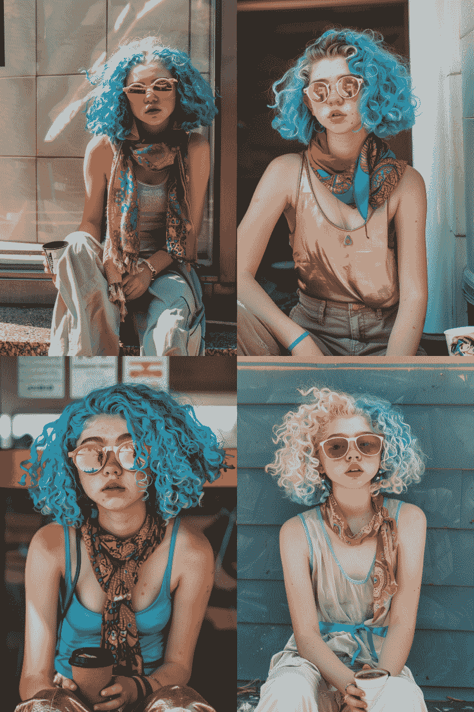

· 不需要重复标志性细节的无干扰提示示例：注意到这个提示没有尝试加强参考图像中的任何标志性细节，它只是“操纵”或“定位”角色。有人正在银行排队等候。--cref https://my.image.host/jo-is-standing.jpg

· 如果您的 cref 图像已经包含您想要的姿势和其他细节，则还有第三种方式可用：您可以仅描述环境、周围环境、背景或情境。Midjourney 将努力将角色融入场景中。如果您选择这种方式，可能会看到一些不连贯的结果。如果是这样，请尝试使用更高值的样式化（--s），例如 --s 800。

· 场景唯一提示的示例： 注意到这个提示甚至没有提及角色，对 Midjourney 能够放置角色充满信心。在一个空荒地下，乌云密布的暴风雨天空下。--cref https://my.image.host/jo-is-standing.jpg注意：--cref 命令适用于单一主题、单一角色的图像。如果您计划在场景中添加多个角色，您需要使用平移按钮来添加它们。

##  3.如果我正在使用 cref，如何在一个画布上放置多个角色

**基于 c**ref 的多个角色放置到单个画布上的最佳方法是使用 平移功能 将新的画布与现有画布拼接在一起。每个新画布的部分都将有自己的 cref。

1.使用 /settings 将 Remix 打开，然后选择 [High Variation Mode / 高变化模式]

**2**.选择将包含第二个字符的图像，然后使用 U  将其从网格中分离出来。

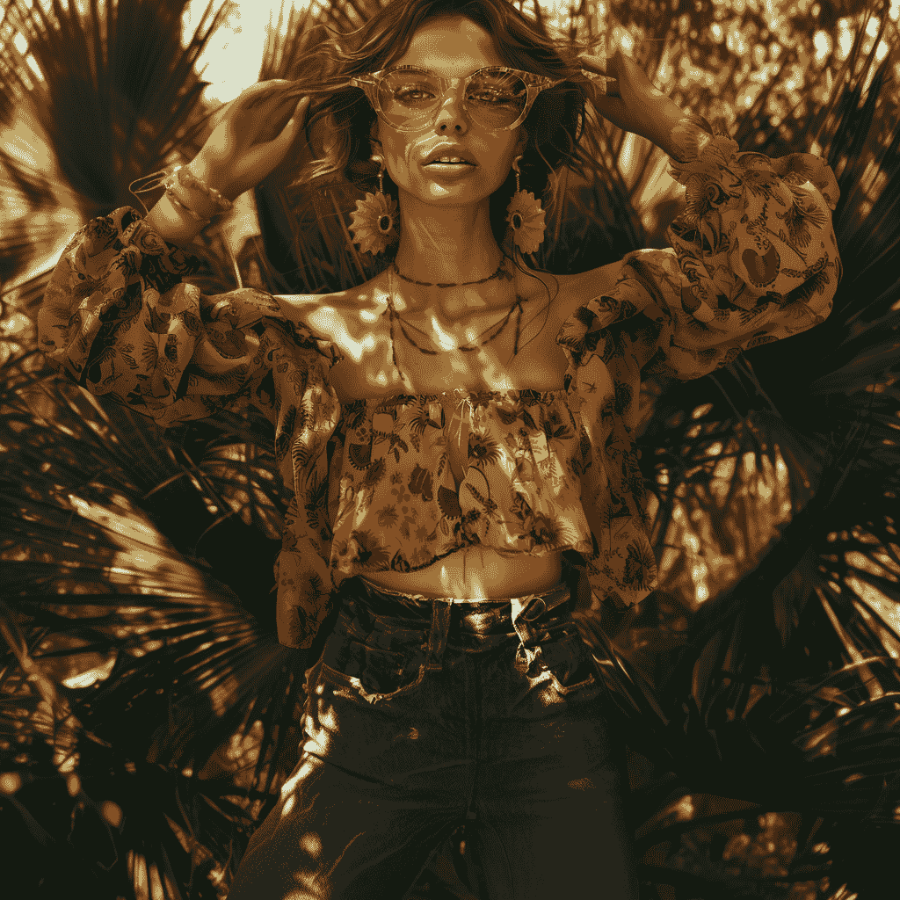

3.寻找蓝色小箭头。 ⬆️⬇️⬅️➡️  每个都会在现有图像中添加一条新图像。选择新角**色的前****进方向**并输入提示及其 -**-cr**ef 。这将缝合一条新的画布，比如上面的角色注意：设置画布以描绘两个人的开场提示。 例子：Two people standing in the forest. Ezra is a husky adult plump male wearing red glasses. He has an undercut short black buzzcut short hairstyle. He is a gamer-nerd dressed in layers, a dark undershirt, an overshirt, hipster boho stylish fashion. He wears a teal overshirt and thick plastic red eyeglasses. --cref https://s.mj.run/dCsjeI5AflU --ar 3:2翻译：在森林中站着两个人。Ezra 是一个傻大个、胖胖的男性，戴着红色眼镜。他有一个短的黑色发型。他是一个穿着层层叠叠的游戏宅男，穿着一件深色背心、一件外套，时尚的嬉皮士波西米亚风格。他穿着蓝绿色的外套和厚厚的塑料红色眼镜。--cref https://s.mj.run/dCsjeI5AflU --ar 3:2

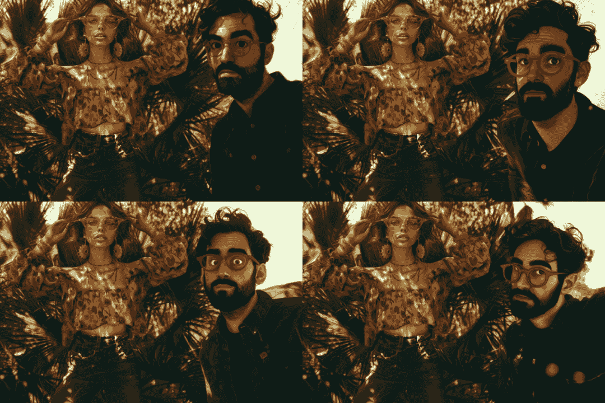

根据需要重复此过程，但要小心不要过多地这样做，因为会丧失保真度。

## ** 4.添加您的角色参考图像，并选择一个 -**-cw (cref 权重) 以达到效果

**Mid**journey 能够从参考图像中识别的角色属性将与提示混合，从而创建出您角色的最终表现。您可以通过使用 --cw N 参数（cref 权重）来大致控制转移，其中 N 的值可以从 1 到 100。默认值为 100。

注意： --cw 参数不会改变角色参考图像的强度/影响力，--cw 参数的作用：· --cw 100 的值（默认值）将捕捉整个角色。 · --cw 99 到 --cw 1 之间的值将开始捕捉较少的整个角色，仅集中于转移面部。 · --cw 0 的值将仅捕捉面部，大致类似于面部替换。 · 您无法关闭面部的转移。

# **CREF 故障排除提示**你需要知道或排除的问题。

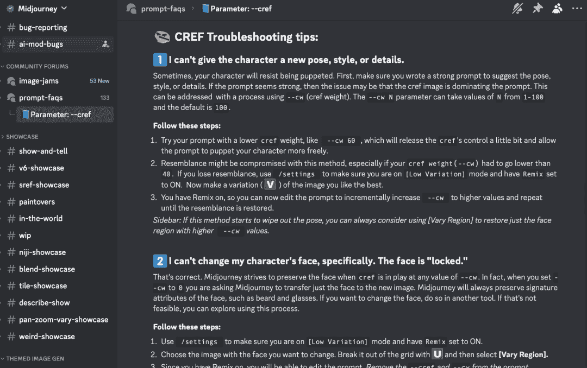

##  1.我无法给角色一个新的姿势、风格或细节

有时，**您的角色会抗拒被操纵**。首先，确保您写了一个强有力的提示，以建议新的姿势、风格或细节。如果提示似乎很强大，那么问题可能是 cref 图像支配了提示。这可以通过**使用 --cw (cref** 权重) 进行处理。--cw N 参数可以取** **N 值从 1 到 100，默认值为 100。 按照以下步骤操作： · 尝试将您的提示与较低的 cref 权重一起使用，比如 --cw 60，这将稍微释放 cref 的控制，允许提示更自由地操纵您的角色。· 使用这种方法可能会损害相似性，特别是如果您的 cref 权重 (--cw) 必须低于 40。· 如果失去了相似性，请使用 /settings 确保您处于 [Low Variation/低变异] 模式并且 Remix 设置为打开。现在，创建一个您最喜欢的图像的变体 （V）。 · 您已经开启了 Remix，所以现在您可以编辑提示，逐步增加 --cw 到较高的值，并重复此过程，直到相似性恢复。 侧边栏：如果此方法开始擦除姿势，您始终可以考虑使用 [Vary Region] 来仅使用更高的 --cw 值恢复面部区域。

##   2.我无法改变我的角色的脸部，特别是脸部是“锁定”的

这是正确的。

Midjourney 努力在 cref 起作用时保留面部，无论 --cw 的值如何。事实上，当您将 --cw 设置为 0 时，您是在要求 Midjourney 将只转移面部到新图像中。Midjourney 将始终保留面部的标志性属性，如胡须和眼镜。如果您想要改变面部，请在另一个工具中进行。如果这不可行，您可以尝试使用此过程。

**按照以下步骤操作： **

**· 使用 /setting**s 确保您处于 [Low Variation/低变异] 模式并且 Remix 设置为打开。

**·** 选择带有您想要更改的面部的图像。使用 (U) 将其从网格中分离出来，然后选择 [Vary Region]。

· 由于您已经开启了 Remix，您将能够编辑提示。

· 从提示中删除 --cref 和 --cw。一旦删除了它们，修改提示以对面部进行更改。例如，您可以慷慨地选择面部的下半部分，并添加“清洁剃须”来除去胡须。您可以尝试使用小的负权重，例如 tattoos ::-0.5 来移除纹身。这是一个供您探索和发现的领域，根据您的目标来决定。

**注意：**当您对更改满意时，请确保不要再次添加 --cref 到提示中！一旦添加回来，"面部交换"将再次发生，那些不需要的属性将重新出现。

##  3.某些部分看起来有些怪异或破碎

有时，Midjourney 在正确将角色放置在背景中时会遇到一些困难。如果结果不连贯（例如，您看到头部朝后或图像被奇怪地裁剪），请尝试将 stylize (--s) 增加到 800-1000。您也可以尝试将 --cw 同时降低到低于 100 的值，视情况而定。

## **  4.你需要知道的问题**

### 1.使用 --cref 时最适合使用的图像类型是什么？

如果您的角色具有明显的标志性角色属性，那么这将非常有帮助。确保这些标志性属性在您提供的 --cref 图像中处于显眼的位置，以确保它们不会被忽略。清晰展现这些标志性属性的图像是最适合使用的图像。（当 cref 图像也处于所需的姿势时，复杂的姿势可能更容易。我们建议创建一个包含各种不同姿势的角色参考图像库，并根据需要使用它们来加强您的文本提示。）

###  2.我是否需要使用多个 cref 图像？

不需要**。一般****情况下**，您不需要提供多个 cref 图像。多个图像可能只有在表示姿势或外观变化方面有困难时才会有所帮助，而这些困难往往无法仅通过提示来解决。在这些情况下，包含代表困难姿势或细节的 cref 图像将非常有帮助。如果您确实使用了多个 cref，请使用空格分隔 URL，就像这样：例子：Jo runs down an alley with a bag of money, looking over her shoulder. --cref https://my.image.host/jo-running.jpg https://my.image.host/jo-looking-over-shoulder.jpg

翻译：乔（Jo）带着一袋钱在小巷中奔跑，回头看着。--cref https://my.image.host/jo-running.jpg https://my.image.host/jo-looking-over-shoulder.jpg

###  3.我的角色是否需要在纯色背景下展示？

不需要。Midjourney 将寻找人类(oid)形象，所以只要它们没有被遮挡或伪装，图像可能就可以使用。人物形象的特征越清晰，它的表现就会越好。

### 4.我的角色是否需要单独展示？

是的。您的 cref 图像中应只包含一个角色。如果 cref 图像中有多个人物形象，Midjourney 将它们混合在一起，并混合到输出中。如果您想在同一个画布上添加多个明确的角色，您将需要使用 pan 并单独添加第二个角色及其自己的 cref。

### ** 5.我可以使用参考表或角色转身表吗，**其中我的一个角色在多个姿势中展示了多次？

可以。我们已经看到参考表和转身表能够使用，但它们似乎并没有比仅有一个图像或多个每个姿势一个图像更好。请注意，每个人物形象将被混合在一起，然后混合到画布上。到目前为止，单一角色主题图像与简单背景的组合似乎效果最好。根据您自己的目标进行探索是值得的。

6.我可以使用任何风格的角色图像吗？ 可以。Midjourney 将努力在捕捉角色属性时不捕捉风格或构图，但如果您看到不良影响，我们建议使用提示来控制风格和构图。

<https://aigcreative.feishu.cn/sync/K4Gvd9vUQsy9Oubwqaeclu0Fnbg>