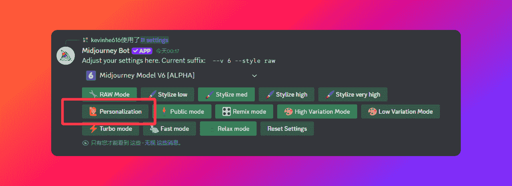
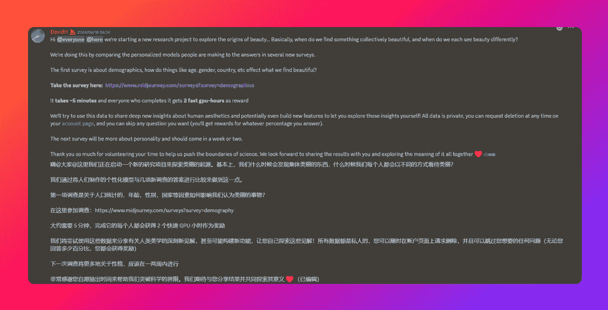
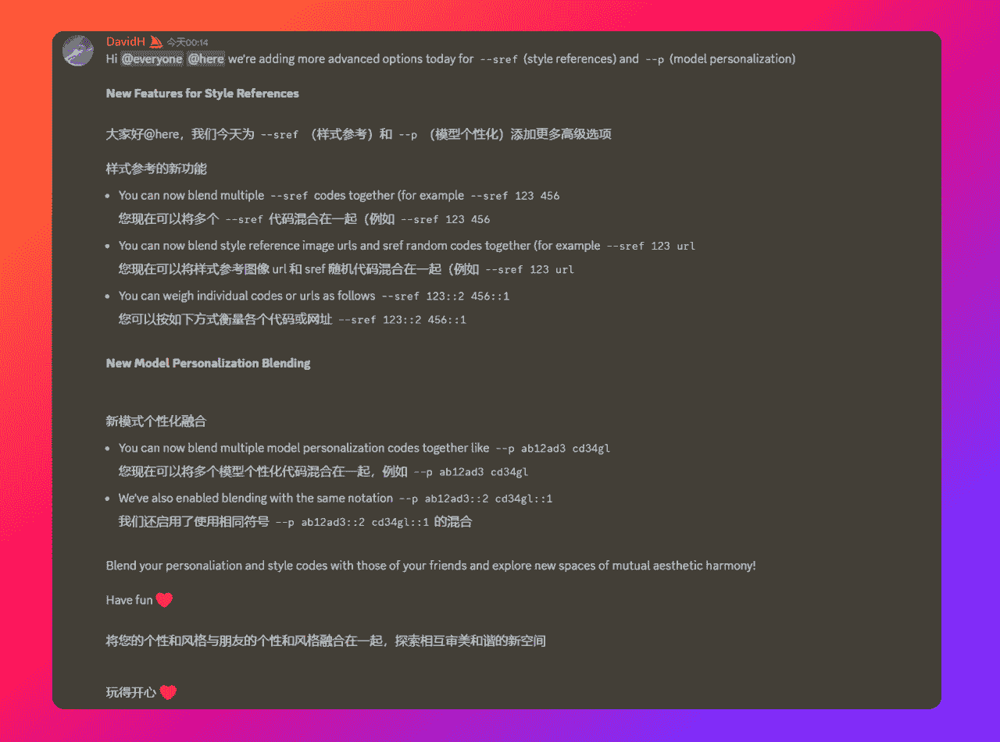
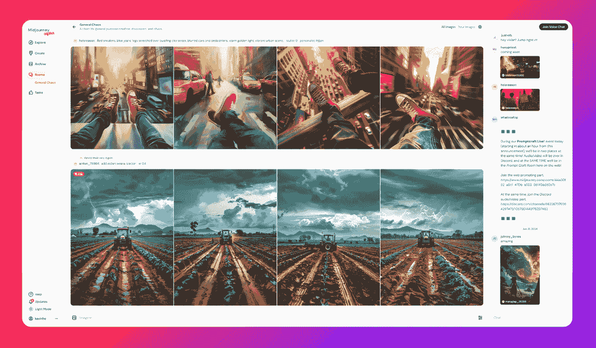

# 20240621-Midjourney大招！V6.5即将发布，视频和3D在V7版本之后！

> 来源：[https://aigcreative.feishu.cn/docx/F4VhdCQoQoIAu2x5AVxcJBkNnO0](https://aigcreative.feishu.cn/docx/F4VhdCQoQoIAu2x5AVxcJBkNnO0)

Midjourney团队在6月19日的最新Office Hours活动中透露了许多激动人心的更新和计划。

从即将推出的个性化功能到新版本的训练进展，Midjourney正在为用户带来更丰富、更高质量的图像生成体验。

#### 个性化设置即将成标配

如果你还没有尝试过Midjourney的个性化功能，那你真的是out了！通过对大约200张图片进行评分，你就能生成自己的个性化代码，并在提示中使用--p选项来应用它。

这项功能很可能在即将发布的v7版本中成为默认设置，帮助你轻松生成更符合个人审美的作品。

#### 填写统计调查，获得Fast时间

Midjourney还推出了一项人口统计调查，参与填写的用户将获得优先访问权，更快体验新功能。这个调查不仅有助于团队了解用户需求，也能让用户享受更好的服务体验。

#### srefs和个性化代码的终极混合

就，Midjourney将推出一项激动人心的更新，用户将可以混合多个srefs和个性化代码。这意味着你可以将不同的灵感和个性化设置融合在一起，创造出更加独特的图像。例如，你可以同时应用多个srefs和个性化代码，获得最佳效果。

#### 网站更新：更多社区互动即将上线

Midjourney的网站也在不断改进中。团队正考虑增加更多的社区功能，例如展示流行的sref。这将帮助用户发现和分享创作灵感。同时，网站也将逐步开放给小批量的随机用户，未来还会添加一个sref百科全书，让大家更方便地查阅和使用不同的sref。

#### v6.5：图像质量大幅提升

Midjourney的v6.5版本正在紧锣密鼓地训练中，团队表示进展顺利，图像质量将会非常出色。这个版本预计将在几周内上线，让我们拭目以待。

#### v7和未来规划

对于v7版本，Midjourney团队目前正在紧张开发中。更令人期待的是，在v7之后，团队将开始涉足视频和3D图像生成领域，这将进一步拓展Midjourney的创作可能性。

Midjourney的每一次更新都很震撼，为用户带来更强大、更便捷的创作工具！很期待这些新功能及Ai视频、3D功能早日上线！

<https://aigcreative.feishu.cn/sync/K4Gvd9vUQsy9Oubwqaeclu0Fnbg>