# 20241222-Midjourney 功能更新：情绪板 Moodboard

> 来源：[https://aigcreative.feishu.cn/docx/EGm1da7AboQRQBx8VsDcTZrMn4d](https://aigcreative.feishu.cn/docx/EGm1da7AboQRQBx8VsDcTZrMn4d)

> 原文链接： [https://mp.weixin.](https://mp.weixin.qq.com/s/uVFSrYWQTxQFkseULI4aKA)qq.com/s/uVFSrYWQ...

> 👸号：设计师doo

今天向大家推荐一个Midjourney的新功能：情绪板（moodboard） 。该功能简明易用，效果显著。

# 什么是情绪板（moodboard）

情绪板就是一种工具，它把一些图片、文字和颜色放在一起，让人一看就能感受到某种情绪、氛围或者风格。

我们可以在Pinterest或者花瓣网上，收集一些图片，作为素材，来建立情绪板。

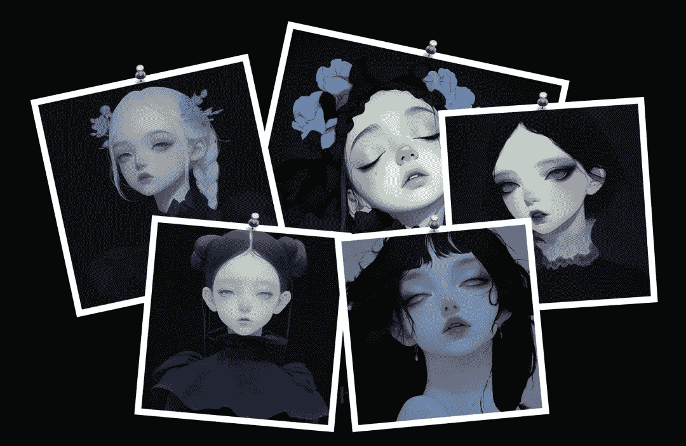

# **实际效果**

我测试了两个案例，分别是数字插画和科技风，实际效果如下：

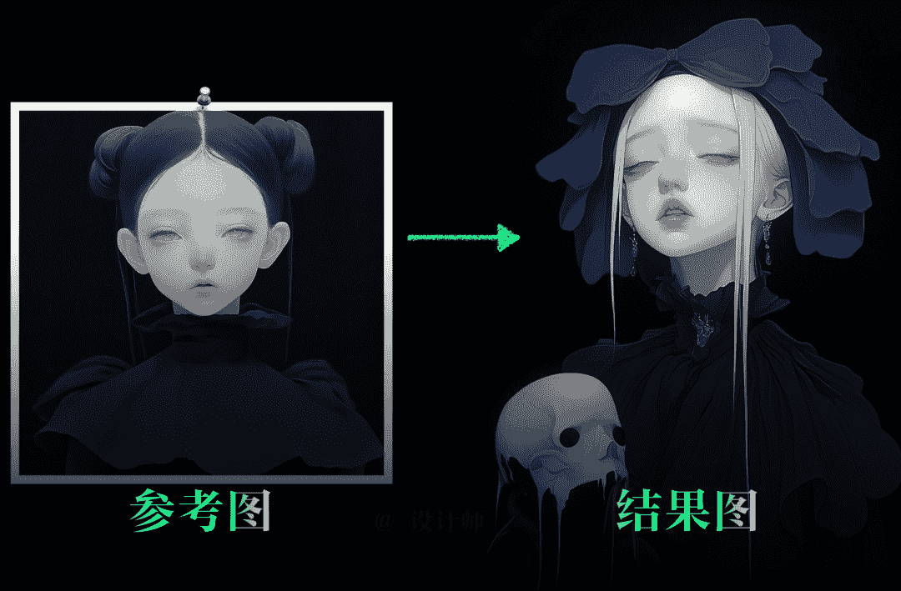

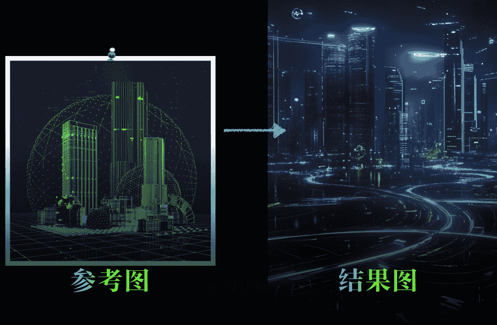

# **如何操作**

登录Midjourney官网（https://www.midjourney.com/），点击左侧的个性化标签。

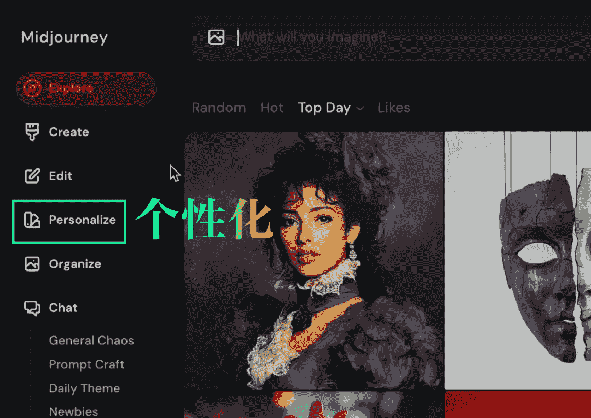

选择页面中部的“建立情绪板”。

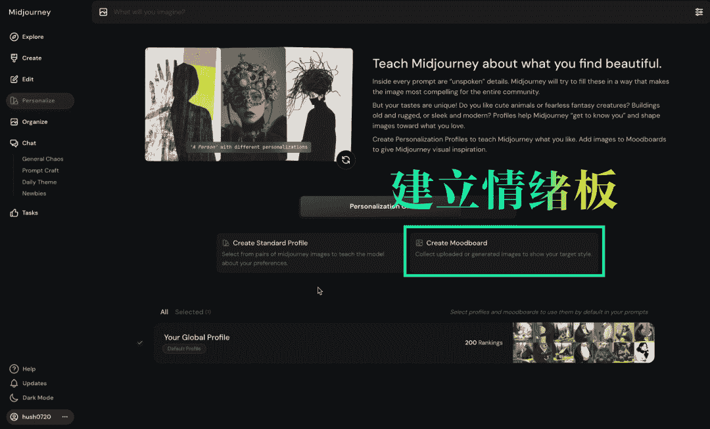

三个上传情绪板的方法：从本地上传、从链接上传、从自己的mj作品中上传。

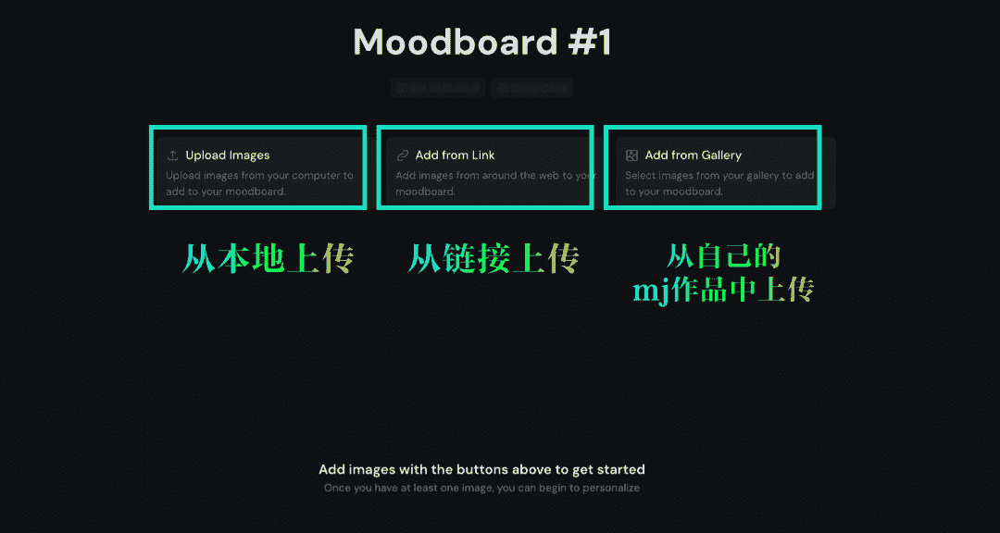

我选择了从本地上传这个方式，上传了一些特定类型的人物插画，以作为情绪板素材。

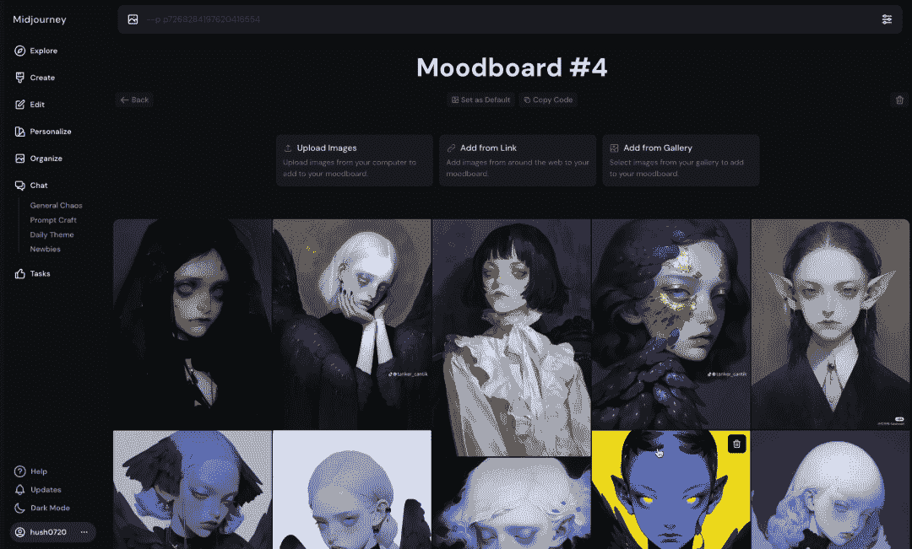

上传好图片之后，在个性化页面中，就出现了一组情绪板，重命名它，方便下次调用。

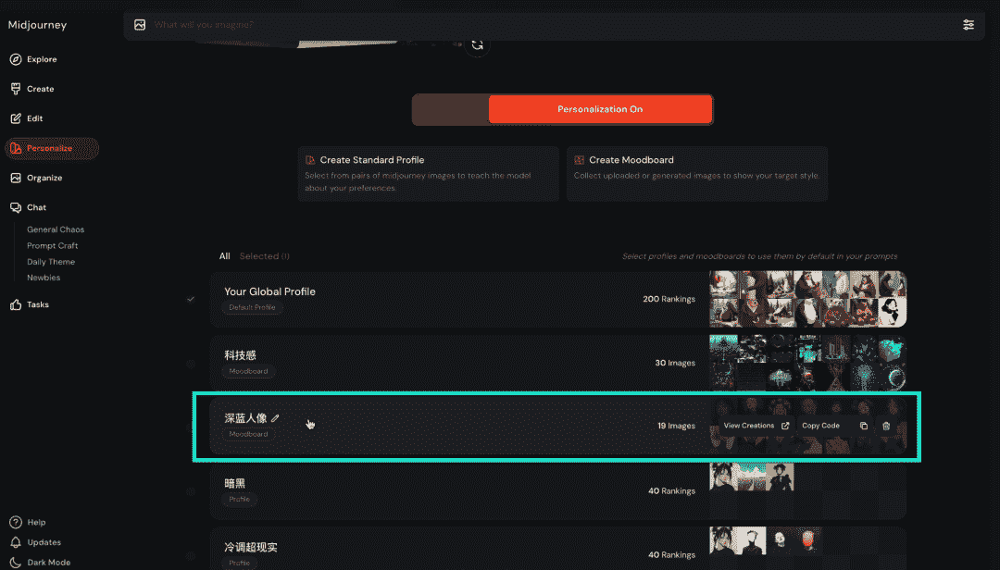

点击复制代码按钮。情绪板代码就被同步到了顶部的输入框内，也就是这串“--p”开头的代码。在此基础上，输入关键词。回车发送，开始出图。

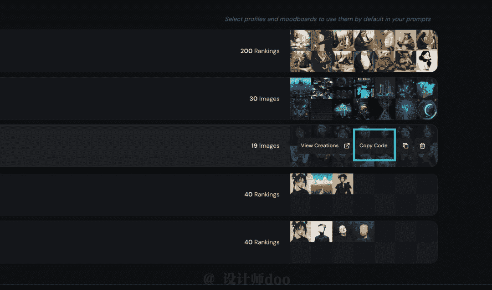

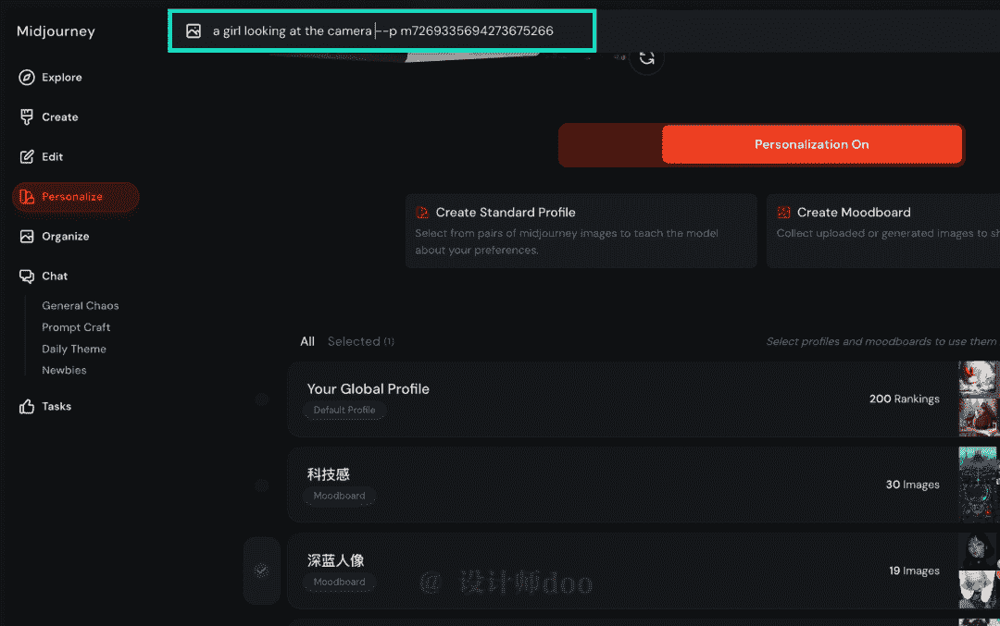

得到一组四宫格结果图，整体还是比较符合参考的。

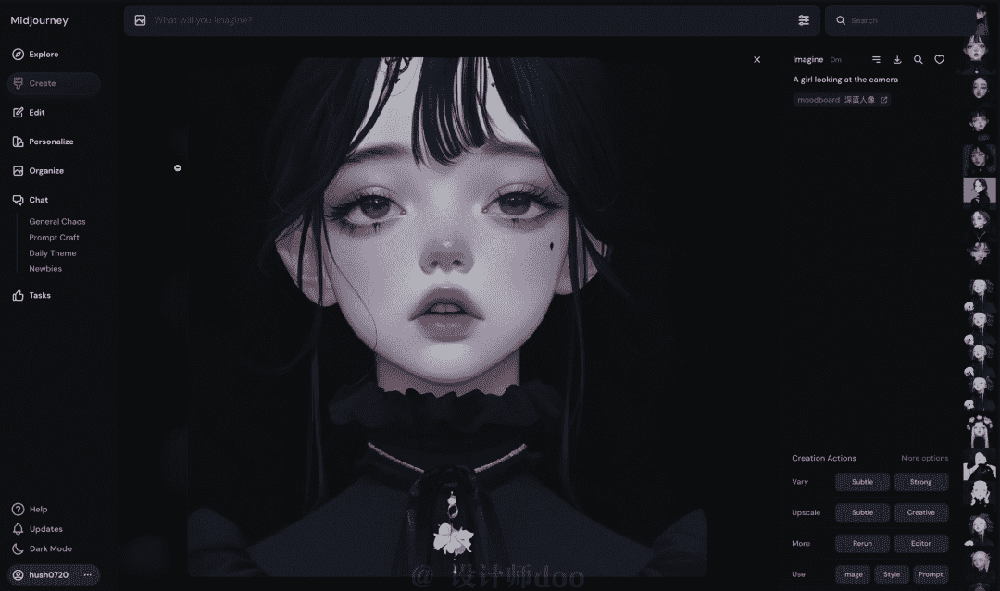

同理，还可以继续建立更多的情绪板，比如“科技感”等等。得到对应结果图。

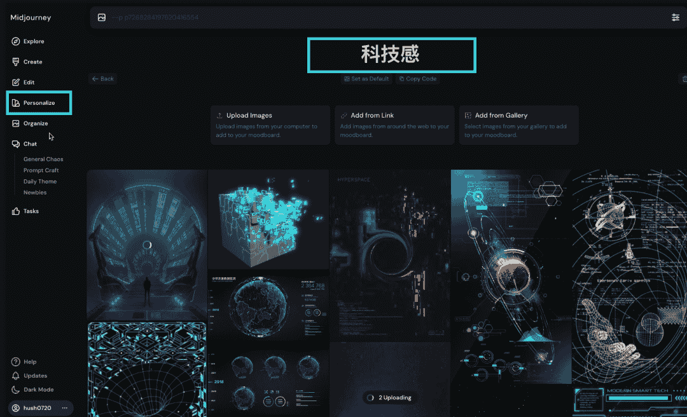

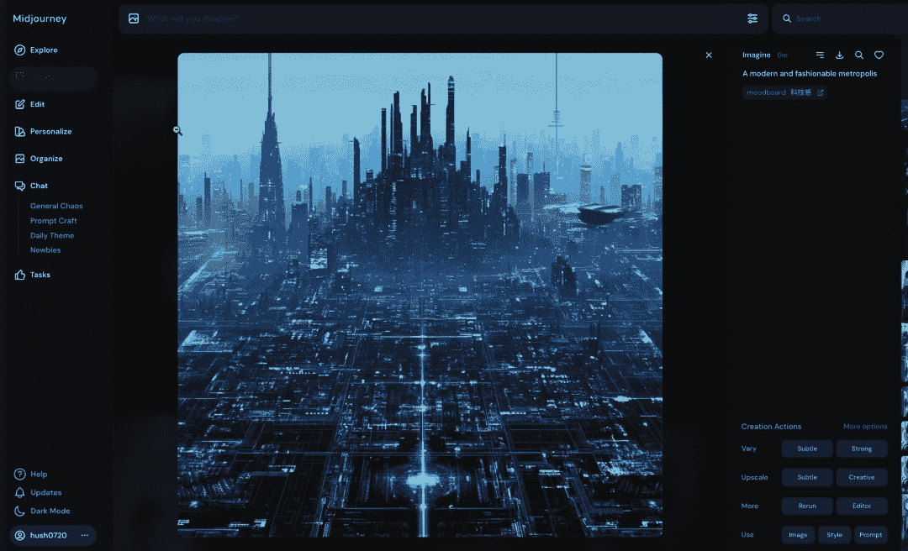

# **总结**

简单明了的新功能情绪板，可以试试。

<https://aigcreative.feishu.cn/sync/K4Gvd9vUQsy9Oubwqaeclu0Fnbg>