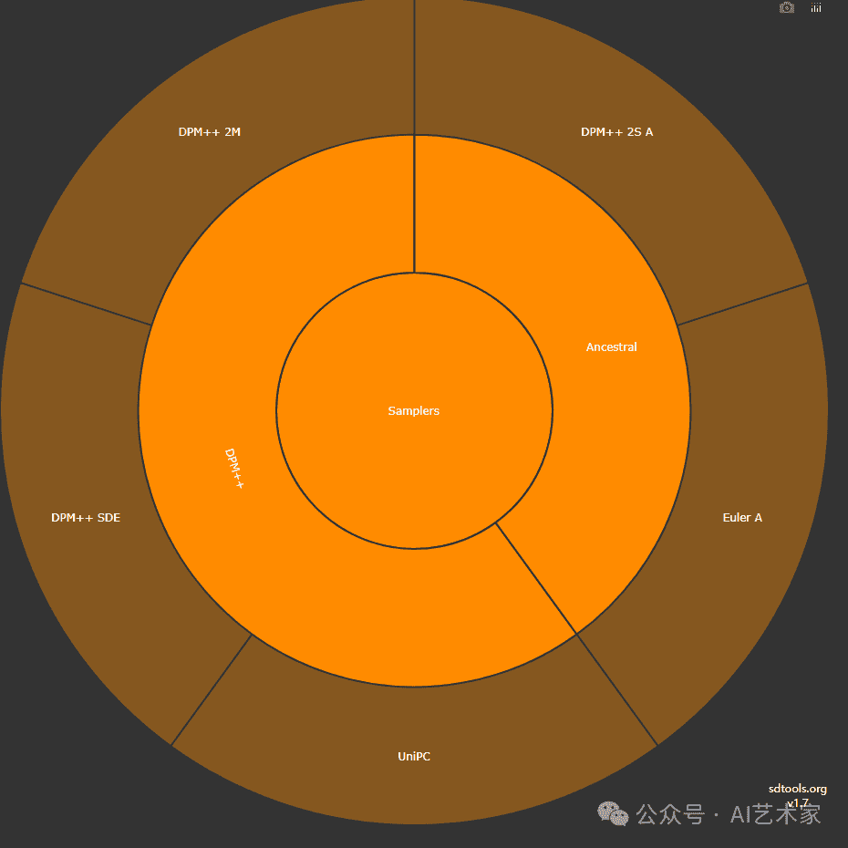
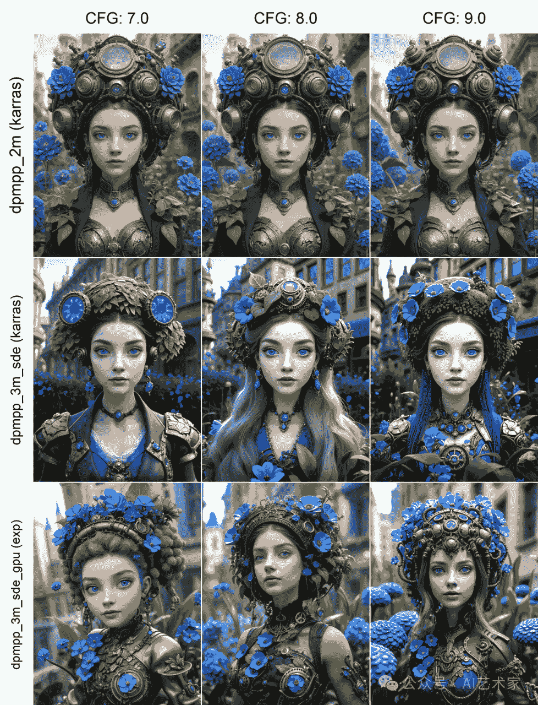
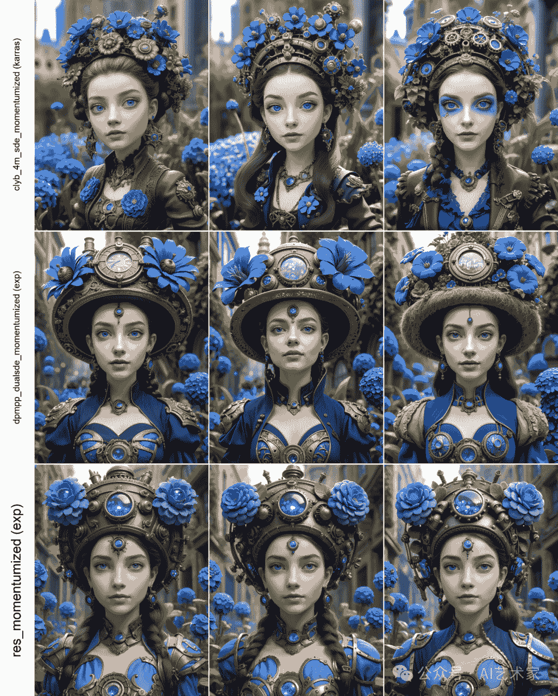

# SD采样器知识

> 来源：[https://aigcreative.feishu.cn/docx/VXWKdoWjUor1k2xh97mc8p46nGh](https://aigcreative.feishu.cn/docx/VXWKdoWjUor1k2xh97mc8p46nGh)

> 来源：公众号-AI艺术家

> 原文链接：https://mp.weixin.qq.com/s/xI8NqeYfRE78k9kU1b_8TA

之前和大家讲过，我们入门AI绘画多少要懂得一点关于采样器的知识。

关于采样器，为什么我们需要不同的采样器？那么，我们要涉及一个核心的问题，那就是哪个采样方法更好？

回答这个问题需要一点点专业性，但并没有那么难。

首先我们都应该知道的是AI绘画是从一堆噪音开始（noise）。我们从最初的噪声图像开始，在每个步骤中，我们都会对图像进行一点降噪。

解决这个问题等同于求解一堆离散微分方程。不同的采样器只是求解微分方程的不同方法。Euler 和 Heun 的两种经典方法可以追溯到一个多世纪前。它们非常慢，因此我们不妨使用产生相同结果的更快、更新的（如 LMS、PLMS、DPM2、DDIM 和 DPM++）。

而其他一些方法，如 DDIM、DPM 和 DPM2 相对较新，它们是解决此问题的基于神经网络的方法。

我们无需要懂得复杂的求微分方程的方法，但我们要了解哪个采样生成的效果更好。简单的办法就是对比。XY对比。

早期的采样对比可以参见：

AI绘画入门教程基础篇（5）磨刀不误砍柴工！使用XYZ表格快速了解你手头的模型到底好不好用

而今天，我们的重点在于介绍一些新的采样：

第一张图是我们常用的DPM++2M /3M+SDE+KARRAS/3M-SDE-EXP。

3M算是去年底出现的新采样方法，可以看到3M的EXP算法为图像提供了非常好的细节和饱和度。

第二张图是我们不常用的DPM++4M /DUAL-SDE/RESTART。

这三种都是新的采样方法，可以看到，采样的饱和度不输给3M，而且提供了很夸张的构图和平衡性，潜力都是可以挖的。

值得一提的是，以上这三种新的采样的范例图片，都是在1.5模型体系生成的，因此，1.5体系模型可以说在新采样方法的支持下，可以发挥非常好的能力。仍有潜力可以挖。

<https://aigcreative.feishu.cn/sync/K4Gvd9vUQsy9Oubwqaeclu0Fnbg>