# SD采样器工作指南

> 来源：[https://aigcreative.feishu.cn/docx/FGMSdlhg3oFBn4xvNoIcEncRnJb](https://aigcreative.feishu.cn/docx/FGMSdlhg3oFBn4xvNoIcEncRnJb)
> 来源：https://www.felixsanz.dev/articles/complete-guide-to-samplers-in-stable-diffusion#family-of-dpm-models

发现了一篇介绍 SD 不同采样器区别的好文章，详细介绍和对比了不同采样器的区别和原理，同时还介绍了不同的采样器之间的继承关系。最后给出了一些采样器选择建议。所以就顺手翻译了一下。

如果你之前也不是很了解 SD 中每个采样器之间的区别，不知道如何选择的话可以看一下。

在《解析Stable Diffusion技术的工作原理》这篇文章中，我们了解到，当我们使用稳定扩散（Stable Diffusion）技术生成图片时，其首先会创建一张带有噪声的图像。然后，通过我们设定的一连串步骤，它逐渐去除图像中的噪声。这个过程就像是从一块毛坯的白色大理石开始，经过连续几天的精细雕刻，最终雕塑出一尊如米开朗基罗的大卫般的精美雕像。

在这个过程中，涉及到几种不同的算法。被称为“采样器”（sampler）的算法负责从我们在稳定扩散中使用的模型获取样本，并将噪声预测器估算出的噪声应用于这个样本上。接着，这个算法会从它正处理的图像中减去这个带噪声的样本，就像每一下锤击都在精雕细琢地塑造大理石一样。

这个采样器算法负责控制去噪的具体操作，而另一个被称为“噪声调度器”（noise scheduler）的算法则负责调控去噪的程度，决定每一步去除多少噪声，以确保整个过程既高效又精准。

如果噪声的减少是线性的，那么在图像处理的每一步中，变化程度都将是一样的，这可能会导致图像出现突兀的变化。而使用斜率为负的噪声调度器可以在初期快速去除大量噪声，加速整个过程，然后逐渐减少噪声去除量，以便精细调整图像的小细节。

如果继续沿用大理石雕刻的比喻，在雕刻的初期，使用较大的力度快速敲掉大块的部分是有益的，这样可以加快雕塑的整体进展。而在雕塑的最后阶段，我们需要极其细致和谨慎地处理，以便精确雕琢出细节，防止雕塑出现破损。

这个过程中的一个关键要素是收敛性。当采样算法达到一个阶段，继续进行更多步骤不会再改善结果时，我们就认为图像已经达到了收敛状态。

有些算法能够迅速收敛，非常适用于快速验证创意和想法。而其他一些算法可能需要更长的时间或更多的步骤才能收敛，但它们通常能够提供更高质量的结果。还有一些算法由于没有设定极限，因此永远不会收敛，这样就为创新和创造性提供了更多空间。

通过这篇文章，你将能够更好地理解这些术语及不同方法的应用场景，而无需深入探讨过于复杂的技术细节。

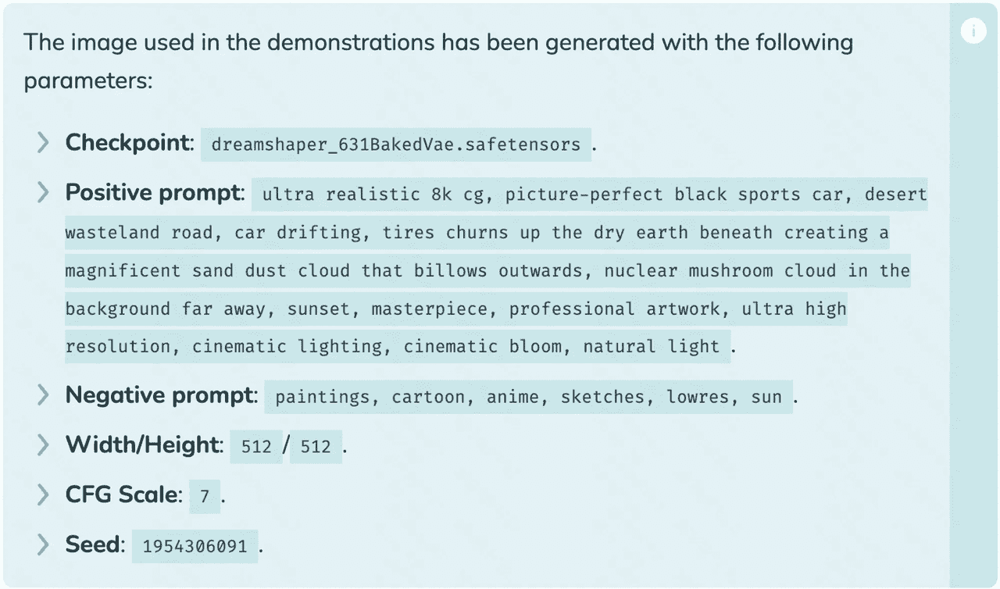

下面所有的图片除了采样器其他的设置如图

## 可用的采样器选项

根据你选择的软件，比如 `Automatic1111`，你会发现有各种不同的采样器可供选择。在这里，我们将探讨 `Automatic1111` 中提供的几种采样器。

虽然把这些采样器分成不同的类别并不容易，但可以大致归纳为两种主要的方法：

1. 概率模型，例如 `DDPM`、`DDIM`、`PLMS` 以及 `DPM` 系列模型。这类生成模型根据模型估计的概率分布来生成结果，就像用相机捕捉风景照片一样，通过捕捉概率中的可能性来形成图像。

2. 数值方法，例如 `Euler`、`Heun` 和 `LMS`。这些方法在每一步中都致力于解决一个具体的数学问题，逐渐构建出解决方案，就像画家在画布上一步步绘制风景，每一步都在细致地添加新的细节。

### DDPM

[`DDPM`](https://arxiv.org/abs/2010.02502)（去噪扩散概率模型，详见相关论文）是稳定扩散技术中最早期的采样器之一。它采用了明确的概率模型来消除图像中的噪声。但这种方法需要执行大量的处理步骤才能获得满意的结果。

目前在 `Automatic1111` 这个软件中，`DDPM` 已经不再提供了。

### DDIM

[`DDIM`](https://arxiv.org/abs/2010.02502)（去噪扩散隐式模型，详情见相关论文）在工作原理上与 `DDPM` 类似，但它采用的是隐式概率模型。与 `DDPM` 相比，`DDIM` 通过更少的处理步骤就能取得更佳的效果，这使得它成为一个更加高效快速的采样器，同时基本保持了图像质量。

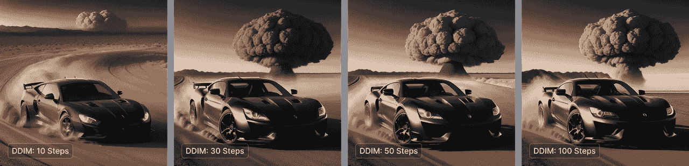

从云的表现可以看出，步数越多（100 步以上），效果越好。我们将在下文中看到更好的替代方案。

### PLMS

`PLMS`（伪线性多步骤，详见[相关论文](https://arxiv.org/abs/2202.09778)）代表了对 `DDIM` 的显著改进。有趣的是，`PLMS` 只需50步处理过程，就能实现比 `DDIM` 在1000步中所达到的更高图像质量。这听起来非常令人兴奈，不是吗？其实，这还只是冰山一角。

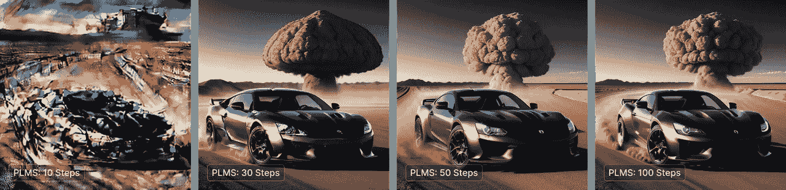

对于 `PLMS`，我们不能使用较少的步骤，因为它无法清除噪声，但在 50 到 100 个步骤之间，它已经能够提供良好的结果。

### Euler

[`Euler` 方法](https://en.wikipedia.org/wiki/Ordinary_differential_equation)可能是最简单直接的采样器之一。这种方法基于普通微分方程（`ODE`），其特点是在每一步处理中都会以固定的比例逐渐减少噪声。尽管因为其简单性而在精确度上可能有所欠缺，但 `Euler` 方法因其处理速度快而被广泛应用。

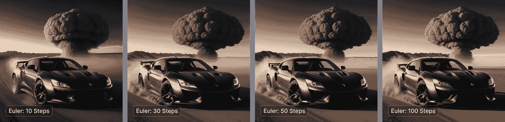

`Euler` 算法非常快速，即使在10步内也能够得出良好的结果。它的优势在30到50步之间。

### Heun

> `Heun` 方法可以看作是 `Euler` 方法的一个更精细的改进版。与 `Euler` 仅采用线性近似不同，`Heun` 在每个处理步骤中执行两项任务，因此被称为二阶采样器。它先用线性近似做出预测，然后通过非线性近似来进行校正。这种方法在提高精确度的同时，也确保了更高的图像质量。然而，这种精确度的提升也有一个小代价：处理时间大约是 `Euler` 方法的两倍。

> Karl Heun 在一个多世纪前开发了这种数值方法！

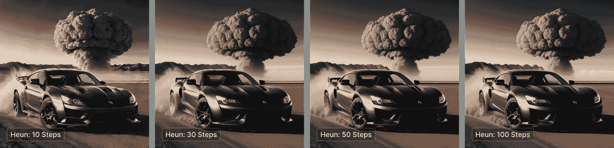

在10个步骤中仍然有一些噪点，但在更多的步骤中它会消失。正如你所看到的，在30个步骤中它提供了高质量，尽管在50个步骤中它提供了更多细节层次。在100个步骤中，它几乎不改变图像，并且不值得等待结果。

### LMS

`LMS`（[线性多步骤方法](https://en.wikipedia.org/wiki/Linear_multistep_method)）可以被视为 `PLMS` 的一个变种，区别在于 `LMS` 使用的是数值方法，而非 `PLMS` 中的概率方法（从 `PLMS` 中去掉概率因素“P”就得到了 `LMS`）。

与 `Euler` 和 `Heun` 不同的是，`LMS` 方法会利用前几个步骤中的信息来在每一步减少噪声。这样的处理方式虽然提高了图像的精度，但相应地也增加了计算需求，导致处理速度较慢。

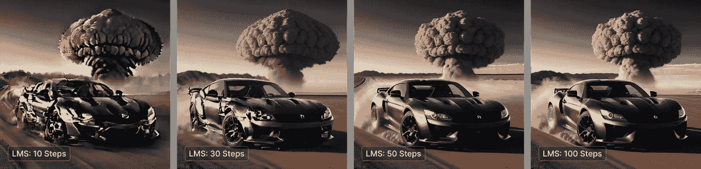

使用几个步骤，我们可以得到一个能够生成模仿药物效果的迷幻图像的采样器。开玩笑的话，这是一个不值得的采样器，因为尽管速度很快，但需要大约100个步骤才能提供一些体面的东西。

### `DPM` 模型家族

`DPM`（扩散概率模型）是一种概率模型，它在 `DDPM` 的基础上进行了一系列改进，因此得名。不过，在 `Automatic1111` 中并没有包含 `DPM` 的实现，因为它已经被更先进的版本所取代，正如我们下面将要介绍的。

`DPM2` 可以被视为 `DPM` 的升级版，相当于“版本2”。它在原有模型的基础上做了进一步的改良和优化。

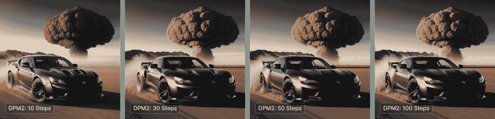

用10个步骤，您已经可以获得令人印象深刻的质量（不要尝试5个步骤，您将不会喜欢结果）。大约30到50个步骤是理想点。通常来说，更多的步骤并不值得。

另一个基于 `DPM` 的改进版本是 `DPM++`。`DPM++` 采用了一种混合方法，它结合了确定性和概率方法进行采样以及后续的噪声减少。在 `Automatic1111` 中，并没有单独实现这个采样器，而是将它与其他方法相结合。具体的结合方式和效果，我们将在下一部分详细探讨。

因此，`DPM` 衍生出了两个重要的改进版本：`DPM2` 和 `DPM++`，每个都具有其独特的特点和优势。

### 更快的 `DPM` 模型（`DPM-Solver` 和 `UniPC`）

扩散概率模型（`DPM`）顾名思义，基于概率原理。与 `Euler`、`Heun` 或 `LMS` 等确定性数值方法不同，`DPM` 在每一步中采用近似方法来处理问题，目的是为了实现尽可能准确的采样。

在这些模型中，存在一个关键的组成部分——求解器。求解器在计算和近似采样的概率分布过程中起到了至关重要的作用。正是在这里，一种名为 `DPM-Solver` 的新技术得以应用，它有效地缩短了采样过程中每一步的时间。

[`DPM fast`](https://arxiv.org/abs/2206.00927)（详见相关论文）或 [`DPM++ 2S`/`DPM++ 2M`](https://arxiv.org/abs/2211.01095)（详见相关论文）这样的模型采用了更快速的求解器，从而在采样过程中节约了时间。

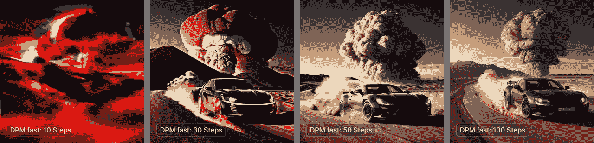

它会很快（也不是那么快），但使用少量步骤时，它变得无法使用。有趣的是，它提供了与其他采样器不同的结果，并且似乎电影效果更加明显。

在 `DPM++ 2S`/`DPM++ 2M` 的版本中，“2”表示它们是二阶模型。这意味着这些模型结合了预测器和校正器两种机制，以更精确地逼近最终结果。

其中，“S”代表单步骤（Single step）。这种模式在每个步骤中只执行一次计算，因此处理速度更快。

相比之下，“M”代表多步骤（Multi step）。这种方法在每一步进行多次计算，并且会考虑到之前步骤中获取的信息，从而实现更精确、更高质量的收敛，但相应地也需要更长的时间。

在这两种模式下，这种求解器都比标准的 `DPM` 模型求解器运行得更快。

目前在 `Automatic1111` 中并没有实现 `DPM++ 2S`，仅提供了 `A`、`Karras` 和 `SDE` 等变体（我们将在后面进一步介绍这些变体）。因此，让我们看一下 `DPM++ 2M` 的一些样例。

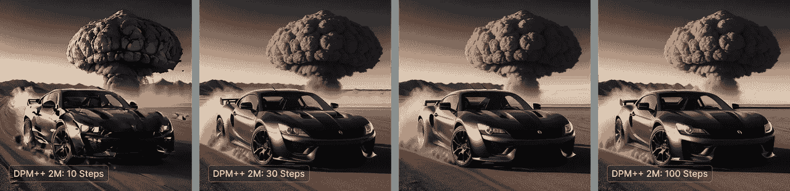

对于这个全能采样器，没有太多可说的。它在30个步骤中提供了令人印象深刻的结果，如果你给它更多时间，它甚至可以挤出更多。

至于 `UniPC`（详见[相关论文](https://arxiv.org/abs/2302.04867)），它是一个由统一预测器（`UniP`）和统一校正器（`UniC`）两部分构成的求解器。这种方法可以被应用到任何 `DPM` 模型上，其核心目标是在尽可能少的步骤中达到最高的采样质量。还记得 `PLMS` 如何将原本 `DDIM` 需要1000步完成的任务缩减到50步吗？在一些情况下，`UniPC` 甚至能够在仅仅5步或10步内生成高质量的图像。

因此，无论是单步骤还是多步骤的 `DPM` 模型，`UniPC` 都能够被集成进去，使其在效率上与 `DPM++ 2S` 或 `DPM++ 2M` 相媲美。特别值得一提的是，当步骤数量极少时，`UniPC` 能提供更优秀的结果。

甚至 `UniC` 校正器也可以被集成到这些采样算法中，进一步提高采样效率（例如在 `DPM++ 2S` 中加入 `UniC`）。

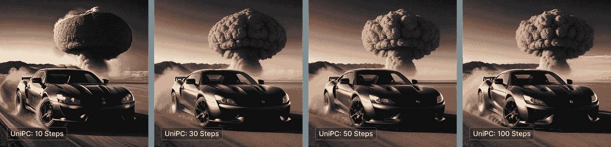

在这个例子中，10步是不足以生成一张没有噪点的图像的，但在15或20步之后你将得到它。在30步时它非常出色，并且没有必要再继续下去，尽管仍有改进的空间。

### 更准确的 `DPM` 模型（自适应）

`DPM` 自适应模型是对标准 `DPM` 模型的一种扩展，其核心特点是能够根据所面临的问题难度自动调整处理步骤的大小。

具体来说，这就像是算法忽略了预设的步骤数量，而是自由地进行采样，直至实现最优的收敛效果。这种方法能够生成更高质量的图像，但需要的时间会根据具体情况而定，有时可能会相对较长（它是所有采样器中速度最慢的一个）。

Steps?在这种情况下，与其他采样器相比，所花费的时间是其三倍或四倍，但结果令人惊叹。图像构图与所有采样器都不同，并且更像 `DPM fast`。

## 其他特点

在选择采样算法时，我们只能选取其中一种。也就是说，你可以选择使用 `Euler` 方法或者 `DPM`，但不能同时使用这两种方法。然而，在谈及不同的算法变体或额外功能时，这些是可以组合使用的。

举个例子，我们可以选择使用一个叫做 `DPM2 A Karras` 的采样器。接下来，让我们来探讨这个采样器组合中的“新值”到底代表什么。

### 初始采样器的变体

当一个采样器包含字母“A”，它通常表示该采样器属于“祖先”变体类别。这类变体的特点是，在每一个新的处理步骤中，它们会添加之前步骤中产生的随机变量。可以想象成，在每个步骤清除噪声之后，又会有一部分先前的噪声被重新引入。

由于每一步都会增加新的随机噪声，带有这一特性的采样器永远不会达到收敛状态。如果总有新噪声需要处理，就总能继续进行下一步。

这使得这些采样器具有更高的创造性。增加额外的处理步骤并不一定会提高图像质量，而是可能产生另一种类似的结果。

如果你在尝试复现使用 `Stable Diffusion` 生成的图像时失败了，即使你使用了相同的种子和参数，那可能是因为你使用了一个祖先采样器。这是正常现象！因为每一步重新加入的噪声都是随机的，不同的实现或采样器版本几乎肯定会产生不同的结果。

`Euler A`、`DPM2 A` 或 `DPM++ 2S A` 等都是祖先采样器的例子。

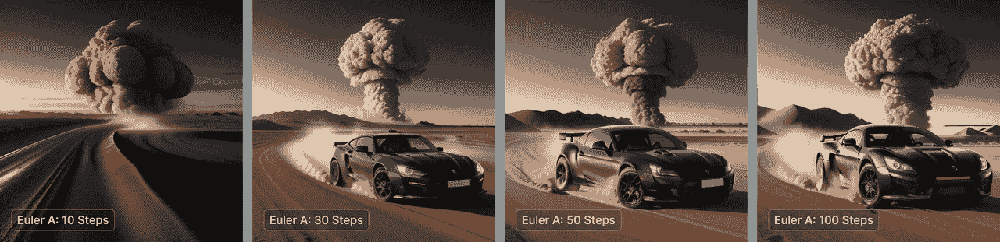

`Euler A` 在25-30步内给出了一个很好的结果，而且速度也非常快。在50步之后，质量变差，但是在100步之后又变得更好。这就像一张彩票。此外，由于每一步引入了随机噪声，你可以看到图像组合不断变化。远非缺点，这或许正是它最大的优势所在。

### `Karras` 变体

[`Karras`](https://arxiv.org/abs/2206.00364)（或简写为 `K`）字样的变体（详见相关论文），是指由 Nvidia 工程师 Tero `Karras` 所领导的一系列工作。这项工作为某些采样器带来了重要的改进，旨在提高输出质量和采样过程中计算效率。

采用了这些改进的采样器包括：`LMS Karras`、`DPM2 Karras`、`DPM2 A Karras`、`DPM++ 2S A Karras`、`DPM++ 2M Karras` 和 `DPM++ SDE Karras` 等。这些采样器利用了 `Karras` 的创新技术，以提升其整体性能和效率。

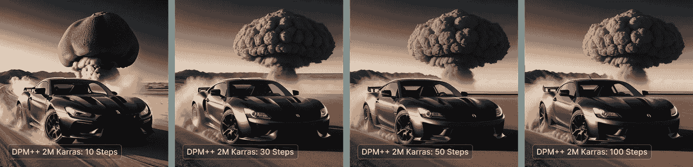

像 `DPM++ 2M` 一样，这个采样器在30到50步之间提供非常好的结果，但是 `Karras` 版本具有在较少的步骤中提供更好结果的优势，如下面的例子所示：

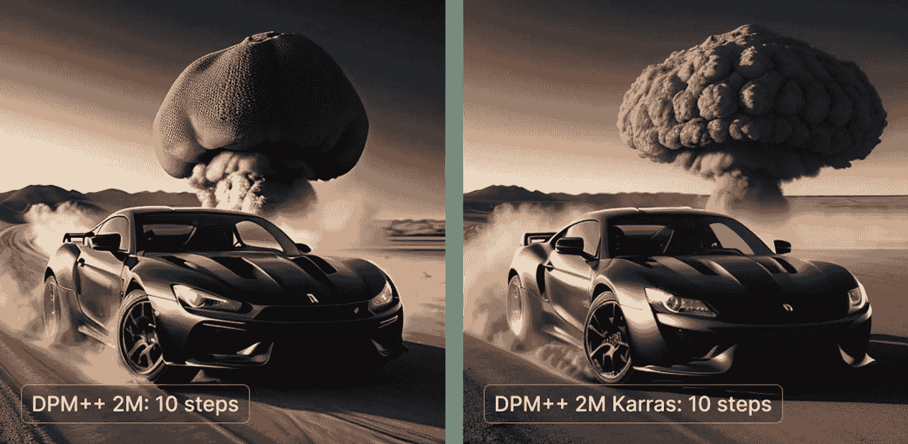

如果使用较高的步数，将很难看到差异。

### `Stochastic` 变体

`SDE`（随机微分方程，详见[相关论文](https://arxiv.org/abs/2011.13456)）变体采用了随机微分方程。简而言之，这类微分方程的使用使得噪声的建模方式更为复杂和精确，它能够利用之前步骤中的信息。原则上，这种方法能够生成更高质量的图像，但相应的代价是处理速度较慢。由于采用了随机方法，`SDE` 变体永远不会达到收敛状态。因此，增加处理步骤的数量并不会提高图像质量，而是会产生更多样化的结果，这一点类似于祖先采样器。

截至本文发表时，我们已经有了几种 `SDE` 变体，包括 `DPM++ SDE`、`DPM++ 2M SDE`、`DPM++ SDE Karras` 和 `DPM++ 2M SDE Karras`。

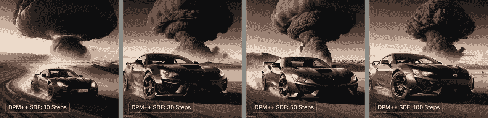

随机采样器虽然速度较慢，但即使在10个步骤下也能提供令人难以置信的结果。它们的结果也更加多样化和富有创意。由于它们永远不会收敛，因此是祖先采样器的一种替代方法。

## Stable Diffusion 中最好的采样器是什么？

选择法拉利还是吉普车更好？这取决于你是否要进行越野驾驶，对吧？

根据你的需求，选择不同类型的采样器会更好。有了上述信息，我希望你能更容易做出选择，但这里有一些提示：

### 图像质量

如果你追求高质量图像，应该着重考虑达到收敛。这是获得最高图像质量的关键。如果你不想牺牲过多的生成速度，那么不妨跳过像 `DDIM` 这样需要成百上千步骤才能收敛的采样器。虽然 `Heun` 和 `LMS Karras` 提供了不错的结果，但使用 `DPM++ 2M` 或其 `Karras` 版本会更佳。

如果你不急于获得结果，可以尝试 `DPM` 自适应，或者如果你有足够时间，`UniPC` 也是个不错的选择。

使用上述提到的采样器，你可以在20-30步内获得良好的结果，尽管尝试更多步骤也无妨。

### 生成速度

如果你正在测试提示，你可能不想花太多时间等待结果。在这种情况下，如果你不追求最高质量，只是想快速测试变化，那么推荐使用 `DPM++ 2M` 或 `UniPC`，步骤数较少。

仅用10-15步，你就能得到非常体面的图像。

如果你不介意可重复性，还可以选择 `Euler A`，这是一个快速且质量不错的祖先采样器。这是我的最爱！

### 创造性和灵活性

这部分专门针对祖先和随机采样器。它们既不提供低质量的输出，也不慢，只是有所不同。

这些采样器的特点（或优势，视角而定）是，如果你有一个在40步中生成的图像，那么在50步中做出的图像可能会更好或更差。你需要不断尝试。而这种不确定性使得这些采样器更具创造性，因为你可以通过改变步骤数量来获得细微变化。

当然，在这里 Euler A 和 DPM++ SDE Karras 特别值得一提。尝试在15步、20步、25步等不同步骤下生成图像，并观察结果如何变化。

<https://aigcreative.feishu.cn/sync/K4Gvd9vUQsy9Oubwqaeclu0Fnbg>
