# 深度：关于Diffusion你应该了解的一切

> 来源：[https://aigcreative.feishu.cn/docx/YDNbdipWqo2g2vxKqTdc6nL7nle](https://aigcreative.feishu.cn/docx/YDNbdipWqo2g2vxKqTdc6nL7nle)

> 分享｜张涛（个人公众号：潜云思绪）编译｜Yinan, 书航审稿｜书航

> 链接：https://mp.weixin.qq.com/s/G8u0OUIW4eCuja-0qgzAEQ

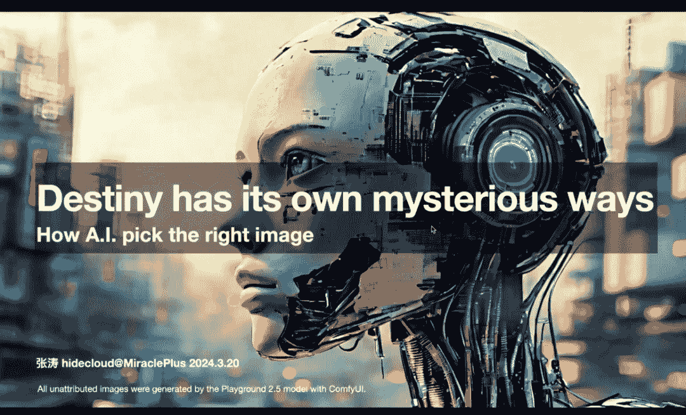

# 「理论与实践」AIPM 张涛：关于Diffusion你应该了解的一切

# Preface**前言**

Stable Diffusion的亮相之初，在Github 排行榜，在不到两个月的时间内飙升至 33K star。

空间站邀请了张涛老师来做分享，张涛老师为光年之外产品负责人，在这篇分享中，张涛老师以产品的角度带领技术小白了解Diffusion的底层原理，也进一步通过基于Diffusion的一些技术进展，SD在过去的一年半的时间里面，在整个行业里面构成了一个什么样子的生态？在这样子的生态里面，我们在产品上面的机会有哪些，以及作为产品经理，我们该如何去做。

接下来我们会按照以下顺序进行分享：

01 Learning - 理论

02 Progress - 实践

03 Thinking - 思考

# 01-Learning

## **1.什么是Diffusion？**

Diffusion ->一滴墨水充满整个杯子的过程，这个过程就叫扩散，也就是我们口中的Diffusion。

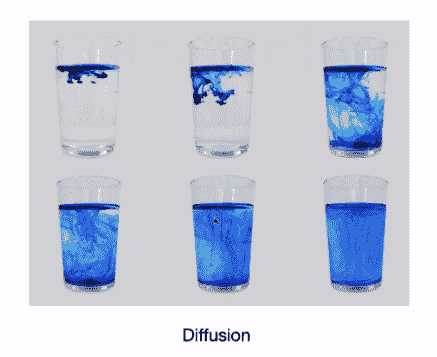

### Diffusion和文生图之间有什么关系？

Diffusion Model通过如下方式建构问题来实现图像生成：

Forward diffusion：

给一开始的输入图，每一步给它加上一些噪点，这样一直加到完全不具备任何现实图像意义、一个存储高斯正态分布的一个噪点图。

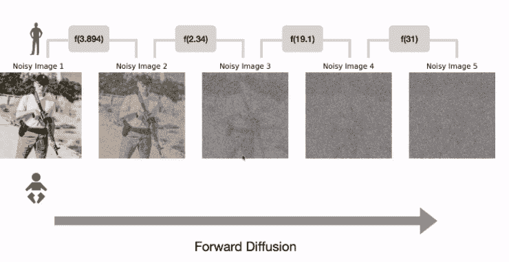

清晰的图片->通过函数一步一步加噪声->得到这些原始的噪声图->训练model->它可以预测每一张图片有可能是加了多少噪声而来的。

Backward diffusion

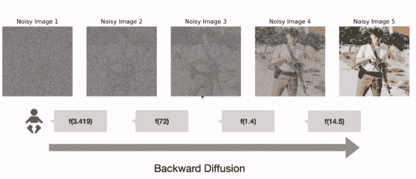

给出任意一张加了噪声的图片->model预测噪声->图像减去噪声->得到清晰图像。

通过加噪去训练，通过去噪去生成。

## 2.Stable diffusion的诞生

General diffusion: 像素级别复原图像，输入512*512，输出512*512，也就是有 26 万 2144 个像素因此，占用内存高且在训练和推理阶段速度慢，太消耗计算机资源。

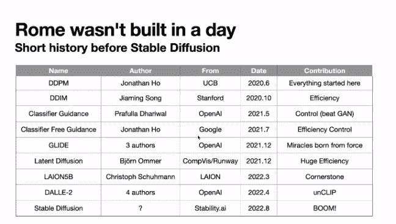

在Stable diffusion出现前，diffusion的发展：Score model->DDPM(就是上面的正向扩散训练model，反向降噪生成图像)->DDIM(发明了一种数学方法，把时间减少几十倍，解决了efficiency的问题)->Classifier diffusion(解决了之前生图无法control的问题，击败了GAN)->CFG(可控式生成，并且更加的高效)->GLIDE

21年5月大家开始意识到GAN方向有点不对，开始转去研究diffusion。

GAN由生成器和判别器两部分组成，生成器和判别器进行对抗性的训练，生成器努力生成更逼真的伪造样本，以欺骗判别器；判别器努力提高对真实和伪造样本的分类准确性。

Diffusion训练和生成新样本的方法比 GAN 更稳定。

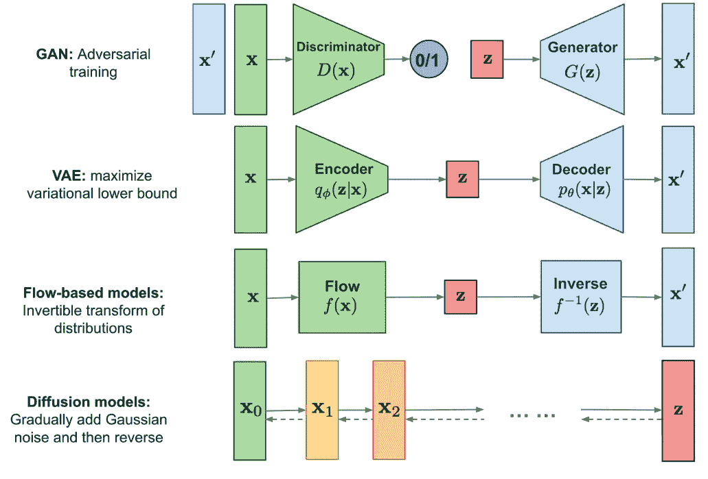

2021 年 12 月份的出现了一篇 paper 就来自于慕尼黑大学 computer vision 那个组和runway，研究出了Latent diffusion。

而在Latent Diffusion 组成中就有VAE模型的身影。

**什么是VAE？**

VAE(变分自编码器):就是把一张图片，我们把它叫做 Pixel space，就是把像素空间的图片编码到了一个潜在空间。（压缩 - 解压 的过程）

**它能够还原出这个图像。不是单纯**的做这种文件层面上的压缩，它仍然保留了从图像中去提取特征的能力。

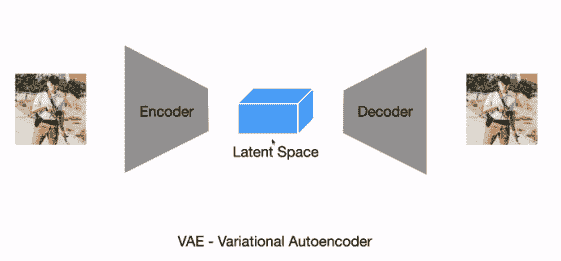

Latent Space使得 diffusion 这种技术从大厂的超级的集群里面计算，变成了每个人的家里面的显卡也能够跑得动的这样一个东西。

VAE与Diffusion model

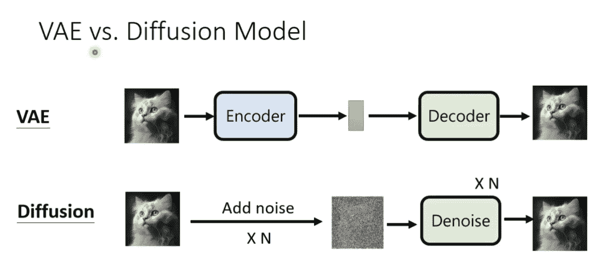

Diffusion 的 add noise对应VAE的encoder，只是不是netural work 而是人为设计好的，noise加进去的process是固定好的，它不需要学习。

VAE + diffusion ->Latent diffusion

Latent diffusion结合了VAE的latent space，提取latents(潜表信息)和 diffusion 的 add noise 和 denoise。

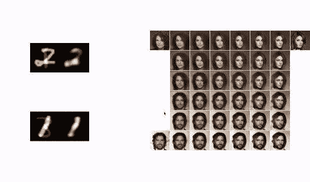

**如何实现图像变换？**

在图像空间做变换，大家想象在那个 Photoshop 里你有一张图，如果要把这个 2 变成另外一个数字，我们通常会把两个图叠加在一起，然后让上面的那个图的那个透明度越来越低，让下面那个图的透明度越来越高。

而latent space的变化意味着它学习了形状上的一些特征，保留了结构等基本特征。

### 有趣的故事 - 加噪时需要的图片数据集从哪来？

21年12月 Google 发了Glide -> 证实可控式生成是可被实现的->需要数据集:一张图和该图对应的描述；

OpenAI 大力出奇迹（用了大量数据）：Clip，借助CFG的思路实现了可控->DALLE；

也就在这个时候OpenAI变得有点Close，虽然发了 Clip这个模型，但是没有公布数据集，没有开源。

Christoph Schuhmann，一个德国的高中物理老师。他就觉得一个如此重要的基础组件掌握在一个封闭的公司手上，会对长期的AI 发展造成很严重的影响。所以在21 年，Schuhmann 他站出来说我们应该搞一个公开的数据集：有大量图片，并且有这个图片对应的描述。这样的话，整个开源社区学术界都可以基于这个公开的数据集去进行接下来的工作，而不是要基于一个封闭的 CLIP 这个模型去做。（40岁高中老师开源的数据集LAION，改变了生成式AI的未来）

他在discord上拉群，一群志愿者成立了LAION->发布了LAION 5B（5亿张图片）

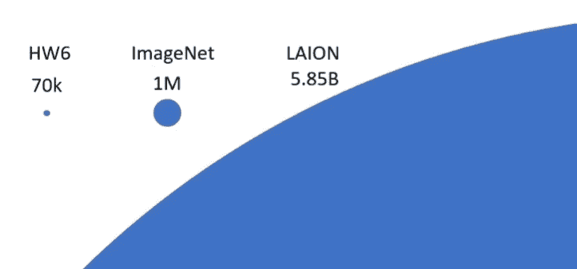

**Latent diffusion+LAION 5**B ->Stable diffusion

Stability AI 的创始人 Emad，进入discord群，捐了4万美元->在看到Latent diffusion之后，意识到文生图的前景 ->赞助了computer vision那个组几十万美元的GPU算力 -> 6月跑出来了sd的第一个版本 -> 开源

但是关于Emad的争议很大，最近他也从Stability.AI离职了，感兴趣的可以看以下文章：

Stability.AI创始人Emad Mostaque万字长谈

突发！Stability AI的CEO，跑路了

## 3.Stable diffusion的底层原理

Stable Diffusion并不是一个单一模型，而是由多个部分和模型一起构成的系统。

**从文本到图像的转换过程：**

首先是一个文本理解组件，**将文本信息转化为数字表示；**

然后将文本特征作为图像生成器的输入，图像生成器在图像信息空间（亦称潜在空间）上对信息作了逐步处理；Diffusion是发生在改组件中的过程，通过逐步细化和去噪，将初始的随机噪声转化为具有特定结构和内容的图像特征；

最后图像解码器根据生成器给出的图像特征信息绘制最终的像素图像。

**整体流程图：**

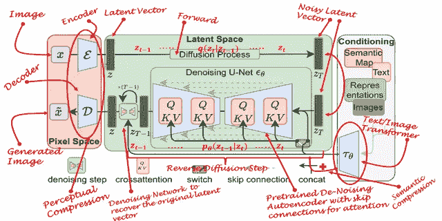

**红色部分**->encode和decode**绿色部分****->在l**atent space中加噪和降噪的过程灰色部分->控制降噪，进行text 的文本到向量空间的转换->每一个QKV都是transformer的每一步attention机制->每一步降噪的时候都用的 text 文字去控制它的降噪过程

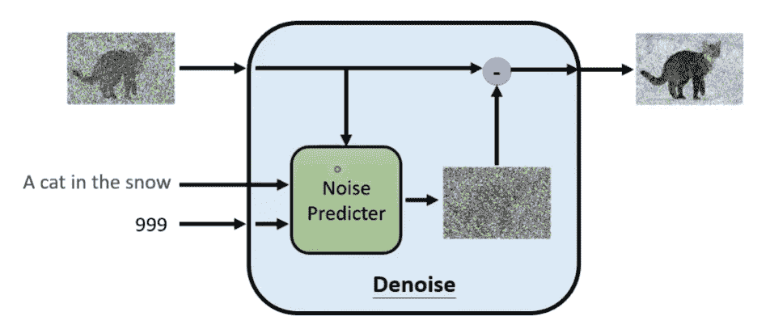

**#编码器Clip**

Clip包含text encoder和image encoder，其实就是在把这些文字和图片投射到一个向量空间里面，也就是embedding。（文字 和 图片 相匹配）

想象一个二维空间，text encoder 干的事情就是你输入一个text，它表示为（a,b）这样一个向量，就是说那个点就代表这个文字，而下面这个 image encoder，它在在另外一个空间里面，它把所有的图像都编码到一个向量空间，就我输入一张图，它告诉你这张图在我们整个这个概念里面，就在这个点。

那么这个时候我们就拥有了两个向量空间，一个有所有的这个文本的向量，一个有所有的图像的向量。

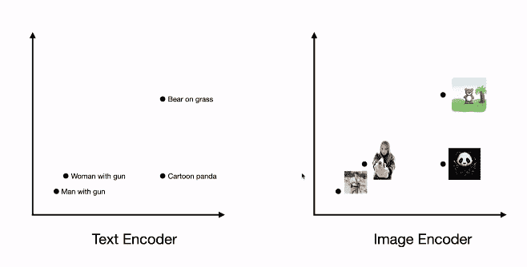

给出一个 text 的 input 的时候，文本的那个向量是指向**(1,2)的那个点的，图片它的向量指向 (2,1)那个点，两**个点其实没有在一起。我们需要训练一个模型去寻找映射方法，能够准确的通过函数变换，让两个向量空间建立关系，也就是Clip。

以上就是整个流程了。

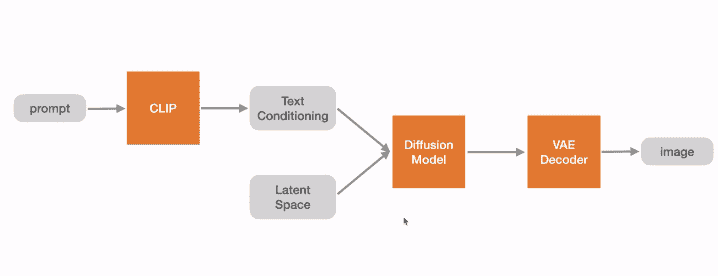

实践 - 通过ComfyUI实现整个流程

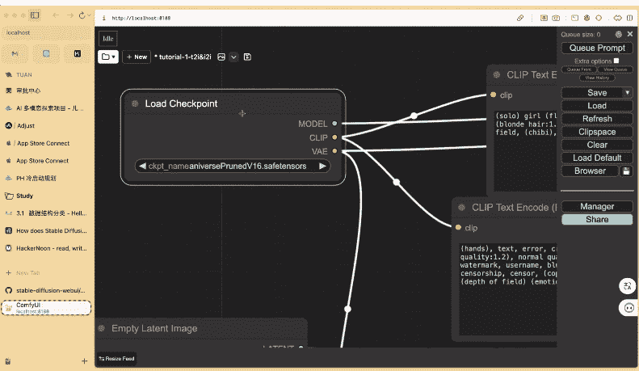

一开始Load三个东西：

1.Clip 用来对文字进行编码的；

2.model，用来做降噪的；

3.VAE，用来对那个图像进行潜在空间和像素空间的转化的。

Clip 的这个模型连到了正向的 prompt 和负向的prompt上->正向的 prompt 和负向的 prompt 都连接到了这个采样器上面，以及它需要一个空白的 latent image->通过采样器最后输出一个latent->通过VAE的这个decode就会得到一张图。

什么是采样器？可以理解为采样器就是去指挥那个模型进行一步一步降噪的这样一个东西。

很多人一开始学 config UI 非常的痛苦的点是因为他不懂基础原理，你一旦懂基础原理，你知道一个生图流程是这个样子的，那你对应回去看整个 workflow 的时候，你就会非常的清晰。

# 02-Progress

从2022 年 6 月份发布第一个版本模型之后，这接近两年的时间，整个的 progress 有哪些？大家就想哪些节点可以优化？

## **1.Conditioning**

当然首先第一个想到节点就是 text conditioning，因为大家生图最想要的就是控制，我想要什么它就生成什么，所以说大部分的工作都在 condition 上面。

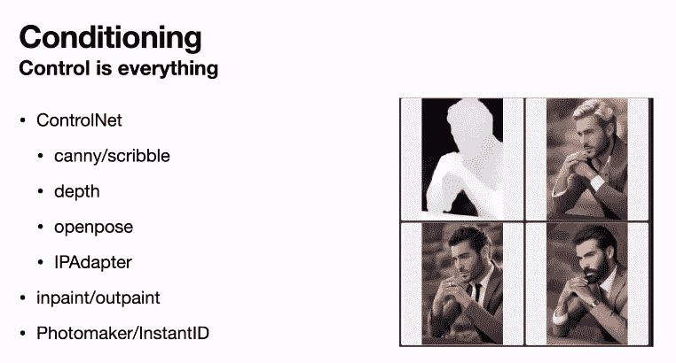

### **#ControlNet**

第一个最重要的工作，对输入的图片进行线稿识别，然后再基于该线稿进行上色

#### Script ControlNet

给出线稿，先读模型，然后把 ControlNet 的模型 load 进去，然后开始去 apply 这个 ControlNet，再去做这个采样，最后生成出来图会跟我的这个涂鸦的形状上是基本上是一致的，所以说它核心就是在做控制。

#### Openpose ControlNet

读模型->正向负向的prompt，然后正向的 prompt 没有直接输给采样器，而是拿去做了control ，选了一个叫 Openpose ControlNet。

Openpose是一个开源的项目，规范一套描述人体结构动作的的，所以它 open post 所有对于人的行为动作都是提取出来，像火柴人一样，右下角可以看到生成效果。

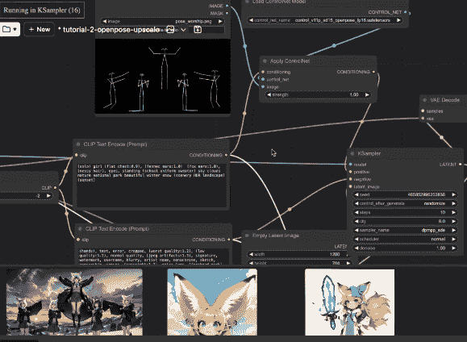

另外有个小知识点，就是这里为什么我要分两次跑，我在前面跑这 10 步的时候，我的这个 latent 我初始的分辨率是一个 1280 乘 704 的分辨率，我跑完了之后，把它输出给下面一步，我把它做了一个 latent 的upscale，把它升到了 1920 乘 1080 的分辨率。

因为后面跑的 8 步是在一个分辨率更高，更占显存的里面去跑。有一种加速的创作方式，就是我们先在低分辨率先跑前面几步，其实那个图像结构基本上也就那样，然后我们再去跑后面几步，弥补细节。

还有其他一些控制生成的inpaint（把图像圈出来修改）、outpaint（扩图），元旦后还有小红书的 InstantID 和腾讯的Photomaker。

张吕敏去年发了 ControlNet 之后他就没**搞其他事了，沉寂了一年，然后最近发了**那个 layer diffusion。范式级别创新的研究员永远在做范式级别创新。在生图的基础上，他可以直接把那个生出来的图把图层给你切好，就是在 Photoshop 里面一样，分图层。

除了ControlNet 以外，还有一种控制的方法，就Lora。

### **#Lora**

#### **Lora 的出现**

通过 latent diffusion 的引入，我们已经把整个模型的训练成本和微调成本极大地下降了，但事实上如果你个人要去微调一个 sd的模型，你仍然需要在一张 4090 的卡上面大概跑个可能六七天。

微软当时提出 Lora 那个技术，有些大模型在进行一些小范围的新知识的 update 的时候，每次都要重新做训练的话成本很高，所以他们发明了一种低成本的，就是不去改动整个模型，而是在整个模型的外围，给它套一层就可以影响模型。结果大家突然发现这个东西最好的使用场景不是语言模型，而是在图片这边。

#### **Lora 的核心**

easy to train， easy to use。

妙鸭：因为训练 Lora 需要几十张图片的输入，训练 Lora 虽然成本已经降低了很多了，但它仍然需要训练。所以说你看你在等的那个时间里面，它就是在帮你练Lora。

Photomaker、Instant ID ：直接一张图就可以提取面部特征，然后用 ControlNet 思路把它去控制它。

Stable diffusion构建了一个怎么样的生态？

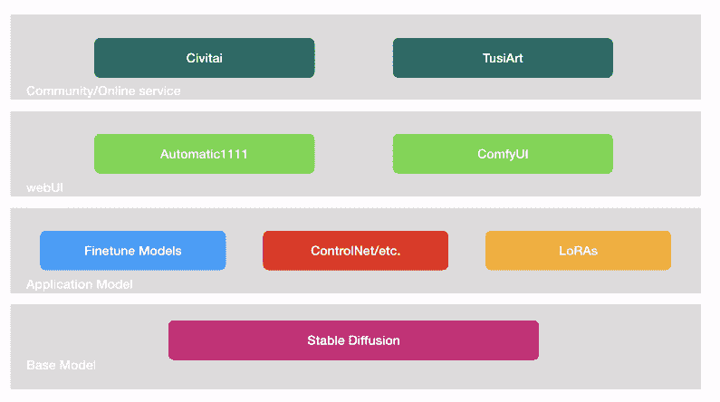

大家知**道文生图现在生得最多的是什么啊**？是二次元妹子是不是？哈哈，LAION 5B 那个数据集里面有多少二次元妹子呢？有多少高质量的二次元妹子呢？不够多，所以它不满足人民群众的需求，所以这个时候除了这个 base model 之外，行业里面就可以开始出来了finetune models。

有些非常擅长生成风景，有些擅长生成建筑，它本质上的背后都是有爱好者、志愿者拿大量的图片去 fine tuning SD，得到了 finetune models，然后再有大家做的各种各样的control。

那么再往上面一层就是 Automatic1111 和 comfy UI 这样子的 Web UI，在这样子的 Web UI 上能够普通人也能够去操纵模型。有些人觉得 Automatic 和 comfy 也很难，我甚至还需要在抖音上花 9 块 9 买个教程去学一下。那就有更简单的 c 站和吐司，它基本已经完全傻瓜化了，你进去之后充了钱，就直接写 prompt 就可以生图了。

**总结：**整个生态就是从底层 stability 做底层模型，然后社区共建应用模型这一层，然后 Web UI 再帮大家做，然后是 community 和一些 online service。

**思考：**当我们提到 SD 的时候，它不是一个单纯的paper，也不是放在 huggingface 上面的单独的一个checkpoint。它已经形成了一个非常完整的生态。那作为从业者来说，如果要切入这个领域，那这个时候你应该去思考在这样的生态下，你的定位是什么？

而且整个这四层里面，每一层都有非常大的机会

如果想做AI生成海报，首先分层生成元素，就是生成海报的背景图、主体人物形象，再分层生成艺术字。然后再把它们做组装，本质上其实跟做个 Photoshop 这个设计工具没有什么区别了，所以说这个 workflow 会特别的复杂，就是多步的连接，多个组件的串联，再包装一下就可以像Canva、figma，它是不是就是下一代的创作工具、编辑工具？

所以说在我们刚刚给大家看的那个整个的那四层里面，底层的 base model、 application model 是有机会的，然后我认为这个 Web UI 这一层仍然也有机会，不管是你自己去做还是你去做，他们的包装都是有机会的。

## **2.Efficiency**

### **#LCM**

#### **LCM 的核心**

解决了一个量变到质变的一个工作。

第二个最重要的工作就是 LCM，它本质上是一种蒸馏模型的方法，比如说我们以前大概推理 20 步能够出一张图，他把这个时间直接压缩到了 4 步。实际上你有些参数你可以把它调得更低，输入可以更快。

**一旦这个反馈变得更加实时了之后，你在整个产品上能够想**到的交互形态和产品可能性是完全不一样的。

但大家回顾一下我刚刚讲的 SD 的生态，在去年 10 月份发这个 paper 的时候，已经有几千上万个 fine tuning model 了，虽然说这个技术真的很快，但是他真的有影响力去要求这几千个模型的创作者么？

所以说他们发了 LCM 之后，立马就做了第二个工作，叫 LCM Lora。在你原有的 fine tuning model 的情况下，只需要套这个Lora，你的模型也能够用 LCM 的方式去快速地去运算出来，它的出现是真的彻底改变了去年Q4的时候 SD 整个的生态。

后来Stability自己也发了Turbo，然后后来那个也卷了Lightning，但是范式级的创新是发生在那个地方的。

## **3.优化VAE**

### **#TAESD**

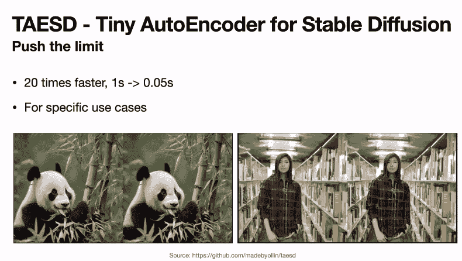

以前大家生一张图要 30 秒， VAE decode只要 1 秒，我当然应该先去卷那个推理图，但自从 LCM 出来之后，生一张图只要 0.5 秒了，大家突然发现 VAE 太慢了，这个时候就有个工作叫这个 TAESD，它直接就把 VAE 的 decode 20 倍的下降从 1 秒变成了 0.05 秒。

**局限：**它比较适合生成那种相对来说大色块一些的。

**使用场景：**1.我们最后要的那个图是一个非常完美的，又高清又精细的，但中间我们经常需要出一些Preview，那这个时候我们用 taesd 就可以节省很多时间；2.在一些不要很真实的纹理细节的场景里面。

### #Consider VAE as filter

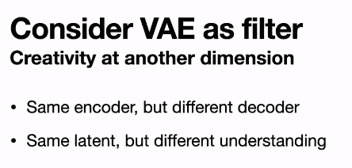

本质上来说VAE是把你的图像里面的特征提取出来，再从特征还原成一张图像，那些特征本身是可以被操纵的。所以说有些人会训练出一些，比如特别擅长那种高光的VAE。

## **4.优化Clip**

OpenAI 在当年在做这个 Clip 的时候，它主要解决的还是一个我们叫 image caption，就是图片标注。

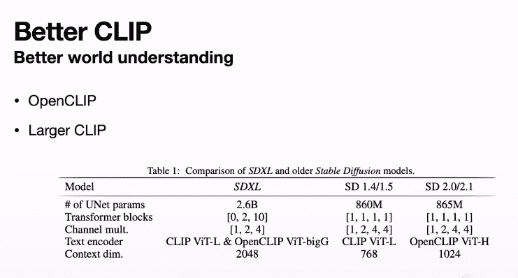

现在对于生图模型的要求越来越变态了，现在卷的方向都是在这个地方插语言模型，这样让那个就是图形对于文字的理解更加的精准。

### **OpenClip**

LAION不仅做了那样 5B 开源的数据集，他们还用 5B 的数据集去做了一个开源的CLIP。

### **Larger Clip**

OpenAI的 CLIP 是一个一系列的模型家族。

# 03-Thinking

我早年间的工作经历大部分是在做 Toc 的产品设计和 Tob 的客户成功管理这一块的事情，我自己 all in AI 是从去年的7月11号开始的，所以说我基本上入行半年多。我讲一下我这半年我自己作为一个PM，我学习 AI 的一些感想、一些方法。

## **1.怎么去学习**

### #Keep reading paper

怎么学习，第一个最重要的事情就是一定要坚持读paper，我是一个大学本科通信工程，然后就出来搞互联网了，也没读研，所以在学术上其实是没有什么造诣的。然后做了十几年的PM，在中间还有5年是搞ToB，做客户成功，做咨询，做售前，其实不是一个典型的做研究、做技术的人。

但是我前面你看我给大家讲得头头是道，其实都是 paper 告诉我的。从 2020 年的 6 月到现在不到四年的时间，整个行业天翻地覆，可能也就十几二十篇 paper 我就拥有了。

我现在看一篇paper，看完写完notes，发完朋友圈一个小时。我问了比较顶级的研究员现在看一篇 paper 多久？他说先看标题，再看摘要，最后再看里面关键的几张图，然后就把它关了。因为他们搞这个的，他基本上看架构图和摘要就知道他在干什么了，我现在要把它训练到 30 分钟内，但前提条件就是要读大量的paper，读不懂不要怕。

读不懂的是因为那是另外一个行业，另外一个世界，他们有很多自己约定俗成的概念和术语。比如说我当时看到 VAE 的时候，我说那啥玩意，然后来就顺着往上读，哦，是干这个事情的，你慢慢理解了之后，就不用怕这些词了。

#### **读paper的好处**

##### **（1）信息差**

因为我是经历过这个 Web 2.0 和移动互联网 Mo**bile Internet 两波**浪潮的，我们就看得非常清楚在一个行业的早期那几年信息差的红利是非常容易赚的红利。

你比**别人多读一点点，就比别人多了非常多**的信息差红利，在行业早期的时候，信息差红利套现其实是一个非常爽的事情。可能再过 5 年这些东西全都变成基本常识了，但现在就是我一个 PM 也可以是 AI 懂王，是不是？所以坚持读 paper 带来的价值是一个非常好的，就是帮助你去形成这个信息差。

##### **（2）灵感**

**他还能帮助你在日常的产品研发、产品决策**、技术架构设计里面能给你带来直接的灵感。因为我们是做 AI 应用的团队，不是搞模型的团队，我日常不可能对模型有那么多的研究，我也不可能储备一大堆的研究员，但全世界最聪明的人把他们的智慧全都写到了 paper 里，里面有无数的知识可以帮助你。

比如说我当时在去年 12 月份的时候，我看了那个 stream diffusion，他们可以在一张 4090 的显卡上面做到一秒钟 120 帧以上的出图速度，就是狂飙，虽然它有一些地方并不是那么实时，有些其它的场景限定，但是不得不说人家还是很厉害的。

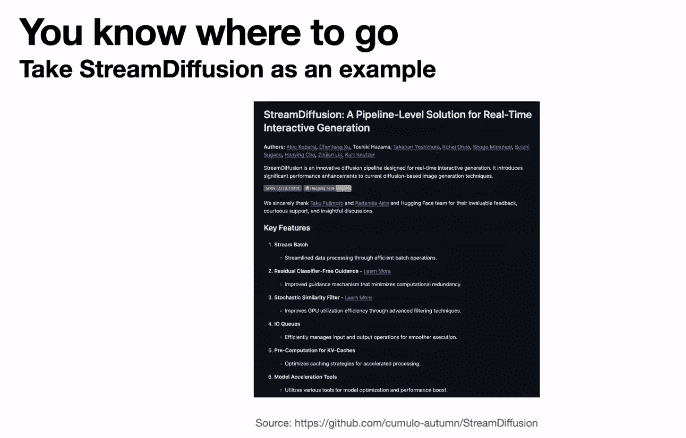

#### **怎么去读**

当时因为我已经读了一些 paper 了，所以说我去看他那个 paper 的时候，首先就看到他的标题：stream diffusion, a pipeline-level solution for real-time interaction generation。所以它是一个在 pipeline 的这个 level 上去优化sd的生成速度的。

pipeline 你能优化，我也能优化，因为我们当时正好在做自己的一款产品，对速度的追求要求也比较极致。所以我觉得这篇论文可以细读一下，我就看他主要是做了哪些工作让他越搞越快啊。

第一个 stream batch，这啥玩意没听说过，进去看一看。

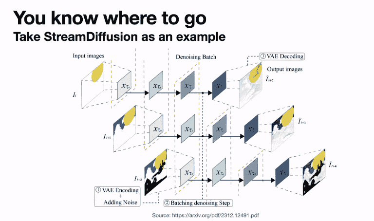

大家不要被这个图吓到了哈，大家可以想想我们刚刚讲的那个生图的过程，是不是一张图进来变成latent，然后降噪，变成图输出去；如果它是要处理视频流，那这一帧处理完，再处理下一帧，两帧处理的中间就夹杂了两次的降噪过程，你输出来的时间决定于整个降噪过程要多长，整个视频流就会非常的不流畅。

所以他们想了一个用空间换时间的方法，就是进去之后先把它降噪，第一步的时候我第二张图我已经准备好了，然后第二步的时候，第三张都已经准备好了，因为只要你的显存足够大，就能把它就是批量处理，就永远这个图会比上个图慢一步，但是慢一步无所谓对不对？只要能保证单步降噪的时间，那我就能做到 stream in stream out，流式处理。

以前如果整个是一个串行的工作流，所有的任务都积压在这里，就等着进那个降噪的那个队列，其实就浪费了时间。所以他们把前置的处理环节、后置的处理环节给拿出来，变成了三个独立的进程，单独去做 VAE 的 encode 和decode，把整个给解耦开。

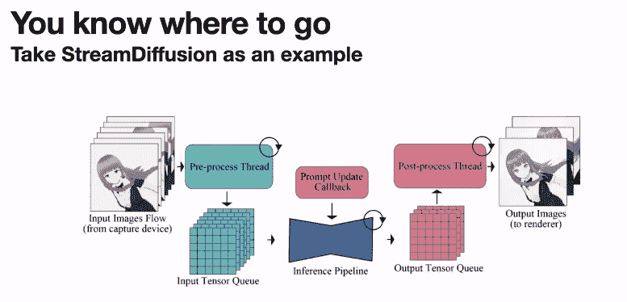

**说实话我们搞了十几年互联网了，这些都是基础思**想，就一个系统里面最慢的节点在哪，就把它解耦出来，不要让它成为整个系统的 block 的点，把其他地方全都异步地去搞就非常简单。

但如果你不去看这些paper，你只把一个模型当做一个整体去看它，你不敢去碰它，不愿意去面对它，理解它，你以前你擅长的那些工程优化思路，你都用不到，但这些东西都是可以改的。

包括说刚刚那个，大家知道视频里面经常一秒 24 帧，里面其实有两三帧没动的画面，如果还要去推理，就很浪费时间，因为本来推理就慢。所以说在前面那个图像队列输进去之前，他加了一个余旋相似器的检测，就是非常快速地去计算两张图像的相似度。只要这个低于一个阈值，就直接把他扔掉，算后面的图，然后让整个这个队列运算也得以加快。

别人已经把所有的技术用和不用的差异都给你写上去了，我最后只需要挑，因为我也不可能全部都用上，我的场景不一样，但我一看我就知道做每个的收益是多少。然后我就跟我的工程师说，这两个收益比较大，咱们去把它实现。

最聪明的人已经把过程中你需要浪费时间去实验的东西好了，你说你用不用吧？但如果你拒绝读paper，你就会错失这些信息，那么在 AI 这种比较早期的行业里，很多时候产品上的一些胜败胜负并不在于什么我 Pretrain 了一个巨牛的模型，有时候是在这种细节上，累积起来决定成败。

## 2.get hands dirty，一定要自己动手

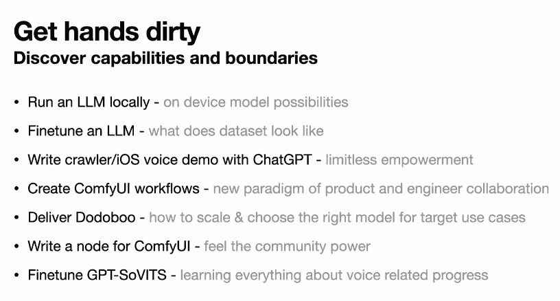

我测了各种各样的多模态语言模型，**我觉得就是 PM 自己去测去玩这些**东西，它最重要什么呢？是帮助你去发现整个行业里面现在最顶尖的能力和边界到底在哪。因为 PM 核心的点不是在于去评价AI，那是评论家干的事情，我们干的事情应该是说，OK，我知道他现在能干这个，不能干那个，那么我们用它来做点什么。所以说通过直接动手，而不是通过自媒体的文章去学习它，你可以非常直观地理解现有的模型边界到底在哪。

比如去年 4 月份，我第一次在本地跑 llama，跟用 ChatGPT 是完全不一样的感受，当你第一刻看到电脑里面蹦出来几个字的时候，那种愉悦感，而且你顺着去思考，它有能带来什么样子的可能性？

OpenAI 为什么把 ChatGPT 搞出来了？就是用了这个基于 human feedback 的强化学习，那搞这个的时候我们就去看那个 instruct 指令集，在 huggingface 上开源的各种各样的 dataset，我就第一次理解了，原来 instruct 长这个样子，原来是有这样子的一些数据结构。

**那**你就可**以去想，那我以前做的很多产品里面，他在哪些环节可能会产生哪些用**户的动作？这些动作的结构化信息是不是能够存储下来？你的很多的这个产品流程的很多的想法你就涌现出来。

为什么现在大厂搞 AI 产品会有很大的问题？因为我知道的很多大厂他们现在内部配合效率太慢了。像我们当时做的时候，就自己在 comfy 里面换模型、换Lora、换controller、调参数、各种调，最后那个 feedback 好快，我们搞了一个多星期，然后我们就上线了，那你就会发现产研之间的配合范式发生了非常多的变化。这些东西如果自己不动手，你也是永远都不可能去想到的。

在 **d**eliver 的产品的过程中，我们就发现怎么去做scale，一个用户用和10个人用、100个人用，整个AI 产品的这个负载要求是完全不一样的，怎么节省成本？怎么做推理优化？如果没有真实的需求推动你去做的话，其实你平时很难想到那些事情的，所以尽快地 deliver 你的产品其实也很重要啊。

然后我第一次觉得 comfyUI node 不够用了，自己去写了第一个node，收到一些开源社区的反馈，我第一次感受到开源社区的这种力量。我以前基本上都在看语言模型和图像模型，最近在玩那个语音模型GPT-so-wits ，它可以做那个语音克隆，我又借着 fine tuning 它的过程，像刚刚研究 stable diffusion 一样，又把这条技术路线从末到开始的 paper 基本上给读了个遍。我觉得在学的过程中 get hands dirty，本身也是一个非常重要的学习技能。

Destiny has its own mysterious ways

我之前也做过搜索推荐，它要你先把一个用户给描绘清楚，就这个用户是谁，他喜欢什么，根据他的行为和喜好在一个向量空间里面去刻画，现在这件事情做得非常好了。

现在业界的难点在我好不容易把你给刻画出来了，结果发现没有内容供给怎么办？把内容放到一个全世界所有的概念的向量空间里面的时候，这些数据点都显得非常的稀疏。但是我最近在看这个 diffusion 的过程中，我就发现了一个非常有意思的一个点，未来会不会存在这样一种推荐系统？

我**把**你的喜好描述出来之后，不管它是视频的、音频的、文字的，在一个关于全世界所有内容的一个空间里面，点其实是无限多的，那每一个点用刚刚大家看到的那个diffusion降噪那个思路，本质上都能还原出一张图像，一个视频或者一个音频。

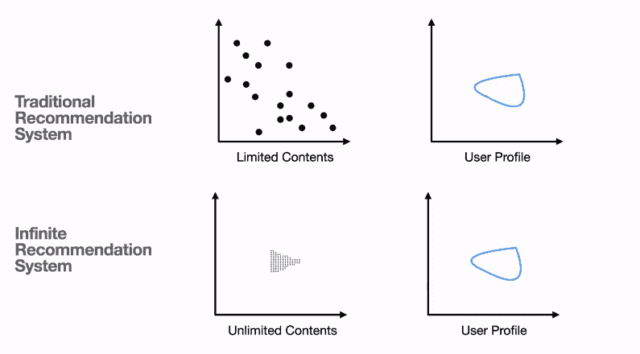

而且这些点全部都是在你喜好的舒适区范围之内的，这意味着什么？这就是真正的就我昨天写的：Infinite recommendation system，就无限推荐系统。本来图像这个事情我觉得没有那么大的兴奋点，但就是我一旦想明白这样子的一个闭环之后，真的就是就脑洞就特别多了，我觉得它对于整个的这个内容生产、内容消费的未来空间的想象力就是完全不一样的过程的。

所以这也是为什么我觉得就是去理解一个技术的原理，对于我们做产品来说其实也很有帮助的。

## **3.创作是不是就此不存在？**

其实我觉得恰恰不是，为什么呢？我们现在整个的世界上所有的已知的各种各样的作品，就这一点放到一个二维平面上，是有点稀疏的。

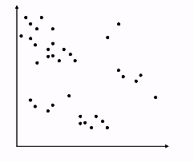

那大家要想象在真实的空间，它不是一个二维空间，而是多维空间。我们现在的内容，现在所有世界上已知的创造在那个空间里面稀疏得不能再稀疏了，基本上就跟宇宙一样。我们现在的机器能够创造的东西多多少少都还是跟已知的点，虽然不是完全重叠，但基本上是靠得比较近的。

**而所有那些未知的空间，其实就是需**要人类真正的创造力才能够去达到的那个样子，画到底该怎么画？色彩该怎么运用？在我现在对于他的原理的理解基础上，我并不认为他能够做得到，而这个部分恰恰是人类我觉得真的最有价值的地方，所以我觉得创作这件事情变得前所未有的重要。

纯粹搬砖形式的艺术创作会被马上替代，但是真正的创作的价值会立马凸显出来。

所以我认为创作并不是死了，我改编了我特别喜欢的魔戒里面的一段话。

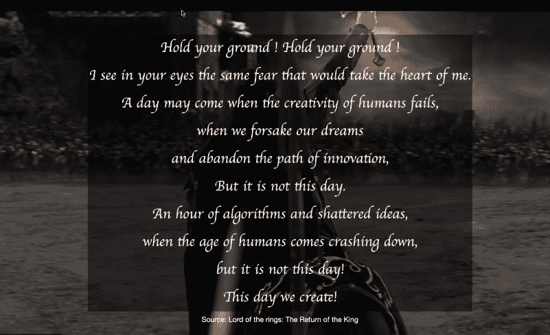

也许有一天算法会统治我们，人类的思想会碎落一地，但是不是今天，今天创作变得前所未有重要。可能有一天我们人类的创作真的把那个空间给填完了，但是我觉得离这一天还太早了。我越是研究这个东西的底层原理，我越是觉得艺术家会变得更加的重要，只不过只是短时间这个 transition 的过程，他们还没有学会掌握这个工具和怎么去在新的时代里面去证明自己的价值。

但是至少在这个方向，我是非常相信真正的艺术的价值是永不毁灭的。

> **Hold your** ground!  Hold your ground!I see in your eyes the same fear that would take the heart of me.A day may come when the courage of men fails,when we forsake our friendsand break all bonds of fellowship,but it is not this day.An hour of algorithms and shattered ideas,when the age of humans comes crashing down,but it is not this day!This day we create!

<https://aigcreative.feishu.cn/sync/K4Gvd9vUQsy9Oubwqaeclu0Fnbg>