# Stable Diffusion 3升级

> 来源：[https://aigcreative.feishu.cn/docx/A0jpdZKcgo9U7uxdKt3c8WXAnqh](https://aigcreative.feishu.cn/docx/A0jpdZKcgo9U7uxdKt3c8WXAnqh)

> 官网：https://stability.ai/news/stable-diffusion-3?utm_source=twitter&utm_medium=website&utm_campaign=blog

# StabilityAl发布 Stable Diffusion 3：

该模型采用扩散变换架构，显著提高了在多主题提示、图像质量和拼写能力方面的性能。

Stable Diffusion 3还采用了一种新型的扩散变换技术，与Sora类似…Stable Diffusion 3的性能提升不仅基于其先进的扩散变换架构，

# 还包括了以下关键的技术创新和改进：

1、新型扩散变换器： Stable Diffusion 3采用了一种新型的扩散变换技术，与Sora类似，这种新技术为模型提供了更强大的图像生成能力。 Transformer 是一种深度学习模型，专门设计来逐步构建图像的细节，从而生成高质量的视觉内容。

2、流匹配与其他改进： 模型还整合了流匹配技术和其他技术改进，进一步增强了生成图像的质量和多样性。流匹配技术有助于模型更好地理解和模拟图像中的动态元素和结构，使得生成的图像在视觉上更加连贯和自然。

3.利用Transformer的改进： Stable Diffusion 3充分利用了Transformer技术的最新进展，这不仅使模型能够进一步扩展其能力，还使其能够接受多模态输入。这意味着模型能够处理更复杂和多样化的数据类型，如结合文本和图像的输入，从而在理解和生成图像内容方面提供更大的灵活性和精确度。

尽管目前已经提及了一些关键的技术创新，Stability AI计划很快发布更多的技术细节。这些细节将为技术社区和感兴趣的用户提供对Stable Diffusion 3技术基础和创新点的深入了解。

# **性能的具体提升内容包括：**

1、多主题提示处理能力： 新模型对于包含多个主题或元素的提示具有更好的理解和处理能力。这意味着用户可以在一个提示中描述更复杂的场景，而模型能够更准确地根据这些描述生成图像。

2、图像质量： Stable Diffusion 3在生成的图像质量上有显著提高，包括更细腻的细节表现、更准确的颜色匹配以及更自然的光影处理。这些改进使得生成的图像更加逼真，更能捕捉到用户的创意意图。

3、拼写和文本处理能力： 这个版本在处理文本元素，尤其是在图像中直接展现的文本（如标语、标签等）时，有更好的拼写能力和文本理解。这包括更准确地识别和渲染用户提示中的文字，甚至是在复杂的视觉背景中。

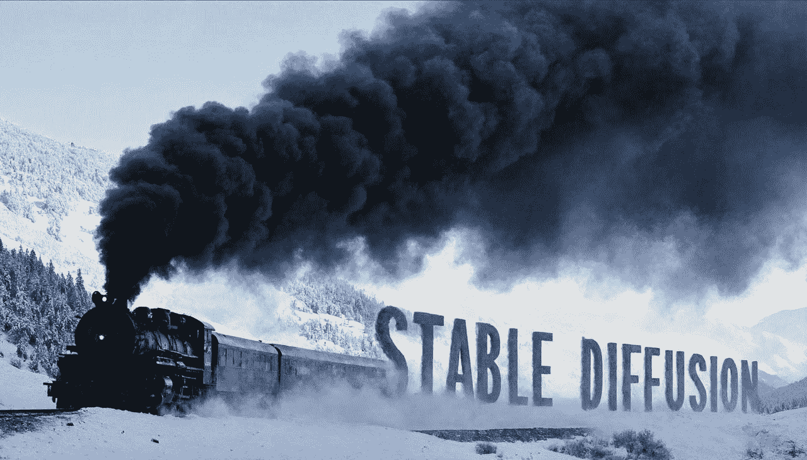

# 官方案例：

> Prompt: Epic anime artwork of a wizard atop a mountain at night casting a cosmic spell into the dark sky that says "Stable Diffusion 3" made out of colorful energy

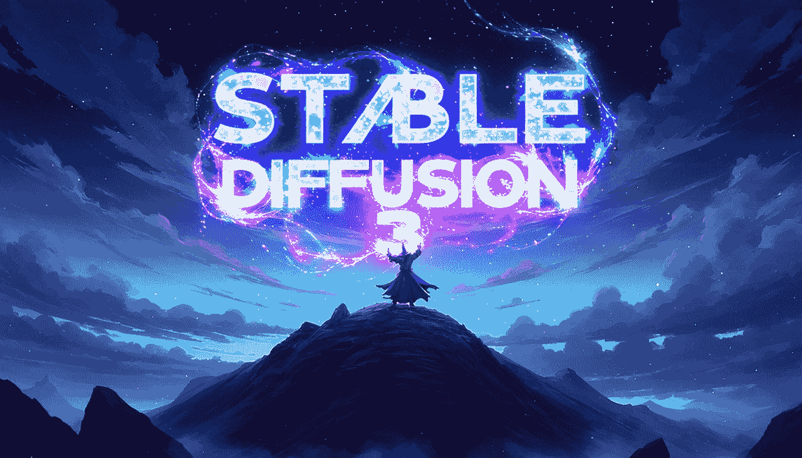

> Prompt: cinematic photo of a red apple on a table in a classroom, on the blackboard are the words "go big or go home" written in chalk

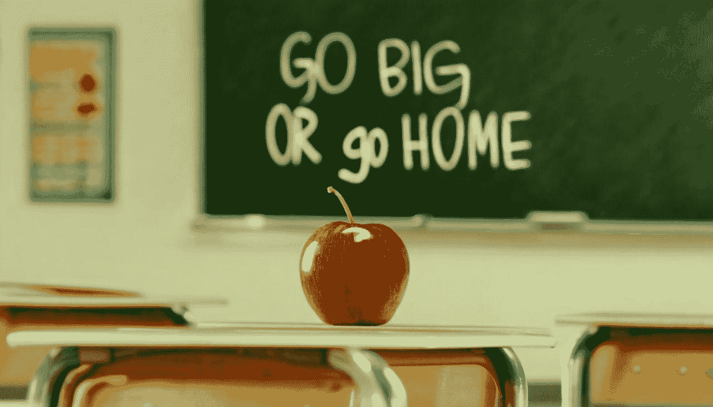

> Prompt: a painting of an astronaut riding a pig wearing a tutu holding a pink umbrella, on the ground next to the pig is a robin bird wearing a top hat, in the corner are the words "stable diffusion"

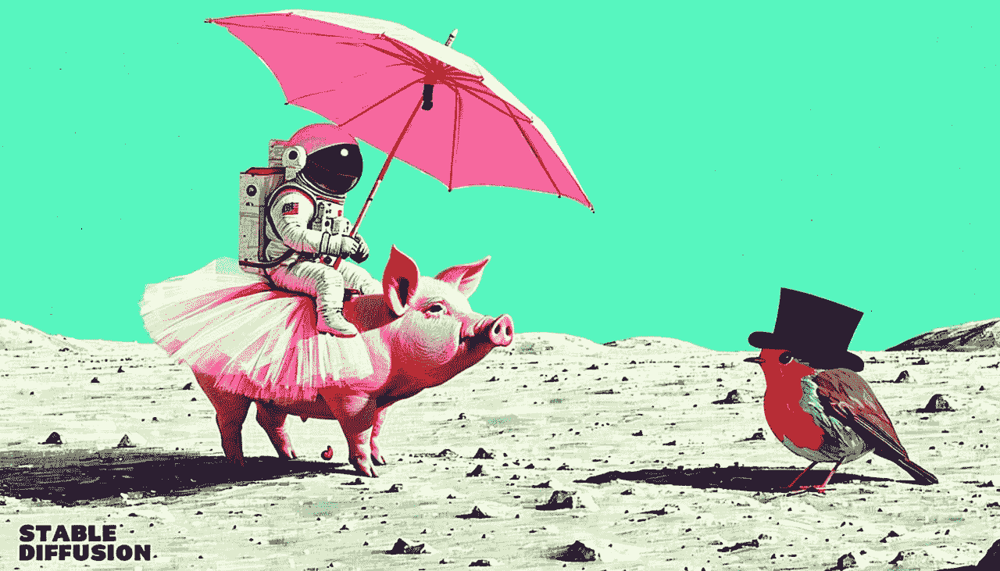

> Prompt: studio photograph closeup of a chameleon over a black background

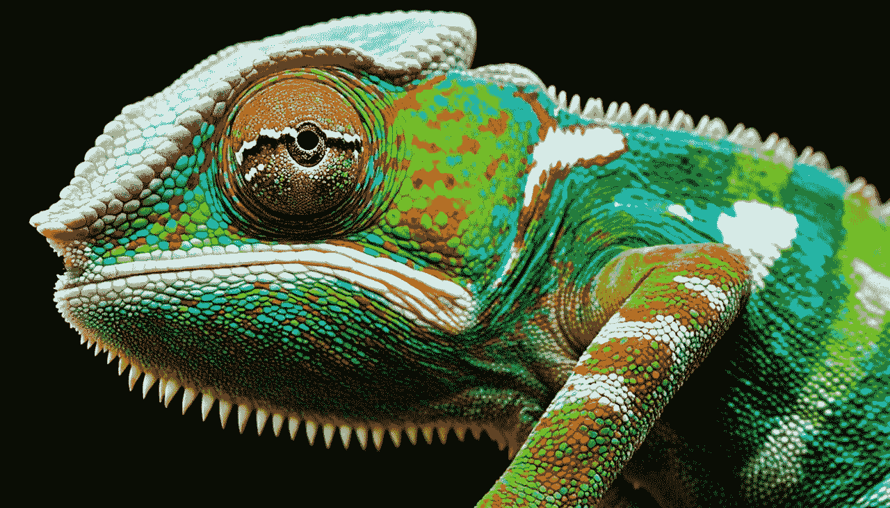

> Prompt: Resting on the kitchen table is an embroidered cloth with the text 'good night' and an embroidered baby tiger. Next to the cloth there is a lit candle. The lighting is dim and dramatic.

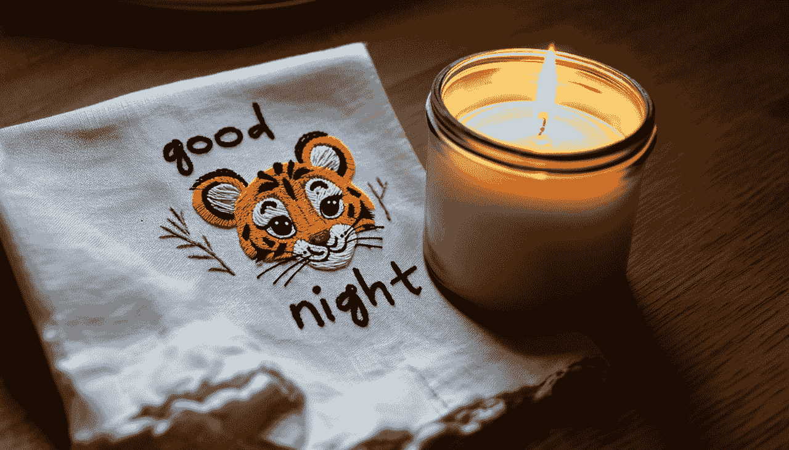

> Prompt: Three transparent glass bottles on a wooden table. The one on the left has red liquid and the number 1. The one in the middle has blue liquid and the number 2. The one on the right has green liquid and the number 3

> Prompt: A horse balancing on top of a colorful ball in a field with green grass and a mountain in the background.

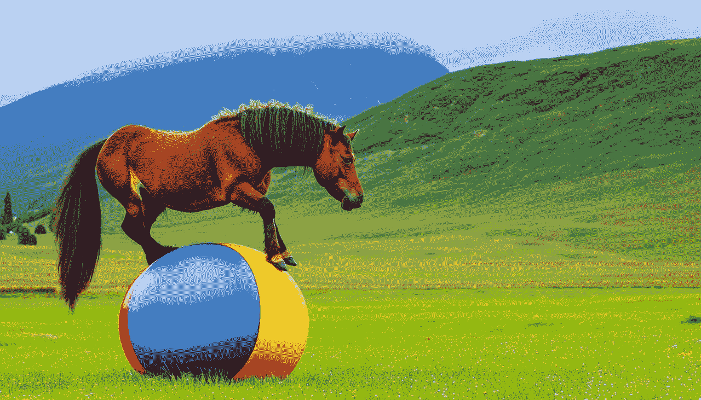

> Prompt: Night photo of a sports car with the text "SD3" on the side, the car is on a race track at high speed, a huge road sign with the text "faster"

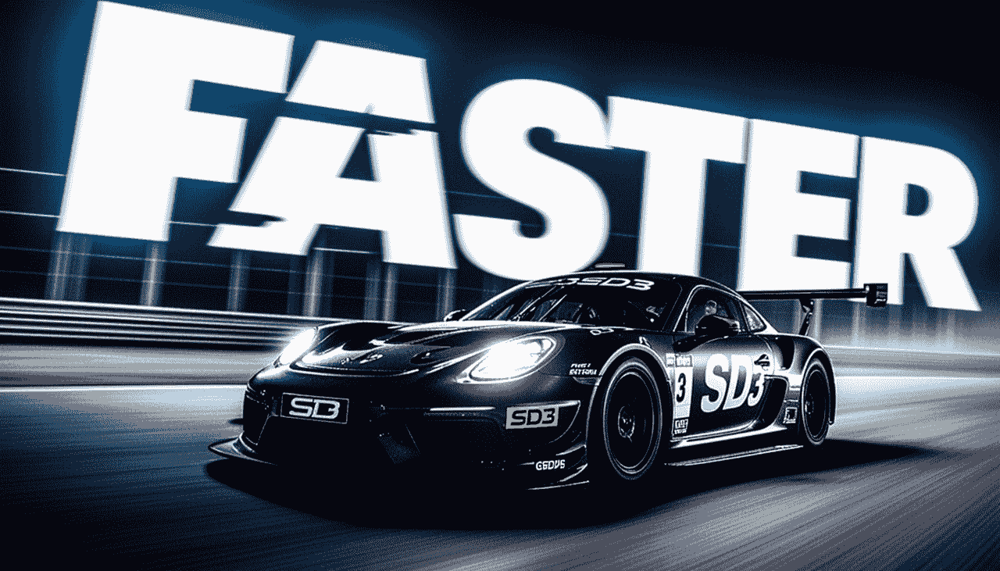

> Prompt: Photo of an 90's desktop computer on a work desk, on the computer screen it says "welcome". On the wall in the background we see

> beautiful graffiti with the text "SD3" very large on the wall.

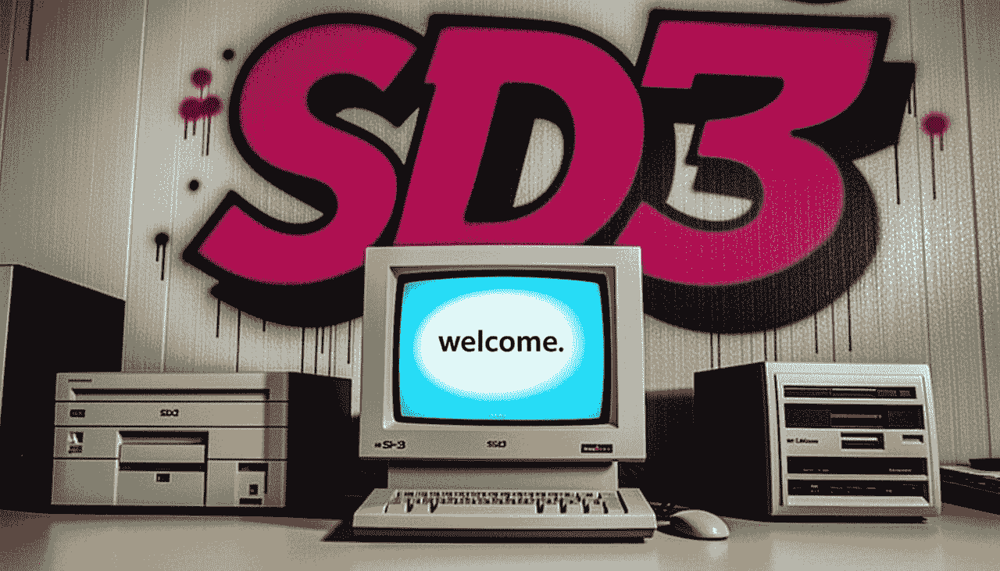

> Prompt: Anime style illustration of a newsstand on top of a small grassy hill, on top of the newsstand we see the text "it's here!". In the background we see a big rain approaching.

> Prompt: A magazine on a glass table, the magazine has the text "incredible" on the cover. The table is in the center of a comfortable room with two very cozy purple sofas.

> Prompt: Professional photo of a silhouette of a fighter throwing a punch, professional sport showing strength. The environment is dark with only a backlight that illuminates the fighter. There is smoke in the environment creating a dark sports hall atmosphere.

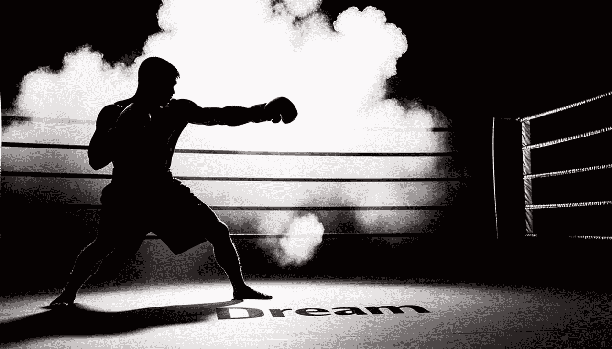

> Prompt: This is an original alcohol ink painting that showcases modern art through an abstract and colorful background, resembling marble texture. It's perfect for modern banners and offers an ethereal touch to graphic design.

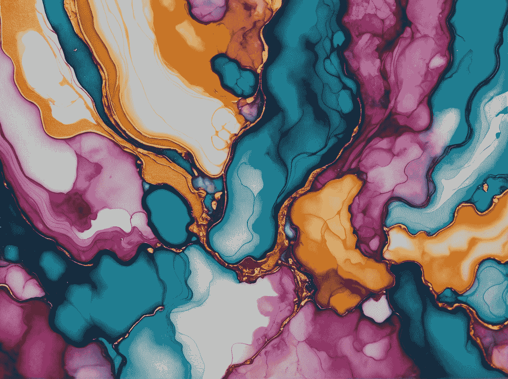

> Prompt: Trees photographed under the Milky Way, the moon and twilight shine on the Valley. The full moon appears high in the sky and the twilight glow can still be seen.

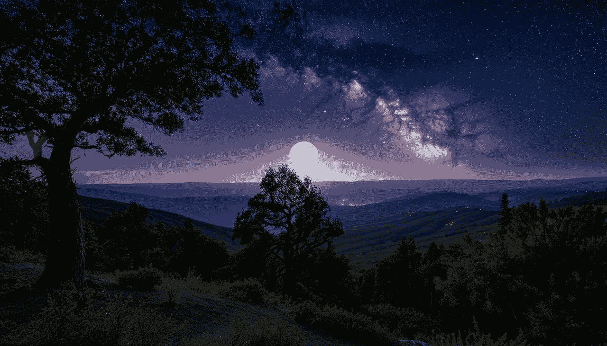

> Prompt: Fisheye lens photo where waves hit a lighthouse in Scotland, black waves.

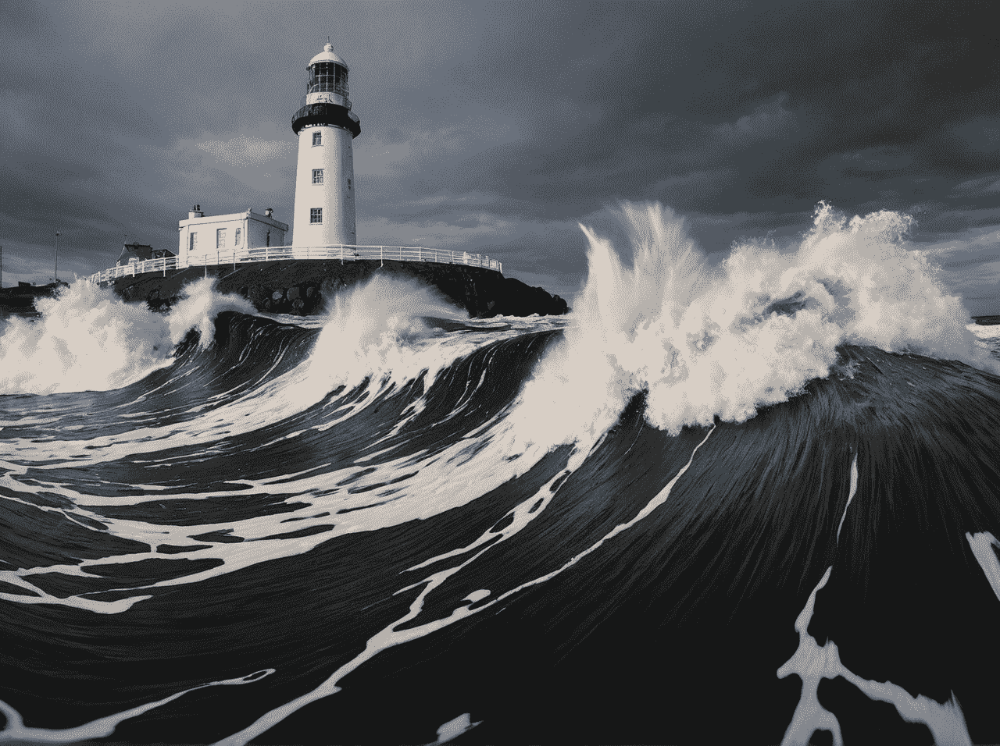

> Prompt: Moody still life of assorted pumpkins.

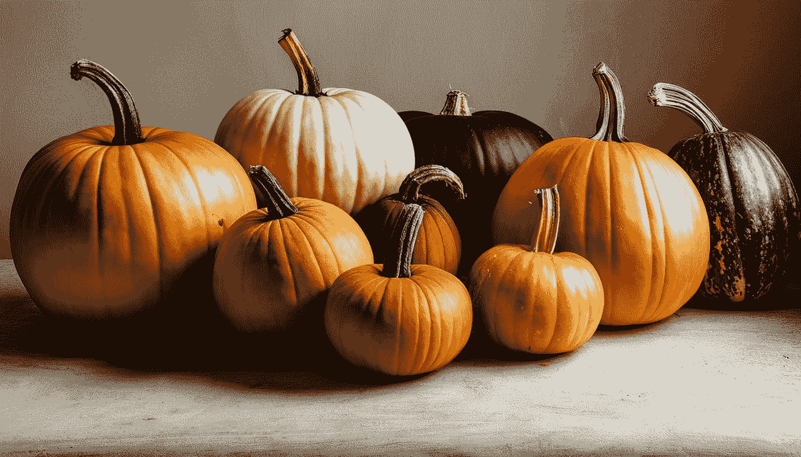

> Prompt: Wide photo of a shipwreck on the beach, lots of rust and moss on the ship contrasting with the beautiful blue of the ocean water and the peace that the beauty of nature conveys. The big waves are magnificent and touch the ship.

> Prompt: Photo of a rectangular orange neon sign with the text "even more stable", the sign is on the wall in a metro station, subway speeding by in the background, perspective photo.

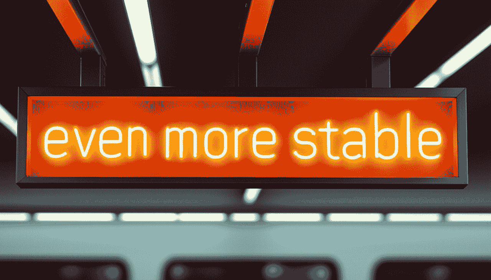

<https://aigcreative.feishu.cn/sync/K4Gvd9vUQsy9Oubwqaeclu0Fnbg>