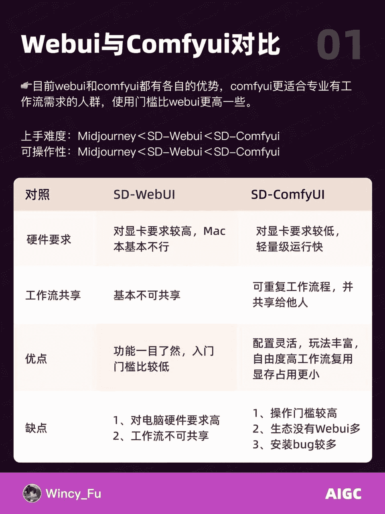
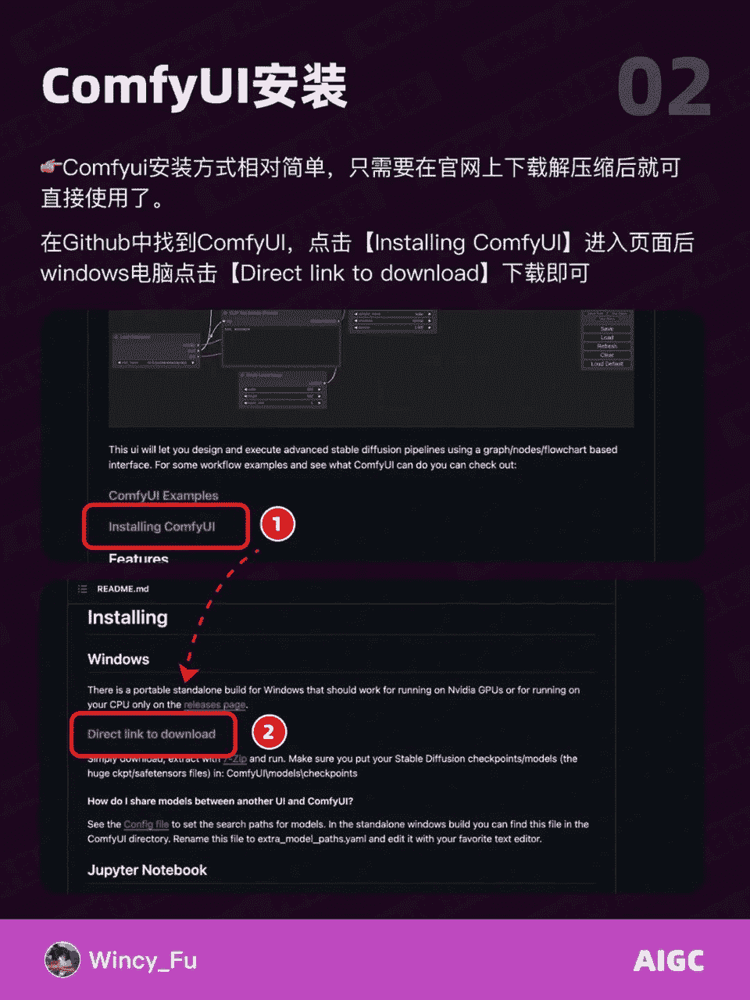
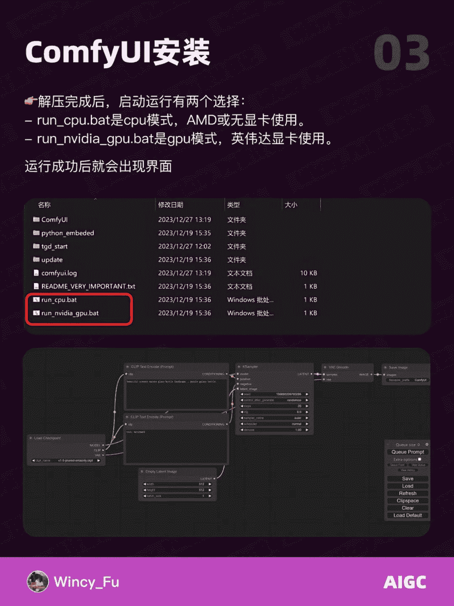
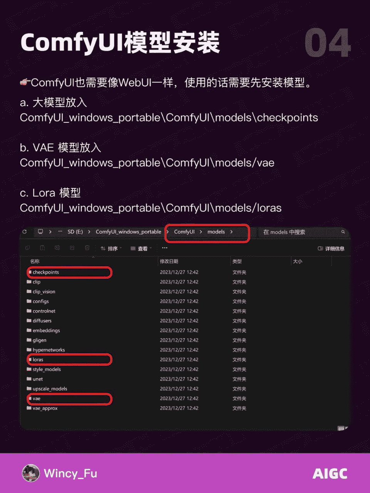
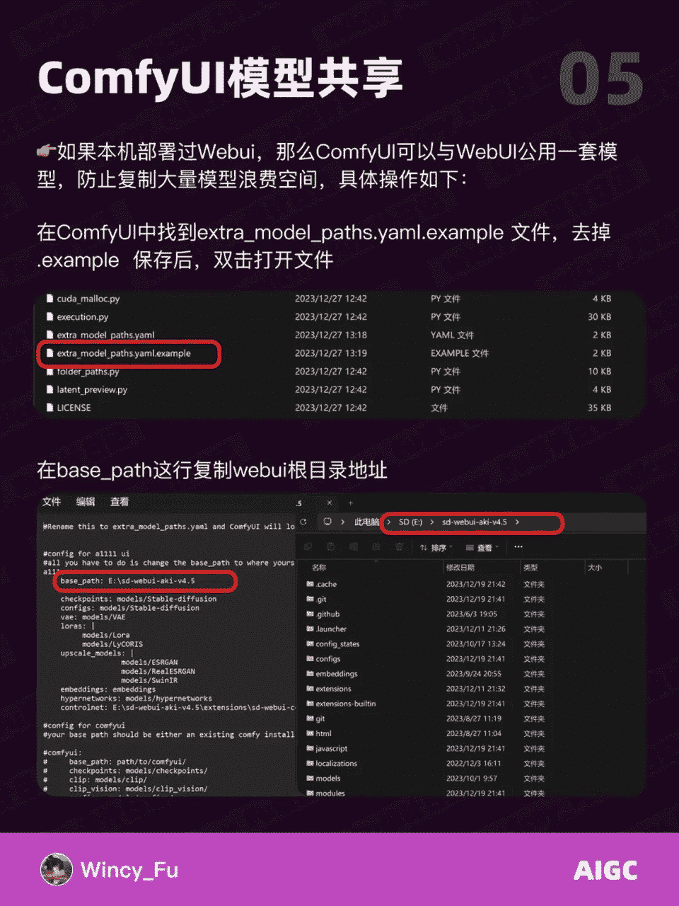
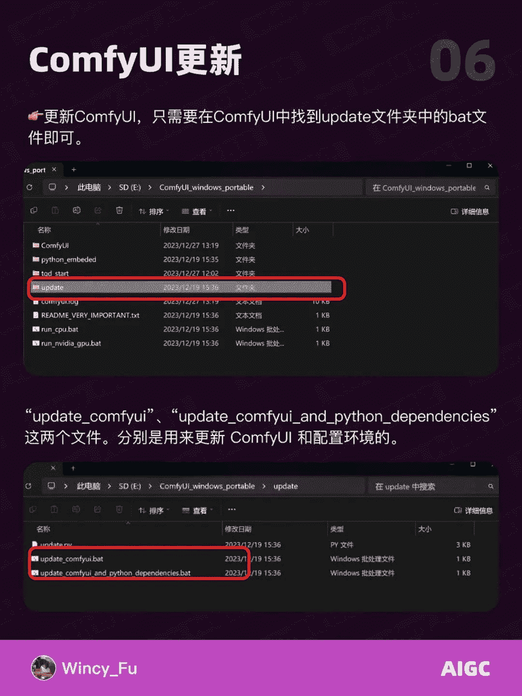

# 5 步学会 ComfyUI 安装部署！开启 SD 的专业级工作流应用

> 来源：[https://aigcreative.feishu.cn/docx/W3vfdwzIjotbS8xXvt9cNNz6nRe](https://aigcreative.feishu.cn/docx/W3vfdwzIjotbS8xXvt9cNNz6nRe)

> 原文链接：https://mp.weixin.qq.com/s/2AETRJdagVfKMnq0QZ-1nA

### ComfyUI 下载：

Comfyui 安装方式相对简单，只需要在官网上下载解压缩后就可直接使用了。在 Github 中找到 ComfyUI，点击【Installing ComfyUI】进入页面后 windows 电脑点击【Direct link to download】下载即可。

### ComfyUI 安装：

解压完成后，启动运行有两个选择：run_cpu.bat 是 cpu 模式，AMD或无显卡使用；run_nvidia_gpu.bat 是 gpu 模式，英伟达显卡使用。

### ComfyUI 模型安装：

a. 大模型放入：ComfyUI_windows_portable\ComfyUI\models\checkpoints；

b. VAE 模型放入：ComfyUI_windows_portable\ComfyUI\models/vae

c. Lora 模型：ComfyUI_windows_portable\ComfyUI\models/loras

### ComfyUI 模型共享：

如果本机部署过 Webui，那么 ComfyUI 可以与 WebUI 公用一套模型，防止复制大量模型浪费空间。

### ComfyUI 更新：

更新 ComfyUI，只需要在 ComfyUI 中找到 update 文件夹中的 bat 文件即可。

<https://aigcreative.feishu.cn/sync/K4Gvd9vUQsy9Oubwqaeclu0Fnbg>