# 完整梳理 ComfyUI 的核心节点

> 来源：[https://aigcreative.feishu.cn/docx/U5m2dsXBgo6ZJkxgtDbcuT10nYy](https://aigcreative.feishu.cn/docx/U5m2dsXBgo6ZJkxgtDbcuT10nYy)

> 来源：优设UP：AI实战

> 主页：https://www.uisdc.com/u/827105/publish/all

#### 1、Load Checkpoint 节点

在 ComfyUI 中，Load Checkpoint 节点是一个非常重要的核心节点。其功能是加载 checkpoint 大模型，常用的大模型有 sd1.0、sd1.5、sd2.0、sd3.0、sdXL 等。

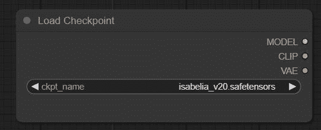

**输入：**

ckpt_name -> 自行选择在模型网站下载好的大模型（在用 WebUI 时下载了大模型的可以共享路径文件，节省磁盘空间）

**输出：**

MODEL -> 该模型用于对潜空间图片进行去噪

CLIP -> 该模型用于对 Prompt 进行编码

VAE -> 该模型用于对潜在空间的图像进行编码和解码

**注意：**·StableDIffusion 大模型(checkpoint)内置有 CLIP 和 VAE 模型

另加载大型模型时，可能会耗费较长时间或占用大量内存，确保系统资源充足，避免因资源不足而导致的加载失败。

#### 2、Load Checkpoint with config 节点

该节点是一个高级的节点，用于加载 checkpoint 大模型并同时应用 config 文件中指定的设置。

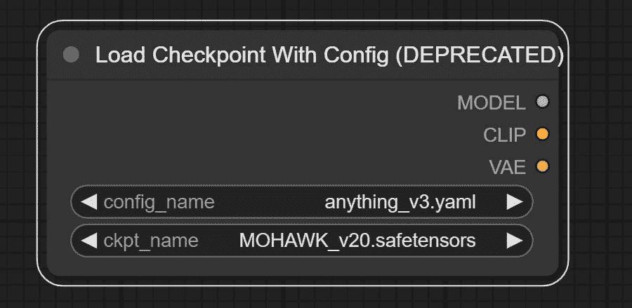

**输入：**

Config_name -> 指定要加载的检查点文件的路径

Ckpt_name -> 自行选择在模型网站下载好的大模型

**输出：**

MODEL -> 该模型用于对潜空间图片进行去噪

CLIP -> 该模型用于对 Prompt 进行编码

VAE -> 该模型用于对潜在空间的图像进行编码和解码

**注意：**确保 checkpoint 文件和 config 文件与当前使用的 ComfyUI 版本兼容

#### 3、CLIP Set Last Layer 节点

对 CLIP 进行微调并调整最后一层（Set Last Layer）。该节点用来设置选择 CLIP 模型在第几层的输出数据，提高模型在目标任务上的表现。

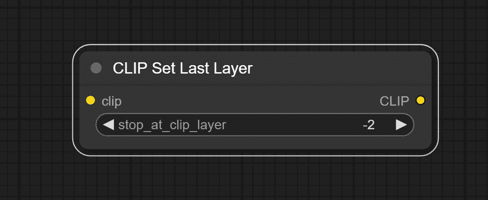

**输入：**

clip -> 接收用于对 prompt 进行编码的 CLIP 模型

**输出：**

CLIP -> 具有新设置的输出层的 CLIP 模型。

**参数：**

stop_at_clip_layer -> 设置 CLIP 模型在第几层进行数据输出

**注意：**CLIP 模型对 prompt 进行编码的过程中，可以理解为对原始文本进行层层编码，该参数就是选择我们需要的一层编码信息，去引导模型扩散。

#### 4、CLIP Text Encode (Prompt)节点

该节点用来输入正反向提示词，也就是“文生图”，“文生视频”中“文”的输入位置

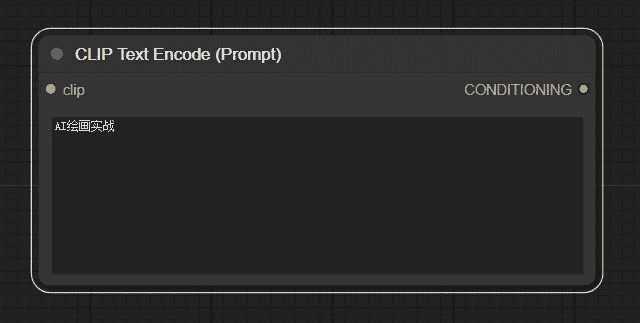

**输入：**

clip -> 接收用于对 prompt 进行编码的 CLIP 模型

**输出：**

CONDITIONING -> 将文本信息通过 CLIP 模型编码，形成引导模型扩散的条件信息

**参数：**

文本输入框 -> 输入需要模型生成的文本信息，正向提示词及反向提示词

**注意：**当前 prompt 仅支持英文的输入，但可通过安装插件实现中文实时翻译

#### 5、KSampler 节点

该节点专门用于逐步减少潜在空间图像中的噪声，改善图像质量和清晰度。

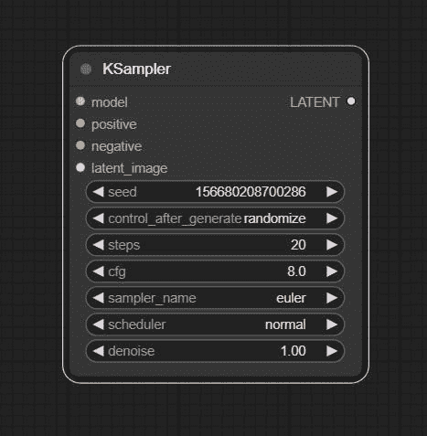

**输入：**

model -> 接收来自大模型的数据流

positive -> 接收经过 clip 编码后的正向提示词的条件信息（CONDITIONING）

negative -> 接收经过 clip 编码后的反向提示词的条件信息（CONDITIONING）

latent_image -> 接收潜空间图像信息

**输出：**

LATENT -> 经过 KSampler 采样器进行去噪后的潜空间图像

**参数：**

seed -> 在去除图像噪声过程中使用的随机数种子。种子数有限，影响噪声生成的结果

control_after_generate -> 指定种子生成后的控制方式

fixed 代表固定种子，保持不变

increment 代表每次增加 1

decrement 代表每次减少 1

randomize 代表随机选择种子

steps -> 对潜在空间图像进行去噪的步数。步数越多，去除噪声的效果可能越显著

cfg -> 提示词引导系数，表示提示词对最终结果的影响程度。过高的值可能会产生不良影响。

sampler_name -> 选择的采样器名称，不同的采样器类型可以影响生成图像的效果，大家可以根据需求进行选择和实验

scheduler -> 选择的调度器名称，影响生成过程中的采样和控制策略，推荐配置可提供更好的结果

denoise -> 去噪或重绘的幅度，数值越大，图像变化和影响越显著。在高清修复等任务中，通常使用较小的值以保持图像细节和质量

#### 6、Empty Latent image 节点

该节点用来控制纯噪声的潜空间图像及比例。

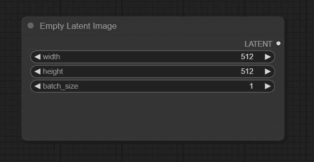

**输出：**

LATENT -> 输出指定形状和数量的潜空间图像

**参数：**

width -> 要生成潜空间图像的宽度

height -> 要生成潜空间图像的高度

batch_size -> 需要生成多少张潜空间图像

**注意：**sd1.0、sd1.5 等模型来说最佳尺寸为 512*512

sd2.0、sd3.0 等模型来说最佳尺寸为 1024*1024

#### 7、VAE Decode 节点

该节点用来将潜空间图像解码到像素级的图像。

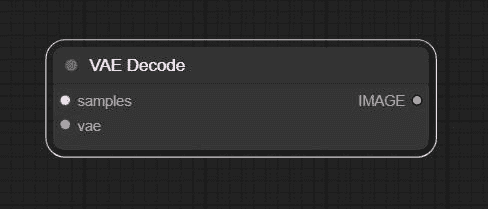

**输入：**

samples -> 接收经过 KSampler 采样器处理后的潜在空间图像, 用于后续的处理或展示

vae -> 接收用于解码潜在空间图像的 VAE 模型, 大部分情况下，模型的检查点（checkpoint）会包含 VAE,当然也可以单独加载一个 VAE 模型

**输出：**

IMAGE -> 输出经过 VAE 解码后可直接查看的图像

#### 8、Save image 节点

该节点用来保存 image 图像

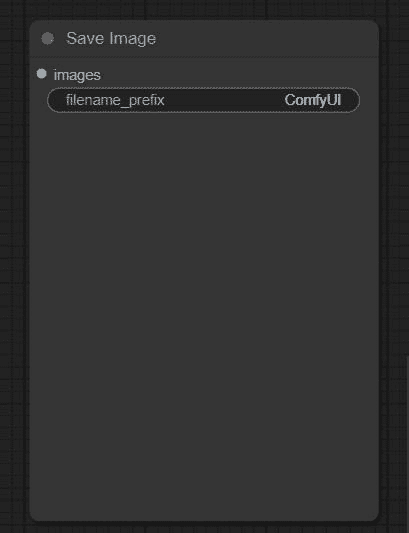

**输入：**

images -> 保存图像

Tips：一般保存的图像会在你的 ComfyUI 文件夹中（eg：安装盘:\Comfyui\ComfyUI\output ）

#### 例子、文生图示例工作流

熟悉以上所有节点之后，你就可以搭建第一个“文生图”工作流了

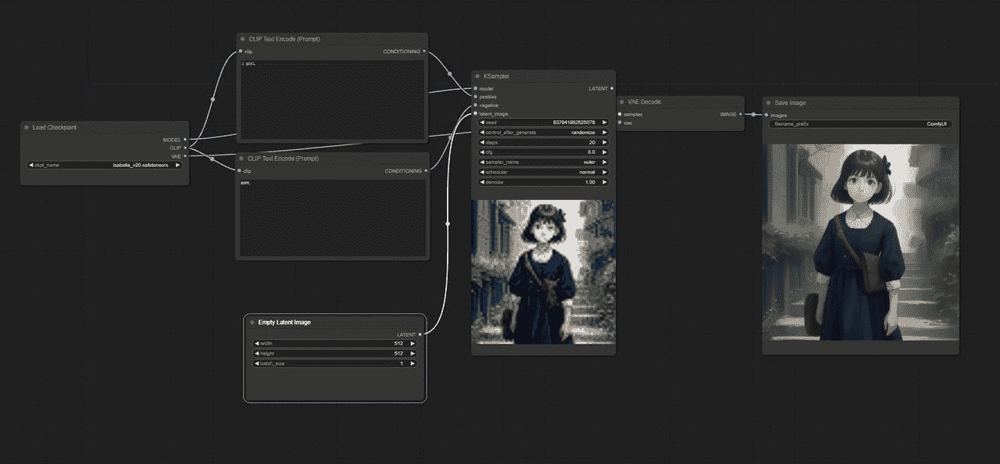

这里使用了 sd1.5 的大模型，所以 latent 图像设置 512*512，正向提示词输入 1 girl，反向提示词输入 NSFW 避免出现不能播的内容，采样器 KSampler 使用默认设置，最终出图如下：

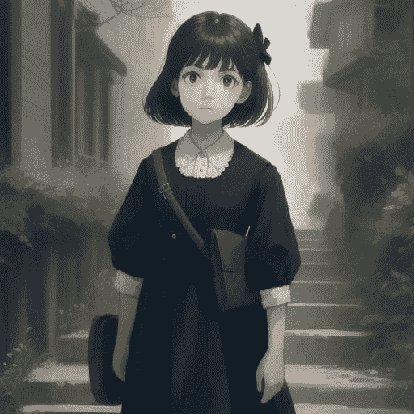

#### 9、VAE Decode(Tiled)节点

该节点用于对变分自编码器（VAE）进行解码操作，以将潜在空间（latent space）中的表示转换回图像。

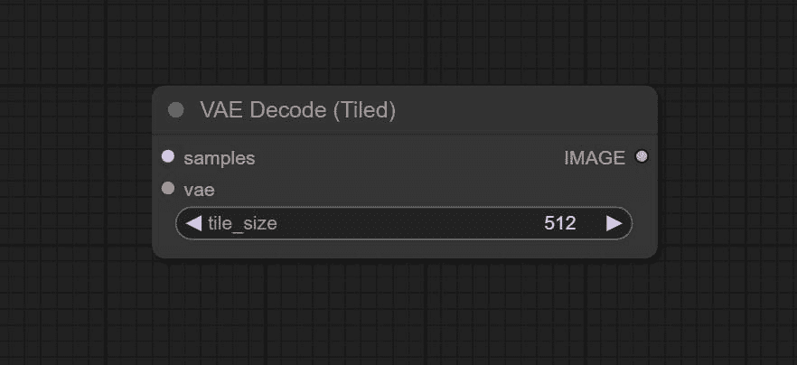

**输入：**

Samples -> 接收 KSampler 采样器处理后的潜空间图像

vae -> 接收对潜空间图像解码使用的 vae 模型

**输出：**

IMAGE -> 输出经过 vae 解码后可直接查看的图像

**参数：**

tile_size -> 用来设定"块"的大小，进行多块处理

Tips：这个节点特别适合处理高分辨率图像，因为将图像分成小块进行处理，然后在处理完所有块后将它们组合成完整图像，可以避免内存溢出，并且提高处理效率。

例如，1024*1024 的图像可以通过设置 1024，来分成 2 块进行解码，也可以设置成 512，分成 4 块进行解码。

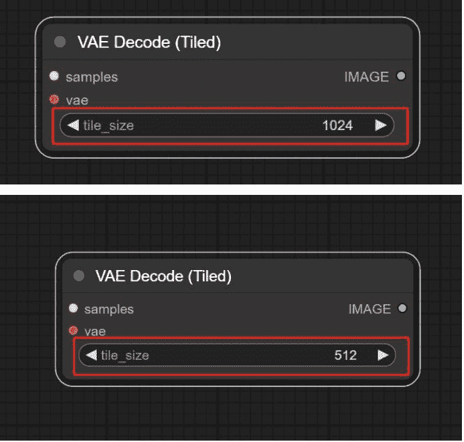

#### 10、Invert Image 节点

该节点用于反转图像的颜色。具体来说，它将图像中的每个像素的颜色值转换为其补色。

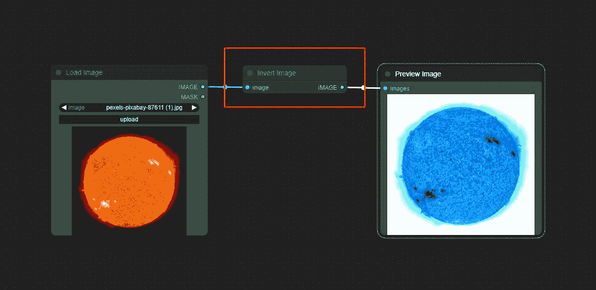

**输入：**

image -> 加载想要处理的图片

**输出：**

IMAGE -> 输出反转图像

1.  反转图像颜色在图像处理和特效制作中有多种应用，包括但不限于以下几种：

1.  视觉效果：反转图像颜色可以产生独特的视觉效果，增加图像的艺术感。

1.  增强对比度：在某些情况下，反转图像颜色可以帮助突出某些细节或对比。

1.  创建掩膜：反转图像颜色可以用于创建和处理掩膜（masks），以便在进一步的图像处理步骤中使用。

#### 11、Load Image 节点

该节点的主要功能是从你的计算机或其他存储设备中加载图像文件，并将其引入到 ComfyUI 的工作流程中。

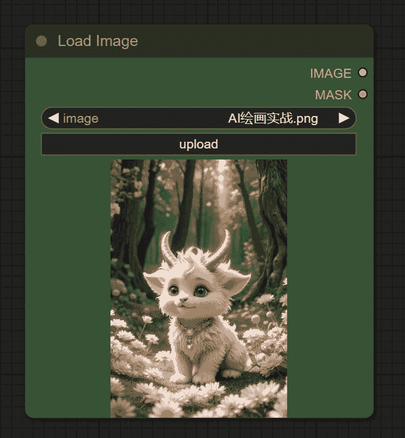

**输入：**

upload -> 点击该按钮，去选择想要加载的图像

**输出：**

IMAGE -> 加载的图像可以作为输入提供给其他节点，以进行进一步的图像处理或操作

MASK -> 如果图像中带有 Alpha 通道信息，则会通过该节点进行输出

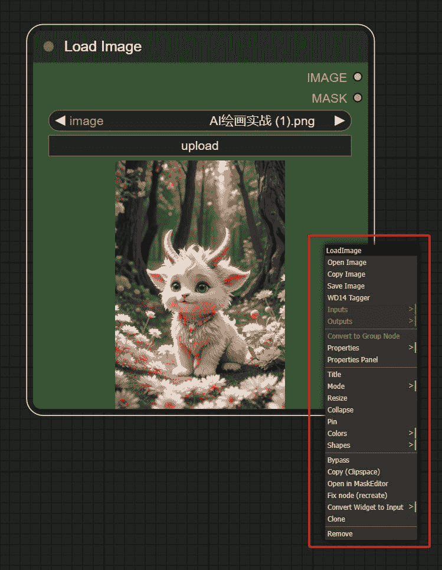

右键点击节点，会有一个功能栏，许多的功能可以在搭建工作流时会有不错的效果：

1.  图像编辑: 加载图像进行剪裁、调整颜色、添加滤镜等操作。

1.  图像分析: 使用加载的图像进行特征提取、模式识别等分析任务。

1.  图像生成: 在生成新图像时，将现有图像作为参考或素材进行处理。

#### 12、Pad lmage for Outpainting 节点

该节点的主要目的是预处理输入图像，以便于后续的绘制或者生成任务。

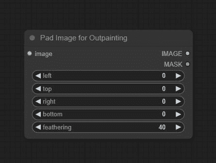

**输入：**

image -> 接收加载的图像信息

**参数：**

left -> 设定图像左侧扩展的像素宽度

top -> 设定图像顶部扩展的像素宽度

right -> 设定图像右侧扩展的像素宽度

bottom -> 设定图像底部扩展的像素宽度

feathering -> 控制边框的柔化程度，使得填充的边缘与原始图像更自然地过渡

输出：

IMAGE -> 输出扩展后的图像信息

MASK -> 输出扩展部分对应的蒙版，并且结合 feathering 参数进行柔化处理。

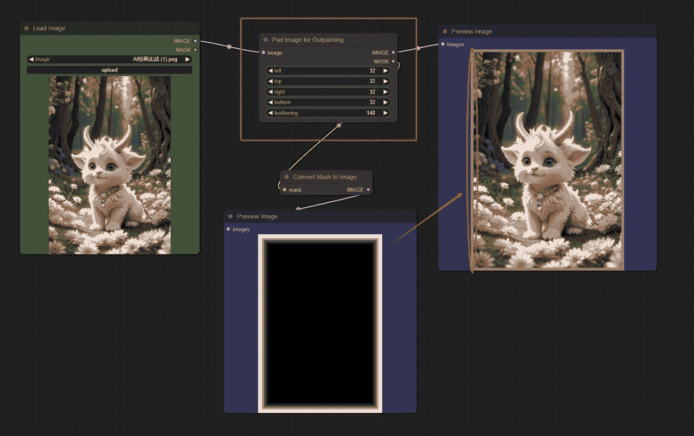

如图所示，可以将 MASK 输出为图像预览羽化效果。

这个节点的作用是调整输入图像的大小或者填充以适应模型的输入要求。具体来说，它可能会执行以下操作之一：

1.  调整大小：将输入图像的尺寸调整为模型所需的输入尺寸。这可以是放大、缩小或者裁剪图像。

1.  填充：如果输入图像的尺寸不足以填满模型所需的输入尺寸，节点可能会在图像周围添加填充。填充通常使用像素值相同的颜色或者根据算法进行填充，以确保输入图像与模型的输入尺寸匹配。

#### 13、VAE Encoder（for inpainting）节点

该节点可以有效地对指定 VAE 模型对图像进行编码解码，从而为后续提供高质量的输入数据。

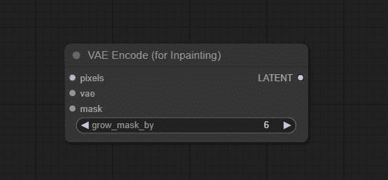

**输入：**

pixels -> 接收输入的图像信息

vae -> 接收输入的 vae 模型，使用该模型进行图片编码

mask -> 接收蒙版信息，用来确定扩散的区域

**参数：**

grow_mask_by -> 控制蒙版的羽化区域，和 Pad lmage for Outpainting 节点的 feathering 参数相似

**输出：**

LATENT -> 编码后的潜空间图像信息

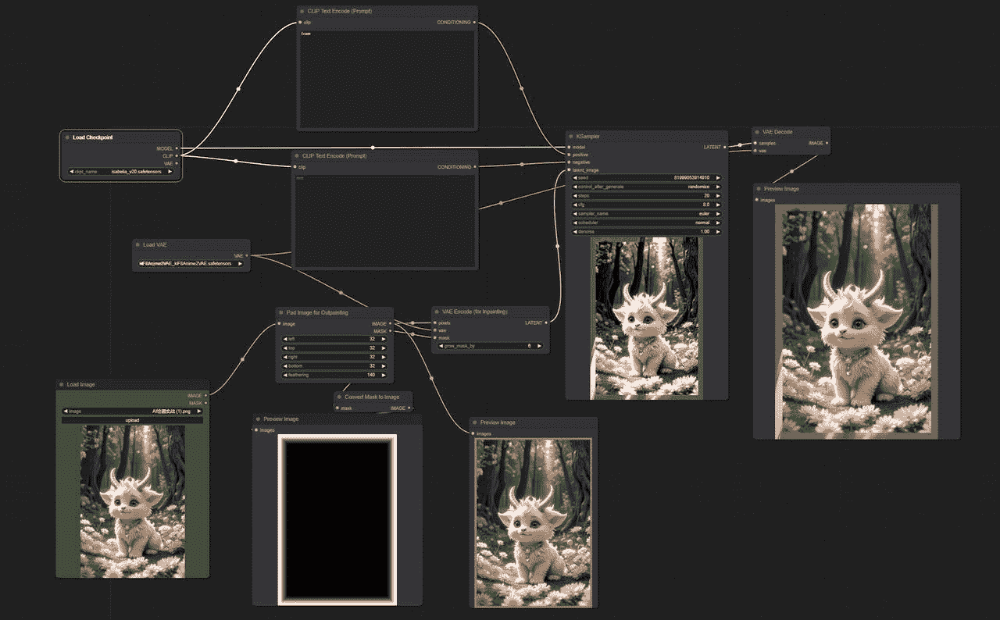

如图所示，在熟悉从节点之后，便可创建一个简单的扩图工作流实现图片的扩展，上图所展示的便是对图片边缘扩展生成一张带边框的图像。

#### 14、Preview image 节点

该节点用来预览 image 图像。

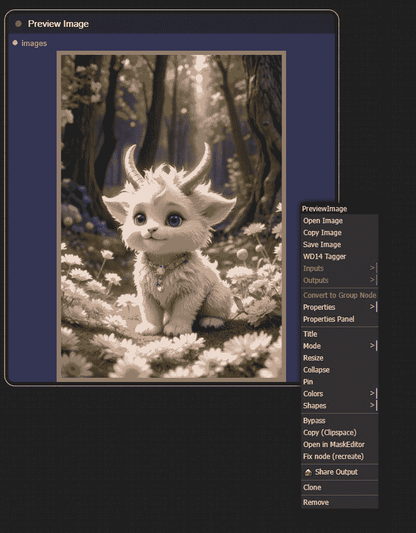

如果觉得图像说想要的效果，也可以右键节点选择“Save Image”进行图像保存，或者也可以建立一个“Save Image”节点，直接保存，保存地址附上。

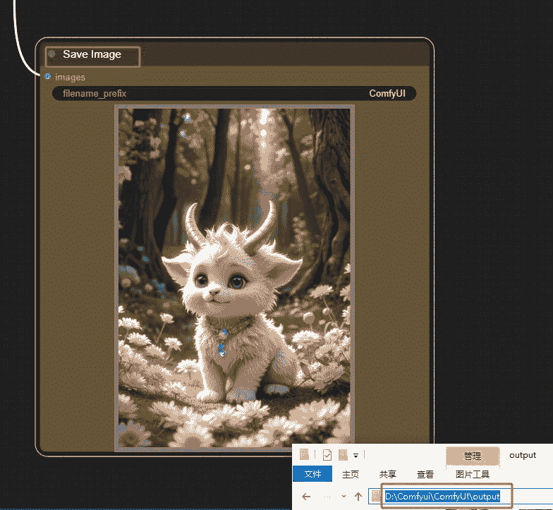

#### 15、Upscale image 节点

该节点用于放大图像的尺寸，同时尽可能保持图像的细节和质量。

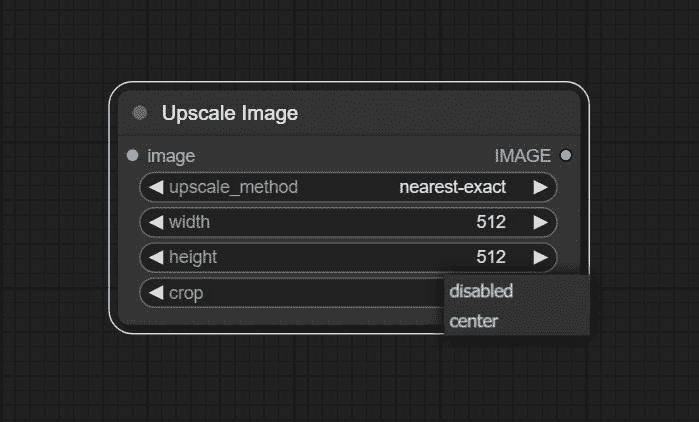

**输入：**

image -> 接收需要调整的图像

**参数：**

upscale_method -> 选择放大图像的算法，“nearest-exact”表示使用最近邻插值算法。

width -> 调整后的图像宽度

height -> 调整后的图像高度

crop -> 设置是否对放大后的图像进行裁剪 “disabled 表示不裁剪，center 表示从中心对图片裁剪”

**输出：**

IMAGE -> 输出调整之后的图像

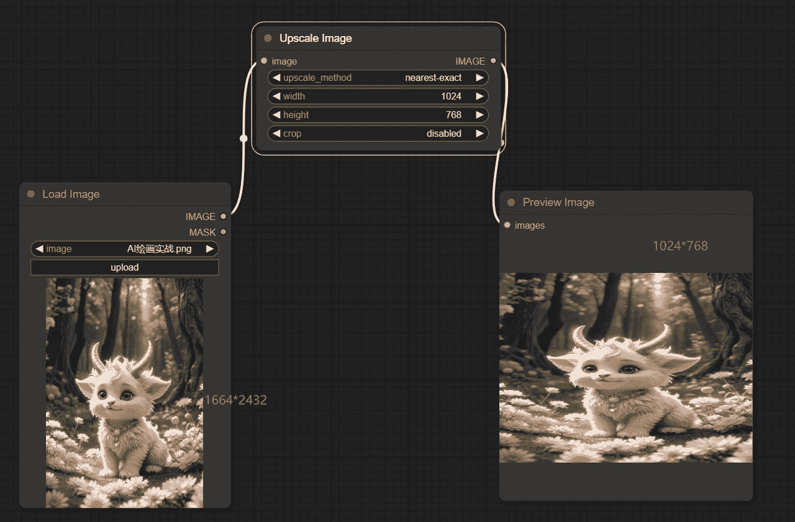

注意：比例需根据自身需求调整，上图的比例设置只为更好的展示节点效果

#### 例子、图生图示例工作流

熟练使用以上节点，你就可以搭建第一个“图生图”工作流了

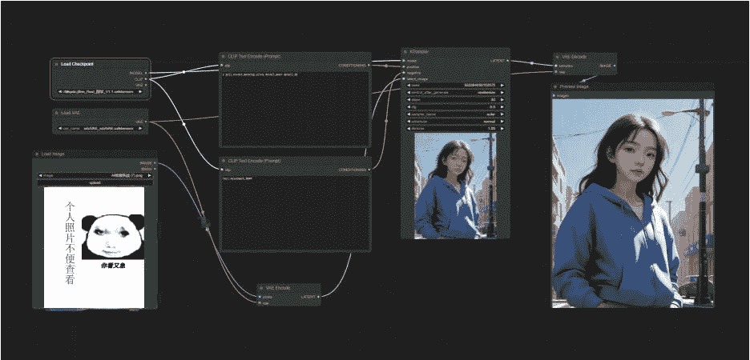

可以看到，在整个图生图工作流中，这里使用了 SDXL 的大模型，上传一张原始底图，经过 VAE Encoder 节点对底图编码，后续通过提示词引导使用 KSampler 采样器进行去噪，最终出图如下：

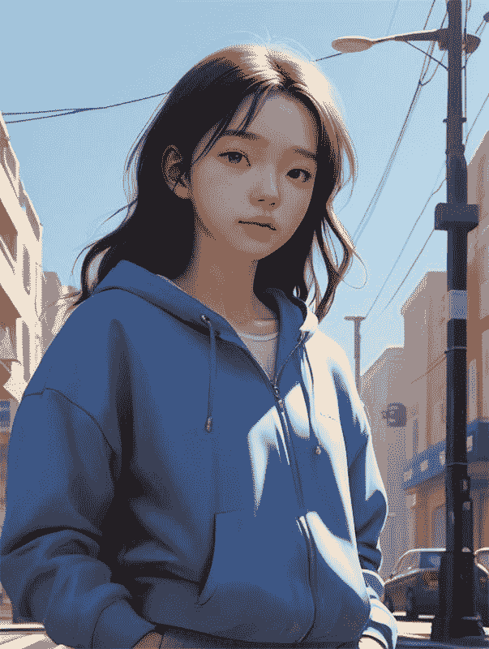

#### 16、Apply Controlnet 节点

该节点用于在生成图像的过程中应用控制网络（ControlNet）

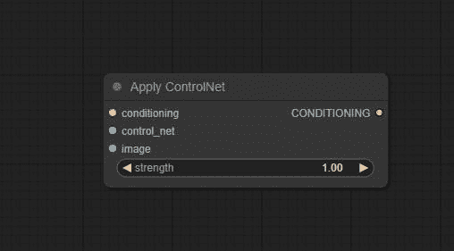

**输入：**

Conditioning → 接收传入的条件信息，比如通过CLIP Text Encode (Prompt)处理后的文本信息，用于指导图像生成过程

control_net → 加载ControlNet模型。注意，Stable Diffusion（SD）模型和Stable Diffusion XL（SDXL）模型对应的ControlNet模型是不同的。

image → 加载经过预处理的图片。在此步骤中，输入的图片已经过预处理，而不是原始图像。

参数：

strength → 控制权重程度。数值越高，约束越强；数值越低，约束越弱。

**输出：**

CONDITIONING → 输出包含混入ControlNet信息的条件信息流。

**应用场景**

1.  图像修复：通过参考控制图像，修复原始图像的缺陷。

1.  图像风格转换：将一张图像的风格应用到另一张图像。

1.  图像合成：结合多个图像元素生成新的图像。

1.  个性化定制：根据用户提供的控制输入，生成特定风格或内容的图像。

通过 Apply Controlnet 节点，可以在图像生成过程中引入更多的控制，从而生成更加精确和符合预期的图像效果这对于需要高质量和高度定制化图像的应用场景非常有用。

#### 17、Conditioning Average 节点

该节点用于合并多个条件信息流，生成一个平均条件信息流。这在多个条件输入需要整合时特别有用，如将多条文本提示或其他控制信号组合起来。

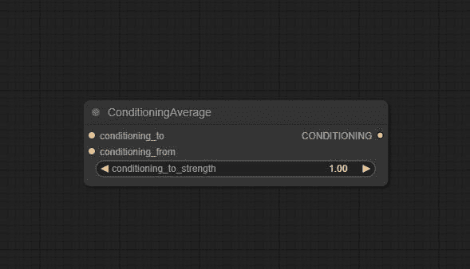

**输入：**

conditioning_to → 需要进行整合的条件信息之一

conditioning_from → 需要进行整合的条件信息之一

**参数：**

conditioning_to_strngth → 设置信息整合的强度

**输出：**

CONDITIONING → 输出信息整合之后的条件信息

注意：当 conditioning_to_strength 为 1 时，图像生成过程将完全受到 conditioning_to 的影响，而 conditioning_from 的影响将被忽略。反之，当 conditioning_to_strength 为 0 时，图像生成将只受 conditioning_from 的影响，conditioning_to 的影响则不会起作用。

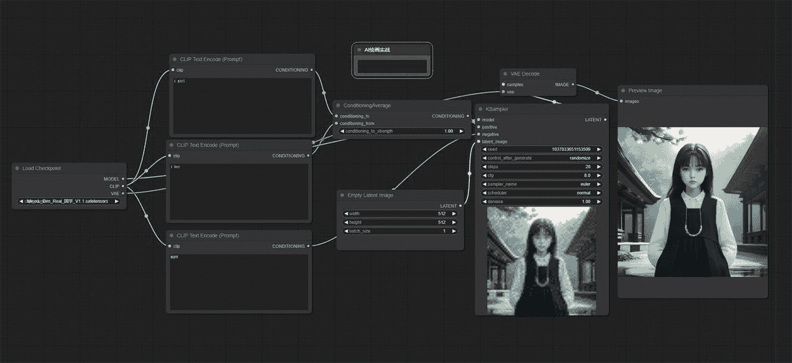

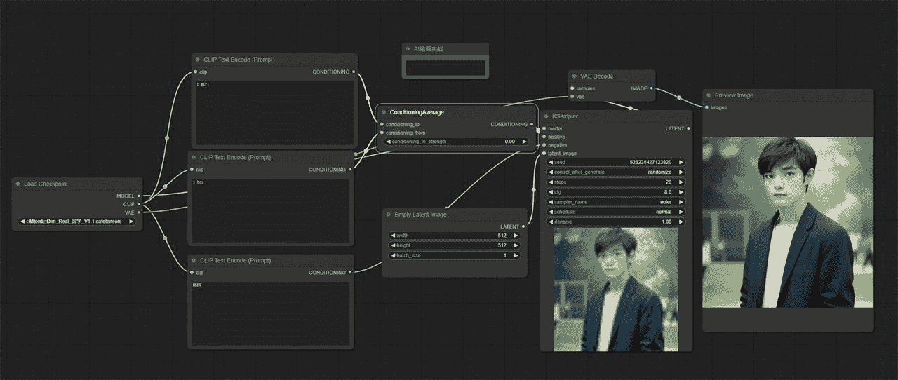

注意：当 conditioning_to_strength 为 0.5 时，图像生成的结果将会受到 conditioning_to 和 conditioning_from 两个条件的影响，它们的权重相等。这种情况下，生成的图像可能会展现出两个条件之间的竞争或者混合的特征。例如，在一个包含"green"和"dragon"这两个条件的情境中，生成的图像可能会显示出这两种特征的一种效果或者混合的效果

**Green 效果**

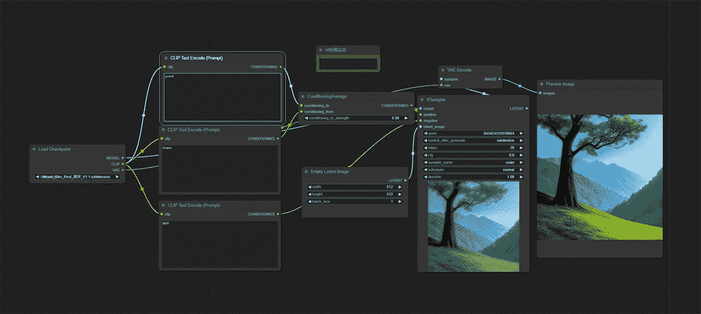

**Dragon 效果**

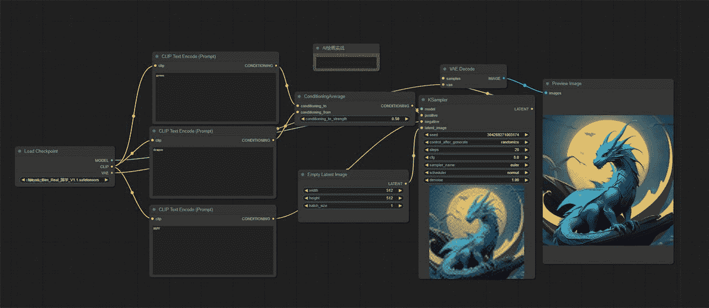

**混合效果**

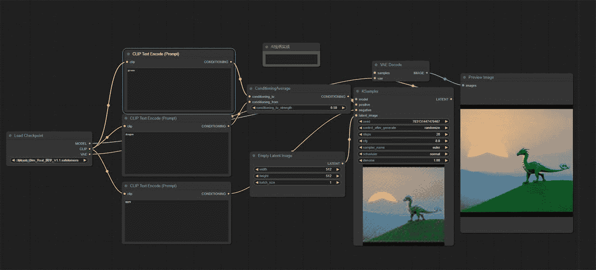

**应用场景**

1.  多文本提示：将多个文本提示的条件信息流合并为一个，综合各种提示的效果进行图像生成。

1.  多控制信号：整合来自不同控制信号的条件信息，以生成更复杂或更平衡的图像效果。

通过 Conditioning Average 节点，用户可以灵活地组合多个条件输入，提高图像生成的多样性和灵活性。

#### 18、Conditioning(Set Area)节点

该节点用于设置图像生成过程中特定区域的条件或者属性，以控制生成图像的局部特征或者风格

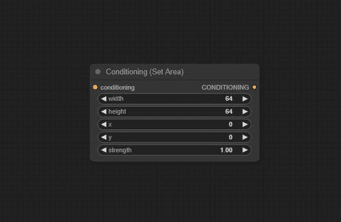

**输入：**

conditioning → 接收传来的条件信息

**输出：**

CONDITIONING → 进行条件限制之后输出的条件信息

**参数：**

width → 控制区域的宽度

height → 控制区域的高度

x → 控制区域原点的x坐标

y → 控制区域原点的y坐标

strength → 表示条件信息的强度

注意：在 ComfyUI 中坐标系的原点是在节点的左上角。

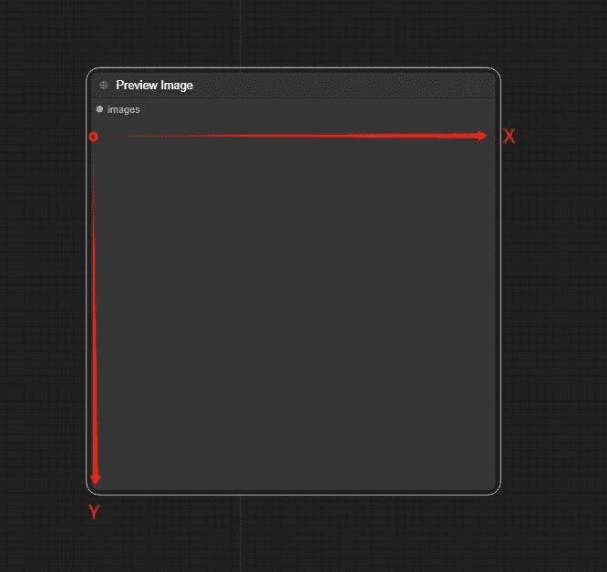

**应用场景**

1.  局部特征调整：针对图像中的特定部分调整颜色、对比度或者其他视觉属性。

1.  局部风格控制：在图像生成过程中，控制特定区域的风格或者外观，以达到定制化或者特定效果。

1.  复杂合成：将多个条件设置节点结合使用，以实现复杂的局部图像合成或者调整。

通过 Conditioning(Set Area)节点，可以精确控制图像生成过程中特定区域的表现，从而增强生成图像的定制性和表现力。

#### 19、Conditioning(Combine)节点

该节点用于将多个条件信息流合并为一个单一的条件信息流，以用于控制图像生成过程中的各个方面。

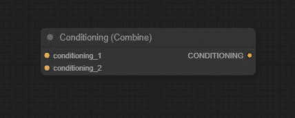

**输入：**

conditioning_1 → 需要进行信息整合的条件信息之一

conditioning_2 → 需要进行信息整合的条件信息之一

**输出：**

CONDITIONING → 输出整合之后的条件信息

结合 Conditioning(Set Area)节点和 Conditioning(Combine)节点，如图所示，设置 1024*512 的图像可以将其左边分配给 1boy 提示词，将右边分配给 1 girl 提示词，从而生成一张两个区域都满足条件的图像。

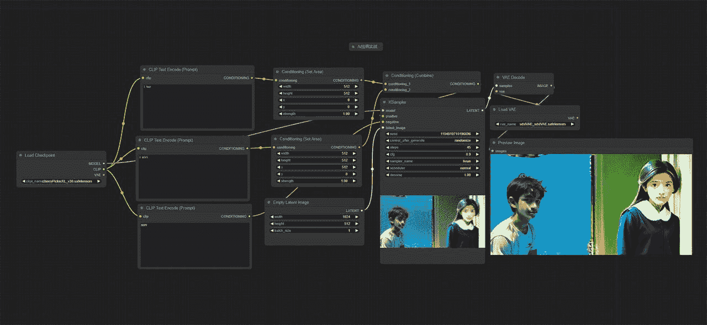

**应用场景**

1.  多源条件整合：从多个文本提示、控制信号或者其他数据源整合条件，以实现复杂的图像生成控制。

1.  灵活控制：根据不同的需求场景和用户输入，动态调整生成图像的特征和风格。

1.  定制化生成：为特定的应用或者用户需求，创建高度定制化的图像生成方案。

通过 Conditioning(Combine)节点，用户可以在图像生成过程中集成和整合多种条件输入，以实现更精确和多样化的图像生成效果。

#### 20、Image Blur 节点

该节点用于对输入的图像进行模糊处理，以改变图像的视觉效果或者减少图像中的细节，通常用于创建柔和或者抽象化的视觉效果。

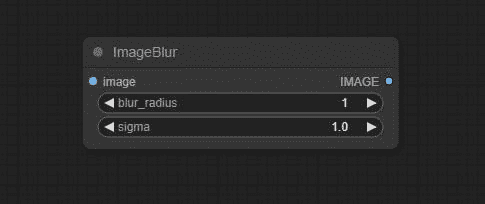

**输入：**

images → 接收输入的图像

**输出：**

IMAGE → 输出模糊后的图像

**参数：**

blur_radius → 输入模糊的高斯半径

sigma → 该值越小，模糊的像素越接近中心

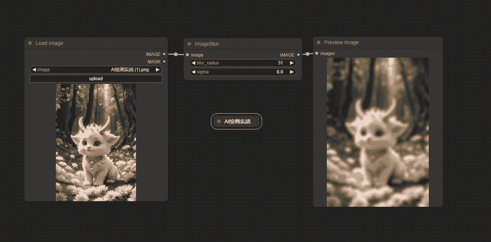

**应用场景**

1.  艺术效果：通过模糊处理来创建抽象化或者柔和的艺术效果。

1.  背景处理：用于减少背景中的细节，突出前景对象。

1.  视觉平滑：在视觉设计中用于平滑图像以减少视觉杂乱或者强调主题。

通过 Image Blur 节点，可以根据需求调整图像的外观，使其更符合艺术创作或者设计需求。

#### 21、Image Sharpen 节点

该节点用于增强图像的清晰度和细节，通常用于提升图像的视觉效果和边缘锐化。

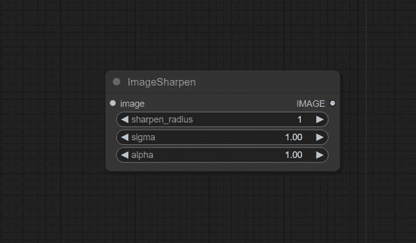

**输入：**

image → 需要进行锐化的原始图像

**输出:**

IMAGE → 输出锐化后的图像

**参数：**

sharpen_radius → 表示锐化的半径

sigma → 该值越小，锐化的像素越接近中心像素

alpha → 锐化的强度

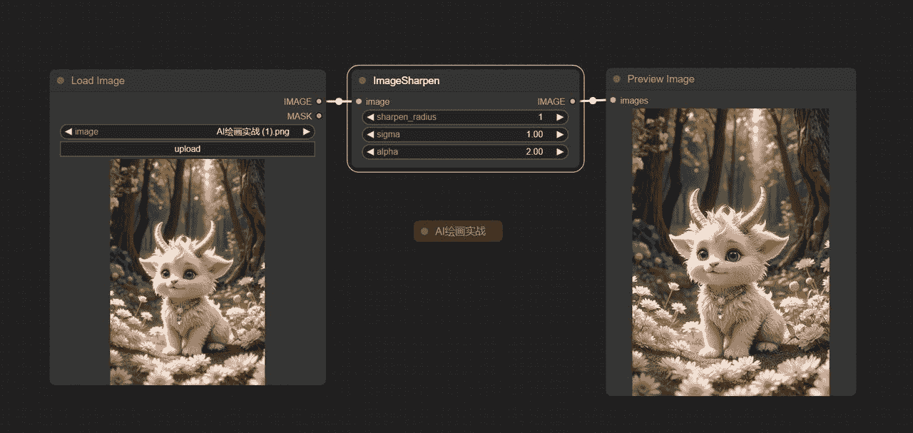

**应用场景**

1.  摄影后期处理：用于增强照片中的细节和清晰度，使图像更生动和有吸引力。

1.  图像分析：在科学和工程领域中，用于增强图像以便更好地识别和分析特定的结构或对象。

1.  艺术效果：在艺术创作中，用于调整图像的视觉效果，以达到更良好的视觉冲击力或者审美效果。

通过 Image Sharpen 节点，可以定制化地调整图像的清晰度和细节，以满足不同的美学和功能需求。

#### 22、Image Quantize 节点

该节点用于将输入的图像进行量化处理，即将图像中的颜色数目减少到较少的色彩级别。

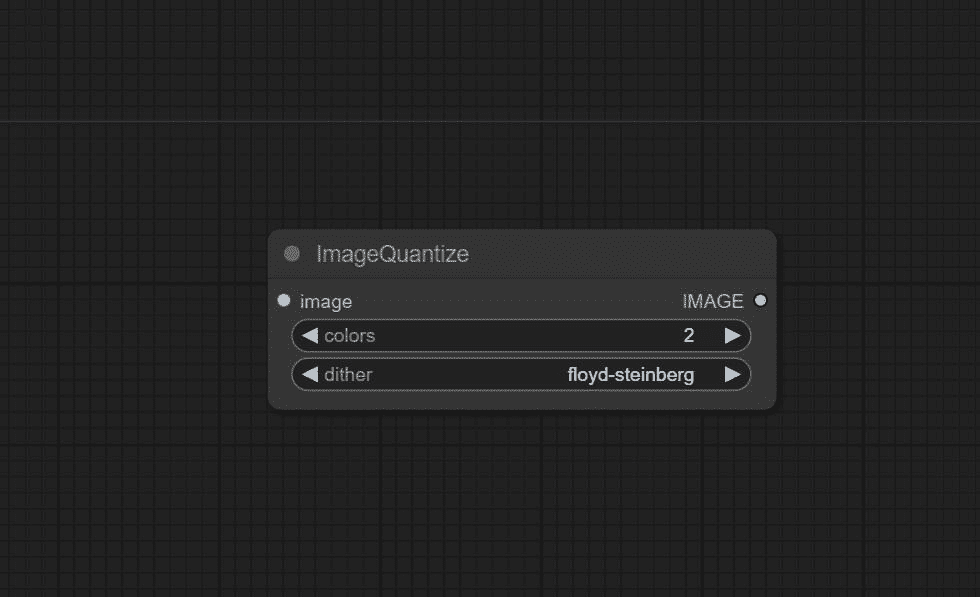

**输入：**

image → 接收需要调整的图像

**输出：**

IMAGE → 输出调整之后的图像

**参数：**

colors → 表示量化后图像包含的颜色数量（颜色数量最小为1，最大位256）

dither → 添加抖动效果，使图像在量化后更加平滑

**不开启抖动**

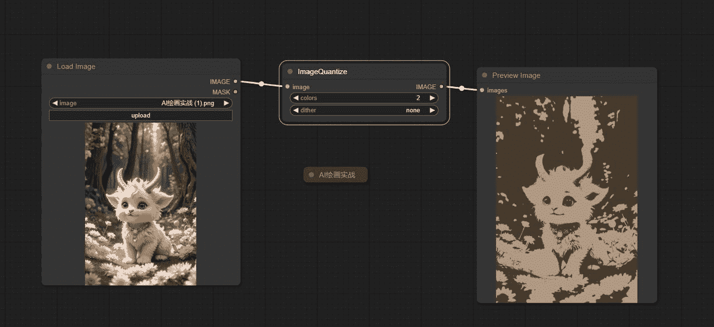

**开启抖动**

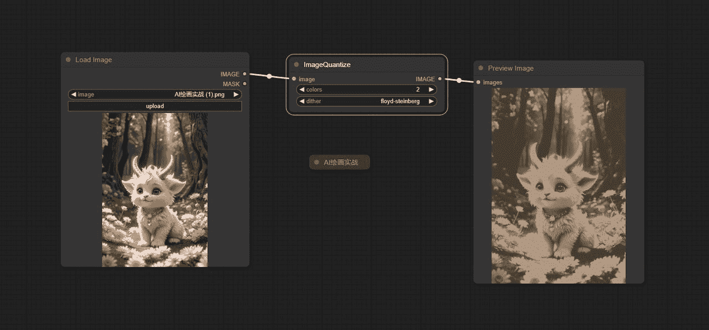

**应用场景**

1.  艺术风格化：通过减少颜色数量，创建抽象或者卡通风格的图像效果。

1.  图像压缩：减少图像文件大小，以节省存储空间或者加快图像传输速度。

1.  特定效果：在某些视觉设计中，可以使用色彩量化来增强特定图像效果或者降低处理复杂度。

通过 Image Quantize 节点，可以调整图像的色彩级别，从而控制图像的视觉表现和处理效率。

#### 23、Image Blend 节点

该节点用于将两幅图像混合在一起，生成一个结合了两幅图像特征的图像。

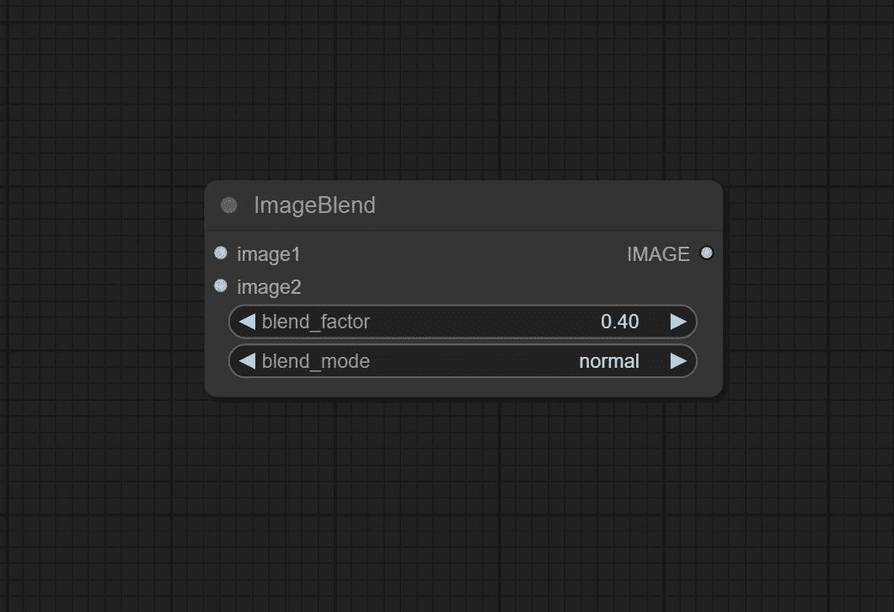

**输入：**

image_1 → 需要混合的第一幅图像

image_2 → 需要混合的第二幅图像

**输出：**

image → 混合后的图像输出

**参数：**

blend_factor → 混合因子，控制两幅图像的混合比例。值为0.0时，输出图像完全由image1决定；值为1.0时，输出图像完全由image2决定。值为0.5时，两幅图像各占一半权重。

blend_mode → 混合模式，定义两幅图像如何混合，有多个模式可选择，以下是常见的混合模式：

normal：正常混合，即按 blend_factor 的比例线性混合两幅图像。

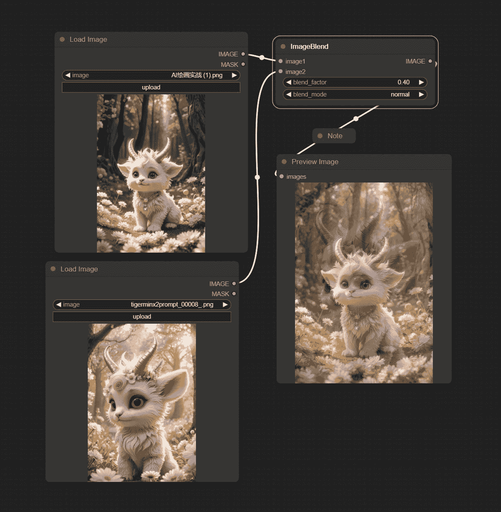

multiply：乘法混合，结果图像的颜色值是两幅图像对应像素颜色值的乘积。

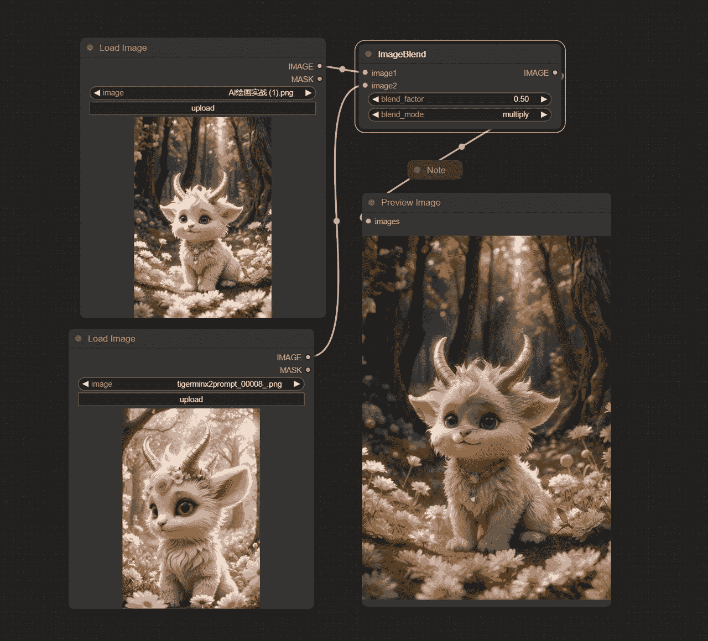

screen：屏幕混合，结果图像的颜色值是反转两幅图像对应像素颜色值的乘积的反转。

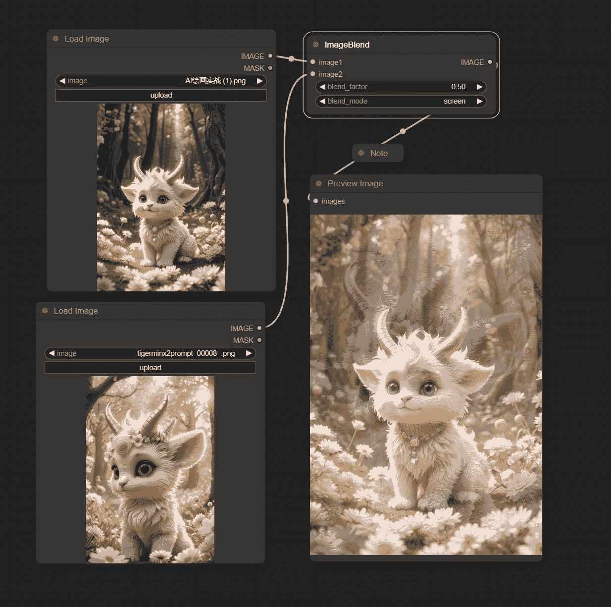

**应用场景**

1.  艺术创作：将不同风格或元素的图像混合在一起，创造独特的艺术效果。

1.  图像合成：在图像处理过程中，合成不同来源的图像，生成具有特殊效果的图像。

1.  视觉特效：在影视、游戏等领域，利用图像混合技术创建逼真的视觉特效。

通过 Image Blend 节点，可以灵活地将两幅图像融合在一起，调整混合比例和模式，以实现丰富多样的图像处理效果。

#### 例子、区域控制示例工作流

熟练使用以上节点，你就可以搭建第一个“区域控制”工作流了。

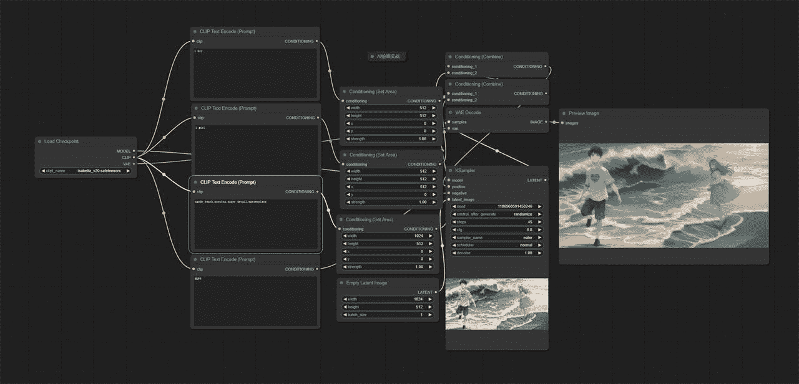

这里使用 SD1.5 的大模型，通过 Conditioning(Set Area)节点控制图片生成区域，然后通过 Conditioning(Combine)节点进行条件合并，然后使用三个正向提示词来控制不同区域，最终出图如下所示：

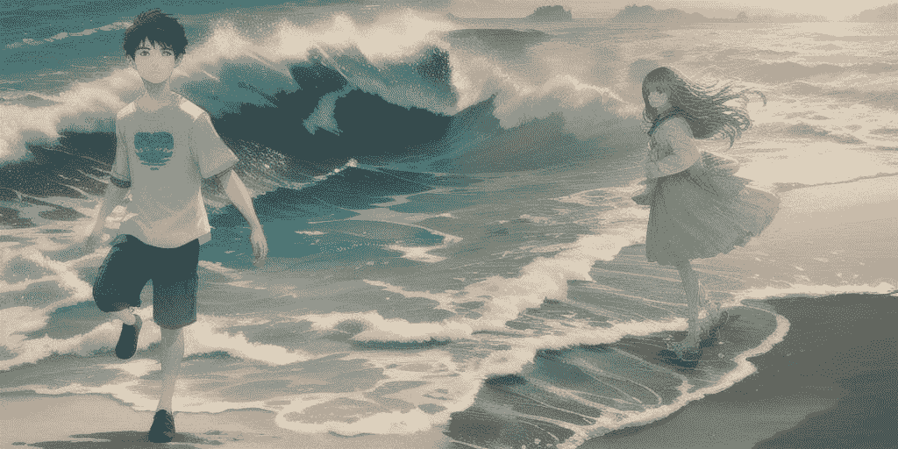

#### 24、Upscale Latent 节点

该节点用于在图像生成过程中放大潜在空间的图像。这是一个常见的操作，用于提高生成图像的分辨率，保持细节并减少失真。

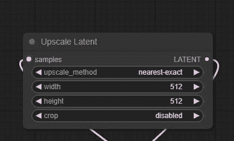

**输入：**

Samples → 传入的原始潜空间图像

**输出：**

LATENT → 输出尺寸调整之后的潜空间图像

**参数:**

upscale_method → 选择像素填充的方法

width → 调整后潜空间图像的宽度

height → 调整后潜空间图像的高度

crop → 选择是否对图像进行裁剪

注意：使用潜空间图像的方法并不能完美融合图像，通过 VAE 解码后可能会损坏图像。正确的做法是使用 KSampler 采样器进行二次采样，以获得更美观的图像。

**应用场景**

1.  细节增强：在图像生成和编辑过程中，提高图像的分辨率以增强细节。

1.  质量提升：用于低分辨率图像的放大，提高整体图像质量。

1.  优化生成过程：在生成高分辨率图像时，通过放大潜在空间，减少直接生成高分辨率图像带来的计算负担。

通过使用 Upscale Latent 节点，可以有效提高生成图像的分辨率和质量，是图像生成和处理过程中的重要工具。

#### 25、LatentCompositeMasked 节点

该节点用于在图像生成过程中，通过掩码在潜空间中合成多个潜在图像，这一节点在需要将不同来源的图像元素组合在一起时非常有用。

**输入：**

destination → 底层潜空间图像

source → 上层潜空间图像

mask → 使用mask对上层潜空间图像进行分割

**输出：**

LATENT → 输出图层叠加后的潜空间图像 和前面latent使用同一VAE解码

**参数：**

x → 表示粘贴区域的x坐标 ComfyUI坐标原点位于左上角

y → 表示粘贴区域的y坐标 ComfyUI坐标原点位于左上角

resize_source → 表示是否对蒙版区域进行分辨率调整

应用场景

1.  图像修复：通过合成不同来源的图像部分来修复图像中的缺陷。

1.  风格迁移：在保持整体风格一致的情况下，合成不同风格的图像元素。

1.  复杂合成：在潜空间中实现复杂的图像合成，以避免图像空间合成带来的边缘和融合问题。

通过使用 LatentCompositeMasked 节点，可以实现更为复杂和精细的图像合成，尤其是在需要保留细节和风格的一致性时。

#### 26、Latent Composite 节点

该节点用于在潜空间中合成多个潜在图像，帮助在生成图像时灵活地组合不同来源的图像元素。

**输入：**

samples_to → 接收叠加的潜空间图层之一 该参数传入的图片为图层底层

samples_from → 接收叠加的潜空间图层之一 该参数传入的图片为图层上层

**输出：**

LATENT → 输出图层叠加后的潜空间图像

**参数：**

x → 上层图层叠加位置的的x坐标 ComfyUI中坐标原点为左上角

y → 上层图层叠加位置的的y坐标 ComfyUI中坐标原点为左上角

feather → 调整边缘的羽化程度

上图示例设置 feather 为 256 可以看到上层图层的边缘有羽化，设置 y 坐标为 336，粘贴位置向下偏移。

**应用场景**

1.  图像混合：将多个图像的特征进行混合，创造出具有多种风格或元素的图像。

1.  风格迁移：在保持整体图像内容一致的情况下，合成不同风格的潜在图像。

1.  细节增强：通过合成多个潜在图像，增强图像的细节和质感。

通过使用 Latent Composite 节点，可以在潜空间中灵活地合成图像，保持图像的高质量和细节，适用于各种图像生成和编辑任务。

#### 27、Set Latent Noise Mask 节点

该节点用于在潜空间图像生成过程中设置噪声掩码，以便对图像的特定区域施加不同程度的噪声。这可以用于控制生成图像中的细节和随机性，特别适用于需要对图像的某些部分进行精细控制的情况。

**输入：**

samples → 接收传入的潜空间图像

mask → 接收传入的蒙版信息

**输出：**

LATENT → 输出带有蒙版信息的潜空间图像

Tips：上图中的火焰与原图的融合度还不是很高，如果再加上高清放大的节点看起来会更加的自然。

**应用场景**

1.  图像修复：在图像的特定区域施加噪声，以修复图像中的缺陷或不一致。

1.  细节增强：通过噪声掩码控制细节的生成，提高图像的整体质量。

1.  风格特化：在保持整体风格一致的情况下，对图像的不同部分进行特化处理。

通过使用 Set Latent Noise Mask 节点，可以在潜空间中灵活地控制图像的噪声分布，提高图像的质量和细节，适用于各种图像生成和编辑任务。

#### 28、Load LoRA 节点

该节点用于加载预训练的 LoRA 模型，并将其应用到潜在空间图像生成过程中。LoRA 模型是一种轻量级的、适用于微调的模型，可以在不改变基础模型参数的情况下，增强生成模型的特定功能或风格。

**输入：**

model → 加载一个基础生成模型的大模型 lora的训练会使用一个大模型底模，对应的底模效果最好

clip → 输入与生成图像相关的文本描述或其他信息

**输出：**

MODEL → 输出修正后的大模型

CLIP → 输出修正后的CLIP模型

**参数：**

lora_name → 需要使用到的lora模型 配置好路径文件，模型可以自行选择

strength_model → 设置LoRA模型对生成图像的影响强度 数值越高，LoRA模型对生成图像的影响越大，可以设置为负值

strength_clip → 设置LoRA模型对与文本描述相关信息的影响强度 数值越高，LoRA模型对文本描述相关部分的影响越大，可以设置为负值

**应用场景**

1.  风格迁移：通过加载不同风格的 LoRA 模型，将特定风格应用到生成图像中。

1.  功能增强：利用 LoRA 模型增强基础生成模型的特定功能，如细节增强、特定对象生成等。

1.  模型微调：在保持基础模型稳定性的情况下，通过 LoRA 模型进行微调，实现更为精细的图像生成。

通过使用 Load LoRA 节点，可以灵活地在图像生成过程中应用预训练的 LoRA 模型，增强生成效果，丰富图像生成的多样性和质量。

#### 例子、LoRA 示例工作流

熟练使用以上节点，你就可以搭建有关 LoRA 的工作流了。

这里使用 SD1.5 的大模型，使用黑晶对应的 lora，设置潜空间图片为 1024*215 进行扩散，提示词中加入 Lora 模型对应的引导词，从而获得最终图像：

<https://aigcreative.feishu.cn/sync/K4Gvd9vUQsy9Oubwqaeclu0Fnbg>