# SDXL模型最佳拍档！COMFY UI上手指南

> 来源：[https://aigcreative.feishu.cn/docx/JXF5d0kMQohliIxf3guc5pAZnuy](https://aigcreative.feishu.cn/docx/JXF5d0kMQohliIxf3guc5pAZnuy)

> 来源：👸号-AI艺术家

> 原文链接：https://mp.weixin.qq.com/s/l0p64XduR4bgDyLy8tmTPA

SDXL 1.0 特点建立在由 3.5B 参数BASE模型和 6.6B 参数REFINE模型组成的两阶段创新架构之上。

理论上，SDXL 1.0 应该在具有 8GB VRAM 的 GPU 上有效工作。但sdwebui现在做不到（需要10G）,能做到的只有COMFY UI。

COMFYUI是一款易于上手的工作流设计工具，具有以下特点：基于工作流节点设计，可视化工作流搭建，快速切换工作流，对显存占用小，速度快，支持多种插件，如ADetailer、Controlnet和AnimateDIFF等。

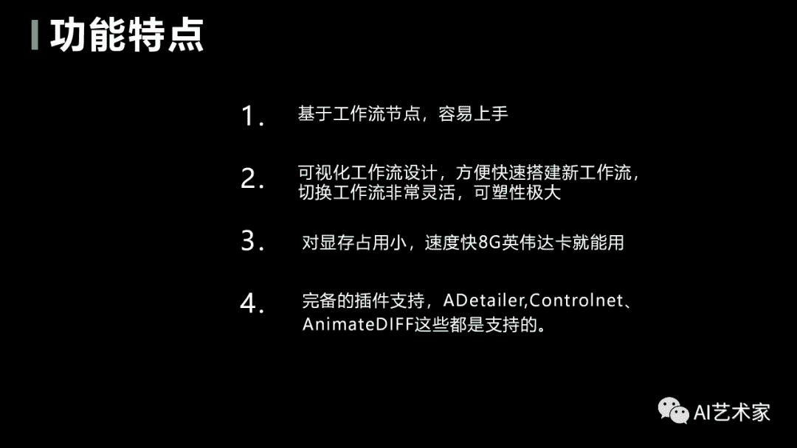

ComfyUI 和stable-diffusion-webui的作用类似，安装方法也类似。我们为大家提供了特别的压缩包，只要解压软件，就算是安装成功了。

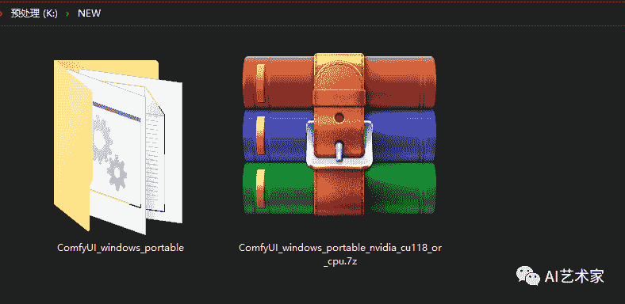

下载SDXL模型和COMFYUI安装包，解压缩后，设置模型路径。然后，安装插件管理器，安装必要插件，最后导入工作流。

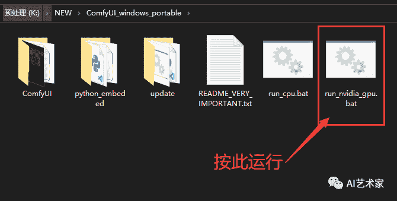

安装软件之后，需要获取SDLX1.0的两个模型base和refiner。

还需要你把它们放在模型路径上。

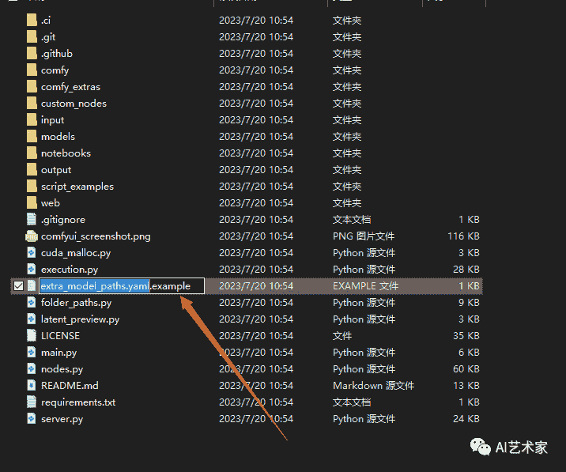

把其中的extra_model_paths.yaml.example改为extra_model_paths.yaml。并修改其中的模型目录，就可以实现自定义模型目录，或者和stable-diffusion-webui共用模型目录。

在使用上，COMFY-UI采用的是工作流模式：

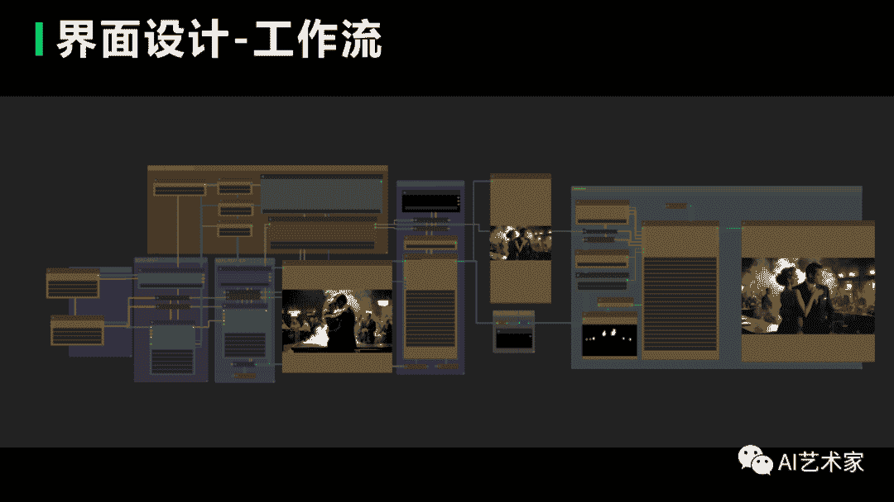

可以说，工作流就是COMFY的灵魂。

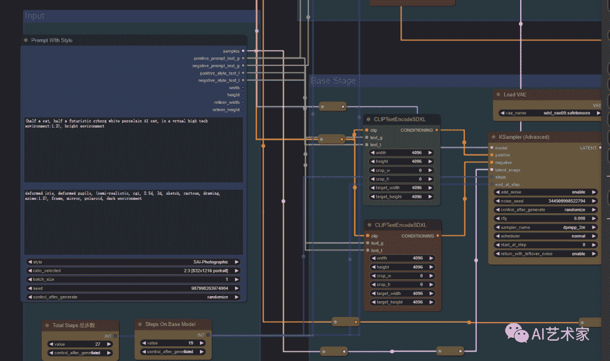

当然，工作流确实看起来很繁琐，之前没接触过的人，会看着一堆密密麻麻的线，望而却步。比如这样。

但是实际上，你只需要导入工作流。

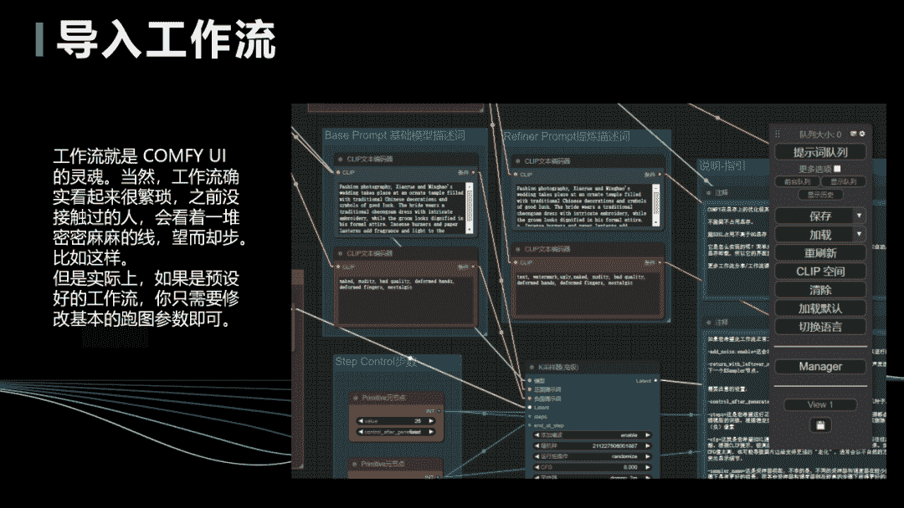

如果是预设好的工作流，你只需要修改：

然后，按一下任务排队执行：

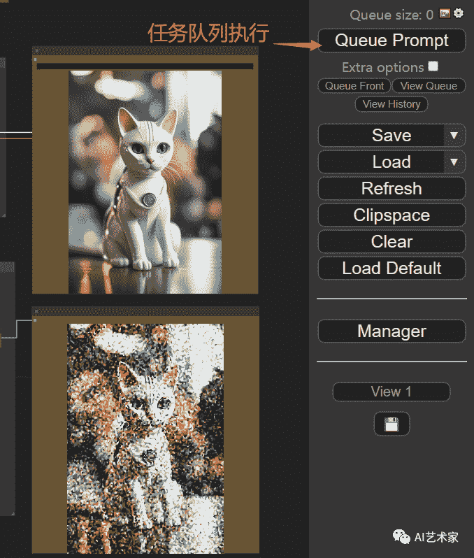

任务就快速完成了。

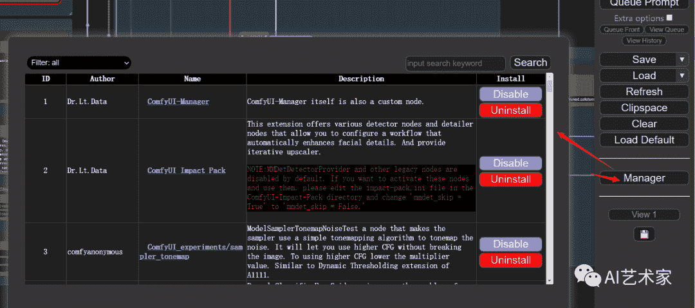

最关键的，您需要安装一个插件管理器，以便在COMFY中安装各种第三方的节点器。您可以按照以下步骤操作：进入命令行模式，在COMFY目录中输入指令，然后克隆插件管理器。

最后，重启COMFYUI即可开始使用。

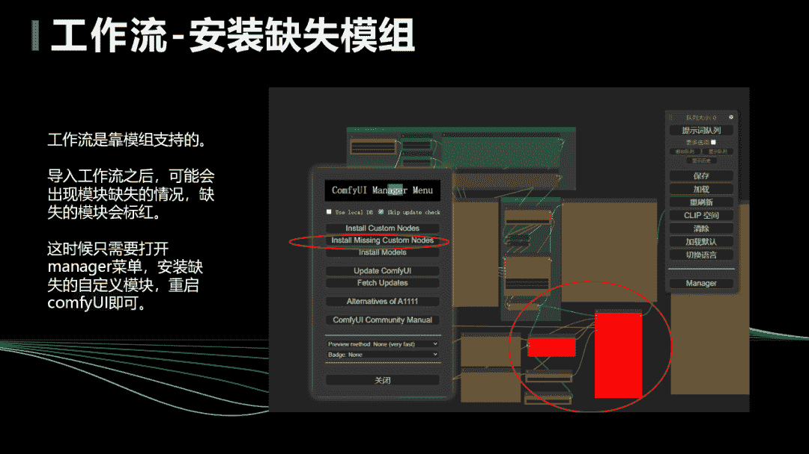

如果遇见上图这种缺模块的情况，直接通过管理器安装缺失模块即可。

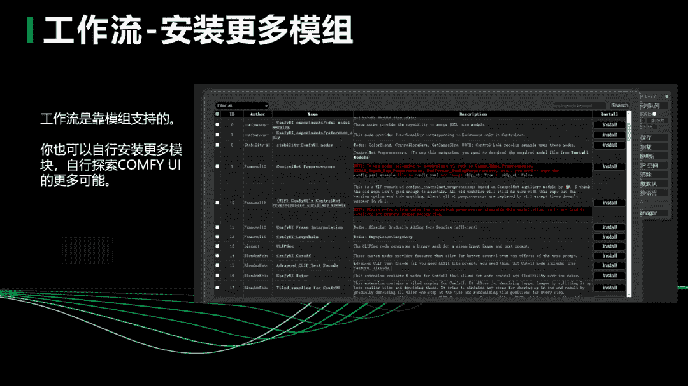

你也可以通过自己研究工作流，设计更多的顶级工作流。比如下面这些：

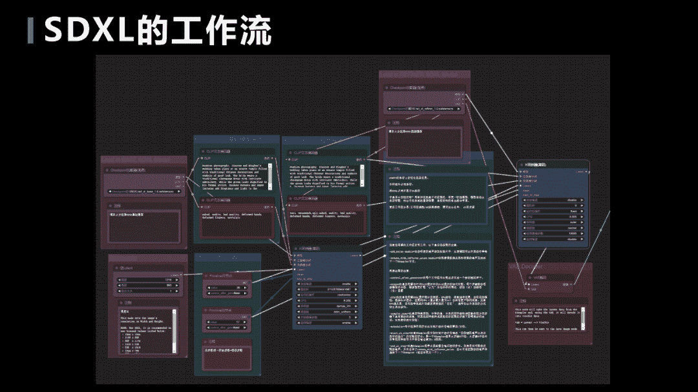

<https://aigcreative.feishu.cn/sync/K4Gvd9vUQsy9Oubwqaeclu0Fnbg>