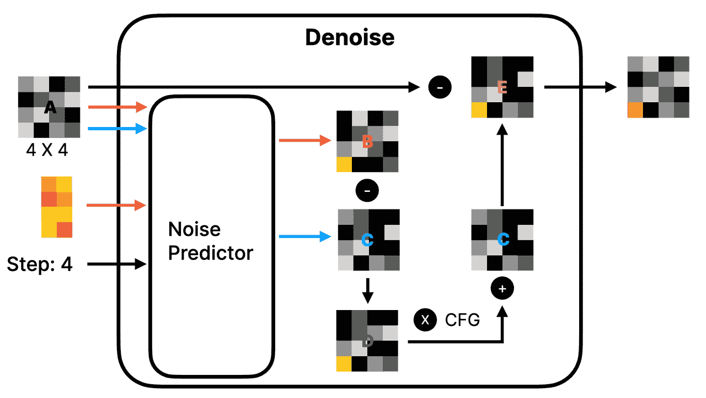
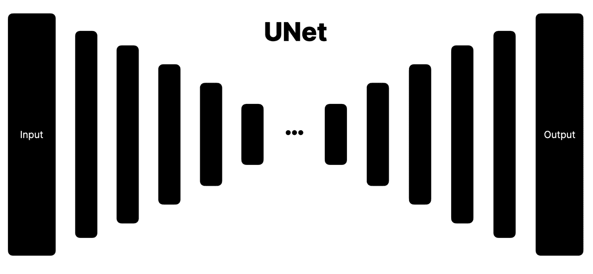
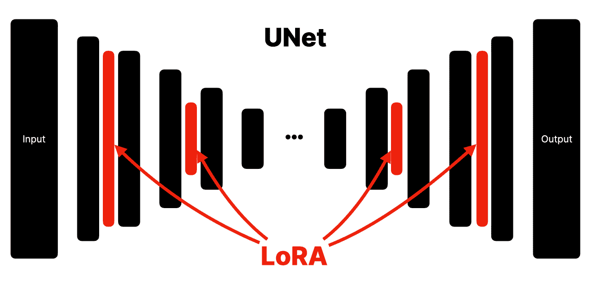
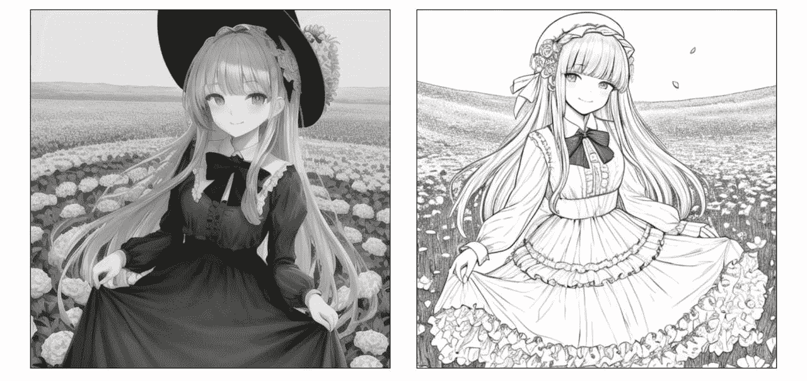
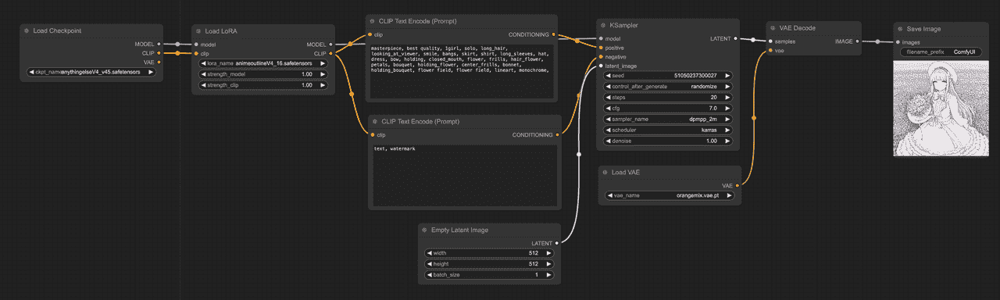
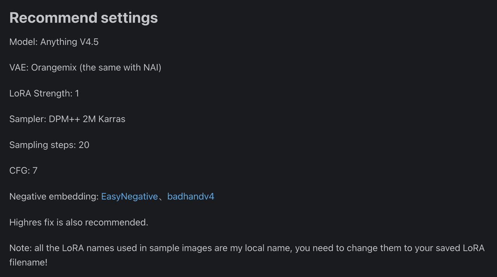
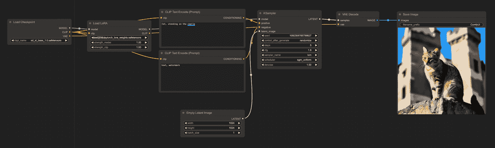

# LoRA

> 来源：[https://aigcreative.feishu.cn/docx/I9qod4az6onSTgxAZ3fcLBuznKB](https://aigcreative.feishu.cn/docx/I9qod4az6onSTgxAZ3fcLBuznKB)

## 原理介绍

介绍如何使用之前，按照惯例，我们聊聊 LoRA 的原理。在 Stable Diffusion 基础篇，我聊到整个图片生成的过程就像是降噪，但在当时还有一个东西没有展开介绍——“Noise Predictor”：

Noise Predictor 是如何工作的呢？简单理解就是进行了一系列的运算，运算所使用到的算法被称为 UNet 算法。我会在后续进阶教程里详细展开介绍此算法。现在你只需要了解，UNet 的算法大概是这样的：

左侧是输入，右侧是输出，数据输入后会经过一些列的运算，图中的长条的柱子就是一步运算。我们可以通过改变柱子里的参数权重，从而改变输出结果，最终改变生成图片的效果。但改变每根柱子里的结果相对比较复杂。

于是研究人员就开始寻找一种更简单的方法，最终他们发现，如果将参数注入到每一层函数中，也能达到改变图片的效果，这个方法就是 LoRA(Low-Rank Adaptation)。

LoRA 是在不破坏任何一层函数，而是将参数注入到原有的每一层中。这样的好处是不破坏原有的模型，即插即用，并且模型的大小也比较小。可视化的效果如下：

用类比来理解，可以将 LoRA 视为类似相机「滤镜」。下方两张图都是用相同的模型、Prompt 和 Seed 生成。左侧这张图是没有 LoRA 的效果，而右边则是加了笔绘风 LoRA 的效果，加了笔绘风 LoRA 的图看起来会更像漫画线稿一些，而且看起是不是有点像是给左边的图加了滤镜？

这就是加 LoRA 的作用，如果你觉得普通的 Stable Diffusion 模型不够好看，或者风格不是你喜欢的，不妨试试添加一些 LoRA。

## LoRA workflow

OK，简单介绍完 LoRA 的原理后，我们再来看看在 ComfyUI 上该如何使用 LoRA，其实看完前面的原理介绍你应该就能推测出如何加 LoRA 节点了：

### 添加 LoRA 节点

只需要右键 → All node → loaders → Load LoRA 即可添加 LoRA 节点。

### 连接节点

节点左侧与 Checkpoint 模型相连，右侧与 CLIP 和 KSampler 相连。

另外，如果你细看我的 workflow，你会发现我并没有直接使用 checkpoint 的 VAE 而是自己加了额外的 VAE。这是因为，整个 Denoise 过程都是在 Latent Space 进行的，所以有一些 LoRA 在某些 VAE 算法下效果会更好。使用何种 VAE，以及 Sampler 算法，LoRA 的共享者一般都会公布出来，比如我使用的这个 Anime Lineart LoRA 其推荐的配置是这样的：

[最后，你如果对](https://www.comflowy.com/zh-CN/basics/basic-optional/LoRA-recommendation) LoRA 感兴趣，可以查阅基础选修中的 LoRA 推荐 一章了解更多 LoRA 模型。

## LCM-LoRA workflow

LoRA 除了能影响出图的风格外，最新的 LCM-LoRA 还可以提升出图的效率，虽然现在 SDXL Turbo 的生成速度也挺快的，但从各种对比测试来看，LCM-LoRA 相较于 Turbo 有以下优势：

+   LCM-LoRA 支持生成 1024X1024 图片，而 Turbo 最大只支持 512X512。

+   相对来说，使用 LCM-LoRA 生[成的图片效果更好，以下是对比样张（来源 ](https://stable-diffusion-art.com/sdxl-turbo/)Stable Diffusion Art(opens in a new tab)），左边是 LCM-LoRA，右边是 Turbo：

但从生成速度来说，Turbo 还是更胜一筹，Turbo 一般只需要 1 step，而 LCM-LoRA 一般需要最少 4 step。所以各位可以自行斟酌使用何种方式。

再说下如何在 ComfyUI 上配置 LCM-LoRA，连接方法跟上面的一样，只是在节点的配置上需要进行一些调整：

### 设置 Load LoRA

继续使用 LoRA workflow，首先将 Load LoRA 里的模型，切换成 LCM-LoRA。需要注意，这里需要选择跟你的 checkpoint 一致的 LoRA，比如我这用的 checkpoint 是 sdxl，就要使用 sdxl LCM-LoRA。

### 设置 KSample

+   step = 5（一般大于 4 都可以）

+   cfg = 1.8（一般大于 1.5 就行）

+   sampler_name = LCM

+   scheduler = sgm_uniform

### 设置 Empty Latent Image

长宽比设置为 1024 * 1024，大于 1024 也可以。

<https://aigcreative.feishu.cn/sync/K4Gvd9vUQsy9Oubwqaeclu0Fnbg>