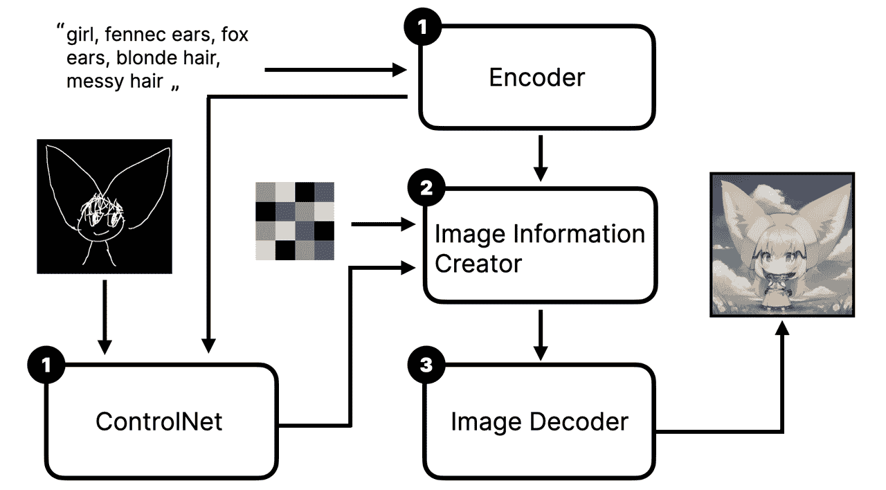
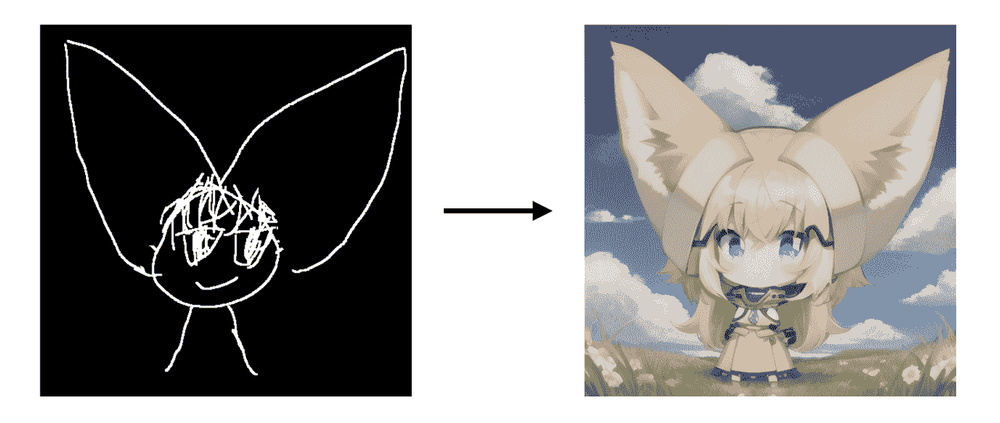
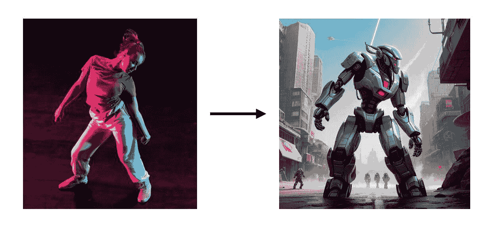
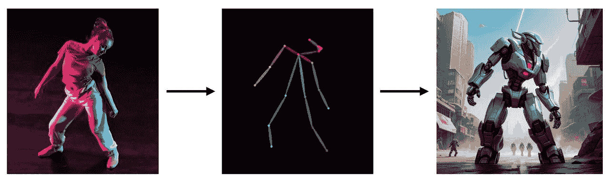
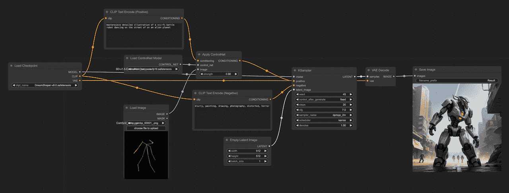
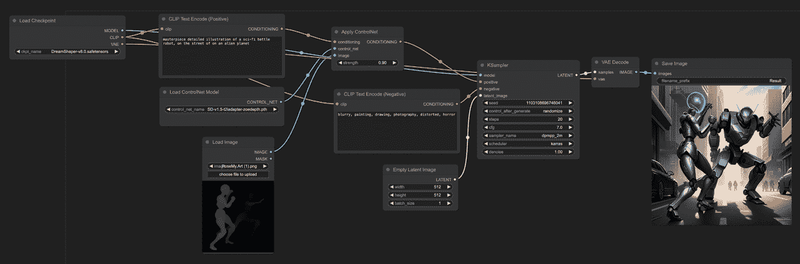
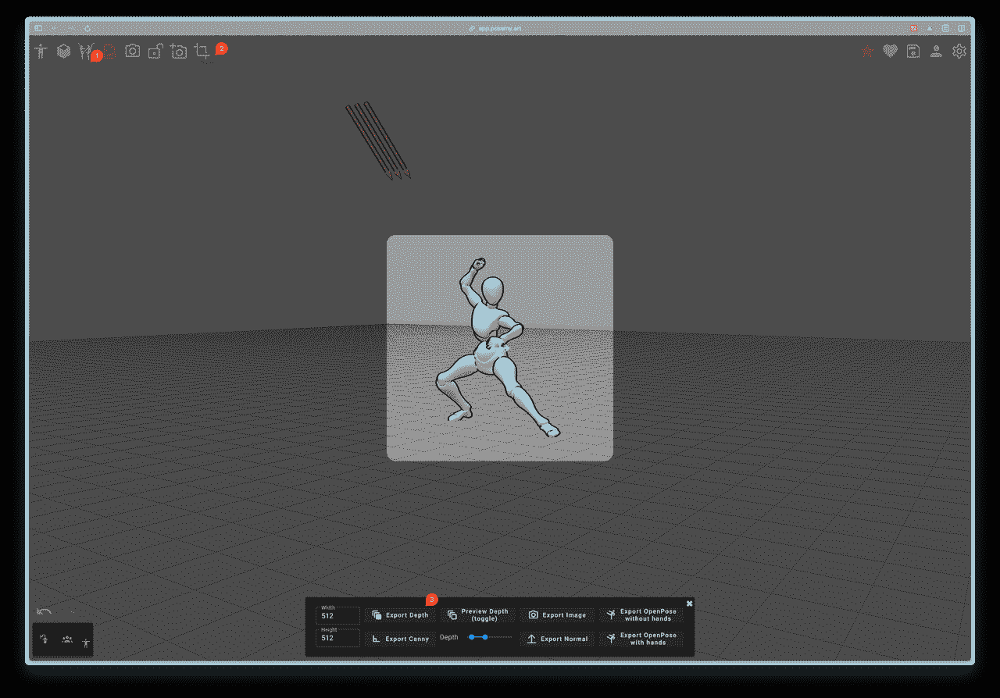
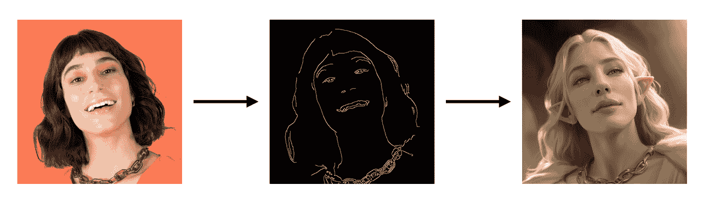
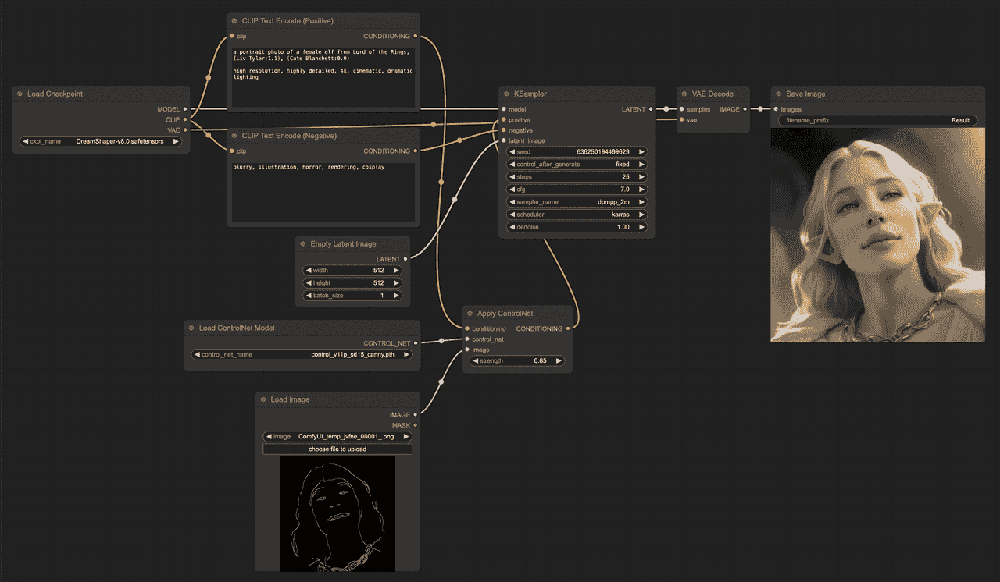

# ContrlNet

> 来源：[https://aigcreative.feishu.cn/docx/OL3Ad1NKXolCLMxl8MPcjwJPnig](https://aigcreative.feishu.cn/docx/OL3Ad1NKXolCLMxl8MPcjwJPnig)

## 原理介绍

本质上来说，我在整个进阶教程中教的所有方法都是 image to image 的方法。都是通过图片给予模型不同的信息，从而让模型生成我们想要的图片。而 ControlNet 则是通过图片的结构信息来控制模型生成的图片。这里的结构信息，可以是简笔画，也可以是一张图片的 mask，甚至是一张图片的边缘信息。这些信息都可以通过 ControlNet 来控制模型生成的图片。 各位可以根据自己的需求，选择不同的 ControlNet 来控制模型生成的图片。

还是按照惯例，为了让大家更好地学会使用 ControlNet，我们先通过可视化的方式介绍下 ControlNet 的原理：

从上图可以看到，我们在使用 ControlNet 的时候，会先将 text prompt 和图片一起输入到 ControlNet 的模型中，然后 ControlNet 的模型会生成一张 latent 图片，这张图片会作为 Conditioning 和最开始的 prompt 一起再输入到 Stable Diffusion 模型中，从而影响模型生成的图片。

## Scribble ControlNet workflow

通过原理介绍，大家就应该能推理出在 ComfyUI 中如何使用 ControlNet 了吧。我们不妨先试试如何搭建一个简单的 ControlNet workflow —— 简笔画的控制。效果大概是这样的：

有了 ControlNet 后，模型输出的图片会根据你画的简笔画构图来生成图片。你可以看到左侧的简笔画是一个画得非常粗糙的动漫人物，右图是生成后的图，整个构图和人物的特征（两个大大的耳朵）都基本匹配左侧简笔画。

OK，大家对 Scribble ControlNet 有一定的印象后，我们再来一起看看该如何搭这个 workflow 吧。各位可以先自己尝试搭一下。这样能加深你的印象。

提示答案

💡

在 LoRA 一章中，我将 LoRA 类比为滤镜。而 ControlNet 我则认为它更像是可视化的 prompt 补充，将原有文字很难描述的 prompt 可视化，同时也让模型更好地理解。从而解决 CLIP 模型对语法理解比较差的问题。这么理解，大家应该就能更好地推理和记忆应该如何连线了。LoRA 是滤镜，影响是模型，所以跟 Model 相连。而 ControlNet 则是 prompt 的补充，控制的是 Conditioning，所以跟 Prompt 节点相连。

## Pose ControlNet workflow

当你能搭出一个 ControlNet workflow 后，你就可以根据自己的需求，自由地切换不同的模型了。

上一个案例是将简笔画作为输入这次我们试下输入一个人物的 pose。这样做的好处是，你可以通过它来控制模型生成的人物的姿势。比如像这样：

不过需要注意我们不能像上一个案例那样直接将图片输入到 ControlNet 的模型中，而是需要先将图片转换成 pose，然后再输入到 ControlNet 的模型中。不过你也可以通过其他工具制作骨架图，然后将其直接输入到 ControlNet 的模型中。

那么整个 workflow 的搭建跟上一个 workflow 是一样的，只是在 Load ControlNet Model 节点里，我们需要加载 ControlNet Openpose 模型，并加载骨架图：

## Depth ControlNet workflow

第三种 ControlNet 的用法是通过深度图来控制模型生成的图片。这种方法的好处是，你可以通过深度图来控制模型生成的图片的景深。比如像这样：

这个 workflow 也跟上一个 workflow 类似，你可以直接直接导入深度图，或者使用插件生成深度图，然后再输入到 ControlNet 的模型中。比如像下面这样：

这个相较于 pose 会多一些景深的信息，比如我的导入的图是两个人在格斗，人物是一前一后站立，如果仅用 pose 来画，相对来说比较难画出这种一前一后的图。

如果你想像 pose 的 workflow 一样，使用插件生成深度图，那么方法也很简单。只需要将上述 workflow 的 DWPose Estimation 节点换成 Zoe-Depth Map 节点即可。

另外再教大家一个方法，你还可以使用一些 3D 工具生成人物 pose 或者深度图。比如 Posemy.art(opens in a new tab) 这款产品，你可以在左上角（标记 1）选择你想要的人物体态，然后通过鼠标拖动的方式调整人物的姿势，最后点击 Export 按钮（标记 2）导出深度图（标记 3），然后再导入到 ComfyUI 里：

## Canny ControlNet workflow

第四种 ControlNet 的用法是通过 Canny 边缘图来控制模型生成的图片。这种方法的好处是，你可以通过 Canny 边缘图来控制模型生成的图片的边缘。比如像这样：

Workflow 搭建与之前的类似，只要将 ControlNet 模型换成 Canny 模型即可。

<https://aigcreative.feishu.cn/sync/K4Gvd9vUQsy9Oubwqaeclu0Fnbg>