# Stability Matrix：整合ComfyUI多种流行包，傻瓜式操作轻松上手

> 来源：[https://aigcreative.feishu.cn/docx/Pz1fdVuJ8ooTbfxip34chcJ0nsb](https://aigcreative.feishu.cn/docx/Pz1fdVuJ8ooTbfxip34chcJ0nsb)

近两年来，AI绘画飞速发展，也分为了开源/闭源两大阵营。开源以Stable Diffusion（以下简称“SD”）为代表，引领着AI绘画稳步发展，效果越来越好、越来越接近真实。

然而，SD的技术门槛极高，普通用户很难上手。尤其是像SD这样的先进模型，尽管拥有强大的功能，但是其载体如WebUI、ComfyUI，以复杂的配置和操作界面让许多人望而却步。

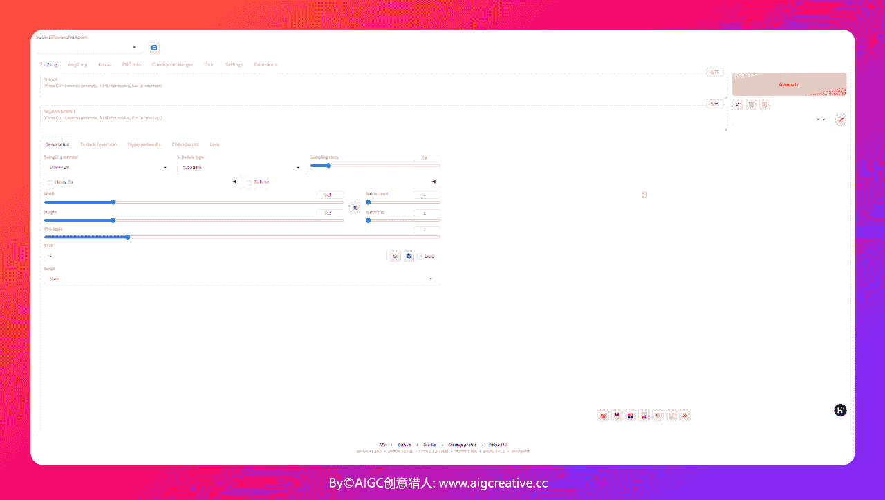

SD的普及受限于高深的技术要求和繁琐的安装过程，使得非技术人员难以享受这一创新技术带来的便利。

今天，创意猎人要特别向大家介绍开源项目——Stability Matrix，不仅仅是一个多平台包管理器，它更是一个为SD量身打造的全新界面，让复杂的SD绘画技术变得触手可及。

看完，相信你会删掉电脑里的WebUI、以及ComfyUI的。

先上下载链接，可根据电脑OS自行下载安装：https://github.com/LykosAI/StabilityMatrix

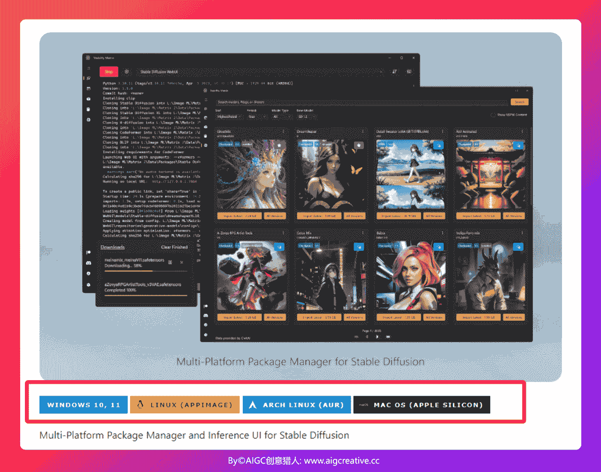

## 一键安装，轻松管理

StabilityMatrix，作为一个多平台的包管理器和推理用户界面，以其一键式安装和更新功能，为Stable Diffusion Web UI包提供了前所未有的便捷性。

这个管理器支持包括Stable Diffusion WebUI Forge、Automatic 1111、SD Web UI-UX等在内的多种流行包，以及Fooocus、ComfyUI等插件或扩展的管理，让整个安装和更新过程变得轻松而直观。

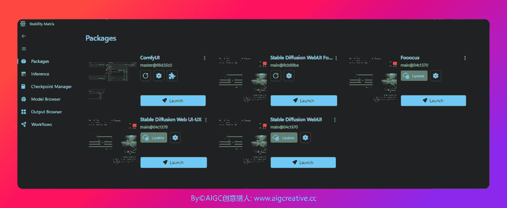

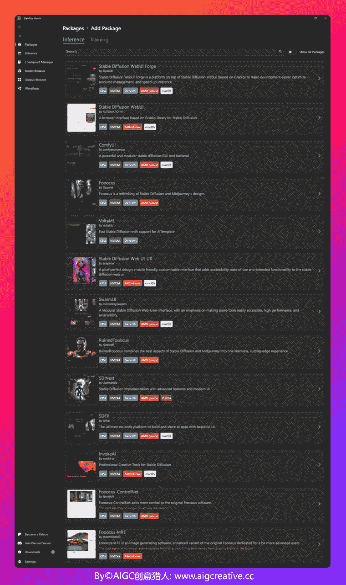

## 原生重构界面，全新的便捷体验

Stability Matrix内置了一个重新构想的、功能强大的推理界面，它不仅提供了强大的自动补全和语法高亮功能，还允许用户通过.smproj项目文件保存和加载工作区。

此外，用户可以自定义可停靠和浮动的面板，生成的图像包含兼容的元数据，甚至可以通过拖放操作来加载画廊图像或文件。

这界面看下来，比起WebUI，确实是清爽、简约、科学多了！很喜欢~~

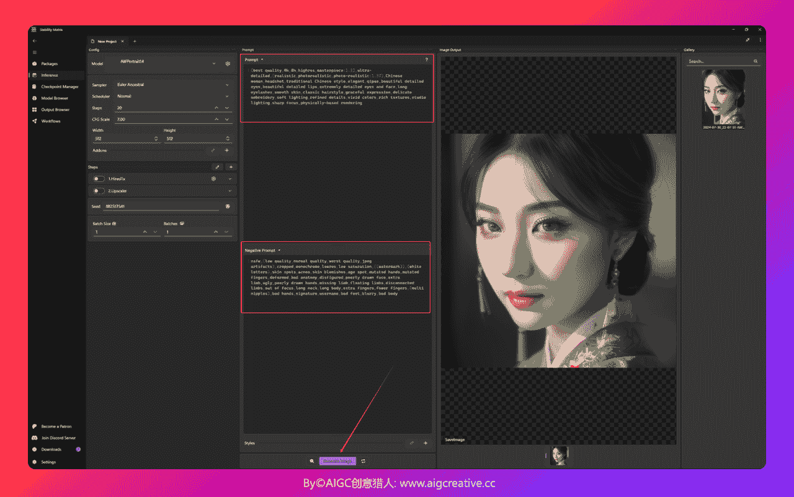

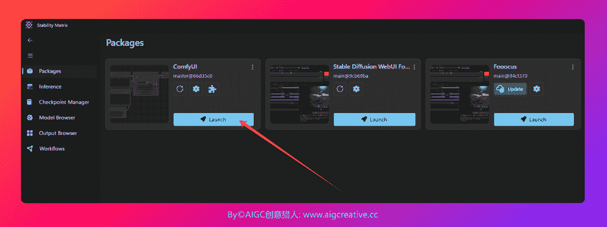

## 各主流平台包一键启动，使用习惯平稳迁移

得益于ComfyUI的便捷、强大的工作流模式，相信很多同学已经成WebUI转移ComfyUI了，同样，在这里，可以一键启动ComfyUI，没有障碍，快速进入出图状态。

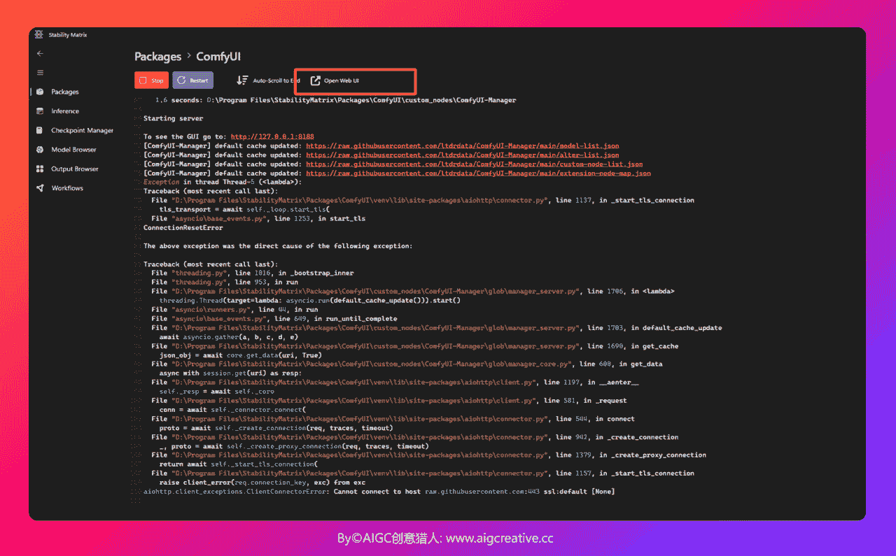

## 资源统一配置，可移植，随时随地带走你的数据

很多SD用户可能下载了很多SD基础大模型、LoRA等模型资源，在这里，Stability Matrix有一点非常好，SD多种包的资源全部在这里，完全可移植性，完全可以共用，也解决了之前如何让WebUI和ComfyUI共用模型的问题，不再需要各种配置。

如果后期要更换电脑，你可以随时随地将数据目录移动到新的硬盘或电脑上，无需担心数据丢失或迁移的麻烦。

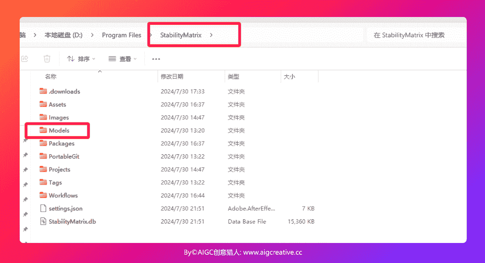

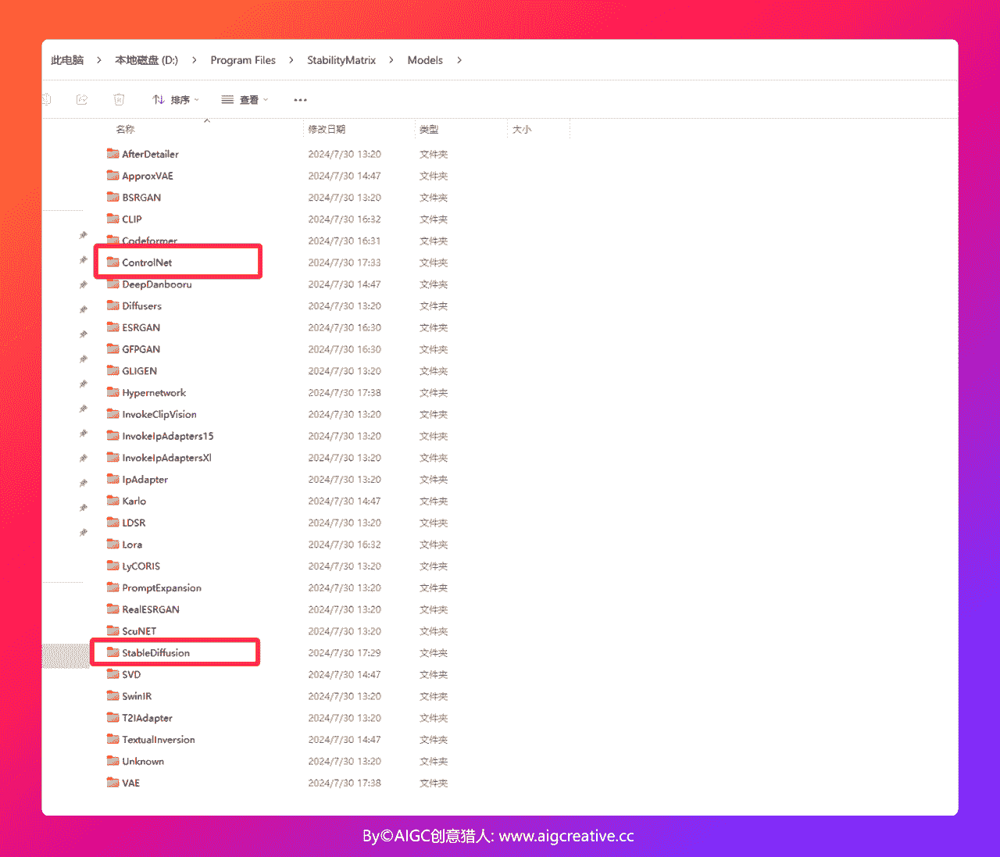

## 有调理、可视化模型管理

这个Models文件夹，相信SD用户很熟悉了。

Stability Matrix客户端，也提供了更加直观、可视化的各种模型管理界面，方便日常使用。

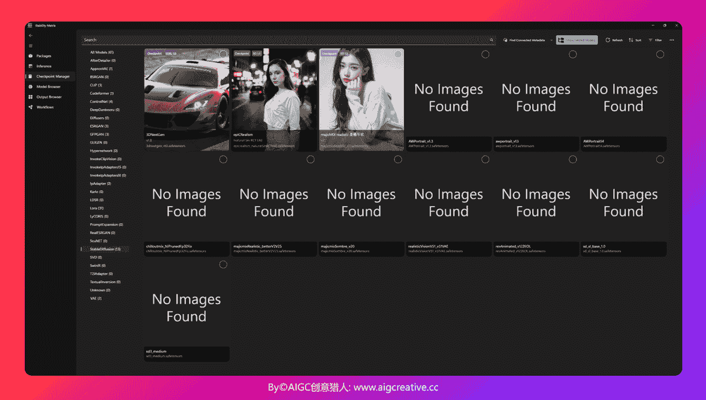

## 模型浏览器，一键下载导入模型

Stability Matrix的模型浏览器功能，让你可以轻松地从CivitAI和HuggingFace等平台导入模型。它甚至能够自动下载相关的元数据文件和预览图像，让你的模型管理变得更加简单。

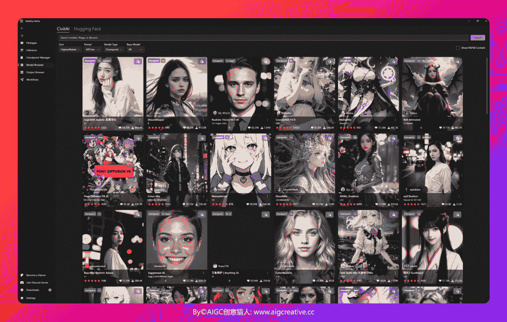

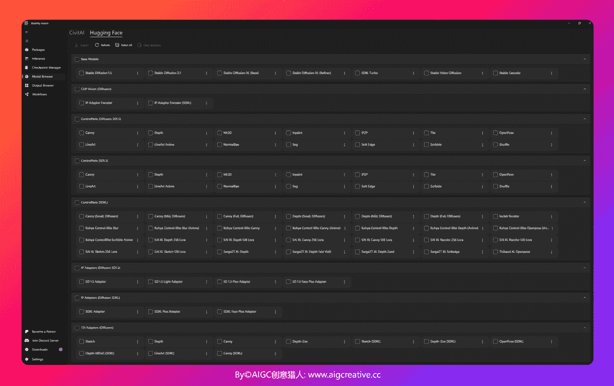

## ComfyUI工作流下载与管理，方便使用

Stability Matrix客户端还内置了大量来自OpenArt的ComfyUI工作流，可一键下载，打开ComfyUI浏览器工作区后，直接拖入就可以使用，非常方便！

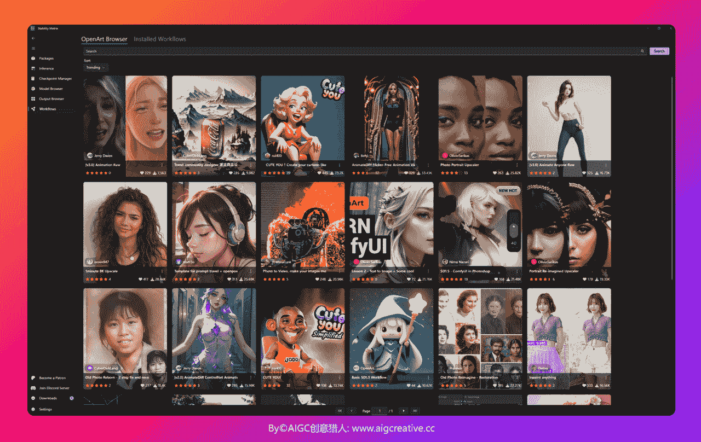

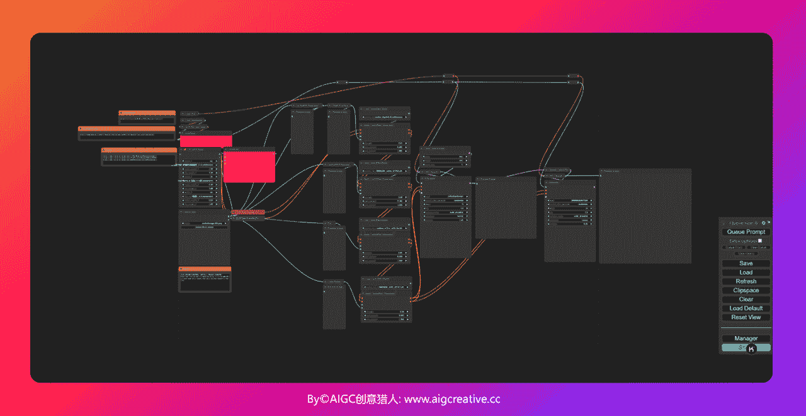

## 多语言支持

Stability Matrix的多语言支持，也不用安装什么语言汉化包了，直接就可以切换。无论是英语、日语、中文、意大利语还是其他语言，Stability Matrix都能满足不同用户的需求。

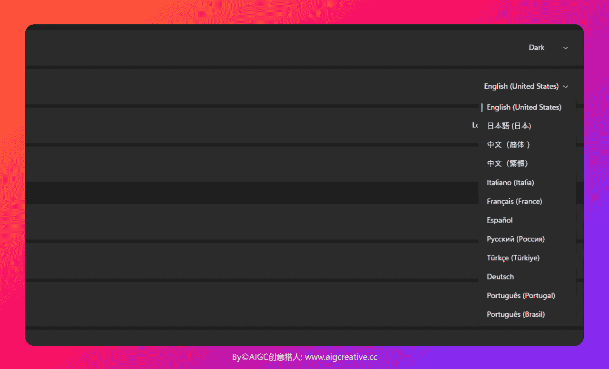

## 如果你是WebUI、ComfyUI用户，真心推荐

把玩了一天Stability Matrix，心动于其傻瓜式的、简化的操作方式，我又拾起了丢弃半年的Stable Diffusion，这个可控性、可玩性更强的AI绘画工具。

Stability Matrix的出现，不仅仅是技术的进步，更是对AI技术普及化、易用化的一种推动。它让复杂的AI操作变得简单，让每个人都能够享受到AI带来的便利。

这也正是我所期待的未来，一个由智能技术驱动，却又触手可及的未来。

嗯。

这下可以把之前安装的WebUI、ComfyUI删了。

<https://aigcreative.feishu.cn/sync/K4Gvd9vUQsy9Oubwqaeclu0Fnbg>