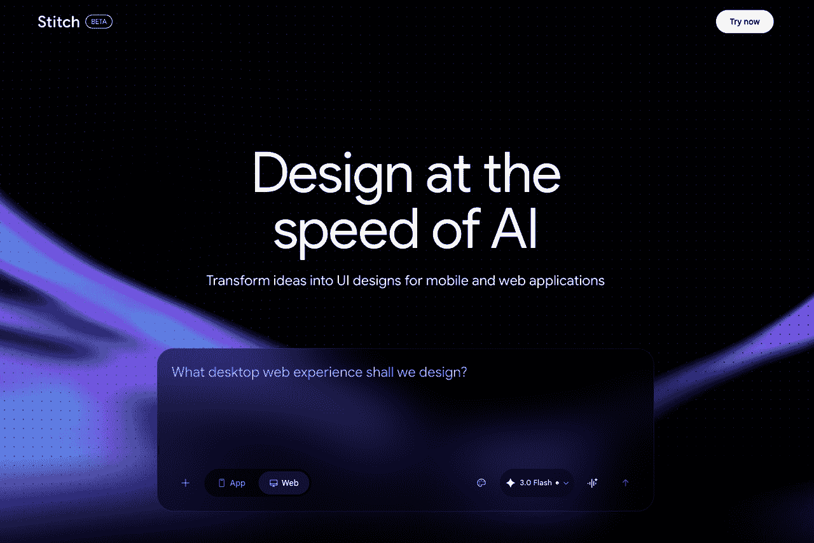

# 工具：Google Stitch

> 来源：[https://aigcreative.feishu.cn/docx/F4mjdmDBIomEDox3N62cgRKwnIJ](https://aigcreative.feishu.cn/docx/F4mjdmDBIomEDox3N62cgRKwnIJ)

> 官方文档：https://stitch.withgoogle.com/docs/

> 网址：https://stitch.withgoogle.com/

**Stitch 是 G**oogle 在收购了 AI 设计初创公司 Galileo AI 之后，打造的 AI 设计平台。

简单说，它是一个「对话式」设计工具，你用自然语言描述你想要的设计，它直接给你生成完整的 UI 界面。

<https://aigcreative.feishu.cn/sync/K4Gvd9vUQsy9Oubwqaeclu0Fnbg>

# 知识库动态