# 20260319-程序员刚被裁，设计师也要失业了！谷歌`Stitch`大改版，口喷做设计~~

> 来源：[https://aigcreative.feishu.cn/docx/Lti8dC4hJos3YrxY8vRcLzQ1ncf](https://aigcreative.feishu.cn/docx/Lti8dC4hJos3YrxY8vRcLzQ1ncf)

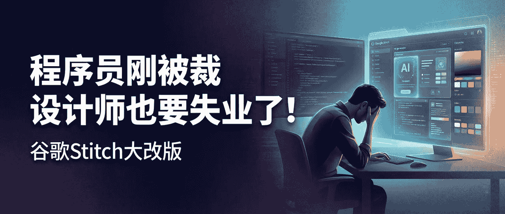

今天可能有点标题党，但形势已经很严峻了，最近网传某大厂断臂式裁员，想必有一些人也看到了。

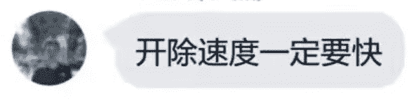

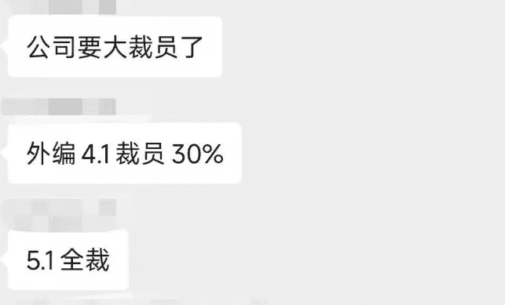

AI 还在疯狂的进化，某些领域阵痛的同时可能也孕育着巨大的机会……

回到正题。

先来看两组设计，比较一下谁做得更好？

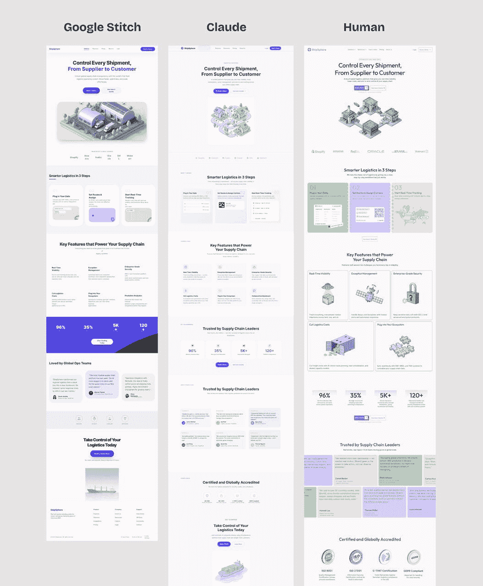

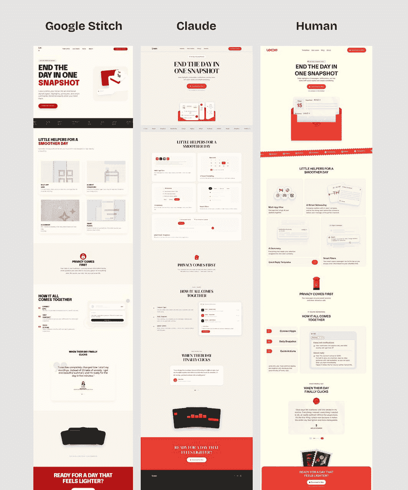

你觉得哪一个做的设计更加好看？

Claude、人类大家应该很熟了，这个 `Stitch` 是谁？

它叫 `Stitch`，来自 Google Labs。

如果你以为 AI 只能帮你写写文案、生成几张图片，那 Google 今天发布的 `Stitch` 这个更新，足够让整个设计行业打一个寒颤。

今天，Google 对 `Stitch` 进行了一次堪称"重写底层代码"级别的大改版。

先来看一看宣传片：

[stitchbygoogle_1080p_20260319_213511.mp4](https://internal-api-drive-stream.feishu.cn/space/api/box/stream/download/all/EbrUbebtgo8zuVxxIgzcBmqZndh)

## 01. `Stitch` 是什么？

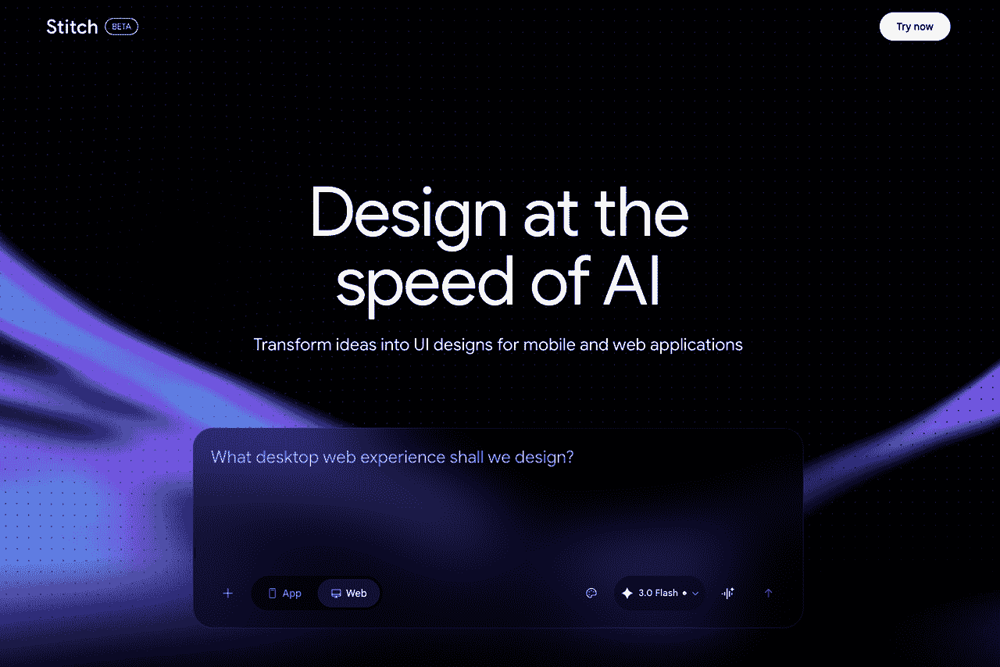

> 网址：https://stitch.withgoogle.com/

`Stitch` 是 Google 在收购了 AI 设计初创公司 Galileo AI 之后，打造的 AI 设计平台。

简单说，它是一个「对话式」设计工具，你用自然语言描述你想要的设计，它直接给你生成完整的 UI 界面。

这次大改版，Google 给它的定位是：你的 vibe design partner（氛围设计搭档）。

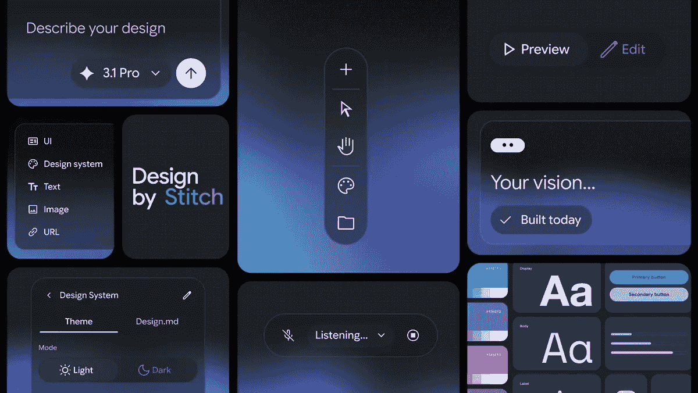

这个词很有意思——Vibe Design。

你没听错，这就是 Vibe Coding 在设计领域的翻版。

这次的五大升级，每一条都值得单独写一篇文章，下面我们一起来看看：

### 1.1 AI 原生无限画布：图片、代码、PRD，往里扔就对了

新版 `Stitch` 的画布不再只是一块空白画板。

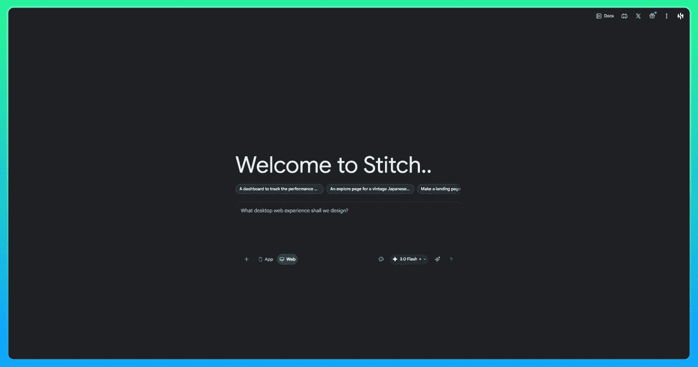

你可以把：

+ 一张手绘草图（截图扔进去）
+ 一段代码片段
+ 一份产品需求文档（PRD）
+ 几张竞品截图
+ 甚至只是一句描述产品感觉的话

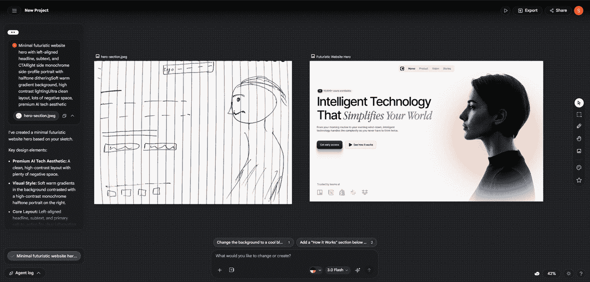

> 来源X@Sameer

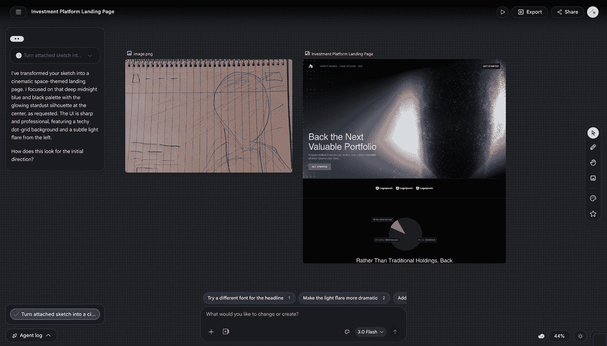

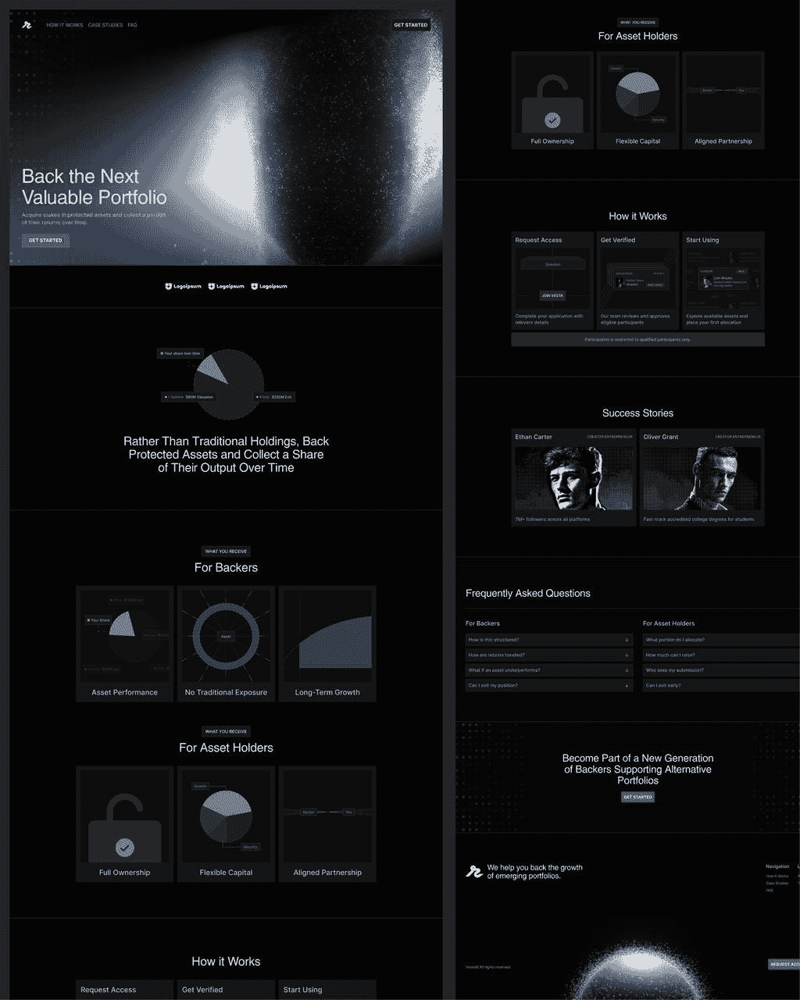

> 来源X@Hewar

作为「种子」扔进画布，AI 会理解它们的上下文，然后并行生成多种设计方案。

画布上还多了一个 `Agent Manager`，帮你协调多个 AI 任务，不再是一锅粥。

哦对，还加了护眼浅色模式，终于不黑了。

我们新建一个项目：

> A user interface that allows restaurants to edit the content of menu items appearing on their website for ordering

> 一个允许餐厅编辑其网站上用于点餐的菜单项内容的用户界面

很快，可以发现，跟之前使用情况不一样的是：在画布上可以看到，它先是出了一份设计规范，包括标准颜色、字体、配色、icon 等；这很赞啊！

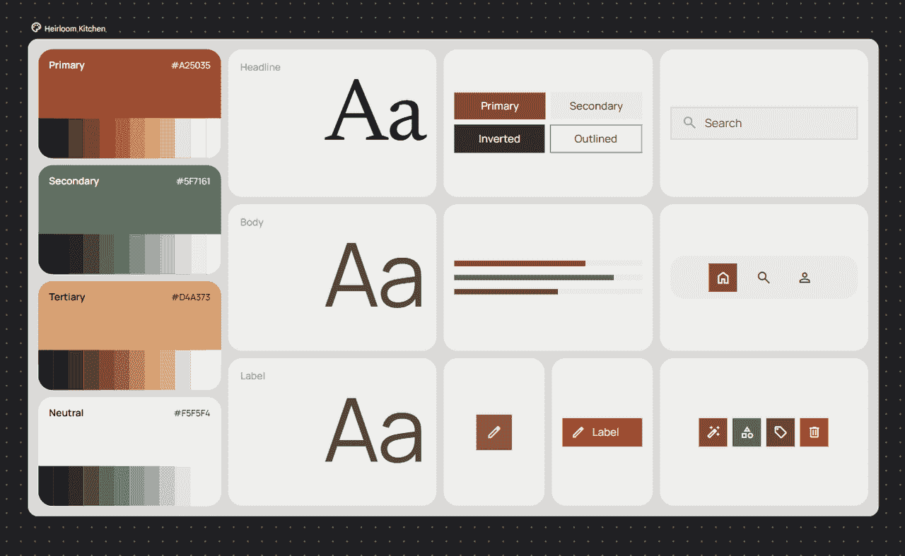

紧接着整套 UI 的设计就做出来了，可以看到完成度相当高了！

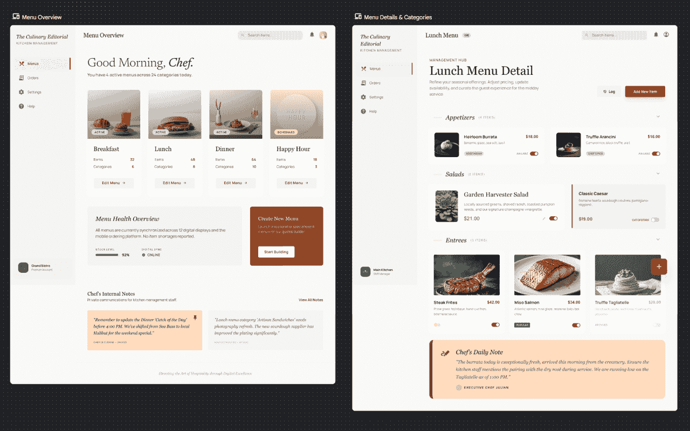

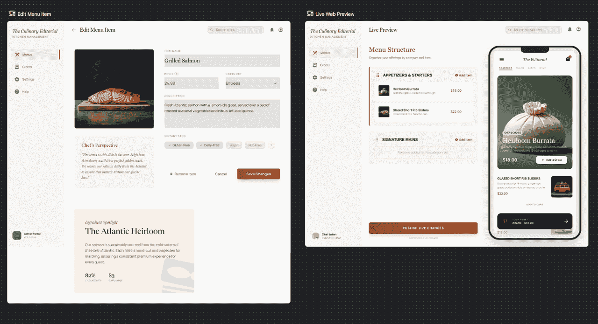

### 1.2 设计 Agent 终于能「看懂」整个项目了

这是最关键的能力跃升。

之前的 AI 设计工具，你给它一张图，它给你一张图，但你要改一个地方，得重新描述一整遍上下文。

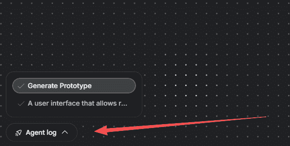

新版 `Stitch` 的设计 Agent 现在能理解整个画布的上下文了。

你可以对它说：

> 「把刚才传的 logo 换掉」「根据这些页面帮我生成一份产品简报」「桌面版直接给我转成移动版」「帮我做一版品牌落地页」

它真的能听懂，指哪打哪。

### 1.3 语音操控：设计师的「嘴替」来了

这是最让我震撼的功能，也是最具「未来感」的一个。

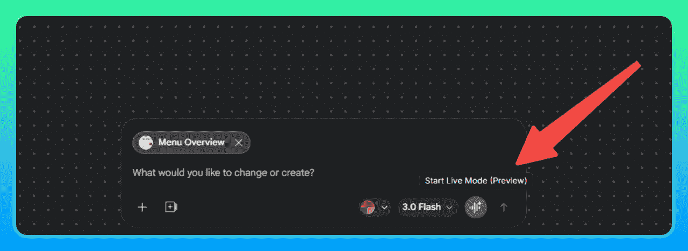

`Stitch` 现在支持实时语音设计：

+ 边说边改，AI 实时渲染
+ 对着画布说「这三种配色的方案各来一份」，它并发干活
+ 设计批评模式——你的设计有什么问题，AI 直接语音给你怼回来
+ 纯语音逛画布，完全不用手

日本设计师博主在 Twitter 上形容：这不就是未来设计师的嘴替吗？

当然，语音功能目前还是 Preview 预览阶段，但已经相当离谱了。

### 1.4 一键瞬发原型：点一下 `Play`，直接出可交互原型

你还在用 Figma 手动连跳转、设置交互？

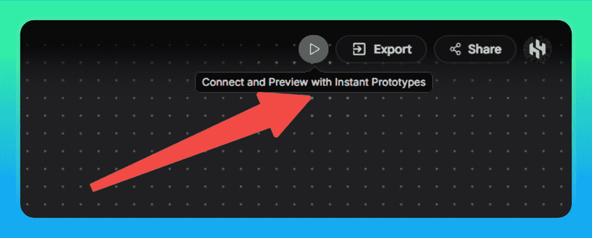

新版 `Stitch`，点一下 `Play`，直接给你生成一个可交互的原型流：

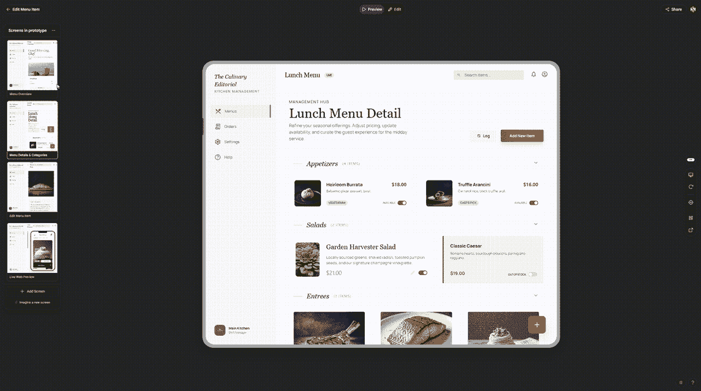

+ 自动连屏
+ 多端显示
+ 智能预测下一屏应该是什么
+ 支持登录/登出状态
+ 直接生成链接或扫二维码在手机上预览

一位日本设计师在 Twitter 上惊呼：「从想法到可分享的原型的速度，简直起飞。」

PC 端原型：

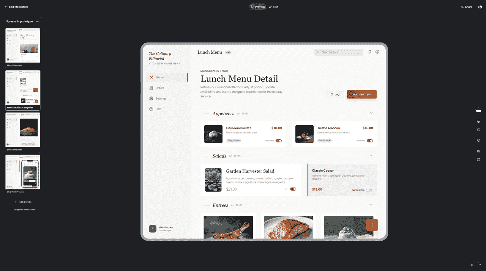

iPad 端原型：

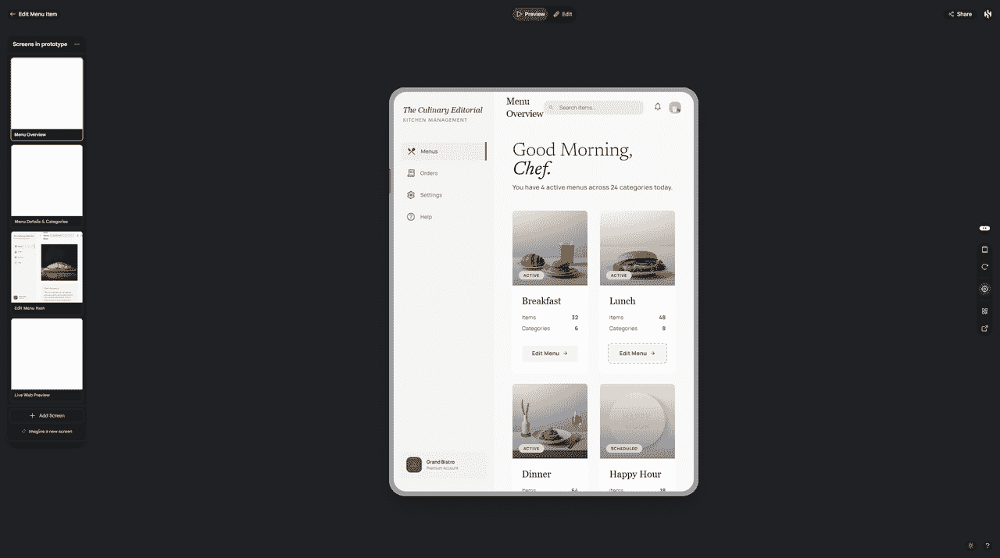

扫码预览，可以直接来到一个 HTML 文件的预览页面，太流畅了：

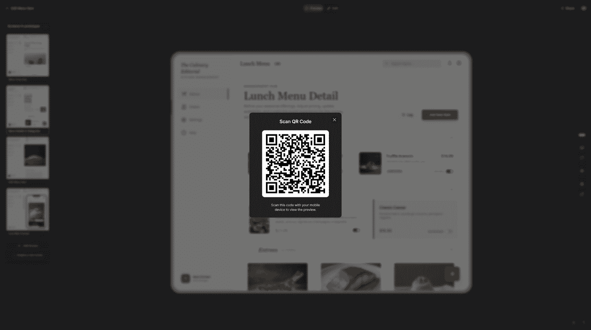

> https://stitch.withgoogle.com/preview/9813562743667995422?node-id=5ee9cf5e8dfe45b2a3fe261090ead69d&raw=1

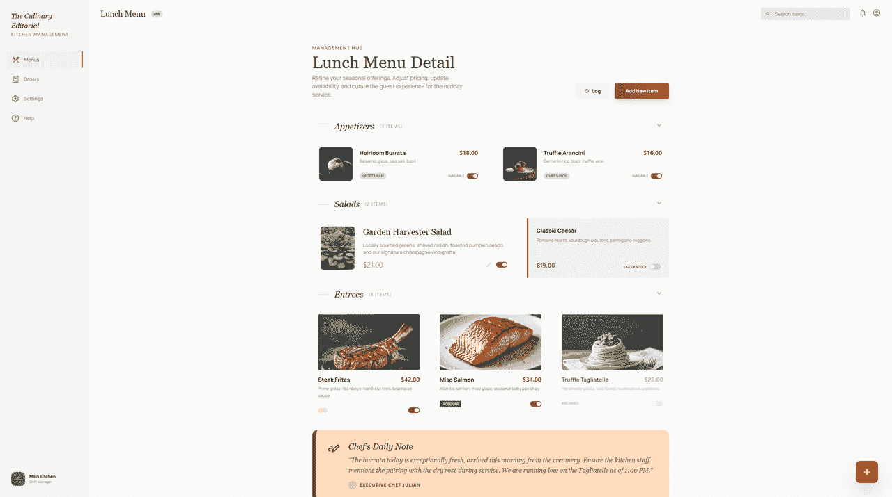

### 1.5 设计系统 + `DESIGN.md`：设计规范像代码一样管理

这是我认为最具行业影响力的更新。

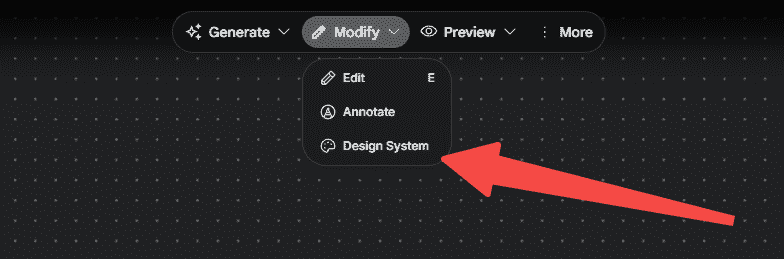

前面开头提到的设计规范：

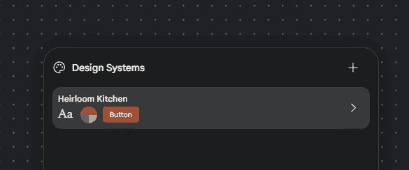

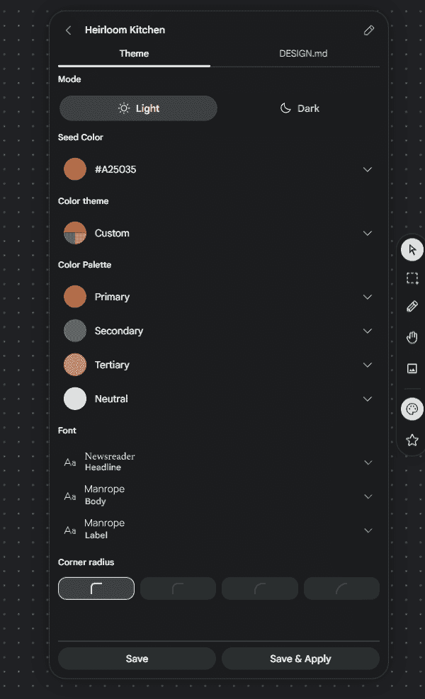

Google 这次带来了一个叫 `DESIGN.md` 的概念：把设计规范做成像代码的 `README` 一样，可以版本管理、可以分享、可以复用。

我把 `DESIGN.md` 的内容复制出来了，大家可以看一下：

# Design System Strategy: The Culinary Editorial

## 1. Overview & Creative North Star

**Creative North Star: "The Digital Maître D’"**

This design system rejects the sterile, "SaaS-blue" dashboard aesthetic in favor of a high-end editorial experience. It is designed to feel like a premium lifestyle magazine transitioned into a functional tool. We achieve this by moving away from rigid grids and boxy containers, instead utilizing **intentional asymmetry**, **tonal layering**, and **generous whitespace**.

The goal is to provide restaurant managers with a sense of calm and culinary craft. The interface should feel as intentional as a plated dish—where every element has a purpose, and the "garnish" (the UI) never overpowers the "main ingredient" (the data).

---

## 2. Colors & Surface Philosophy

The palette balances the heat of the kitchen with the cool composure of the front-of-house.

### The "No-Line" Rule

**Strict Mandate:** Designers are prohibited from using 1px solid borders to define sections. Layout boundaries must be achieved through background color shifts.

* **Example:** A side navigation using `surface-container-low` should sit flush against a `surface` dashboard without a dividing line.

### Surface Hierarchy & Nesting

Treat the UI as physical layers of fine paper.

* **Base Layer:** `surface` (#f9f9f8)
* **Secondary Content:** `surface-container-low` (#f4f4f3)
* **Interactive Cards/Modules:** `surface-container-lowest` (#ffffff) to create a "lifted" feel.
* **Inset Elements:** Use `surface-container-high` (#e8e8e7) for search bars or input areas to create an "etched" look.

### The "Glass & Gradient" Rule

To elevate the experience, use **Glassmorphism** for floating elements (like `Toast` notifications or "Quick Action" menus).

* **Token:** Use `surface` at 70% opacity with a `24px` `backdrop-blur`.
* **Signature Gradients:** For primary CTAs, use a subtle linear gradient from `primary` (#843920) to `primary_container` (#a25035). This adds "soul" and depth that prevents the UI from feeling flat or "default."

---

## 3. Typography

We use a high-contrast pairing to balance authority with utility.

* **The Authority (Serif):** `newsreader`. Used for `display` and `headline` roles. This evokes the feeling of a printed menu or a heritage cookbook. It signals prestige.
* **The Utility (Sans-Serif):** `manrope`. Used for `title`, `body`, and `label` roles. Its geometric clarity ensures that high-density data (inventory counts, floor plans) remains legible at a glance.

**Editorial Scaling:** Use `display-lg (3.5rem)` sparingly for empty states or dashboard greetings to create a "hero" moment that breaks the monotony of management tasks.

---

## 4. Elevation & Depth

We eschew traditional "drop shadows" for a more organic, ambient light approach.

* **The Layering Principle:** Depth is achieved by stacking. A `surface-container-lowest` card placed on a `surface-container-low` background creates a natural, soft lift.
* **Ambient Shadows:** If an element must float (e.g., a `Modal`), use a diffused shadow: `Y: 8px, Blur: 32px, Color: rgba(26, 28, 28, 0.06)`. This mimics soft overhead gallery lighting.
* **The "Ghost Border" Fallback:** If accessibility requires a container edge, use `outline_variant` (#dbc1ba) at **15% opacity**. It should be felt, not seen.

---

## 5. Components

### Buttons & Interaction

* **Primary:** Gradient of `primary` to `primary_container`. Roundedness: `lg (0.5rem)`. Text: `label-md` in `on_primary`.
* **Secondary:** `secondary_container` (#d4e8d4) with `on_secondary_container` (#576959) text. This provides the "Sage Green" appetizing accent.
* **Tertiary:** No background. Uses `primary` text. Interaction state: `surface-container-low` on hover.

### Forms & Image Uploaders

* **Input Fields:** Use `surface-container-highest` as the background. No border. On focus, transition to a `px` underline in `primary`.
* **Image Uploader:** A large, `dashed` area using `outline_variant` at 20% opacity. When an image is uploaded, use a `xl (0.75rem)` corner radius to make the food photography feel like a framed piece of art.

### Status Indicators

**The "Pulse" Rule:** Statuses (e.g., "Table Ready," "Order Delayed") should not just be colored dots. Use a small `label-sm` badge with `secondary_fixed` (#d4e8d4) for "Active" and `error_container` (#ffdad6) for "Urgent," using a soft semi-circle (`full` roundedness).

### Cards & Lists

**Rule:** Forbid divider lines. Use `8 (2rem)` of vertical white space from the Spacing Scale to separate list items. Use a subtle hover state change to `surface-container-low` to indicate interactivity.

---

## 6. Do's and Don'ts

### Do

**Use Asymmetry:** Place headlines off-center or allow images to bleed off the edge of a container to create an editorial feel.

**Embrace "Sage":** Use the `secondary` color palette for "Growth" or "Positive" actions (Inventory restocked, table cleared).

**Prioritize Breathing Room:** When in doubt, increase the spacing. Use `12 (3rem)` or `16 (4rem)` to separate major functional modules.

### Don't

**Don't use 100% Black:** Always use `on_surface` (#1a1c1c) for text. Pure black is too harsh for the "warm" appetizing palette.

**Don't use Box-Shadows on everything:** Only use shadows for elements that physically move over others (`Modal`, `Dropdown`). For everything else, use color-blocking.

**Don't use Serif for data:** Never use `newsreader` for numbers, prices, or table data. It is for "voice," not "info." Use `manrope` for the heavy lifting.

---

## 7. Signature Restaurant Components

**The Table Map:** Use `surface-container-low` for unoccupied tables and `primary_fixed` for occupied ones.

**The Ingredient Status:** A "Stock Level" chip that uses a gradient fill to represent quantity, moving from `secondary` (full) to `tertiary` (low) to `error` (out).

**The "Chef’s Note":** A specialized tooltip variant using the `tertiary_fixed` (#ffdcbd) background and `newsreader` italic text to highlight internal kitchen communications.

# 设计规范系统策略：餐饮编辑风格

## 1. 概述与创意北极星

> 创意北极星：“数字餐厅领班”

> 此设计规范系统摒弃了单调的“SaaS蓝色”仪表盘美学，转而追求高端的编辑体验。它的设计旨在营造出一种从优质生活杂志转变而来的实用工具的感觉。我们通过摒弃僵硬的网格和方形容器，转而采用刻意的不对称、色调分层和充足的留白来实现这一目标。

> 目标是为餐厅经理带来平静和烹饪技艺的感觉。界面应像精心摆盘的菜肴一样有目的性——每个元素都有其用途，“装饰”（UI）永远不会盖过“主菜”（数据）。

---

## 2. 色彩与表面哲学

> 调色板平衡了厨房的热烈与前台的冷静沉着。

### “无边界线”规则

> **严格规定**：设计师禁止使用 `1px` 的实线边框来划分区域。布局边界必须通过背景颜色的变化来实现。

> **示例**：使用 `surface-container-low` 的侧边导航应与 `surface` 仪表盘无缝贴合，不使用分隔线。

### 表面层级与嵌套

> 将 UI 视为精美的纸张的物理层。

+   **基础层**：`surface`（#f9f9f8）

+   **次要内容**：`surface-container-low`（#f4f4f3）

+   **交互式卡片/模块**：`surface-container-lowest`（#ffffff），以营造“凸起”的感觉。嵌入元素：搜索栏或输入区域使用 `surface-container-high`（#e8e8e7）来营造“蚀刻”效果。

### “玻璃与渐变”规则

> **为提升体验**，浮动元素（如吐司通知或“快速操作”菜单）使用玻璃拟态。

+   **参数**：使用不透明度为 70% 的 `surface`，并设置 `24px` 的背景模糊效果。

+   **标志性渐变**：主要行动呼吁（CTA）使用从 `primary`（#843920）到 `primary_container`（#a25035）的微妙线性渐变。这为 UI 增添了“灵魂”和深度，避免其显得平淡或“默认”。

---

## 3. 排版

> 我们采用高对比度的搭配来平衡权威性与实用性。

+   **权威性（衬线字体）**：`newsreader`。用于 display 和 headline 角色。它能唤起印刷菜单或传统食谱的感觉，传递出威望感。

+   **实用性（无衬线字体）**：`manrope`。用于 title、body 和 label 角色。其几何清晰度确保高密度数据（库存计数、楼层平面图）一目了然。

> **编辑缩放**：在空状态或仪表盘问候语中谨慎使用 `display-lg`（`3.5rem`），以营造一个“英雄”时刻，打破管理任务的单调感。

---

## 4. 高度与深度

> 我们摒弃传统的“投影”，采用更自然的环境光方法。

+   **分层原则**：通过堆叠来实现深度。将 `surface-container-lowest` 卡片置于 `surface-container-low` 背景上，可营造出自然、柔和的提升效果。

+   **环境阴影**：如果某个元素必须浮动（例如……g., 模态框）使用扩散阴影：Y: `8px`，模糊：`32px`，颜色：`rgba(26, 28, 28, 0.06)`。这模拟了柔和的画廊顶部照明效果。

+   **“幽灵边框”备用方案**：如果无障碍访问需要容器边缘，请使用不透明度为 **15%** 的 `outline_variant`（#dbc1ba）。它应该是有触感但不可见的。

---

## 5. 组件

### 按钮与交互

+   **主要按钮**：从 `primary` 到 `primary_container` 的渐变。圆角：`lg`（`0.5rem`）。文本：`on_primary` 中的 `label-md`。

+   **次要按钮**：`secondary_container`（#d4e8d4）搭配 `on_secondary_container`（#576959）文本。这提供了“鼠尾草绿”的诱人强调色。

+   **第三按钮**：无背景。使用 `primary` 文本。交互状态：悬停时为 `surface-container-low`。

### 表单与图像上传器

+   **输入字段**：使用 `surface-container-highest` 作为背景。无边框。聚焦时，过渡到 `primary` 颜色的 `px` 下划线。

+   **图像上传器**：一个大的虚线区域，使用不透明度为 20% 的 `outline_variant`。上传图像后，使用 `xl`（`0.75rem`）的圆角半径，使食物摄影看起来像装裱好的艺术品。

### 状态指示器

+   **“脉冲”规则**：状态（例如，“餐桌就绪”、“订单延迟”）不应只是彩色圆点。使用小的 `label` 徽章，“活跃”状态使用 `secondary_fixed`（#d4e8d4），“紧急”状态使用 `error_container`（#ffdad6），采用柔和的半圆（`full` 圆角）。

### 卡片与列表

+   **规则**：禁止使用分隔线。使用间距量表中的 `8`（`2rem`）垂直空白来分隔列表项。使用对 `surface-container-low` 的微妙悬停状态变化来表示交互性。

---

## 6. 注意事项

### 建议

+   **使用不对称性**：将标题偏离中心放置，或让图像超出容器边缘，以营造出编辑风格。

+   **采用 “Sage”**：将 `secondary` 调色板用于 “增长” 或 “积极” 操作（库存补货、餐桌清理）。

+   **优先考虑留白**：如有疑问，增加间距。使用 `12`（`3rem`）或 `16`（`4rem`）来分隔主要功能模块。

### 禁忌

+   **不要使用纯黑色**：文本始终使用 `on_surface`（#1a1c1c）。纯黑色对于 “温暖” 诱人的调色板来说过于刺眼。

+   **不要对所有元素都使用阴影**：仅对在其他元素之上物理移动的元素（模态框、下拉菜单）使用阴影。对于其他元素，使用色块。

+   **不要对数据使用衬线字体**：切勿对数字、价格或表格数据使用 `newsreader`。它适用于 “语气”，而非 “信息”。使用 `manrope` 来处理主要内容。

---

## 7. 招牌餐厅组件

+   **餐桌地图**：未占用的餐桌使用 `surface-container-low`，已占用的使用 `primary_fixed`。

+   **食材状态**：一个 “库存水平” 芯片，使用渐变填充来表示数量，从 `secondary`（满）到 `tertiary`（低）再到 `error`（缺货）。

+   **“厨师提示”**：一种特殊的工具提示变体，使用 `tertiary_fixed`（#ffdcbd）背景和 `newsreader` 斜体文本，以突出厨房内部沟通。

具体能力：

+   从 **任意 URL** 抓取设计规范（扔一个网站进去，AI 自动提取它的设计语言）

+   改一次，全屏同步

+   支持 **导出/导入规则文件**

+   甚至可以让 Agent 直接从代码里给你「抠」出一套设计规范来

设计系统团队狂喜：一致性，终于有解了。

此外，Stitch 还支持 **Figma 导出**和 **React 代码输出**——设计到代码，一条龙。

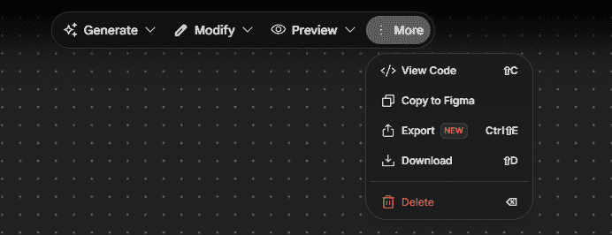

> X@JacKwine说的很好：

> 未来设计师的工作，可能会回归到本质：

> 维护 `Design.md`

> 不论你是 CEO、还是 CTO 还是 Agent，只要你的产品需要美好的体验和美好的外表，都应该将这个 md 文件贯彻公司上下，保持一致。

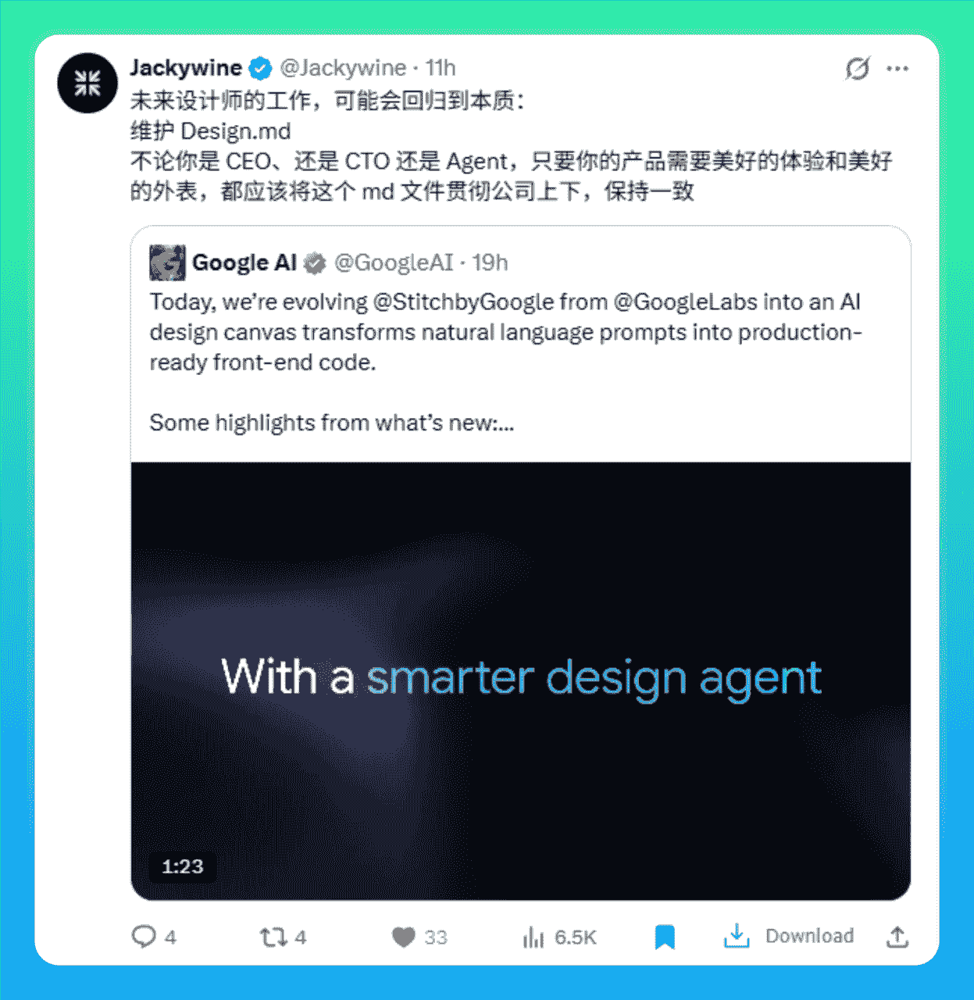

## 02.设计师要失业了？

Twitter 上最火的评论，来自一位巴西设计师：

“Google 彻底终结了设计师这个职业。不是夸张，Google 今天发布了史上最大 Stitch 更新……一个创业者，现在能靠嘴，从想法到完整页面、可跳转原型、可分享的前端代码，全部搞定。不雇设计师、不开 Figma、不花几周迭代。AI 已经能交付一个初级/中级设计师花好几天才能做完的东西。”

日本设计师社区的反应也很两极：

+   Vibe Design 的时代来了，设计师的门槛大幅降低

+   日本的初创公司，即使没有设计师，也能几分钟内做出 MVP 了

+   但也有人冷静指出：工具变强了，但「设计意图」和「产品判断力」依然需要人

## 03.我的判断

这次更新，让我想到一件事：

Vibe Coding 之后，Vibe Design 来了。

ChatGPT 掀起的是用自然语言写代码的热潮；现在 Stitch 掀起的是用自然语言做设计的热潮。两件事的本质是一样的，把执行层的事尽量外包给 AI，人类退回做决策和判断。

**对于设计行业来说，这确实是一次冲击。但我更倾向于把它理解成一次分工重组：**

+   以前设计师花 70% 的时间在执行、修改、对齐。

+   以后这些时间可以还给他们去思考用户真正需要什么？品牌的调性是什么？这个功能值不值得做？

工具变强，从来不是坏事。

坏事是，你还在用旧工具做新时代的梦。

> **补充**：Stitch 目前已在 `stitch.withgoogle.com` 推送，**语音功能**为 Preview 阶段，仅支持英语和国家/地区限制（需满 18 岁）。

你看好 Google Stitch 这次更新吗？你觉得 AI 设计工具会取代设计师吗？欢迎在评论区聊聊。

如果觉得有收获，转发给身边做设计或做产品的朋友看看。

---

按照惯例用，一张图来总结今天的分享

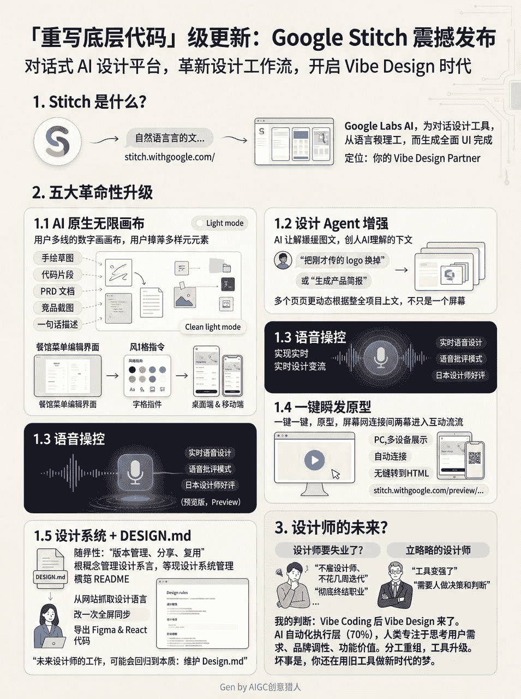

更多精彩内容，我们下期见。

<https://aigcreative.feishu.cn/sync/K4Gvd9vUQsy9Oubwqaeclu0Fnbg>

## 知识库动态
