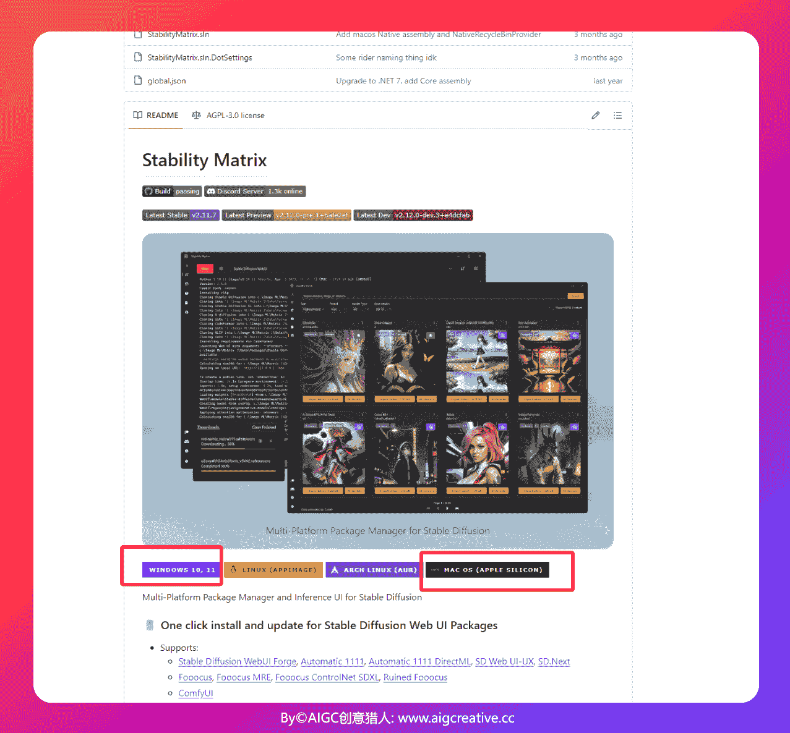
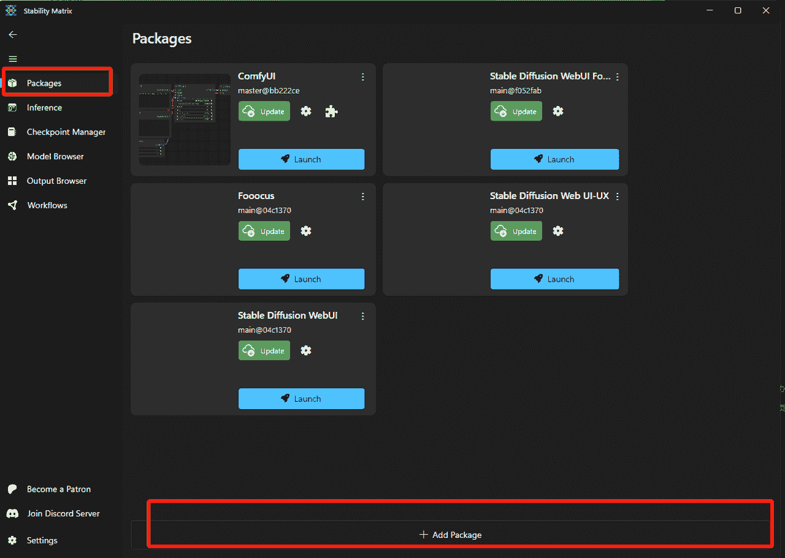
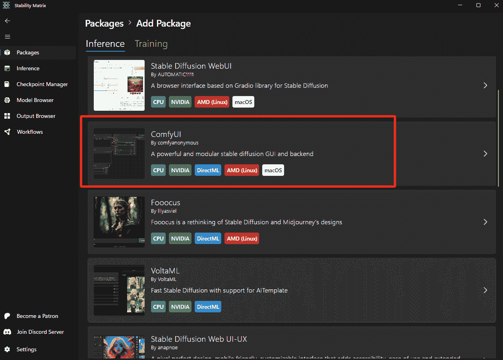
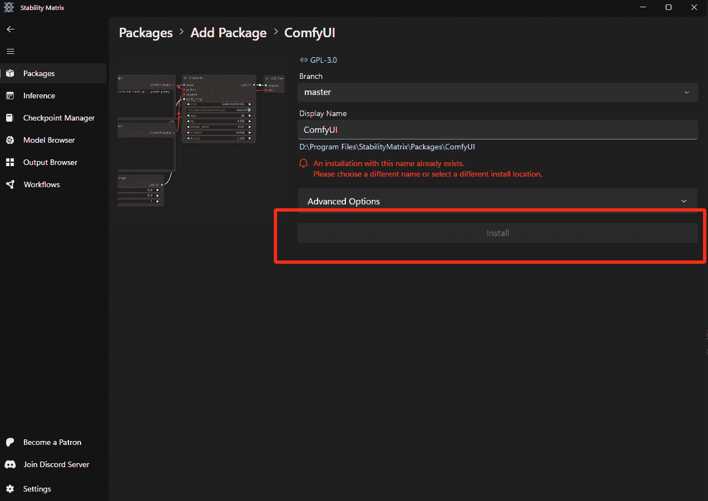
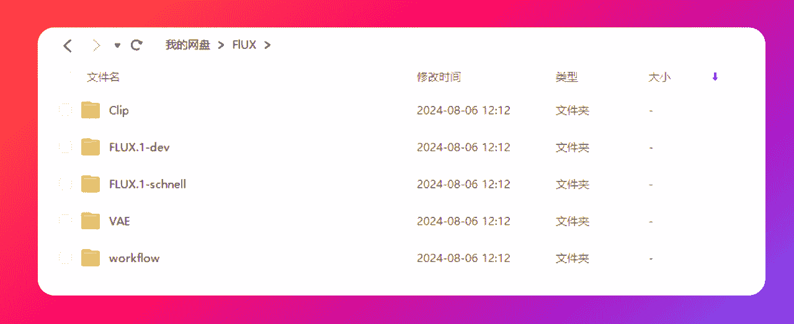
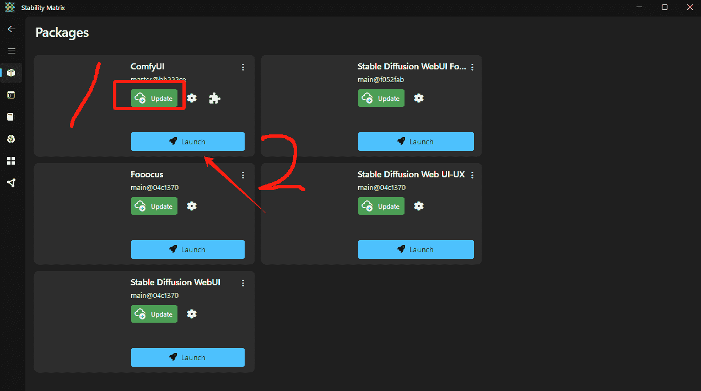
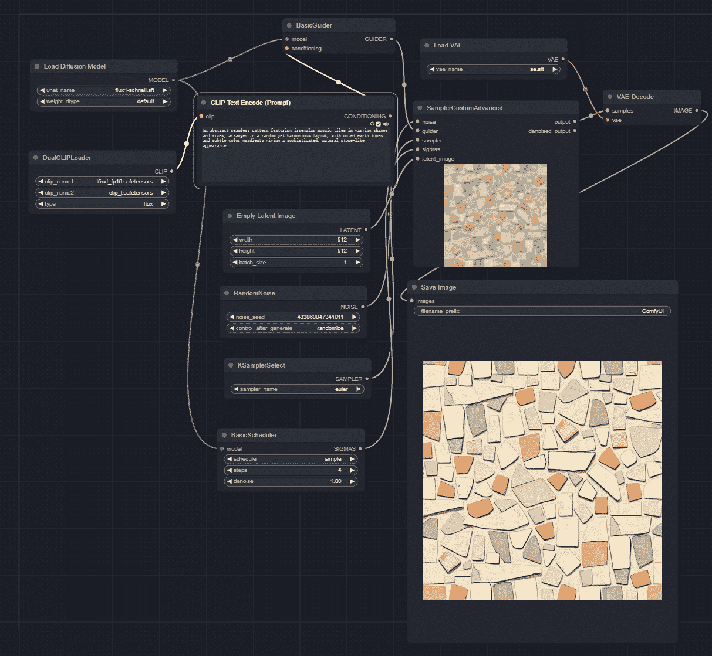

# FLUX在ComfyUI本地部署指北

> 来源：[https://aigcreative.feishu.cn/docx/LIuKdZ34WoUCAdxjzIUcNKBcnpc](https://aigcreative.feishu.cn/docx/LIuKdZ34WoUCAdxjzIUcNKBcnpc)

> [ComfyUI创意实验室](https://aigcreative.feishu.cn/wiki/AVv2wV3TTiVPY0ksxiQcxrhonCS)于ComfyUI入门，可转移至本知识库文档系统学习-->>

# 1、管理平台Stable Matrix安装：

参考文档：[Stability Matrix：整合ComfyUI多种流行包，傻瓜式操作轻松上手](https://aigcreative.feishu.cn/wiki/IABLwlKnZiAaLhkjAGMcOYNbnUf)

Stable Matrix安装包下载：https://github.com/LykosAI/StabilityMatrix

根据电脑系统选择：

# 2、安装ComfyUI

## 2.1 打开Stable Matrix

## 2.2 找到ComfyUI部署包

## 2.3 点击安装即可

## 2.4 FLUX模型下载安装：

> 百度云下载地址：链接：https://pan.baidu.com/s/1CEi5J5NiTQT-Yas65vE_AQ      提取码：qyu1

### Unet（checkpoint）模型、Clip模型、VAE模型下载：

## **补充：**Lora模型下载：[FLUX现有Lora模型](https://aigcreative.feishu.cn/wiki/YYVJw3Jb4i6eY8kLmv8ceQfpnBc)

## **补充：**ControlNet模型下载：[FLUX现有ControlNet模型](https://aigcreative.feishu.cn/wiki/Hdhww3achiJz7NkqwSicOBChnjd)

## 2.5更新ComfyUI内核：

## 2.6载入工作流+出图体验：

<https://aigcreative.feishu.cn/sync/K4Gvd9vUQsy9Oubwqaeclu0Fnbg>