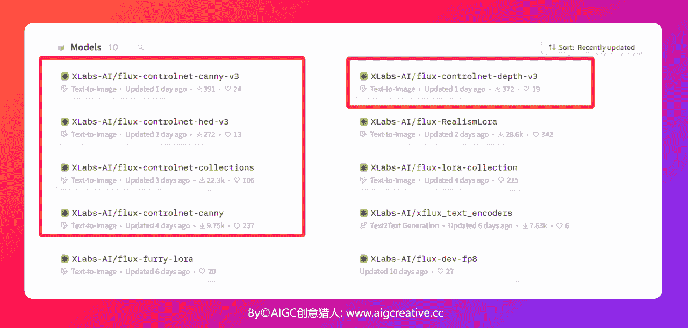
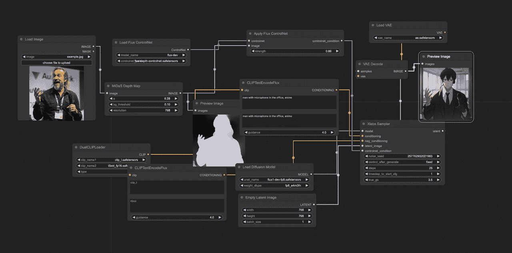

# FLUX现有ControlNet模型

> 来源：[https://aigcreative.feishu.cn/docx/No60d84Nho4MprxDmsDcb5rOnvc](https://aigcreative.feishu.cn/docx/No60d84Nho4MprxDmsDcb5rOnvc)

> 目前Xlabs已发布V3版本：

> 模型下载地址：https://huggingface.co/XLabs-AI



This repository provides a collection of ControlNet checkpoints for FLUX.1-dev model by Black Forest Labs

该存储库提供 Black Forest Labs 的 FLUX.1-dev 模型的 ControlNet 检查点集合


[See our github](https://github.com/XLabs-AI/x-flux-comfyui) for comfy ui workflows.

请参阅我们的 github，了解舒适的 ui 工作流程。



[See our github](https://github.com/XLabs-AI/x-flux) for train script, train configs and demo script for inference.

请参阅我们的 github，了解训练脚本、训练配置和用于推理的演示脚本。

#

# Models  型号

Our collection supports 3 models:

我们的系列支持 3 种型号：

+   Canny 精明的

+   HED 哈德

+   Depth (Midas) 深度（迈达斯）

Each ControlNet is trained on 1024x1024 resolution and works for 1024x1024 resolution. We release v2 versions - better and realistic versions, which can be used directly in ComfyUI!

每个 ControlNet 均在 1024x1024 分辨率下进行训练并适用于 1024x1024 分辨率。我们发布了 v2 版本 - 更好、更真实的版本，可以直接在 ComfyUI 中使用！

[Please, see our Com](https://github.com/XLabs-AI/x-flux-comfyui)fyUI custom nodes installation guide

请参阅我们的 ComfyUI 自定义节点安装指南

#

# Examples  示例

See examples of our models results below.

请参阅下面的模型结果示例。

Also, some generation results with input images are provided in "Files and versions"

此外，“文件和版本”中提供了一些带有输入图像的生成结果

#

# Inference  推理

To try our models, you have 2 options:

要尝试我们的模型，您有 2 个选择：

1.  [Use main.py f](https://github.com/XLabs-AI/x-flux)rom our official repo
使用我们官方仓库中的 main.py

1.  Use our custom nodes for ComfyUI and test it with provided workflows (check out folder /workflows)
使用我们的 ComfyUI 自定义节点并使用提供的工作流程对其进行测试（查看文件夹 /workflows）

See examples how to launch our models:

查看如何启动我们的模型的示例：

##

## Canny ControlNet (version 2) Canny ControlNet（版本 2）

1.  Clone our [x-flux-comfyui](https://github.com/XLabs-AI/x-flux-comfyui) custom nodes
克隆我们的 x-flux-comfyui 自定义节点

1.  Launch ComfyUI 启动 ComfyUI

1.  Try our canny_workflow.json
尝试我们的 canny_workflow.json


## Canny ControlNet (version 1) Canny ControlNet（版本 1）

1.  Clone [our repo](https://github.com/XLabs-AI/x-flux), install requirements
克隆我们的存储库，安装要求

1.  Launch main.py in command line with parameters
在命令行中使用参数启动 main.py

```
python3 main.py \
 --prompt &quot;a viking man with white hair looking, cinematic, MM full HD&quot; \
 --image input_image_canny.jpg \
 --control_type canny \
 --repo_id XLabs-AI/flux-controlnet-collections --name flux-canny-controlnet.safetensors --device cuda --use_controlnet \
 --model_type flux-dev --width 768 --height 768 \
 --timestep_to_start_cfg 1 --num_steps 25 --true_gs 3.5 --guidance 4
```


## Depth ControlNet (version 2) 深度控制网络（版本 2）

1.  Clone our [x-flux-comfyui](https://github.com/XLabs-AI/x-flux-comfyui) custom nodes
克隆我们的 x-flux-comfyui 自定义节点

1.  Launch ComfyUI 启动 ComfyUI

1.  Try our depth_workflow.json
尝试我们的 height_workflow.json


## Depth ControlNet (version 1) 深度控制网络（版本 1）

1.  Clone [our repo](https://github.com/XLabs-AI/x-flux), install requirements
克隆我们的存储库，安装要求

1.  Launch main.py in command line with parameters
在命令行中使用参数启动 main.py

```
python3 main.py \
 --prompt &quot;Photo of the bold man with beard and laptop, full hd, cinematic photo&quot; \
 --image input_image_depth1.jpg \
 --control_type depth \
 --repo_id XLabs-AI/flux-controlnet-collections --name flux-depth-controlnet.safetensors --device cuda --use_controlnet \
 --model_type flux-dev --width 1024 --height 1024 \
 --timestep_to_start_cfg 1 --num_steps 25 --true_gs 3.5 --guidance 4
```


```
python3 main.py \
 --prompt &quot;photo of handsome fluffy black dog standing on a forest path, full hd, cinematic photo&quot; \
 --image input_image_depth2.jpg \
 --control_type depth \
 --repo_id XLabs-AI/flux-controlnet-collections --name flux-depth-controlnet.safetensors --device cuda --use_controlnet \
 --model_type flux-dev --width 1024 --height 1024 \
 --timestep_to_start_cfg 1 --num_steps 25 --true_gs 3.5 --guidance 4
```


```
python3 main.py \
 --prompt &quot;Photo of japanese village with houses and sakura, full hd, cinematic photo&quot; \
 --image input_image_depth3.webp \
 --control_type depth \
 --repo_id XLabs-AI/flux-controlnet-collections --name flux-depth-controlnet.safetensors --device cuda --use_controlnet \
 --model_type flux-dev --width 1024 --height 1024 \
 --timestep_to_start_cfg 1 --num_steps 25 --true_gs 3.5 --guidance 4
```


## HED ControlNet (version 1) HED ControlNet（版本 1）

```
python3 main.py \
 --prompt &quot;2d art of a sitting african rich woman, full hd, cinematic photo&quot; \
 --image input_image_hed1.jpg \
 --control_type hed \
 --repo_id XLabs-AI/flux-controlnet-collections --name flux-hed-controlnet.safetensors --device cuda --use_controlnet \
 --model_type flux-dev --width 768 --height 768 \
 --timestep_to_start_cfg 1 --num_steps 25 --true_gs 3.5 --guidance 4
```


```
python3 main.py \
 --prompt &quot;anime ghibli style art of a running happy white dog, full hd&quot; \
 --image input_image_hed2.jpg \
 --control_type hed \
 --repo_id XLabs-AI/flux-controlnet-collections --name flux-hed-controlnet.safetensors --device cuda --use_controlnet \
 --model_type flux-dev --width 768 --height 768 \
 --timestep_to_start_cfg 1 --num_steps 25 --true_gs 3.5 --guidance 4
```


<https://aigcreative.feishu.cn/sync/K4Gvd9vUQsy9Oubwqaeclu0Fnbg>