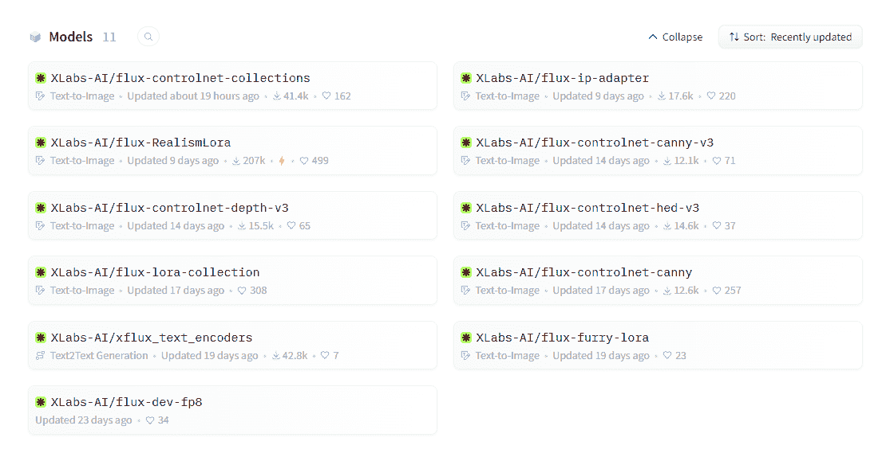
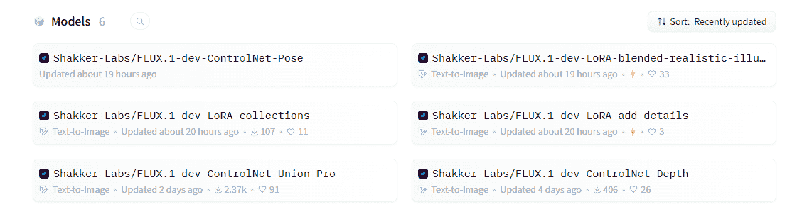

# FLUX三方模型Labs

> 来源：[https://aigcreative.feishu.cn/docx/DDR8dpH4SokXfIxurb0cM4Yvnjg](https://aigcreative.feishu.cn/docx/DDR8dpH4SokXfIxurb0cM4Yvnjg)

# XLabs AI

XLabs AI 是一个处于国际公司之下的产品实验室，团队致力于在机器学习和神经网络领域取得领导地位。该公司正在推出一系列创新的 B2B 和 B2C 服务，这些服务完全基于人工智能，并对生成式 AI 的演进产生了影响。XLabs AI 的团队是开放、充满活力且年轻的集体，他们欢迎创新思想，并支持员工的主动性和创造力。公司正在积极寻找专家加入其令人兴奋的项目。公司的工作方向和更多信息可以在其网站上了解，并且邀请感兴趣的人通过 Telegram 提交职业咨询。目前，XLabs AI 在 Hugging Face 上拥有多个更新中的 Text-to-Image 模型，但尚未公开任何数据集。

> https://huggingface.co/XLabs-AI

---

# ShakkerAI Labs

ShakkerAI Labs 是一个专注于人工智能领域研究和开发的实验室。

> https://huggingface.co/Shakker-Labs

<https://aigcreative.feishu.cn/sync/K4Gvd9vUQsy9Oubwqaeclu0Fnbg>