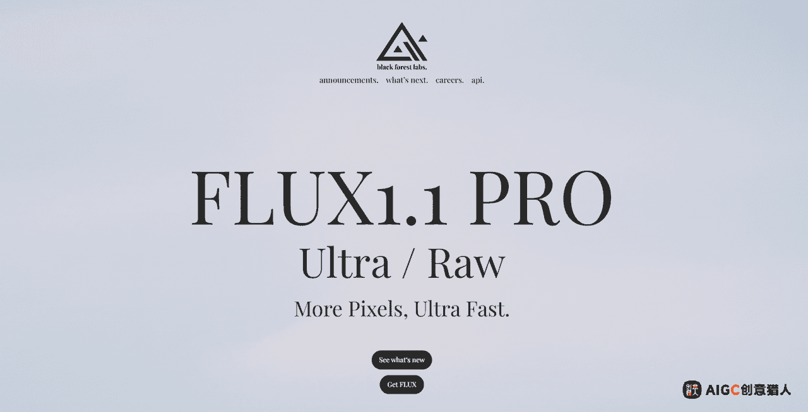
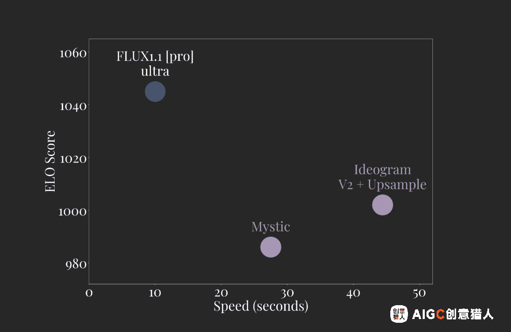
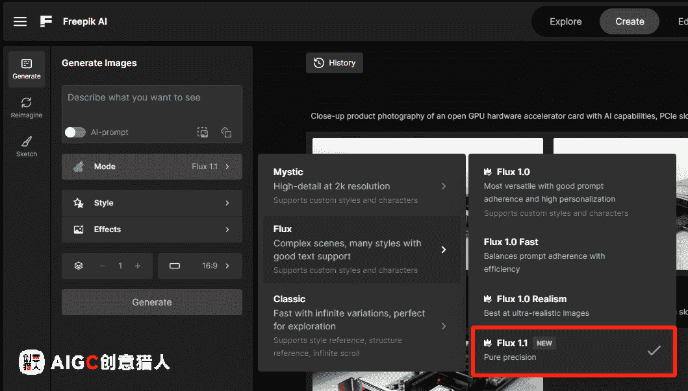
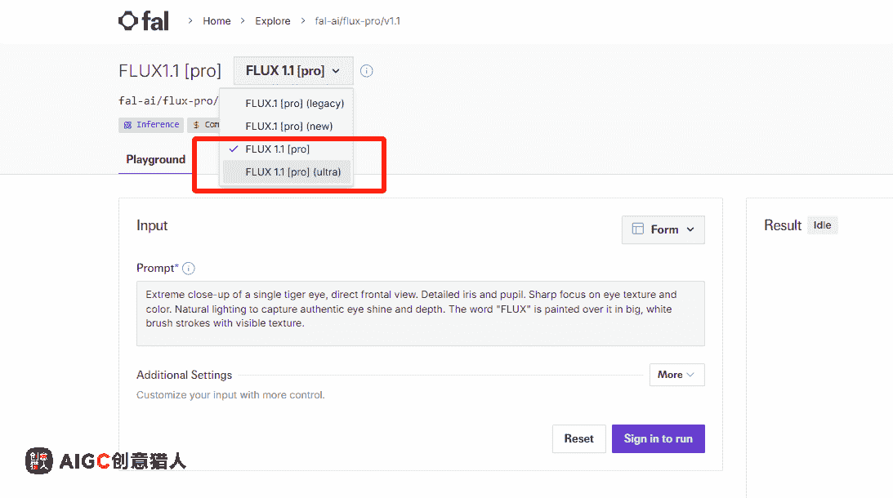
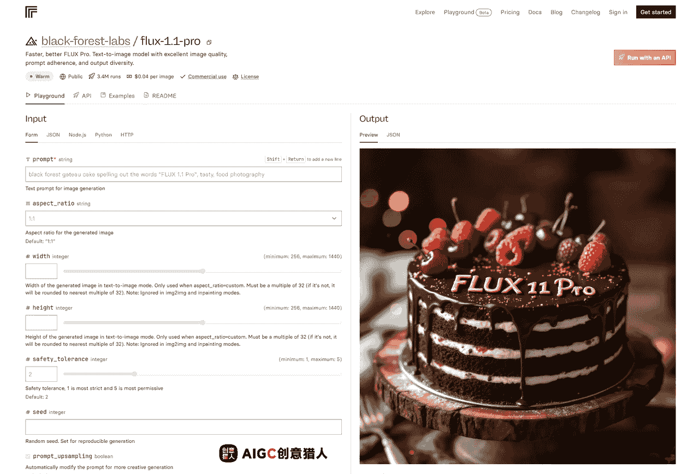

# 20241107-惊艳升级！FLUX1.1 [Pro] 的Ultra/Raw模式发布：10秒生成4K图像，细节堪比摄影

> 来源：[https://aigcreative.feishu.cn/docx/W8HYdJhT1oMaQNx6LfrcRjHsn7o](https://aigcreative.feishu.cn/docx/W8HYdJhT1oMaQNx6LfrcRjHsn7o)

黑森林实验室（Black Forest Labs）最近推出了FLUX1.1 [pro]的Ultra模式和Raw模式，为图像生成工具带来突破性升级，让创作者在AI生成图像领域有了前所未有的选择。

超高分辨率和自然风格的组合，正逐渐接近真实摄影的效果，成为图像生成工具的黑马。

这一系列更新究竟带来了怎样的震撼？一起来探究。

# 4倍分辨率，10秒极速生成——Ultra模式的硬核体验

FLUX1.1 [pro] Ultra模式的最大亮点无疑是4倍于原版本的分辨率（高达4MP），却在速度上丝毫不减，依旧能在10秒内完成图像生成。很多AI生成工具在提高分辨率时往往牺牲速度，生成速度大打折扣。

而Ultra模式却突破了这一瓶颈，比许多同类高分辨率工具的速度提升了2.5倍。这种又快又清晰的特性，简直是高效创作的福音。

更值得一提的是，Ultra模式的收费也极具竞争力，每张图像仅需0.06美元，为专业创作者带来超值体验。

# 走进“真实”的艺术——Raw模式让图像更自然

除了Ultra模式，FLUX1.1 [pro]还推出了Raw模式，带来另一种截然不同的创作风格。如果Ultra模式更关注清晰度与速度，那么Raw模式则是在图像的“真实感”上发力。

相比其他生成工具中的人像显得过于“完美”甚至有些“假”，Raw模式下生成的人像图像更加自然、真实，营造出一种随意捕捉的“瞬间感”。

这种风格尤其适合自然风光和人文摄影，使生成的作品更接近真实摄影的质感。

# 不只是“玩票”——FLUX1.1 [pro]的新模式背后的更大意义

FLUX1.1 [pro]的Ultra和Raw模式不仅是一次普通的功能升级，更代表着AI图像生成领域朝向专业化、个性化的转变。

Ultra模式的高分辨率和快速响应，为广告、影视、设计等领域的创作者提供了快捷而高质的图像生成解决方案。

而Raw模式让创作不再局限于冰冷的“完美”图像，赋予了作品更多的真实和人性化。

这场AI生成图像的进化，也让我们看到技术与艺术融合的可能性。对于追求高效的商业项目，Ultra模式无疑是得力助手；而在艺术创作上，Raw模式则让图像生成不再是一成不变的“机器印象”，更增添了些许人文情怀。

# 技术赋能创作，未来更具期待

随着FLUX1.1 [pro]的Ultra和Raw模式上线，AI图像生成工具已经不再局限于单纯的技术展示，而是逐渐融入到实际创作需求中。

这一发展，或许正是AI赋能创作的最佳诠释。高效与真实的结合，让技术真正服务于艺术，创造出一个更具活力的创作生态。

FLUX1.1 [pro]的创新，

将为未来的图像生成工具开辟全新方向。

# 在线体验地址：

【1】Freepik AI：https://www.freepik.com/pikaso/ai-image-generator

【2】fal.ai:https://fal.ai/models/fal-ai/flux-pro/v1.1

【3】replicate：https://replicate.com/black-forest-labs/flux-1.1-pro

# 以下是一些精彩样片：

<https://aigcreative.feishu.cn/sync/K4Gvd9vUQsy9Oubwqaeclu0Fnbg>

# 知识库动态