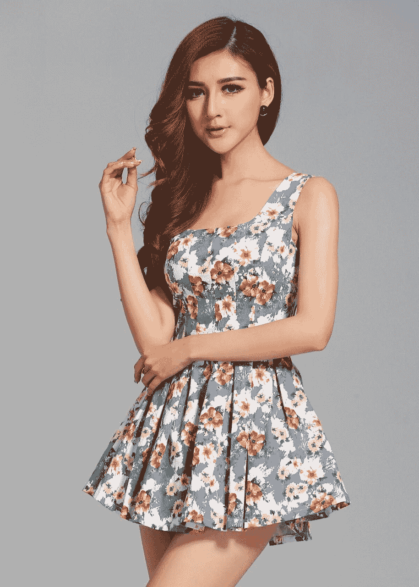
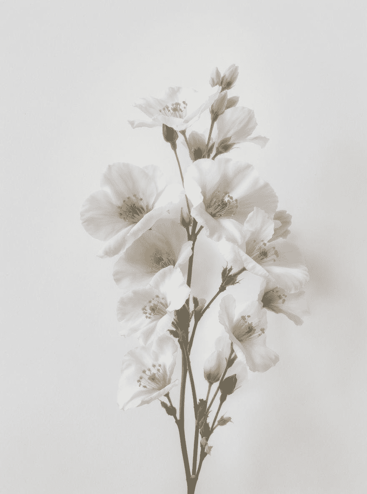
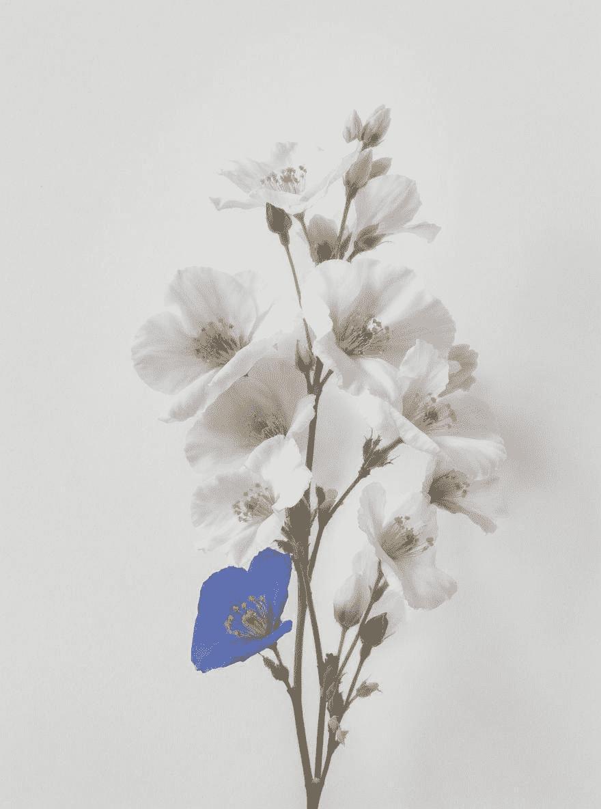

# 20250605-打脸了...这才是文生图的“GPT”时刻！附FLUX Kontext官方提示词技巧

> 来源：[https://aigcreative.feishu.cn/docx/C2bsdCq30odYKmxYhQacTnjenOf](https://aigcreative.feishu.cn/docx/C2bsdCq30odYKmxYhQacTnjenOf)

玩AI以来，一直重点关注AI文生图领域的发展。

一路看过来，有很多激动人心的时刻：

Midjourney V6、V7的发布；

黑森林FLUX系列模型发布；

谷歌Gemini 2.0 Flash的文生图、编辑；

ChatGPT 4o文生图、编辑；

直到近一周，

黑色森林发布的FLUX.1 Kontext模型......之前有过介绍《》。

又将文生图、AI图图片编辑，拉上了新的高度！

之前吹过很多次文生图的“GPT”，现在看来，打脸了。

Kontext的发布，才是文生图的“GPT”时刻啊！

这几天深度使用下来，很是感慨。一是惊叹于Kontext模型的优秀能力；而是感慨于AI进化速度之快！几乎是以“周”为单位的快速迭代升级！各方大公司、创业公司竞争明显加剧！

细思极恐，有很兴奋。

回到Kontext。

FLUX.1 Kontext 背后藏着一套叫"流匹配"（Flow Matching）的技术，听起来高大上，其实原理不复杂。

#### 传统方法 vs 流匹配

**传统扩散模型：**先把图片"模糊"成噪声，再一步步"还原"

**问题：**改动一处，可能把整张图都弄得面目全非

**流匹配：**基于连续归一化流，通过高斯概率路径精准计算变换过程

简单点说，它就像一个超级聪明的画师，能精准地"画"出你想要的改动，同时保证其他部分纹丝不动。

看看下面我测试使用案例，堪比用了10年PhotoShop的资深设计师啊！画面的一致性就不用说了，看到它处理局部的手法，抠图，编辑的方式，跟使用PhotoShop操作、编辑的效果，没什么区别，效果甚至更好！

关键是还很快！以下是案例对比：

提示词：It's dark, it's night time, the lights on the billboards are on, shining on the ad, the shot should not change

提示词：Change the color of the car body to green, keeping the original lens scene unchanged

提示词：The black words "AIGC Creative Hunter" are written on the front of the shirt.

提示词：The model is holding this facial cleanser for display

提示词：Change the man's clothes to purple

提示词：fine art photography, flowers, delicate composition

提示词：Person with a veil walking up to a surreal structure, in the style of matte painting, otherworldly paintings, futuristic architecture, textured collages, mountainous vistas, concrete, night time, muted white

提示词：Street of Mexico City, full-body shot standing in front of a colorful mural in a side , hands on her hips. The bright, diffused daylight brings out the vibrancy of both her expression and the city around her..Lucía is a middle-aged Latina curvy man

更多效果，大家可以自行尝试。

未来，肯定还有更多的文生图的“GPT”时刻。

但当下，可以确定的是，借助Kontext，你立马可以成为PS高手！

# 下面附上FLUX Kontext官方提示词技巧，想使用Kontext的小伙伴可以看看，学习一下：

## 使用英文

### 1. 基础修改

+   简单直接："Change the car color to red"

+   保持风格："Change to daytime while maintaining the same style of the painting"

### 2. 风格转换

**原则：**

+   明确命名风格："Transform to Bauhaus art style"

+   描述特征："Transform to oil painting with visible brushstrokes, thick paint texture"

+   保留构图："Change to Bauhaus style while maintaining the original composition"

### 3. 角色一致性

**框架：**

+   具体描述："The woman with short black hair"而非"她"

+   保留特征："while maintaining the same facial features, hairstyle, and expression"

+   分步修改：先改背景，再改动作

### 4. 文本编辑

+   使用引号："Replace 'joy' with 'BFL'"

+   保持格式："Replace text while maintaining the same font style"

## 常见问题解决

### 角色变化过大

❌ 错误："Transform the person into a Viking"

✅ 正确："Change the clothes to be a viking warrior while preserving facial features"

### 构图位置改变

❌ 错误："Put him on a beach"

✅ 正确："Change the background to a beach while keeping the person in the exact same position, scale, and pose"

### 风格应用不准确

❌ 错误："Make it a sketch"

✅ 正确："Convert to pencil sketch with natural graphite lines, cross-hatching, and visible paper texture"

## 核心原则

1.  **具体明确** - 使用精确描述，避免模糊词汇

1.  **分步编辑** - 复杂修改分为多个简单步骤

1.  **明确保留** - 说明哪些要保持不变

1.  **动词选择** - 用"更改"、"替换"而非"转换"

## 最佳实践模板

**对象修改：**

"Change [object] to [new state], keep [content to preserve] unchanged"

**风格转换：**

"Transform to [specific style], while maintaining [composition/character/other] unchanged"

**背景替换：**

"Change the background to [new background], keep the subject in the exact same position and pose"

**文本编辑：**

"Replace '[original text]' with '[new text]', maintain the same font style"

> **记住：** 越具体越好，Kontext 擅长理解详细指令并保持一致性。

<https://aigcreative.feishu.cn/sync/K4Gvd9vUQsy9Oubwqaeclu0Fnbg>

# 知识库动态