# 20250929-腾讯来炸场了！“会思考”的混元图像3.0，强的可怕！开源免费！

> 来源：[https://aigcreative.feishu.cn/docx/IN1UdX45aodDrIxAxiXc1gpsn9c](https://aigcreative.feishu.cn/docx/IN1UdX45aodDrIxAxiXc1gpsn9c)

今天的标题里有三个感叹号“！”，很少有这么激动的时刻！

混元图像3.0——首个开源的工业级的原生多模态架构。

强的可怕！

到底有多强？

这么说吧，这篇推文里的Case，几乎都是一次成型的！而且都非常满意！

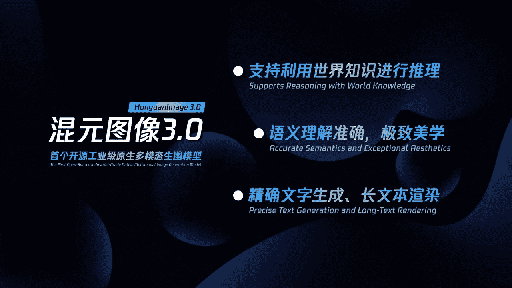

最近AI生图这个领域，确实挺热闹的，隔一段时间就有让人眼前一亮的新东西出来。

大家用得多了，眼光自然也变高了，不再满足于画得“像”、“真实”，而是希望它能更聪明、更能理解+推理我们的想法。

说实话，之前用过不少AI生图工具，它们很强大，但总感觉还隔着一层。

特别是在图里加文字这个功能，基本没几个能让人省心的。

所以，当腾讯混元推出3.0版本，提到“原生多模态”和“世界知识”这些概念时，我确实产生了兴趣，想看看它在“理解”这件事上，到底做得怎么样。

实际使用下来，发现它确实有自己的独到之处。

# 1、一个能理解意图会思考的生图模型

为了测试它的理解能力，我试着提了个需求：“用四格漫画的形式，解释一下石油的形成过程”

> 四格漫画的形式，描绘石油的形成过程。

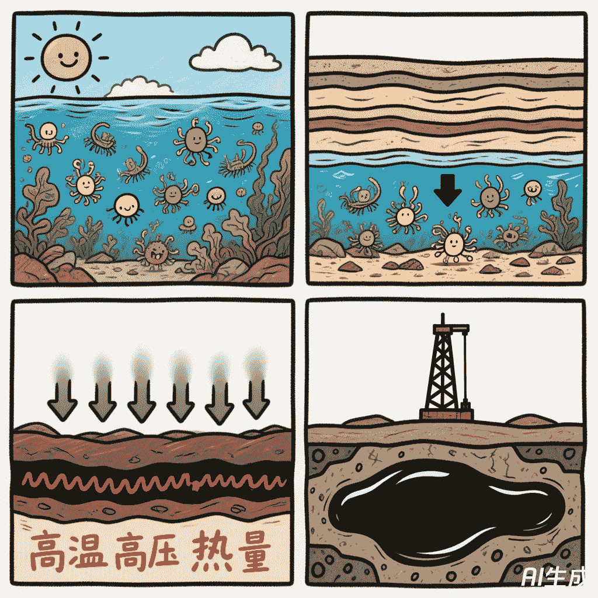

这个提示词的关键，在于它需要先“理解”石油形成的知识，这考验的是腾讯混元背后的知识储备和逻辑能力。

结果很让我很惊喜，清晰地展示了石油形成的全过程，逻辑顺序链条是完整的。

再来做个数学题：

> 在教室的黑板上解答一下这道数学题：在一个笼子里，关着若干只鸡和若干只兔子。已知笼子里共有100只动物，总共有260条腿，请问笼子里有多少只鸡和多少只兔子？

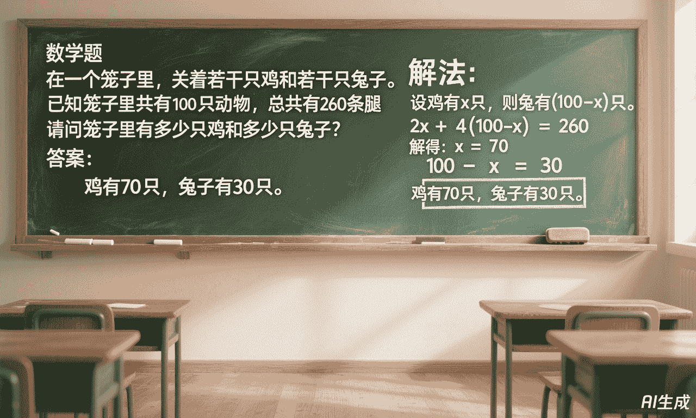

可以看到，复述写在黑板上的题目，文字都正确了，解题思路及过程也完全正确！还是很厉害的！

> 一名AI创业者正在公司的白板上，写满关于Agent的原理架构图

关于Agent主体架构还是有很好的体现的，小字还有提升空间。

> 一名大学教授在黑板上推导麦克斯韦方程

> 牛顿在黑板上推理万有引力定律，写满整个黑板

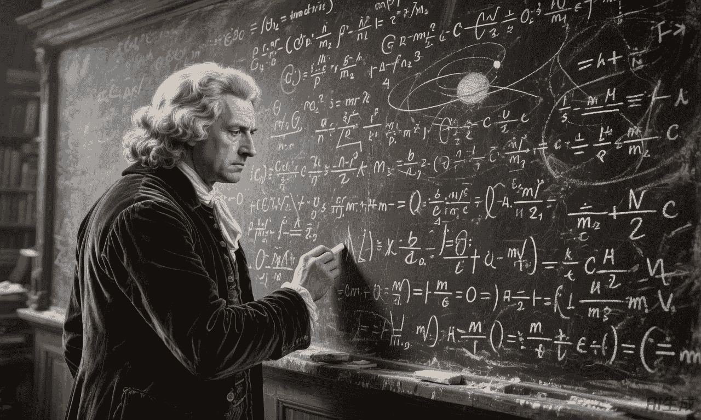

哈哈，这两个场景就有点为难人家腾讯混元了，这么多文字......理解万岁。但是整个画面的光影体现，还是很到位的。

> 创作一组通俗易懂的插画介绍Agent的工作原理，带上文字说明

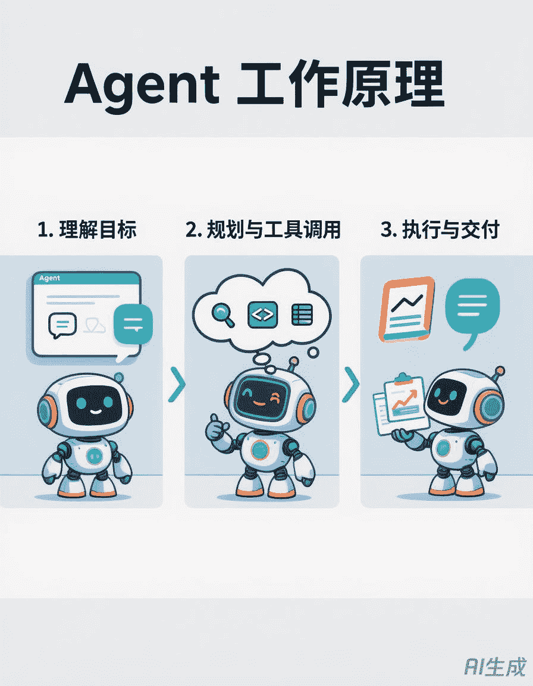

> Create step-by-step recipe infographic for creamy garlic mushroom pasta, top-down view, minimal style on white background, ingredient photos labeled: "200g spaghetti", "150g mushrooms", "3 garlic cloves", "200ml cream", "1 tbsp olive oil", "parmesan", "parsley", dotted lines showing process steps with icons (boiling pot, sauté pan, mixing), final plated pasta shot at the bottom

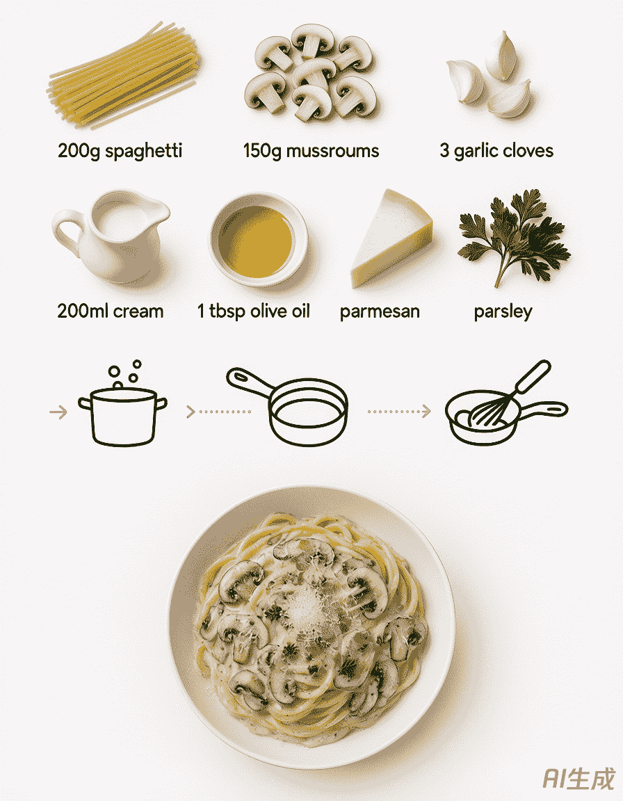

看到它生成的这些结果，真感觉混元图像3.0就像一个能听懂话、有知识储备的助理。

它能明白我想要什么，然后调动自己的知识帮我实现，这个过程就顺畅了很多。

# 2、在图里生成清晰准确的文字，这个痛点总算解决了

我们再来聊聊那个AI生图一直以来的痛点——在图片里加文字。

相信不少朋友都体验过，想让AI在海报上加句宣传语，结果生成一串谁也看不懂的乱码，确实让人头疼。

当然，各家的模型也都做得越来越好，比国外的模型领先就更多了。

这次混元图像3.0在文字生成上的表现，可以说是我目前用过的模型里最出色的。

我尝试用它来制作一些带字体设计、有较长标题和说明文字的图片，它不仅能准确、清晰地把文字嵌入画面，而且在排版和风格上，也和图片本身融合得很好，没有那种生硬的“后期P图”感。

来看看效果：

## 字体设计：

> 黑底白字，书法连笔潇洒飘逸灵动字体设计“满江红”，草书字体狂野奔放，长笔画，视觉张力富有动感，笔画流畅飘逸，笔画巧妙延长变形，飞白效果，字体大小变化，错位排版。笔画流畅洒，干净背景，搭配衬线小英文“HunyuanImage 3.0”排版，右边点缀红色传统印章；大师作品，电影主题字体，视觉冲击力强。

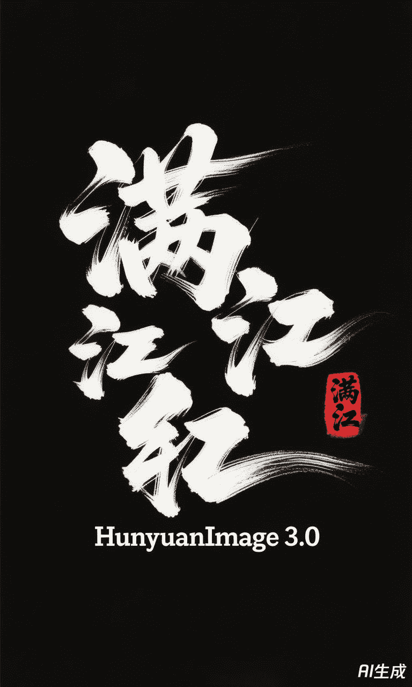

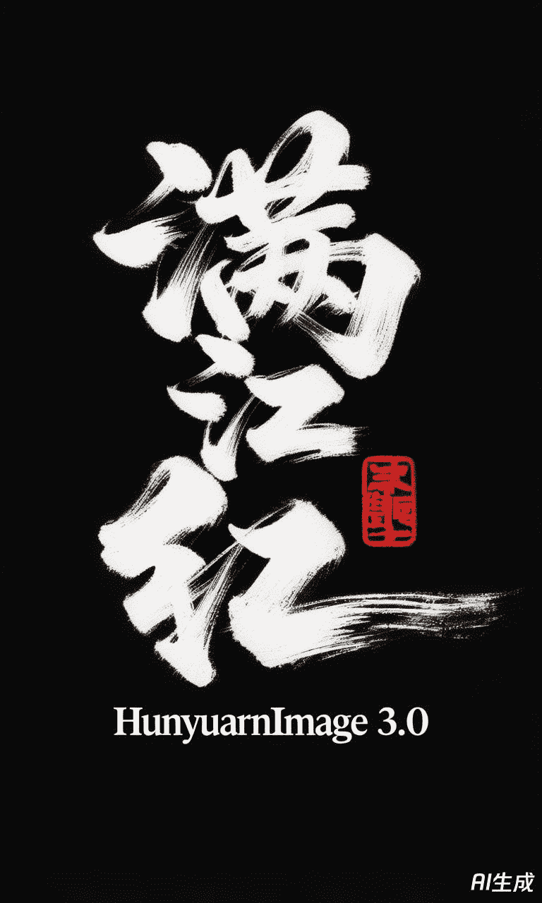

> 高达风格的立体机械字体“混元图像3.0 C4D风格设计”，3D渲染，C4D风格。它的亮丽颜色有蓝色、绿色还有橙色、白色相结合，细节丰富，黑色的背景

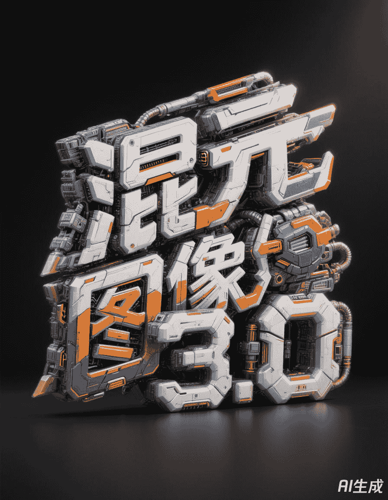

> 字体标志“秋日露营季"，创意字体设计，线条流畅且富有艺术感，将字体进行抽象变形，创造出独特的节奏和动感，给人以强烈的视觉冲击。加入帐篷，风筝，相机等装饰元素，白色加黄绿色点缀，高级感，背景为微型视角，有小溪，岩石，草地，蓝天

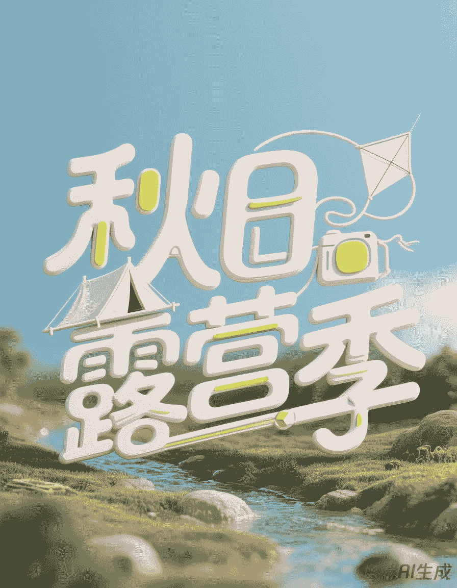

> 中国苗族风格文字logo，版画，主体为“肇兴苗寨”文字变形组合而成，横排，文字笔画粗壮，朴拙，有张力和力量感，融合苗族传统图案相关元素，字体笔画有苗族刺绣，苗族蜡染，苗族银饰，苗族服装，牛图腾等图案，吊脚楼等纹路。青花瓷蓝色底纹，小字有“Zhaoxing Miao Village”文字元素，整体风格民族风浓郁、色彩以蓝色为主调，辅助中国传统朱砂红，简洁且富有文化特色。

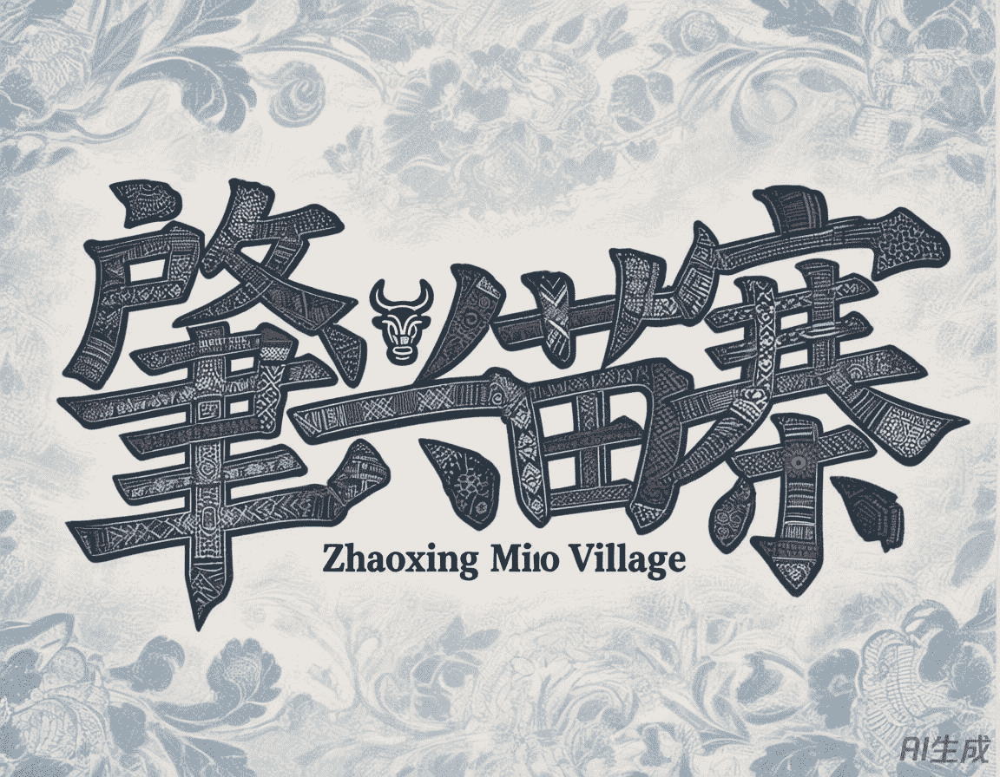

> 生成潮流派对风格艺术字体，内容为“创意猎人，搭配英文“Creative Hunter”进行排版。字体大小变化，错落有致排版。字体笔画粗厚醒目，形态夸张变形，部分笔画带俏皮弧度或独特弯折，营造活泼、肆意、充满活力的派对氛围，黑色背景，绿色点缀。背景干净。白色字体，大师作品。

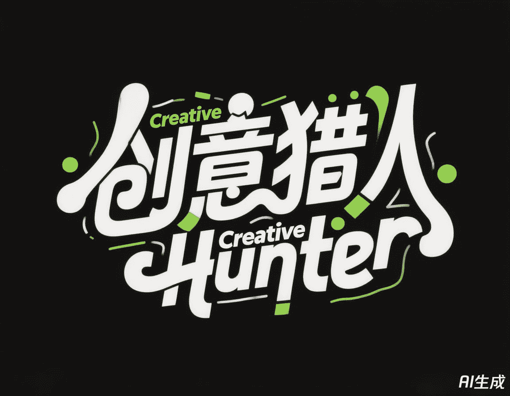

> 签名字体设计，何先森Kevin：字体飘逸，草书，钢笔字效果。干净的白色背景，无水印，大面积留白，适用于签名。

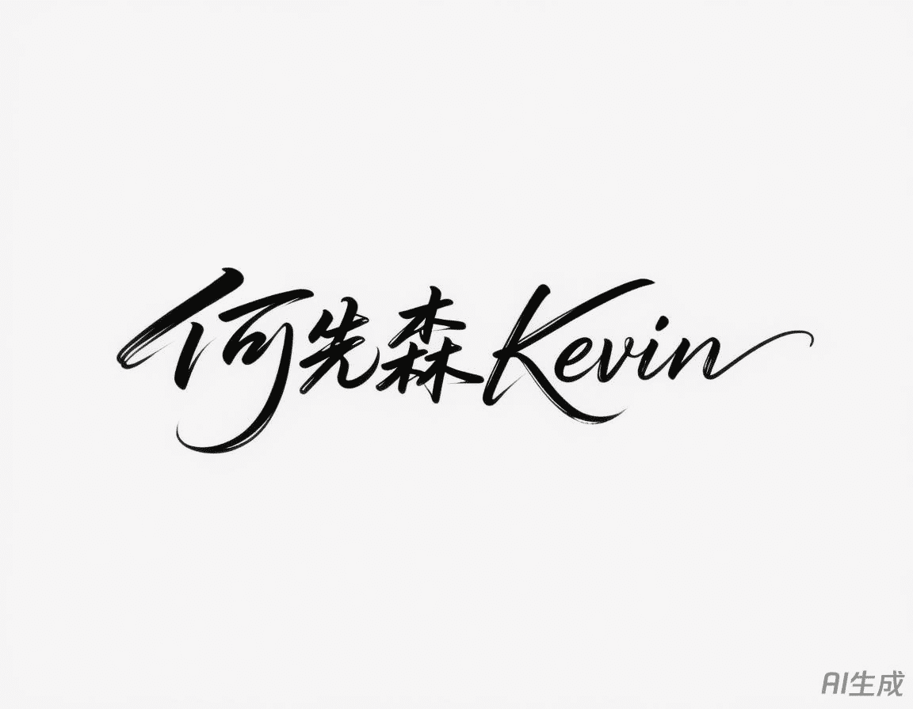

## 多行文本体现：

> 搞怪创意风格的海报，主体展示带有牛图案的黄色警示标识与 “牛馬注意” 文字牌，搭配 “你們爲什麼那麼多時間做海報” 等文字；场景设定为户外草地与蓝天，营造出轻松诙谐的氛围；风格融合搞怪创意与户外场景，色调以亮黄（标识）、青绿（草地）、湛蓝（天空）为主，传递出活泼吸睛的感觉；构图采用户外标识的中景视角，突出创意元素与自然场景的结合；细节补充有 “REFUSE TO BE LIKE A COW OR HORSE 10.01”“牛馬請做好牛馬的分內工作”“拒絕內捲 請勿做海報” 等文字，以及 “POSTER Design”“LOGO Design” 等设计类别标识，整体传递出搞怪调侃做海报的创意氛围，兼具趣味与设计感。

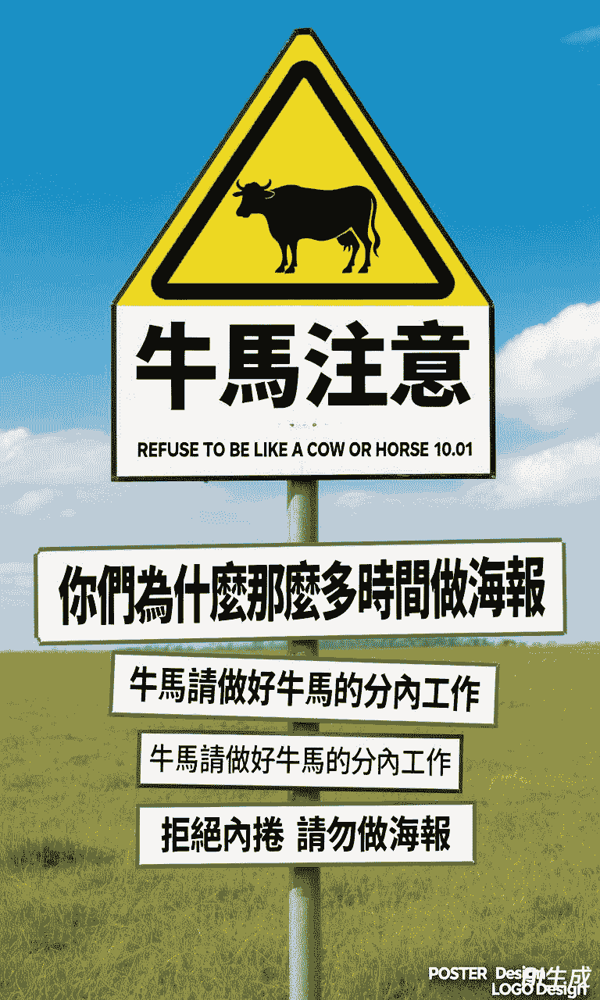

看看以上的效果，文字的渲染输出，提升是相当的明显！

对于内容创作者或者需要快速制作宣传图的朋友来说，它可以省掉“AI生成图片+导入设计软件加字”的步骤，效率提升很明显。

无论是做个简单的图文卡片，还是设计表情包，都方便了不少。

# 3、对复杂指令超强的理解能力，和很优秀的审美

除了知识推理和文字生成这两个亮点，混元3.0在应对复杂的AI绘画提示词时，也表现得不错。

它对这种长文本的理解和消化能力很强，能比较准确地抓住核心需求，生成的图片整体感很好，不会出现元素丢失或混乱堆砌的情况。

## 人像摄影：

> 暗黑朦，隐约的淡彩+橙黄褪色，逆朦，泛朦，特写，一个灵动纯美的明日香女生人像及场景，突出动态发丝的凌乱美，超高颜值，复古，迷离，伦勃朗光，低饱和，反射，折射，肌理质感，泛光模糊晕染，极简风，柔焦灰度美学，情绪写意，前卫视觉艺术美学，大片高级感，电影美学，大师杰作，细节英文信息解析点缀，超高清，艺术写真

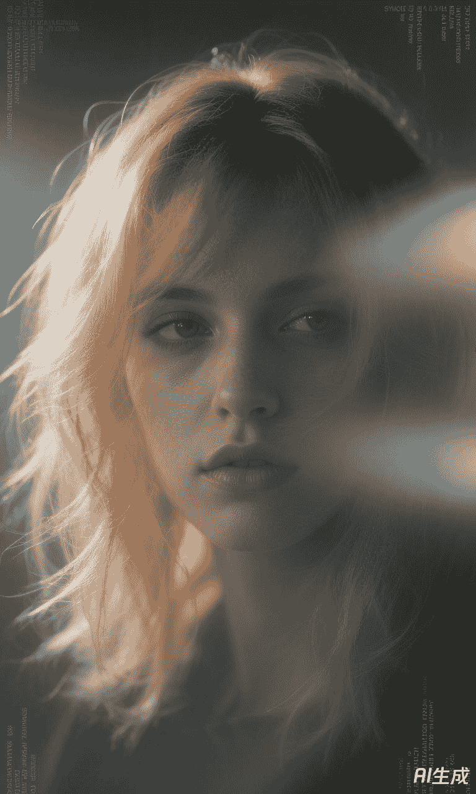

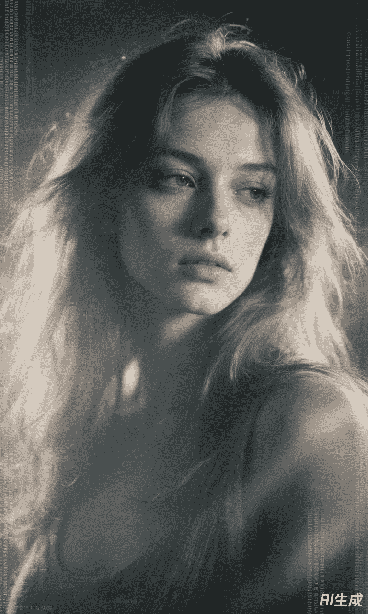

## 矢量风格插画：

> 矢量插画，意识流，春天气息，清新淡雅，由树叶和花瓣以抽象艺术的形式构成一位端庄典雅的东方女性轮廓，正负形，同形异构，色彩几何，柔和的色彩渐变，东方禅意，唯美意境，画面大面积留白，极简主义，创意大赛金奖作品，大师级作品，高清，8k

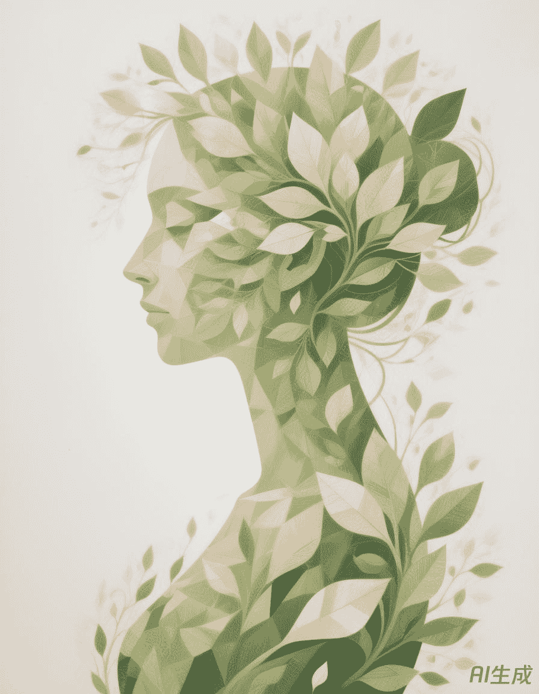

> A dramatic, front-facing close-up portrait of Hayao Miyazaki. The composition is perfectly symmetrical, with his face divided vertically into two distinct artistic styles. The left half is hyper-realistic

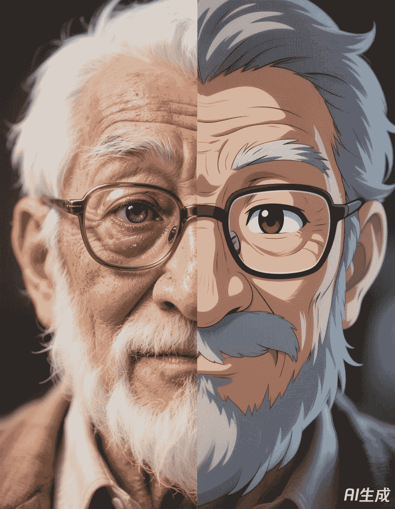

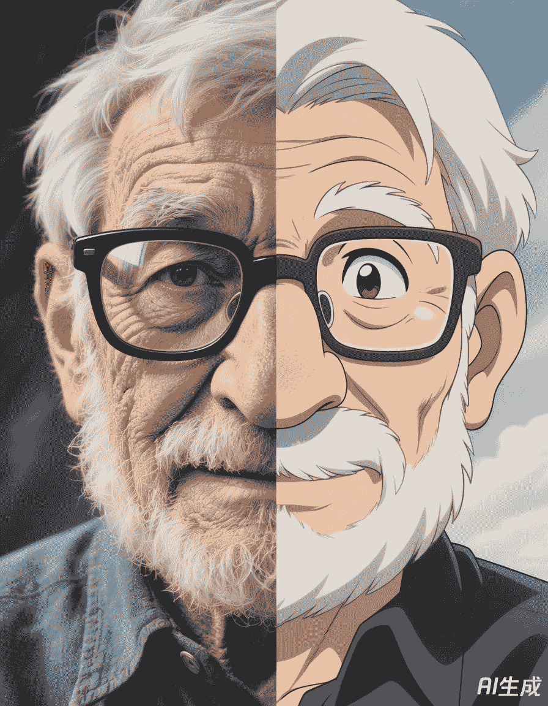

> 一幅讽刺漫画风格的插画，采用复古美式漫画风格，背景是一个多层货架，货架上都是一样的红色棒球帽，帽子正面印有大字标语“MAKE AMERICA GREAT AGAIN”，帽侧贴着白色标签写着“MADE IN CHINA”，特写视角聚焦其中一顶红色棒球帽。画面下方有价格牌，原价“$50.00”被粗黑线X划掉，改为“$77.00”，色调为怀旧的土黄与暗红色调，阴影处理带有90年代复古印刷质感。整体构图风格夸张讽刺，具讽刺政治消费主义的意味。

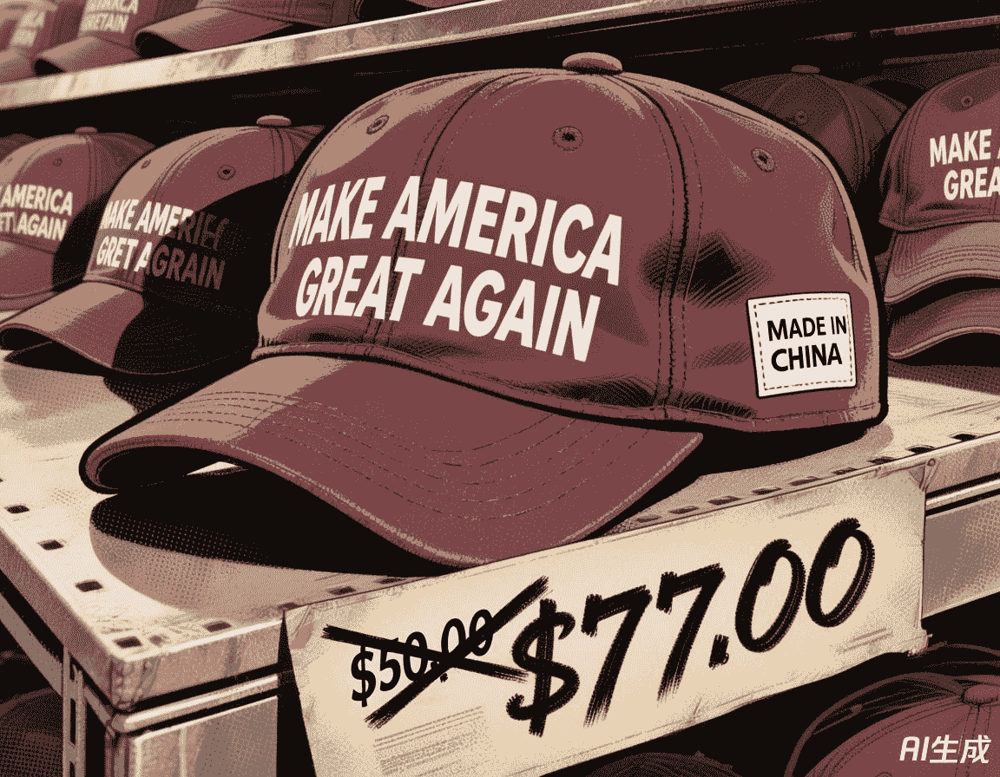

同时，它生成的图片在美学上保持了比较高的水准。无论是写实风格还是动漫、艺术风格，在色彩、构图和光影上都处理得比较舒服，出图的“可用性”很高。

# 4、它在专业设计场景，表现如何？

在体验了基础功能后，我又好奇地测试了一下它在更专业、更垂直的设计领域的应用表现。

我花时间尝试了我们工作中常见的多种场景。

结果发现，它的“全能”程度，还是挺让我意外的。

## 电影海报：

> 大面积留白，极简风格，鲜明色彩，反差感，远景，最佳艺术构图，设计感极强，大师作品，景深，远景视角里一个小小的人举着萤火灯在夏夜穿梭，墨黑、荧绿，渐变晕染，动态，渐变，神秘感，创意手写文字“夏夜里的星点”，小字内容“The star dot in the summer night”，电影海报设计，大师级排版

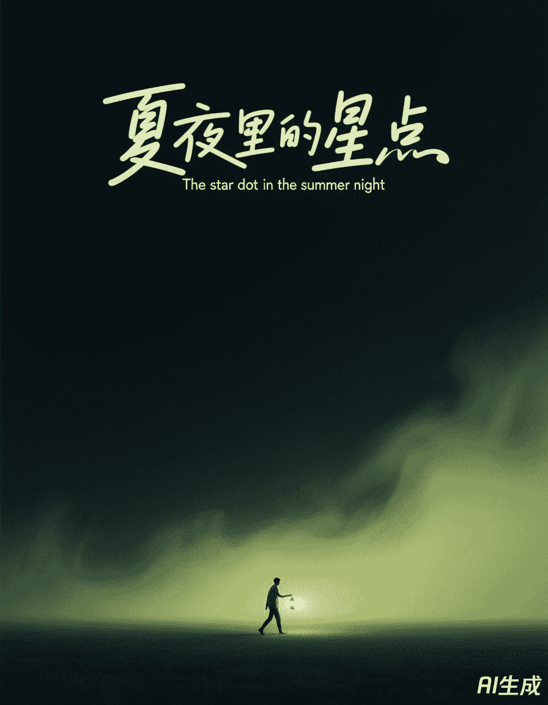

> 高级感插画，电影海报，天空背景，画面顶部是红色的隆起的表面呈现荔枝表皮的纹理，有压迫感，有一个唐代青衣中年男子正在下面策马奔腾，地面金粉飞溅。背景有关于荔枝的暗淡诗句“一骑红尘妃子笑，无人知是荔枝来”，有岭南荔枝树，有唐代宫殿投影。右上角，金色岩彩竖版字体，艺术草书，“长安的荔枝”，暖色调，史诗感的构图，景深效果，画风柔美，细节丰富，神秘氛围，梦幻朦胧。

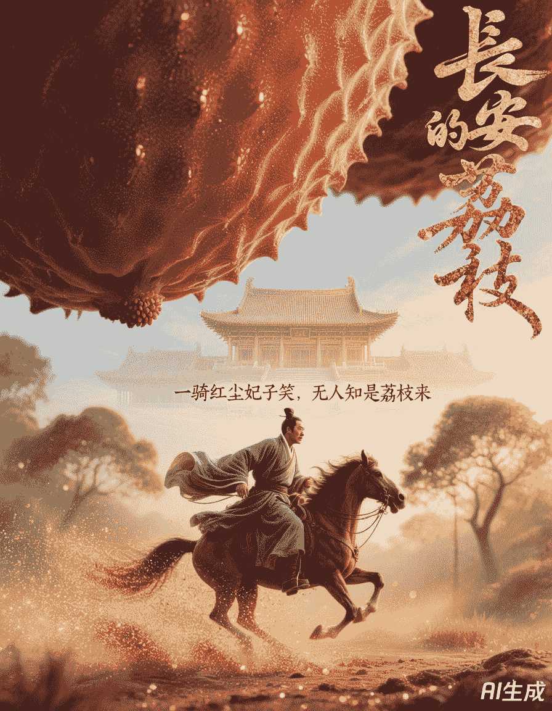

> 获奖电影海报设计，极简风格，黑色背景，巨大的水墨印记，电影名称是巨大毛笔书法泼墨字体：“江湖”金色小字副标题“LEGEND”极小的两个极小红衣侠客比武，强烈的对比反差，极简主义，大面积留白，禅意，神性，杰作，获奖作品，极致构图，电影光线，极致像素，高清出图，32K，HDR，印章

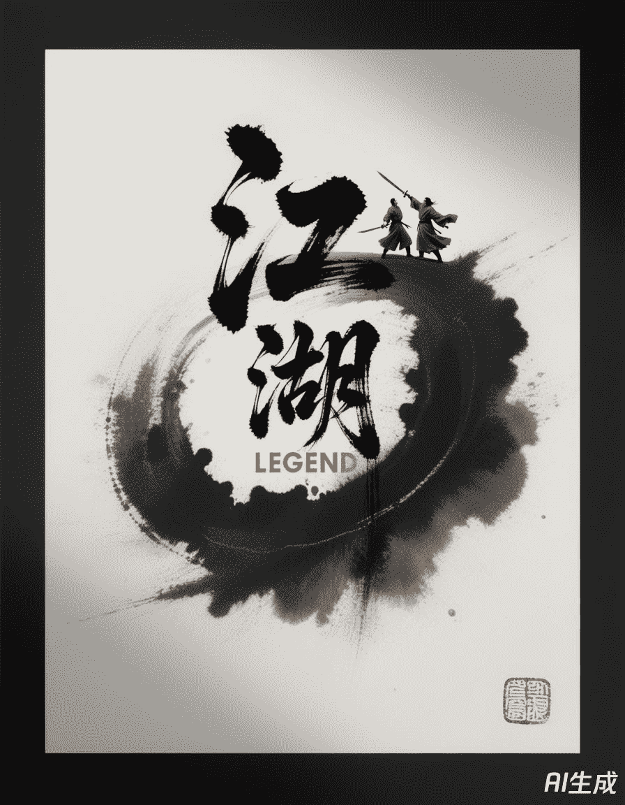

## 节日海报：

> 新中式水墨风国庆主题海报，纵向构图。 上部以浅灰色宣纸纹理为背景，叠加巨型红色“CHINA”水墨晕染英文字母，两侧标注“1949.10.01”与“2025.10.01”日期，日期文字采用小篆或隶书风格。 中部核心呈现苍劲有力的金色毛笔水墨书法“与国同庆”（旁缀红色印章水墨效果），下方衔接故宫风格的红色宫殿檐角水墨剪影，檐角处有祥云或仙鹤水墨纹理点缀。 下部为写意风格的红橙渐变水墨山水画，层峦叠嶂的红色水墨山峦间蜿蜒着浅蓝水墨河流，天空点缀写意飞鸟，左下角有小人剪影以增强意境。 底部标注白色“10.1 NATIONAL DAY国庆节”（小字）—— 文字。 整体色调以红、灰、橙为主，融合水墨书法艺术与写意山水渲染，营造出庄重喜庆且饱含山河盛景的国庆氛围。

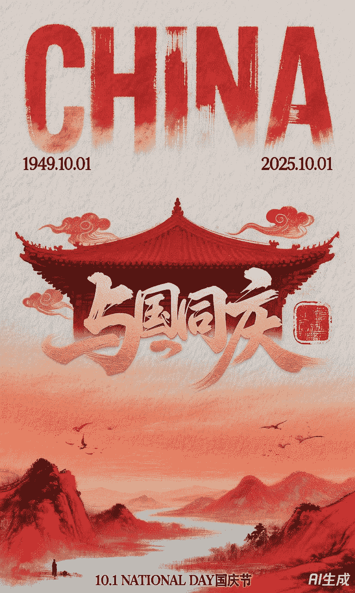

> 中秋夜晚，巨大的月饼造型房屋，上面刻有“中秋”字样，屋内有一家三口在吃团圆饭，房屋在挂着灯笼的大树下，夜空挂着圆月，暖光，氛围温馨喜庆，AI生成，3D风格，细节精致。

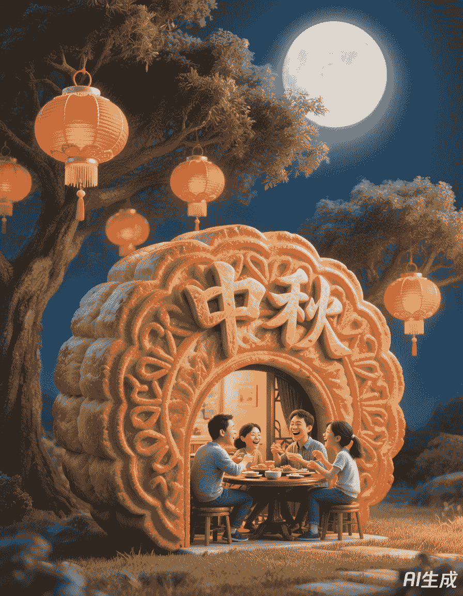

## 创意宣传海报：

> 3D渲染风格宣传海报，整体以蓝色和橙色为主色调，充满都市潮流感。画面中央是一位站在城市天台上的赛博朋克风格男性角色，他留着亮眼的蓝色渐变短发，戴着透明科技感眼镜，身穿宽松的橙色连帽卫衣和深蓝色工装裤，裤腿处有多功能口袋设计，脚上穿着一双未来感十足的白色高帮运动鞋，造型前卫。他正单手插兜，另一只手拿着一块发光的平板电脑，屏幕上显示着复杂的代码和虚拟城市地图，姿态自信。男性角色周围漂浮着或散落着各种科技与艺术结合的物品，包括几块透明的数据显示屏，显示着“HunyuanImage 3.0”的字样，还有蓝色的全息投影设备、橙色的街头涂鸦喷漆罐、数位板、无人机等物品，营造出一种高科技且富有创造力的氛围。海报右上角有大大的黑色文字“数字浪潮 城市探索”，旁边有蓝色和橙色的几何装饰元素。

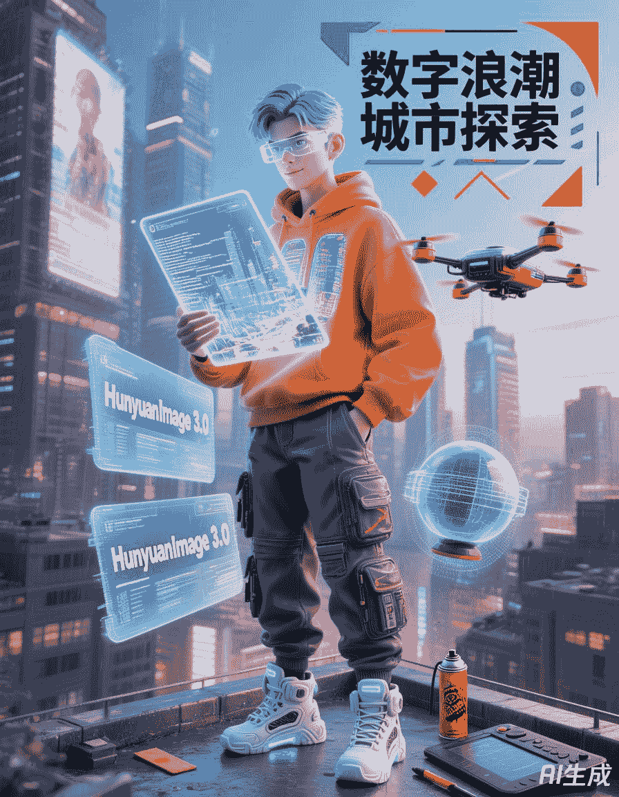

## 品牌创意表现：

> 一张纵向（3∶4）4K 分辨率的极简未来主义展览海报，背景为超浅冷灰 #f4f4f4。海报中心有一枚流体 3D metaball，形态为【立体可口可乐经典汽水瓶】，材质磨砂玻璃并带细腻颗粒噪点。 流体渐变：Coca-Cola 红 #E41C23 → 珍珠白 #FFFFFF，呈现丝滑玻璃质感。高位 softbox 柔光照明，投射长而柔的彩色阴影与淡淡光晕。流体叠在文字之上，被遮挡的字母透过磨砂玻璃呈轻微高斯模糊。· 主标题 “Coca-Cola” 经典红色 logo 位于中部，被唯一的流体部分遮挡；被遮挡的字母透过磨砂玻璃呈轻微高斯模糊。· 副标题，Modern sans-serif 粗体全大写纯黑字体： “TASTE THE FEELING” 位于主标题下方，同样被流体局部覆盖并产生模糊，其余部分锐利。整体留白干净、构图平衡、焦点锐利、HDR 高动态范围。

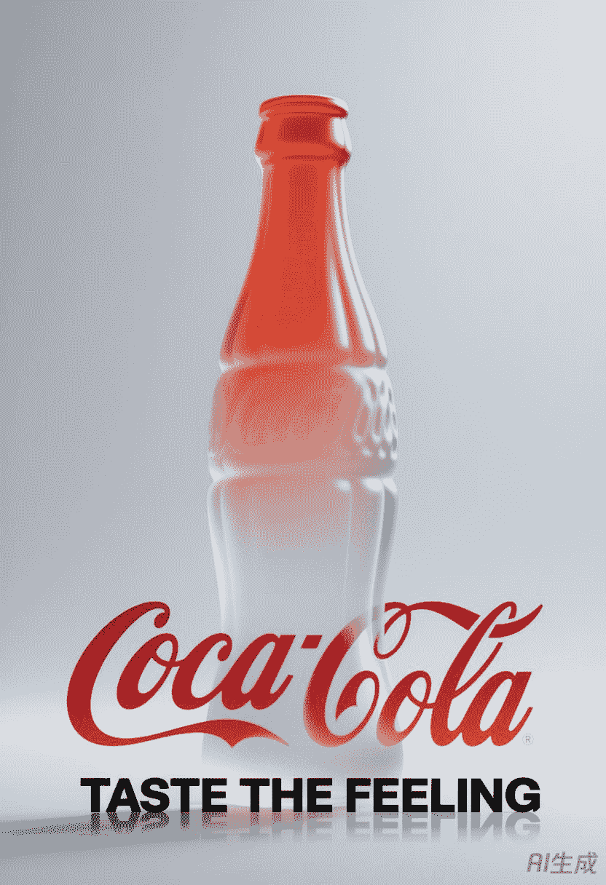

## 小红书文字封面：

> 画一个小红书封面。要求：有足够的吸引力吸引用户点击；字体醒目，选择有个性的字体；文字大小按重要度分级，体现文案的逻辑结构；标题是普通文字的至少2倍；文字段落之间留白。只对要强调的文字用醒目色吸引用户注意；背景使用吸引眼球的图案，有企鹅、QQ相关元素，使用合适的图标或图片增加视觉层次，但要减少干扰。 文案：混元图像模型3.0，最好的开源图像模型

## 产品创意：

> 速效快乐胶囊一颗上为星巴克绿下为透明的小药丸，上面印有星巴克logo，里面有很多咖啡豆说明（小字）：请在悲伤难过时服用，一日三次，一次两粒购买按钮 和 药丸颜色一致，下面价格：$9，请遵循医嘱酌情购买。

>

> 可以向其他品牌延伸。

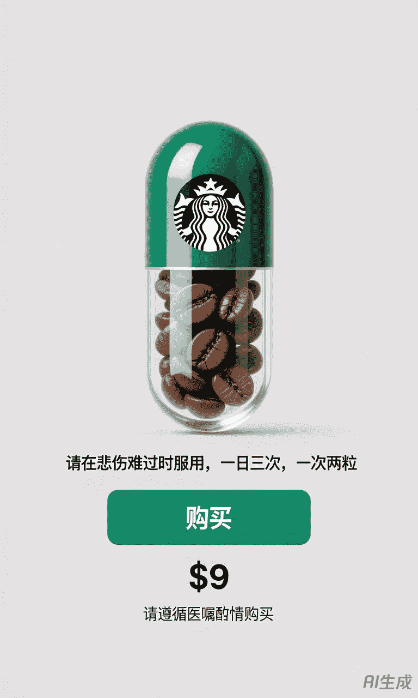

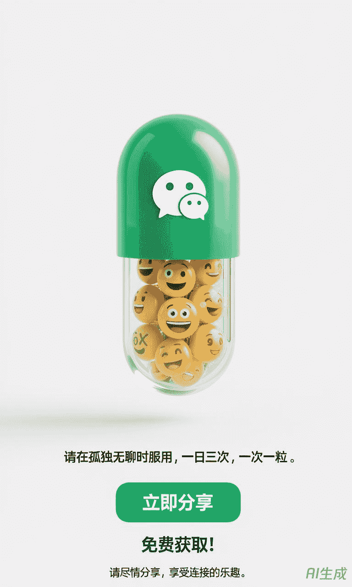

## 设计素材生产：

> 一组星辰标题栏、标题框。简约创意，立体感，多细节，渐变蓝色和纯色标题框背景，各种星星、云朵、月亮、宇宙、飞船、火箭、天文望远镜等夜晚元素点缀边框，一组6个排列，纯色背景，高清渲染，36K，科技感

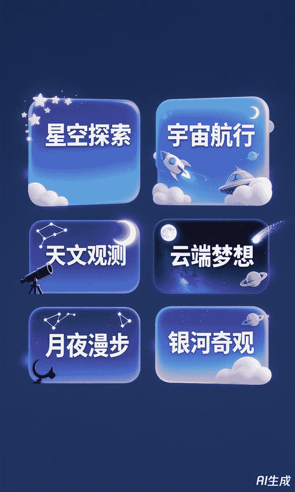

## 产品摄影：

> 高级摄影，大牌既视感，主体为1瓶洗发水，瓶身印有品牌英文"HUNYUAN"和slogan"HunyuanImage 3.0"，瓶身透明质感，搭配深色按压泵头，液体呈流动滴落状，从顶部流到产品；浅色调渐变背景，采用悬浮式构图，营造立体空间感；色彩色调以暖棕为主莫兰迪色系风格；画面风格偏向高端产品摄影，注重光影的细腻表现，突出产品的质感与精致感；背景要素为单一纯色，无多余装饰，让产品成为视觉焦点，整体传递出轻奢、专业的洗护产品广告质感。

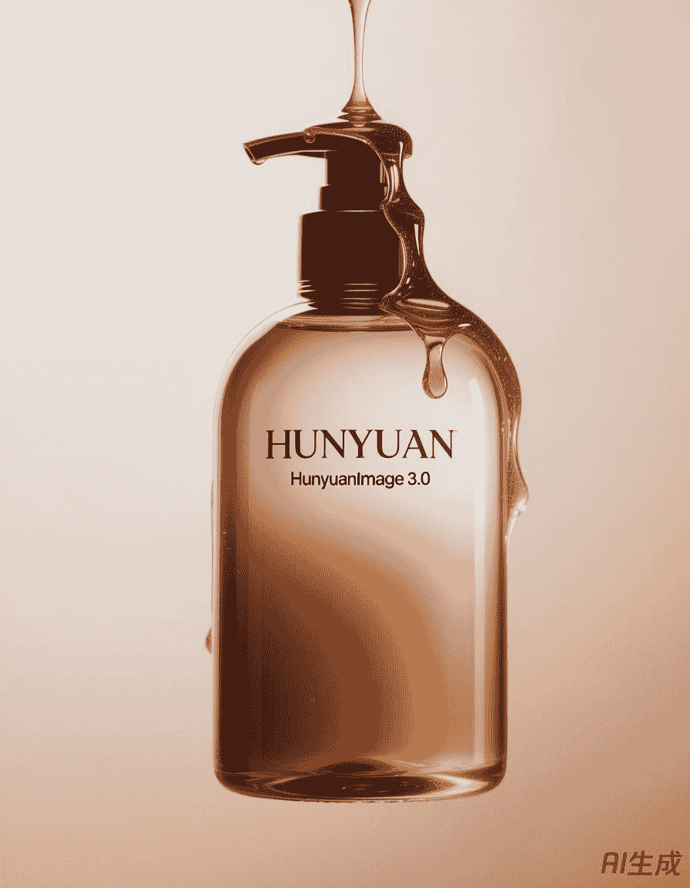

## 产品设计：

> 以蓝图的风格制作Q版的腾讯QQ企鹅吉祥物玩偶，毛茸茸，设计草图。并包括尺寸和解释性文本注释。应使用线条和测量值来指示各个部位的尺寸，给草图以技术和详细的感觉。除了主要设计外，还包括显示不同角度的零散缩略图，立体景深，高清细节，黑色背景；

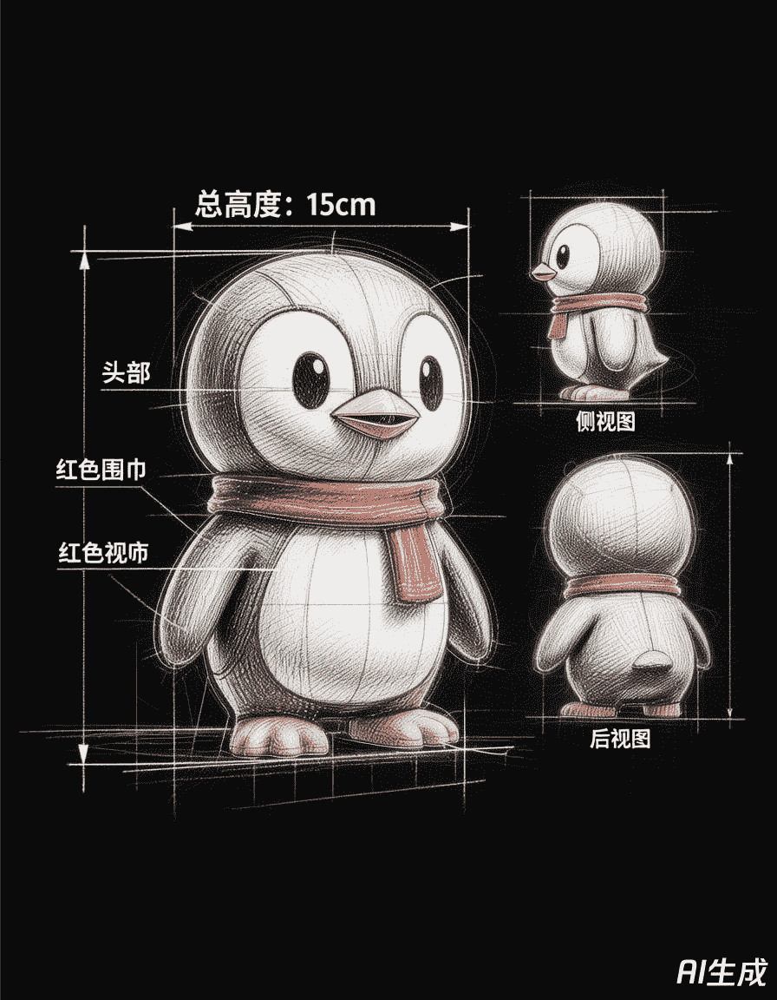

## 壁纸：

> 8K高清壁纸，正视图，全画幅克莱因蓝色橡胶质感柔性墙纸中心，一只米唐老鸭被挤压陷入到墙纸里，四肢展开，表情兴奋，洋溢着快乐的笑容，强烈的挤压感，四周气鼓鼓的状态，体积光，极具立体感，极致细节。极致质感，极致光感，UHD，3D渲染，octane render，8K HDR。

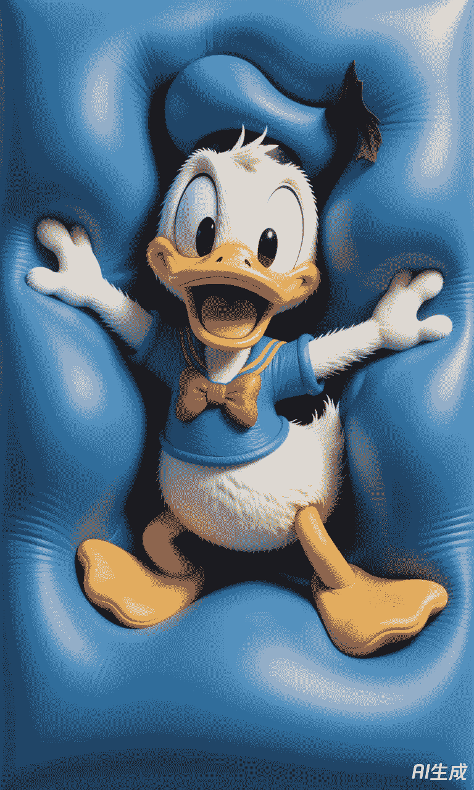

## 3D表现：

> 瑞幸咖啡，Q版门店，深海蓝色渐变色调，白色和咖啡色点缀，透明反光玻璃质感，透明感，UI设计风格，光线追踪，干净背景，参考Pinterest、Dribbble 风格，使用OC渲染器，细节丰富，16K高清，浅色背景，大面积留白。

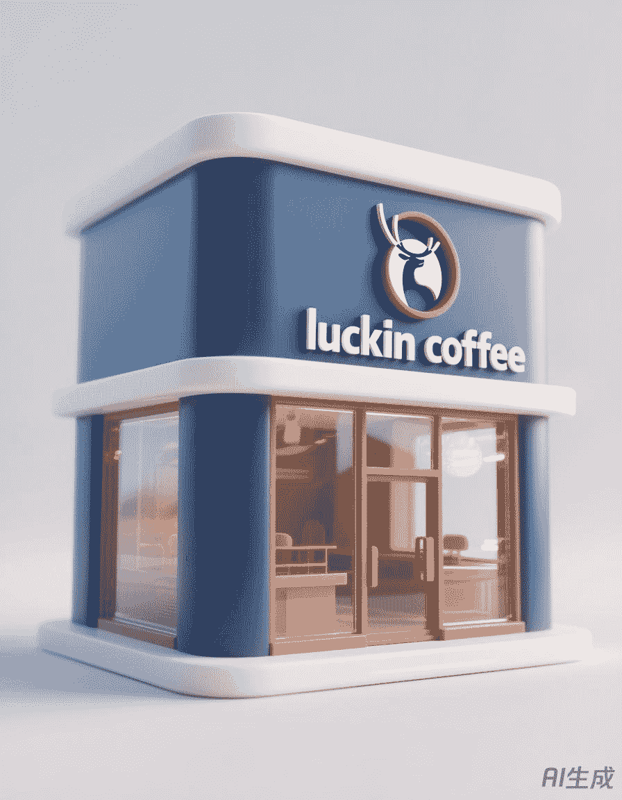

## 图标icon设计：

> 一组3D立体风格的功能图标；深蓝透明质感设计；呈现数据分析，AI智能，数据统计，信息通知，安全，设置，工具，客服，数据库，客服，文档，编辑等多种图标；整齐排列；正视图效果；高级感；微软风格；磨砂质感。黑色背景；图标正视。

## 品牌周边设计：

> 创意猎人品牌文创周边包装设计，潮流文创风格。以橙色和白色为主色调，搭配可爱卡通猎人图案。涵盖手机壳、手提袋、抱枕、眼罩、贴纸、杯子、日历、滑板、雨伞等多样物品，突出‘CREATIVE’‘HUNTER’等简洁时尚字体文字。营造轻松愉悦、充满潮流感的氛围，契合创意猎人品牌文创定位 。

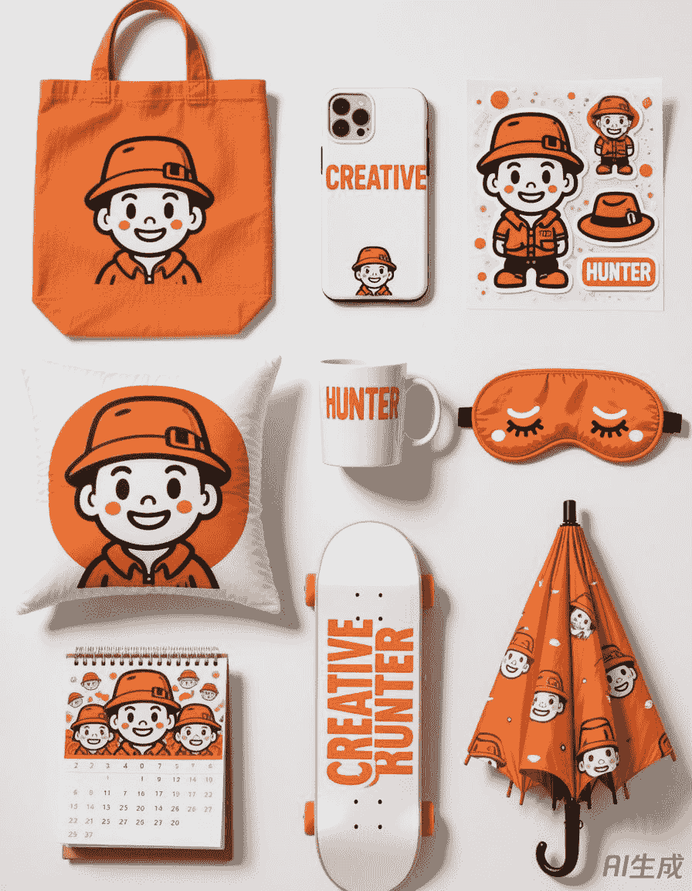

## IP形象设计：

> 一个3D风格的女孩虚拟潮流角色肖像，角色拥有短白发、雀斑、眉钉、冷酷表情，佩戴未来感银色大眼镜，戴一顶荧光绿毛呢材质的帽子，帽子上别有多个徽章，包括一个笑脸小花徽章、一个黑白涂鸦徽章、一个Nike安全别针等嘻哈元素，背景为玫红色渐变色，画风干净简洁，角色光影细腻，呈现次世代渲染质感，视觉风格融合Y3K与潮玩设计风，偏态度感、虚拟偶像风格，居中构图

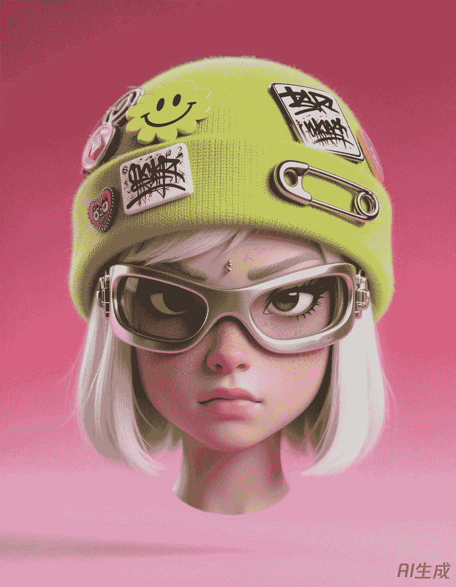

## 表情包：

> "英短白猫，九宫格构图，每格展示宠物呈现不同拟人化表情：打哈欠带‘zzz’符号、惊讶带‘!!!’符号、生气带红色叉号、 wink 、开心露齿、侧头、脸颊微微泛红、疑惑带‘???’符号、委屈带蓝色泪滴；明亮均匀的光线，白色简洁背景，暖色调；超写实主义风格，32K UHD超精度细节，细腻的毛发质感，数字摄影，微距特写，清晰展现神态与毛发纹理，画面生动可爱。"

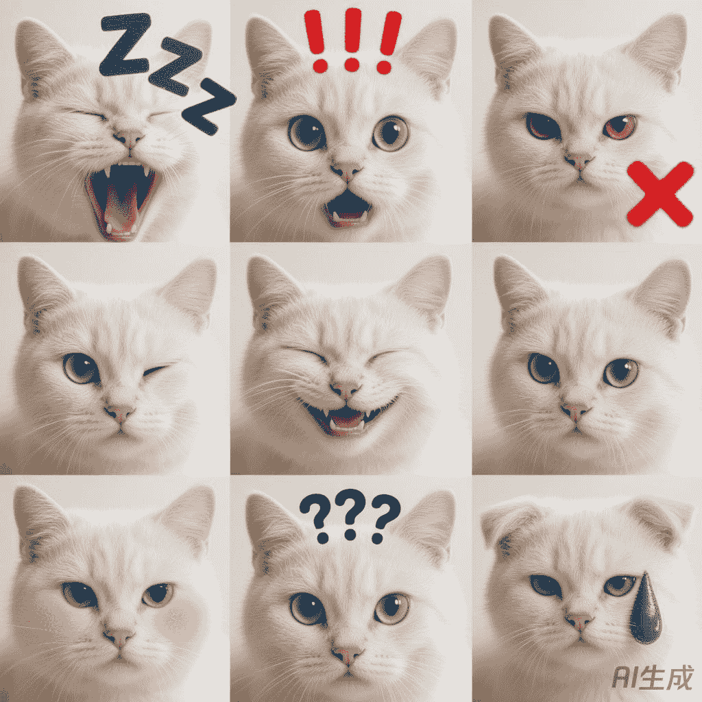

从上面的案例可以看到：

+   **对于市场和新媒体工作**，比如制作**节日海报**、**小红书封面**，或者设计**品牌周边**，非常高效。你提供想法和文案，它能快速生成多种视觉方案供你选择。

+   **对于专业设计师来说****，它可以**承担很**多基础性的工**作，比如生成**设计素材**、绘制图标ic**on、表情包**构思IP形象草图，甚至完成矢量风格插画。它对风格化的指令理解得很好，生成的素材完成度不低，可以作为很好的设计起点。

**甚至在一**些有技术**门槛的领**域，比如模拟产品**摄影的质**感、3D渲染效果图、高质量的人像摄影风格图等等，它也能生成得像模像样。

无论你是专业设计师，还是偶尔有作图需求的朋友，都能找到适合自己的用法。

## 还有一些有趣的玩法效果：

> 复古CRT电脑启动屏幕，最终显示为[腾讯QQ的企鹅LOGO形状]的ASCII艺术。

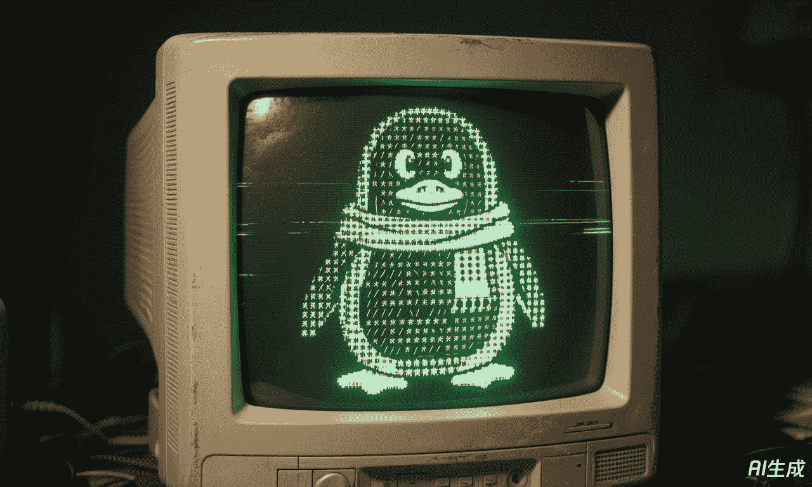

> 爱因斯坦刚刚完成相对论后发布的一条超写实风格的微信朋友圈。包含一张自拍照，照片中清晰可见背景中的粉笔板和潦草的公式。朋友圈下方显示尼古拉·特斯拉点赞了该内容。

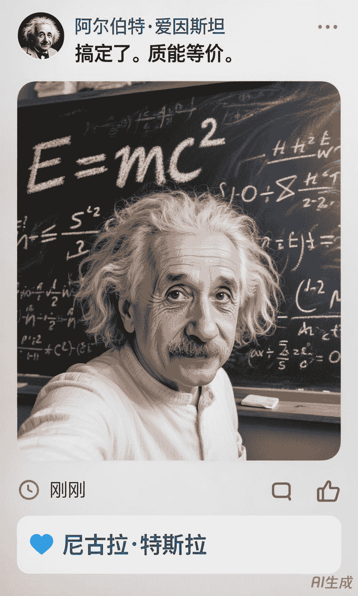

> 第一人称视角，前方道路上有用多彩秋叶（黄、红、绿、棕等颜色的叶子）拼成的小王子形象。小王子有着黄叶头发、红叶围巾、绿叶衣服，周围还散落着几片秋叶。场景明亮，捕捉到了富有创意的秋日艺术瞬间。要求生动立体复杂

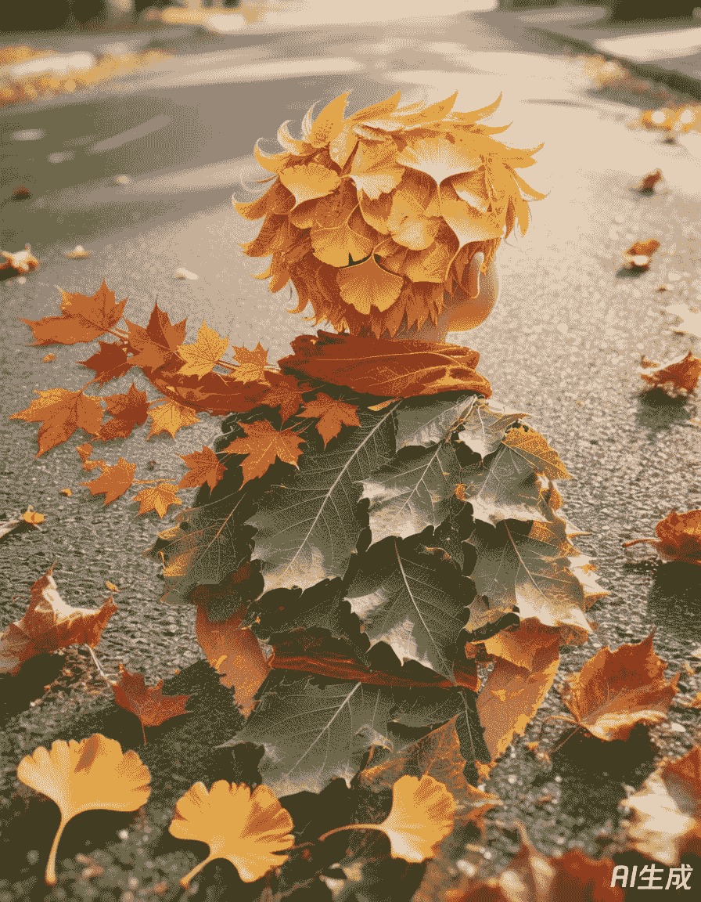

# 5、最后，简单聊聊背后的技术

体验下来整体感觉真的不错，我也简单了解了一下它背后的技术逻辑。

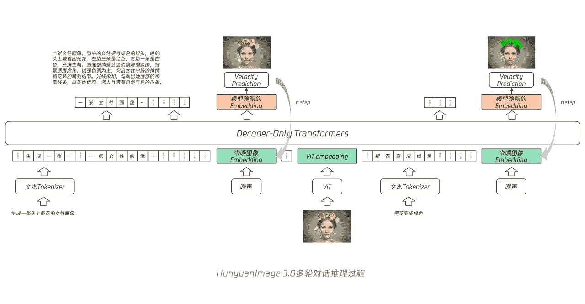

主要是两点：

一是它采用了“原生多模态”架构，简单理解就是把语言大模型（LLM）的“大脑”和图像生成的“手”深度结合了，所以它的理解能力更强。

二是它的参数规模很大（80B），并且训练数据很充分，这保证了它知识的广度和生成图像的质量。

此外，关键的是，腾讯这次选择了将模型开源。

简直就是AI界的活菩萨！

我觉得这是一个很有意义的举动，这意味着更多的开发者可以参与进来，围绕它构建更丰富的应用，对整个生态发展是件好事。

# 6、值不值得尝试？

聊了这么多，最后简单给个总结。

我的答案是：当然值得一试！必须，马上！

如果你是视觉领域的创作者，它的语义理解能力和全面的应用场景，或许能给你的工作流带来一些新的提效思路。

如果你只是一个对AI技术感兴趣的普通用户，那么它“会思考”的特性，也能让你体验到AI生成领域正在发生的一些新变化。

腾讯混元3.0给我的感觉是，它在努力让AI从一个执行指令的工具，向一个理解意图的伙伴转变。

这条路肯定还很长，竞争也很激烈，但它确实让我们看到了一个很有意思的方向。

# 7、使用体验入口：

官方提供了很全的免费体验入口，大家可以亲自上手感受一下，这比任何测评都来得更直接。

+   手机端可以搜“腾讯混元”小程序。

+   PC端：https://hunyuan.tencent.com/image

+   Github：https://github.com/Tencent-Hunyuan/HunyuanImage-3.0

+   HuggingFace：https://huggingface.co/tencent/HunyuanImage-3.0

<https://aigcreative.feishu.cn/sync/K4Gvd9vUQsy9Oubwqaeclu0Fnbg>