# AI生图最强黑马来了！击败Midjorrney、Flux，SD，全球评分第一！

> 来源：[https://aigcreative.feishu.cn/docx/EXa6dDzrYo2DL7xXcoQcP4VGnuh](https://aigcreative.feishu.cn/docx/EXa6dDzrYo2DL7xXcoQcP4VGnuh)

> 原文链接： [https://mp.weixin.](https://mp.weixin.qq.com/s/4x9ZPM2vTrIS8ldHMDUrXw)qq.com/s/4x9ZPM2v...

> 👸号：AI生活研究所

真的太卷了， AI生图圈又杀出一匹黑马！

最近，大模型竞技场上，一个叫做Recraft V3的模型，一出场就技压群雄，生图质量将Midjorrney、ideogram、FLUX等一众明星模型，按在地上摩擦，成为当下时刻全球评分NO.1。

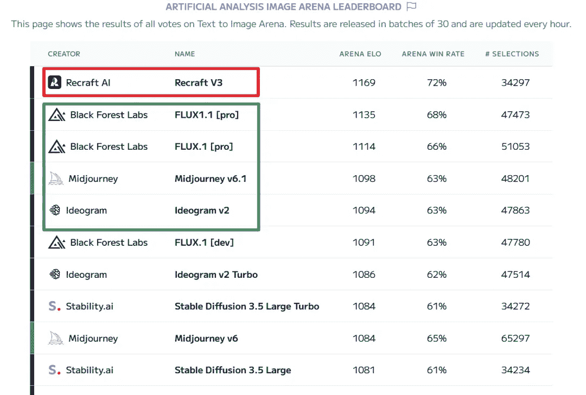

这个评分真的能代表实力吗？还真能，它采用用户盲测，用不同模型跑同一个提示词，然后， 在用户不知情的情况下，给出 优劣 评价，相对靠谱 。

这榜单，清一色的海外模型......，国产加油啊！

经实测，生图质量确实优秀，但是，更令我惊叹的是它的功能设计

Recraft的使用是基于一个超高自由度画布。生图只是它的基础功能，还融合了多个AI创意工具，套索、局部重绘、抠图、去背景，还有文本框、排版，图层、素材库。

这简直就是AI版的PS，Midjourney的局部重绘修改，在Recraft面前就是个半成品、弟弟。

还有一点，来自英国的 Recraft，竟然支持中文 提示词 ！好评

**详细功能体验实测**

地址：

https://www.recraft.ai/invite/kWbjlwTy7R

每天登录可送50积分，能生成25张图，用这个链接注册，能一次性多送200积分。

功能亮点较多，一个一个来，看完后，你会颠覆对传统AI生图的认知。

**01**

**基础生图能力**

点击Image后，进入生图界面。选好模型参数，点击生成后，右侧窗口即可生成图片。

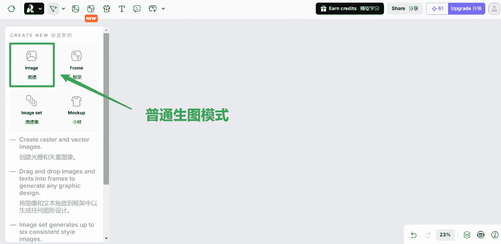

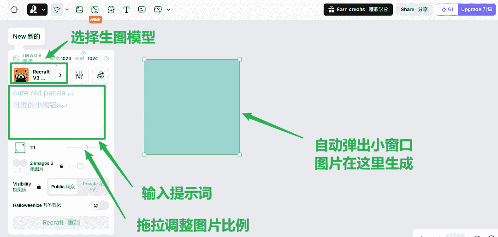

实测， Recraft基础生图能力确实强，提示词理解很强。

提示词：

A huge wild boar man, fierce and evil, with fangs, huge, very, very big, wearing armor,Standing among the flowers in the Kunlun Mountains, clouds and mist, the morning light shining down，with Buddhist elements

巨大的野猪人，凶猛邪恶，獠牙巨大，很大很大，身披铠甲，站在昆仑山花丛中，云雾缭绕，晨光洒落，带有佛教元素

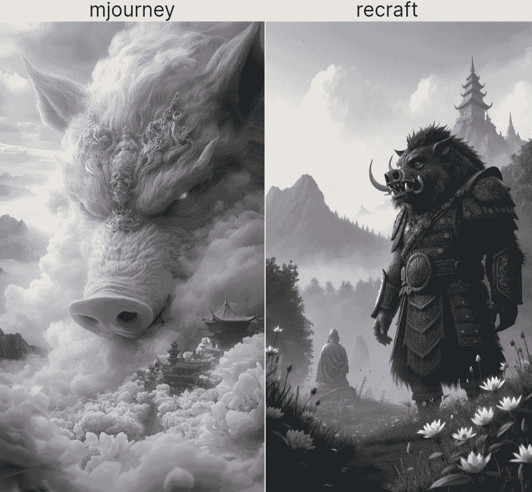

MJ细节更丰富， Recraft对提示词的把握更加准确。

提示词：

A wide angle front above photo from a matte light green bmw with copper accents, the car is retrofuturistic and has a wide body kit. It's a bmw m4 g82 with orange headlights and a large front bonnet. The fenders have orange stripes on them, and it also features full LED lights along its sides. It's a bmw classic racecar.

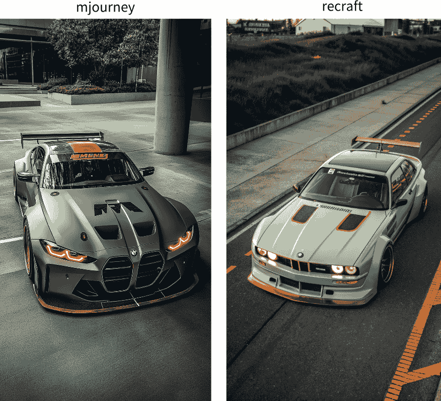

两个都不错， MJ有点偏灰绿色， 颜色感官上 Recraft会更讨喜，差距不算特别大。

Recraft提示词可直接用中文，而且图片中能插入英文句子。

提示词：一艘未来主义宇宙战舰特写，复杂科幻的机械装置，高度细节，超高分辨率，飞船侧面船体上印着一句话“The most powerful battleship in the universe, made in China”，周围飞过很多导弹

中英结合的提示词，能将一整句英文 印在船体上，设计过度很自然，文本插入能力比Ideogram更强。

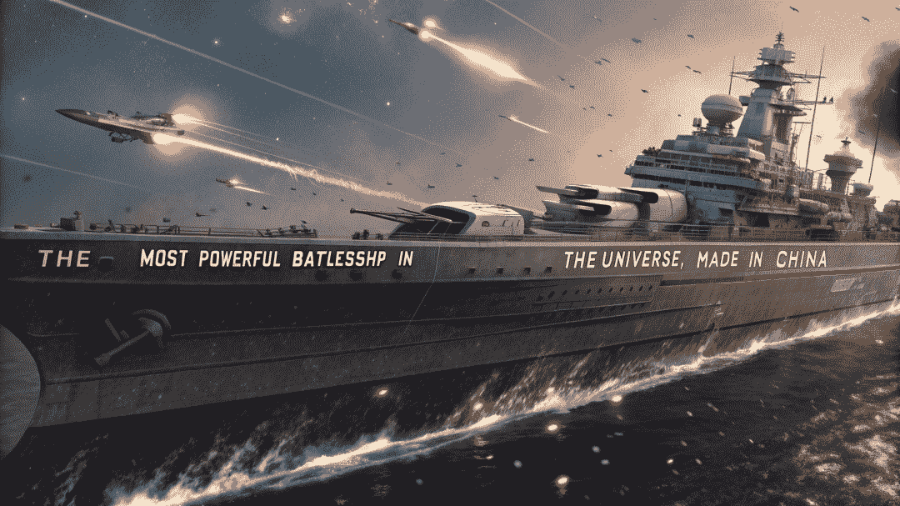

**02**

**AI图像编辑能力**

用类似PS的套索功能，选中图片修改区域，通过提示词可修改图片。

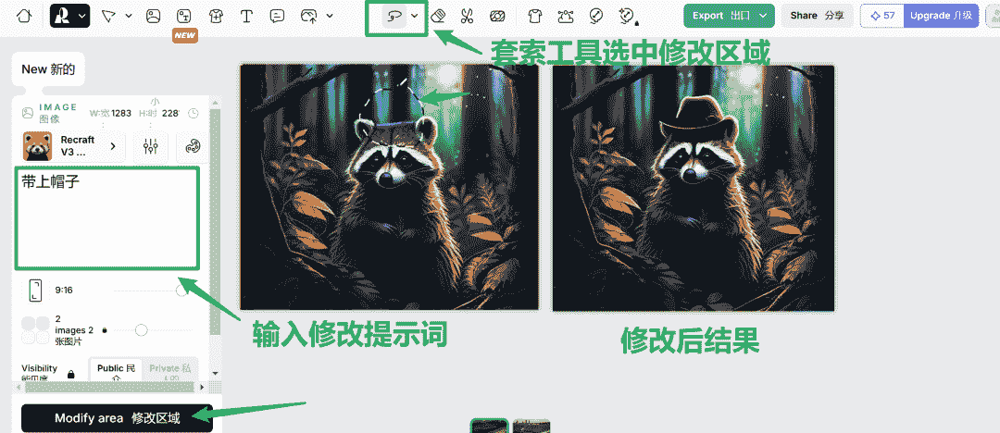

一键去除背景（抠图）；配合提示词，一键修改背景。

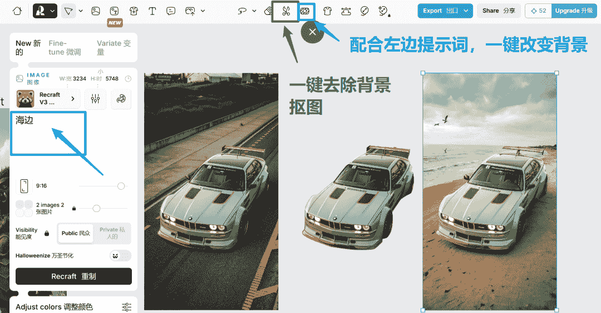

**03**

**AI特色生成融合**

点击Frame，在画布中添加一个框架，放入任意图片素材，位置大小可以鼠标拖拽随意安放，即可AI合成为一张新图片。

我用2张随机图，放进去，一键融合成新图。

而且，跟之前见过的图片融合完全不一样，这个是图片的空间融合，好牛！

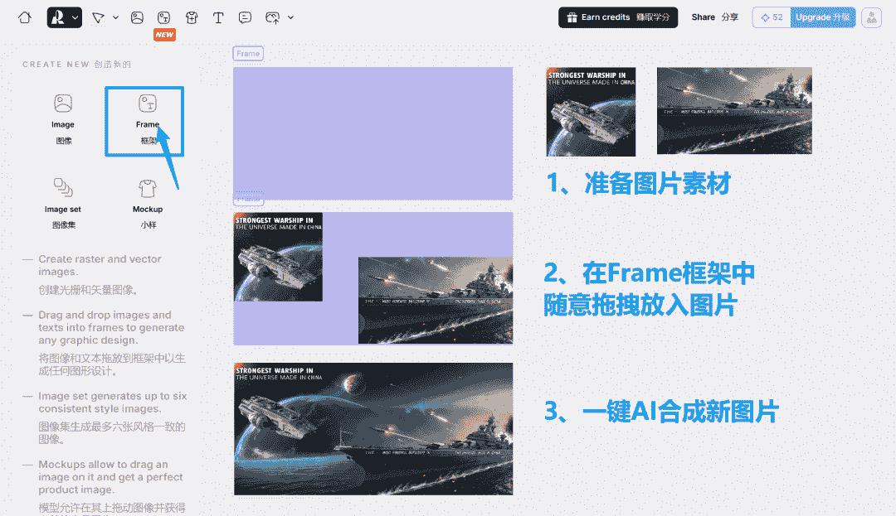

后面还有惊喜

就是这个Mockup，具体看案例

点击它，然后用提示词，先生成 一个白色马克杯

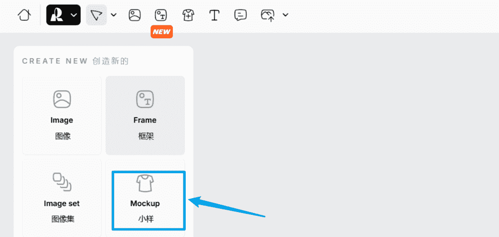

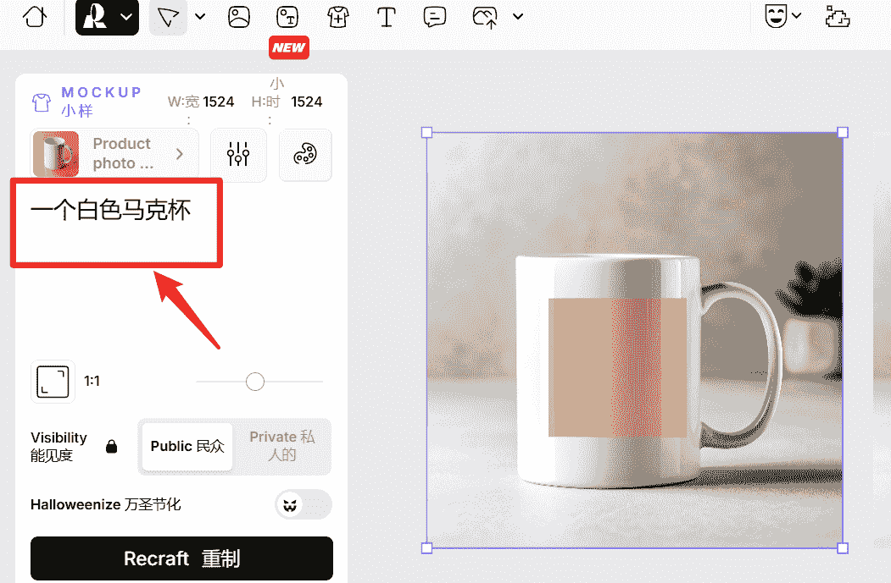

然后点击中间橙色框，可用提示词，在马克杯中间生成装饰图。

注意看，它是3D融合而成，是有变形纵深的，而不是简单的平面图融合。

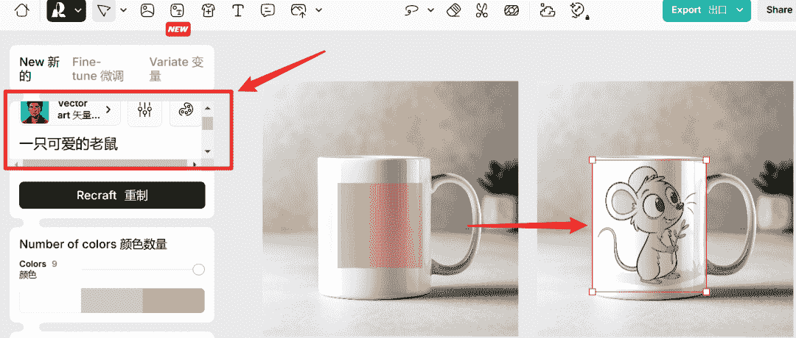

不仅如此，也可以用本地或素材库中图片，来融合，直接看下方效果图。

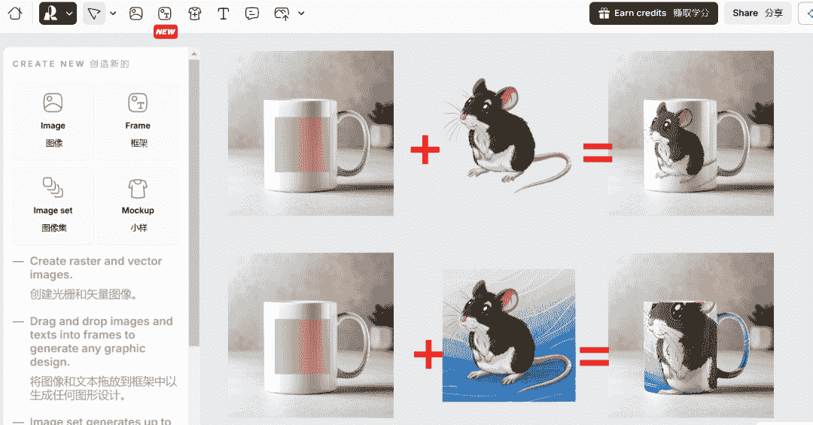

测到这里，这真的就是AI ps的感觉。

还没完，下一个

点击Image set

这是一个图片集，能一次输入6个提示词，然后一次性生成6张风格统一的图。

生成12生效图，风格整齐划一。

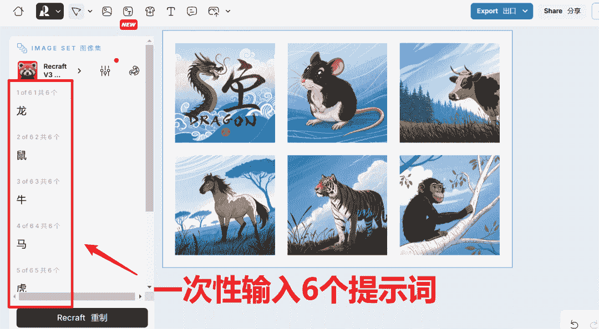

更换矢量图模型，再跑一次，生成全新风格图片。

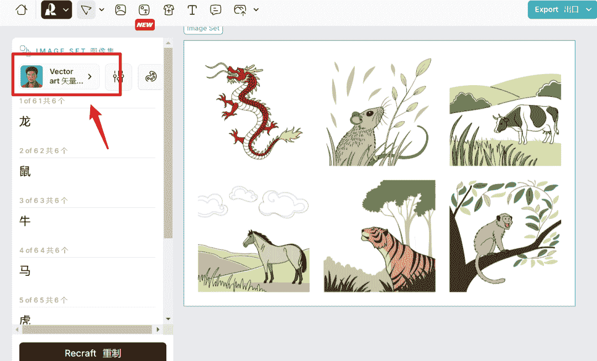

不同的模型，提示词的组合，这就能生成套图了，做UI设计都行。

Recraft的产品设计跟传统生图完全不一样，它所有功能都在画布上完成，右侧能搜索Recraft设区用户的图、收藏夹、生成记录，鼠标可以直接拖进画布，点击查看原图提示词。

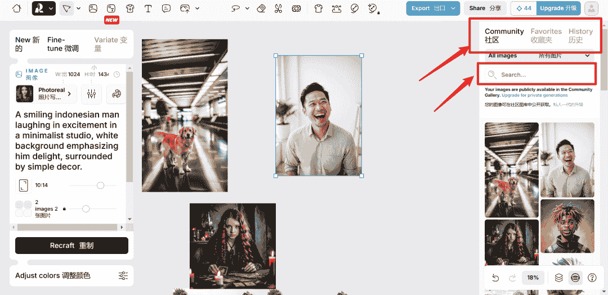

看到这里，大家应该明白了，Recraft的野心，远远不只是生图，它是想做一个AI PS，既能生成，也能编辑，还能排版，对比其他AI生图工具，综合实力可以说相当彪悍。

<https://aigcreative.feishu.cn/sync/K4Gvd9vUQsy9Oubwqaeclu0Fnbg>