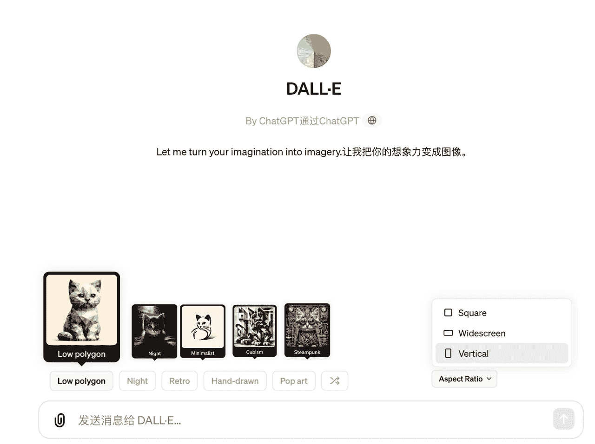
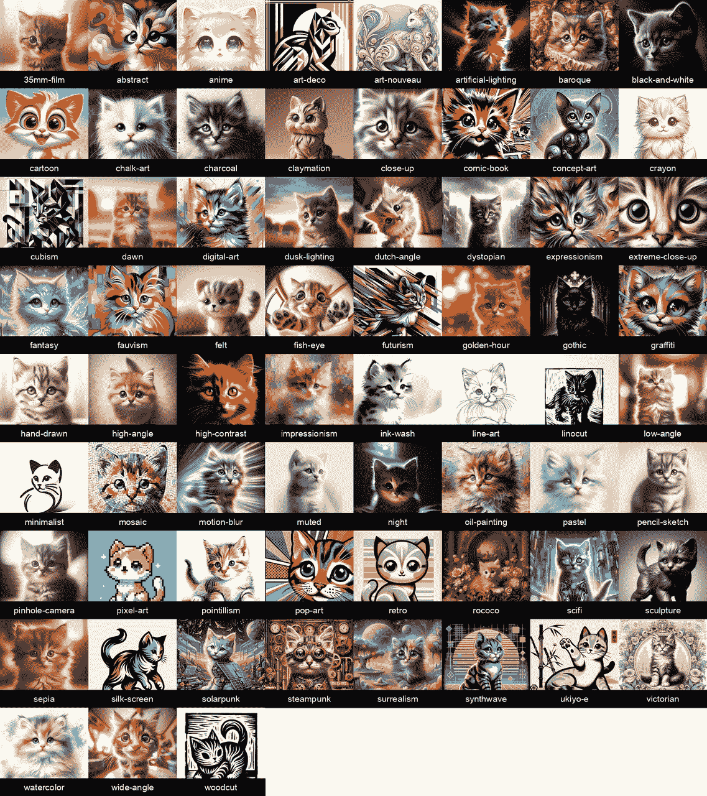

# DALL·E新功能的所有可选风格

> 来源：[https://aigcreative.feishu.cn/docx/FVu9doA2Sobp3AxRsyTcAfVsnpf](https://aigcreative.feishu.cn/docx/FVu9doA2Sobp3AxRsyTcAfVsnpf)

DALL·E 更新 正在灰度测试，可以选择图像风格指定图像纵横比，选择生成横屏还是垂直方向。

DALL·E 3 新增了67种图像风格：

35mm-film,

abstract,

anime,

art-deco,

art-nouveau,

artificial-lighting,

baroque,

black-and-white,

cartoon,

chalk-art,

charcoal,

claymation,

close-up,

comic-book,

concept-art,

crayon,

cubism,

dawn,

digital-art,

dusk-lighting,

dutch-angle,

dystopian,

expressionism,

extreme-close-up,

fantasy,

fauvism,

felt,

fish-eye,

futurism,

golden-hour,

gothic,

graffiti,

hand-drawn,

high-angle,

high-contrast,

impressionism,

ink-wash,

line-art,

linocut,

low-angle,

minimalist,

mosaic,

motion-blur,

muted,

night,

oil-painting,

pastel,

pencil-sketch,

pinhole-camera,

pixel-art,

pointillism,

pop-art,

retro, rococo,

scifi,

sculpture,

sepia,

silk-screen,

solarpunk,

steampunk,

surrealism,

synthwave,

ukiyo-e,

victorian,

watercolor,

wide-angle,

woodcut

<https://aigcreative.feishu.cn/sync/K4Gvd9vUQsy9Oubwqaeclu0Fnbg>