# 🎬 即梦 Seedance 2.0 使用手册（全新多模态创作体验）

> 来源：[https://aigcreative.feishu.cn/docx/UoKxd4WNworCP5x4OG3cXGZynUd](https://aigcreative.feishu.cn/docx/UoKxd4WNworCP5x4OG3cXGZynUd)

> 请在即梦官方网站体验，保证最佳效果哦！

> 官方网站：https://jimeng.jianying.com/

> Seedance2.0模型已全量上线。

> 最近使用人数过多，服务器压力较大，可以尝试Seedance 2.0 Fast模型获取更流畅的体验（现在知道的人还比较少哦～）

## 🌀 视频 Seedance 2.0 正式上线即梦！

还记得从只能用文字和首/尾帧「讲故事」的那天起，我们就想做出一个真正听得懂你表达的视频模型。今天，它真的来了！

> 即梦 Seedance 2.0 现在支持图像、视频、音频、文本四种模态输入，表达方式更丰富，生成也更可控

你可以用一张图定下画面风格，用一个视频指定角色的动作和镜头的变化，再用几秒音频带起节奏氛围……搭配提示词，让创作过程变得更自然、更高效，也更像真正的“导演”。

这次升级中，“参考能力”是最大亮点：

+ 📷 参考图像可精准还原画面构图、角色细节

+ 🎥 参考视频支持镜头语言、复杂的动作节奏、创意特效的复刻

+ ⏱ 视频支持平滑延长与衔接，可按用户提示生成连续镜头，不止生成，还能“接着拍”

+ ✂️ 编辑能力同步增强，支持对已有视频进行角色更替、删减、增加

我们知道，视频创作从来不仅是“生成”，更是对表达的控制。2.0 不只是多模态，更是一种真正可控的创作方式

> Seedance 2.0，多模态创作，从这里启程。请你们大胆想象，其余的交给它

### 参数预览

| 核心维度 | Seedance 2.0 |

| --- | --- |

| 图片输入 | + ≤ 9 张 |

| 视频输入 | + ≤ 3 个，总时长［2,15］s |

| 音频输入 | + ≤ 3 个，总时长不超过15s |

| 文本输入 | 自然语言 |

| 生成时长 | ≤ 15s，可自由选择4-15s |

| 声音输出 | 自带音效/配乐 |

| 交互限制：目前支持的混合输入总上限是 12 个文件。建议优先上传对画面或节奏影响最大的素材，合理分配不同模态的文件数量 | |

### 交互形式

#### ⚠️注意：

即梦Seedance 2.0 支持「首尾帧」和「全能参考」入口，智能多帧和主体参考无法选中。若你只上传首帧图 + `prompt`，可走首尾帧入口；如需多模态（图、视频、音频、文本）组合输入，则需进入全能参考入口

当前支持的交互方式是通过 `@素材名` 来指定每个图片、视频、音频的用途，例如：`@图片1` 作为首帧，`@视频1` 参考镜头语言，`@音频1` 用于配乐

#### ⚠️温馨提示：关于上传写实人脸素材的说明

由于平台合规要求，目前暂不支持上传包含写实真人脸部的素材（图片和视频素材均不行）。为保障用户权益与生成安全，系统会自动拦截此类素材，上传后将无法生成视频内容。

这意味着如果你上传了真人照片（尤其是清晰可辨识的人脸），模型将无法处理对应生成。

我们理解这可能会带来一些限制，但这一措施是为了确保内容安全和平台规范运行。感谢大家的理解与配合！后续如果有 `update` 我们会及时在文档里更新，再次感谢理解～

---

下面是一些不同场景下的用法和玩法，帮助你更好地理解 Seedance 2.0 在生成质量上、控制能力和创意表现上的升级。如果你还不知道从哪开始，不如先看看这些例子，激发灵感～

---

## 即梦Seedance 2.0 能力 / 提升预览

### 基础能力显著增强：更稳、更顺、更像真的！

不只是多模态，Seedance 2.0 在基础层面显著增强，物理规律更合理、动作表现更自然流畅、指令理解更精准、风格保持更稳定，不仅能稳定完成复杂动作、连续运动等高难度生成任务，也让整体视频效果更真实、更顺滑，是一次底层能力的全面进化！

Case：

| `prompt` | `img` | `vid1` |

| --- | --- | --- |

| 女孩在优雅的晒衣服，晒完接着在桶里拿出另一件，用力抖一抖衣服。 |  | |

| 画里面的人物心虚的表情，眼睛左右看了看探出画框，快速的将手伸出画框拿起可乐喝了一口，然后露出一脸满足的表情，这时传来脚步声，画中的人物赶紧将可乐放回原位，此时一位西部牛仔拿起杯子里的可乐走了，最后镜头前推画面慢慢变得纯黑背景只有顶光照耀的罐装可乐，画面最下方出现艺术感字幕和旁白：“宜口可乐，不可不尝！” | 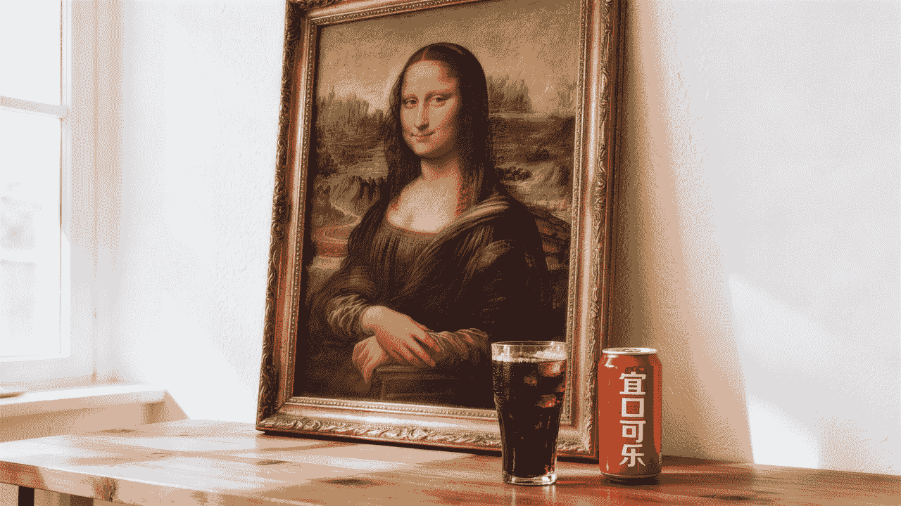 | |

| 镜头小幅度拉远（露出街头全景）并跟随女主移动，风吹拂着女主的裙摆，女主走在19世纪的伦敦大街上；女主走着走着右边街道驶来一辆蒸汽机车，快速驶过女主身旁，风将女主的裙摆吹起，女主一脸震惊的赶忙用双手向下捂住裙摆；背景音效为走路声，人群声，汽车声等等 | 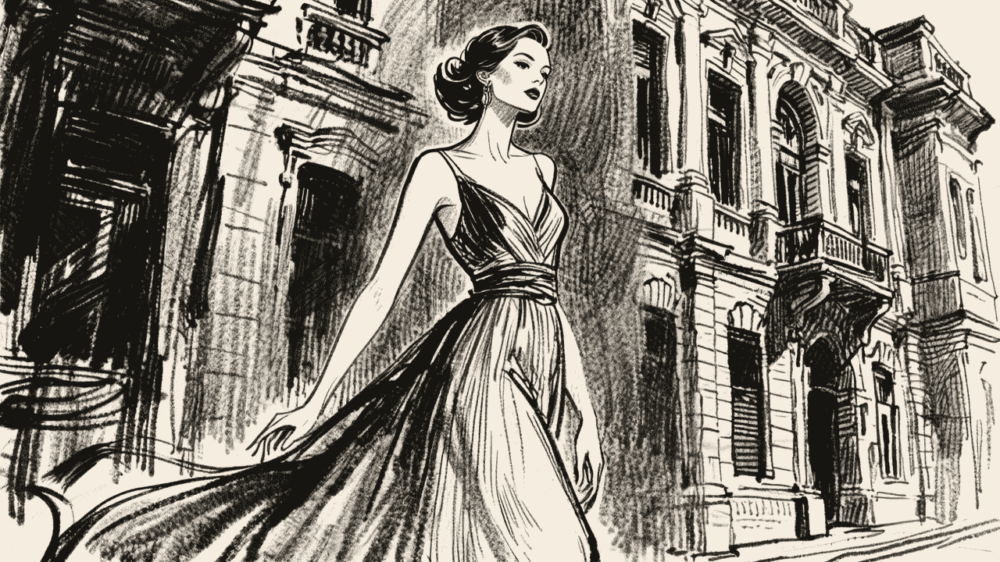 | |

| 镜头跟随黑衣男子快速逃亡，后面一群人在追，镜头转为侧面跟拍，人物惊慌撞倒路边的水果摊爬起来继续逃，人群慌乱的声音。 |  | |

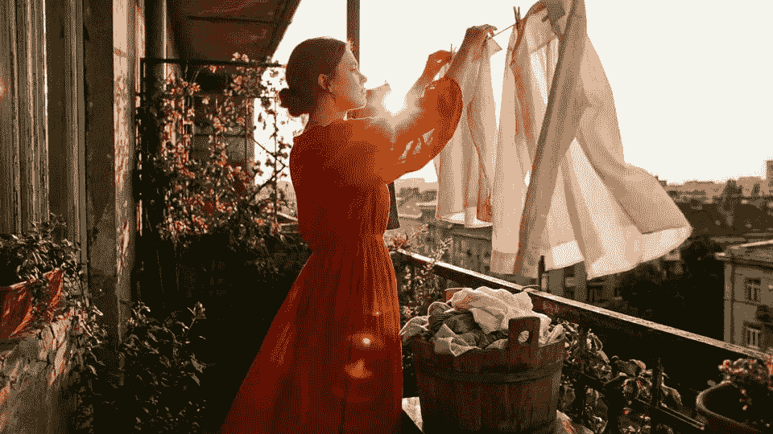

[jimeng-2026-02-06-4829-固定镜头，女孩在优雅的晒衣服，晒完接着在桶里拿出另一件，用力抖一抖衣服.mp4](https://internal-api-drive-stream.feishu.cn/space/api/box/stream/download/all/U6DfbRrIsoFLjdxKcRecTJo3nrI)

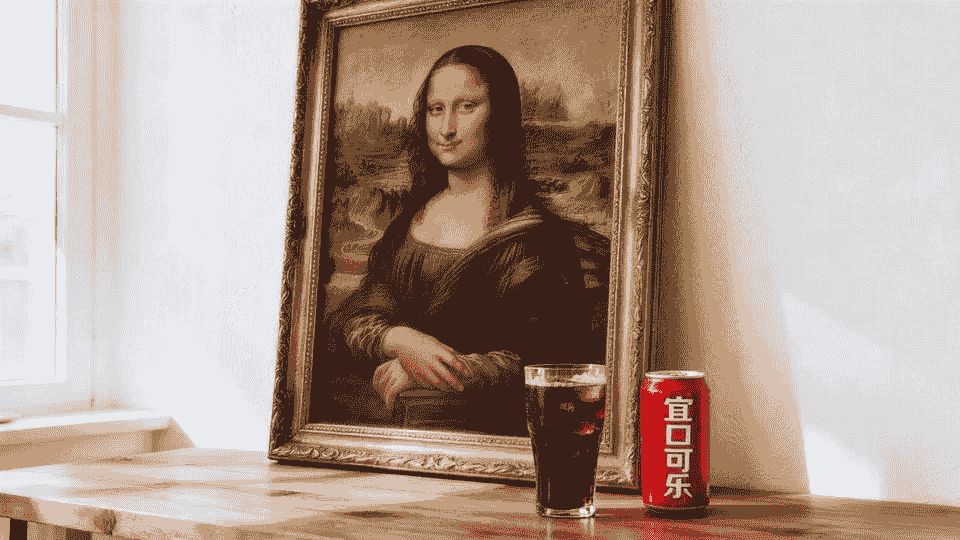

[jimeng-2026-02-05-3220-画里面的人物心虚的表情，眼睛左右看了看探出画框，快速的将手伸出画框拿起可乐喝了一....mp4](https://internal-api-drive-stream.feishu.cn/space/api/box/stream/download/all/IbZfbY2E7owB2KxHlbicg5nQnZc)

[jimeng-2026-02-05-9575-镜头小幅度拉远（露出街头全景）并跟随女主移动，风吹拂着女主的裙摆，女主走在19世....mp4](https://internal-api-drive-stream.feishu.cn/space/api/box/stream/download/all/Lmr8bNXNXoG0oBxCJvlc2mCNnUb)

[jimeng-2026-02-06-5100-镜头跟随黑衣男子快速逃亡，后面跟着一群人在追逐，镜头侧面跟拍，人物惊慌撞倒路边的....mp4](https://internal-api-drive-stream.feishu.cn/space/api/box/stream/download/all/GKr9bEPAKoqmI4xYNLAc26hbnPb)

### 多模态全面升级：视频创作进入“自由组合”时代！

#### Seedance 2.0 多模态介绍

+ 支持上传文本、图片、视频、音频，这些素材都可以被用作使用对象或参考对象。你可以参考任何内容的动作、特效、形式、运镜、人物、场景、声音，只要提示词写得清楚，模型都能理解。

+ Seedance 2.0 = 多模态参考能力（可参考万物） + 强创意生成 + 指令响应精准（理解力很棒）

+ 用自然语言描述你想要的画面和动作就可以啦，明确是参考，还是编辑～素材多的时候，建议你多检查一下各个 `@对象` 有没有标清楚，别把图、视频、角色搞混了哦

#### 特殊使用方式（不设限，仅供参考）：

+ 有首帧/尾帧图？还想参考视频动作？

 → 提示词中写清楚，如：“`@图1`为首帧，参考`@视频1`的打斗动作”

+ 想延长一个已有的视频？

 → 说明延长时间，如“将`@视频1`延长 5s”，注意：此时选择的生成时长应为“新增部分”的时长（例如延长 5s，生成长度也选 5s

+ 想融合多个视频？

 → 提示词中说明合成逻辑，如：“我要在`@视频1`和`@视频2`之间加一个场景，内容为xxx”

+ 没音频素材？可以直接参考视频里的声音

+ 想生成连续动作？

 → 可以在提示词中加入连续性描述，如：“角色从跳跃直接过渡到翻滚，保持动作连贯流畅”`@图1``@图2``@图3`...

#### 一致性全面提升

你可能遇到过这些烦恼：画面里人物前后长得不一样、商品细节丢了、小字模糊、场景跳变、镜头风格无法统一……这些在创作中常见的一致性问题，现在在 2.0 中都能被解决。从人脸到服装，再到字体细节，整体一致性更稳、更准

###### Case：

| `prompt` | `img1` | `img2` | `img3` | `img4` | `vid1` | 生成结果 |

| --- | --- | --- | --- | --- | --- | --- |

| 男人`@图片1`下班后疲惫的走在走廊，脚步变缓，最后停在家门口，脸部特写镜头，男人深呼吸，调整情绪，收起了负面情绪，变得轻松，然后特写翻找出钥匙，插入门锁，进入家里后，他的小女儿和一只宠物狗，欢快的跑过来迎接拥抱，室内非常的温馨，全程自然对话 |  | | | | | |

| 将`@视频1`中的女生换成戏曲花旦，场景在一个精美的舞台上，参考`@视频1`的运镜和转场效果，利用镜头匹配人物的动作，极致的舞台美感，增强视觉冲击力 | | | | | | |

| 参考`@视频1`的所有转场和运镜，一镜到底，画面以棋局为起始，镜头左移，展示地板的黄色沙砾，镜头上移来到一个沙滩，沙滩上有足印，一个穿着白色素衣的女生在沙滩上渐行渐远，镜头切到空中的俯拍视角，海水在冲刷（不要出现人物），无缝渐变转场，冲刷的海浪变成飘动的窗帘，镜头拉远，展示女孩的面部特写，一镜到底 | | | | | | |

| 0-2秒画面：快速四格闪切，红、粉、紫、豹纹四款蝴蝶结依次定格，特写缎面光泽与 “chéri” 品牌字样。画外音“Chéri 자석 리본으로 무궁무진한 아름다움을 연출해 보세요!” |  | | | | | |

| 对`@图片2`的包包进行商业化的摄像展示，包包的侧面参考`@图片1`，包包的表面材质参考`@图片3`，要求将包包的细节均有所展示，背景音恢宏大气， | 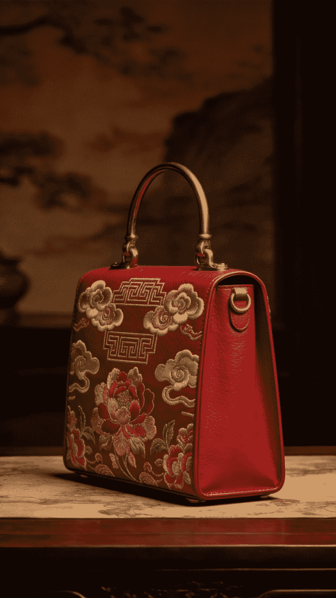 | 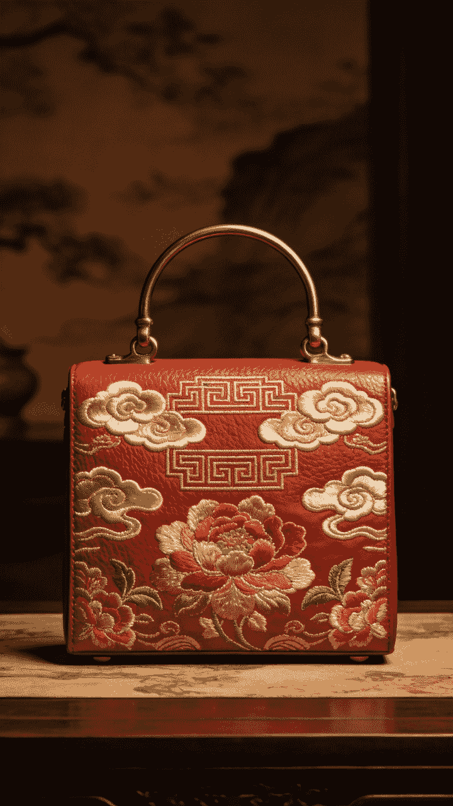 |  | | | |

| 把`@图片1`作为画面的首帧图，第一人称视角，参考`@视频1`的运镜效果，上方场景参考`@图片2`，左边场景参考`@图片3`，右边场景参考`@图片4`。 |  | 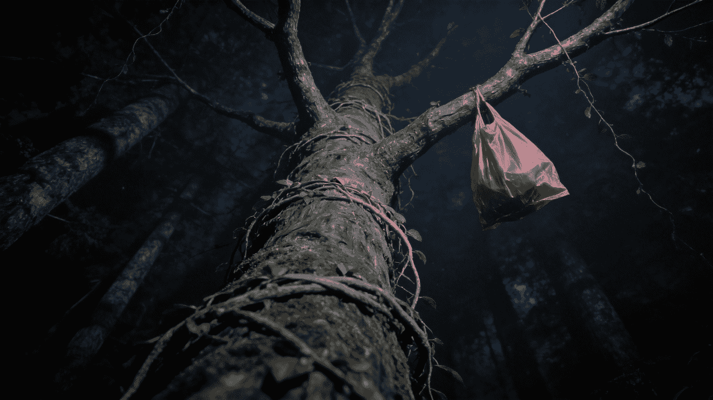 |  | 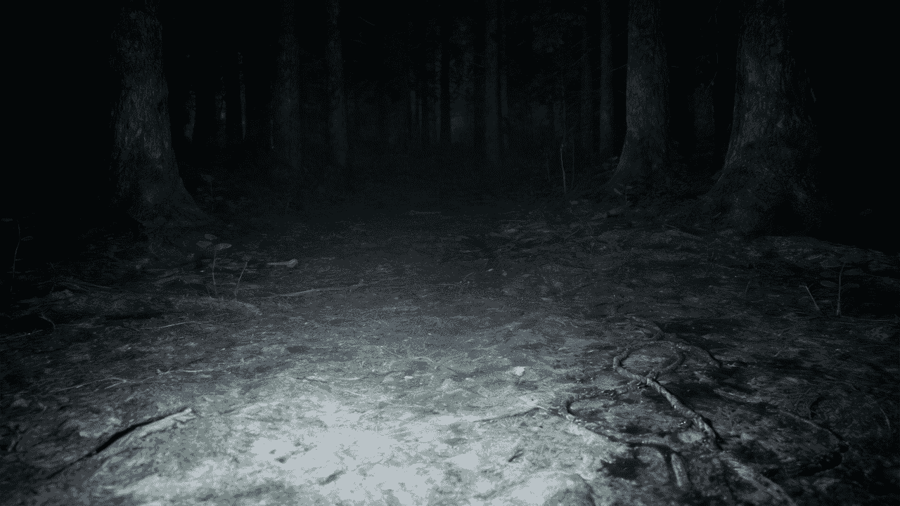 | | |

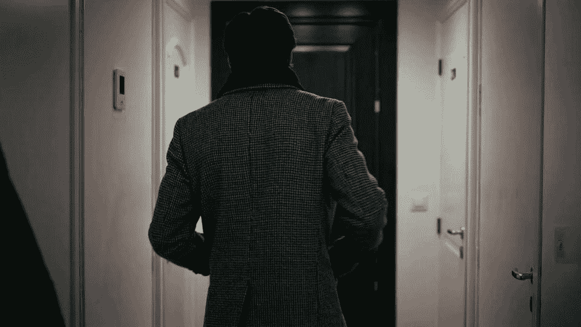

[jimeng-2026-02-06-3748.mp4](https://internal-api-drive-stream.feishu.cn/space/api/box/stream/download/all/H2ptby9XNoanfZxauWncZhNQnic)

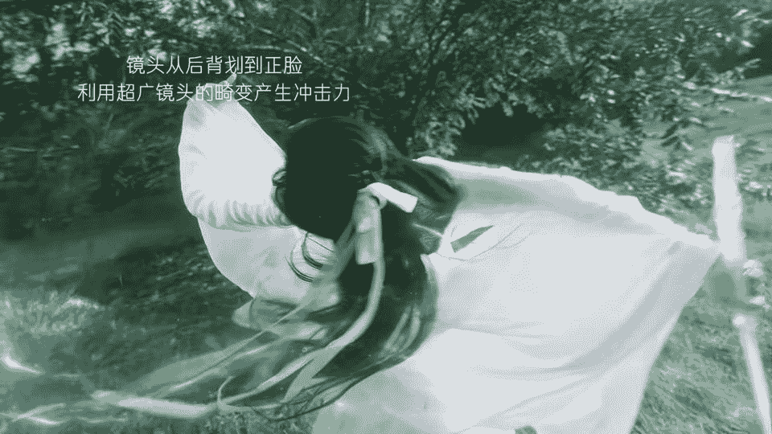

[发现更多精彩视频 - 抖音搜索 (32).mp4](https://internal-api-drive-stream.feishu.cn/space/api/box/stream/download/all/W5BNbtJERohrB1xd4GFco72nnWg)

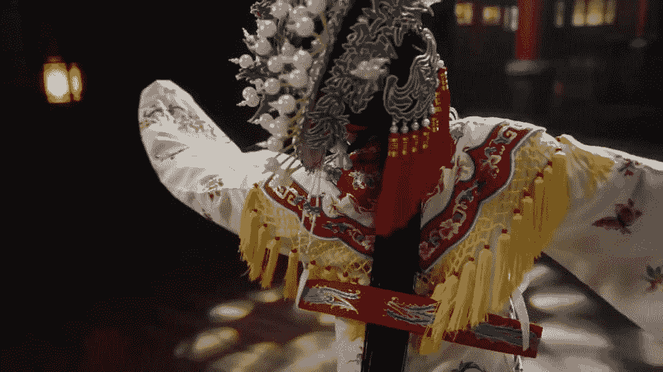

[jimeng-2026-02-06-2924.mp4](https://internal-api-drive-stream.feishu.cn/space/api/box/stream/download/all/AHaPbdaVNoeDnuxkQSCcrDsznUf)

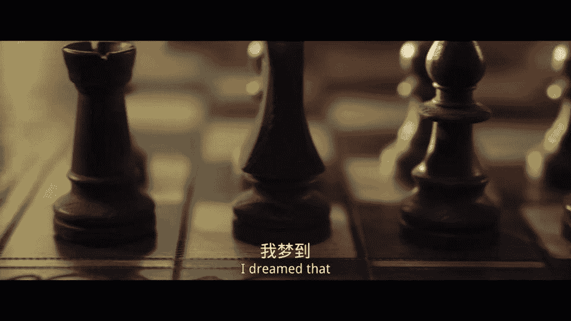

[2月6日 (1)(10).mp4](https://internal-api-drive-stream.feishu.cn/space/api/box/stream/download/all/IfhdbqfBwoZ8NExltwCcGaFjn9d)

[jimeng-2026-02-06-5842.mp4](https://internal-api-drive-stream.feishu.cn/space/api/box/stream/download/all/LQXIblyxpo6Ow2xzLzHc61QInCd)

[磁吸蝴蝶结.mp4](https://internal-api-drive-stream.feishu.cn/space/api/box/stream/download/all/FsQdbOmGUoredGxvS7bcwVxVnNf)

[手提包.mp4](https://internal-api-drive-stream.feishu.cn/space/api/box/stream/download/all/D5CpbSg83oTqVzxzN56cWvTYn3c)

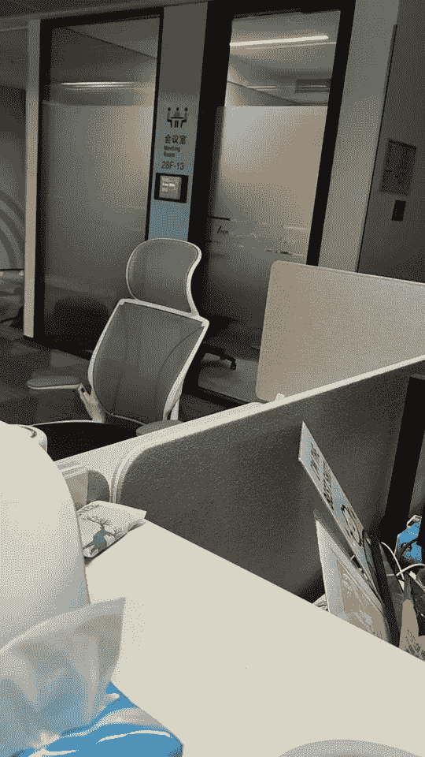

[实拍运镜.mp4](https://internal-api-drive-stream.feishu.cn/space/api/box/stream/download/all/PXZjbReepoc0oBxdqIYch9qgnCd)

[恐怖片运镜.mp4](https://internal-api-drive-stream.feishu.cn/space/api/box/stream/download/all/HLFhbyeuOoF06TxIUwYci85An3c)

### 高难度/可控的运镜和动作精准复刻

以前想让模型模仿电影里的走位、运镜或者复杂动作，要么写一堆细节提示词，要么干脆做不到。而现在，只需要上传一段参考视频，就可以了

###### Case：

| `prompt` | `img1` | `img2` | `img3` | `img4` | `img5` | `img6` | `img7` | `vid1` | `vid2` | `vid3` | 生成结果 |

| --- | --- | --- | --- | --- | --- | --- | --- | --- | --- | --- | --- |

| 参考`@图1`的男人形象，他在`@图2`的走廊中，完全参考`@视频1`的所有运镜效果，还有主角的面部表情，镜头跟随主角在`@图2`拐角奔跑，然后在`@图3`的长廊里，镜头从背面的跟随视角，通过低视角环绕到主角正面；镜头再右摇90度拍摄`@图片4`的分叉路口，急停后右摇180度，怼脸拍摄主角正面：主角气喘吁吁，镜头跟随主角的视角环顾四周，参考`@视频1`里急速的左右环绕运镜展示场景，后拉到`@图片5`的场景，继续跟拍主角奔跑的侧面视角 |  |  | 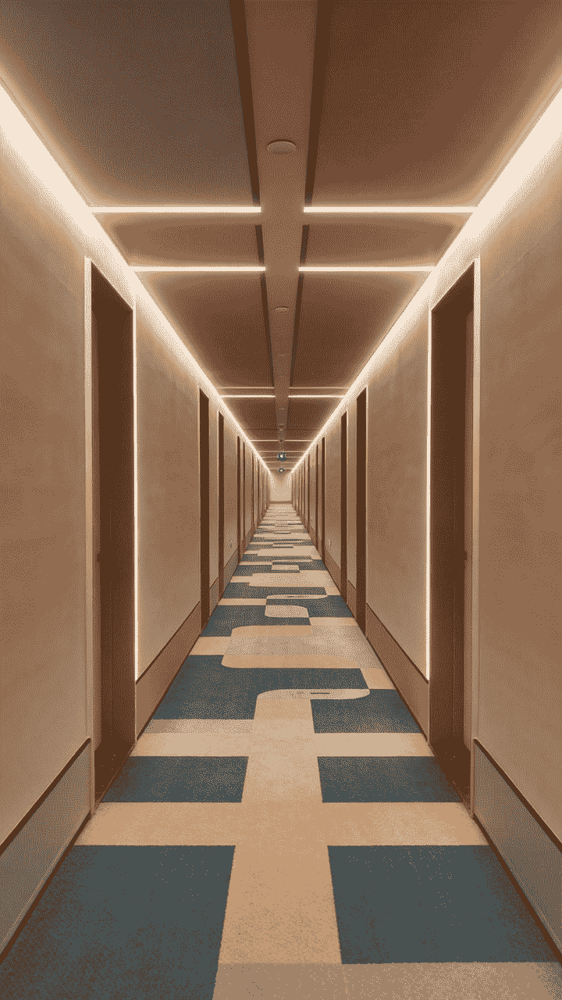 | 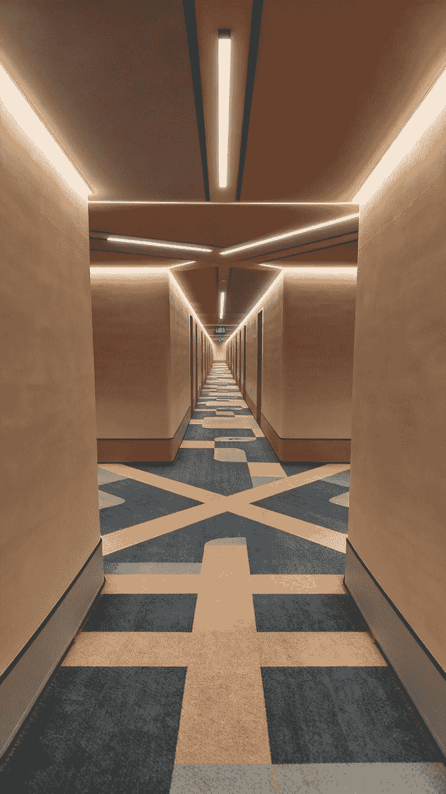 |  | | | | | |

| @图片1的平板电脑作为主体，运镜参考@视频1，推近到屏幕的特写，镜头旋转后平板反转展示全貌，屏幕中的数据流一直在变化，周围的环境逐渐变成科幻风格的数据空间 |  |

| @图片1的女星作为主体，参考@视频1的运镜方式进行有节奏的推拉摇移，女星的动作也参考@视频1中女子的舞蹈动作，在舞台上活力十足地表演 |  |

| 参考@图1@图2长枪角色，@图3@图4双刀角色，模仿@视频1的动作，在@图5的枫叶林中打斗 | 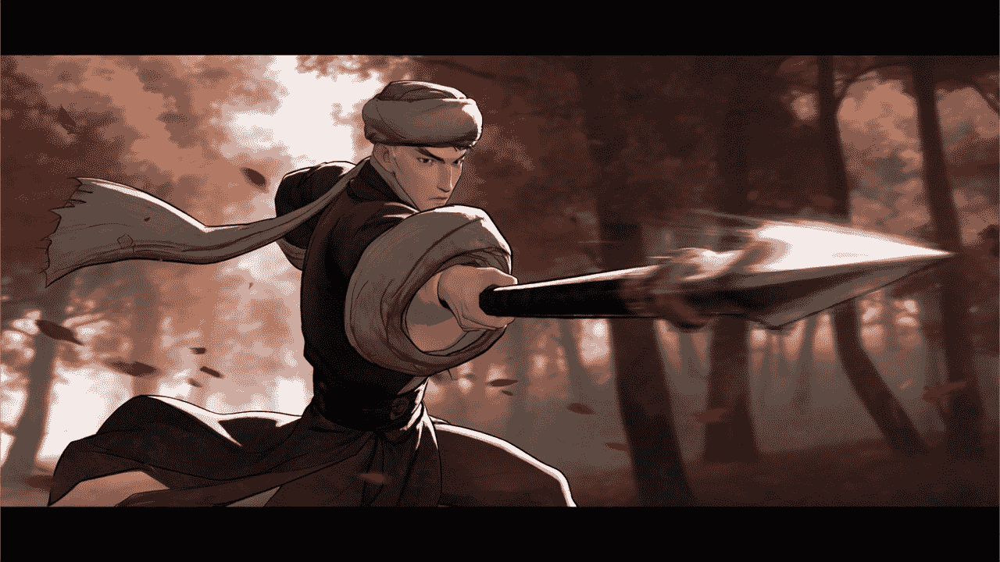 | 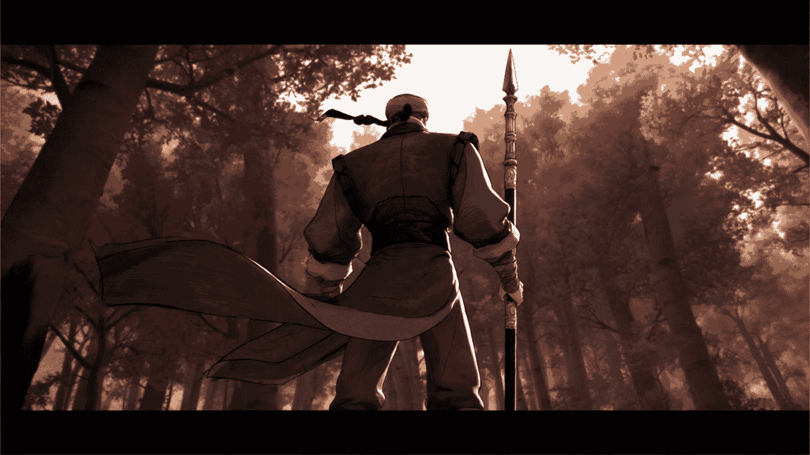 | 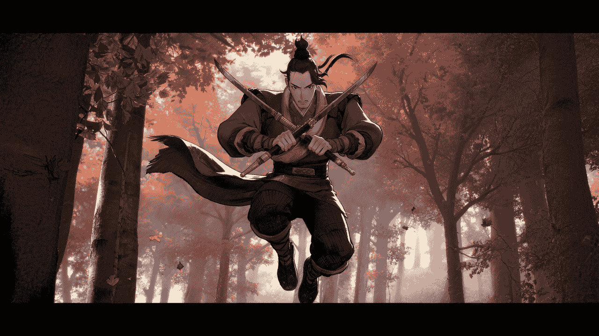 | 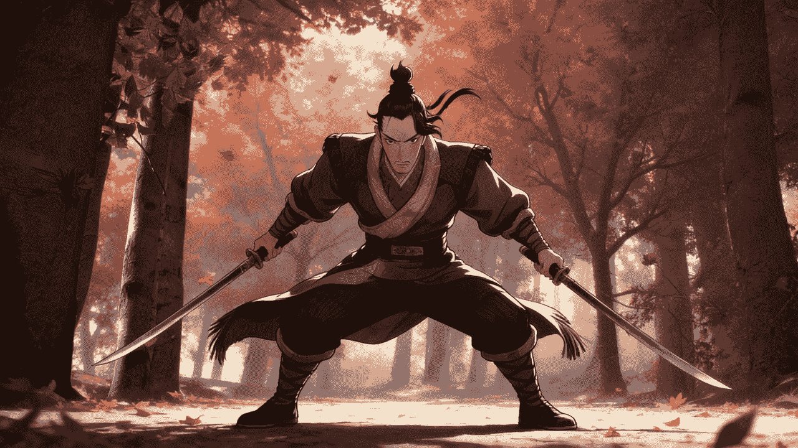 | 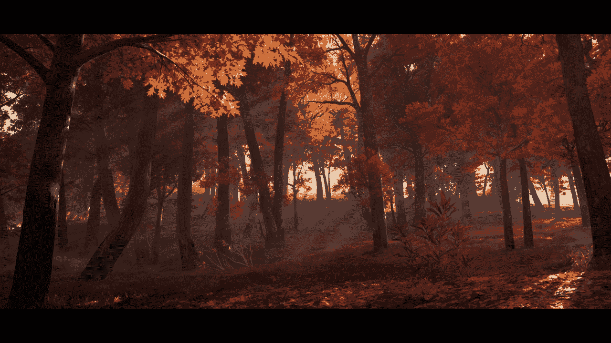 |

| 参考视频1的人物动作，参考视频2的环绕运镜镜头语言，生成角色1和角色2的打斗场面，打斗发生在星夜中，打斗的过程中有白色灰尘扬起，打斗场面非常华丽，气氛十分紧张。 |  |  |

| 参考视频1的运镜、画面切换节奏，拿图片1的红色超跑进行复刻。 |  |

[1月30日(4).mp4](https://internal-api-drive-stream.feishu.cn/space/api/box/stream/download/all/AawobWWUyoYl9lxTDAecdGlhnxh)

[jimeng-2026-02-05-8410.mp4](https://internal-api-drive-stream.feishu.cn/space/api/box/stream/download/all/RYYYbsxJwoKh2lxlB1VcVqOonxw)

[1月30日(1).mp4](https://internal-api-drive-stream.feishu.cn/space/api/box/stream/download/all/F9DwbgFCtosIPvxTwzQcnpBTnwb)

[jimeng-2026-02-05-3654.mp4](https://internal-api-drive-stream.feishu.cn/space/api/box/stream/download/all/Es4Rb81tTol9RlxAugpcJCnAnp6)

[聚焦旋转.mp4](https://internal-api-drive-stream.feishu.cn/space/api/box/stream/download/all/PFLObGK6So2uhPxLKWJceTX0nWb)

[jimeng-2026-02-05-3975.mp4](https://internal-api-drive-stream.feishu.cn/space/api/box/stream/download/all/Snlob5pgAouS9px5zcdcCv80nNd)

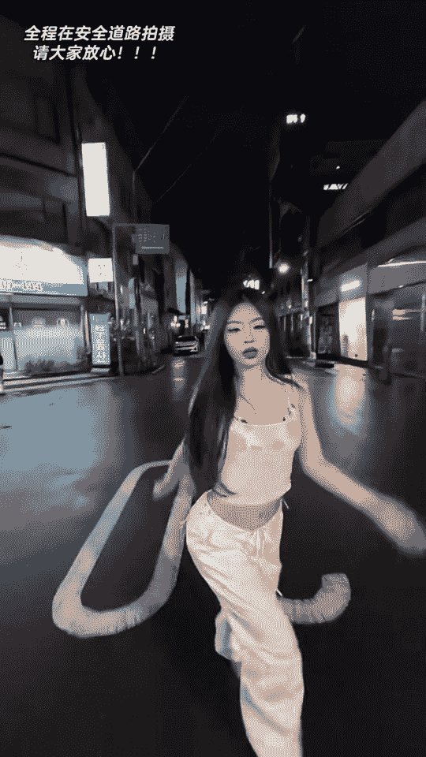

[推拉舞蹈运镜.mp4](https://internal-api-drive-stream.feishu.cn/space/api/box/stream/download/all/JmGObIiRuo4mpkxnULoc2bMknch)

[jimeng-2026-02-05-2445.mp4](https://internal-api-drive-stream.feishu.cn/space/api/box/stream/download/all/SF7Bb7Wtwo2mXGx9dmQcBRTinkc)

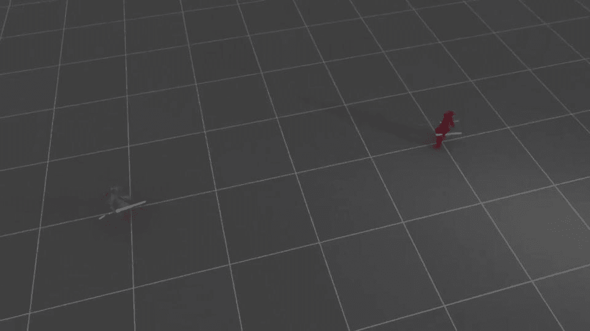

[1月30日(7).mp4](https://internal-api-drive-stream.feishu.cn/space/api/box/stream/download/all/EzOgbw1NSoLzXaxYYwDcxLSFnYg)

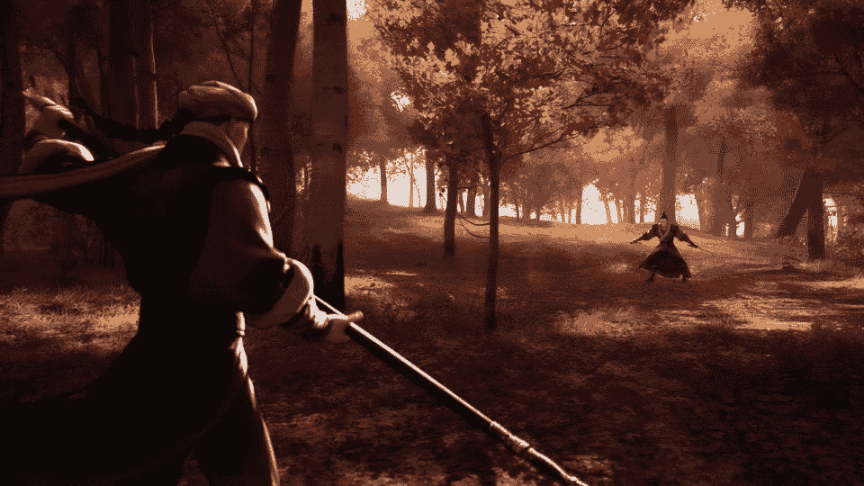

[okI4k2Elxfe5eFYM86DD4BAvIkCfLJ4ApIAIEc.mp4](https://internal-api-drive-stream.feishu.cn/space/api/box/stream/download/all/DQjNb9YnYoPhUKxIiDScj8LZnzh)

[打斗.mp4](https://internal-api-drive-stream.feishu.cn/space/api/box/stream/download/all/ZDiUbdVkPoVt5LxCa7JcAL30nxb)

[02176967295935700000000000000000000ffffac15af9c90c167.mp4](https://internal-api-drive-stream.feishu.cn/space/api/box/stream/download/all/LnY3b9HWVor82OxNS6XcHgzQnXg)

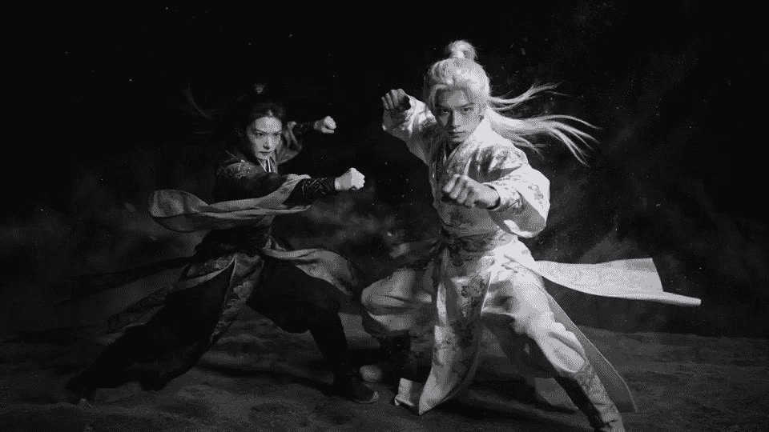

[jimeng-2026-02-05-5400.mp4](https://internal-api-drive-stream.feishu.cn/space/api/box/stream/download/all/SZOLbGA3eo4E1BxiAqgc1r5inNf)

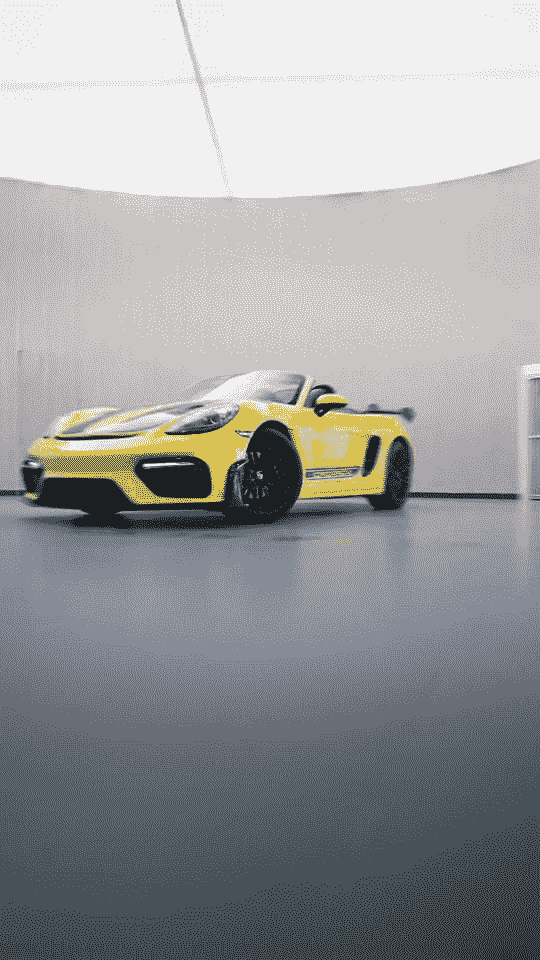

[汽车运镜.mp4](https://internal-api-drive-stream.feishu.cn/space/api/box/stream/download/all/ZqkgbvXHxoLDpcx20Zhc73H8nk6)

[汽车运镜.mp4](https://internal-api-drive-stream.feishu.cn/space/api/box/stream/download/all/JRQjbGYNJoNvUdxSmYYcyNgZnxm)

## 创意模版 / 复杂特效精准复刻

不止能生图写故事，Seedance 2.0 还支持“照着模仿”——创意转场、广告成片、电影片段、复杂剪辑，只要你有参考图或视频，模型就能识别动作节奏、镜头语言、视觉结构，并精准复刻出来。不懂专业术语也没关系，写清楚你想参考的部分，比如“参考 @视频1 的节奏和运镜，@图1 的角色造型”，模型就能高质量生成属于你的版本。大胆试！它真的能做到

### Case：

| `prompt` | `img1` | `img2` | `img3` | `img4` | `img5` | `img6` | `img7` | `vid1` | 生成结果 |
| --- | --- | --- | --- | --- | --- | --- | --- | --- | --- |

| 将@视频1的人物换成@图片1，@图片1为首帧，人物带上虚拟科幻眼镜，参考@视频1的运镜，及近的环绕镜头，从第三人称视角变成人物的主观视角，在AI虚拟眼镜中穿梭，来到@图片2的深邃的蓝色宇宙，出现几架飞船穿梭向远方，镜头跟随飞船穿梭到@图片3的像素世界，镜头低空飞过像素的山林世界，里面的树木生长形式出现，随后视角仰拍，急速穿梭到@图片4的浅绿色纹理的星球，镜头穿梭并掠过星球表面 | 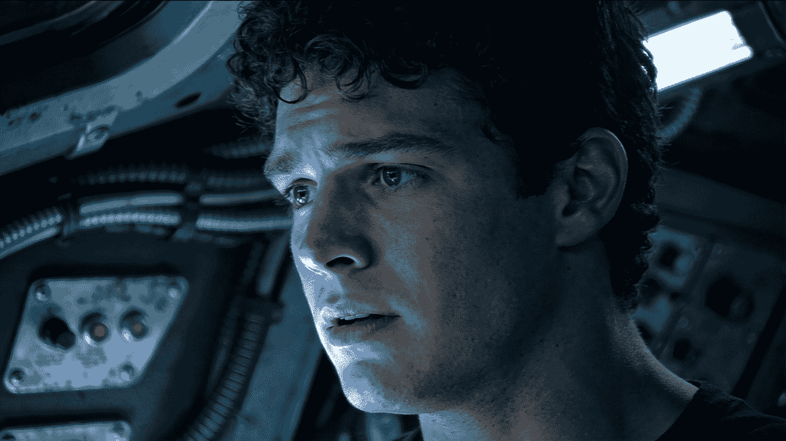 |  | 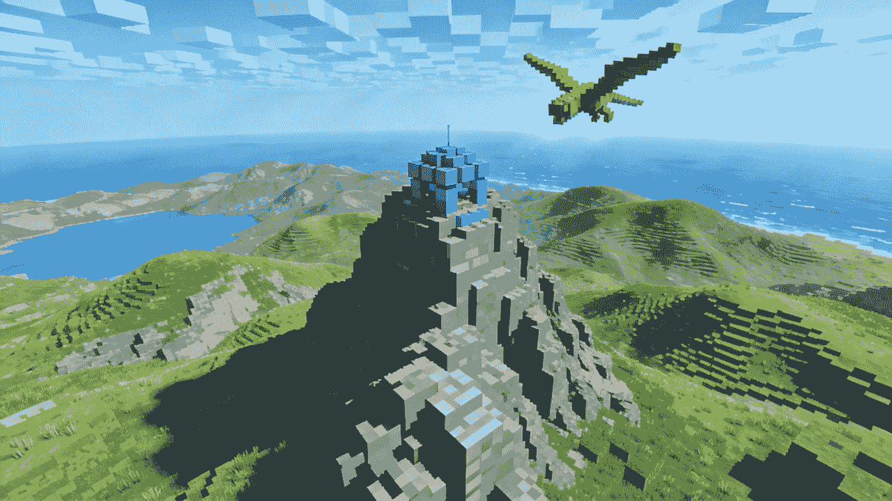 |  |

| 参考第一张图片里模特的五官长相。模特分别穿着第2-6张参考图里的服装凑近镜头，做出调皮、冷酷、可爱、惊讶、耍帅的造型，每一个造型穿着不同服装，每次更换，画面伴随会切镜，参考视频的里鱼眼镜头效果、重影闪烁的炫影画面效果，参考@视频1的效果 |  | 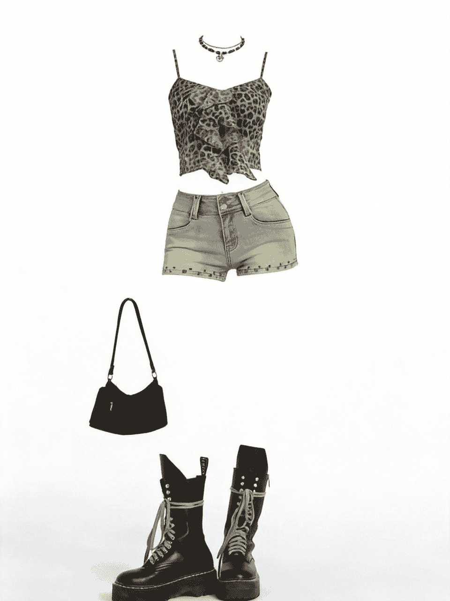 | 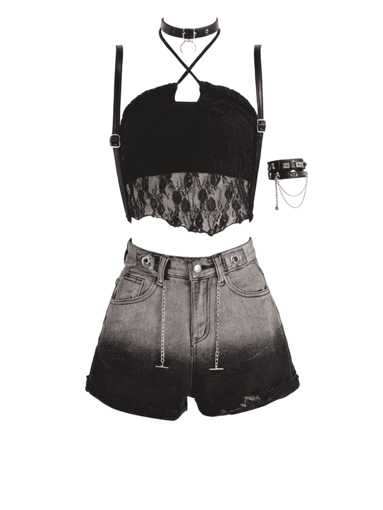 | 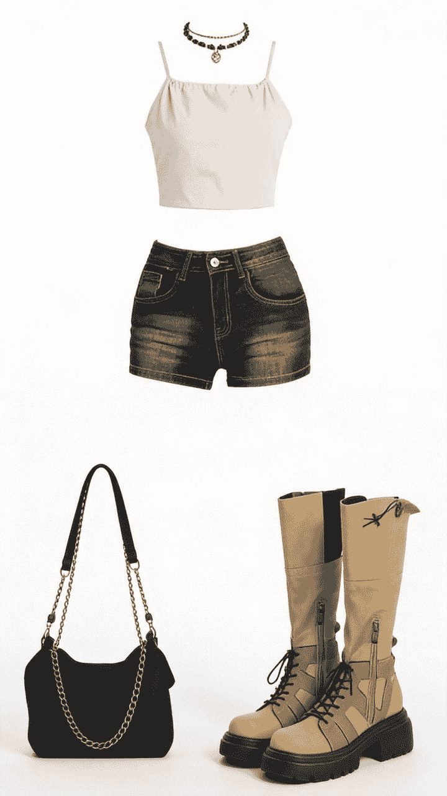 | 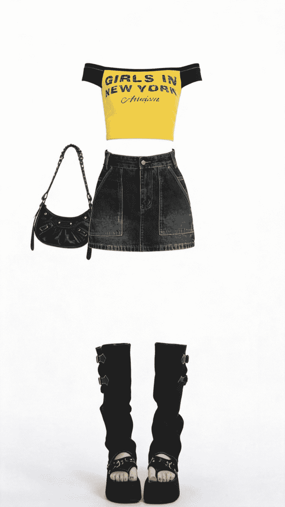 | 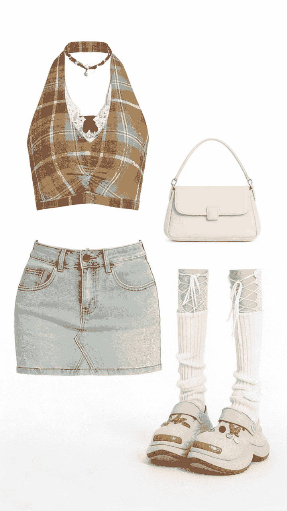 |

| 参考视频的广告创意，用提供的羽绒服图片，并参考鹅绒图片、天鹅图片，搭配以下广告词“这是根鹅绒，这是暖天鹅，这是能穿的极地天鹅绒羽绒服，新年穿得暖，生活过得暖”，生成新的羽绒服广告视频。 |  |  |  |

| 黑白水墨风格，@图片1的人物参考@视频1的特效和动作，上演一段水墨太极功夫 | 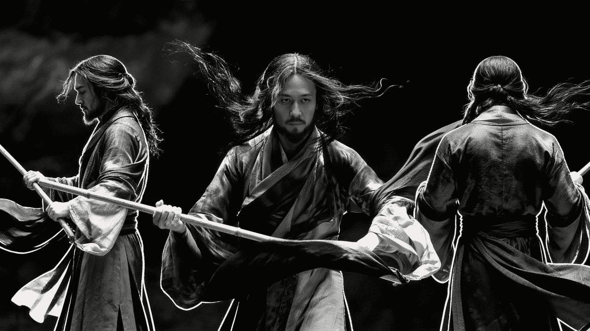 |

| 将@视频1的首帧人物替换成@图片1，完全@参考视频1的特效和动作，手里的花蕊长出玫瑰花瓣，裂纹在脸部向上延伸，逐渐被杂草覆盖，人物双手拂过脸部，杂草变成粒子消散，最后变成@图片2的长相 |  |  |

| 由@图片1的天花板开始，参考@视频1的拼图破碎效果进行转场，“BELIEVE”字体替换成“Seedance”，参考@图2的字体 |  |  |

| 以黑幕开场，参考视频1的粒子特效和材质，金色鎏金材质的沙砾从画面左边飘出并向右覆盖，参考@视频1的粒子吹散效果，@图片1的字体逐渐出现在画面中心 |  |

| @图片1的人物参考@视频1中的动作和表情变化，展示吃泡面的抽象行为 |  |

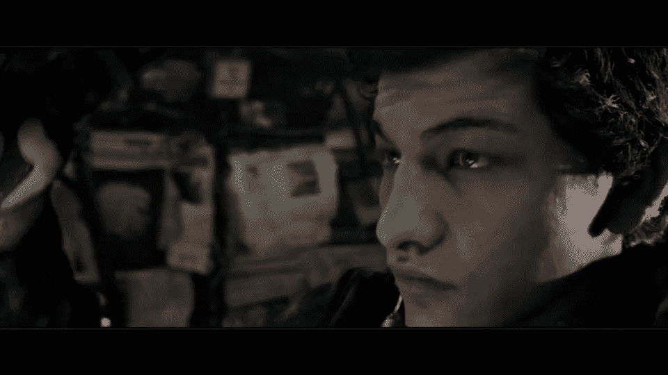

[2月4日.mp4](https://internal-api-drive-stream.feishu.cn/space/api/box/stream/download/all/QWeLbxUR7oKo98xkxGkcBZsunwc)

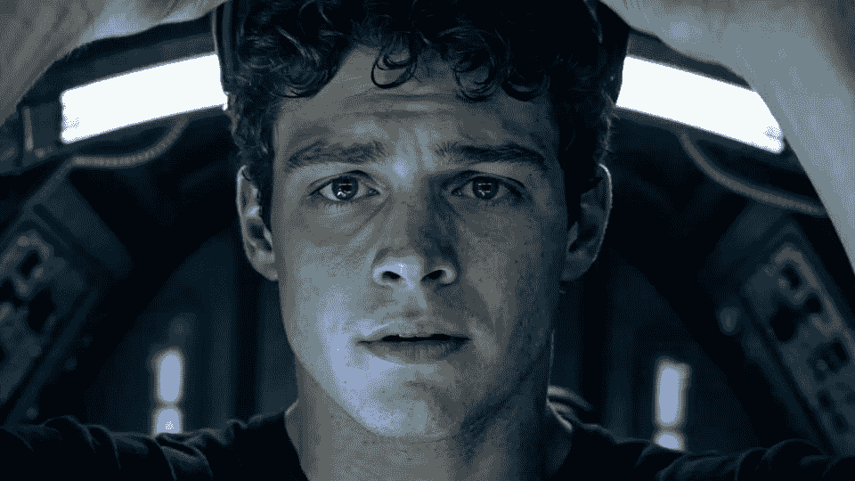

[jimeng-2026-02-05-6539.mp4](https://internal-api-drive-stream.feishu.cn/space/api/box/stream/download/all/ENBkbHlaaoo40gxFmHscAzSRnFc)

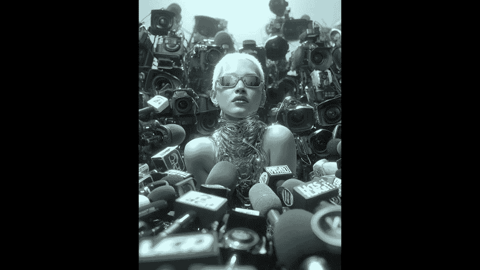

[2月5日(3).mp4](https://internal-api-drive-stream.feishu.cn/space/api/box/stream/download/all/BuhpbCKq6oLvFtx485dcvQa8nZd)

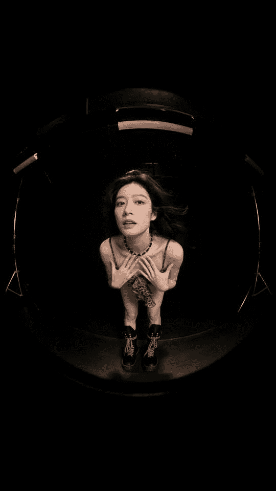

[jimeng-2026-02-05-8964.mp4](https://internal-api-drive-stream.feishu.cn/space/api/box/stream/download/all/LtLObUe5qocBeZxKzMncjiNanMe)

[v15-1.mp4](https://internal-api-drive-stream.feishu.cn/space/api/box/stream/download/all/QPcLb7o7IoW4ejx6NVdc7xJYnxg)

[32.mp4](https://internal-api-drive-stream.feishu.cn/space/api/box/stream/download/all/Hk1lbOHJQoUksXxZOlHcb3plnrh)

[1月30日(6).mp4](https://internal-api-drive-stream.feishu.cn/space/api/box/stream/download/all/VcAEb7YEwocI10xhvhncqeDdnEb)

[jimeng-2026-02-05-1007.mp4](https://internal-api-drive-stream.feishu.cn/space/api/box/stream/download/all/N6V2boPSIopylcxAQr4c92PXn4e)

[变装.mp4](https://internal-api-drive-stream.feishu.cn/space/api/box/stream/download/all/RNeib86sxookCKxCEMIc2lkvnne)

[jimeng-2026-02-05-8841.mp4](https://internal-api-drive-stream.feishu.cn/space/api/box/stream/download/all/K5E2buSMgoLDU7xZHIMcFGvPnrm)

[1月30日(3).mp4](https://internal-api-drive-stream.feishu.cn/space/api/box/stream/download/all/B8fDbfwAuofqUIxvHLacWLCMn4e)

[oAgveDLfVIGKTuAL8uABeQIyleIm2wPCIA4c5E.mp4](https://internal-api-drive-stream.feishu.cn/space/api/box/stream/download/all/OeqJbjzhUoziAIxbJj2cMAOznKd)

[ae片头.mp4](https://internal-api-drive-stream.feishu.cn/space/api/box/stream/download/all/GU4qbJlWzoOccexmWTTc8HGNnNd)

[jimeng-2026-02-05-5566.mp4](https://internal-api-drive-stream.feishu.cn/space/api/box/stream/download/all/GC3TbvmPzoQK7MxSGAucHQ6wn3f)

[1月21日(8).mp4](https://internal-api-drive-stream.feishu.cn/space/api/box/stream/download/all/Myx8bTh6eorKPGxunvwcJMpQnUe)

[jimeng-2026-02-05-4864.mp4](https://internal-api-drive-stream.feishu.cn/space/api/box/stream/download/all/GbFjbYq3Bo0IhFxp2UScrOAEnOd)

### 模型的创意性、剧情补全能力

#### Case：

| prompt | img1 | img2 | img3 | img4 | img5 | img6 | img7 | vid1 | 生成结果 |
| --- | --- | --- | --- | --- | --- | --- | --- | --- | --- |
| 将@图1以从左到右从上到下的顺序进行漫画演绎，保持人物说的台词与图片上的一致，分镜切换以及重点的情节演绎加入特殊音效，整体风格诙谐幽默；演绎方式参考@视频1 |  |  |  |  |  |  |  |  |  |
| 参考@图片1的专题片的分镜头脚本，参考@图片1的分镜、景别、运镜、画面和文案，创作一段15s的关于“童年的四季”的治愈系片头 |  |  |  |  |  |  |  |  |  |
| 参考视频1的音频，根据图1、图2、图3、图4、图5为灵感，发散出一条情绪向的视频。背景音乐参考@视频1 |  |  |  |  |  |  |  |  |  |

[2月4日(1) (1).mp4](https://internal-api-drive-stream.feishu.cn/space/api/box/stream/download/all/MAfVbQN8robZUixbfx5cEnpRnvb)

[jimeng-2026-02-05-8318-先是固定镜头，主体涂口红然后抿了抿嘴唇，镜头开始向镜子前推，主体对着镜子用口红在....mp4](https://internal-api-drive-stream.feishu.cn/space/api/box/stream/download/all/PinVblXCXo22Dcx4x2KcNzmHnNb)

[jimeng-2026-02-05-7071.mp4](https://internal-api-drive-stream.feishu.cn/space/api/box/stream/download/all/OwC9bNJvPolsrWxj7QFc4vmwnpy)

[jimeng-2026-02-05-4263.mp4](https://internal-api-drive-stream.feishu.cn/space/api/box/stream/download/all/Qep3b3OznokWnPxXLZwcTt0dncb)

### 视频延长

#### Case：

| 生成时长 | prompt | img1 | img2 | img3 | img4 | img5 | img6 | img7 | vid1 | 生成结果 |
| --- | --- | --- | --- | --- | --- | --- | --- | --- | --- | --- |
| 15s | 延长15s视频，参考@图片1、@图片2的驴骑摩托车的形象，补充一段脑洞广告  画面1：侧面固定镜头，驴骑着摩托车冲出棚栏，旁边的鸡受到惊吓，  画面2：驴骑着摩托在沙地盘旋，先特写摩托轮胎，再切到半空中俯拍驴骑着摩托车做着盘旋特技，掀起烟雾  画面3：背景是雪山镜头，驴骑着车从山坡飞越过，广告语在主体背后，通过遮罩的形式（驴和摩托车飞过时）中间出现"Inspire Creativity,Enrich Life"，最后在摩托飞过，扬起一阵尘烟 |  |  |  |  |  |  |  |  |  |
| 6s | 将视频延长6s，出现电吉他的激昂音乐，视频中间出现“JUST DO IT”的广告字体后逐渐淡化，镜头上移到天花板，一个健硕的男人拉着吊环，上半身穿着@图1的紧身健身服，背面印有@图2的“Fitness”logo，男人用健硕的上肢拉上吊环，随后视频中间出现“DO SOME SPORT”的广告结束字体。 |  |  |  |  |  |  |  |  |  |
| 15s | 将@视频1延长15秒。1-5秒：光影透过百叶窗在木桌、杯身上缓缓滑过，树枝伴随着轻微呼吸般的晃动。6-10秒：一粒咖啡豆从画面上方轻轻飘落，镜头向咖啡豆推进至画面黑屏。11-15秒：英文渐显第一行“Lucky Coffee ”，第二行“Breakfast”，第三行“AM 7:00-10:00”。 |  |  |  |  |  |  |  |  |  |
| 10s | 向前延长10s，温暖的午后光线里，镜头先从街角那排被微风掀动的遮阳篷开始，慢慢下移到墙根处几株探出头的小雏菊。紧接着，画面里出现主人公的红色板鞋，他正蹲在街边花摊前，笑着把一大捧向日葵拢进怀里，花瓣蹭过他的白 T 恤。他转身踏上滑板时，花摊老板笑着喊了句 “小心花瓣飞啦！”，他冲老板挥了挥手，然后才开始滑行，几片金黄的花瓣已经先一步从花束里挣脱出来，落在了滑板的板面。 |  |  |  |  |  |  |  |  |  |

[2月5日(10).mp4](https://internal-api-drive-stream.feishu.cn/space/api/box/stream/download/all/TTUXb3xznob8l1xWqRScXFwrnac)

[jimeng-2026-02-05-3767.mp4](https://internal-api-drive-stream.feishu.cn/space/api/box/stream/download/all/P8Fdbd3J5o9Y77xkAQbcjgrMne9)

[jimeng-2026-02-05-1923.mp4](https://internal-api-drive-stream.feishu.cn/space/api/box/stream/download/all/JYdhbMUiPofrqRxj0JGcEbBknuf)

[jimeng-2026-02-05-3437.mp4](https://internal-api-drive-stream.feishu.cn/space/api/box/stream/download/all/R3Ssb3qguoxSvjxLQSyca4mMnvg)

[jimeng-2026-02-04-2947-延时摄影，咖啡杯长出树枝，上面挂着曲奇.mp4](https://internal-api-drive-stream.feishu.cn/space/api/box/stream/download/all/Ftj7bBgsno177Uxl8cjcBd5JnTd)

[jimeng-2026-02-05-4162.mp4](https://internal-api-drive-stream.feishu.cn/space/api/box/stream/download/all/Xk76b1Rb3oZHnUxgDPFcs8cUn0f)

[向日葵滑板车.mp4](https://internal-api-drive-stream.feishu.cn/space/api/box/stream/download/all/TA6tbdn48oDEB6xEySbc1gELnGf)

[jimeng-2026-02-05-5137.mp4](https://internal-api-drive-stream.feishu.cn/space/api/box/stream/download/all/XTribx2Z9oiq5tx6bThc4WObnFB)

### 音色更准，声音更真

#### Case：

| prompt | img1 | img2 | img3 | vid1 | vid2 | vid3 | 生成结果 |
| --- | --- | --- | --- | --- | --- | --- | --- |
| 固定镜头，中央鱼眼镜头透过圆形孔洞向下窥视，参考视频1的鱼眼镜头，让@视频2中的马看向鱼眼镜头，参考@视频1中的说话动作，背景BGM参考@视频3中的音效。 |  |  |  |  |  |  |  |
| 根据提供的写字楼宣传照，生成一段15秒电影级写实风格的地产纪录片，采用2.35:1宽银幕，24fps，细腻的画面风格，其中旁白的音色参考@视频1，拍摄 “写字楼的生态”，呈现楼内不同企业的运作，结合旁白阐述写字楼如何成为一个充满活力的商业生态系统. |  |  |  |  |  |  |  |
| 在“猫狗吐槽间”里的一段吐槽对话，要求情感丰沛，符合脱口秀表演：  喵酱（猫主持，舔毛翻眼）：“家人们谁懂啊，我身边这位，每天除了摇尾巴、拆沙发，就只会用那种“我超乖求摸摸”的眼神骗人类零食，明明拆家的时候比谁都凶，还好意思叫旺仔，我看叫“旺拆”还差不多哈哈哈“  旺仔（狗主持，歪头晃尾巴）：“你还好意思说我？你每天睡18个小时，醒了就蹭人类腿要罐头，掉毛掉得人类黑衣服上全是你的毛，人家扫完地，你转身又在沙发上滚一圈，还好意思装高冷贵族？” |  |  |  |  |  |  |  |
| 豫剧经前桥段《铡美案》的伴奏响起，左侧的黑衣包拯指着右侧的红衣陈世美，咬牙切齿地唱着豫剧：“刀对鞘，真凭实据你敢不招？” 陈世美的眼珠左右滴溜溜乱转，寻找着权宜之策，面色窘迫至极。此时，画面外传来一声豫剧旦角的念白：“且慢！”包拯和陈世美一齐向画面右侧看去。 |  |  |  |  |  |  |  |
| 生成一个15秒的MV视频。关键词：稳重构图 / 轻推拉 / 低角度英雄感 / 纪实但高级A超广角建立镜头，低机位轻微仰拍，悬崖土路与复古旅行车占画面下三分之一，远处海面与地平线拉开空间，夕阳侧逆光体积光穿过尘粒，电影级构图，真实胶片颗粒，微风吹动衣角。 |  |  |  |  |  |  |  |
| 画面中间戴帽子的女孩温柔地唱着说"I'm so proud of my family!"，之后转身拥抱中间的黑人女孩。黑人女孩感动地回应"My sweetie, you're the heart of our family"，回抱她。左侧的黄衣服男孩开心地说"Folks, let's dance together to celebrate！” 最右侧的女孩紧接着回复： “I'll bring the music!"，背景拉美音乐响起，左侧穿橙色裙的女性（朱丽叶塔）笑着点头，右侧扎辫女性（路易莎）握紧拳头挥动手臂。人群中有人开始踏起步子，孩子们跟着节奏拍手，整个家族即将围成圈，伴着欢快的音乐，裙摆飞扬，在五彩的街道上尽情舞动，传递着喜悦与温暖。 |  |  |  |  |  |  |  |
| 固定镜头。站着的壮汉（队长）握拳挥臂用西班牙语说着：“三分钟后突袭！”，金发队员站在检查枪械，绿发队员握紧战术手电。黑人队员搭肩问同伴用西班牙语说：“侧翼包抄？”队长点头用西班牙语说：“老规矩，活口留审讯。”全员肃然，装备碰撞声中完成战术手势，默契起身，大家都严阵以待，左侧两个男生也争先站起来准备战斗。 |  |  |  |  |  |  |  |
| 0-3秒：开头闹钟响起来，画面朦胧中出现画面1； |  |  |  |  |  |  |  |
| @图片1的猴子走向奶茶店柜台，镜头跟随在他身后，一位@图片2的比熊服务员正在吧台处擦拭制作工具，猴子向服务员用四川口音点单：“幺妹儿，霸王别姬有得没得？”  切镜，特写。  服务员放下手里的活，怪异地看了老头一眼后回答：“没得，美式要不要得嘛”  切镜，镜头给到猴子。 |  |  |  |  |  |  |  |
| 用科普风格和音色，将图片1中的内容演绎出来，内容包括悟空为过火焰山，到翠云山向铁扇公主借芭蕉扇。铁扇公主因红孩儿被悟空降伏拜观音为童子，母子分离，不肯借扇还欲报仇。悟空好言相劝无果，二人随即起了争执的小故事进行讲解。 |  |  |  |  |  |  |  |

[鱼眼.mp4](https://internal-api-drive-stream.feishu.cn/space/api/box/stream/download/all/Me2kbin7EodtnFxVmXjcmNHNnfe)

[jimeng-2026-02-03-3673-红色的背景下，突然一个头顶红布、睁大无辜眼睛的马头从下面抬起，然后马儿摇摇耳朵，....mp4](https://internal-api-drive-stream.feishu.cn/space/api/box/stream/download/all/OEmRbycchoWXKIxuI1mcxXDvnMc)

# 视频生成功能示例

[无标题视频——使用Clipchamp制作 (16).mp4](https://internal-api-drive-stream.feishu.cn/space/api/box/stream/download/all/BZmGbFvW3onNU5xy4tWcNogtnmb)

[jimeng-2026-02-05-9949.mp4](https://internal-api-drive-stream.feishu.cn/space/api/box/stream/download/all/BQjobPf70ozwTWxHry8cXP9inRc)

[无标题视频——使用Clipchamp制作 (18).mp4](https://internal-api-drive-stream.feishu.cn/space/api/box/stream/download/all/G95gbsoGZohExWxA386cPRWGnrb)

[jimeng-2026-02-05-4039.mp4](https://internal-api-drive-stream.feishu.cn/space/api/box/stream/download/all/Lw8YbPMTGoCFeUxGubmc9eWWnte)

[jimeng-2026-02-05-9740.mp4](https://internal-api-drive-stream.feishu.cn/space/api/box/stream/download/all/M2bHb5yztoB0UbxLRCCczdwvnNh)

[jimeng-2026-02-05-7415.mp4](https://internal-api-drive-stream.feishu.cn/space/api/box/stream/download/all/IXG6bl3owoJdyhx7mDvcyAsLnrb)

[jimeng-2026-02-05-1458.mp4](https://internal-api-drive-stream.feishu.cn/space/api/box/stream/download/all/SBjSbXFdsodPe1xLreccjVb3nqb)

[jimeng-2026-02-05-1958.mp4](https://internal-api-drive-stream.feishu.cn/space/api/box/stream/download/all/EndubqBFRodv1TxYujScVSpBnOh)

[jimeng-2026-02-05-1805.mp4](https://internal-api-drive-stream.feishu.cn/space/api/box/stream/download/all/OACoblyP3oz50Rxb8t3cw6pAn3f)

[无标题视频——使用Clipchamp制作 (19).mp4](https://internal-api-drive-stream.feishu.cn/space/api/box/stream/download/all/GjGkb7CHzo61C6xK3WRc7RKZn63)

[jimeng-2026-02-05-2906.mp4](https://internal-api-drive-stream.feishu.cn/space/api/box/stream/download/all/DdCIbxI9do2v1Ex40ONcKoujnFc)

[jimeng-2026-02-05-8320.mp4](https://internal-api-drive-stream.feishu.cn/space/api/box/stream/download/all/RF8obZDj1omPxpx7RYmcqXQWnLt)

[jimeng-2026-02-05-2803.mp4](https://internal-api-drive-stream.feishu.cn/space/api/box/stream/download/all/H0HUbUA4eo9NuKx5nf6c3hLVnwc)

## 镜头连贯性（一镜到底）更强

### Case：

| `prompt` | `img1` | `img2` | `img3` | `img4` | `img5` | `img6` | `img7` | 生成结果 |
| --- | --- | --- | --- | --- | --- | --- | --- | --- |
| `@图片1` `@图片2` `@图片3` `@图片4` `@图片5`，一镜到底的追踪镜头，从街头跟随跑步者上楼梯、穿过走廊、进入屋顶，最终俯瞰城市。 |  |  |  |  |  |  |  |  |
| 以`@图片1`为首帧，画面放大至飞机舷窗外，一团团云朵缓缓飘至画面中，其中一朵为彩色糖豆点缀的云朵，始终在画面中居中，然后缓缓变形为`@图片2`的冰淇淋，镜头推远回到机舱内，坐在窗边的`@图片3`伸手从窗外拿进冰淇淋，吃了一口，嘴巴上沾满奶油，脸上洋溢出甜蜜的笑容 |  |  |  |  |  |  |  |  |
| 谍战片风格，`@图片1`作为首帧画面，镜头正面跟拍穿着红风衣的女特工向前走，镜头全景跟随，不断有路人遮挡红衣女子，走到一个拐角处，参考`@图片2`的拐角建筑，固定镜头红衣女子离开画面，走在拐角处消失，一个戴面具的女孩在拐角处躲着恶狠狠的盯着她，面具女孩形象参考`@图片3`，只参考形象，女孩站在拐角处。镜头往前摇向红衣女特工，她走进一座豪宅消失不见了，豪宅参考`@图片4`。全程不要切镜头，一镜到底。 |  |  |  |  |  |  |  |  |
| 根据`@图片1`外景的镜头，第一人称主观视角快推镜头到木屋内的环境场景近景，一只小鹿`@图片2`和一只羊`@图片3`在围炉旁喝茶聊天，镜头推进特写茶杯的样式参考`@图片4`. |  |  |  |  |  |  |  |  |
| `@图片1` `@图片2` `@图片3` `@图片4` `@图片5`，主观视角一镜到底的惊险过山车的镜头，过山车的速度越来越快。 |  |  |  |  |  |  |  |  |

[oECdEZG7A3kCeBDBBAAF2fh3EfIHSZECqAI18l.mp4](https://internal-api-drive-stream.feishu.cn/space/api/box/stream/download/all/WvodbSTB7oRL0DxvlbycpJrsnpg)

[jimeng-2026-02-05-4364.mp4](https://internal-api-drive-stream.feishu.cn/space/api/box/stream/download/all/Gc43b78YWon1kFxfVUjckTtCnag)

[jimeng-2026-02-05-7710.mp4](https://internal-api-drive-stream.feishu.cn/space/api/box/stream/download/all/T1cebZEGOoHIqTxUCoDcYdbTnSb)

[jimeng-2026-02-05-3336.mp4](https://internal-api-drive-stream.feishu.cn/space/api/box/stream/download/all/OjYeb7VKdo9O0xxdE1bcbvbOnjq)

[jimeng-2026-02-05-6048.mp4](https://internal-api-drive-stream.feishu.cn/space/api/box/stream/download/all/Okaqb1wPBoc5UXxph15cDFn9neb)

## 视频编辑可用度高

有时候你已经有了一段视频，不想从头再找图或重做一遍，只是希望调整其中一小段动作、延长几秒钟，或让角色表现更贴近你的想法。现在你可以直接用已有视频作为输入，在不改变其它内容的前提下，指定片段、动作或节奏进行定向修改。无需重头生成，也能快速完成调整

### Case：

| `prompt` | `img1` | `img2` | `img3` | `img4` | `vid1` | 生成结果 |
| --- | --- | --- | --- | --- | --- | --- |
| 颠覆`@视频1`里的剧情，男人眼神从温柔瞬间转为冰冷狠厉，在女主毫无防备的瞬间，猛地将女主从桥上往外推，把女主推进水里。动作干脆利落，带着蓄谋已久的决绝，没有丝毫犹豫，彻底颠覆原有的深情人物设定。女主坠入水中的瞬间，没有尖叫，只有难以置信的眼神，她抬头冲男主嘶吼：“你从一开始就在骗我！”男主站在桥上上，脸上露出阴冷的笑容，对着水面低声说：“这是你欠我家族的。” |  |  |  |  |  |  |
| 颠覆`@视频1`的整个剧情 |  |  |  |  |  |  |
| `视频1`中的女主唱换成`图片1`的男主唱，动作完全模仿原视频，不要出现切镜，乐队演唱音乐。 |  |  |  |  |  |  |
| 将`视频1`女人发型变成红色长发，`图片1`中的大白鲨缓缓浮出半个脑袋，在她身后。 |  |  |  |  |  |  |
| `视频1`镜头右摇，炸鸡老板忙碌地将炸鸡递给排队的客户，用普通话说“做完他的，做你的，大家文明排队。”一说完，就去拿纸袋子去装炸鸡。特写展示老板拿印有`图1`的纸袋子，特写展示递给客户的手部特写。 |  |  |  |  |  |  |

[jimeng-2026-02-03-4484-中景拍摄，古装服饰的一对男女主角，站在桥上赏月.mp4](https://internal-api-drive-stream.feishu.cn/space/api/box/stream/download/all/VdwSbInVkoliO7xub0acDiEcndc)

[推下水.mp4](https://internal-api-drive-stream.feishu.cn/space/api/box/stream/download/all/EXjob5FBhoM7GIxM6r2cmVmXnad)

[男女主(1).mp4](https://internal-api-drive-stream.feishu.cn/space/api/box/stream/download/all/F11BbRWYWoWsbMxTuyrcQhNuntc)

[零食.mp4](https://internal-api-drive-stream.feishu.cn/space/api/box/stream/download/all/RGZ3bXAqtoV7rFxO2CYc4lS1n1b)

[乐队(1).mp4](https://internal-api-drive-stream.feishu.cn/space/api/box/stream/download/all/Bt4rbtBpdoZUtJxRfBxc0wwHnFh)

[乐队2.mp4](https://internal-api-drive-stream.feishu.cn/space/api/box/stream/download/all/U8OGbXtXpokIhPxEpSIc0cPdn2d)

[水面(1).mp4](https://internal-api-drive-stream.feishu.cn/space/api/box/stream/download/all/HF1EbBlt8o0aXCx5VYXcg2C9nig)

[水面.mp4](https://internal-api-drive-stream.feishu.cn/space/api/box/stream/download/all/HvhEbIj9GoyFYfxFgPQcGtZ4nTv)

[炸鸡(1).mp4](https://internal-api-drive-stream.feishu.cn/space/api/box/stream/download/all/HKC3bL7fmoKqvbxzRiRcQdjlnec)

[印度炸鸡.mp4](https://internal-api-drive-stream.feishu.cn/space/api/box/stream/download/all/WoVfbiP2zoLXNZxZFxwc9DrQnid)

## 可进行音乐卡点

### Case：

| `prompt` | `img1` | `img2` | `img3` | `img4` | `img5` | `img6` | `img7` | `vid1` | 生成结果 |
| --- | --- | --- | --- | --- | --- | --- | --- | --- | --- |

| 海报中的女生在不停的换装，服装参考`@图片1``@图片2`的样式，手中提着`@图片3`的包，视频节奏参考`@视频` |  |  |  |  |  |  |  |  |  |

| `@图片1``@图片2``@图片3``@图片4``@图片5``@图片6``@图片7`中的图片根据`@视频`中的画面关键帧的位置和整体节奏进行卡点，画面中的人物更有动感，整体画面风格更梦幻，画面张力强，可根据音乐及画面需求自行改变参考图的景别，及补充画面的光影变化 |  |  |  |  |  |  |  |  |  |

| `@图片1``@图片2``@图片3``@图片4``@图片5``@图片6`的风光场景图，参考`@视频`中的画面节奏，转场间画面风格及音乐节奏进行卡点 |  |  |  |  |  |  |  |  |  |

| 8秒智性博弈式战斗动漫片段，贴合复仇主题。0-3秒：分镜图1中女主转身坐下，转镜头，女主下了一步棋子，并说“你输了”，参考分镜图2。3-4秒：快速摇镜头，转向对面男人面部特写，参考分镜图3，男人咬牙切齿，对结果很不满。4-6秒：切镜头，俯拍，女人下了一步棋，对面的人们惊叹，参考分镜图4。6-8秒：镜头迅速向下摇，画面黑屏转场，后画面渐亮，昏暗室内，女人看着窗外月色静静地说“我们走着瞧”，参考分镜图5。 |  |  |  |  |  |  |  |  |  |

[音乐卡点.mp4](https://internal-api-drive-stream.feishu.cn/space/api/box/stream/download/all/G5E1btjKSog0SbxPgbkcZq1xn5d)

[jimeng-2026-02-05-5881.mp4](https://internal-api-drive-stream.feishu.cn/space/api/box/stream/download/all/Hrl4blX13oZXHoxKDzkcc6MInGh)

[卡点.mp4](https://internal-api-drive-stream.feishu.cn/space/api/box/stream/download/all/HmN5bhjS1o0YPGx0mlncpA7unPc)

[jimeng-2026-02-05-4918.mp4](https://internal-api-drive-stream.feishu.cn/space/api/box/stream/download/all/Qz15b2h2AoBSZGxfBKmcLOuXnxg)

[2月5日.mp4](https://internal-api-drive-stream.feishu.cn/space/api/box/stream/download/all/N8SJbFrK9o3icXxQWvucPxiOnMc)

[jimeng-2026-02-05-9009.mp4](https://internal-api-drive-stream.feishu.cn/space/api/box/stream/download/all/Q89QbP9mAor7AGxRB8RcOuSYnGg)

[jimeng-2026-02-05-3301-3D 动画风格，中景平视镜头，保持公园长椅场景，1-2s两人起身争执，男性怒吼前....mp4](https://internal-api-drive-stream.feishu.cn/space/api/box/stream/download/all/MMlWbK1bPofJEnxqtODc3iybnJb)

## 情绪演绎更好

### Case：

| `prompt` | `img1` | `img2` | `img3` | `img4` | `img5` | `img6` | `img7` | `vid1` | `生成结果` |

| --- | --- | --- | --- | --- | --- | --- | --- | --- | --- |

| `@图片1`的女子走到镜子前，看着镜子里面的自己，姿势参考`@图片2`，沉思了一会突然开始崩溃大叫，抓镜子的动作崩溃大叫的情绪和表情完全参考`@视频1`。 |  |  |  |  |  |  |  |  |  |

| 这是一个油烟机广告，`@图片1`作为首帧画面，女人在优雅的做饭，没有烟雾，镜头快速向右边摇动，拍摄`@图片2`男人满头大汗面红耳赤在做饭，浓烟滚滚，镜头向左边摇动推进拍摄`@图片1`桌面上的一个油烟机，油烟机参考`@图片3`，油烟机在疯狂抽烟。 |  |  |  |  |  |  |  |  |  |

| `@图片1`作为画面的首帧图，镜头旋转推近，人物突然抬头，人物面部长相参考`@图片2`，开始大声咆哮，激动带有一些喜剧色彩，参考`@图片3`的表情神态。然后人物身体变身成为一只熊，参考`@图片4`.。 |  |  |  |  |  |  |  |  |  |

[情绪3.mp4](https://internal-api-drive-stream.feishu.cn/space/api/box/stream/download/all/JO46bXCDyobhH2xmoF6cZTugncg)

[jimeng-2026-02-05-2315.mp4](https://internal-api-drive-stream.feishu.cn/space/api/box/stream/download/all/K3xRbFDvioqLyXxrgnvcHTrynFd)

[jimeng-2026-02-05-6028.mp4](https://internal-api-drive-stream.feishu.cn/space/api/box/stream/download/all/GtnlbUym7oHUy1xhFw4c5wvrnAg)

[jimeng-2026-02-05-2154.mp4](https://internal-api-drive-stream.feishu.cn/space/api/box/stream/download/all/UaTvb2DznoV3SYxRxixcSE0onnb)

# 🏁 最后说两句

Seedance 2.0 的多模态能力正处于不断进化中，我们会持续更新能力、支持更多种输入组合方式。希望这份使用手册能帮你更自由地发挥创意！

如果你遇到了 Bug，或者有用法建议、需求场景，欢迎留言、私信、敲锣打鼓告诉我们！我们会持续优化，一起把即梦变成真正让你们开心、方便的生产力工具 ❤️
