# 全网首个“中国版Sora”横评！15家企业对决，字节领跑

> 来源：[https://aigcreative.feishu.cn/docx/JvvddjF6HolJA4xmtvmchwprnkf](https://aigcreative.feishu.cn/docx/JvvddjF6HolJA4xmtvmchwprnkf)

> 作者：香草

> 来源：智东西

> 链接：https://mp.weixin.qq.com/s/UTA5PDQX1RbE9-FPN2Ymdg

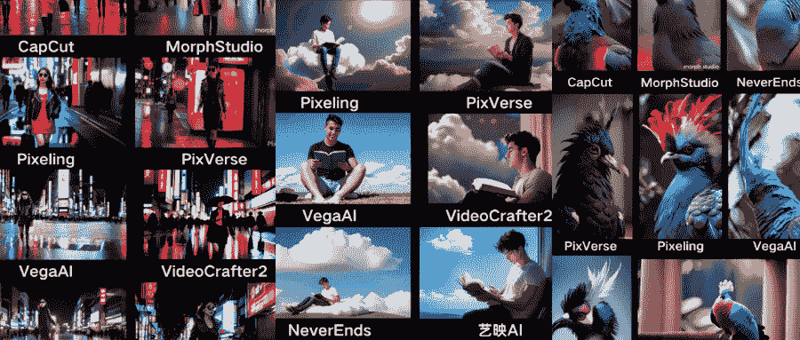

8款工具迎战，6大难关决出终极王者。

距离OpenAI发布Sora已经十几天了，“中国版Sora”表现如何？

本周，我们深度体验了字节的CapCut AI Video、腾讯的VideoCrafter2、爱诗科技的PixVerse等8款国产的AI视频生成工具，设置6道关卡，将其生成视频效果与Sora进行横向测评。

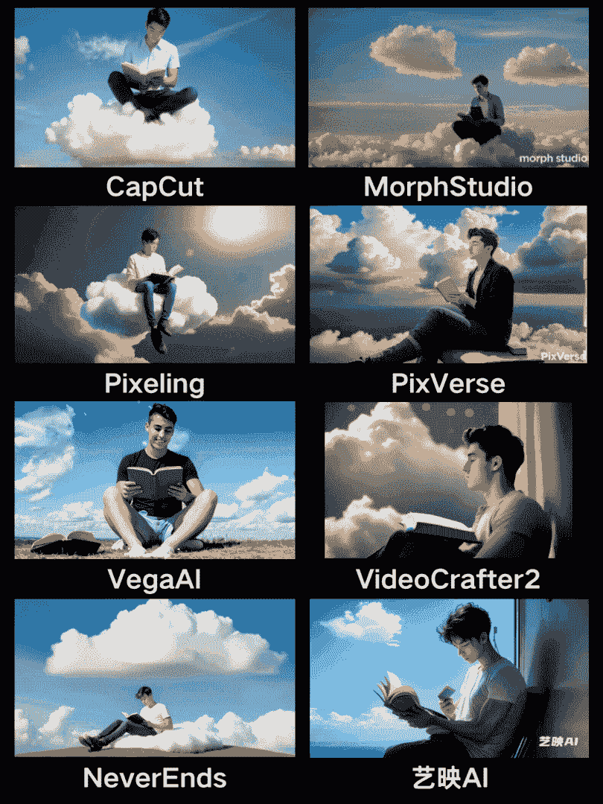

▲8款工具生成结果对比，提示词为：一位20多岁的年轻人坐在天空的云朵上看书

纵观国内玩家，已有超15家企业推出了视频生成工具，既包括百度、阿里、腾讯、字节等6家巨头，也包括爱诗科技、生数科技、智象未来等9家创企。这些企业相比OpenAI做得怎么样？本文在第一部分做了全景式的解读。

综合产品易得性、视频生成速度等因素，本次选取字节的CapCut AI Video、腾讯的VideoCrafter2、右脑科技的Vega AI、爱诗科技的PixVerse、MewXAI的艺映AI、智象未来的Pixeling，以及NeverEnds和Morph Studio的同名产品8款工具进行对比，并从个人体验的角度，尝试从语义理解、运动平滑度、运动程度以及成像质量方面打分。

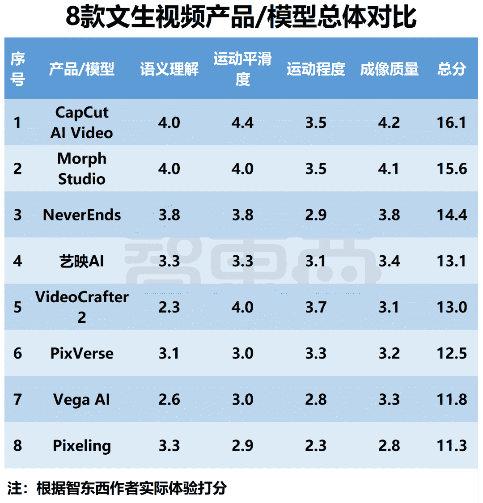

▲八款文生视频工具总体得分对比（智东西制表）

通过体验，我们整体感觉字节短暂上线的CapCut AI Video功能最佳，尤其胜在运动平滑度和成像质量上。

Morph Studio、NeverEnds在创企中领跑，且稳定性较高，在体验过程中没有出现大翻车的情况。

VideoCrafter2、Pixeling生成质量不够稳定，出现了几次大翻车的情况；

PixVerse、Vega AI也出现了不同程度的翻车。

对比Sora如何？总体来讲，智东西有以下几点发现：

1、字节、Morph Studio分别领跑大厂和创企，稳定性和成像质量表现优秀。

2、大部分产品仍处于测试阶段，临时下线、长时间排队、无独立站点成为家常便饭。

3、生成2-4秒视频等待时间多为3-5分钟甚至更久，效率较低。

4、运动程度整体较低，多为平移式运动或镜头运动。

5、人手、动物等仍是重灾区，非现实场景大模型难以理解。

不过，Sora目前仍未面向大众测试，虽然官方公布的视频效果震撼，但产品玩起来如何仍有待实际体验。本文文末附有8款工具的试用链接，感兴趣的读者朋友可以自行体验，欢迎在评论区分享体验感受和新发现~

## 01. 9家创企、6路大厂围攻Sora，八名选手参赛

据智东西不完全统计，目前已发布类Sora产品的国内创业公司有以下9家，分别是Morph Studio、HiDream.ai（智象未来）、爱诗科技、MewXAI、NeverEnds、右脑科技、李白AI实验室、Möbius以及生数科技。

它们的产品发布时间均早于Sora，且大多都同时支持文生视频和图生视频。

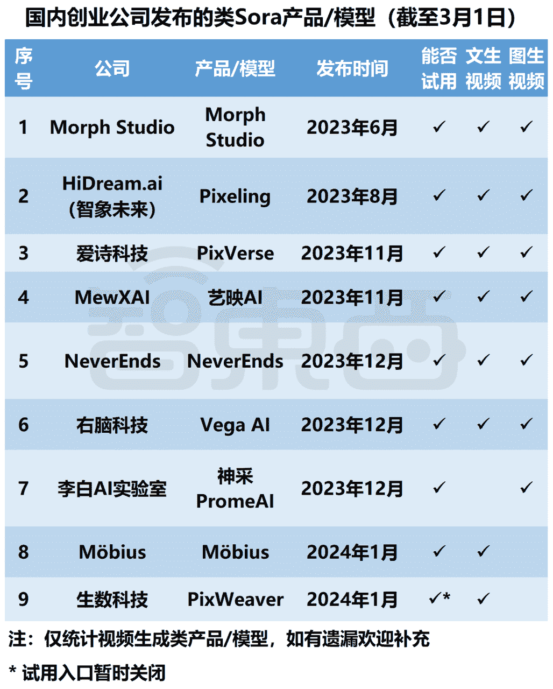

▲国内创业公司发布的Sora类产品/模型（智东西统计制表，数据截至3月1日）

与创企相比，国内大厂在产品落地方面推进更加谨慎。截至发文，只有字节在海外版剪映CapCut中推出了有独立主页的AI视频生成功能，但短暂释出后便下线了，目前尚不清楚其是否基于字节1月发布的MagicVideo-V2模型。

此外，阿里、腾讯的部分模型虽然托管在开源社区，但实际体验过程中生成等待时间过长，有的甚至超过1个小时，因此不在本次对比范围内。

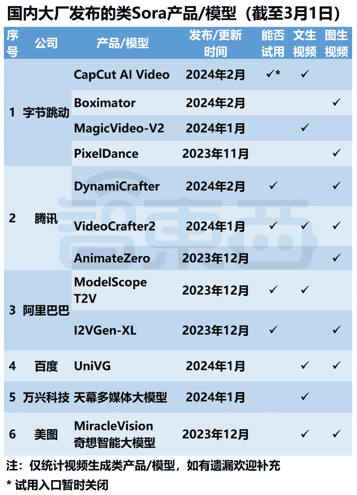

▲国内大厂发布的Sora类产品/模型（智东西统计制表，数据截至2月27日）

本次出战文生视频大赛的8名玩家其各自支持生成的视频时长、扩展功能，以及生成视频的分辨率和帧率如下表所示（按产品名首字母排序）。

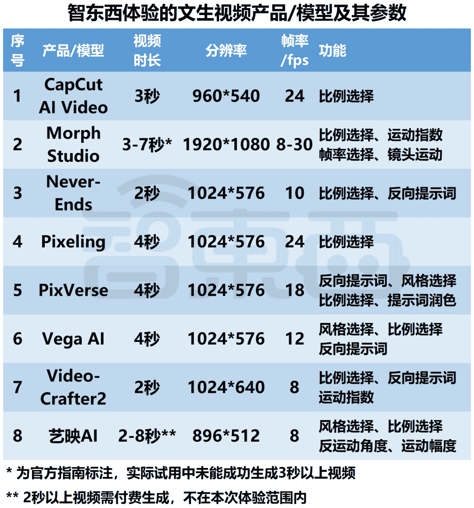

▲可试用的文生视频工具参数对比（智东西制表）

## 02. 六大关卡覆盖三类场景，第六关遇培养皿全员翻车？

为了与Sora的对比更直观，智东西将Sora官方示范视频给出的英文提示词输入这些生成器。公平起见，其他扩展功能如镜头运动、反向提示词等保持默认设置，且均选取第一次生成的视频。

下面让我们具体来看一下各位参赛选手在不同关卡的表现情况。

### 1、人物场景：步行变“漂移”，人手依然是重灾区

提示词1：一个时髦的女人走在东京的街道上，到处都是温暖的霓虹灯和生动的城市标志。她穿着黑色皮夹克、红色长裙、黑色靴子，拿着一个黑色钱包。她戴着太阳镜，涂着红色的口红。她走起路来自信而随意。街道是潮湿和反光的，创造了一个彩色灯光的镜子效果。许多行人走来走去。

首先来看一下Sora放出的Demo，不仅长达1分钟，且完美体现了每一处细节，还进行了景别切换，整体画面十分惊艳。

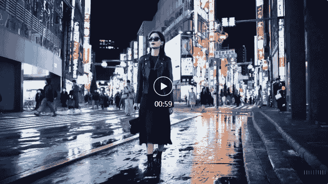

，时长00:59

在参赛选手这边，首先在整体效果上，8款工具基本都呈现了一个女人走在街道上的画面，并且对霓虹灯、城市标志的理解也较为准确。

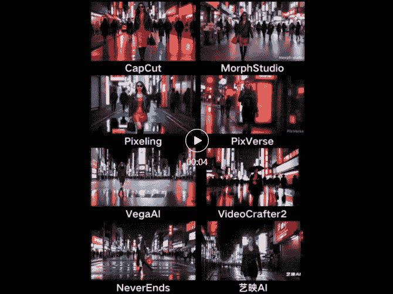

，时长00:04

但细看之下，只有Pixeling、Morph Studio和CapCut较好地描绘了黑色皮夹克、红色长裙、黑色靴子和太阳镜，Morph Studio生成了钱包但错将黑色钱包变成了红色。另外5位选手则对人物细节的生成不太准确，其中VideoCrafter2的看起来甚至不太像人脸。

场景方面，各位选手的表现大同小异，其中CapCut、Morph Studio、Vega AI及NeverEnds生成画面比较精致，但Morph Studio忽略了“潮湿”这个细节。

这道题难度较大，有很多细节上的描述，对女子的穿着、随身物品、风格等进行了详细的要求，稍不注意就会出现失误。背景上，潮湿的地面和霓虹灯反光也是一大难点。

提示词2：一位20多岁的年轻人坐在天空的云朵上看书。Sora的Demo视频展现了年轻人坐在云朵上读书的画面，并且有翻书的细节。

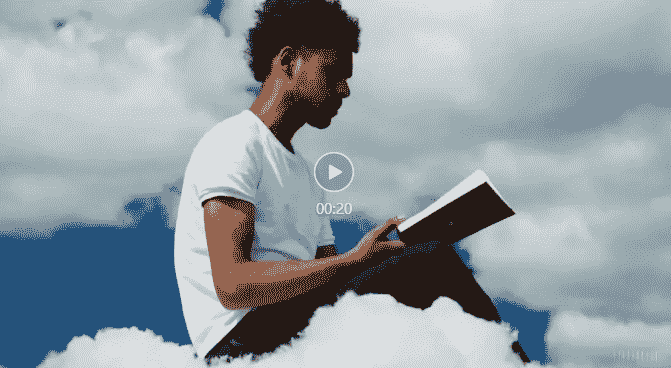

，时长00:20

这一关基本没有难倒参赛选手，8款工具都生成了一个年轻人坐着读书的画面，不过PixVerse、Vega AI没能让人物坐在云上，NeverEnds则把云拽到了地面。VideoCrafter2、艺映AI没有拍到人物的屁股具体在哪儿，但从其背景能够看出大概率并不是云。

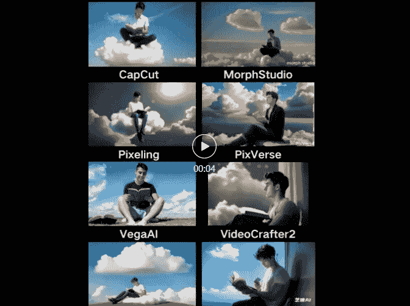

，时长00:04

不出意外的，人手又成了大模型跌倒的重灾区，几乎都糊作一团，有的还出现了第三只手。另外，Pixeling生成的人脸五官有些“抽象”。

从画面风格上来看，PixVerse、艺映AI有点像三维动画风格，整体画面比较精致；Vega AI生成的人物最真实，但整个画面只有背景的云在运动。

这道题的难度中等，不同于前一个提示词，它十分简短并且创造了一个现实生活中不可能出现的场景，主要考验大模型的“想象力”以及对不同主体之间关系的理解能力。

### 2、动物场景：柯基变面包，稀有物种难以描绘

提示词3：一只柯基犬在热带毛伊岛拍摄自己的Vlog。

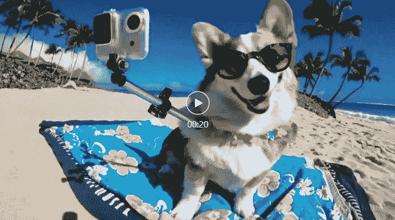

，时长00:20

这个提示词的难点在于，如何表现柯基“拍摄自己”。Sora的演示虽然表现了这个细节，但也有些经不起推敲，自拍杆看起来像长在柯基身体上一样怪异。不过瑕不掩瑜，视频整体效果很精致，柯基表情灵动，还戴上了和热带环境相符的墨镜。

CapCut生成的柯基非常可爱，虽然眼球有些飘逸现象，但不算明显。遗憾的是它没有表现“自拍”这个关键词。

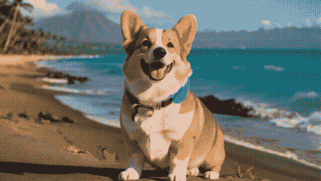

Morph Studio的效果也不错，还给柯基挂上了一台摄像机。

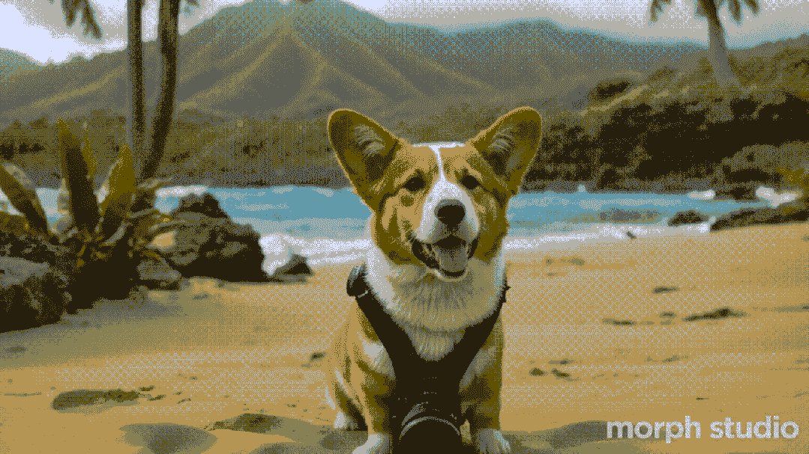

NeverEnds描绘的柯基有点像人，不仅自己上手调试相机，嘴型看起来还像在说话——说好的建国后不准成精呢？另外，NeverEnds生成的柯基似乎长了六条腿，和Sora把蚂蚁画成四条腿有点双向奔赴了。

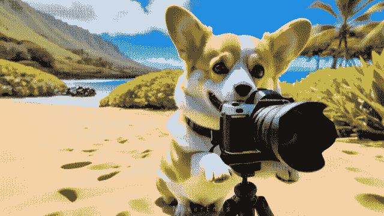

Pixeling没能通过这条测试，直接生成了一段“鬼畜”视频。

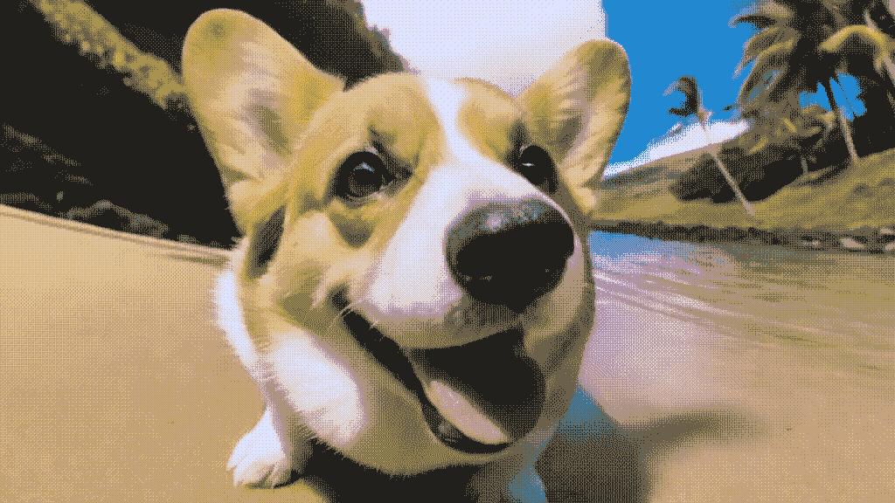

开头可爱的狗狗特写反复变形，让我联想到机器学习中一个很有意思的梗——如何分辨柴犬与面包。看来，Pixeling漏掉了这节课。

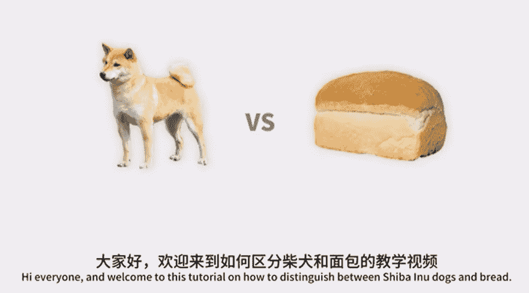

PixVerse理解了“拍摄”，但搞错了主体，生成了一只人手来拍摄柯基犬，这只手也有些“诡异”，AI还是一如既往地在人手上栽了跟头。此外，视频开头处柯基的嘴巴歪得也有些离谱。

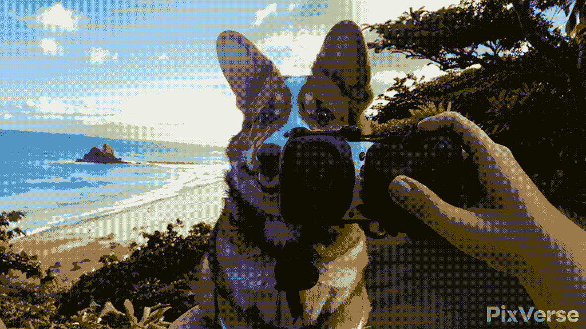

Vega AI生成的视频一开始比较正常，但最后1秒可爱的柯基突然变形，最后表演了一个“头部消失术”。此外，它通过椰子树表现了“热带”，但似乎漏掉了“毛伊岛”这一点。

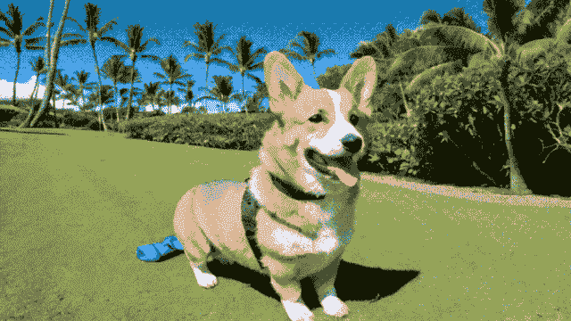

VideoCrafter2似乎只记住了“柯基”这一个关键词，其他的提示词都被它忽略了。它还给画面加了一个神奇的光影，看起来像是夕阳余晖。

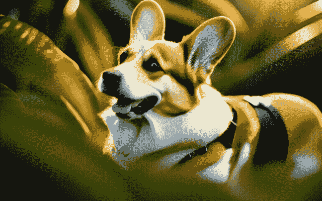

艺映AI生成的狗子画风较为真实，整体画面流畅，不过也没体现“自拍”的细节。

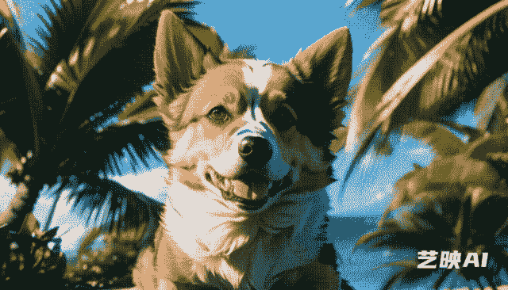

这道题难度中等，整体来看，对提示词理解较好的是Morph Studio和NeverEnds，PixVerse则算是勉强及格。从画面效果上看，CapCut、Morph Studio、VideoCrafter2和艺映AI稳定性较好，画面更加流畅。

提示词4：这个维多利亚凤冠鸠（Victoria crowned pigeon）的特写展示了它引人注目的蓝色羽毛和红色胸部。它的羽冠是由精致的花边羽毛制成的，而它的眼睛是醒目的红色。鸟的头微微向一侧倾斜，给人一种帝王和威严的印象。背景是模糊的，吸引人们注意到这只鸟引人注目的外表。

Sora演示视频中的凤冠鸠全方位地展示了自己的羽冠，正面、侧面、背面都不在话下，羽毛也随着头的转动摇摇晃晃。

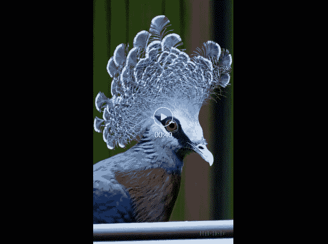

，时长00:40

如果只看画面，除了艺映AI几乎是甩了张静态图出来，其他7位选手的画面效果都还算流畅。

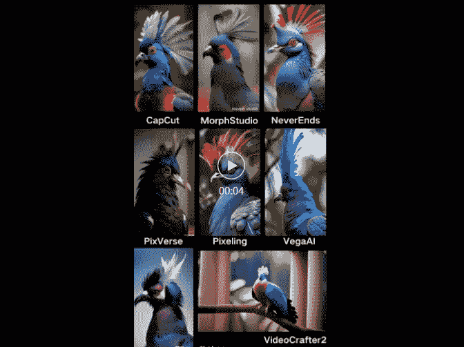

，时长00:04

CapCut、Morph Studio、NeverEnds和Pixeling生成的凤冠鸠基本是同一个角度，没有大幅度的运动或角度变化，PixVerse、Vega AI和VideoCrafter2则有头部角度的变化。

从对该物种的特征还原来看，CapCut、VideoCrafter2表现较好，还原了红色眼睛、红色胸部、蓝色身体以及蓝白色的羽冠，其他6位参赛选手的还原度略低。

此外，VideoCrafter2虽然在使用指南中提到了比例调整的功能，但并没有成功生成9:16的竖屏视频。

这道题难度中等，主要难点在于对不常见动物特征的准确描绘。下图是Sora生成视频截图与动物网站Fact Animal上的维多利亚凤冠鸠照片对比。可以看出，Sora对该动物的还原程度很高，从身体、眼睛的颜色到喙部、羽冠的形状基本都与照片一致。相比之下，8位参赛选手都没能准确表现这些特征。

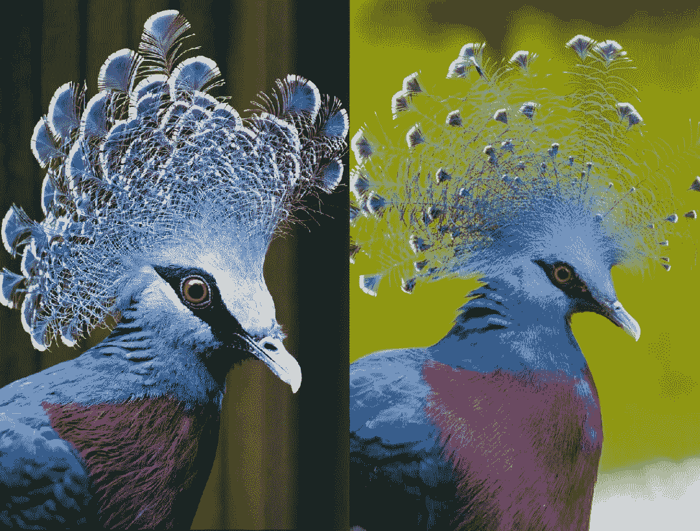

▲Sora生成的（左）与真实的（右）维多利亚凤冠鸠对比

### 3、“虚拟现实”场景：想象力不足，遇“小熊猫培养皿”全员翻车？

提示词5：两艘海盗船在一杯咖啡中航行时相互争斗的逼真特写视频。

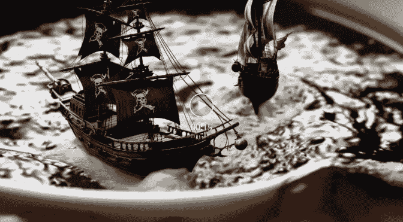

，时长00:15

CapCut成功将海盗船放入了咖啡杯中，但只放了一艘，自然也没办法“相互争斗”。

Morph Studio则将两艘海盗船放进了两个咖啡杯，还自作主张地添加了海洋背景。

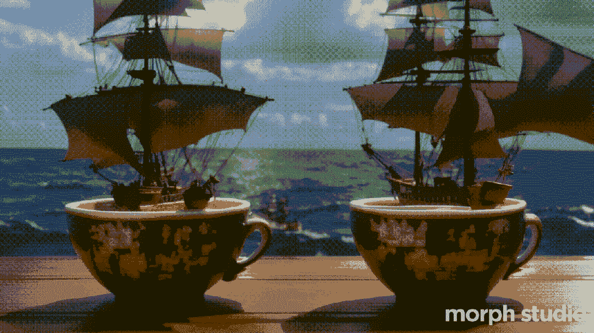

NeverEnds、艺映AI也将船放进了咖啡杯，同时在背景绘制了大海和更多海盗船。NeverEnds还给咖啡加了拉花。

▲NeverEnds生成的咖啡杯海盗船

▲Vega AI生成的咖啡杯海盗船

不过，能将海盗船准确地生成在咖啡杯里已经算比较好的了，其他4位参赛选手在这条提示词上各有各的“翻车”方式。Pixeling直接将海盗船印在了杯子上。

PixVerse分别生成了咖啡杯、海盗船，但稳定性较差，前景中的咖啡杯最后变形成了一艘船。

Vega AI也犯了同样的错误，并且海洋和沙滩的分界线有些模糊。

VideoCrafter2则连海盗船都没能出现，只有几个看起来像海盗帽子的小东西摇来摇去。

这道题难度较大，船在咖啡中航行是不可能在现实中出现的场景，因此必然缺乏能完全与之对应的训练数据，这就很考验大模型的“想象力”。

提示词6：一个培养皿，里面长着一片竹林，里面有小熊猫在跑来跑去。

，时长00:10

这轮比拼十分精彩，几乎是全员翻车。遗憾的是在智东西还没来得及测试更多提示词时，CapCut AI Video就下线了，缺席本轮比赛。

Morph Studio生成的培养皿看起来像一颗水晶球，小熊猫还玩起了“影分身”。

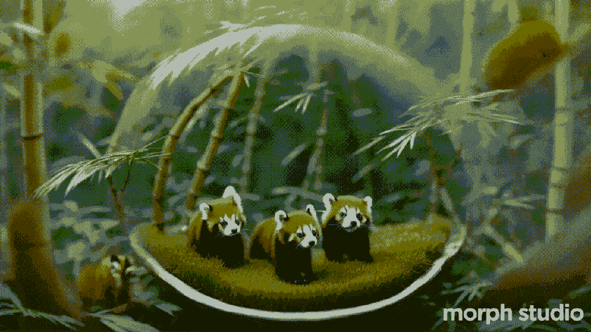

NeverEnds是对几个关键词描绘最准确的，不过还是错把竹林画在了培养皿外面，并且只有镜头运动，画面上的主体几乎静止。

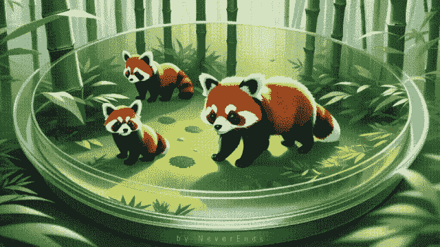

Pixeling准确描绘了培养皿，但“竹林”和小熊猫都仿佛变成了水中的倒影，且和动物关中的柯基一样，小熊猫糊作一团。

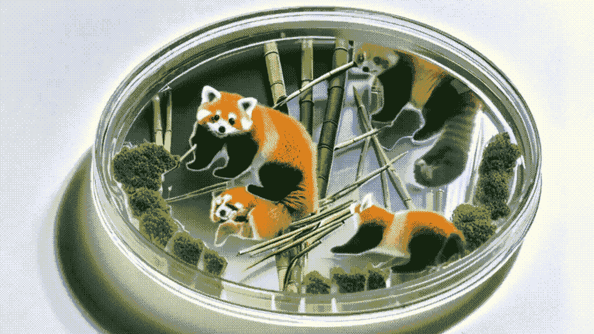

PixVerse的视频中没有出现培养皿。

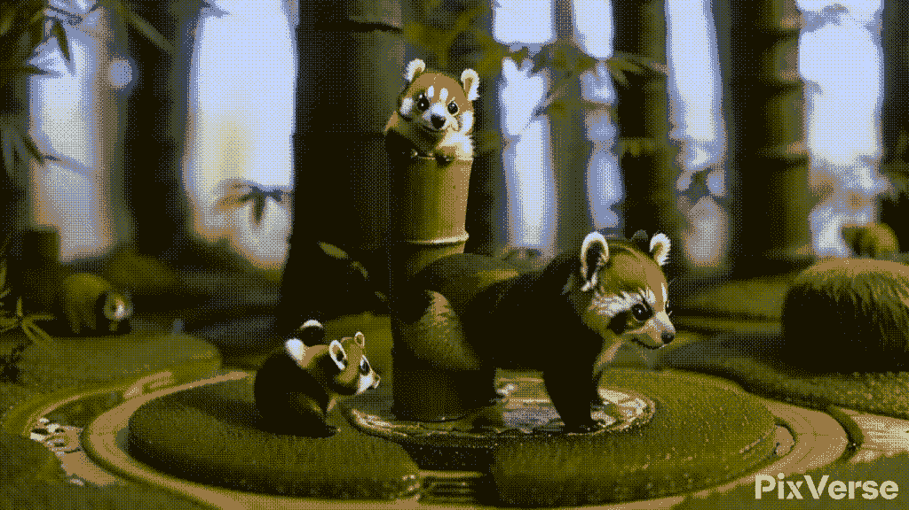

Vega AI生成了一个带盖的“培养皿”，并且搞反了它和竹林之间的包含关系，优点是小熊猫的稳定性较高。

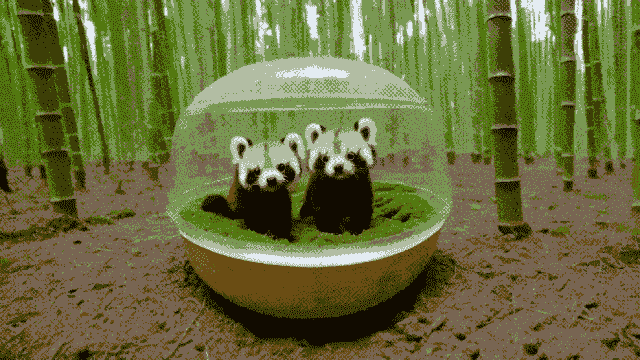

VideoCrafter2生成的小熊猫神态比较灵动，几只小熊猫各自有各自的运动轨迹，但漏掉了培养皿这个关键词。

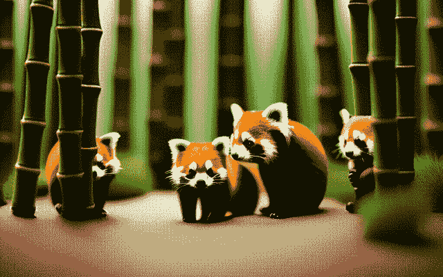

艺映AI在这关翻车比较严重，是唯一一个看不出来画的是什么动物的选手，稳定性也不高。

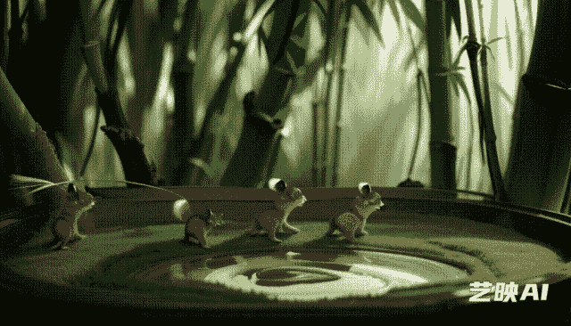

这道题的难度也很高，不仅创造了非现实场景，小熊猫“跑来跑去”这个动线很大的场景也是一大痛点。总的来说，这一关在语义理解上优胜的是Morph Studio、NeverEnds，在画面效果上有优势的是Vega AI和VideoCrafter2。

## 03. 结语：国内AI视频商业化任重道远

在智东西体验这些产品或模型的过程中，遇到了不少令人“头秃”的突发情况。如字节的CapCut AI Video、阿里的ModelScope T2V等待时间过长，生数科技的PixWeaver、万兴科技的Filmora频频出现Bug等，各种各样的不确定因素成为体验路上的拦路虎。

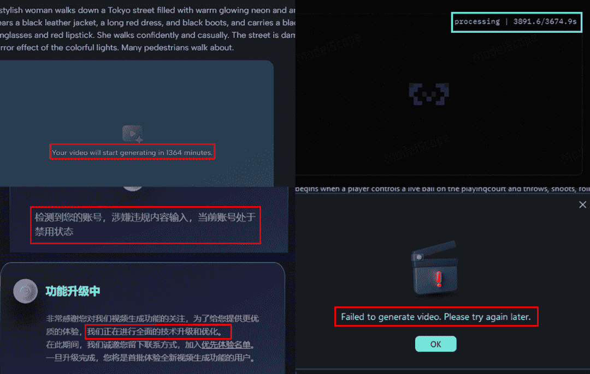

▲等待时间过长、无法生成等情况出现

从不同场景来看，AI在生成人物、常见动物等要素时理解能力表现较好，但当遇到稀有动物、非现实场景等元素时常常翻车，这可能与训练数据量不足有关。

经过一番体验，智东西对国产AI视频工具的印象也大大改观。虽然要追赶甚至超越Sora还有很长的路要走，但至少能和海外其他明星产品如Pika、Runway等一决高下。

近几年来，国内虽然涌现出很多AI视频玩家，但大部分集中在数字人、AI剪辑等赛道，真正的文生视频类产品不多。在Sora爆火之后，我们期待国内涌现出更多视频生成选手，再现“百模大战”的壮观景象。

# 附各工具试用链接：

CapCut AI Video：`https://www.capcut.com/editor-tools/ai-video-generator`

Morph Studio：`https://www.morphstudio.com/`

NeverEnds：`https://neverends.life/`

Pixeling：`https://hidream.ai/#/Pixeling`

PixVerse：`https://app.pixverse.ai/`

Vega AI：`https://www.vegaai.net/textToVideo`

VideoCrafter2：`discord.gg/RQENrunu92`

艺映AI：`https://app.artink.art/mx-video`

`https://aigcreative.feishu.cn/sync/K4Gvd9vUQsy9Oubwqaeclu0Fnbg`
