# 短剧剧本创作 Skill 正式发布！你完全可以靠写剧本赚到第一桶金！

> 来源：[https://aigcreative.feishu.cn/docx/F6XPd3TfKoZzv3xu16Sc7ahJnAd](https://aigcreative.feishu.cn/docx/F6XPd3TfKoZzv3xu16Sc7ahJnAd)

> 来源：X@冰河

> 链接：https://x.com/binghe/status/2027685265817694668

内容有点长，如果你没耐心看，就帮我点个赞吧！

短剧剧本用 Skill 创作是我们工作室业务链路，从写小说（长篇，短篇）到小说转剧本，剧本转场景，场景生成 Seedance 2.0 专业指令中最要的一环！

因为剧本是一个拍摄团队的指导书，如果你也在投稿，这样的剧本格式是非常重要的。

也有人专门写剧本投稿，赚钱！如果通过一稿剧本，最少收入是 3 万左右！剧火了还会有分成，大概是 1.5%（当然这要谈，只有相对成熟的作者有这待遇）

前不久，我发布了写长篇小说，短篇小说的 Skill ，如果你们有兴趣可以去看一下！

**想靠小说赚钱的人必看：Claude Cod**e 长篇小说创收 Skill 实战教程！

今天的教程非常有实战意义，这并不等同于那些工具型，提升效率型的 Skills，而是直接可以拿来就用，用了就可以创收的实用型 Skill！

AI 写小说这个课题在以前，我们写过很多相关文章，AI 网文写作指令都已经升级到了...

**Claude Code 全题材短篇小说超级Skill**s小白使用指南！轻松写出爆火短篇小说！

这篇教程，拖了好久，中间经历了自己两个账号被封的惨痛损失。

话不多说，好饭不怕晚，今天把如何写全题材短篇小说的 Skills 教程分享出来，希望给大家一些帮助。

其实 skills 也可以在 claude...

> **这**两个的 Skill我已经分享在推特的“订阅”里了， 今天的剧本创作 Skill 我也会放进去订阅里，欢迎你成为点亮我小铃当的第一人！

又或者你可以加入我们的社群“**钱来有道”** ，里面有众多写作指令和 Skill 都或免费获得！OK，广告先打到这里！开始介绍下面的内容：

先介绍一下：一个专门为**微短剧剧本创作**打造的 Claude Skill，从选题到完稿全流程覆盖，输入几个指令就能产出专业级短剧剧本，国内出海都能用！帅不？

这个 Skill 能帮你做什么？

完整的创作工作流

很多人用 AI 写短剧，都是直接丢一句"帮我写个霸总短剧"——出来的东西格式乱七八糟，前后矛盾，根本没法用。

**这个 S**kill 不一样。它把专业编剧的完整工作流程拆解成了7个指令，一步步带你走：

**/开始 → /创作方案 → /角色开发 → /**目录 → /分集 → /自检 → /导出

你只需要跟着指令走，每一步都有引导**，每一步都能确**认和调整。最终产出的是一部50-100集的完整短剧剧本，不是一堆散装的故事碎片。

先把 Skill (命名为short-drama的文件夹，放到 claude 的全局 skill 里），然后在某个项目文件夹中（这步非常重要，因为所有的内容都要保存在这里）打开 Claude Code ，然后让他找到short-drama skill ，准备开始！或者直接说，我要写剧本，找到相关 skill

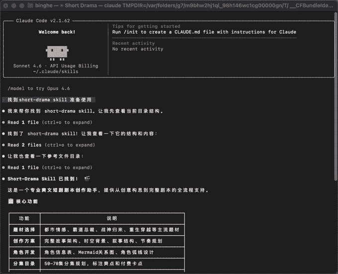

具体每一步能做什么

# 第一步：/开始 —— 选题和定位

Skill 会展示13种主流短剧题材让你选——都市情感、霸道总裁、甜宠、重生穿越、战神归来、古装宫廷、励志逆袭、家庭伦理、萌宝、悬疑探案、软科幻、末日重生、喜剧。每个题材都有受众分析和描述，不用你自己瞎猜。

而且支持**题材叠加**，比如"战神+萌宝"变成战神奶爸归来，"霸总+重生"变成重生后我成了霸总的白月光。组合出差异化的卖点。

选完题材后还会确认目标受众（男频/女频/全年龄）、故事基调（爽燃/甜虐/搞笑/暗黑/温情）、结局类型、集数规模、输出语言。

一次性把方向定死，后面不会跑偏。

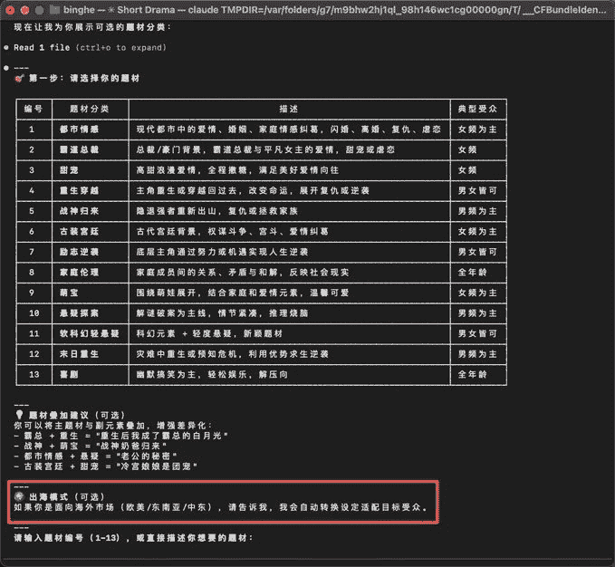

注意，这里还有个出海模式哦。。。做海外剧的剧本创作，我也加了进来！

如果你也是，可以选择出海模式，走的就是另一个产出流程。

会根据海外受众喜欢的内容，做针对性的输出，并且出海模式默认英文，格式自动切换为好莱坞行业标准（INT./EXT.、CLOSE-UP 等）

补充了英文台词写作要点，强调避免中式英语！

[genre-guide.md](https://genre-guide.md/)

出海部分从原来的 23 行扩展到约 100 行！尽量避免中式的叙事结构，增加了本地冲突机制和爽点本地化！

# 第二步：/创作方案 —— 故事的骨架

这一步会自动生成一份完整的创作方案，包括：

1.  3个剧名备选

1.  时空背景和社会环境设定

1.  一句话故事线 + 核心冲突

1.  三大幕叙事结构拆解

1.  **全剧节奏波形图**

哪里是高潮、哪里是低谷、哪里放付费卡点，一目了然，结局设计和爽点矩阵。

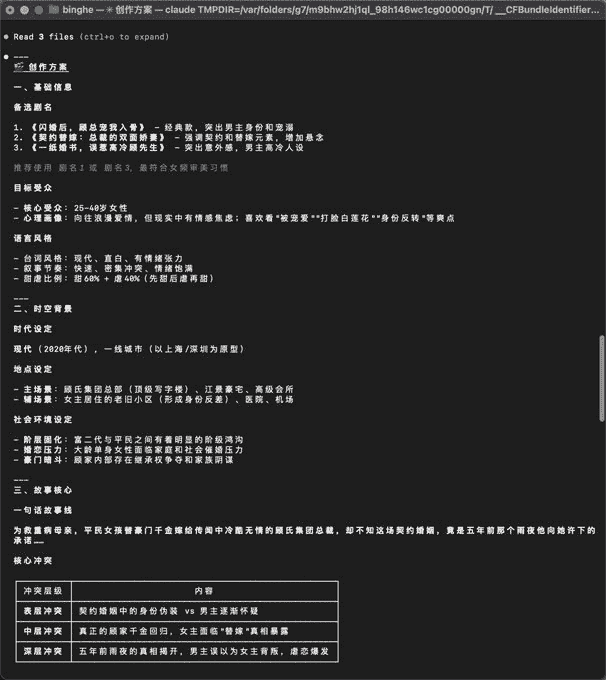

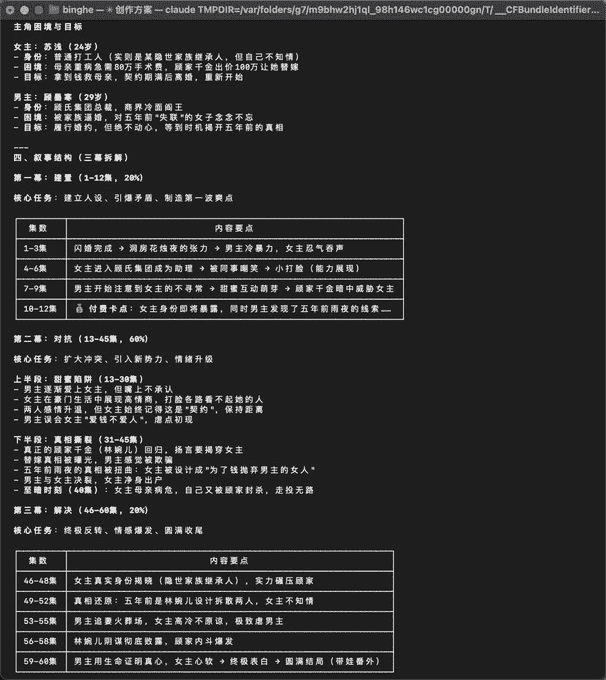

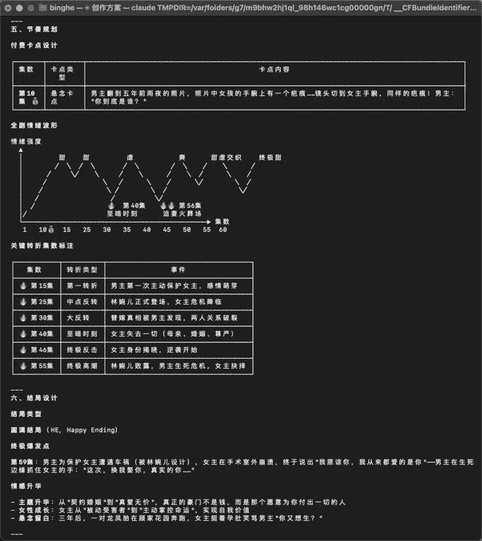

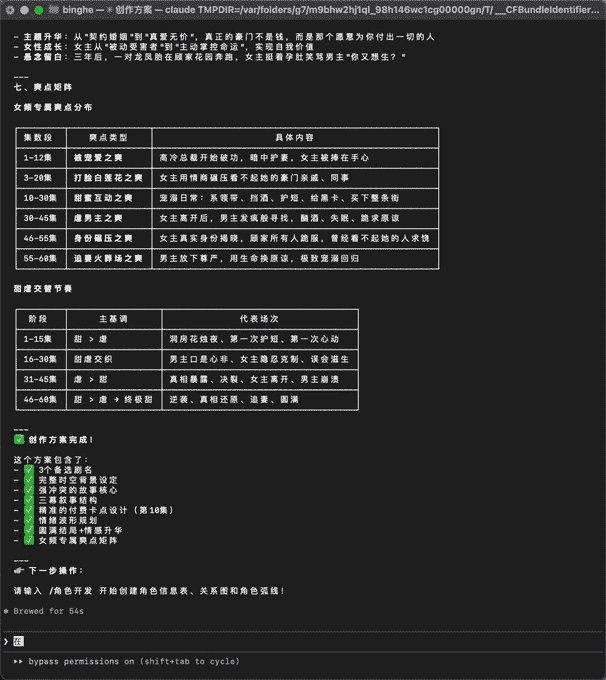

内容比较多，我就先放上这些，你看看就好。

这不是随便编的，是基于 Skill 内置的节奏设计理论、付费卡点策略、开篇黄金法则等专业知识生成的。

# 第三步：/角色开发 —— 让人物活起来

给**每个角色**生成详细的信息表——姓名、年龄外貌、性格特征、公开身份vs真实身份、核心动机、冲突点，最关键的是爽点功能（这个角色在故事里是负责让观众爽的哪个环节）。

还会自动生成：

1.  **Mermaid 角色关系图**——谁跟谁是什么关系，一张图看清楚

1.  **角色弧线设计**——每个角色从头到尾怎么变化

1.  **感情线弧线**——男女主怎么从陌生到相爱

1.  **关键互动场景预设**——第一次冲突在哪、身份揭露在哪、终极对决在哪

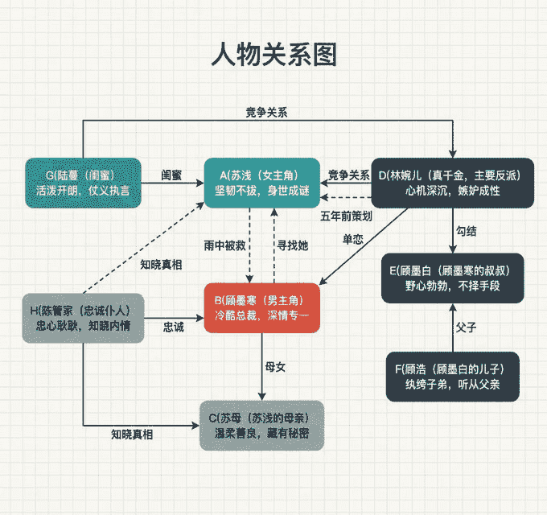

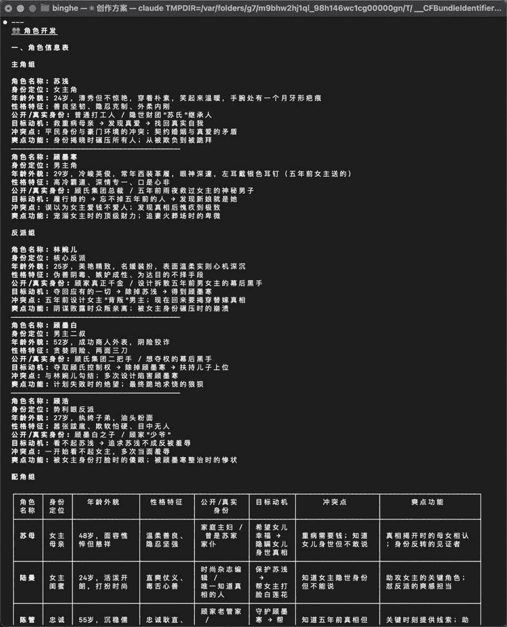

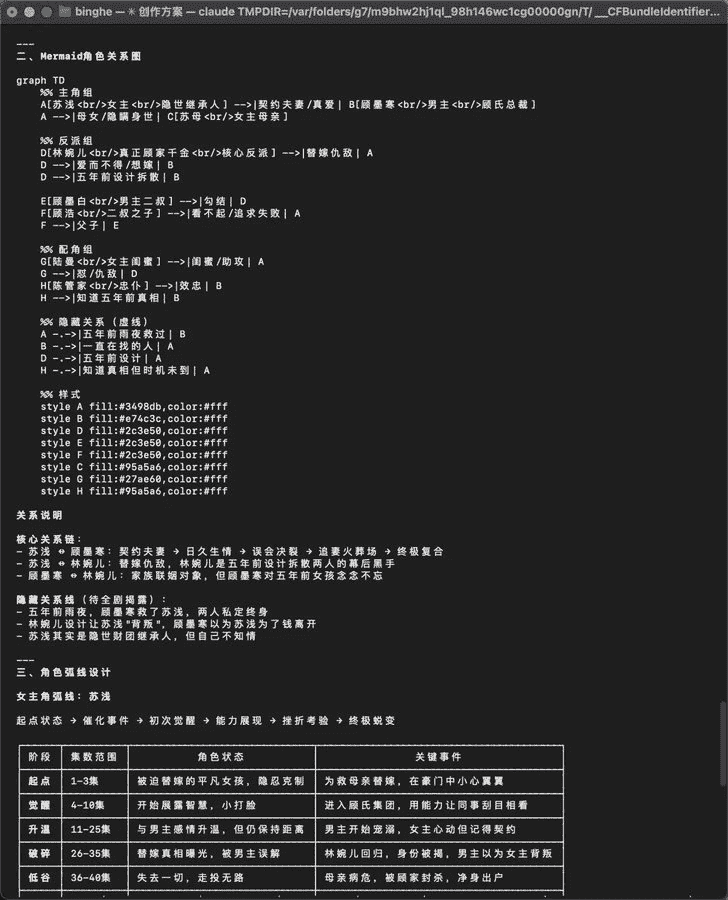

其它的部分你们自己使用时看吧。

# 第四步：/目录 —— 50-100集的完整规划

一集一行，每集标注标题和核心冲突/爽点。重要集用 🔥 标记，付费卡点集用 💰 标记。你一眼就能看出整部剧的节奏走向。

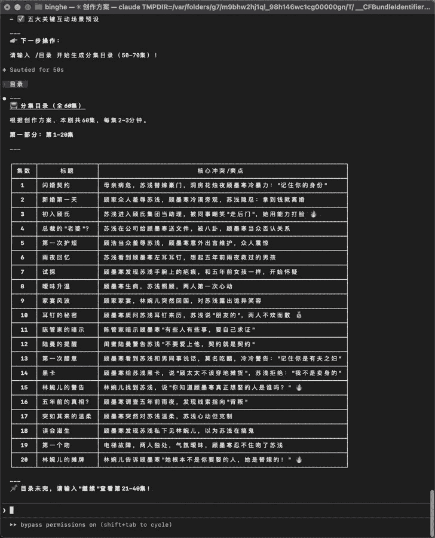

而且 Skill 会强制要求你看完全部目录再开始写分集，避免写到一半发现前面的铺垫不对。

# 第五步：/分集 —— 真正的剧本产出

这是最硬核的部分。

输入 /分集 1 就会按照**专业剧本格式**写出第1集完整剧本：

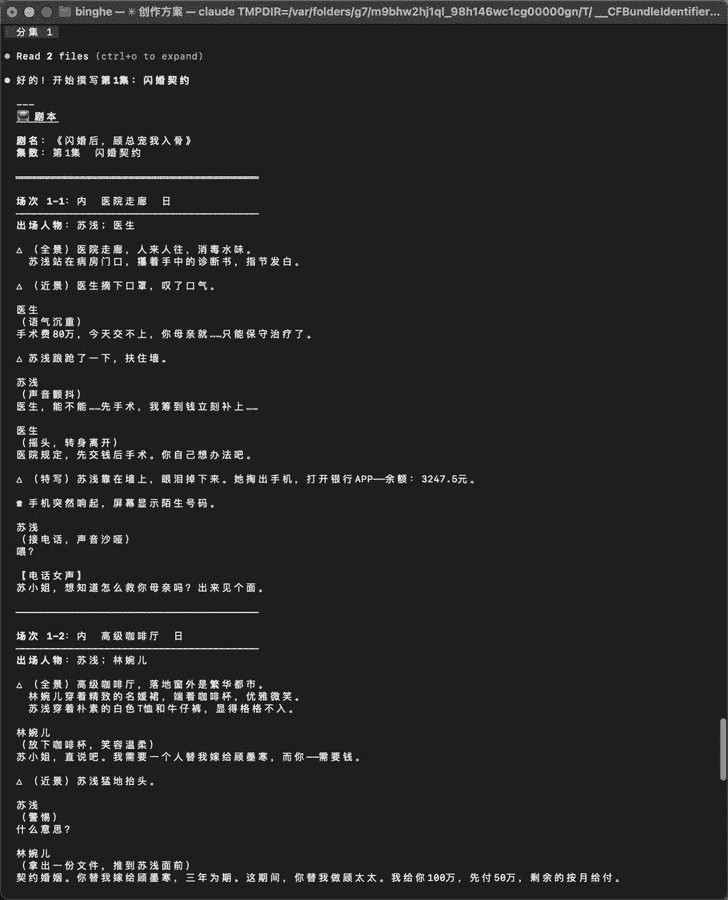

1.  每集 3-5 个场次

1.  每集 800字以上

1.  包含场景头（内/外景、地点、日/夜）

1.  出场人物列表

1.  △ 动作描写（带景别提示：全景/中景/近景/特写）

1.  角色台词（带语气/动作指示）

1.  音乐提示、电话标记等特殊标记

1.  每集结尾必有悬念钩子

这样写出来的东西，导演拿到手就能拍。不需要你再去调格式。

# **第六步：/自检 —— 质量把关**

写完后跑一遍自检，从5个维度打分：

1.  节奏检查（开场够不够快、有没有拖沓）

1.  爽点检查（够不够多、强度够不够）

1.  台词检查（有没有废话、区分度够不够）

1.  格式检查（有没有漏标场景头、景别等）

1.  连贯性检查（跟前面的剧集有没有矛盾）

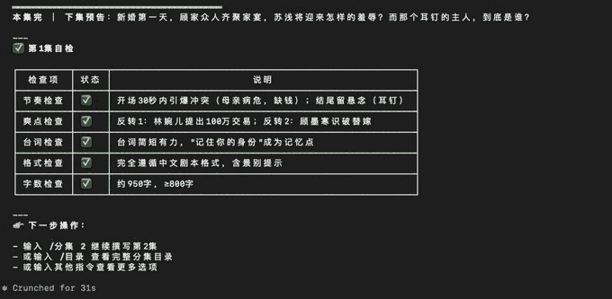

# **第七步：/导出 —— 直接交付**

把完成的剧本导出成专业排版的** .md **文件：

+   标准的剧本结构（场次、场景、人物、台词）

+   专业的拍摄备注（景别、灯光、音乐）

+   完整的元信息（编剧、类型、时长、字数）

+   爽点标注和下集预告

但你可以去用专业工具，转成 docx 格式，然后直接提交给制作方或平台审核。

https://markdowntoword.io/zh

其它已经生成的角色档案，目录，人物关系等，都会保存在项目文件夹中。以备日后查看！

这个 Skill 有什么特别之处？

1.  **内置了一整套爽剧创作方法论**

这不是一个简单的"帮我写个故事"的提示词。Skill** 的 refer**ences 文件夹里塞了7份专业参考文档，总计超过1500行，覆盖了：

1.  **开篇黄金5秒法则**——6种开场模板（直接打脸型、身份反转型、极端困境型、倒叙悬念型、高甜钩子型、重生起始型），每种都有示例

1.  **付费卡点设计**——什么位置放卡点、三大设计原则、5种经典卡点套路

1.  **节奏曲线设计**——单集三幕微结构（前30秒钩子→中间1分钟冲突升级→最后30秒爽点释放）、全剧四阶段节奏波形

1.  **5大爽点类型矩阵**——身份碾压、打脸复仇、逆袭翻盘、情感爆发、视觉冲击，每种都有细分套路

1.  **反派设计要点**——4层反派体系（小反派→中反派→大反派→隐藏反派），怎么让反派越可恨、打脸越爽

1.  **每集钩子设计**——5种钩子类型（悬念钩、反转钩、情绪钩、信息钩、危机钩）

这些都是从短剧行业的实战经验中提炼出来的，Claude Code每次写剧本前会先读这些参考材料，所以出来的东西不会"AI味"太重，是真正懂短剧节奏的。

1.  支持出海——中英文双格式，欧美文化元素库

这是这个 Skill 最大的亮点之一。现在短剧出海是大趋势，ReelShort 2025年Q1全球收入就超过1.3亿美元。

Skill 内置了：

1.  **中英文双剧本格式**——选中文就用国内标准格式，选英文就自动切换好莱坞行业标准（INT./EXT.、CLOSE-UP等），不会出现中英文混用的尴尬

1.  **文化元素映射表**——国内的修仙、王爷、宫斗、战神等设定，对应到欧美、东南亚、中东分别怎么转换

1.  **欧美已验证爆款元素库**——从 ReelShort、DramaBox 的真实数据中总结出来的，哪些元素在欧美市场转化率最高（Billionaire、Werewolf/Alpha、Flash Marriage、Secret Baby……）

1.  **欧美文化元素速查**——社交场景（慈善晚宴、法庭、圣诞聚会）、文化符号（黑卡、家族信托、律师函）、情感表达差异

1.  **中式叙事陷阱清单**——哪些中国式剧情套路在欧美市场水土不服（比如"你不孝"、跪地道歉、重男轻女作为核心冲突），帮你避坑

输入 /出海 就能一键切换出海模式。

1.  **合规审核清单**

很多人写短剧光顾着爽，忘了审核。2024年6月起微短剧管理新规已经实施，不合规的内容上都上不了线。

Skill 内置了完整的**合规审核检查清单**：

1.  红线内容清单（绝对不能碰的）

1.  高风险内容处理指南（暴力尺度、情感尺度、社会敏感话题怎么把握）

1.  短剧特有的踩雷点（主角"法外开恩"、金钱万能论、封建糟粕等）

1.  正向价值观清单

输入 /合规 就能对已完成的剧本做一次全面合规扫描。

1.  不是"一次性提示词"，是真正的工作流工具

市面上大部分短剧提示词都是一次性的——你丢进去，出来一坨东西，用不了还得自己改。

这个 Skill 的设计思路完全不同：

1.  **渐进式创作**：每一步确认后才进入下一步，不会一口气吐出一堆不可控的内容

1.  **可随时调整**：每个阶段都可以回头修改，改完创作方案可以重新生成目录，改完角色可以更新关系图

1.  **上下文连贯**：写第10集的时候，Claude Code知道前9集发生了什么，角色关系怎么变化的，不会出现前后矛盾

1.  **质量可控**：每集写完可以跑自检，不满意就重写，满意了再往下走

1.  专业剧本格式，拿到手就能用

很多 AI 生成的"剧本"其实就是小说**，没法直接拍。这个** Skill 产出的是真正的文学剧本格式：

1.  有场景头（内/外景、具体地点、日/夜时间）——场务看了就知道怎么安排

1.  有景别提示（全景、中景、近景、特写）——导演和摄影师看了就知道怎么拍

1.  有动作描写和语气指示——演员看了就知道怎么演

1.  有音乐提示——后期配乐有参考

不管是提交给短剧制作公司、上传到平台审核、还是自己组团队拍，都能直接用。

# 适合谁用？

1.  **短剧编剧/创作者**：提高产出效率，一个人就能搞定从创意到完整剧本

1.  **短剧制作公司**：快速生成剧本初稿，再由人工编剧精修

1.  **短剧出海团队**：直接产出英文剧本，内置欧美市场洞察

1.  **网文作者转型短剧**：有故事底子但不熟悉剧本格式的人，跟着流程走就对了

1.  **想试水短剧赛道的个人创业者**：低成本快速验证想法

# 最后说一句

**这个 Skill 的**核心理念很简单：让 AI 真正懂短剧。

不是让 AI 随便编个故事，而是让它理解短剧的节奏逻辑——为什么前5秒必须抓人，为什么每集结尾要留钩子，为什么付费卡点放在第10集而不是第20集，为什么反派必须先嚣张够了再被打脸。

这些"短剧的手艺"，全部编码进了 Skill 的参考文档里。Claude Code每次创作前都会读一遍，所以它写出来的东西，是真正按照爆款短剧的套路来的。

用起来试试，你会发现它比你想象的更懂短剧。

<https://aigcreative.feishu.cn/sync/K4Gvd9vUQsy9Oubwqaeclu0Fnbg>

# 知识库动态