# 收藏！AI视频入门速查手册，快速掌握视频创作20大核心功能！

> 来源：[https://aigcreative.feishu.cn/docx/MTWvdBakfohrPDxckd4cc2iEnMe](https://aigcreative.feishu.cn/docx/MTWvdBakfohrPDxckd4cc2iEnMe)

> 图片来源于网络X

> 整理：AIGC创意猎人

电影大片、广告宣传片的制作总是给人一种高大上的距离感，但在生成式AI视频技术的加持下，这种界限正被逐步打破。

随着生成式AI视频产品（如Runway、LumaAI、可灵、即梦等）功能的持续进化与完善，无论你是专业导演还是普通用户，只需几行文字（prompt）或一张图片，就能生成令人惊叹的视频内容。AI将你“脑中的想象”变成“屏幕上的现实”，赋予我们从未体验过的创作体验。

然而，要想达到专业导演、摄影摄像师的水平，还是需要系统的学习的。

在X上看到这张Runway Gen-3的快速入门学习指南，觉得非常好非常有用！

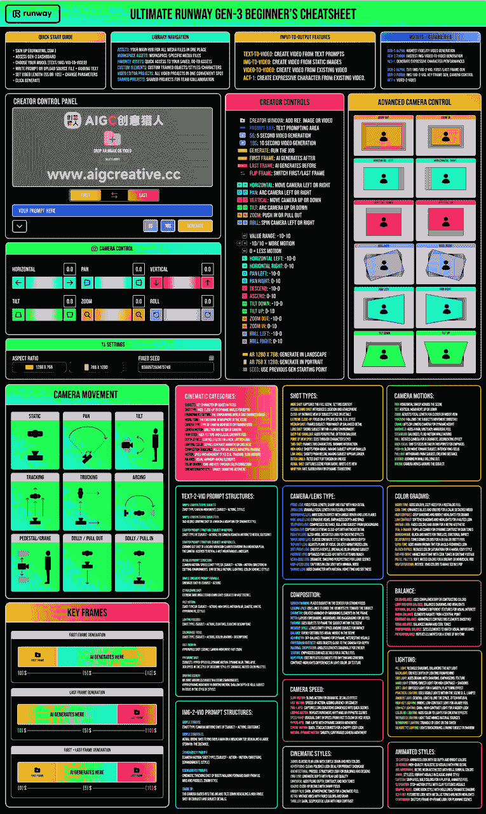

这份速查表详细解析了 Runway Gen-3 的核心功能，包括从文字到视频、图像到视频的创作流程，以及镜头运动、关键帧控制、高级摄像设置等模块。通过直观的控制面板，用户可调整镜头平移、倾斜、缩放等效果，并结合丰富的电影风格、颜色分级及镜头类型，创作出高质量的视频内容。

此外，还提供了结构化的文本提示模板，让用户快速上手视频生成功能。

对于创作者，这是一张整合了AI视频创意与技术的全能速查表。除去前面关于Runway的操作外，后面的内容对于所有的生成式AI视频产品都适用，特整理分享给AI视频的初学者朋友们。

下面与【创意猎人】一起一一来拆解这张内容丰富的AI视频使用指南：

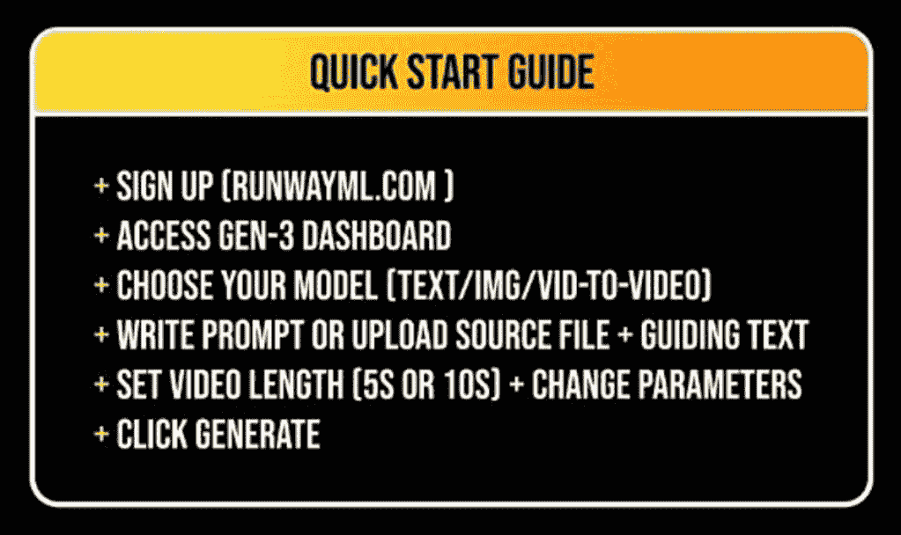

## Quick Start Guide 快速入门指南

+ **Sign up (runwayml.com)**: Create an account on RunwayML.

注册 (runwayml.com)：在 RunwayML 上创建账户。

+ **Access gen-3 dashboard**: Open the Gen-3 Dashboard.

访问 Gen-3 控制面板：打开 Gen-3 控制面板。

+ **Choose your model (text/img/vid-to-video)**: Select your desired model.

选择模型 (文本/图像/视频生成视频)：选择您需要的模型。

+ **Write prompt or upload source file + guiding text**: Input your prompt or upload your source materials.

输入提示词或上传素材文件 + 指导文本：输入提示词或上传您的素材文件。

+ **Set video length (5s or 10s) + change parameters**: Adjust video duration and settings.

设置视频时长 (5秒或10秒) + 修改参数：调整视频时长和相关设置。

+ **Click generate**: Start generating your video.

点击生成：开始生成您的视频。

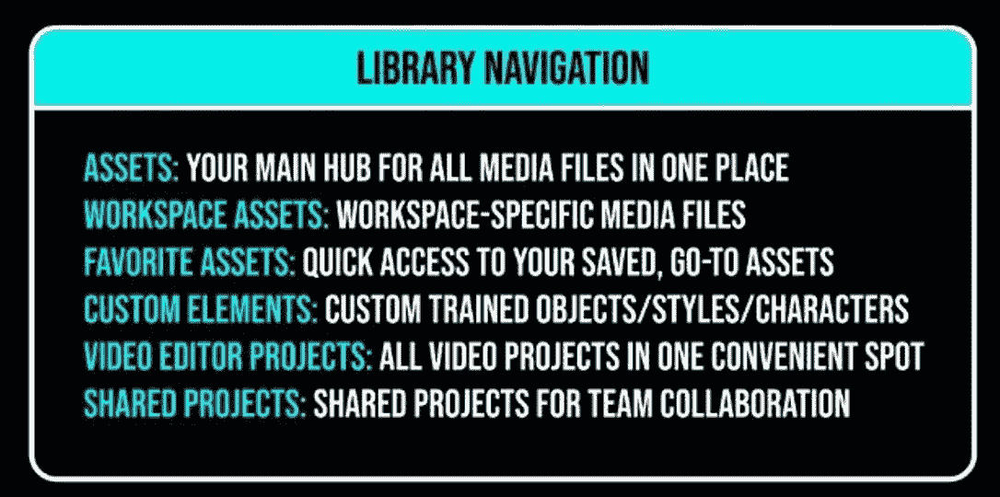

## Library Navigation 目录导航

+ **Assets**: Your main hub for all media files in one place.

素材库: 您的所有媒体文件集成在一个地方的主要中心。

+ **Workspace assets**: Workspace-specific media files.

工作区素材: 与工作区相关的特定媒体文件。

+ **Favorite assets**: Quick access to your saved, go-to assets.

收藏素材: 快速访问您保存的常用素材。

+ **Custom elements**: Custom trained objects/styles/characters.

自定义元素: 自定义训练的对象、风格或角色。

+ **Video editor projects**: All video projects in one convenient spot.

视频编辑项目: 将所有视频项目集中于一个便捷位置。

+ **Shared projects**: Shared projects for team collaboration.

共享项目: 用于团队协作的共享项目。

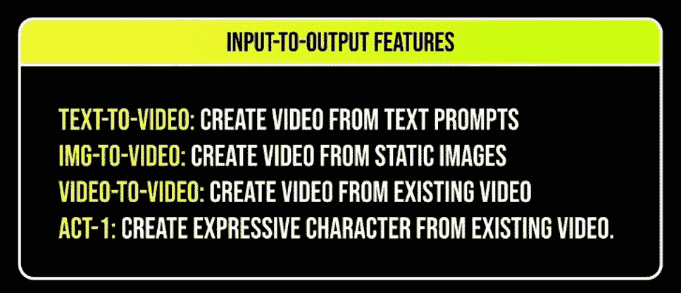

## Input-to-Output Features 输入到输出功能

+ **Text-to-video**: Create video from text prompts.

文字生成视频：通过文本提示生成视频。

+ **Img-to-video**: Create video from static images.

图像生成视频：通过静态图像生成视频。

+ **Video-to-video**: Create video from existing video.

视频生成视频：通过已有视频生成新视频。

+ **Act-1**: Create expressive character from existing video.

Act-1 动态角色生成：从现有视频中创建富有表现力的角色。

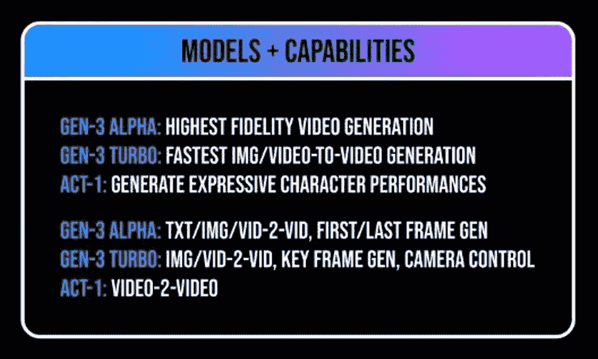

## Models + Capabilities 模型与功能

+ **Gen-3 Alpha**: Highest fidelity video generation.

Gen-3 Alpha：最高保真度的视频生成。

+ **Gen-3 Turbo**: Fastest img/video-to-video generation.

Gen-3 Turbo：最快的图像/视频生成视频功能。

+ **Act-1**: Generate expressive character performances.

Act-1：生成具有表现力的角色表演。

+ **Gen-3 Alpha**: Txt/img/vid-to-vid, first/last frame gen.

Gen-3 Alpha：支持文本/图像/视频生成视频功能，并生成首帧或尾帧。

+ **Gen-3 Turbo**: Img/vid-to-vid, key frame gen, camera control.

Gen-3 Turbo：支持图像/视频生成视频功能，关键帧生成及摄像机控制。

+ **Act-1**: Video-to-video.

Act-1：视频生成视频功能。

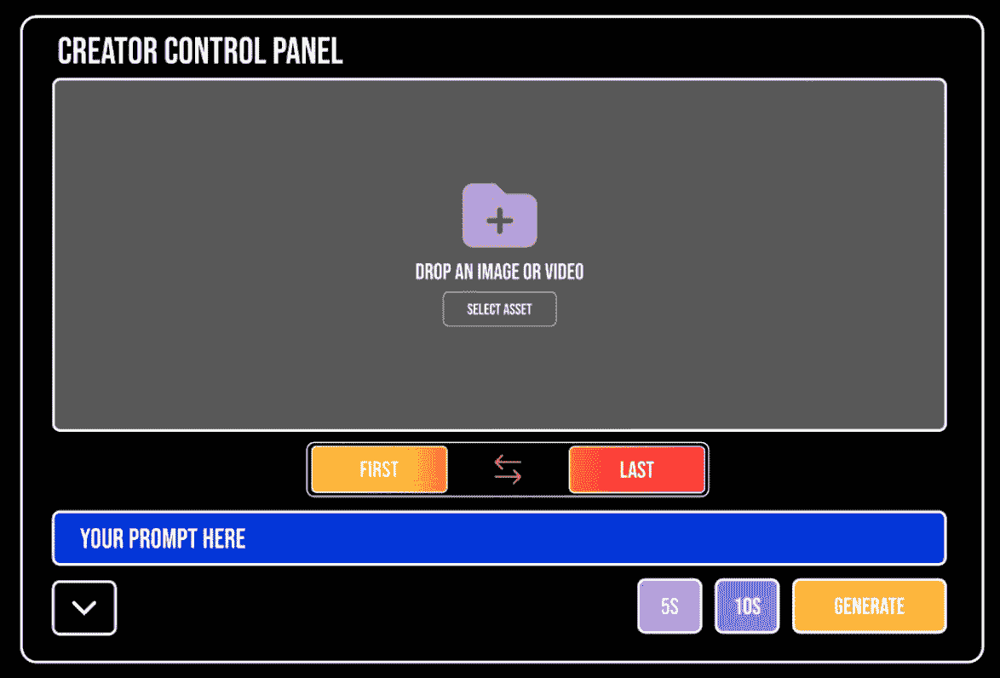

## Creator Control Panel 创建者控制面板

+ **Drop an image or video**: Upload your image or video file.

拖入图片或视频：上传您的图片或视频文件。

+ **Select asset**: Choose an asset to work with.

选择素材：选择要处理的素材。

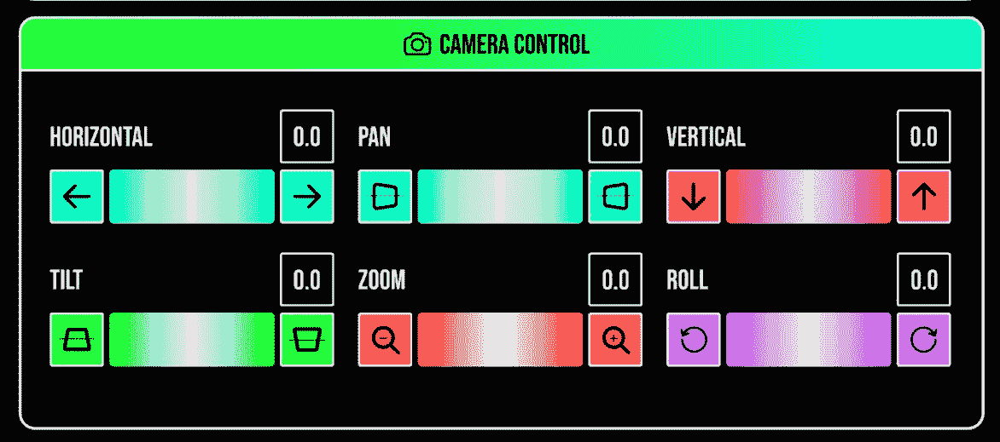

## Camera Control 摄像机控制

+ **Horizontal**: Adjust the horizontal position.

水平：调整摄像机的水平位置。

+ **Pan**: Move the camera from side to side.

平移：左右移动摄像机。

+ **Vertical**: Adjust the vertical position.

垂直：调整摄像机的垂直位置。

+ **Tilt**: Adjust the tilt angle of the camera.

倾斜：调整摄像机的倾斜角度。

+ **Zoom**: Zoom in or out.

缩放：放大或缩小画面。

+ **Roll**: Adjust the rotation around the camera's axis.

旋转：调整摄像机轴心的旋转角度。

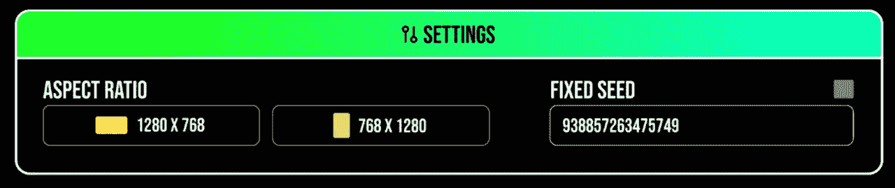

## Settings 设置

+ **Aspect Ratio**: Select the aspect ratio for your output.

纵横比：选择输出的宽高比。

+ **1280 x 768**: Standard horizontal layout.

1280 x 768：标准横向布局。

+ **768 x 1280**: Standard vertical layout.

768 x 1280：标准纵向布局。

+ **Fixed Seed**: Set a fixed seed value to ensure consistent outputs.

固定种子：设置固定的种子值以确保输出一致性。

+ Current seed: **938857263475749**

当前种子值：938857263475749

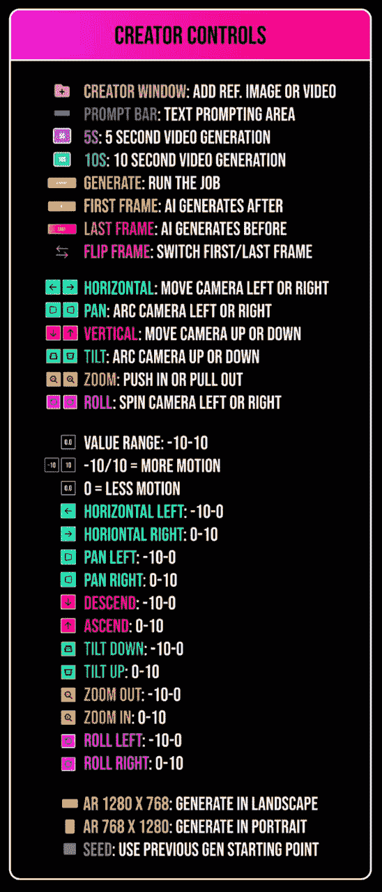

## Creator Controls 创建者控制

+ **Creator Window**: Add reference image or video.

创建窗口：添加参考图片或视频。

+ **Prompt Bar**: Text prompting area.

提示栏：输入文本提示区域。

+ **5s**: 5-second video generation.

5秒：生成5秒视频。

+ **10s**: 10-second video generation.

10秒：生成10秒视频。

+ **Generate**: Run the job.

生成：启动生成任务。

+ **First Frame**: AI generates content after this frame.

首帧：AI从此帧之后生成内容。

+ **Last Frame**: AI generates content before this frame.

末帧：AI从此帧之前生成内容。

+ **Flip Frame**: Switch first and last frames.

翻转帧：切换首帧和末帧。

### Camera Movements 摄像机移动

+ **Horizontal**: Move camera left or right.

水平：左右移动摄像机。

+ **Pan**: Arc camera left or right.

平移：摄像机弧形左右移动。

+ **Vertical**: Move camera up or down.

垂直：上下移动摄像机。

+ **Tilt**: Arc camera up or down.

倾斜：摄像机弧形上下移动。

+ **Zoom**: Push in or pull out.

缩放：拉近或拉远摄像机。

+ **Roll**: Spin camera left or right.

旋转：左右旋转摄像机。

### Value Range 数值范围

+ **Range**: -10 to 10.

范围：-10到10。

+ **-10/10**: More motion.

-10/10：更多运动。

+ **0**: Less motion.

0：较少运动。

### Specific Adjustments 具体调整

+ **Horizontal Left**: -10 to 0.

水平左移：-10到0。

+ **Horizontal Right**: 0 to 10.

水平右移：0到10。

+ **Pan Left**: -10 to 0.

左平移：-10到0。

+ **Pan Right**: 0 to 10.

右平移：0到10。

+ **Descend**: -10 to 0.

下降：-10到0。

+ **Ascend**: 0 to 10.

上升：0到10。

+ **Tilt Down**: -10 to 0.

向下倾斜：-10到0。

+ **Tilt Up**: 0 to 10.

向上倾斜：0到10。

+ **Zoom Out**: -10 to 0.

缩小：-10到0。

+ **Zoom In**: 0 to 10.

放大：0到10。

+ **Roll Left**: -10 to 0.

左旋转：-10到0。

+ **Roll Right**: 0 to 10.

右旋转：0到10。

### Aspect Ratios 和种子

+ **AR 1280 x 768**: Generate in landscape.

宽屏模式：生成横向布局视频。

+ **AR 768 x 1280**: Generate in portrait.

竖屏模式：生成纵向布局视频。

+ **Seed**: Use previous generation starting point.

种子：使用上次生成的起始点。

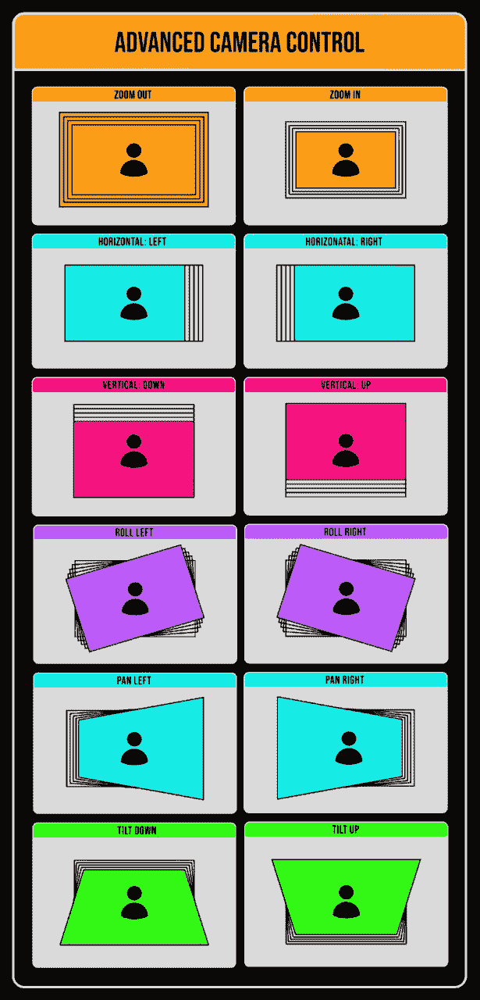

## Advanced Camera Control 高级摄像机控制

+ **Zoom Out**: Reduce the field of view to show a larger area.

缩小：减小视野范围，显示更大区域。

+ **Zoom In**: Increase the field of view to focus on a smaller area.

放大：增大视野范围，聚焦于较小区域。

+ **Horizontal Left**: Move the camera to the left.

水平左移：将摄像机向左移动。

+ **Horizontal Right**: Move the camera to the right.

水平右移：将摄像机向右移动。

+ **Vertical Down**: Move the camera downward.

垂直向下：将摄像机向下移动。

+ **Vertical Up**: Move the camera upward.

垂直向上：将摄像机向上移动。

+ **Roll Left**: Rotate the camera counterclockwise.

左旋转：逆时针旋转摄像机。

+ **Roll Right**: Rotate the camera clockwise.

右旋转：顺时针旋转摄像机。

+ **Pan Left**: Shift the camera's field of view to the left.

左平移：将摄像机视野向左平移。

+ **Pan Right**: Shift the camera's field of view to the right.

右平移：将摄像机视野向右平移。

+ **Tilt Down**: Tilt the camera angle downward.

向下倾斜：将摄像机角度向下倾斜。

+ **Tilt Up**: Tilt the camera angle upward.

向上倾斜：将摄像机角度向上倾斜。

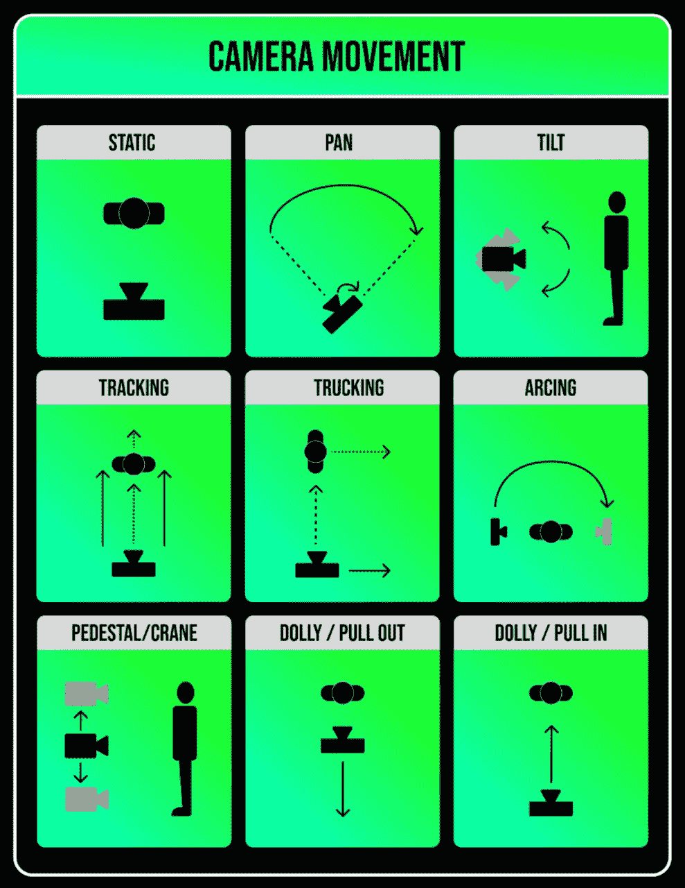

## Camera Movement 摄像机移动

+ **Static**: The camera remains fixed in one position.

静止：摄像机保持固定位置不动。

+ **Pan**: The camera swivels horizontally from a fixed position.

平移：摄像机从固定位置水平旋转。

+ **Tilt**: The camera tilts up or down from a fixed position.

倾斜：摄像机从固定位置上下倾斜。

+ **Tracking**: The camera moves to follow a subject.

跟踪：摄像机随主体移动。

+ **Trucking**: The camera moves laterally left or right.

横移：摄像机水平向左或向右移动。

+ **Arcing**: The camera moves in a curved path around the subject.

弧形运动：摄像机围绕主体沿曲线路径移动。

# Camera Moves 镜头基本移动

+ **Pedestal/Crane**: The camera moves vertically up or down.

升降：摄像机上下移动。

+ **Dolly** / **Pull Out**: The camera moves backward to increase the distance.

推轨/拉远：摄像机向后移动以增大距离。

+ **Dolly** / **Pull In**: The camera moves forward to decrease the distance.

推轨/拉近：摄像机向前移动以减小距离。

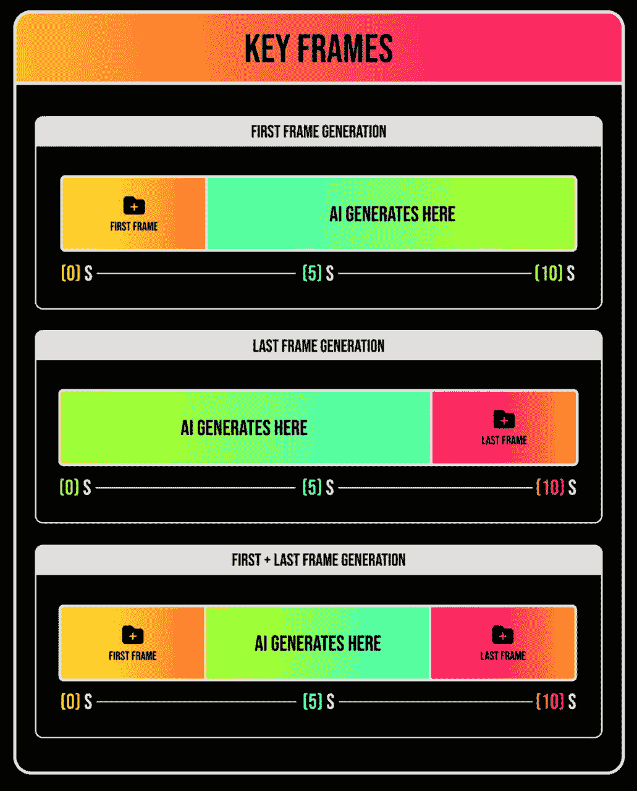

# Key Frames 关键帧

+ **First Frame Generation**: AI generates the animation after the first frame, starting from 0 seconds to 10 seconds.

首帧生成：AI在首帧之后生成动画，从0秒到10秒。

+ **Last Frame Generation**: AI generates the animation before the last frame, spanning from 0 seconds to 10 seconds.

末帧生成：AI在末帧之前生成动画，从0秒到10秒。

+ **First + Last Frame Generation**: AI generates the animation between the first and last frames, covering 0 seconds to 10 seconds.

首帧+末帧生成：AI在首帧和末帧之间生成动画，时间范围为0秒到10秒。

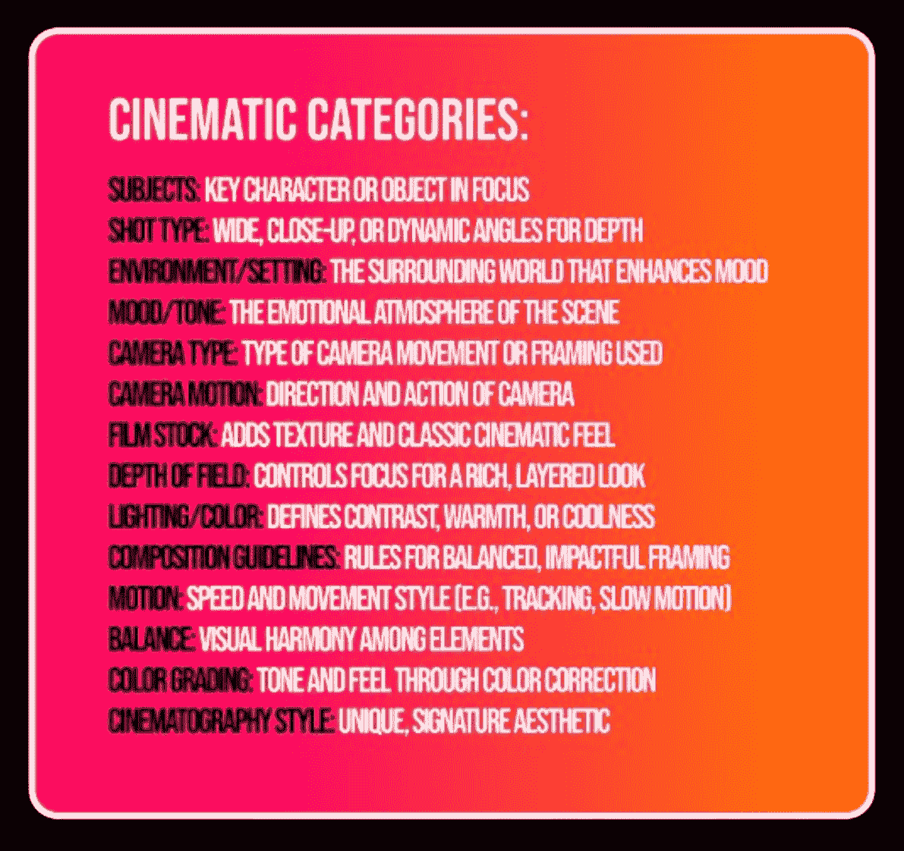

# Cinematic Categories 电影分类

+ **Subjects**: Key character or object in focus.

主题：聚焦于关键角色或物体。

+ **Shot Type**: Wide, close-up, or dynamic angles for depth.

镜头类型：广角、特写或动态角度以增加画面深度。

+ **Environment/Setting**: The surrounding world that enhances mood.

环境/场景：增强氛围的周围世界。

+ **Mood/Tone**: The emotional atmosphere of the scene.

情绪/色调：场景的情感氛围。

+ **Camera Type**: Type of camera movement or framing used.

摄像机类型：所使用的摄像机移动方式或画面框架。

+ **Camera Motion**: Direction and action of the camera.

摄像机动作：摄像机的方向和动作。

+ **Film Stock**: Adds texture and a classic cinematic feel.

胶片效果：添加纹理和经典的电影质感。

+ **Depth of Field**: Controls focus for a rich, layered look.

景深：控制焦点以呈现丰富的分层效果。

+ **Lighting/Color**: Defines contrast, warmth, or coolness.

光影/色彩：定义画面的对比度、暖色或冷色。

+ **Composition Guidelines**: Rules for balanced, impactful framing.

构图指南：平衡和有影响力画面的规则。

+ **Motion**: Speed and movement style (e.g., tracking, slow motion).

动作：速度和移动风格（如跟踪镜头、慢动作）。

+ **Balance**: Visual harmony among elements.

平衡：画面元素之间的视觉和谐。

+ **Color Grading**: Tone and feel through color correction.

调色：通过色彩校正塑造画面的色调和感觉。

+ **Cinematography Style**: Unique, signature aesthetic.

摄影风格：独特且标志性的美学风格。

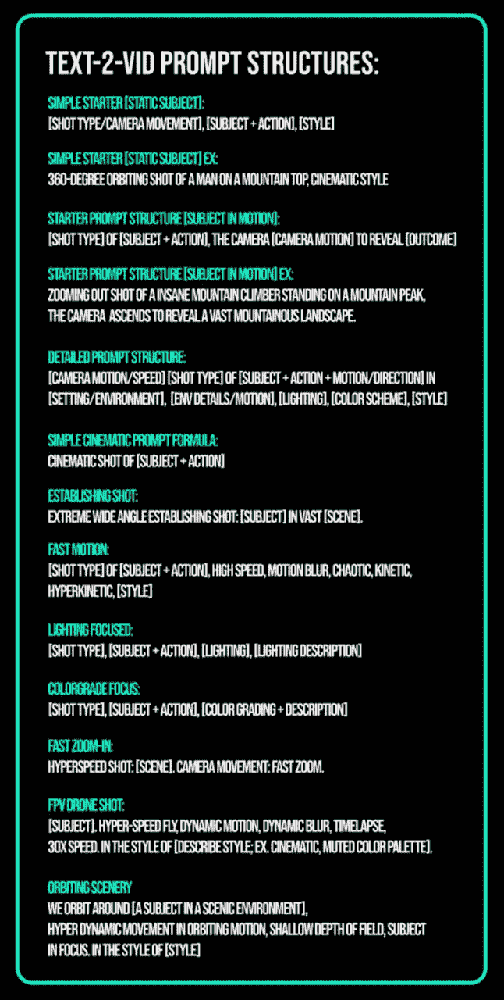

# Text-2-Vid Prompt Structures 文本生成视频提示结构

+ **Simple Starter [Static Subject]**

Structure: [Shot type/camera movement], [Subject + Action], [Style].

简单开始 [静态主体]

结构：[镜头类型/摄像机动作]、[主体+动作]、[风格]。

+ **Example**: 360-degree orbiting shot of a man on a mountain top, cinematic style.

示例：360度围绕山顶男人的镜头，电影风格。

---

+ **Starter Prompt Structure [Subject in Motion]**

Structure: [Shot type] of [Subject + Action], the camera [Camera motion] to reveal [Outcome].

开始提示结构 [动态主体]

结构：[镜头类型]、[主体+动作]，摄像机[动作]展示[结果]。

+ **Example**: Zooming out shot of an insane mountain climber standing on a mountain peak, the camera ascends to reveal a vast mountainous landscape.

示例：从疯狂登山者的视角缩小，摄像机向上升起展示广阔的山景。

---

+ **Detailed Prompt Structure**

Structure: [Camera motion/speed] [Shot type] of [Subject + Action + Motion/Direction] in [Setting/Environment], [Env details/motion], [Lighting], [Color scheme], [Style].

详细提示结构

结构：[摄像机动作/速度]、[镜头类型]、[主体+动作+方向]、[场景/环境]、[环境细节/动作]、[光影]、[配色方案]、[风格]。

---

+ **Simple Cinematic Prompt Formula**

Structure: Cinematic shot of [Subject + Action].

简单电影提示公式

结构：电影镜头 + 主体+动作。

---

+ **Establishing Shot**

Structure: Extreme wide-angle establishing shot: [Subject] in vast [Scene].

开场镜头

结构：极限广角开场镜头：[场景中的主体]。

---

+ **Fast Motion**

Structure: [Shot type] of [Subject + Action], high speed, motion blur, chaotic, kinetic, hyperkinetic, [Style].

快速运动

结构：[镜头类型]、[主体+动作]、高速、运动模糊、混乱、动感、超动感、[风格]。

---

+ **Lighting Focused**

Structure: [Shot type], [Subject + Action], [Lighting], [Lighting description].

光影聚焦

结构：[镜头类型]、[主体+动作]、[光影]、[光影描述]。

---

+ **Colorgrade Focus**

Structure: [Shot type], [Subject + Action], [Color grading + Description].

调色重点

结构：[镜头类型]、[主体+动作]、[调色+描述]。

---

+ **Fast Zoom-In**

Structure: Hyperspeed shot: [Scene]. Camera movement: fast zoom.

快速拉近

结构：超快镜头：[场景]，摄像机动作：快速拉近。

---

+ **FPV Drone Shot**

Structure: [Subject]. Hyper-speed fly, dynamic motion, dynamic blur, timelapse, 30x speed. In the style of [Describe style; e.g., cinematic, muted color palette].

第一人称视角无人机镜头

结构：[主体]，超快飞行、动态动作、动态模糊、延时摄影、30倍速度，风格描述：[如电影风格、柔和色调]。

---

+ **Orbiting Scenery**

Structure: We orbit around [A subject in a scenic environment], hyper dynamic movement in orbiting motion, shallow depth of field, subject in focus, in the style of [Style].

环绕场景

结构：围绕[风景环境中的主体]旋转，动态环绕运动，浅景深，主体聚焦，风格描述：[风格]。

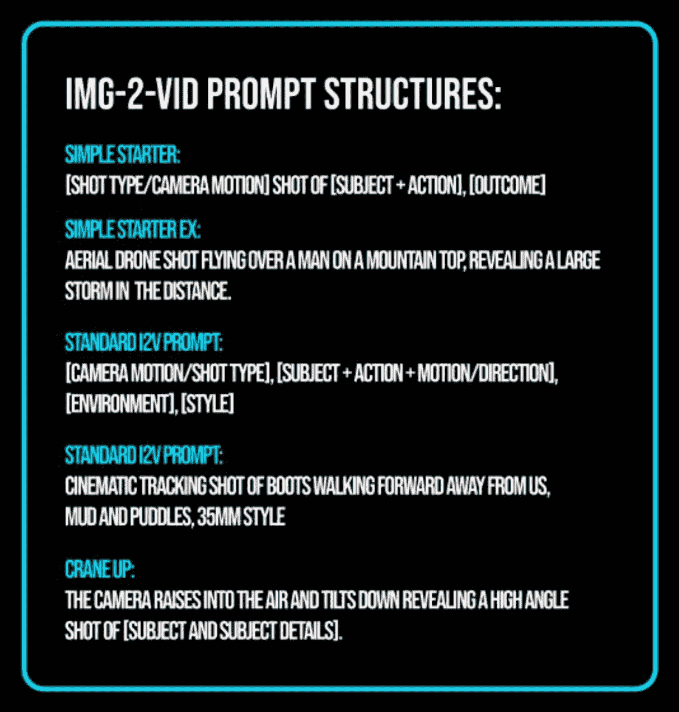

# Img-2-Vid Prompt Structures 图像生成视频提示结构

+ **Simple Starter**

Structure: [Shot type/camera motion] shot of [Subject + Action], [Outcome].

简单开始

结构：[镜头类型/摄像机动作]，主体+动作，结果。

+ **Example**: Aerial drone shot flying over a man on a mountain top, revealing a large storm in the distance.

示例：无人机镜头飞越山顶的一名男子，远处显现一场大风暴。

---

+ **Standard I2V Prompt**

Structure: [Camera motion/shot type], [Subject + Action + Motion/Direction], [Environment], [Style].

标准图像生成视频提示

结构：[摄像机动作/镜头类型]，主体+动作+方向，场景，风格。

+ **Example**: Cinematic tracking shot of boots walking forward away from us, mud and puddles, 35mm style.

示例：电影风格跟踪镜头拍摄靴子向前行走，伴随泥泞和水洼，35毫米镜头效果。

---

+ **Crane Up**

Structure: The camera raises into the air and tilts down revealing a high-angle shot of [Subject and Subject Details].

上升镜头

结构：摄像机升空并向下倾斜，展示高角度镜头，主体和主体细节。

+ **Example**: The camera lifts to reveal a wide shot of a landscape with intricate details of the surroundings.

示例：摄像机升起展示全景，并细致呈现周围环境的细节。

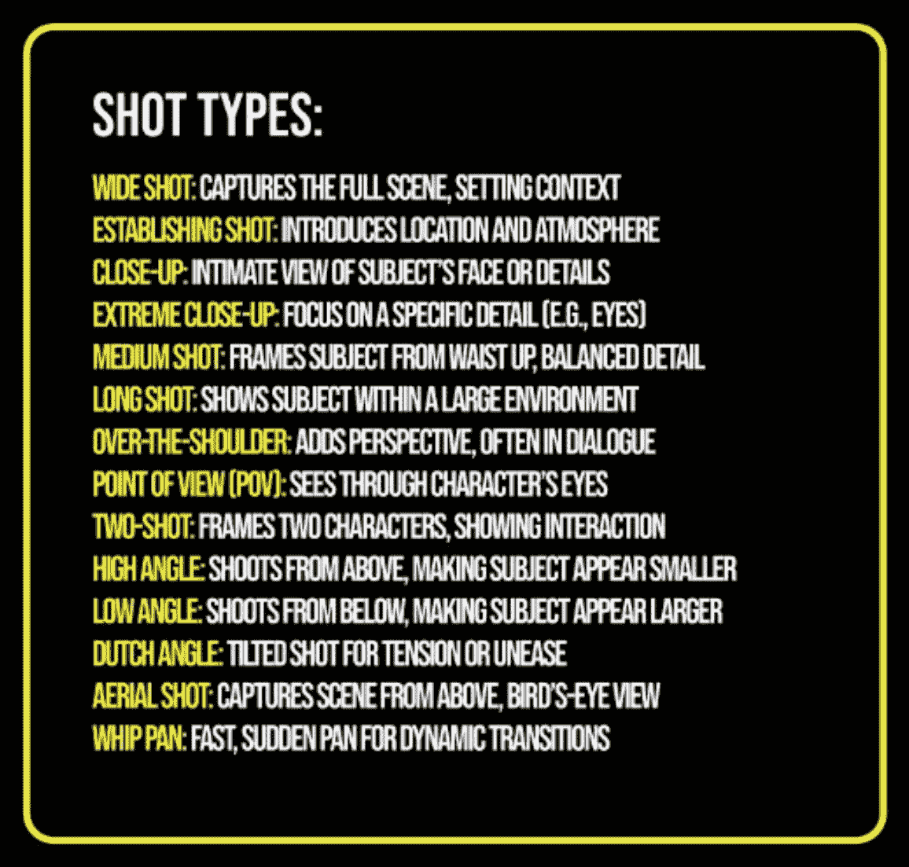

# Shot Types 镜头类型

+ **Wide Shot**: Captures the full scene, setting context.

广角镜头：捕捉整个场景，设定背景和环境。

+ **Establishing Shot**: Introduces location and atmosphere.

开场镜头：展示位置和氛围。

+ **Close-Up**: Intimate view of the subject's face or details.

特写镜头：贴近主体的面部或细节。

+ **Extreme Close-Up**: Focus on a specific detail (e.g., eyes).

极端特写镜头：聚焦于特定细节（如眼睛）。

+ **Medium Shot**: Frames subject from waist up, balanced detail.

中景镜头：从腰部以上构图，提供平衡的细节。

+ **Long Shot**: Shows subject within a large environment.

远景镜头：展示主体与宽广环境的关系。

+ **Over-the-Shoulder**: Adds perspective, often in dialogue.

肩背镜头：增加视角，常用于对话场景。

+ **Point of View (POV)**: Sees through the character’s eyes.

主观镜头：以角色的视角观看场景。

+ **Two-Shot**: Frames two characters, showing interaction.

双人镜头：构图包含两个人物，展示互动。

+ **High Angle**: Shoots from above, making the subject appear smaller.

高角度镜头：从上方拍摄，使主体看起来更小。

+ **Low Angle**: Shoots from below, making the subject appear larger.

低角度镜头：从下方拍摄，使主体看起来更大。

+ **Dutch Angle**: Tilted shot for tension or unease.

倾斜镜头：镜头倾斜，用于增加紧张感或不安感。

+ **Aerial Shot**: Captures scene from above, bird's-eye view.

航拍镜头：从高空拍摄，鸟瞰视角。

+ **Whip Pan**: Fast, sudden pan for dynamic transitions.

快速摇镜头：快速突然的移动镜头，用于动态过渡。

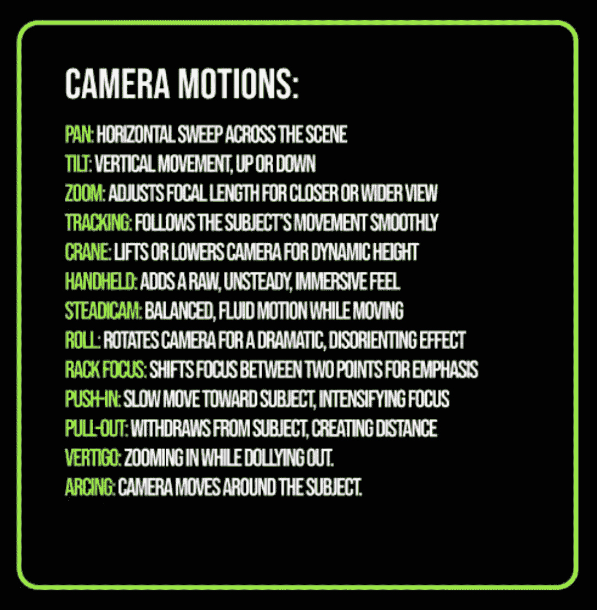

# Camera Motions 摄像机动作

+ **Pan**: Horizontal sweep across the scene.

平移：水平扫过场景。

+ **Tilt**: Vertical movement, up or down.

倾斜：垂直上下移动。

+ **Zoom**: Adjusts focal length for closer or wider view.

缩放：调整焦距以获得更近或更宽的视角。

+ **Tracking**: Follows the subject's movement smoothly.

跟踪：平滑跟随主体的移动。

+ **Crane**: Lifts or lowers the camera for dynamic height.

升降：升高或降低摄像机以动态调整高度。

+ **Handheld**: Adds a raw, unsteady, immersive feel.

手持：增加原始、不稳定的沉浸感。

+ **Steadicam**: Balanced, fluid motion while moving.

稳定器：平衡、流畅的运动拍摄。

+ **Roll**: Rotates the camera for a dramatic, disorienting effect.

旋转：旋转摄像机以营造戏剧化或迷惑感。

+ **Rack Focus**: Shifts focus between two points for emphasis.

拉焦：在两个焦点之间切换以突出强调。

+ **Push-In**: Slow move toward the subject, intensifying focus.

推进：缓慢靠近主体，加强聚焦。

+ **Pull-Out**: Withdraws from the subject, creating distance.

拉远：从主体撤离，拉开距离。

+   `Vertigo`: Zooming in while dollying out.

眩晕镜头：拉近镜头同时推远摄像机。

+   `Arcing`: Camera moves around the subject.

环绕：摄像机围绕主体移动。

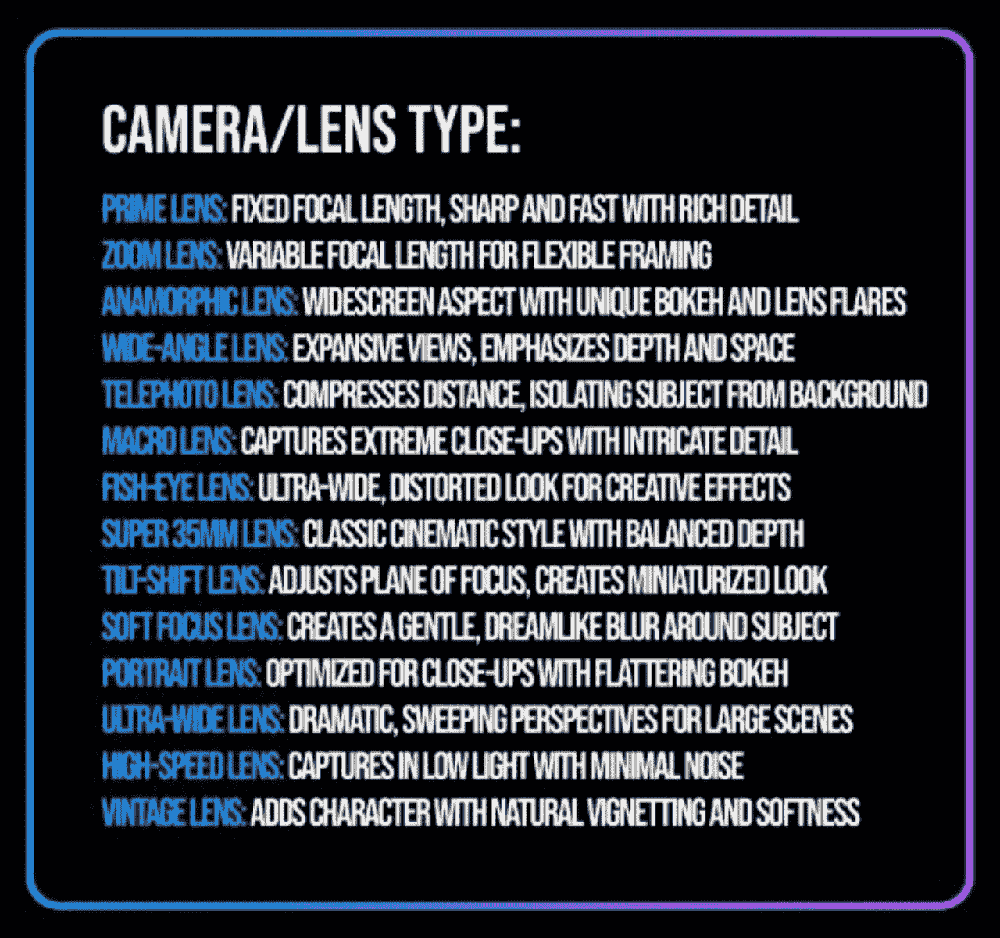

# Camera/Lens Type摄像机/镜头类型

+   `Prime Lens`: Fixed focal length, sharp and fast with rich detail.

定焦镜头：固定焦距，清晰快速，细节丰富。

+   `Zoom Lens`: Variable focal length for flexible framing.

变焦镜头：可变焦距，构图灵活。

+   `Anamorphic Lens`: Widescreen aspect with unique bokeh and lens flares.

变形镜头：宽银幕比例，独特的散景和镜头光晕。

+   `Wide-Angle Lens`: Expansive views, emphasizes depth and space.

广角镜头：广阔视野，突出深度和空间感。

+   `Telephoto Lens`: Compresses distance, isolating subject from background.

长焦镜头：压缩距离，突出主体，隔离背景。

+   `Macro Lens`: Captures extreme close-ups with intricate detail.

微距镜头：捕捉极限特写，展现复杂细节。

+   `Fish-Eye Lens`: Ultra-wide, distorted look for creative effects.

鱼眼镜头：超广角，扭曲效果，适合创意拍摄。

+   `Super 35mm Lens`: Classic cinematic style with balanced depth.

超级35毫米镜头：经典电影风格，深度平衡。

+   `Tilt-Shift Lens`: Adjusts plane of focus, creates miniaturized look.

移轴镜头：调整焦平面，营造微缩效果。

+   `Soft Focus Lens`: Creates a gentle, dreamlike blur around the subject.

柔焦镜头：在主体周围产生柔和、梦幻般的模糊效果。

+   `Portrait Lens`: Optimized for close-ups with flattering bokeh.

人像镜头：优化特写拍摄，散景效果优美。

+   `Ultra-Wide Lens`: Dramatic, sweeping perspectives for large scenes.

超广角镜头：戏剧性的广阔视角，适合大场景。

+   `High-Speed Lens`: Captures in low light with minimal noise.

高速镜头：适合弱光拍摄，噪点极低。

+   `Vintage Lens`: Adds character with natural vignetting and softness.

复古镜头：增添自然渐晕和柔和质感，富有个性。

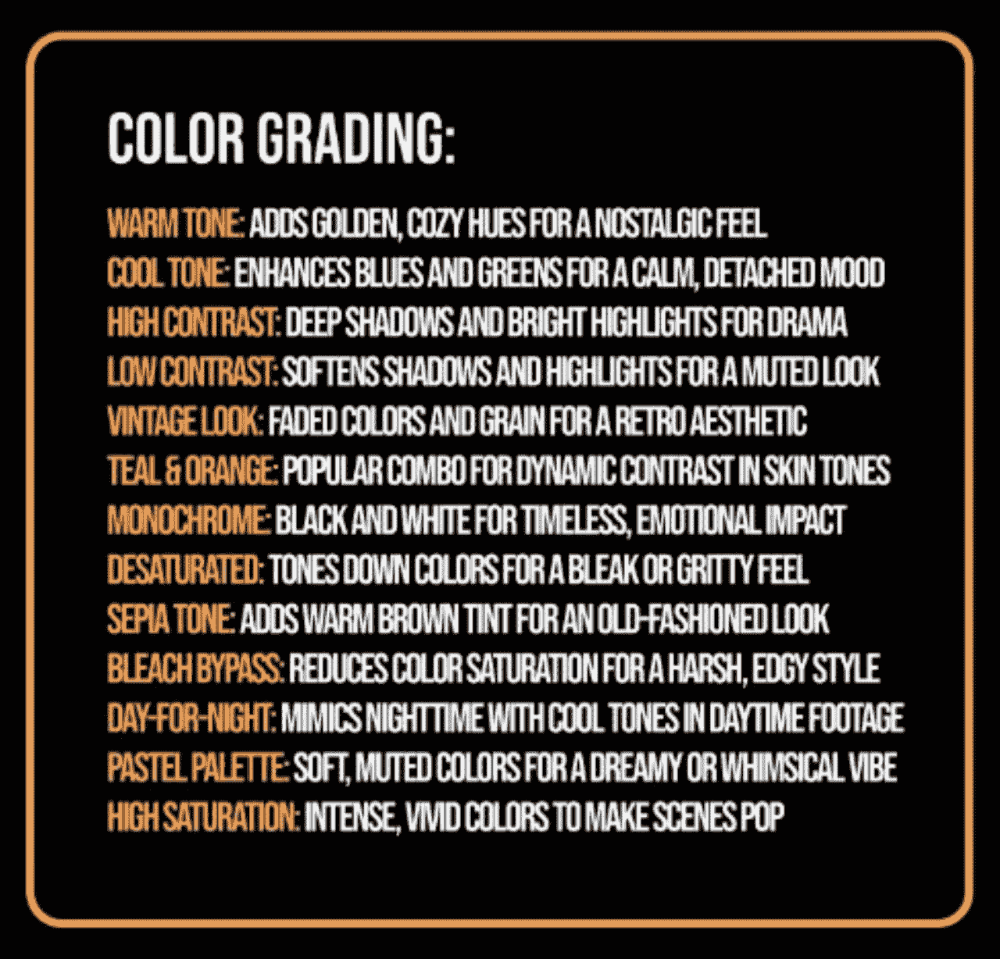

# Color Grading色彩校正

+   `Warm Tone`: Adds golden, cozy hues for a nostalgic feel.

暖色调：增加金色、温馨的色调，营造怀旧氛围。

+   `Cool Tone`: Enhances blues and greens for a calm, detached mood.

冷色调：强化蓝色和绿色，营造平静、冷淡的氛围。

+   `High Contrast`: Deep shadows and bright highlights for drama.

高对比：深邃的阴影与明亮的高光，增强戏剧效果。

+   `Low Contrast`: Softens shadows and highlights for a muted look.

低对比：柔化阴影和高光，呈现柔和的画面效果。

+   `Vintage Look`: Faded colors and grain for a retro aesthetic.

复古风格：褪色的颜色和颗粒感，营造复古美感。

+   `Teal & Orange`: Popular combo for dynamic contrast in skin tones.

青橙色调：流行搭配，增强肤色的动态对比。

+   `Monochrome`: Black and white for timeless, emotional impact.

单色调：黑白效果，传递永恒且富有情感的冲击力。

+   `Desaturated`: Tones down colors for a bleak or gritty feel.

去饱和：降低色彩饱和度，营造凄凉或粗粝的感觉。

+   `Sepia Tone`: Adds warm brown tint for an old-fashioned look.

棕褐色调：增加温暖的棕色，打造老式风格。

+   `Bleach Bypass`: Reduces color saturation for a harsh, edgy style.

漂白旁路：减少色彩饱和度，呈现强烈、锋利的风格。

+   `Day-for-Night`: Mimics nighttime with cool tones in daytime footage.

日夜调色：通过冷色调将白天的画面模拟成夜晚效果。

+   `Pastel Palette`: Soft, muted colors for a dreamy or whimsical vibe.

柔和色调：柔软、低饱和的颜色，营造梦幻或奇妙的氛围。

+   `High Saturation`: Intense, vivid colors to make scenes pop.

高饱和：浓烈、鲜艳的色彩，使画面更加突出。

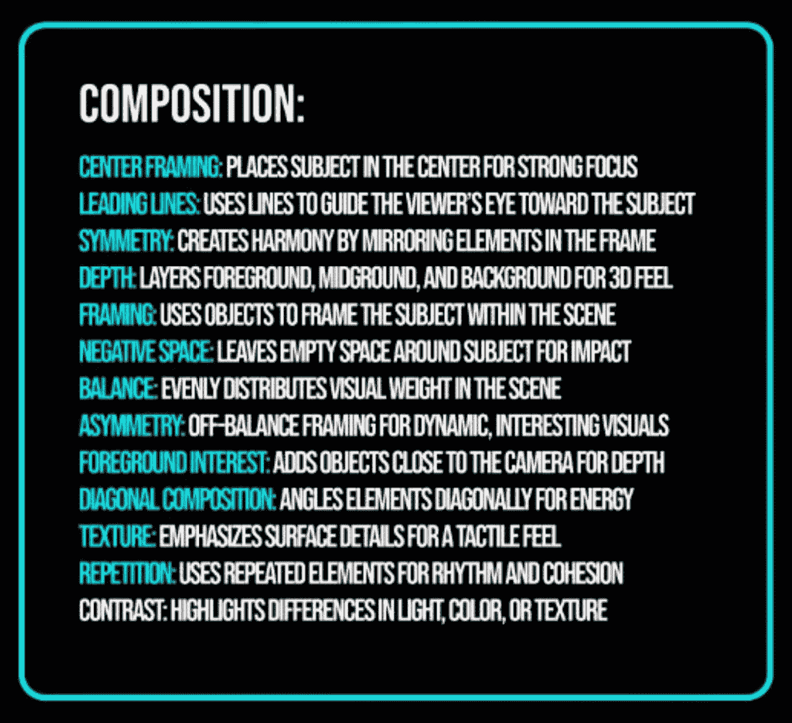

# Composition构图

+   `Center Framing`: Places subject in the center for strong focus.

中心构图：将主体置于中心位置以突出重点。

+   `Leading Lines`: Uses lines to guide the viewer’s eye toward the subject.

引导线：利用线条引导观众的视线到主体上。

+   `Symmetry`: Creates harmony by mirroring elements in the frame.

对称性：通过镜像构图中的元素营造和谐感。

+   `Depth`: Layers foreground, midground, and background for a 3D feel.

深度：通过前景、中景和背景的分层营造三维效果。

+   `Framing`: Uses objects to frame the subject within the scene.

框架构图：使用物体在场景中为主体构造框架。

+   `Negative Space`: Leaves empty space around the subject for impact.

负空间：在主体周围留出空白以增强视觉冲击力。

+   `Balance`: Evenly distributes visual weight in the scene.

平衡：均匀分配场景中的视觉重量。

+   `Asymmetry`: Off-balance framing for dynamic, interesting visuals.

非对称性：通过不平衡构图创造动态且有趣的视觉效果。

+   `Foreground Interest`: Adds objects close to the camera for depth.

前景趣味：添加靠近镜头的物体以增强深度感。

+   `Diagonal Composition`: Angles elements diagonally for energy.

对角线构图：以对角线角度安排元素，增加画面张力。

+   `Texture`: Emphasizes surface details for a tactile feel.

纹理：强调表面细节，营造触感效果。

+   `Repetition`: Uses repeated elements for rhythm and cohesion.

重复：使用重复的元素以增加画面的节奏感和统一性。

+   `Contrast`: Highlights differences in light, color, or texture.

对比：突出光线、颜色或纹理之间的差异。

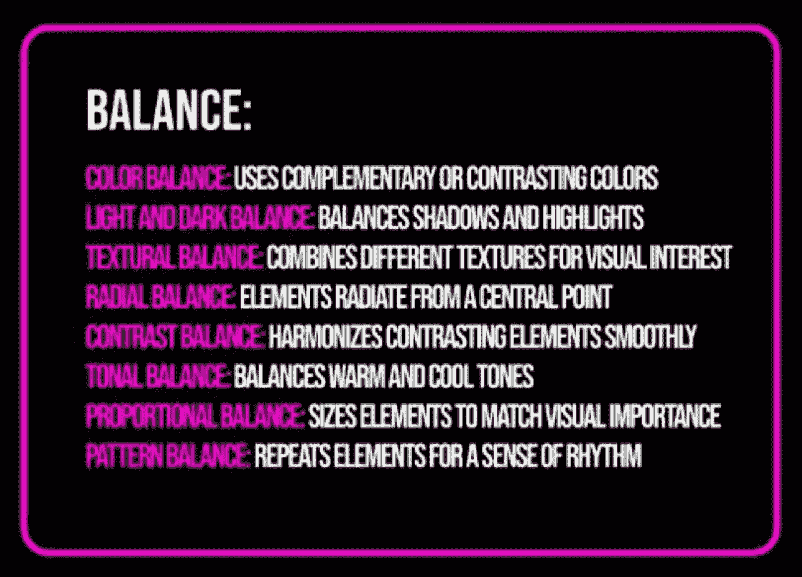

# Balance平衡

+   `Color Balance`: Uses complementary or contrasting colors.

色彩平衡：使用互补色或对比色。

+   `Light and Dark Balance`: Balances shadows and highlights.

明暗平衡：平衡阴影和高光。

+   `Textural Balance`: Combines different textures for visual interest.

纹理平衡：结合不同的纹理以增加视觉趣味性。

+   `Radial Balance`: Elements radiate from a central point.

放射平衡：元素从中心点向外放射。

+   `Contrast Balance`: Harmonizes contrasting elements smoothly.

对比平衡：平滑协调对比元素。

+   `Tonal Balance`: Balances warm and cool tones.

色调平衡：平衡暖色调和冷色调。

+   `Proportional Balance`: Sizes elements to match visual importance.

比例平衡：调整元素大小以匹配视觉重要性。

+   `Pattern Balance`: Repeats elements for a sense of rhythm.

图案平衡：重复元素以营造节奏感。

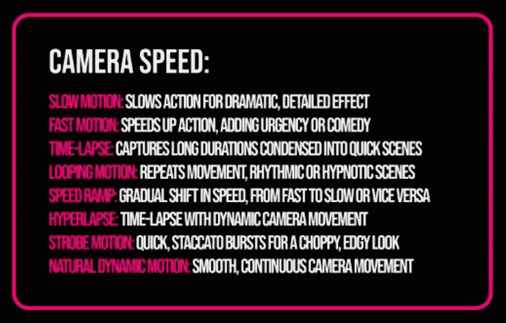

# Camera Speed摄像机速度

+   `Slow Motion`: Slows action for dramatic, detailed effect.

慢动作：减缓动作速度，营造戏剧化、细腻的效果。

+   `Fast Motion`: Speeds up action, adding urgency or comedy.

快速动作：加快动作速度，增添紧迫感或喜剧效果。

+   `Time-Lapse`: Captures long durations condensed into quick scenes.

延时摄影：将长时间的过程压缩成快速场景。

+   `Looping Motion`: Repeats movement, rhythmic or hypnotic scenes.

循环动作：重复运动，营造节奏感或催眠效果的场景。

+   `Speed Ramp`: Gradual shift in speed, from fast to slow or vice versa.

速度变化：速度逐渐转换，从快到慢或从慢到快。

+   `Hyperlapse`: Time-lapse with dynamic camera movement.

动态延时：结合动态摄像机运动的延时摄影。

+   `Strobe Motion`: Quick, staccato bursts for a choppy, edgy look.

闪烁运动：快速、断续的运动，营造不连续和尖锐的视觉效果。

+   `Natural Dynamic Motion`: Smooth, continuous camera movement.

自然动态运动：平滑、连续的摄像机移动。

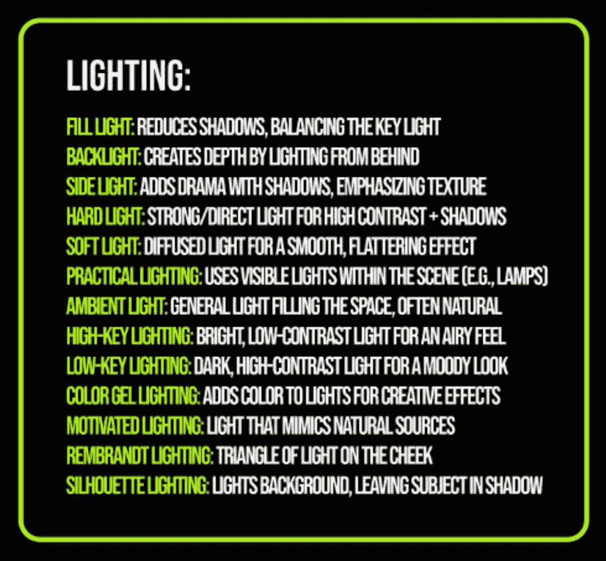

# Lighting灯光

+   `Fill Light`: Reduces shadows, balancing the key light.

补光：减少阴影，平衡主光。

+   `Backlight`: Creates depth by lighting from behind.

背光：通过从后方照明增加深度感。

+   `Side Light`: Adds drama with shadows, emphasizing texture.

侧光：通过阴影增加戏剧性，突出纹理。

+   `Hard Light`: Strong/direct light for high contrast + shadows.

硬光：强烈/直接的光线，营造高对比度和阴影。

+   `Soft Light`: Diffused light for a smooth, flattering effect.

柔光：散射光线，呈现柔和的效果。

+   `Practical Lighting`: Uses visible lights within the scene (e.g., lamps).

实用光：使用场景中的可见光源（如灯具）。

+   `Ambient Light`: General light filling the space, often natural.

环境光：充满空间的整体光线，通常为自然光。

+   `High-Key Lighting`: Bright, low-contrast light for an airy feel.

高调光：明亮、低对比度的光线，营造轻盈感。

+   `Low-Key Lighting`: Dark, high-contrast light for a moody look.

低调光：暗调、高对比度的光线，营造情绪化效果。

+   `Color Gel Lighting`: Adds color to lights for creative effects.

色彩滤光：为灯光添加颜色，营造创意效果。

+   `Motivated Lighting`: Light that mimics natural sources.

模仿光：模仿自然光源的灯光。

+   `Rembrandt Lighting`: Triangle of light on the cheek.

伦勃朗光：脸颊上形成三角光斑的照明方式。

+   `Silhouette Lighting`: Lights background, leaving subject in shadow.

剪影光：照亮背景，将主体留在阴影中。

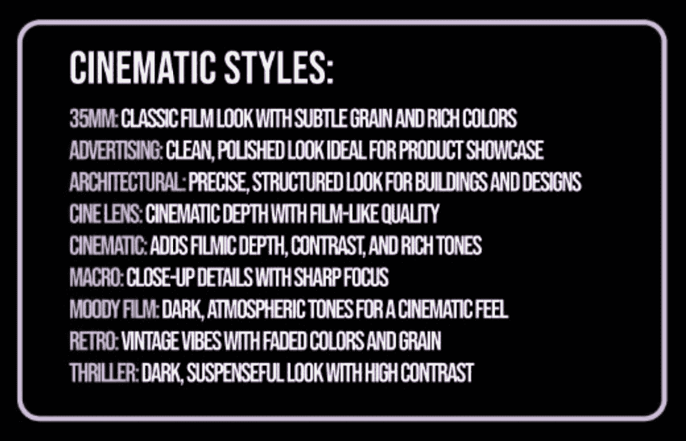

# Cinematic Styles电影风格

+   `35mm`: Classic film look with subtle grain and rich colors.

35毫米：经典胶片风格，带有细腻颗粒感和丰富色彩。

+   `Advertising`: Clean, polished look ideal for product showcase.

广告风格：干净、精致的外观，适合产品展示。

+   `Architectural`: Precise, structured look for buildings and designs.

建筑风格：精确、结构化的外观，适合建筑和设计拍摄。

+   `Cine Lens`: Cinematic depth with film-like quality.

电影镜头风格：具有电影质感和深度。

+   `Cinematic`: Adds filmic depth, contrast, and rich tones.

电影风格：增加电影感的深度、对比和丰富色调。

+   `Macro`: Close-up details with sharp focus.

微距风格：以锐利的焦点展示细节特写。

+   `Moody Film`: Dark, atmospheric tones for a cinematic feel.

情绪化电影风格：暗调氛围，增强电影感。

+   `Retro`: Vintage vibes with faded colors and grain.

复古风格：具有褪色色彩和颗粒感的复古氛围。

# Thriller

**Thriller**: Dark, suspenseful look with high contrast.

惊悚风格：暗调、高对比，营造悬疑感。

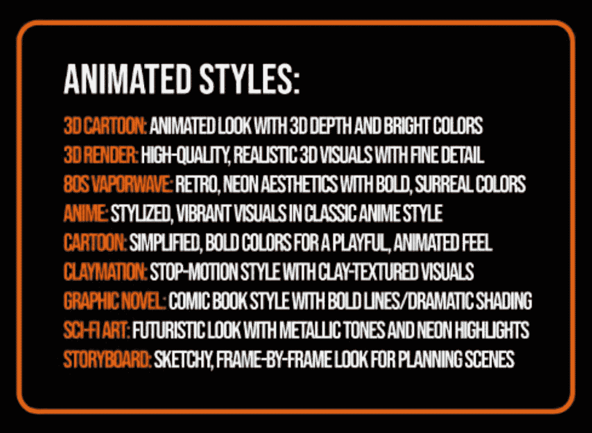

# Animated Styles动画风格

+ **3D Cartoon**: Animated look with 3D depth and bright colors.

3D卡通：具有3D深度和鲜艳色彩的动画外观。

+ **3D Render**: High-quality, realistic 3D visuals with fine detail.

3D渲染：高质量、逼真的3D视觉效果，细节精致。

+ **80s Vaporwave**: Retro, neon aesthetics with bold, surreal colors.

80年代蒸汽波：复古霓虹美学，色彩大胆且超现实。

+ **Anime**: Stylized, vibrant visuals in classic anime style.

动漫：经典动漫风格，视觉效果活力十足。

+ **Cartoon**: Simplified, bold colors for a playful, animated feel.

卡通：简化、大胆的色彩，营造轻松愉快的动画感。

+ **Claymation**: Stop-motion style with clay-textured visuals.

黏土动画：具有黏土质感的定格动画风格。

+ **Graphic Novel**: Comic book style with bold lines/dramatic shading.

图像小说：漫画风格，线条大胆，阴影戏剧化。

+ **Sci-Fi Art**: Futuristic look with metallic tones and neon highlights.

科幻艺术：未来感外观，具有金属色调和霓虹点缀。

+ **Storyboard**: Sketchy, frame-by-frame look for planning scenes.

分镜风格：草图风格，逐帧展示用于场景规划。

# 结语

生成式AI视频技术让我们看到了创意表达的无限可能。在不久的未来，每个人都可以成为视频创作的“导演”，将自己独特的故事呈现给世界。

无论是震撼的视觉大片，还是充满个性的短视频，生成式AI让“艺术创作”真正成为一项全民参与的活动。

也许，下一部让人惊艳的“大片”，就来自你的键盘和鼠标之间。

<https://aigcreative.feishu.cn/sync/K4Gvd9vUQsy9Oubwqaeclu0Fnbg>
