# 20251107-AI视频制作百万级商业广告？！我被TapNow秀到了！

> 来源：[https://aigcreative.feishu.cn/docx/GeemddCJYoShfExeFM2c5m6mnQe](https://aigcreative.feishu.cn/docx/GeemddCJYoShfExeFM2c5m6mnQe)

大家好。

2025年，AI图片视频这块儿，竞争可谓是异常激烈。大家估计都看麻了，一会儿发个新模型，一会儿又SOTA了。说实话，大部分东西，看看热闹还行，真要拿来干活儿，总感觉还差那么口气。

最近，我一直在用一个叫**TapNow**的AI视频工具，可把我给“秀”到了。

TapNow还号称是**目**前最专业的AI图片视频创作平台。

**我**最开始注意到它，是听说了一个挺震撼的事：他们宣布使用AI打造了AI行业首个百万制作的TVC项目。

百万级？还是TVC？

仔细扒了一下，原来，他们与欧阳英豪导演一起合作给汤臣倍健了个南极探险主题大片的项目。欧阳英豪导演，就是广告圈很牛的那位。

我看了下，视听效果强得离谱，大场景的构建、画面的细节，到光影的模拟，运镜转场，都相当专业。

这表明AI视频，可能真的已经摸到可商用TVC标准的门槛了。

**而TapNow他们产品的****核**心思路，是从专业级模仿到泛场景落地，要能全面覆盖。

**那支百万****级TV**C广告片，就像是一个技术标杆，用来证明他们的产品有这个能力。而他们真正想落地的，是后面那句泛场景。

怎么落地？

Now，现在，我们一起进入TapNow的AI世界：https://app.tapnow.ai/?tap_referral=aigccylr

# 1、全新的产品设计理念及创作方式

TapNow，可能有很多朋友是第一次听说。

**这个AI图片视频创作工具**，主要的工作台是一张无限的画布，他们管这个叫all in one画布，这个我用了一段时间后非常喜欢。

从文字、到图片、到视频、再到声音，全在一个地方搞定，不用在N个软件之间反复横跳，而且它支持高清放大与质感优化。还有很多简单上手专业功能，比如：分镜管理节点（故事版）、找影片参照、精细控制图片视频。

如果对以上操作界面&工作流不熟悉，感到困惑，无从下手的朋友，**不用担心，T**apNow还有一个免费学习的开源创作社区。

**这是全球第一个视频创作开源社区**，全网爆火的**梦游牛油果频道**，审美艺术性极强**initialC老师的万圣节**，商业导向的TVC**京东TVC**，都在这里可以1:1复刻学习，真的是非常格局和创新!

在官网首页点开**TapTV**和**工作流**就能看到各个案例创作的全部过程。

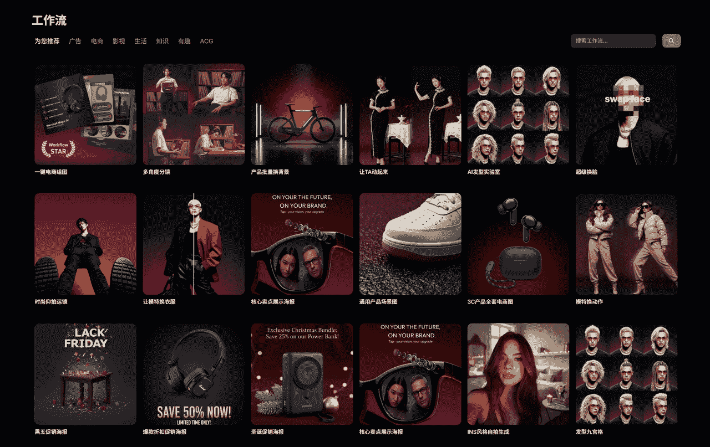

然后我发现，TapNow他们与导演合作的前面提到的南极探险主题大片的全部创作流程也公开了！

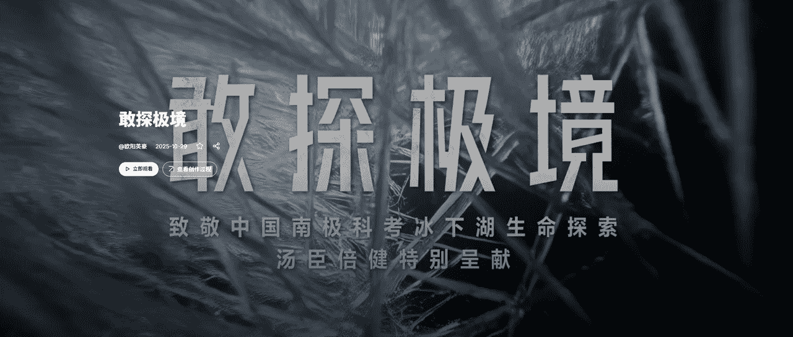

链接直达：https://app.tapnow.ai/#/home/taptv/1/6c455902-0822-48c1-9a68-4c2f3da1754e?tap_referral=aigccylr

他们把这个百万AI TVC是怎么诞生的，从头到尾，做成了一个可以观摩学习的案例，你可以完整地看到整个创作过程，看导演的实拍逻辑是怎么被AI重现的。你能理解到分镜、场景、光影、甚至声音这些环节，AI是怎么处理的。甚至，你还能学到其中的思考路径与Prompt技巧。 见下图：

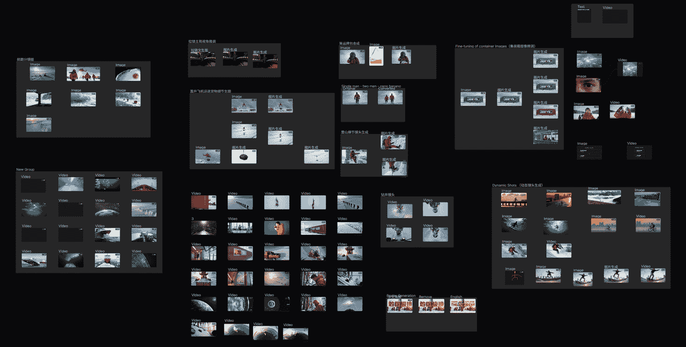

这不就是等于白嫖了一堂顶级导演的AI创作大师课吗？学起来！

# 2、进入实战：图片、视频创作，轻松拿捏

**首先是****图片****的创作。**

我们在做AI视频有一个最大的难点，就**是角色、**场景的一致性的问题，如何生成好的图片分镜很重要。

以前我们使用豆包、即梦、Midjourney等，都是在Chat对话框里进行，单线程进行，这种方式，效率其实是很低的，我们来看看TopNow工作流的方式：

在这个工作流中，从原始参考图出发，我们很快就能得到多组基于参考图人物角色及风格分镜图，效果非常好。

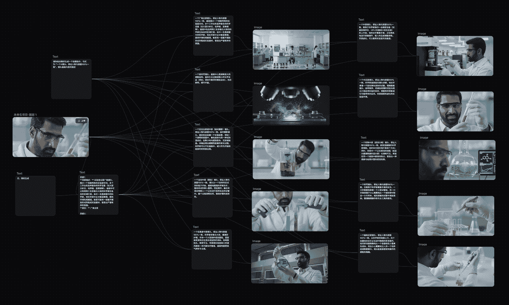

**从中，我们能体会到这种交互模式创作的精妙之处：对比单一的Chat类的AI图片视频生成产品，这种多**线并行混排的工作流的方式，对于故事逻辑的梳理，素材&提示词的复用等等，都是一种非常好的方式！可能用过ComfyUI的朋友就很熟悉了，大家可以多看几个案例进行学习体会。

比如电商需求场景下的产品一致性、及使用场景的快速生成：

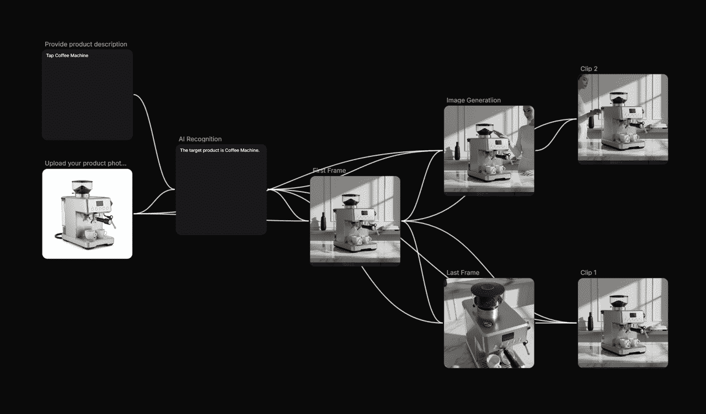

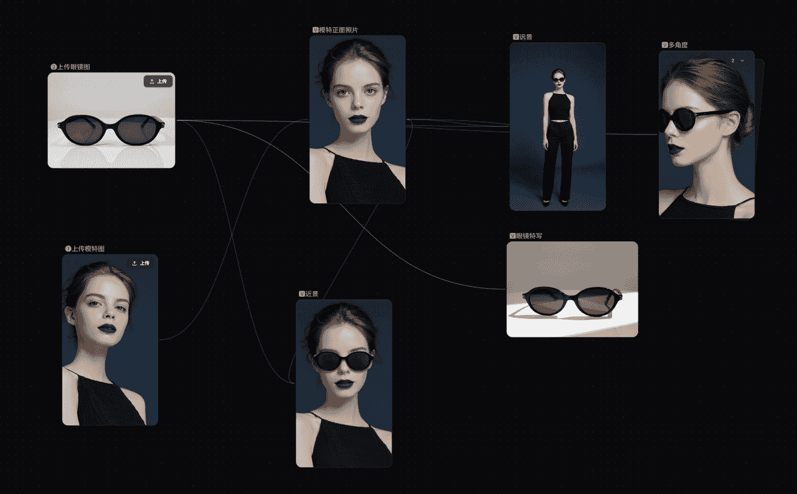

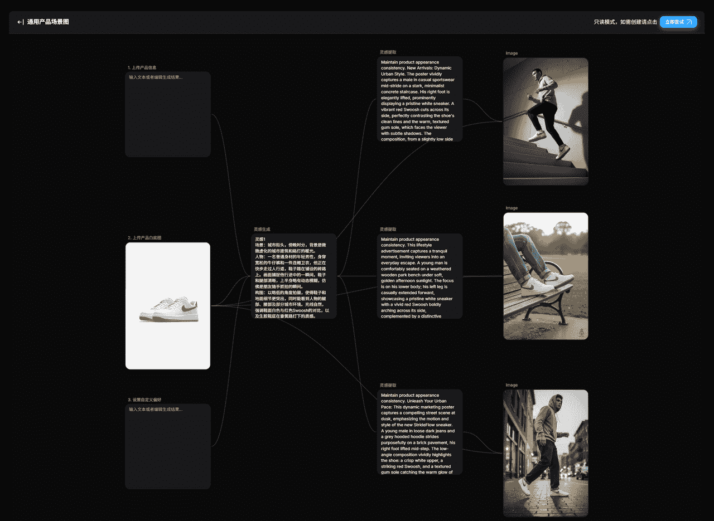

效率简直起飞，在NanoBanana一众优秀的模型加持下，几乎没有什么废图。

**接下来进入重头戏——****视频****。**

视频这块，我总结了下TopNow的产品功能，思路很清晰，针对不同专业程度的玩家都有解决方案。

1）如果你是专业玩家，或者想玩得专业点，TapNow提供了一整套影视广告的制作流程：

**前期策划****： ****灵感枯竭**了**？想扒一下别人的片子？它有**一键拉片和storyboard故事版功能。这基本就是把策划阶段的工作给AI化了。

在TapNow能在线搜到海量的图片视频素材，可以直接使用：

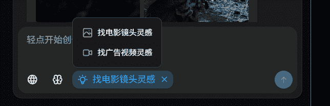

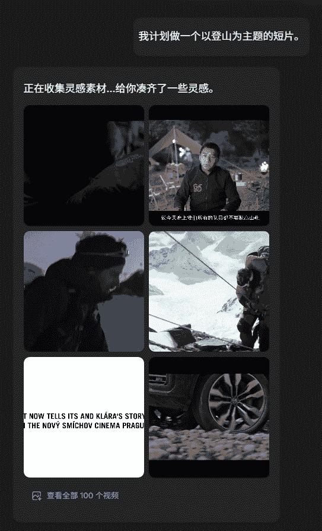

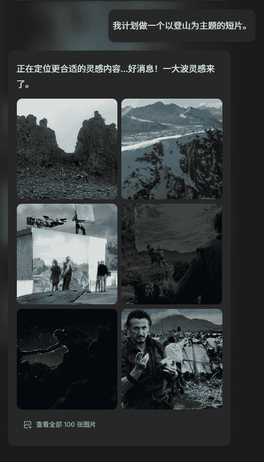

比如，找来小米米家的这个片子，来拉一下片：

[f1471bdb-bfda-47d8-8e61-b95a2b8a9cb1.mp4](https://internal-api-drive-stream.feishu.cn/space/api/box/stream/download/all/BaNAbgOmOoB3Y0xBf3zcKd8lnBe)

导入到TapNow中，点击**分镜头解析**：

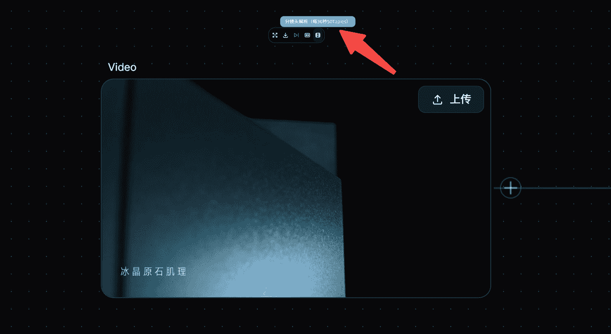

很快就能得到一份非常详细的分镜表！

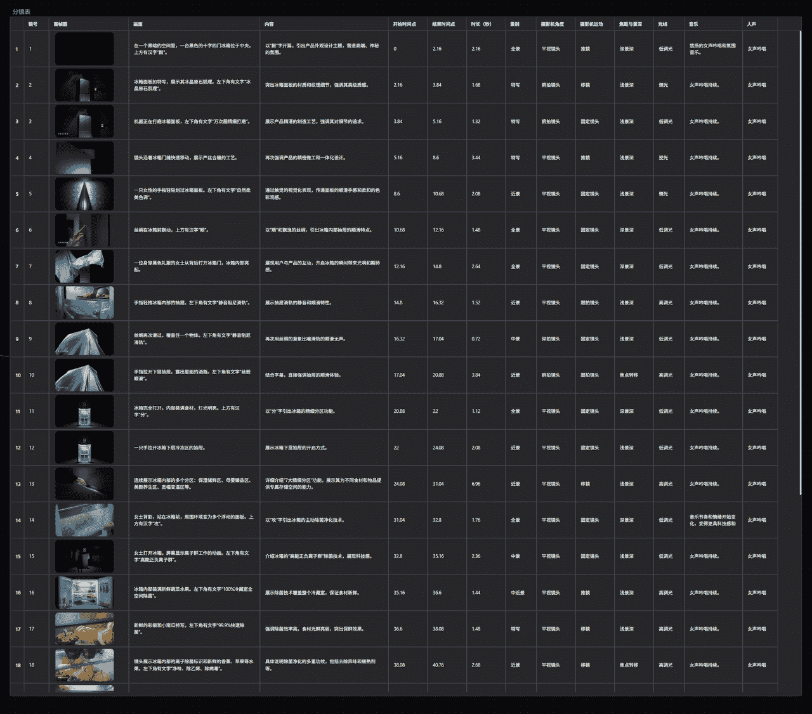

**制作流程****：** 这主要是在前面提到的**all in one画布****里**操作，熟悉了，就很方便快捷了，直接找到前面工作流里生成好的图片，当作收尾帧，写上提示词，选好模型，就能很快出视频了：

> 中景拍摄 镜头360°转场 模特用手抬起眼镜

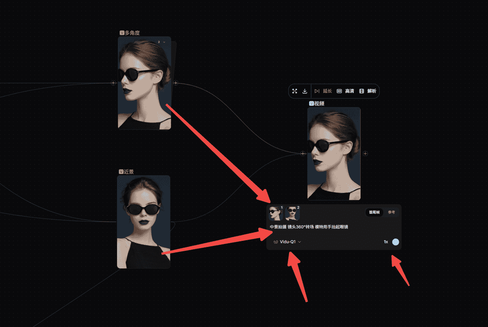

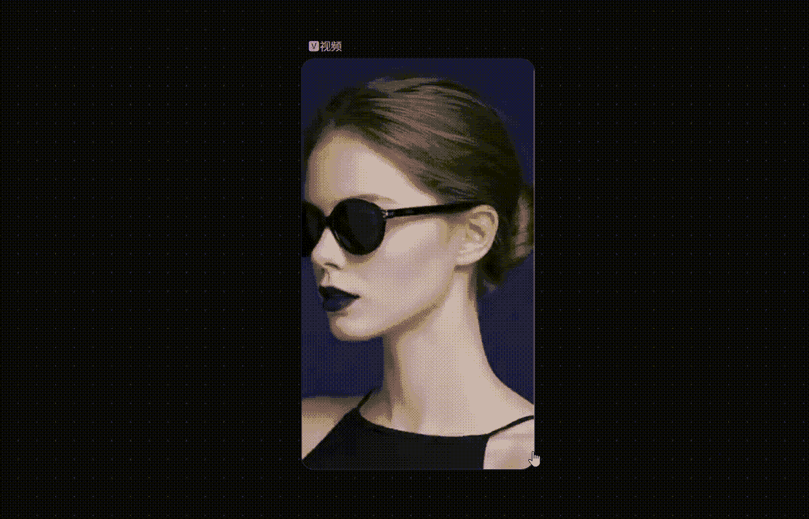

**灵活编辑****：** 这里TopNow提了三个独家功能：Draw to Edit, Draw to Video, 和 Post Control。听名字就知道，类似“蒙版”和“涂抹”，让你对画面的控制力更强。

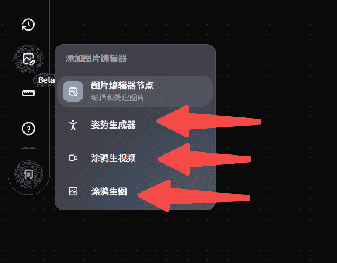

涂鸦生视频：

[org-C1314130720250015476_user-96ea0c99-cdfd-4d17-88bf-c864086b515f_compressed_3ea5ed97-cae3-47df-b100-859e7f72acc1_medium.mp4](https://internal-api-drive-stream.feishu.cn/space/api/box/stream/download/all/YnmQbdfL3oOrHSxYxB6c9yptnec)

涂鸦生图：

[org-C1314130720250015476_user-96ea0c99-cdfd-4d17-88bf-c864086b515f_compressed_62ca8d73-0d66-462f-bb62-4f28e68eed4a_medium.mp4](https://internal-api-drive-stream.feishu.cn/space/api/box/stream/download/all/KJ2dbR7iNoKSAOxCuvMcNAHvnTf)

姿势生成器：

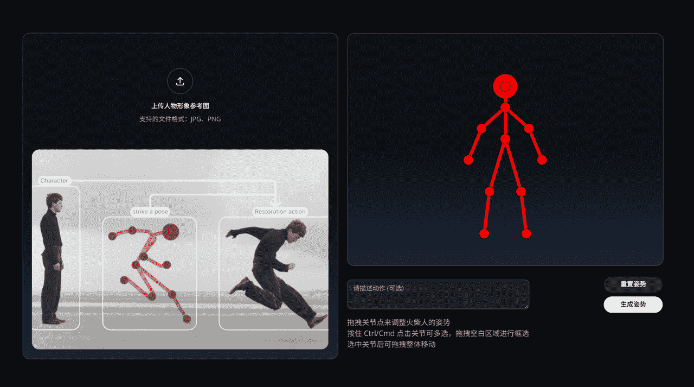

从上身照出发，轻松拓展至全身画面，再用火柴人驱动控制动作：

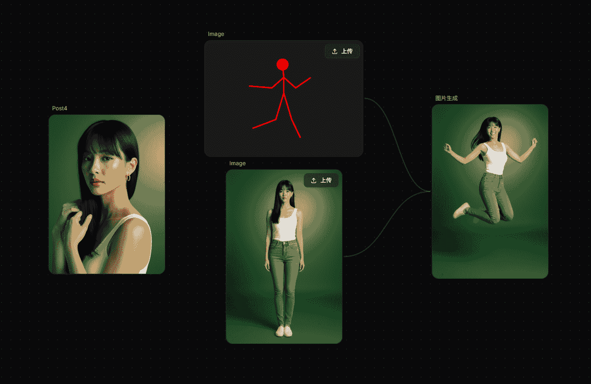

这一套**全家桶工具**下来，是给那些想拿AI当生产力，甚至想做个TVC专业视频的高端玩家准备的。

2）但如果你是和我一样的普通玩家，也能轻松上手：

比如我一直心心念念的这种不同造型产品（宝马3系）演化的视频，可以快速的从零开始架构。

先是找来宝马3系历代的主要车型：

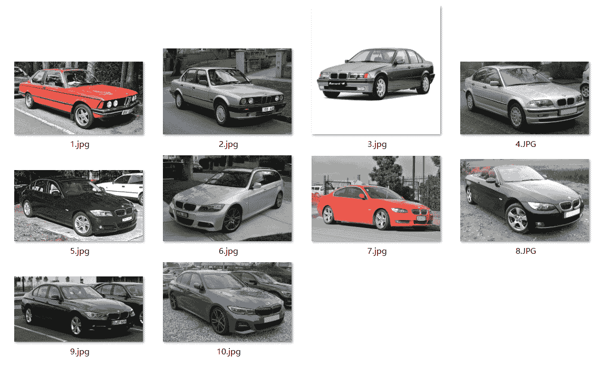

然后分别导入到TapNow里，因为车的拍摄角度、车头朝向不一致，接下来需要把所有的车的朝向统一调整+重新渲染，整齐划一，很快就得到了中间的那一列角度、场景、风格大致一致的图。

然后，再用首尾帧依次生成视频让画面动起来，简单剪辑就可以出片了：

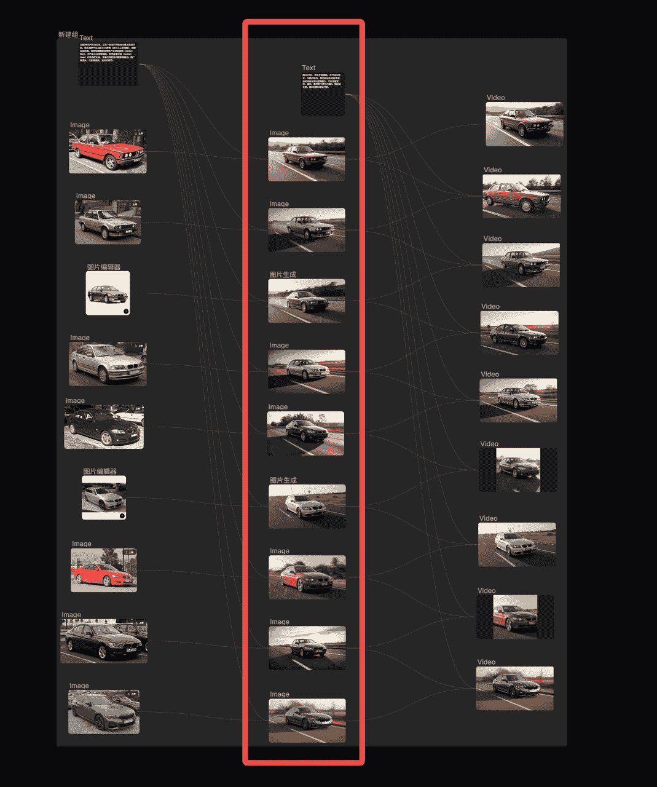

看看上面整个创作思路逻辑，是不是非常的清晰、流畅，非常契合这种演化类视频的制作，生图生视频的提示词可以多次复用，制作非常高效！

[11月2日(1).mp4](https://internal-api-drive-stream.feishu.cn/space/api/box/stream/download/all/KiWtbAPoNoh6AmxJYeycH5ZMnWf)

**3）如果实在不**想多动手，也有偷懒的方法——工作流一键生成。

**我想这才**是TapNow想给大多数人传递的核心价值。

比如你想给公司拍个产品宣传视频，可以去工作流里找个模板。里面全是各种现成的案例，比如产品广告、时尚穿搭、美食探店、科技开箱……找一个产品视频的：

你不需要从零开始设计分镜、想Prompt。

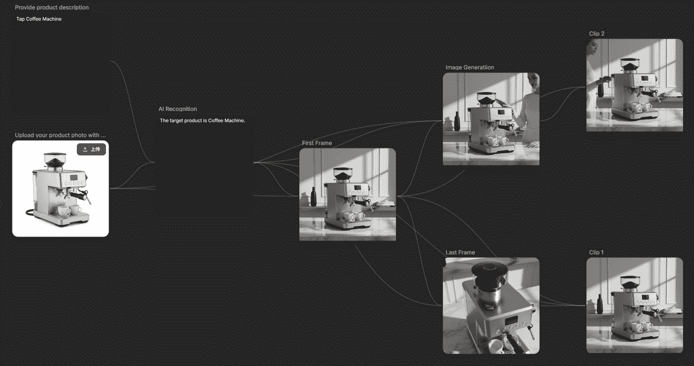

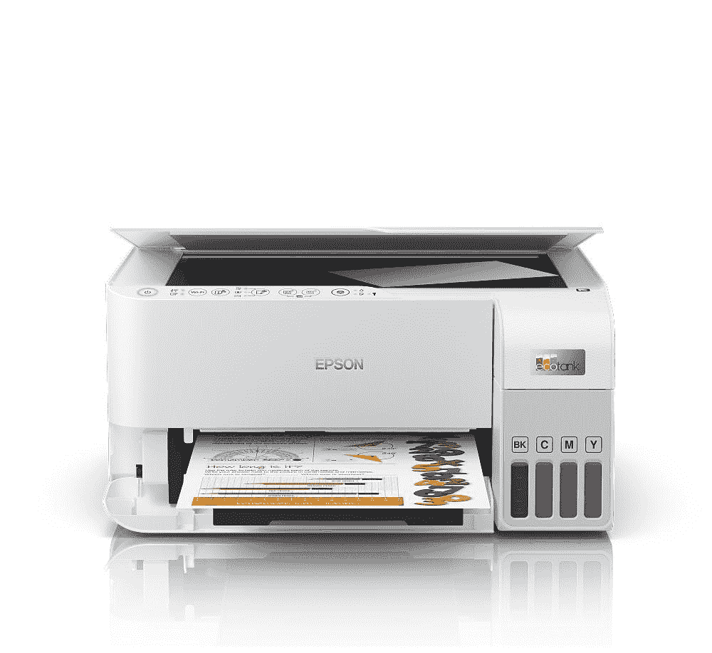

直接替换上你的产品，比如这个片子的咖啡机替换成上面的打印机：

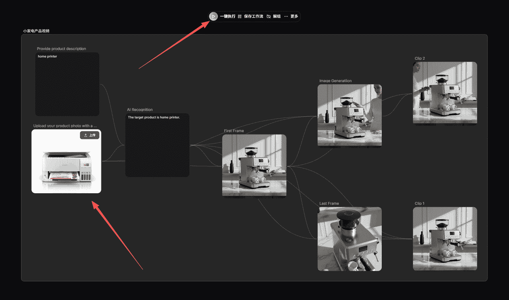

就能一键执行就能出片了，自动执行工作流，生成图片、生产视频：

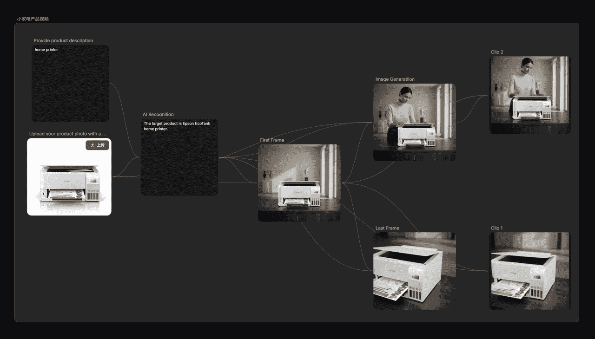

1分钟不到就能出片了！

[Clip 2-1762251552571.mp4](https://internal-api-drive-stream.feishu.cn/space/api/box/stream/download/all/PPa7bKDlLouXcVxDDVycPNOLn6d)

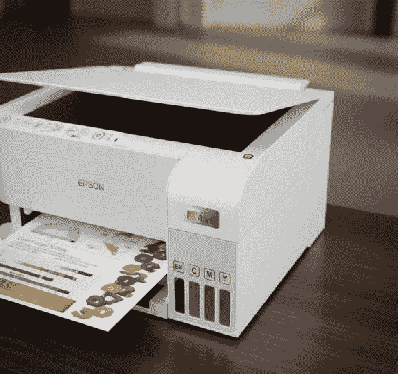

[Clip 1-1762251553745.mp4](https://internal-api-drive-stream.feishu.cn/space/api/box/stream/download/all/JtdlbExiWowpxqxjXIPcUgudnb4)

小结一下，以上就是针对不同类型视频的不同玩法：

**1、高端案例（电影感TVC）：**

就**像那支南极大片。这种属于**“天花板”级别的。你需要深度使用它的全套流程，从一键拉片分析原片风格，到用Storyboard设计分镜，再到all in one画布里精细调整每一帧的光影和质感。这适合专业导演和广告公司，用来制作影视级商单。

**2、中端案例（品牌宣传短片）：**

比如你要做一个有故事性的品牌宣传片，或者一个叙事型广告。你可以用“灵感Agent”生成创意脚本，然后用Storyboard快速把脚本视觉化，最后在画布里结合“Post Control”精修画面。这比传统制作流程快得多，适合有一定创作需求的团队。

3、入门案例（电商/日常品宣）：

这是我觉得最实用的。比如你开个网店，想给新上的衣服做个展示视频；或者像我，要做个简单的产品宣传视频。你直接去工作流里，找到电商宣传片或日常品宣视频的模板，点一键生成。AI会把整个片子的框架、风格、转场逻辑都给你搭好。你可能只需要换换产品图片、改改文案就行了。真正做到了零专业门槛也能高效出片。

TapNow算是把高端、中端、入门三个层次全覆盖了。

# 3、进阶玩法：用AI Agent操控TapNow进行创作

前不久，ChatGPT不是出了他们的AI浏览器——ChatGPT Atlas嘛，想着能不能在ChatGPT Atlas浏览器里，在Agent模式下，能不能让AI指挥AI进行创作？试了下，还真可以！ChatGPT Atlas能根据你的基础创意进行发散，再操控TapNow，真的就是在一步一步进行操作，还能得到一个很好的效果！感兴趣的小伙伴可以试试~~

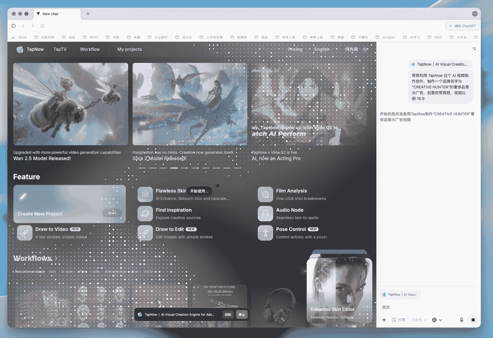

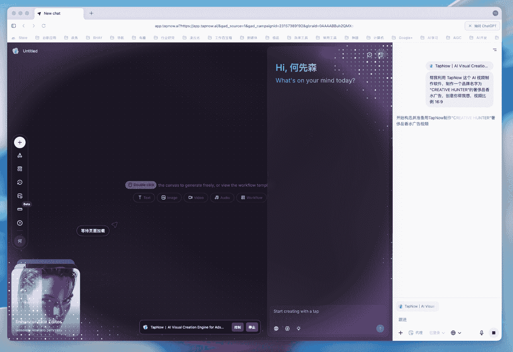

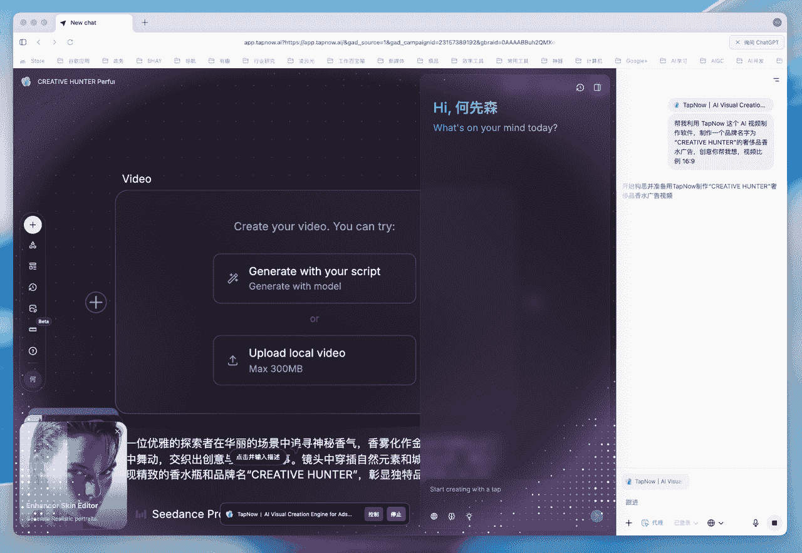

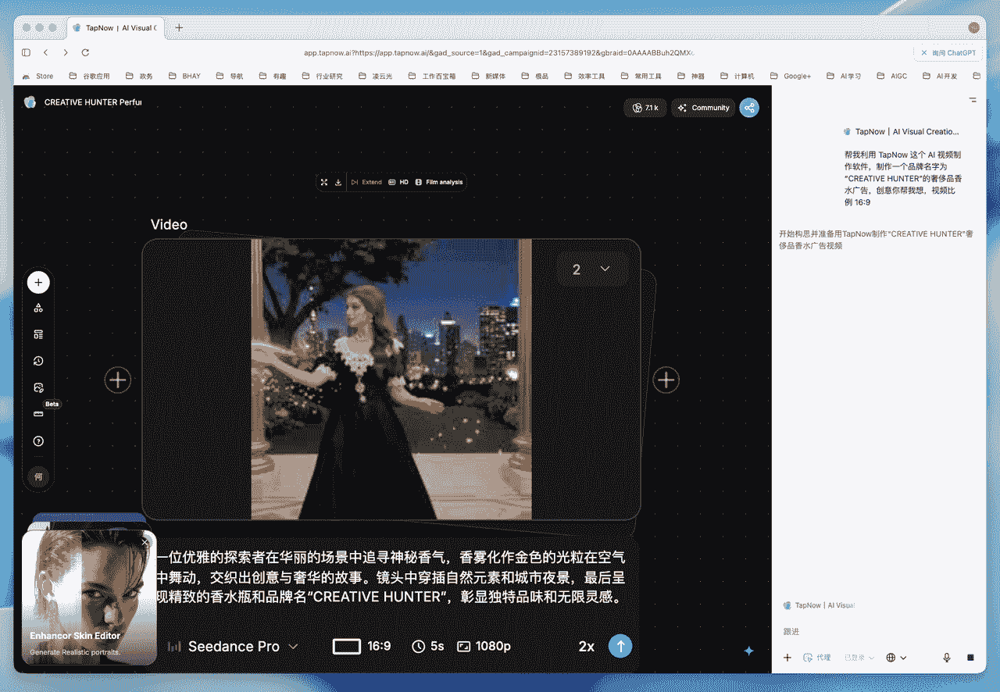

# 4、最后

TapNow用那支百万TVC秀肌肉，证明了自己有处理顶级商用的能力；同时又通过开源社区和一键工作流，把这个能力释放给了普通人。

说到底，AI工具的价值，最终还是要看它能不能“降本增效”。

对我来说，那个百万TVC复刻案例确实震撼，但真正让我这个科技博主动心的，反而是那个一键生成产品宣传视频的功能。

毕竟，一个人人都能快速产出高价值视频的时代，可能真的要来了。

好了，这次的分享就到这。

下次见。

<https://aigcreative.feishu.cn/sync/K4Gvd9vUQsy9Oubwqaeclu0Fnbg>