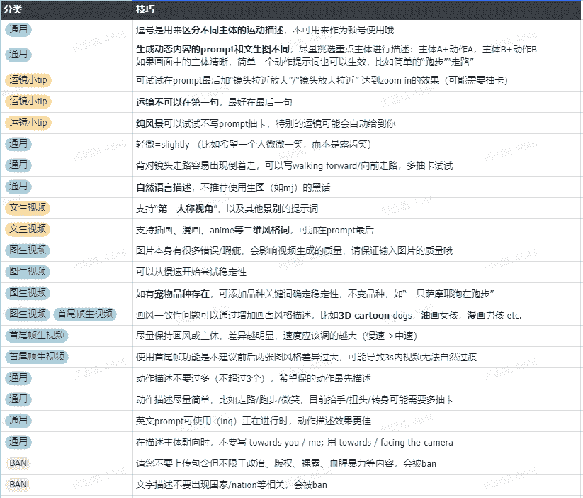

# 工具：即梦Dreamina

> 来源：[https://aigcreative.feishu.cn/docx/FfIMdaztgozLMrxA8PFcWTCtnpe](https://aigcreative.feishu.cn/docx/FfIMdaztgozLMrxA8PFcWTCtnpe)

Dreamina是由字节跳动旗下的剪映推出的一款AI创作工具，专注于帮助用户将文字描述转化为图像和视频内容。这个平台旨在加速和简化内容创作过程，特别是对于抖音图文和短视频创作者来说，提供了一个快速将创意和想法转化为视觉内容的工具。

以下是Dreamina平台的一些主要特点和功能：

### **文字生成图像（文生图）**

+   用户可以通过输入文本提示来生成图像，Dreamina的AI技术会根据描述自动创建出相应的视觉内容。

+   支持中英文提示词，使得不同语言背景的用户都能轻松使用。

### **视频生成**

+   Dreamina不仅支持生成静态图像，还能将这些图像进一步转化为短视频，通常在2-3分钟内生成一个3秒的视频片段。

+   这一功能与当前市场上的许多AI视频生成工具相似，提供了快速的内容创作解决方案。

### **多样化的创作工具**

+   Dreamina提供了包括文字绘图、扩图、局部重绘和图片灵感生成等多种功能，以满足不同创作需求。

+   平台支持云端高性能计算，用户无需拥有高端显卡即可体验先进的AI绘图功能。

### **艺术形式丰富**

+   Dreamina覆盖了从AI插画到AI漫画，再到AI设计的广泛艺术形式，为用户提供多样化的创作选择。

+   无论是专业艺术家还是业余爱好者，都能在Dreamina中找到适合自己的创作工具。

### **易于使用**

+   Dreamina的设计初衷是激发艺术创意和提升绘画体验，因此它的操作界面简洁直观，易于上手。

+   用户可以通过自然语言描述他们想要的图片，让AI技术帮助他们将想象变为现实。

### **开启AI绘画之旅**

+   加入Dreamina，用户可以探索无限的创造可能性，开启他们的AI绘画之旅。

Dreamina是一个创新的AI创作平台，它利用先进的AI技术，为用户提供了一个简单、快捷且功能丰富的内容创作工具。通过Dreamina，用户可以将文字描述转化为图像和视频，极大地提高了创作效率和创作质量，同时也为内容创作者开辟了新的创作途径。

### 官方PromptTips：

<https://aigcreative.feishu.cn/sync/K4Gvd9vUQsy9Oubwqaeclu0Fnbg>

# 知识库动态