# 20251011-Gaga AI ，嘎嘎香！当导演、教AI演戏，轻松拿捏专业“演员”！

> 来源：[https://aigcreative.feishu.cn/docx/SYNXdNorno9OuAxwDARcOALJnBb](https://aigcreative.feishu.cn/docx/SYNXdNorno9OuAxwDARcOALJnBb)

最近这大半年，各大AI厂商卷的厉害，AI视频工具没少玩。从一开始的图生视频、文生视频，到后来的视频生视频，技术迭代快得让人眼花缭乱。

我们现在主流的流程，往往是先文生图再图生视频，或者文生视频，得到视频后，用一个TTS（文本转语音）工具生成音频，然后再用另一个AI工具去驱动角色的口型和表情来匹配这个音频。

这个流程下来，AI就像一个笨拙的配音演员，结果眼神是空洞的，表情是公式化的，声音和脸也常常像是两张皮，贴合得不太好。

总之，就是麻烦，效果不好，也不好用。

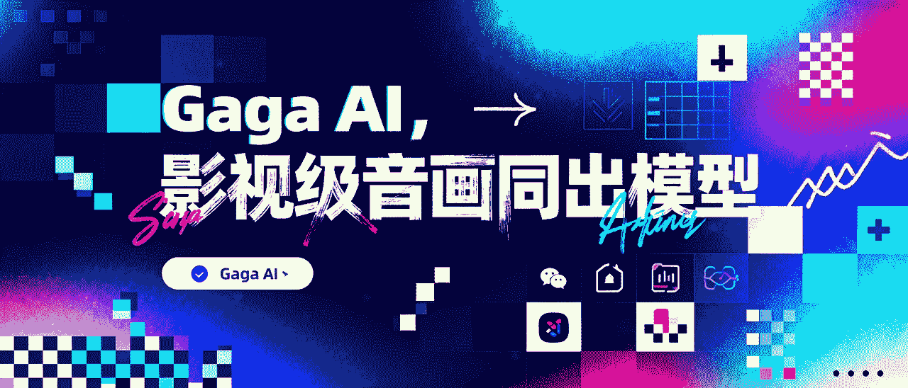

前不久，在群里看到有人分享Gaga AI的新模型生成的视频，从根本上解决这个问题时，我的兴趣一下子就来了。

后来了解到，GAGA-1竟然还是全球首个专注于「人物对话」的影视级音画同出模型。

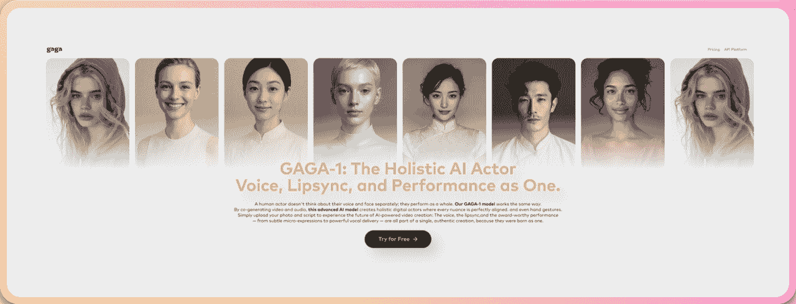

**音画同出**，这四个字是关键。

它意味着流程不再是“配音+对口型”的两步走，而是一步到位。你给它提示词，它自己去理解，然后用一套自洽的逻辑，同时生成声音、口型和表情。

带着这份好奇和怀疑的心理，接下来我们来看看这个自称要教AI“演戏”的GAGA-1，到底是不是在吹牛。

顺带一提，背后的团队Sand.ai也挺有意思。一个非常低调的清华系初创团队，之前就搞出过被圈内人称为视频领域“Deepseek”的开源模型，属于那种话不多但活儿很硬的类型。

先看看软件操作界面：

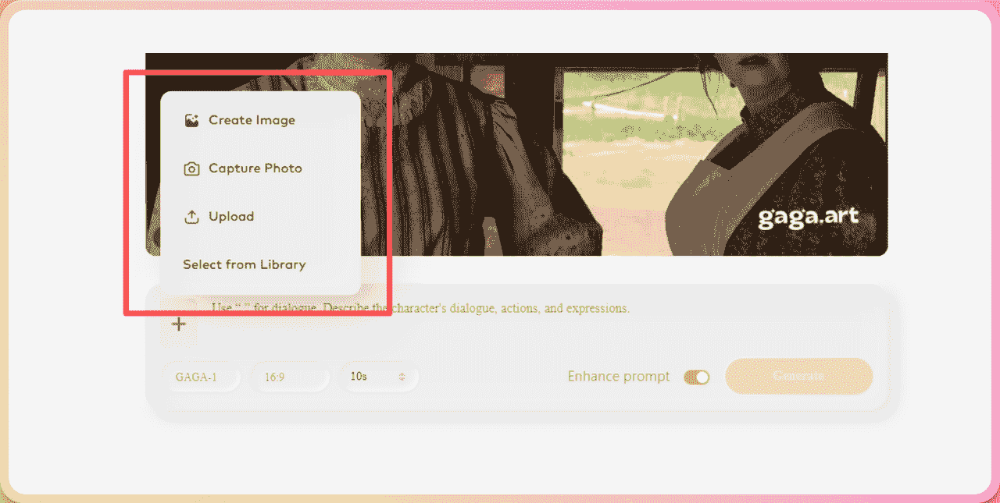

首要的操作就是得有一张图了，可以在这里直接文生图，利用摄像头拍摄，还可以自己上传。

至于提示词，你可以写得很详细，也可以让Gaga AI自行发挥，都行。

最近实测把玩很久，总结了一下，大概有这几种玩法：

## 1、经典影视画面重现：

要考验演技，就得上经典。我选了《狂飙》、《夏洛特烦恼》、《让子弹飞》等电影里的一些经典镜头画面，以及经典的台词，致敬原片，简单复刻：

> 男子沉稳地说道：" 我没什么大的理想，只想在摊位上卖鱼，风浪越大鱼越贵，我赚的就越多！”

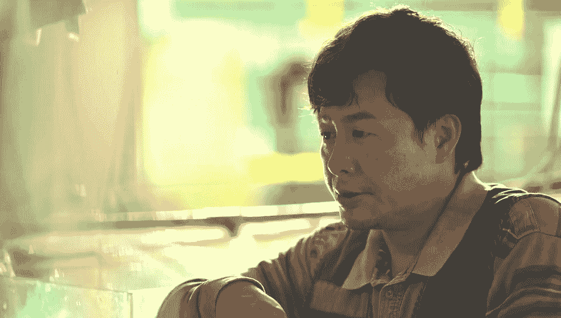

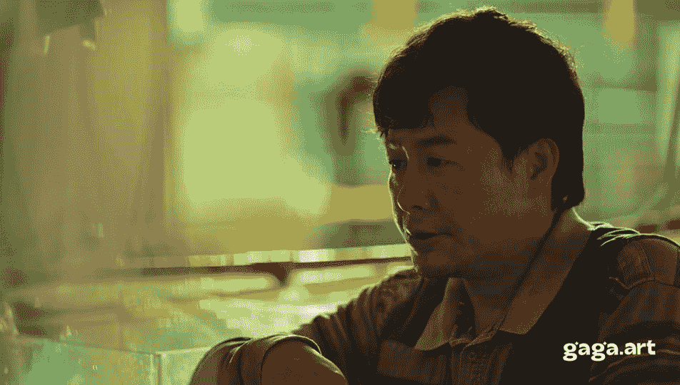

[gaga-output-251008-214854.mp4](https://internal-api-drive-stream.feishu.cn/space/api/box/stream/download/all/OVSDbYtQ2oiF59xoTI6c4OaWnih)

> 大爷疑惑的问到：“马冬什么？什么冬梅？马什么梅？你这孩子说清楚点儿啊！”

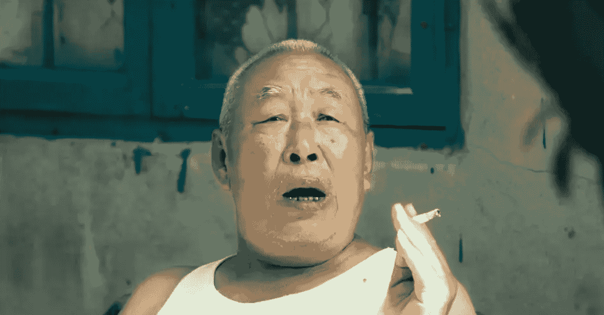

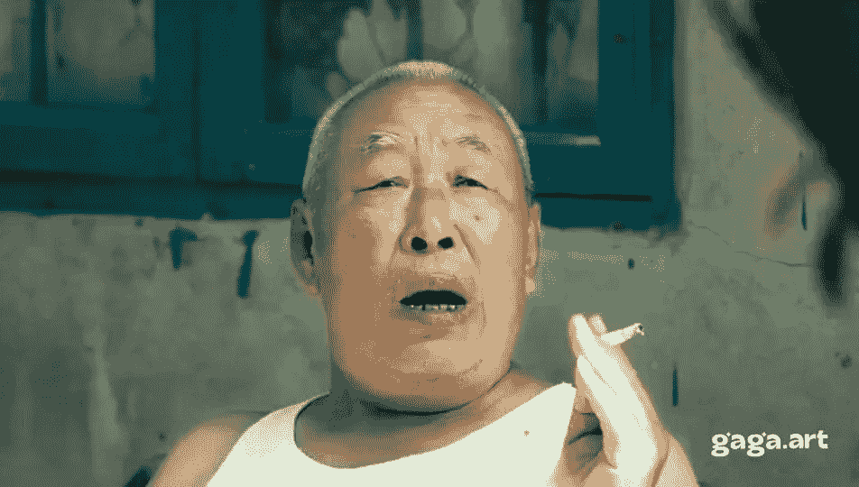

[02.mp4](https://internal-api-drive-stream.feishu.cn/space/api/box/stream/download/all/CKtPblRg9o3Zbgxnf33cJzInnph)

> 这名男子声音粗粝中带磁性、雄浑厚重的基底感与充满张力的表现力，愤怒的说道：“我就想让你翻译，什么叫惊喜！翻译给我听，什么他妈的叫他妈的惊喜！”

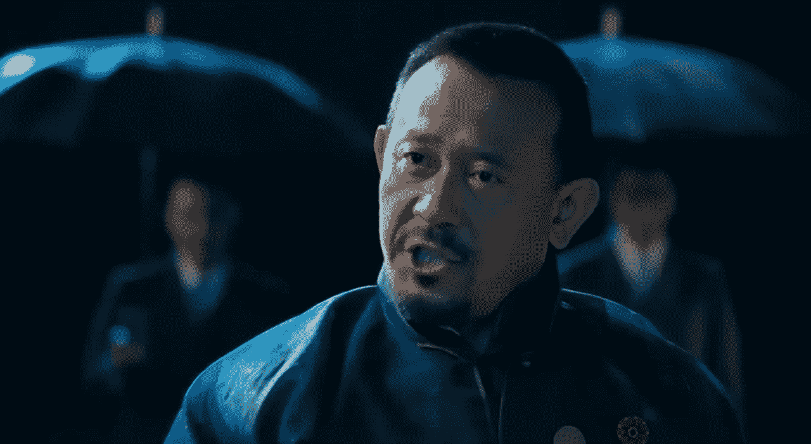

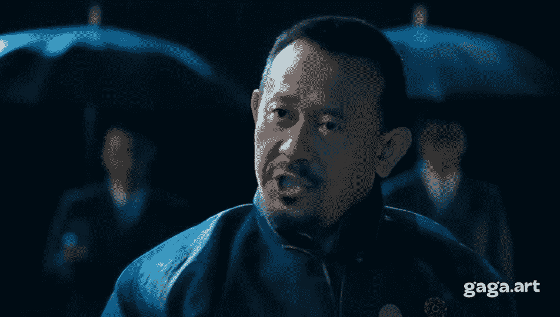

[03.mp4](https://internal-api-drive-stream.feishu.cn/space/api/box/stream/download/all/EDKub7U3eoYaY4x5HeOcoK9unWg)

> 这个男人微微一笑，然后语重心长的说到：“You’re never really done for, as long as you’ve got a good story and someone to tell it to.”

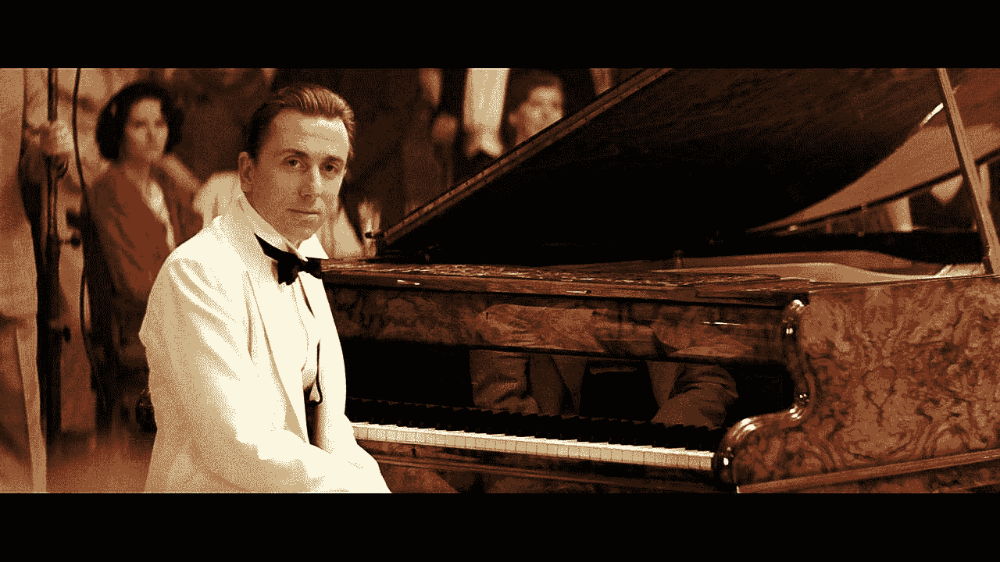

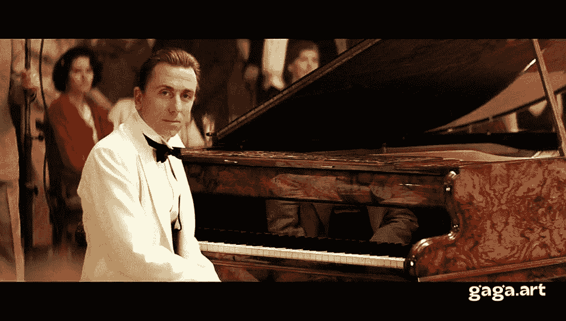

[gaga-output-251008-163530.mp4](https://internal-api-drive-stream.feishu.cn/space/api/box/stream/download/all/GT58bOBqioPqUTxEaSscTUMknVg)

每个视频等待了大约1~2分钟，视频生成了。点开播**放，我得承认，****效果超出**了我的预期，真的是影视级音画同出的效果！

首先，口型匹配度极高，这是基本功，做到了。但真正打动我的是表演的细节，它不仅仅是让嘴巴动了起来，而是调动了整个面部的微表情来服务于这句台词的情感。这一点，是它和市面上绝大多数产品拉开差距的地方。

## 2、原创影视创作：

> 西部牛仔的人物形象，英语台词。

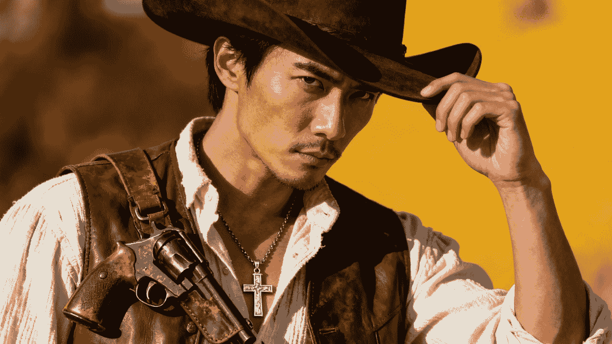

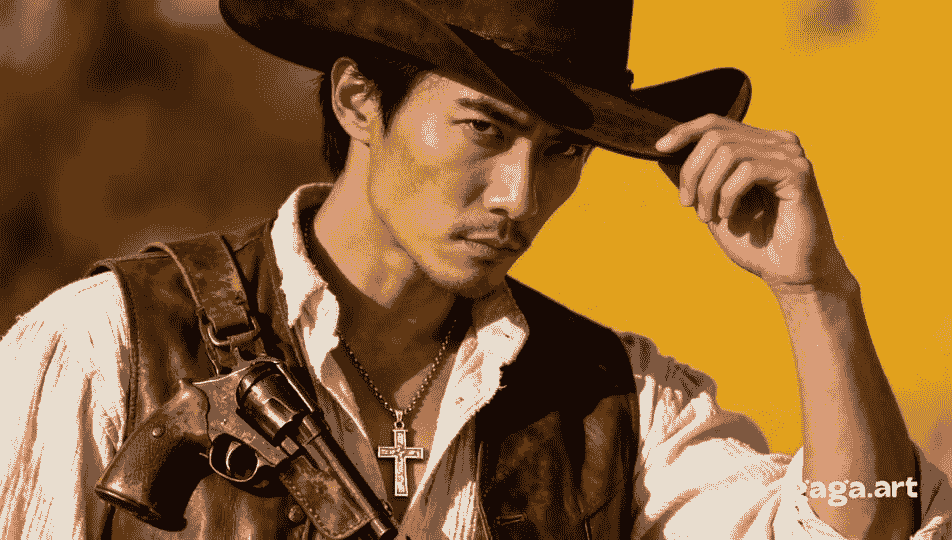

[gaga-output-251008-235330.mp4](https://internal-api-drive-stream.feishu.cn/space/api/box/stream/download/all/T71sb3KSBovaO1xlxurcBh7knpc)

## 3、真人脱口秀：

> 美国人，现场脱口秀，搞笑，有背景笑声，英文台词。

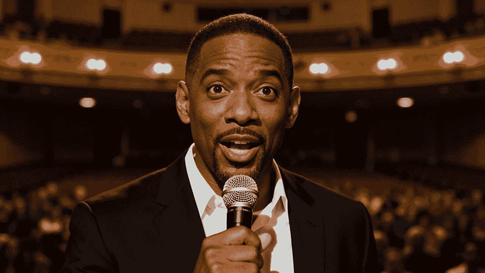

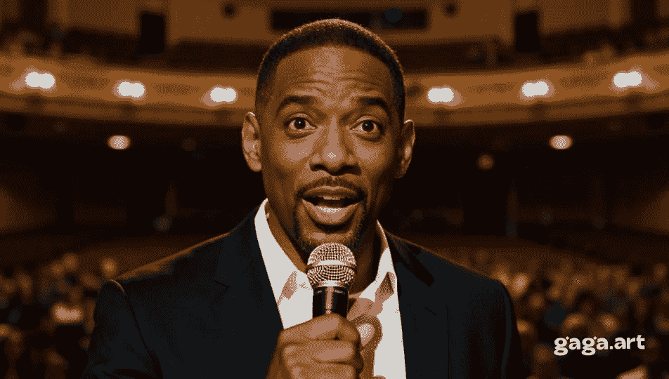

[gaga-output-251008-210815.mp4](https://internal-api-drive-stream.feishu.cn/space/api/box/stream/download/all/J0M4bReqUoaKQ0xNACBclaZOnke)

## 4、双人对话场景：

> 两个相声演员正在台上表演节目，甲乙两人轮流说台词，中文。

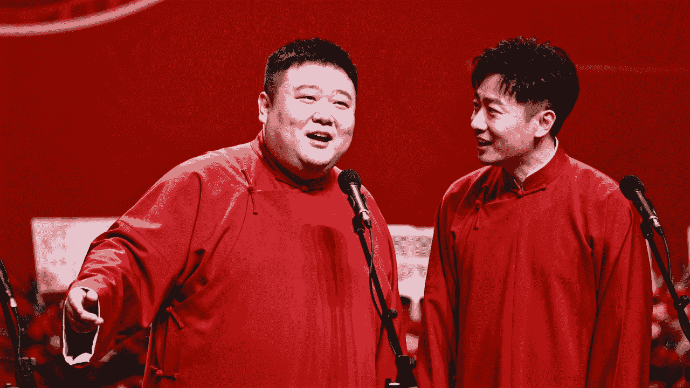

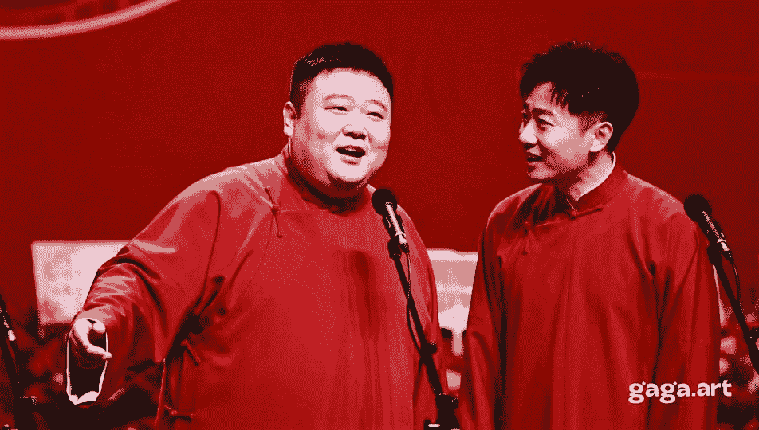

[gaga-output-251010-010726.mp4](https://internal-api-drive-stream.feishu.cn/space/api/box/stream/download/all/TJY3bPWyKoQvuTx4ZYEcIAmdnj5)

> The expressions of the two women quickly changed from shock to despair and panic. The woman on the left said in panic, "How could he find himself here?" The woman on the right said in panic, "It's over, ma'am. We're all done."

[gaga-output-251008-215239.mp4](https://internal-api-drive-stream.feishu.cn/space/api/box/stream/download/all/XUtob0p1co9xLWxVXDMcA35snQc)

> 职场上下级，正在商讨策略，中文对话。

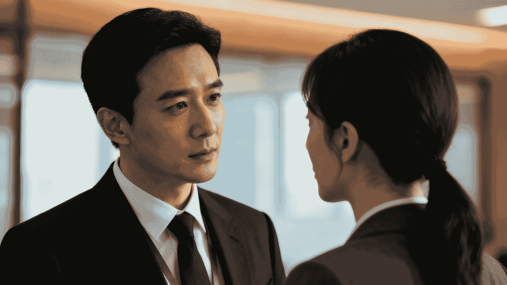

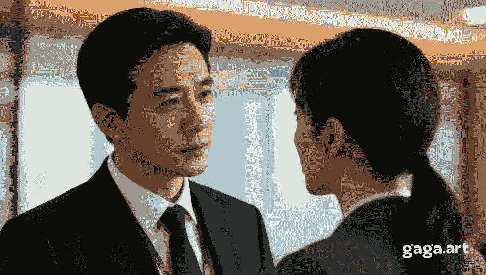

[gaga-output-251009-233049.mp4](https://internal-api-drive-stream.feishu.cn/space/api/box/stream/download/all/Go1NbgYRBoG9qGxyJFUcT5lfnvg)

以上的对话的“交接”非常流畅，人物之间的互动感很强。

这证明了GAGA-1在处理双人场景时，是有“导演”意识的，它知道在一个对话场景中，主角和配角（说话者和倾听者）应该是什么状态。

## 5、自定义虚拟偶像：

> 美国女流行歌手，演唱会现场，温和的演唱，近景特写，歌词自定义

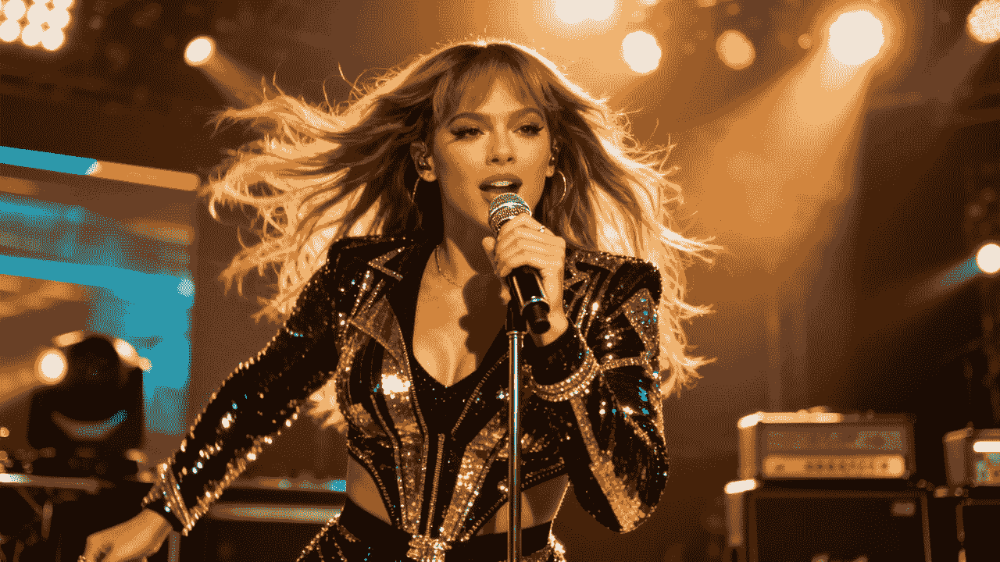

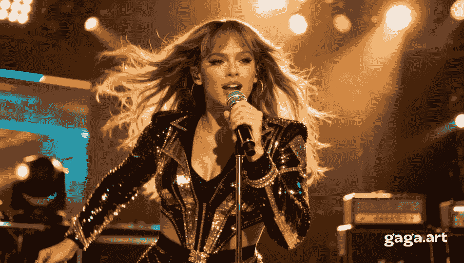

[10.mp4](https://internal-api-drive-stream.feishu.cn/space/api/box/stream/download/all/PKavbtZGToFtLNxdktIccr3XnFd)

这个虚拟偶像，首先是图生视频的效果，很自然，画面没有任何异常，特别是头发丝细节的处理，没有什么错乱的地方。

以上这些测试的结果，让我看到了Gaga在语义、场景理解上的潜力。

虽然前不久Sora 2发布大火，但对比Sora，我觉得GAGA-1更加的沉稳、精细、细节做的更加到位，还比较可控，可以具体规定台词的内容，也可以任其自由发挥。

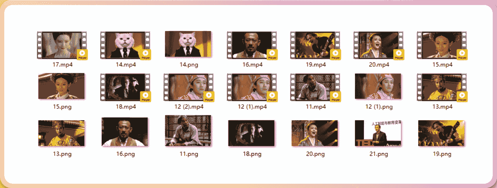

（👸号只能放10个视频，还有一些Case，汇总，发视频号，插入在此）

此外，如果你想让人物声音一致性更加可控，可以使用这个功能——Gaga Avatar：定制语音做参考、选取合适的数字分身、选取适合的音色等。目前，也开放给免费用户使用

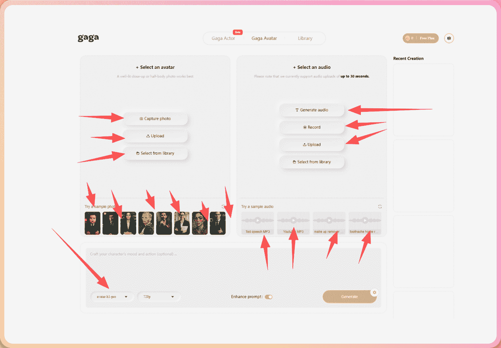

# 客观地说，这位“AI新秀”很优秀了但也还有提升空间。

经过多轮测试，GAGA-1的实力确实让我佩服，尤其是在它专注的“人物对话”领域。但我们也要客观地看到，作为一个新生模型，它现阶段的“戏路”还比较窄。

+   **专精“文戏”，不擅“武戏”**：它的核心优势在于对话表演。我也尝试让它唱歌，效果就比较随机，有点像KTV里的入门选手。

+   **一些待优化的技术细节**：比如在生成较长或连续的片段时，角色的音色可能会有细微漂移；双人场景很棒，但想塞进第三个人，系统就会有点“头疼”。

不过，在我看来，对于一个V1版本的产品，这种“有所为有所不为”的专注反而是件好事。

先把最核心的对话演绎做到极致，再逐步拓宽能力边界，是一条很稳健的路。

# 那么，谁会是这位“AI演员”的第一批观众？

聊了这么多，你可能会问，Gaga AI到底能用来做什么？我能想到的应用场景还挺多的：

**1）****内容创作者和独立制作人****：** 以前做个视频，人物独白或者角色对话是最头疼的部分之一。现在，你只需要一张图、一段文案，就能快速生成高质量的表演片段，无论是用作视频素材，还是制作动画、游戏的角色对话Demo，效率都大大提升。

**2）****营销和广告行业****：** 可以快速生成虚拟代言人的产品介绍、用户证言等视频内容，用更低的成本，实现更生动的视觉呈现。

**3）****教育和知识分享****：** 可以让历史人物“亲口”讲述自己的故事，或者让不同领域的专家“同台”辩论，让知识的传播变得更加有趣和直观。

**4）****我们普通用户****：** 当然是用来“整活儿”和创造乐趣。让老照片里的爷爷奶奶开口说话，给朋友做个会说话的表情包，或者把自己P到名人合照里来一段“神对话”，想象空间很大。

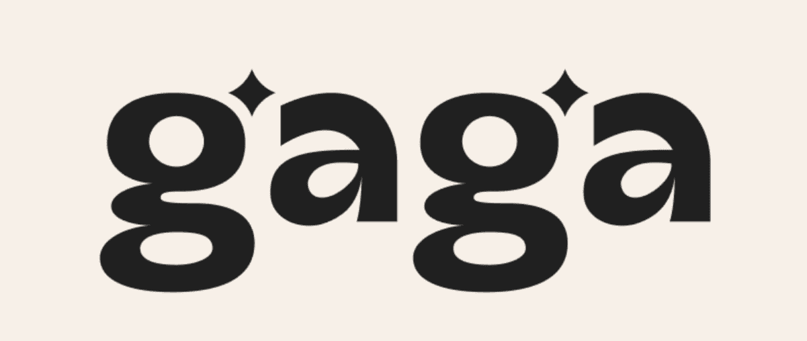

整体使用下来，Gaga AI给我的感觉，是一个非常有潜力的新生代“演员”。它没有急着去学十八般武艺，而是潜心钻研台词和表演，这一项核心技能，并且已经做得有模有样。

据悉，GAGA-1模型目前已经正式发布了，没有套路，直接全量上线，无需邀请码。

它能否搅动AI视频这池春水，又会给内容创作带来怎样的新可能？

我们拭目以待。

<https://aigcreative.feishu.cn/sync/K4Gvd9vUQsy9Oubwqaeclu0Fnbg>

# 知识库动态