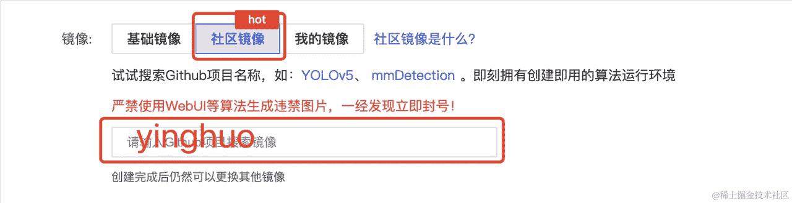
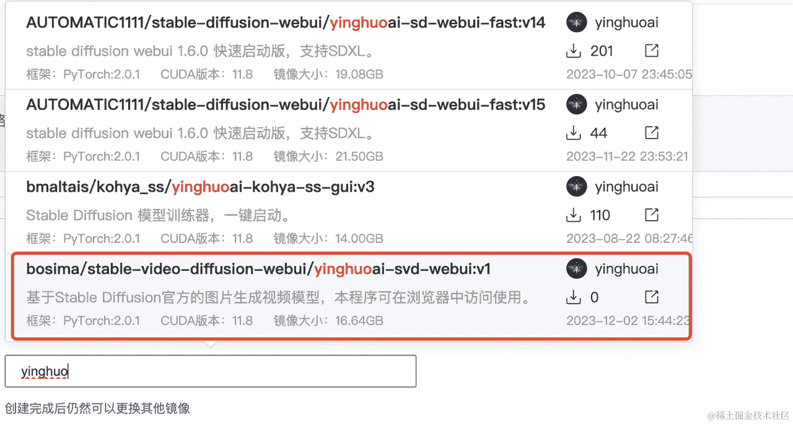
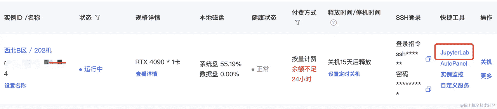
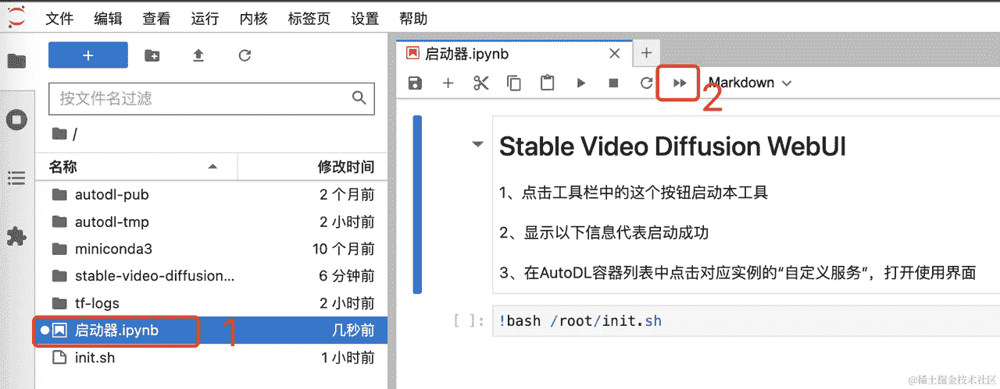
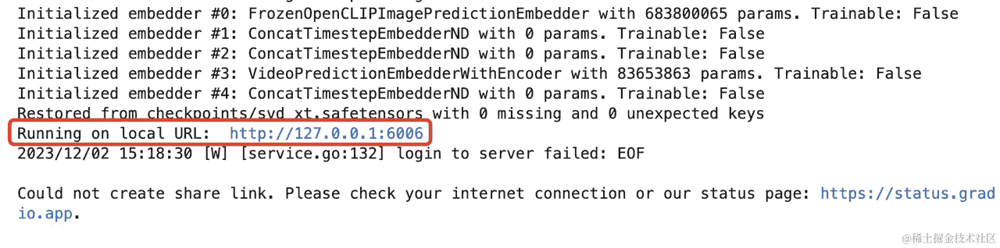
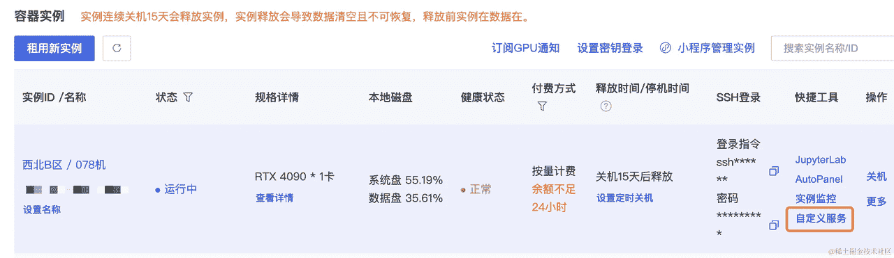
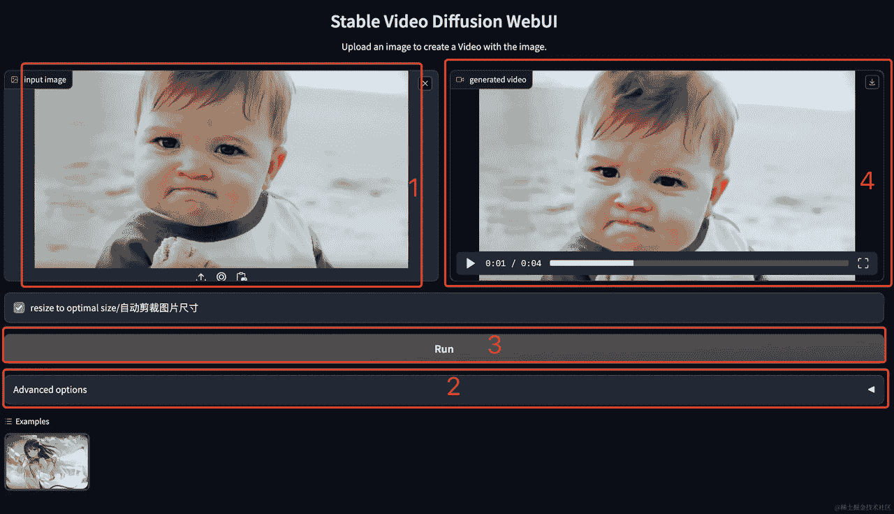

# 图片生成视频：Stable Video Diffusion使用教程

> 来源：[https://aigcreative.feishu.cn/docx/NOTPdN7AwolAfKx10WIc1mRQnzg](https://aigcreative.feishu.cn/docx/NOTPdN7AwolAfKx10WIc1mRQnzg)

> 作者：萤火架构

> 链接：https://juejin.cn/post/7308536984028807194

11月22日 Stability AI 发布了一个AI视频的开源项目：Stable Video Diffusion，它可以基于一张图片生成数秒钟的视频，效果比较惊艳，本文就给大家分享下如何安装和使用。

视频不方便分享，我这里做成了gif动图，可以看到画面很稳定，基本上是没有闪烁的。


这个程序对显卡的要求比较高，如果你的电脑没有二三十G的显存，不建议本地安装，建议试试云环境，比如AutoDL、青椒云等。

如果你使用AutoDL，也可以直接使用我制作好的镜像，免去繁琐的安装步骤，具体方法请看本文中的“云环境镜像”一节。

如果你既不想安装，也不想使用镜像，也有社区提供的免费演示空间，只不过可能需要特殊网络设置，请看本文中的“社区免费空间”一节。

## **手动安装**

为了方便安装，这里使用的测试程序对Stability AI官方发布的 Stable Video Diffusion 做了一个简单的包装，也是一个开源项目：

[g](https://link.juejin.cn?target=https%3A%2F%2Fgithub.com%2Fxx025%2Fstable-video-diffusion-webui)ithub.com/xx025/stabl…

首先你需要在运行环境中安装Git和Conda，这两个网上介绍的比较多，这里不啰嗦了。

然后下面的步骤都通过执行命令行来完成。

通过git将代码复制到本地：

```
bash
复制代码
git clone https://github.com/xx025/stable-video-diffusion-webui.git
```

进入程序目录：

```
bash
复制代码
cd stable-video-diffusion-webui
```

通过 Conda 配置 Python 虚拟环境：

```
ini
复制代码
conda create -n svd python=3.10
```

激活Python虚拟环境：

```
复制代码
conda activate svd
```

如果上面的命令不能成功执行，请换成下面这个（因为新版本的conda不支持activate）：

```
bash
复制代码
source activate svd
```

使用 install.py 进行安装，主要是用来安装程序需要的依赖包：

```
复制代码
python install.py
```

因为依赖的包很多，这个安装可能比较耗时，请耐心等待。

安装完成之后，我们还需要去下载大模型，然后才能用来生成视频。

创建存放大模型的目录：

```
arduino
复制代码
mkdir checkpoints
```

下载大模型到这个目录中：

```
ruby
复制代码
wget https://huggingface.co/vdo/stable-video-diffusion-img2vid-xt/resolve/main/svd_xt.safetensors?download=true -P checkpoints/ -O svd_xt.safetensors
```

大模型发布在HuggingFace 上，文件大小接近10G，直接下载可能比较慢，随后我会上传到网盘，如果被封了，你也可以加我的微信 yinghuojun007 获取。

然后我们就可以启动程序了。

```
arduino
复制代码
python run.py
```

启动成功后，会有类似下文的提示，我们可以在浏览器中打开这个链接：


## **云环境镜像**

为了方便测试，我在AutoDL上制作了一个 Stable Video Diffusion WebUI 的容器镜像，可以直接启动使用。

在创建实例时，镜像这里选择“社区镜像”，下方输入 yinghuo。



在弹出的镜像提示中选中“yinghuoai-svd-webui” 。



实例启动后，在容器实例控制台，点击进入容器实例的 JupyterLab 工具。



在JupyterLab 中打开“启动器”，点击工具栏中的这个按钮启动程序。



它会先下载大模型，然后再启动WebUI，显示以下信息代表启动成功 。



最后在AutoDL容器实例列表中点击对应实例的“自定义服务”，就可以在浏览器打开程序的使用界面了。



## **社区演示站**

Huggingface 上有两个推荐的演示空间，可以直接体验图片生成视频的效果。

不过这个网站经常访问不了，可能需要特殊的网络设置；另外因为是免费公开的，如果同时生成的人比较多，可能需要排队，等的时间比较长。

huggingface.co/spaces/mult…

huggingface.co/spaces/Just…

## **工具使用**

这个工具的使用界面比较简单（其实隐藏了很多参数设置），我们按照顺序看一下：

1、这里上传用来生成视频的图片。

2、这里是一些高级参数设置，展开就能看到了，比如每秒的视频帧数，建议默认就行了。

3、点击这里就开始生成视频了。

4、视频生成成功后，会展示在这里，可以进行预览播放。



<https://aigcreative.feishu.cn/sync/K4Gvd9vUQsy9Oubwqaeclu0Fnbg>