# Pixverse基础实操

> 来源：[https://aigcreative.feishu.cn/docx/OwHbdSmhxojFwBxiSCUcLe0onPh](https://aigcreative.feishu.cn/docx/OwHbdSmhxojFwBxiSCUcLe0onPh)

Pixverse是北京爱诗科技旗下AI生成视频产品。爱诗科技是一家专注于AI视频生成技术的公司，由前字节跳动视觉技术负责人王长虎创立。其团队成员来自清华、北大、中科院等顶级学府的专家，以及前字节、微软亚洲研究院、快手、腾讯等公司的核心技术团队成员。

目前有两种方式使用pixverse产品：官方网站和discord社区

官网链接：https://app.pixverse.ai/login

discord社区链接： https://discord.gg/nHxRGRKcBq（点击邀请链接加入Discord-PixVerse服务器）

官网链接体验会更符合中国人的习惯，同时国内可正常使用，不需要魔法；discord社区可以第一时间收到平台工作人员的消息，也可以看到世界各地艺术家使用产品制作的视频，拥有更好更直接的交流氛围，但需要🪜才能使用。建议大家都注册登陆。

提示：pixverse可以使用中文提示，但亲测英文生成效果更好，建议中文翻译英文后生成。

# 官网使用指南

## 一，注册和登录

进入登录页面后，可以用谷歌邮箱直接登录，可以使用个人邮箱注册登录，支持国内各类邮箱。

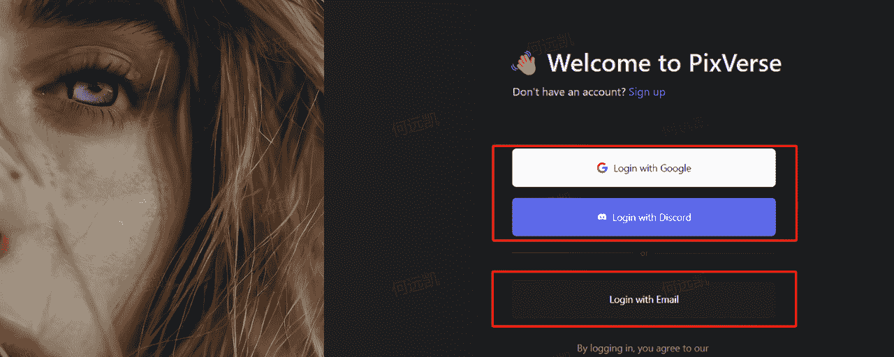

## 二，认识界面

主页面分两部分，左边一排是展示热门视频/用户生成视频/收藏视频控件，右边突出的红紫色按钮是创建功能，是视频生成核心功能。

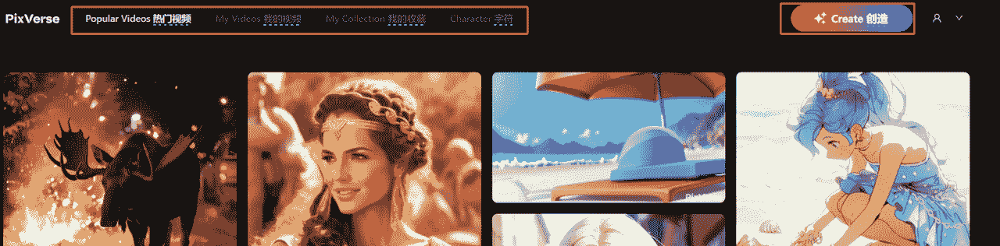

我们先看左边一排控件。

### Popuplar Video　热门视频

热门视频展示当前由平台创作者们生成的优质片段，随便点开一个进去，可以看到视频生成的详细信息，你可以点击创建，进入创建页面创建自己的视频（后面会讲），也可以点击【upscale升档】和【retry重试】对当前视频进行画质提升和重新生成。

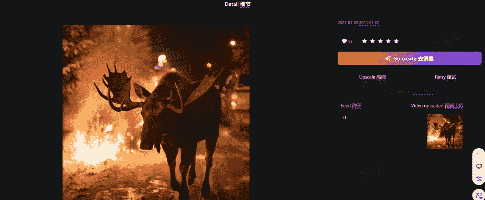

### My Video　我的视频

展示你生成过的历史视频片段

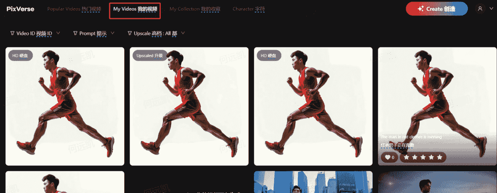

### My collection　我的收藏

收藏你觉得不错的视频片段和提示词。这里你可以在热门视频当中会看到视频左下角出现小星星，点击小星星就可以收藏到【My collection】中。

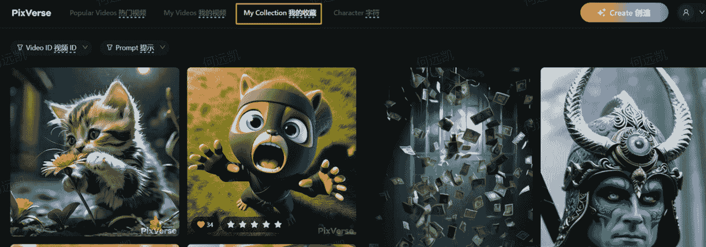

### Character　角色

pixverse新推出的角色一致性功能，上传一张人物正面图片，描述人物所在的场景和动作，可以生成一张该人物的场景片段。

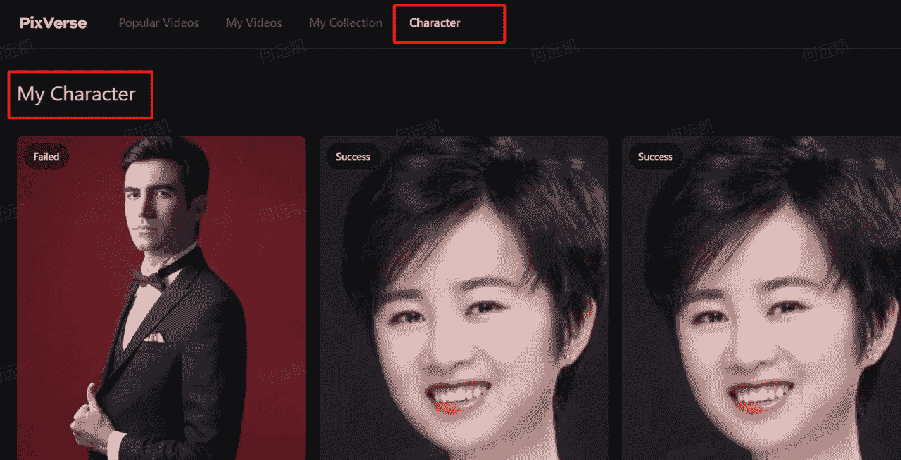

接下来我们重点讲一下creat视频生成。

## 三，文生视频

我们直接点击右上角的creat 就可以进入生成界面

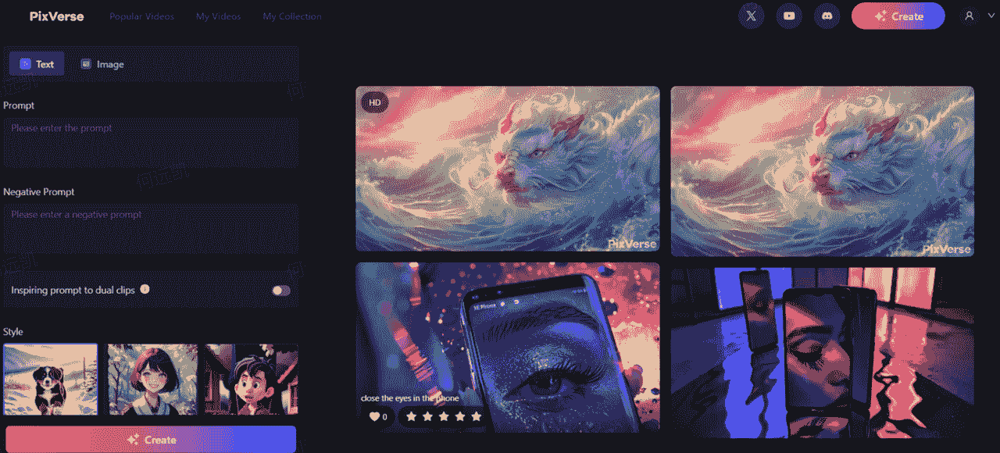

左边是我们的操作板块，右边是我们视频展示板块，新用户这里是空白的，我们生成视频之后会在右边这里展示。

我们主要看一下左边的这个操作界面，也是非常的简单，它分成两种视频生成方式，一种是直接输入文字生成视频；一种是提供图片，输入文字提示指引模型让图片按照提示动起来。

### 正负提示词

文生视频的提示词分成正向提示词和负向提示词两种。

正向提示词主要描述我们想要的画面，而负向提示词则描述的是我们不想出现的视频元素，比如我们不想画面中有任何的模糊，丑陋，变形的手指等等要素，我们就可以在负向提示词框中描述。

另外，添加负向提示词，在一定程度上还能增加画面细节。

举例：

【正向提示】

young Asian woman holding a red rose in the corner of her eyes, in the style of unreal engine 5, max rive, gaston bussière, pipilotti rist, beautiful,smiling movie still,attractive atmosphere

年轻亚洲女性，手拿着一朵红玫瑰放在眼角，风格类似于虚幻引擎5、马克斯·里夫、加斯顿·布西埃、皮皮洛蒂·里斯等艺术家，美丽、微笑的电影静态画面，富有吸引力的氛围。

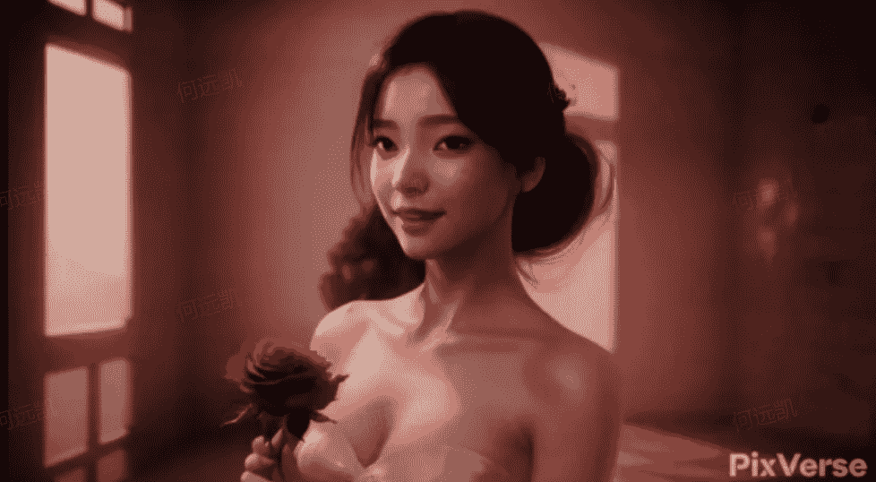

【负向提示】

extra hands,extra arms,missing arms,twisted fingers,poorly drawn hands,disfigured,deformed,blurry,duplicate,ugly,out of frame

额外的手，额外的手臂，缺失的手臂，扭曲的手指，画得不好的手，毁容，畸形，模糊，重复，丑陋，超出画面

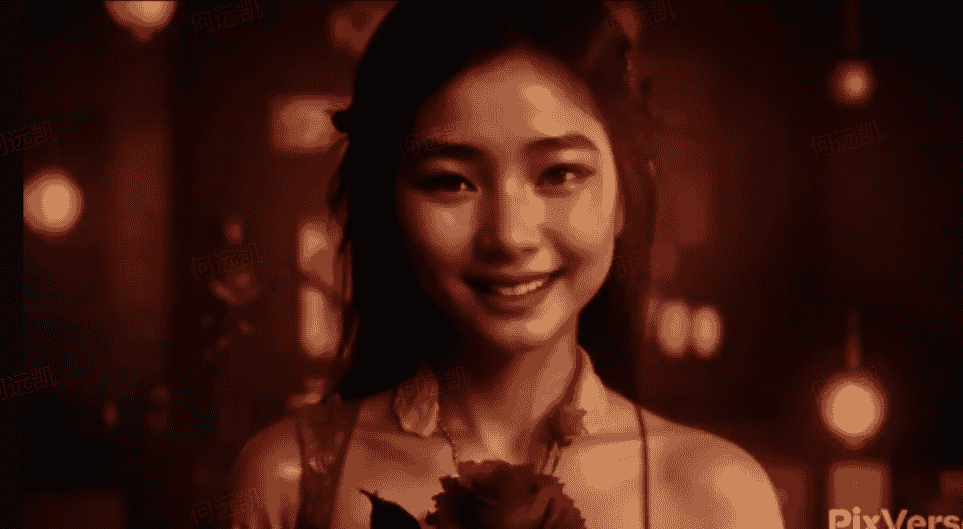

我们会看到画面背景细节，人物细节都增强了许多。仔细看画面，也少了很多模糊和伪影。

负面提示词会有一些常用的模版，这里我给大家提供几个范式，大家基于这个模板，根据需要进行修改或者直接复制。

版本一：

ugly,duplicate, blurry, abstract, disfigured, deformed, cartoon, 3d, bad art, poorly drawn, extra limbs, close up, b&w, weird colors, blurry, watermark, blur haze, watermark, elongated body, cropped image, out of frame, draft, deformed hands, twisted fingers, double image, malformed hands, multiple heads, extra limb, ugly, poorly drawn hands, missing limb, cut-off, over saturated, grain, low res, bad anatomy, poorly drawn face, mutation, mutated, floating limbs, disconnected limbs, out of focus, long body, disgusting, extra fingers, gross proportions, missing arms, mutated hands, cloned face, missing legs

丑陋，不止一个头，重复，模糊，抽象，毁容，畸形，卡通，3D，糟糕的艺术，画得不好，额外的肢体，特写，黑白，奇怪的颜色，模糊，水印，模糊晕影，水印，身体延长，裁剪的图像，超出画面，草稿，畸形的手，扭曲的手指，双重图像，畸形的手，多个头部，额外的肢体，丑陋，画得不好的手，缺失的肢体，切断，过饱和，颗粒，低分辨率，糟糕的解剖，画得不好的脸，变异，变异，飘浮的肢体，断开的肢体，焦点不准，长身体，恶心，额外的手指，粗糙的比例，缺失的手臂，变异的手，克隆的脸，缺失的腿。

版本二：

(hands), text, error, cropped, (worst quality:1.2), (low quality:1.2), normal quality, (jpeg artifacts:1.3), signature, watermark, username, blurry, artist name, monochrome, sketch, censorship, censor, (copyright:1.2), extra legs, (forehead mark) (depth of field) (emotionless)

（手），文本，错误，裁剪，（最差质量：1.2），（低质量：1.2），普通质量，（JPEG噪点：1.3），签名，水印，用户名，模糊，艺术家名称，单色，素描，审查，审查，（版权：1.2），额外的腿部，（前额标记）（景深）（无表情）

### 双视频生成功能

开启下图中的按钮，可以基于同一个提示词生成两个片段，然后择优选择。

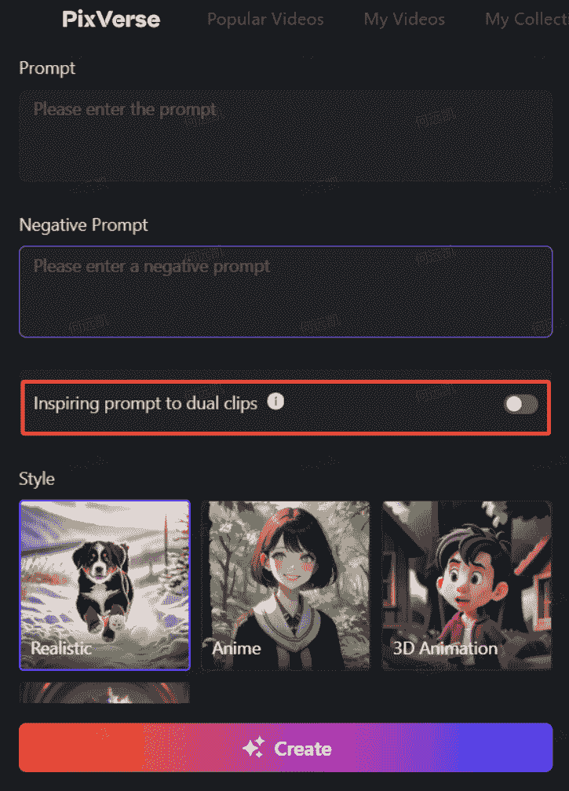

### 风格选择

截至目前，pixverse提供了四种视频风格选项：真实，2D动漫，3D动漫和CG动漫。

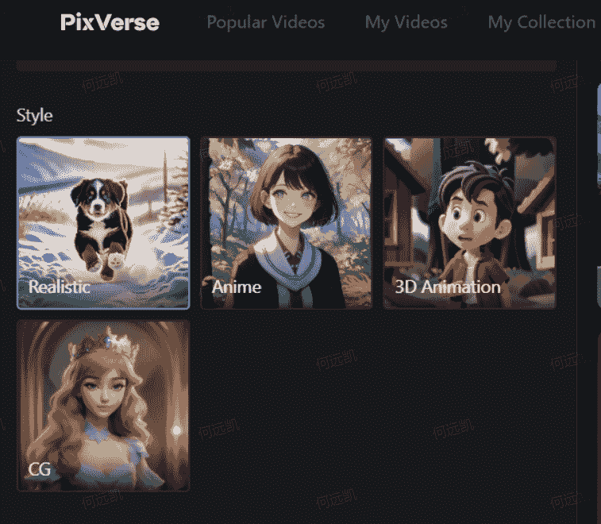

### 画面比例

官方提供了五种画面比例选项：

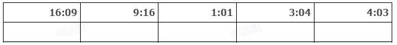

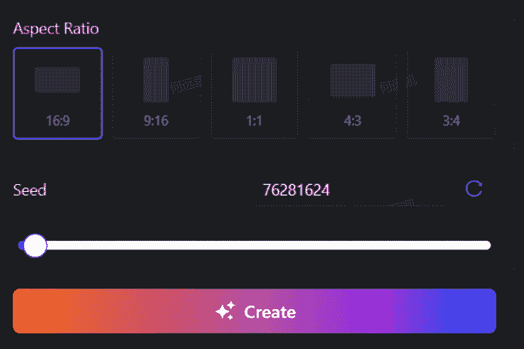

最后点击生成就好了

## 四，图生视频

图生视频即提供一张图片，然后通过提示词指引图片中镜头和主体如何运动。

### １，添加图片

建议提供的图片线条明暗或色块十分清晰的，否则模型很难识别图片主体。这也是为什么有些特别抽象派的图片很难做动态化。

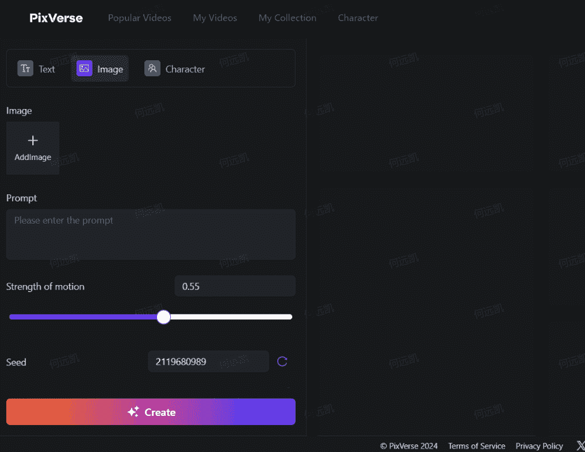

### ２，输写提示词prompt

图生视频tips:

(1) 图生视频只有正向提示词，由于模型能够识别图片主体和要素，提示词不需要再次详细描述主体，只需要简单提及即可，重点描述主体和镜头需要完成的运动；

(2) 时长只有4秒，动作提示建议使用单一提示，多重动作提示没有用；

正确示范：男人跑步；

错识示范：男人跑步后停了下来；

(3) 英文提示ing效果会更好；

### ３，运动权重

默认0.55，范围0到1之间。

调试tips:

(1) 值越大，理论上运动强度越大，默认最佳的运动值为5；

(2) 如果人物因运动幅度过大导致伪影或模糊现象，建议把运动权重再调小些；

(3) 但为了保证主体动作的稳定性建议值为5，pixverse的运动幅度都非常小，表现在画面上就是主体动作比较慢，镜头运动也十分缓慢;

### ４，seed值

主要用于测试不同的提示词的效果。一般不用管。

## 五，角色一致性

在主页面点击选择“Character”。

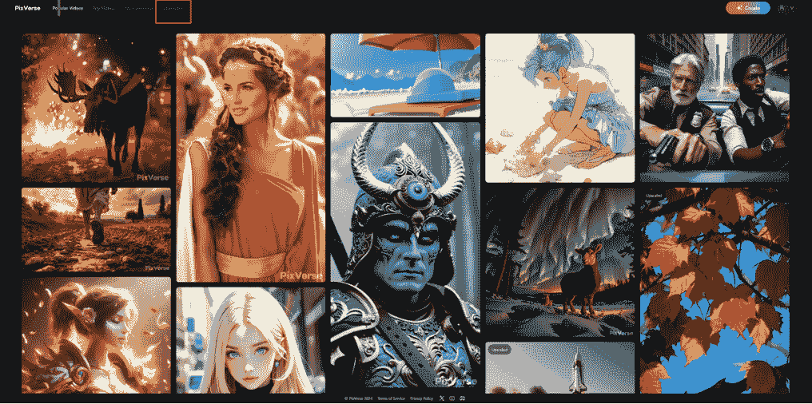

点击“Create Character”。

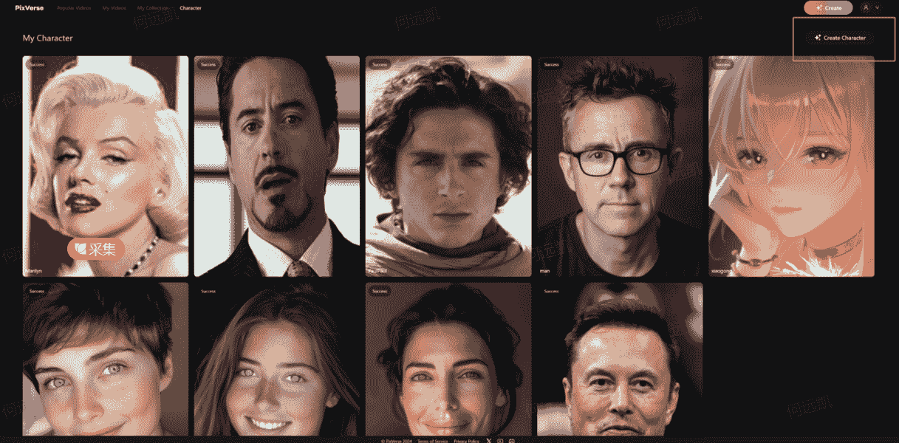

在此界面通过点击或拖动的方式上传图片，命名您创建的Character，最后点击“Create Character”即可生成。

提示：最好使用包含真实人脸的单人图片效果最佳，脸部大小需要超过 200×200px，面部无遮挡

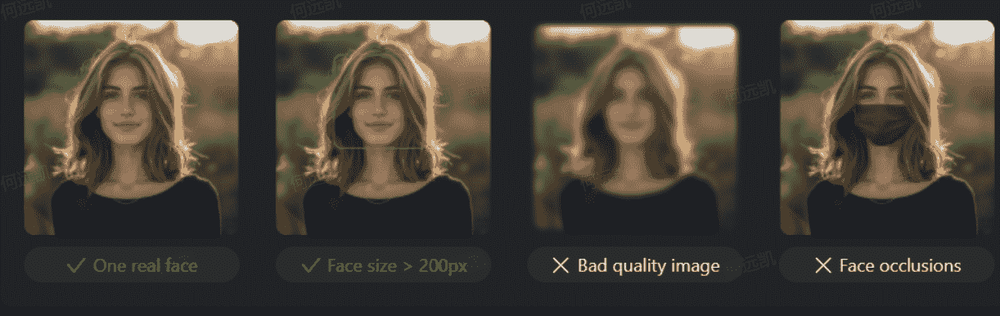

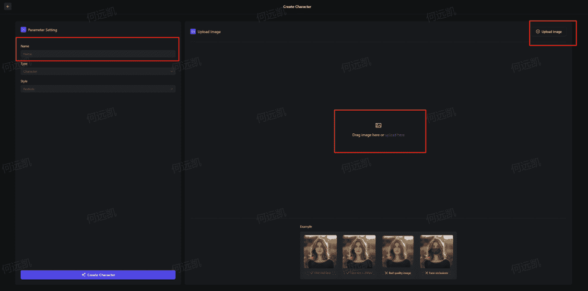

Character添加完毕后，等待20秒左右，在看到“Success”提示后，点击“Create”进入创作界面。

若未等到“Success”提示便进入创作界面，会找不到创建的Character，此时需等待10~30秒，待Character创建完成即可。

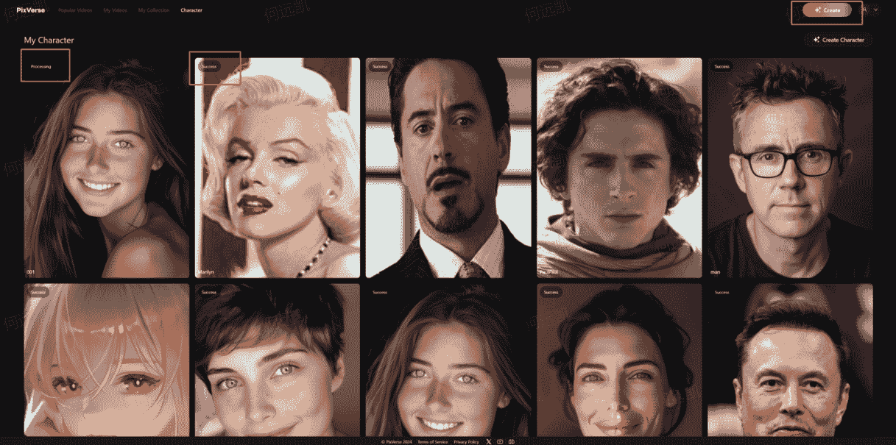

点击“Character”。

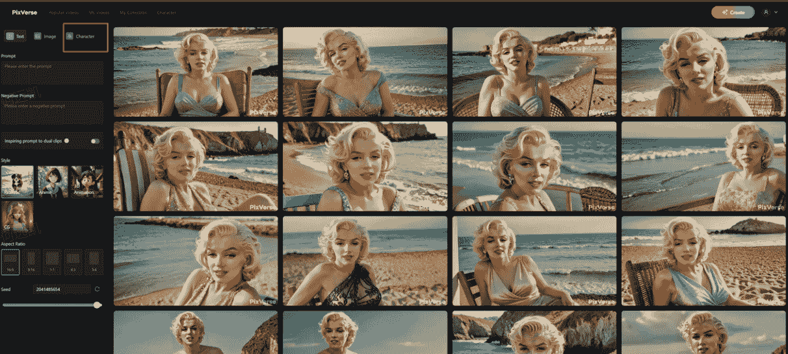

在下拉选项中选择您创建的character,输入提示词，选择您想要的画幅比例。点击“Create”完成制作！（Auto Character Prompt默认开启）

### Auto Character Prompt 功能：

+   打开此按钮，我们会自动添加提示以增强您角色的保真度。

+   如果想要在原有人物的基础上做改动，可以尝试关闭改选项。

提示词技巧：

1.Character功能在中近景下的表现效果最佳，使用时可以通过加入upper body，super detailed face等词语，并避免幅度过大的动作，以保证最佳效果。

2.为了保持人物的高度一致，请在提示词中尽可能详细描述人物的外貌特点，比如：男性/女性，长发/短发等等。

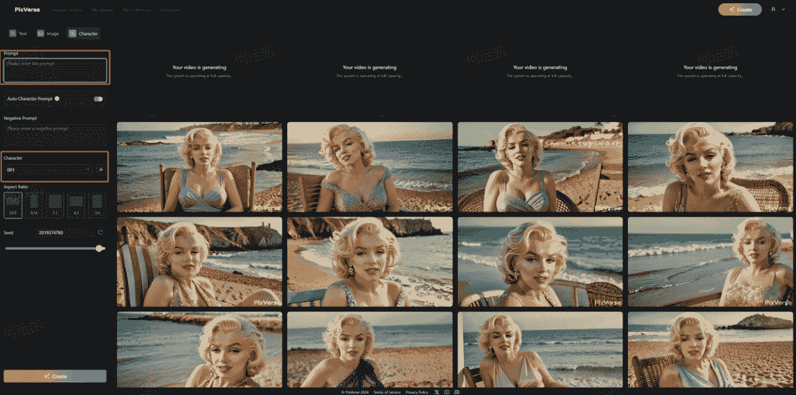

提示：

无论提示词中是否包含人物主体信息，Character模式下视频默认包含选择的Character，如果您要生成不含人物的其他视频（如风景等），请选择文生视频功能。