# MorphStudio使用指南（网页UI版本）

> 来源：[https://aigcreative.feishu.cn/docx/AB0AdRs9Voo1wpxAzcTcLxzanSd](https://aigcreative.feishu.cn/docx/AB0AdRs9Voo1wpxAzcTcLxzanSd)

> 作者：印迪谦      公众号：AI觉醒时代

> 链接：https://mp.weixin.qq.com/s/P_YzDC6S2zEmicttXJ3kRw

网址：https://app.morphstudio.com/

排队地址：https://app.morphstudio.com/waitlist

目前为内测阶段，可以排队等待，通过后会向你的邮箱发送一封邀请邮件

# 一、创建项目

注册并使用您的帐户登录后，您将看到以下页面。单击“新建”创建一个新项目。您可以设置项目的“名称”、“纵横比”、“FPS”和“分辨率”。我们很快将添加更多的纵横比，包括9:16，这是TikTok和Instagram上拍摄视频内容的默认设置。

## 1、**创建一个新项目**

## 2、**设置项目参数**

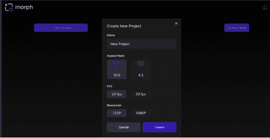

# 二、创建视频

## 1、生成视频:

在"Shot"卡中，您可以输入提示并点击蓝色星号图标生成视频。您也可以上传图片或视频，并以其他方式生成视频，更多详情请参见“高级功能”章节。

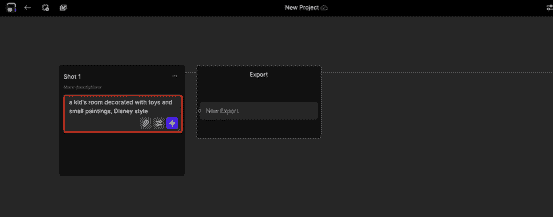

## 2、等待时间:

根据提示以及视频长度和分辨率等因素，各代的等待时间可能从20-30秒到几分钟不等。随时生成更多的视频，因为你等待现有的完成

## 3、展开视图/卡片信息:

生成完成后，您可以点击卡片右下角的展开图标来查看生成的照片的信息，包括提示、模型和用于该照片的参数。

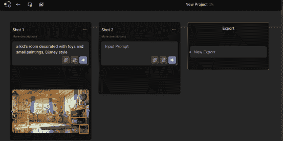

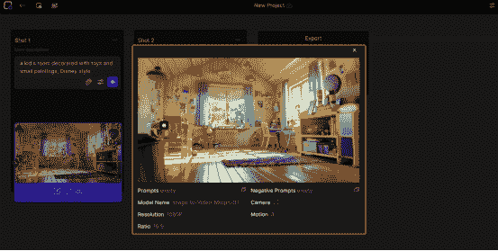

## 4、重新生成视频

对于生成的视频，您可以以各种方式重新生成视频。点击生成的视频，会弹出三个图标:重新提示、重新生成和样式转换

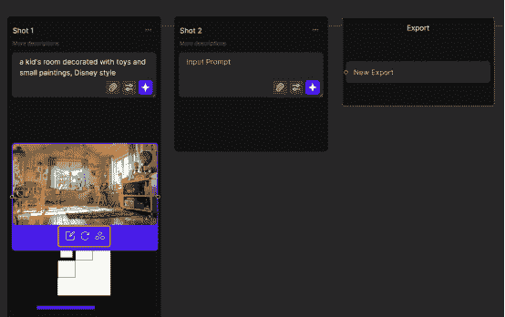

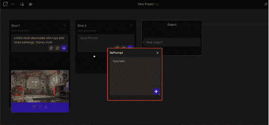

重新提示:您可以编辑本视频输入的提示，同时保持使用的所有模型和参数相同。

## 5、重试

保留原有的提示和设置，重新生成视频。现在，reprompt和retry提供类似的功能，我们将很快添加种子，这样你就可以根据你的年龄做微妙或强烈的变化。

## 6、风格转换

保留原始视频的构图和动画，同时使用我们的预设来更改视频的风格。到目前为止，现实，动画2D，动画3D，幻想，像素风格可用，我们将很快增加更多的预设。

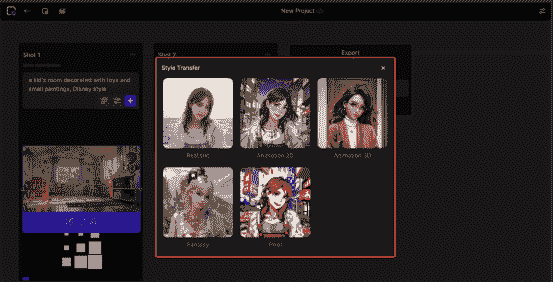

## 7、添加/编辑镜头

### ·添加一个新镜头:

当你需要添加更多的镜头时，你可以点击屏幕左上角的按钮，在时间轴上添加一个镜头。新生成的抽牌将作为导出抽牌前的最后一张抽牌，您可以随意与其他抽牌切换抽牌的位置。

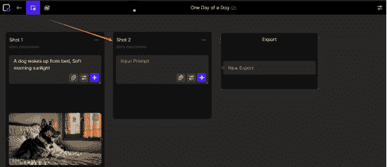

### 编辑快照：

当您单击快照卡右上角的“…”图标时，您可以编辑卡的名称、添加说明，或者保存和删除快照。

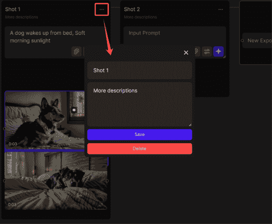

# 三、导出您的作品

当你有足够的剪辑时，是时候连接它们并在导出它们之前观看预览了。详细步骤如下：

1.您可以通过拖动快照并在主时间线上重新排列来调整快照的顺序。

2.要创建时间线：您可以将任意两个快照连接在一起，方法是将鼠标/触摸板左键单击快照列内卡片两侧的圆形点图标顶部，然后拖动它以连接不同快照卡片上的另一个点。

**其逻辑如下：**

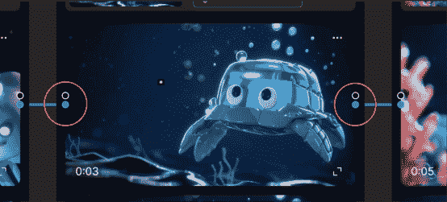

-任何穿过卡片左侧的线都意味着该卡片将在之前连接的射击之后播放

-任何穿过卡片右侧的线都意味着该卡片将在之前连接的射击之前播放。

如果点没有填充线的颜色，则意味着线在卡后面与另一张卡连接。

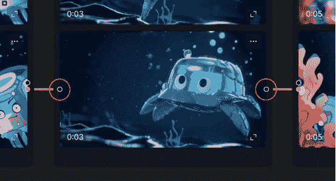

**线条的属性：**

-您最多可以在卡片的两侧连接3个点。但是，在一个时间线内，您可以连接的卡的总数没有限制。如果需要，也可以连接同一列中的快照。

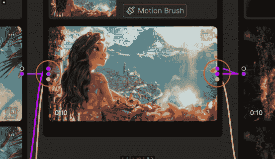

-线条最多可以有8种不同的颜色。在最终导出过程中，它将仅将与具有相同颜色的线连接的快照缝合在一起。

**删除行：**

-要删除一行，您可以单击该行，将出现一个“X”图标进行删除。

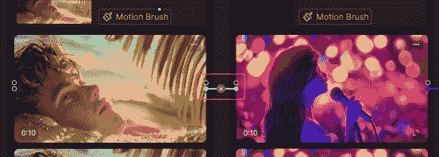

-您也可以点击该行，然后按键盘上的“DEL”按钮删除该行。

一旦你将照片连接到你喜欢的位置，你就可以在最后一张卡片的右侧拖动一条线到导出面板上的左点。然后，各个片段将缝合在一起以进行更长的预览。

3.当你点击导出卡上的下载按钮时，你可以选择批量下载单个片段，也可以选择在一个长视频中下载整个预览。

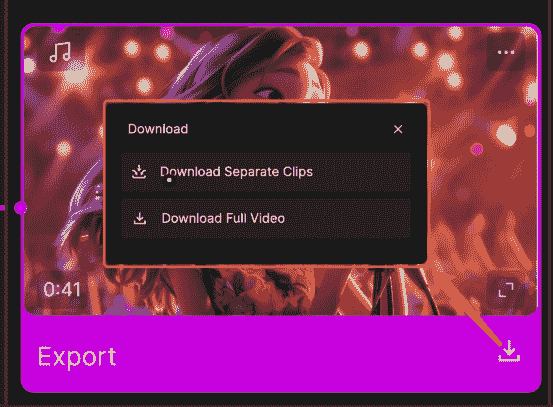

# 四、高级功能

如果你已经掌握了生成视频的基本知识，本章将向你介绍更高级的功能，在那里你的创造力可以提升到一个新的水平！

## 1、选择模型

我们现在支持以下模型在Morph Studio中生成视频：

**更改模型：**

文本到视频形态-0.1被设置为任何新创建的射击卡的默认模型。您的型号选择将根据您是否上传了图像或视频而更改。每个模型也有自己的一组参数可供调整，如下所示：

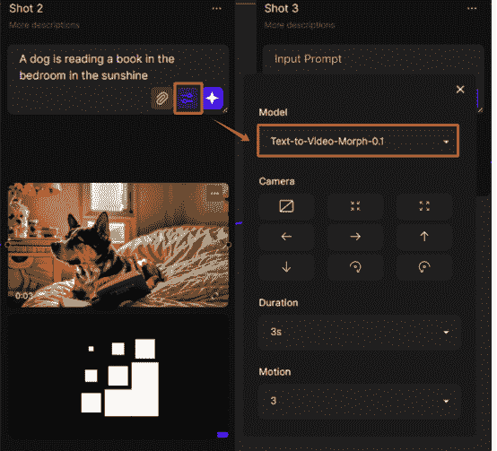

**设置说明**

**相机运动**

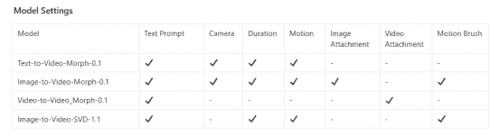

现在我们支持静态、放大、缩小、向左平移、向右平移、向上平移、向下平移、顺时针旋转和逆时针旋转。一次选择多个相机移动的选项将在未来可用。

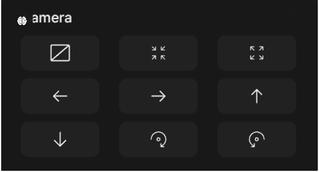

**时间**

我们支持最多10秒的视频生成。默认持续时间设置为3s。

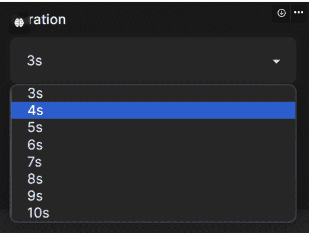

**运动**

我们支持1-10的运动值范围；最小值和默认值为1，最大值为10；数字越高，动作就越引人注目。

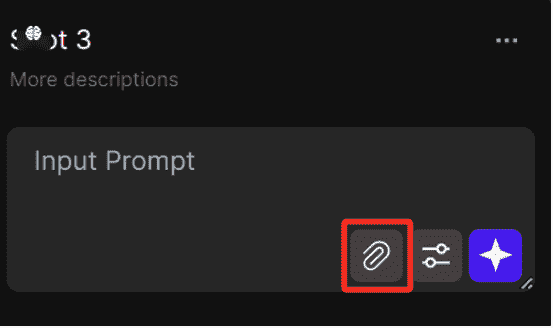

您可以点击回形针按钮上传图像。请注意，截至目前，生成的视频的最高分辨率为1080p。建议使用略高分辨率的图像来保留图像中的更多细节，但请将其保持在4k以下，以免服务器过载。

**视频附件（视频）：**

您也可以使用回形针按钮上传视频进行样式转换。附件的大小限制为50M。

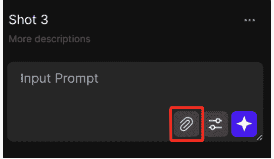

**运动刷：**

运动笔刷仅适用于“图像到视频”模型。上传图像后，您可以通过单击蓝色按钮使用运动刷功能。

-**笔：**使用笔工具覆盖视频中要移动的区域。

-**橡皮擦：**使用橡皮擦工具删除选定区域的部分内容。

-**清除：**使用清除按钮清除笔工具选择的所有蓝色区域。

-**保存：**请在关闭窗口之前单击“保存”。如果您不喜欢生成的结果，可以稍后返回并编辑运动区域。

我们将添加按Ctrl+Z撤消的选项，并且很快就会有“重做”和“撤消”按钮。目前，请在退出窗口之前保存。

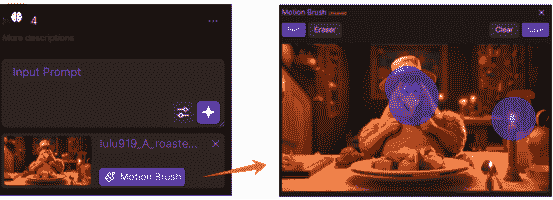

## 2、批量上载图像

为了在生成故事时方便使用和提高效率，我们提供了“批量上传”图像的选项，并自动将其转换为屏幕上排列的镜头。点击左上角的按钮访问此功能，您最多可以一次上传10张图像。

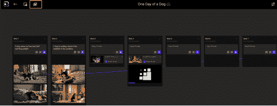

成功上传图像后，单击“创建快照”将图像转换为画布上的快照卡。

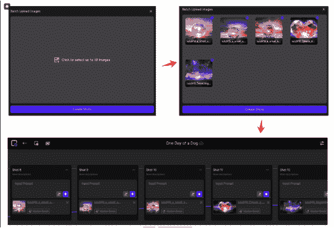

## 3、模板使用情况

为了从一开始就创造更友好的用户体验，我们提供了一些模板项目，您可以在库中进行编辑。您可以通过“我的图书馆”页面访问它们。

单击“使用此模板”后，浏览器中将打开一个新选项卡，您可以在其中开始编辑模板。此模板也将作为新项目复制到库中，因此您可以随时重新访问它。

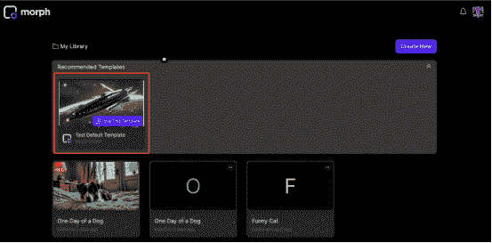

# 五、作品展示

我比较怀念80年代上海电影美术制片厂的动画作品，我用秒画和Morph复刻了一下经典动画片《齐天大圣》

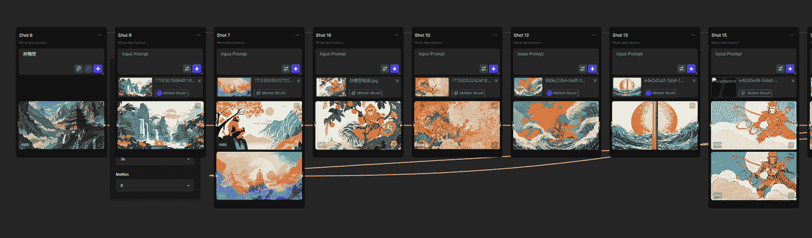

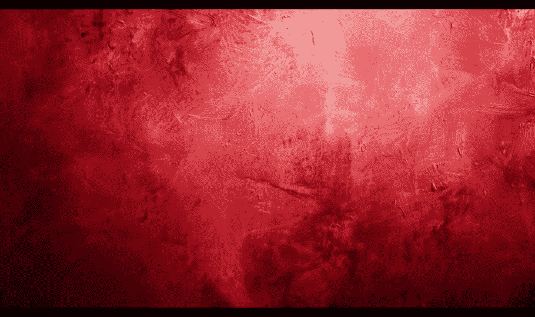

[齐天大圣.mp4](https://internal-api-drive-stream.feishu.cn/space/api/box/stream/download/all/T2nub3O6NoD7J7xjy4CcdKyenFg)

<https://aigcreative.feishu.cn/sync/K4Gvd9vUQsy9Oubwqaeclu0Fnbg>