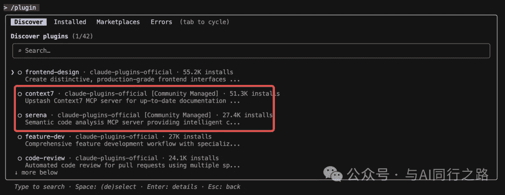
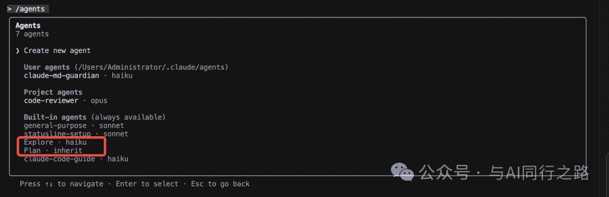

# Claude Code 2025年终盘点：从研究预览到编程平台的蜕变之路

> 来源：[https://aigcreative.feishu.cn/docx/LIzxdTUfAopAkuxZVcsce0tjnzb](https://aigcreative.feishu.cn/docx/LIzxdTUfAopAkuxZVcsce0tjnzb)

> 原文链接： [Claude Code 2025](https://mp.weixin.qq.com/s/LsLd0TzLFoFaCgIbQaQbcQ)年终盘点：从研究预览到编程平台的蜕变之路

> 来源：👸号：与AI同行之路

说实话，回顾2025这10个月，我对Claude Code的感受是： 它不再只是一个AI编程工具了，它正在变成一个完整的开发平台。


年初Claude Code刚发布的时候，我还在想这玩意儿跟Cursor、Copilot有啥本质区别。现在？Subagent、Hooks、Skills、Plugin、LSP、Chrome自动化……每一个功能都让我重新思考AI编程到底应该是什么样子。

这篇文章不是简单的功能罗列，我想从一个用Claude Code开发了10来个系统的深度用户角度，帮你梳理Claude Code这10个月的进化脉络。如果你用了10个月但还是在"打字→看回复→复制粘贴"，那这篇文章应该能帮你打开新世界的大门。

> 📚 系**列导读 ：**这篇年终盘点是我2025年Claude Code系列文章的"总纲"。过去一年，我针对每个核心功能都写过深度解析，本文会在各节点标注相关文章链接，方便你按需深入。如果你是第一次读我的文章，建议先通读本文建立全貌，再根据兴趣点击延伸阅读。

---

## 一、时间线：Claude Code的四个阶段

先上个总图，让你有个整体印象：

| 阶段 | 时间 | 关键版本 | 核心特性 |
| --- | --- | --- | --- |
| **启动期** | 2-4月 | 研究预览 | 终端聊天、CLAUDE.md、基础命令 |
| **爆发期** | 5-7月 | 正式GA | IDE集成、MCP、自定义命令、Hooks、Subagent |
| **深化期** | 8-10月 | 2.0.x系列 | Plan Mode、背景任务、插件系统、Skills |
| **成熟期** | 11-12月 | 2.0.50+ | Claude in Chrome、LSP、Opus 4.5、异步Agent |

如果让我用一句话总结这四个阶段： 从"代码生成器"到"协作编程团队"的蜕变。

> 💡 阅**读建议 ：**这四个阶段我都有持续追踪并写过版本更新解读。如果你想了解某个版本的具体变化，可以直接跳到文末的"版本更新追踪"系列。

---

## 二、启动期（2-4月）：一个有记忆的终端AI

2025年2月24日，Claude Code随着Claude 3.7 Sonnet一起发布，作为"研究预览"让开发者先尝尝鲜。

那时候功能很简单：

+   • 终端里跟Claude聊天

+   • 它能读文件、写文件

+   • 能跑bash命令

+   • 能帮你commit代码

**但有一个功能，从第一**天就奠定了Claude Code的基调—— CLAUDE.md 。

### 2.1 CLAUDE.md：项目记忆的开端

这是我当时最惊喜的一个设计。

用过其他AI编程工具的都知道，每次打开新对话，你都得重复告诉它：我用什么框架、代码风格是什么、有哪些特殊约定。烦死了。

CLAUDE.md解决了这个问题。你在项目根目录创建这个文件，写上项目的关键信息：

```
**# 我的电商项目****

## 技**术栈
- 后端: Spring **Boot 3.**x + MyBatis Plus
**- 数据库: **MySQL 8.0 + Redis 7
- 消息队列: Kafka
- 搜索: Elasticsearch 8.x

## 重要约定
- 订单表使用按月分区，跨月查询要注意性能
- 用户表有读写分离，查询优先走从库
- 所有API都要做幂等校验
- 日志统一用SLF4J + Logback

## 代码规范
- Service层方法命名：动词+名词，如 createOrder, updateUser
- 禁止在循环里调用远程接口
- 异常统一用自定义BusinessException
```

Claude Code每次启动都会自动加载这个文件。它不是"猜"你的项目结构，是真的"知道"。

**我当时测试的时候，让它写一个数据库查询，它直接就按照分区表**的逻辑来，还提醒我注意跨分区查询性能。 我当时就愣了——这货怎么知道我们用分区表？

后来发现，是因为我在CLAUDE.md里写过。

你还可以在 ~/.claude/CLAUDE.md 创建一个全局配置，写上你所有项目通用的偏好：

```
**# 全局偏好****

## 代码**风格
- 用TypeScript而不是JavaScr**ipt
- 函数**式编程优先
- 所有公开方法都要写JSDoc注释
- 单元测试覆盖率不低于80%

## Git规范
- commit message用conventional commits格式
- 不直接往main分支提交
- 每次commit保持原子性
```

**说白了，CLAUDE.md就是Claude Code的"**长期记忆"，但这个记忆是你手动维护的。 其他工具是对话一关啥都忘，Claude Code是你写下来它就一直记得。

> 📖 延**伸阅读 ：**

+   • 《Claude Code记忆系统深度解析：从上下文压缩到高效开发实践》—— 详解记忆机制原理与最佳实践

+   • 《Claude 记忆功能深度解析:客户端 vs Code 版,到底哪个才适合你?》—— 客户端 vs Code 版

+   • 《ClaudeForge：一键生成高质量CLAUDE.md配置文件》—— 自动化生成项目配置的工具推荐

**💡 实践建议 ：**CLAUDE.md的内容不宜过多，建议控制在60-80行精华内容。而且它也不是一成不变的——随着项目推进，定期吐故纳新，让Claude始终"知道"当前最重要的上下文。

### 2.2 早期命令：够用但还不够爽

启动期的斜杠命令还比较基础：

+   • /init - 扫描项目，自动生成CLAUDE.md模板

+   • /clear - 清空对话上下文

+   • /help - 显示帮助

+   • /compact - 压缩对话历史，释放上下文空间

/compact 这个命令后来证明非常实用。Claude的上下文窗口是有限的，长对话会"忘事"。 /compact 会把历史对话总结成摘要，保留核心信息的同时释放空间。

我的习惯是每30-40条消息手动/compact一次。 这样Claude既能记住关键上下文，又不会因为上下文太长而变迟钝。

### **2.3 启动期的痛点**

说实话，这个阶段Claude Code虽然有亮点，但用着还是有些难受：

1.  1. **没有IDE集成 **- 你在终端里敲代码，但编辑器在VS Code，来回切换窗口烦得很

1.  2. **手动审批太多 **- 每次修改文件、执行命令都要你确认，改50个文件就要点50次approve

1.  3. **没法扩展 **- 想加个自定义工具？没门。功能就那些，爱用不用

1.  4. **会话不持久 **- 关掉终端，上下文就没了，下次还得从头来

这些痛点，在接下来的"爆发期"几乎被全部解决了。

---

## 三、爆发期（5-7月）：真正的生产力工具诞生

2025年5月22日，Claude Code正式GA（General Availability），同时Anthropic发布了Claude 4 Sonnet和Claude 4 Opus。

这一波更新简直是井喷式的，几乎每个痛点都被针对性地解决了。

### 3.1 IDE集成：终于不用来回切窗口了

这是我等了最久的功能。

VS Code和JetBrains系列都支持了。你在Claude Code里让它改文件，编辑器里实时就能看到变化。不用再切窗口去找"它到底改了啥"。

设置很简单，在Cursor或VS Code里打开集成终端，运行Claude Code就行。它会自动检测IDE环境。

**代码审查的效率提升特别明显。 **Claude改完代码，我直接在编辑器里看diff，不满意当场指出，满意就继续下一步。整个流程丝滑多了。

> 📖 延**伸阅读 ：**

+   • 《从 Cursor 迁移到 Claude Code：Rules 配置完全指南》—— 两大工具的配置对比与迁移方案

+   • 《AI编程双雄对决！Cursor vs Claude Code：存储vs搜索的架构博弈》—— 深度对比两种AI编程范式

### 3.2 GitHub Actions：让Claude给你值班

这个功能让Claude Code开始有了"自动化"的味道。

你可以在GitHub仓库里配置Action，让Claude自动处理一些事情。比如我给一个开源项目配了Issue自动分类：

```
# .github/workflows/issue-triage.yml
name: 自动处理Issue

on:
  issues:
    types: [opened]

jobs:
  triage:
    runs-on: ubuntu-latest
    steps:
      - uses: actions/checkout@v4
      - name: 运行Claude Code
        uses: anthropics/claude-code-action@v1
        with:
          prompt: |
            新Issue标题: &quot;${{ github.event.issue.title }}&quot;
            内容: ${{ github.event.issue.body }}
            
            请分析这个Issue：
            1. 判断是bug、feature还是question
            2. 打上对应标签
            3. 如果是bug，检查是否有相关的最近commit
            4. 写一个友好的初步回复
```

配完之后，新Issue进来Claude会自动分类、打标、回复。我不用24小时盯着了。

自动出包


**还能干啥？**

+   • PR自动review，提出改进建议

+   • 发布新版本时自动生成changelog

+   • 代码推送时自动跑安全扫描

+   • 文档更新时自动同步相关代码

+   • 还可以直接给你出包

> 📖 延**伸阅读 ：**《Claude Code与GitHub结合使用的实践指南》—— 完整的GitHub集成配置与自动化工作流设计

### 3.3 MCP：让Claude"看见"你的系统

MCP（Model Context Protocol）是这波更新里技术含量最高的功能，也是我花时间最多研究的。

简单说，MCP让Claude Code能够连接到外部工具和服务。 数据库、API、浏览器、Slack——只要有MCP服务器，Claude就能访问。

举个具体例子。我连接了Playwright MCP，Claude就能直接操作浏览器做测试：

```
# 添加Playwright MCP服务器
claude mcp add playwright npx @playwright/mcp@latest
```

然后我可以直接说：

```
打开 http://localhost:3000/login
在邮箱输入框填入 test@example.com
在密码框填入 wrongpassword
点击登录按钮
告诉我显示了什么错误信息
```

Claude真的会打开浏览器、填表单、点按钮、然后告诉你结果。

再比如连接数据库：

```
claude mcp add postgres npx @anthropic/mcp-postgres
```

配**好连接字符串后，Clau**de就真的"知道"你的数据库结构了——有哪些表、字段类型、外键关系、索引配置。 不是猜，是实打实地知道。

我试过之后，Claude再也没瞎猜过表名，也不会生成不存在的字段。SQL都是能直接跑的。

好消息是，最新的版本安装mcp也特别方便：

在claude code cli 输入 /plugin 就会给你列出常用的mcp功能安装。



**💡 实践建议 ：**MCP服务器会消耗上下文。如果你加了太多，Claude会变慢。用 /context 看看什么在占用token预算，不用的MCP及时移除。

> 📖 延**伸阅读 ：**

+   • 《AI编程助手进入浏览器时代-Chrome-DevTools-MCP革命性调试体验》—— MCP在前端调试场景的深度应用

+   • 《使用Claude Code时MCP的使用会增加Token消耗吗》—— MCP的Token消耗机制详解与优化建议

### 3.4 自定义命令：打造你的专属工具集

这个功能让我的工作效率直接翻倍。

你**有没有发现自己每天都在重复**向Claude解释同样的开发任务？以前我每天要花20-30分钟向Claude解释相同的工作流程。 斜杠命令彻底改变了这一切 ——那些需要20-30分钟解释的任务，现在只需要一个简单的 /commit 就能完成。

斜杠命令本质上就是放在 .claude/commands/ 目录下的Markdown文件，Claude Code会自动发现并加载它们。

**我最常用的几个命令：**

**/commit**** - 智能提交向导**

```
---
allowed-tools: Bash(git:*)
description: 使用暂存更改生成约定式提交
---

# 智能Git提交

## 上下文分析
- 当前git状态：!`git status --porcelain`
- 暂存的更改：!`git diff --cached --name-only`
- 最近的提交：!`git log --oneline -5`

## 你的任务
1. 分析暂存的更改以了解修改了什么
2. 生成约定式提交消息（feat, fix, docs等）
3. 使消息具有描述性但简洁
4. 使用生成的消息执行提交
5. 显示提交哈希和摘要
```

这里有个黑魔法： ! 前缀会在提示运行前执行bash命令，给Claude提供关于你当前更改的完美上下文。 Claude不是在猜你改了什么，是真的看到了git diff。

**/optimize**** - 性能侦探**

```
---**
de****scripti**on**: 分析和优化代码**性能
argument-hint: [file-or-function]
---

# 性能优**化：$ARGUMENT**S

## 分析阶段
1. **识别瓶颈**
   - 时间复杂度分析
   - **内存使用模式
**  ** - I/O操作
**  ** - 数据库查询效****率

2.** **测量当前状态**
   - 基准测试现有性能
   - 分析内存分配
   - 分析bundle大小影响

## 优化策略
1. **算法改进** - 更高效的数据结构、降低计算复杂性、缓存机会
2. **实现改进** - 代码分割、懒加载、内存泄漏预防

## 验证
- 实施性能测试
- 比较前后指标
- 确保功能保持不变

@$ARGUMENTS
```

用法： /optimize src/services/orderService.ts

注意 $ARGUMENTS 变量——它会自动接收你在命令后面输入的参数。而 @$ARGUMENTS 会让Claude自动读取那个文件作为上下文。

**/create-api**** - API构建器**

```
---**
description: 生成带有完整****设置的****REST AP**I端**点
argument-**hi**nt: [end**point-name] [method?]
**---

# **AP**I端点生成器：****$ARGUME**NTS

创建一个完整的API端点，包含所有必要的组件：

## 实现文件
1. **路由处理程序**（`routes/${endpoint}.ts`）
2. **控制器**（`controllers/${endpoint}Controller.ts`）
3. **服务**（`services/${endpoint}Service.ts`）
4. **类型**（`types/${endpoint}Types.ts`）

## 附加组件
- 使用Joi/Yup进行输入验证
- 所有层的单元测试
- API文档（OpenAPI/Swagger）
- 速率限制配置

@routes/ @types/ @controllers/
```

用法： /create-api users POST

一条命令，Claude帮你创建完整的API端点，包含路由、控制器、服务、类型定义、验证、测试——全套。

**前置元数据的力量**

注意命令开头的 --- 块，这是让命令更智能的关键：

+   • allowed-tools ：限制Claude可以使用的工具（安全考虑）

+   • argument-hint ：向用户显示需要提供哪些参数

+   • description ：在 /help 中显示，提高可发现性

**全局命令放在 ****~/.claude/c**ommands/ ，所有项目通用。项目命令放在 .claude/commands/ ，只在当前项目生效。

**💡 实践建议 ：**掌握斜杠命令的开发者效率能提升10倍，不是因为编码速度快10倍，而是消除了90%浪费时间的重复性任务。

> 📖 延**伸阅读 ：**

+   • 《Claude Code 斜杠命令使用指南：你想知道的都在这了》—— 所有斜杠命令的完整清单与使用技巧

+   • 《Claude Code生态完全指南：从菜鸟到大神的终极装备清单》—— 各种自定义插件进阶用法

### 3.5 Hooks：自动化的"钩子"

7月9日Hooks功能上线，这是Claude Code开始真正变成"自动化平台"的转折点。

说白了，Hooks就是让你在特定时机自动执行脚本。 Claude写完文件自动格式化、执行危险命令前先拦截、任务完成发个通知——这些都能用Hooks实现。

Claude Code提供了10种Hook事件：

| Hook类型 | 触发时机 | 常见用途 |
| --- | --- | --- |
| SessionStart | 会话启动时 | 加载项目配置、初始化环境 |
| SessionEnd | 会话结束时 | 清理临时文件、发送总结 |
| UserPromptSubmit | 用户提交prompt时 | 添加上下文信息、预处理输入 |
| PreToolUse | Claude执行工具前 | 拦截危险命令、权限检查 |
| PostToolUse | Claude执行工具后 | 自动格式化、运行测试 |
| Stop | Claude停止响应时 | 发送完成通知 |
| PreCompact | 上下文压缩前 | 保存重要信息 |
| PostCompact | 上下文压缩后 | 恢复必要上下文 |
| Notification | 收到通知时 | 转发到其他渠道 |
| SubagentStop | Subagent停止时 | 汇总子任务结果 |

**我生产环境必备的几个Hook：**

**Hook 1：自动格式化代码**

```
{
  &quot;hooks&quot;: {
    &quot;PostToolUse&quot;: [
      {
        &quot;matcher&quot;: &quot;Write|Edit&quot;,
        &quot;hooks&quot;: [
          {
            &quot;type&quot;: &quot;command&quot;,
            &quot;command&quot;: &quot;prettier --write \&quot;$CLAUDE_FILE_PATHS\&quot; || true&quot;
          }
        ]
      }
    ]
  }
}
```

每次Claude改完文件，自动跑prettier。我再也不用手动格式化了。

**Hook 2：危险命令拦截**

```
{
  &quot;hooks&quot;: {
    &quot;PreToolUse&quot;: [
      {
        &quot;matcher&quot;: &quot;Bash&quot;,
        &quot;hooks&quot;: [
          {
            &quot;type&quot;: &quot;command&quot;,
            &quot;command&quot;: &quot;if echo \&quot;$CLAUDE_BASH_COMMAND\&quot; | grep -qE &#x27;(rm -rf|DROP TABLE|DELETE FROM)&#x27;; then echo &#x27;危险命令已拦截&#x27; &gt;&amp;2; exit 2; fi&quot;
          }
        ]
      }
    ]
  }
}
```

exit code 2告诉Claude操作被阻止。有一次Claude想帮我"清理缓存"，差点执行 rm -rf / ，幸好有这个Hook拦住了。

**Hook 3：修改后自动跑测试**

```
{
  &quot;hooks&quot;: {
    &quot;PostToolUse&quot;: [
      {
        &quot;matcher&quot;: &quot;Write|Edit&quot;,
        &quot;hooks&quot;: [
          {
            &quot;type&quot;: &quot;command&quot;,
            &quot;command&quot;: &quot;npm test -- --findRelatedTests \&quot;$CLAUDE_FILE_PATH\&quot; --passWithNoTests&quot;
          }
        ]
      }
    ]
  }
}
```

测试挂了Claude能直接看到输出，然后自己改代码修复。

**配置文件位置：**

+   • 全局： ~/.claude/settings.json

+   • 项目： .claude/settings.json

项目配置会 **完全覆盖 **全局配置，不是合并。

运行 /hooks 可以打开可视化配置界面。


> 📖 延**伸阅读 ：**《手把手教你玩转 Claude Code Hooks-从入门到生产实战》—— 10种Hook事件的完整配置指南与实战案例

### 3.6 Subagent：构建你的AI编程团队

7月24日Subagent功能上线。这是Claude Code真正开始"团队化"的标志。

**Subagent是什么？ **不是一个Claude干所有事，而是创建多个专业的Agent，各司其职。代码审查的专审代码，前端开发的专写前端，互不干扰。

**为什么需要Subagent？**

1.  1. **专业分工 **- 每个Agent专注一个领域，prompt更精准

1.  2. **隔离上下文 **- 不同Agent有自己的上下文窗口，不会互相污染

1.  3. **并行工作 **- 多个Agent可以同时执行不同任务

1.  4. **安全控制 **- 可以限制每个Agent能用的工具

我创建的几个实用Subagent：

1. 代码审查Agent（只能读，不能改）

```
---**
na**me: code-reviewer
description: 代码审查专家，用于代码质量评审。
tools: Read, Grep, Glob
---

你是一个高级代码审查员。你的工作是发现问题，不是修复问题。

审查重点：
- 安全漏洞（OWASP Top 10）
- 性能问题
- 逻辑错误
- 异常处理不完善
- 代码坏味道

对每个发现的问题：
1. 指出文件和行号
2. 解释问题是什么
3. 解释为什么这是问题
4. 建议如何修复

按严重程度排序，严重问题优先。
```

注意 tools: Read, Grep, Glob ——这个Agent只能读代码，不能改。审查员就该只审不改。

**2. 后端开发Agent**

```
---
name: backend-dev
de**scr**iption: 后端API开发专家，专注Spring Boot和微服务。
tools: Read, Write, Edit, Bash
---

你是我的后端开发专家。

技术栈：
- Spring Boot 3.x + Spring Cloud
- MyBatis Plus
- MySQL 8 + Redis 7
- Kafka消息队列
- Elasticsearch搜索

开发规范：
- Controller只做参数校验和结果封装
- Service处理业务逻辑
- DAO只负责数据访问
- 所有接口都要做幂等
- 统一异常处理

每个API endpoint：
1. 先校验参数
2. 处理异常
3. 返回统一格式
4. 写清楚日志
```

**3. 前端开发Agent**

```
---**
na**me: frontend-dev
description: 前端开发专家，专注React和Vue。
tools: Read, Write, Edit, Bash
---

你是我的前端开发专家。

技术栈：
- React 18 + TypeScript
- Tailwind CSS
- shadcn/ui组件库

开发规范：
- 组件不超过100行
- 复杂逻辑用custom hooks提取
- 移动端优先的响应式设计
- 所有组件都写TypeScript interface

创建组件时：
1. 先看项目里现有组件的模式
2. 用我们的命名规范
3. 写好Props类型定义
4. 加上基本的单元测试
```

**实际使用：**

当我说"审查一下认证模块的代码"，Claude会识别出这个任务适合code-reviewer agent，自动启动它在单独的上下文窗口工作。完成后把结果摘要返回给主对话。

我的主对话上下文不会被污染，但能拿到审查结果。

运行 /agents 可以管理所有Subagent。


建议：先从2-3个Agent开始。 太多Agent自己都记不清哪个干什么了。

> 📖 延**伸阅读 ：**

+   • 《Claude Code Sub Agent完全指南：构建你的专属编程团队》—— Subagent的完整架构设计与最佳实践

+   • 《告别AI编程的"分身乏术"！Claude Code Sub Agents让你的代码效率翻20倍》—— 17个GitHub原始模板+Token节省原理深度解析

---

## 四、深化期（8-10月）：从工具到平台

GA之后，Claude Code进入了快速迭代期。几乎每周都有新版本，功能持续打磨。

### 4.1 Plan Mode：先想清楚再动手

这是我用得最多的功能之一。

**问题在于： **Claude有时候太着急了。你说要做个功能，它立刻开始写代码。二十分钟后你发现——它理解错了你的需求。

Plan Mode解决这个问题。 按两次 Shift+Tab 进入Plan模式。在这个模式下，Claude会先给你一个详细的计划，等你确认了再动手。

计划模式实际是启动一个plan字代理给你干活



复杂的计划还会默认开启explore子代理哦，探索完成后，才开始plan。

Claude更新计划，等我确认后才开始写代码。

> 📖 延**伸阅读 ：**

> 《Claude Code重磅更新：Opus Plan模式与学习型输出样式全解析》—— Plan Mode的底层机制与进阶用法

> 《Claude Code系统提示词完全拆解：你发的每条消息，背后藏着40多个提示词》—— 这里你可以找到Explore和Plan的提示词

### 4.2 背景任务：Claude在后台默默干活

以前用Claude Code，你得盯着它干完才能做别的事。现在不用了。

**在命令后面加个 ****&**** ，任务就在后台跑。**

```
把所有API路由都改成新的异常处理模式 &amp;
```

Claude开始工作，你可以继续打其他命令，甚至做别的事。完成后会有通知。

**更强的是多Agent并行：**

```
用backend-dev agent重构用户服务 &amp;
用frontend-dev agent更新用户组件 &amp;
用code-reviewer agent等他们完成后做审查 &amp;
```

三个Agent同时工作，各自在隔离的Git worktree里，不会冲突。

> 📖 延**伸阅读 ：**

+   • 《用 tmux 让 Claude Code 24/7 干活：自动化+多任务完整指南》—— 后台任务的终极方案

+   • 《Claude Code长期任务为什么越跑越慢？Anthropic工程师揭秘：Compact不是解药，这套工程方案才是》—— 长任务性能优化的官方建议

### 4.3 Extended Thinking：让Claude想得更深

Claude 3.7引入了"Extended Thinking"（扩展思考），到了8-10月这个功能越来越成熟。

**不同的思考深度：**

| 级别 | 关键词 | 适用场景 |
| --- | --- | --- |
| 基础 | think | 简单问题，快速回答 |
| 中级 | think hard | 设计决策，调试 |
| 深度 | think harder | 架构设计，复杂重构 |
| 极限 | ultrathink | 关键决策，复杂算法 |

**我遇到过一个真实案例： **实时通知系统有时候会重复推送。普通问法Claude给的都是表面建议。

当我说"ultrathink一下为什么通知会偶尔重复推送"，Claude：

1.  1. 把整个消息流程走了一遍

1.  2. 找到三个可能的竞态条件点

1.  3. 分析了触发重复的时序场景

1.  4. 提出用幂等key解决

1.  5. 具体告诉我在哪里加这个逻辑

ultrathink的回复长三倍，但真的解决了问题。

简单问题别ultrathink，浪费时间。复杂问题值得等。

### 4.4 Plugin系统：打包你的最佳实践

10月9日Plugin功能上线。

**问题是： **我花了好几周调教好Claude Code——自定义命令、Subagent、Hooks、MCP配置。然后新同事入职，问我"你的配置怎么弄的"，我得手把手教一小时。

Plugin把这些全打包成一个可分享的包。

一个Plugin可以包含：

+   • 斜杠命令

+   • Subagent定义

+   • Hooks配置

+   • MCP服务器配置

+   • 各种设置

```
my-team-plugin/
├── commands/
│   ├── review.md
│   ├── test.md
│   └── deploy.md
├── agents/
│   ├── code-reviewer.md
│   ├── backend-dev.md
│   └── frontend-dev.md
├── hooks.json
├── mcp-servers.json
└── plugin.json
```

新人入职，一条命令搞定：

```
/plugin install team-setup@our-marketplace
```

所有配置、工作流、规范，全有了。

Plugin还能发布到marketplace让别人用。 官方marketplace有各种预制plugin，社区也有很多分享。

运行 /plugin 进入管理界面，Discover标签可以浏览可用的plugin,marketplaces还可以管理插件市场


### 4.5 Skills：可复用的能力包

10月Skills功能Beta上线，这是我认为Claude Code最有潜力的设计之一。

Skills和Subagent有什么区别？

+   • **Subagent **= 独立的Claude实例，有自己的上下文

+   • **Skill **= 知识包，增强主Claude的能力

**打个比方： **Subagent是你雇了个专家来帮忙。Skill是你自己学了一项新技能。

**Skill的结构：**

```
my-skill/
├── SKILL.md          # 核心指令
├── templates/        # 可复用模板
├── scripts/          # 辅助脚本
└── examples/         # 参考示例
```

我创建的一个API开发Skill：

```
**# API D**evelopment Skill

## 触发条件
当用户在做以下事情时**激活这个Ski**ll：
- 创建API endpoint
- 修改路由处理器**
- 处理**请求/响应逻辑

## 开发规范**
- 所有**输入必须用Zod校验
- 返回统一格式：{ success, data, error }
- 公开endpoint必须有频率限制
- 错误要带请求上下文记日志

## 模板
标准endpoint结构见 /templates/endpoint.ts
错误处理模式见 /templates/error-handler.ts

## 示例
完整CRUD实现见 /examples/user-crud.ts
```

当我让Claude创建API endpoint，它会自动加载这个Skill，按我的规范来写。

Skills适合把团队规范编码成可执行的知识。 不用每次都说"按照我们的规范"，Skill帮你记着呢。

Skills目录在 .claude/skills/ ，用 /skills 命令管理。

> 📖 延**伸阅读 ：**

+   • 《手把手教你创建第一个能用的Claude Code Skill(附完整代码)》—— 完整的Skill开发流程

+   • 《别再重复调教 AI 了！Claude Skills 让你的工作方式可打包》—— Skills的设计理念与应用场景

+   • 《【Skills宝典】15个顶级AI技能包资源网站全解析》—— 优质Skills资源大全

+   • 《HuggingFace Skills：用自然语言微调大模型，门槛打到了地板》—— Skills的前沿应用

---

## 五、成熟期（11-12月）：全面武装

到了年底，Claude Code进入了"成熟期"。该有的功能基本都有了，重点转向打磨体验和补齐短板。

### 5.1 Claude Opus 4.5：更强的底层模型

11月24日Anthropic发布了Claude Opus 4.5，这是他们目前最强的模型。

**说实话，差距很明显。**

我用同样的任务测试过：重构一个15文件的认证系统，改token格式。

+   • **Opus 4 **：做到70%开始出错——import写错、引用漏改、风格不一致

+   • **Opus 4.5 **：一次过。每个import都对，每个引用都更新，风格完全一致

据Anthropic说，使用Opus 4.5的团队工具调用错误率下降了50-75%。对于长时间运行的任务，这意味着成功和失败的区别。

什么时候用Opus 4.5，什么时候用Sonnet？

+   • **Opus 4.5 **：复杂重构、架构设计、长会话、关键任务

+   • **Sonnet **：快速修复、简单功能、高频任务（省钱）

用 Option+P （Mac）或 Alt+P （Windows/Linux）可以随时切换模型。

> 📖 延**伸阅读 ：**

+   • 《Claude 4.5 发布了，但我更想聊聊那个只活5天的"Imagine"》—— Opus 4.5发布背后的故事

+   • 《Claude 4.5 编程测试碾压人类？我用真实业务验证了一下》—— Opus 4.5的实战性能测试

+   • 《如何让 Claude Code + Opus 4.5 跑出满血性能》—— Opus 4.5的配置优化指南

### 5.2 Claude in Chrome：浏览器自动化

2.0.72版本带来了Claude in Chrome功能。 Claude Code终于能控制浏览器了。

以前做Web自动化，你得写Selenium、Puppeteer脚本。现在直接跟Claude说：

```
用Chrome扩展：
1. 打开 http://localhost:3000/login
2. 邮箱填 test@example.com
3. 密码填 wrongpassword
4. 点登录按钮
5. 告诉我显示什么错误
```

Claude真的会操作浏览器，然后告诉你结果。

**功能包括：**

+   • 网站导航

+   • 表单填写

+   • 截图

+   • 录制GIF

+   • 查看控制台日志和网络请求

**怎么用：**

1.  1. 安装Chrome扩展： https://claude.ai/chrome

1.  2. 启动Claude Code时开启Chrome控制：

```
claude --chrome
```

1.  3. 在Claude Code里运行 /chrome 管理设置

**权限控制： **网站级别的权限在Chrome扩展里设置。你可以控制Claude能访问哪些网站，不能访问哪些。

**实际应用场景：**

+   • 端到端测试自动化

+   • 批量数据抓取

+   • 操作录制和回放

+   • 视觉回归测试

> 📖 延**伸阅读 ：**

> 《Claude Code能控制Chrome了！告别Puppeteer，一句话搞定浏览器自动化》—— claude code chrome功能全解析

### 5.3 LSP支持：AI终于有了IDE的"眼睛"

12月2.0.74版本带来了LSP（Language Server Protocol）支持。

这个功能我专门写过一篇文章讲，因为它真的是质变。

**以前Claude怎么理解代码？**

+   • 把文件当文本读

+   • 用grep搜索关键词

+   • 跑编译器看有没有报错

这方式能用，但经常出问题。比如让它"找到getUserData函数的定义"，可能grep到注释里的mention，或者找到同名的其他函数。

**有了LSP之后：**

LSP是微软为VS Code开发的协议，现在是行业**标准。它让语言服务器**帮你做语义分析—— 真正理解代码的语义 ，不是靠文本匹配猜。

**LSP支持的操作：**

| 操作 | 功能 | 以前怎么做 |
| --- | --- | --- |
| goToDefinition | 跳转到定义 | grep搜索，可能搜到注释 |
| findReferences | 查找所有引用 | 搜索+人工过滤 |
| hover | 显示类型和文档 | 自己读文件推断 |
| documentSymbol | 文件符号结构 | 正则匹配 |
| incomingCalls | 谁调用了这个函数 | 几乎没法做 |
| outgoingCalls | 这个函数调用了什么 | 几乎没法做 |

**怎么启用：**

```
# 设置环境变量
export ENABLE_LSP_TOOLS=1

# 安装LSP插件（比如TypeScript）
/plugin install typescript-lsp@claude-plugins-official

# 安装语言服务器
npm install -g @vtsls/language-server
```

重启Claude Code就能用了。

**实际效果： **我让Claude重构一个函数名，它用LSP找到所有引用，一个不漏地全改了。以前用grep可能会漏一些动态调用或者复杂引用。

**社区反馈： **有人说LSP让Claude Code开始往IDE方向走了，也有人觉得LSP的API不太适合Agent（你得传file:line:column，不能直接问"Foo函数在哪"）。我觉得这是正确方向的第一步，后续肯定会继续打磨。

> 📖 延**伸阅读 ：**《Claude Code 2.0.74-2.0.76版本更新：LSP来了》—— LSP功能的完整技术解析与配置指南

### 5.4 会话持久化：终于能继续上次的工作了

以前关掉终端，上下文就没了。现在可以给会话命名，下次继续。

**命名会话：**

```
/rename payment-refactor
```

**恢复会话：**

```
claude --resume payment-refactor
```

或者在Claude Code里：

```
/resume payment-refactor
```

一切都回来了——对话历史、上下文、正好接上上次的进度。

**我的习惯是按任务命名： **"auth-v2"、"performance-optimization"、"db-migration"。随时能跳回任何一个工作流。

### 5.5 异步Agent：真正的并行协作

背景任务升级了。Agent现在可以完全异步运行，边干活边给你发消息。

```
用code-reviewer agent审查最近3次commit的改动。
发现问题就告诉我。&amp;
```

Claude在后台启动agent。你继续干别的。

过几分钟：

```
[code-reviewer agent]: 在src/api/users.js发现2个问题——第45行和第78行缺少输入校验。

[code-reviewer agent]: src/auth/tokens.js有安全隐患——token过期时间没有检查。

[code-reviewer agent]: 审查完成。共发现5个问题，2个严重。完整报告已准备好。
```

你随时可以查看报告，处理问题。

**多Agent并行：**

```
用backend-dev重构用户服务 &amp;
用frontend-dev更新前端组件 &amp;
code-reviewer等他们完成后审查 &amp;
```

三个Agent各自工作，最后一个等前两个完成再动手。全程自动协调。

---

## **六、功能速查表**

一年下来功能太多了，我整理了一个速查表，方便你查找：

| 功能 | 上线时间 | 用途 | 入口/命令 |
| --- | --- | --- | --- |
| CLAUDE.md | 2月（首发） | 项目记忆配置 | 项目根目录创建文件 |
| /init | 2月（首发） | 自动生成项目配置 | /init |
| /compact | 2月（首发） | 压缩对话历史 | /compact |
| IDE集成 | 5月 | VS Code/JetBrains同步 | 自动检测 |
| GitHub Actions | 5月 | CI/CD自动化 | GitHub仓库配置 |
| MCP | 5月 | 连接外部工具 | claude mcp add |
| 自定义命令 | 5月 | 个人快捷指令 | .claude/commands/ |
| Hooks | 7月 | 自动化触发器 | /hooks |
| Subagent | 7月 | 专业Agent团队 | /agents |
| Plan Mode | 8月 | 先计划后执行 | Shift+Tab |
| 背景任务 | 8月 | 后台异步执行 | 命令后加 &amp; |
| Extended Thinking | 8月 | 深度思考模式 | ultrathink |
| Plugin | 10月 | 打包分享配置 | /plugin |
| Skills | 10月 | 可复用能力包 | /skills |
| Claude in Chrome | 12月 | 浏览器自动化 | /chrome |
| LSP | 12月 | IDE级代码理解 | 安装LSP插件 |
| 会话持久化 | 12月 | 命名和恢复会话 | /rename |
| 异步Agent | 12月 | Agent后台协作 | 任务后加 &amp; |

---

## **七、我的工作流分享**

说了这么多功能，可能你会想：这些东西组合起来到底怎么用？

分享一下我目前的日常工作流：

### **7.1 项目初始化**

新项目第一天：

```
# 1. 初始化项目配置
/init

# 2. 编辑CLAUDE.md，补充项目特殊信息
#    技术栈、架构决策、编码规范、注意事项

# 3. 安装团队plugin
/plugin install my-team-setup@our-marketplace

# 4. 连接必要的MCP服务
claude mcp add postgres ...

# 5. 启用LSP
export ENABLE_LSP_TOOLS=1
/plugin install typescript-lsp@claude-plugins-official
```

### **7.2 日常开发**

开始新功能：

```
# 1. 进入Plan模式
# 按两次Shift+Tab

# 2. 描述需求
&quot;建一个订单导出功能，支持按时间范围筛选，导出CSV格式&quot;

# 3. 审核计划，提出修改
&quot;分页导出改成流式处理，避免大数据量内存溢出&quot;

# 4. 确认后执行
&quot;可以开始了&quot;

# 5. 完成后自动代码审查
/review
```

### **7.3 代码审查**

PR提交前：

```
# 让专业reviewer agent来审
用code-reviewer agent审查src/services/下所有今天改过的文件。
重点关注安全问题和性能问题。
```

### **7.4 调试复杂问题**

遇到诡异的bug：

```
# 1. 深度思考
ultrathink一下为什么订单状态会偶尔变成null

# 2. 如果需要看数据库
# （前提是已连接postgres MCP）
查一下orders表最近一周status为null的记录，分析什么规律

# 3. 如果需要看运行时行为
# （前提是已启用Chrome）
用Chrome打开订单详情页，跟踪从下单到支付完成的整个流程，
记录每步的网络请求
```

### **7.5 大型重构**

跨多模块的重构：

```
# 1. 先做计划
# Plan Mode下详细规划

# 2. 并行执行
用backend-dev agent重构订单服务 &amp;
用frontend-dev agent更新订单组件 &amp;

# 3. 等待完成后统一审查
用code-reviewer agent审查所有改动 &amp;

# 4. 期间可以做别的事
```

### **7.6 会话管理**

```
# 长期任务命名
/rename order-refactor-v2

# 下班前
/compact  # 压缩上下文

# 第二天继续
claude --resume order-refactor-v2
```

> 📖 延**伸阅读（企业级应用三部曲） ：**

+   • 《Claude Code企业级应用上篇：组织架构与战略规划》

+   • 《Claude Code企业级应用中篇：技术实施与工具集成》

+   • 《Claude Code企业级应用下篇：运营管理与规模化》

## **八、总结**

Claude Code这一年的进化，说实话超出了我的预期。

如果你还在用它的方式是"打字→看回复→复制粘贴"，那你可能只用了它10%的能力。

**我的建议是：**

1.  1. 如果你还没试过Subagent ：先创建一个code-reviewer agent，给它只读权限，用一周看看效果

1.  2. **如果你还在手动格式化代码 **：配一个PostToolUse hook自动跑prettier，5分钟搞定，之后省无数时间

1.  3. **如果你处理大代码库 **：启用LSP，找引用和定义会快很多

1.  4. **如果你在团队工作 **：把你的最佳实践打包成Plugin，新人入职一键配置

Claude Code从终端聊天工具变成完整开发平台，只用了不到一年。

下一年会怎样？我很期待。

---

## 附录：2025年Claude Code系列文章索引

这一年我围绕Claude Code写了几十篇深度文章，按主题整理如下，方便你按需查阅：

### **📚 入门与基础**

| 文章 | 主题 |
| --- | --- |
| 《 Claude Code 官方课程深度解析：AI编程新时代的必备技能 》 | 官方课程解读 |
| 《 [AI编程神器Claude Code：](https://mp.weixin.qq.com/s?__biz=MzkzODk3MTIwMQ==&amp;mid=2247485656&amp;idx=1&amp;sn=e415f9fc8c34fa908db85758cef9b0e9&amp;scene=21#wechat_redirect)从&quot;想想而已&quot;到&quot;说干就干&quot;的完美转身 》 | 快速上手指南 |
| 《 Claude Code 斜杠命令使用指南：你想知道的都在这了 》 | 命令完全手册 |
| 《 [Claude Code 9个月进化史：Anthropic ](https://mp.weixin.qq.com/s?__biz=MzkzODk3MTIwMQ==&amp;mid=2247487668&amp;idx=1&amp;sn=0d56d8fc6619eca226f91a4e877406aa&amp;scene=21#wechat_redirect)想改变 AI 编程，但我们准备好了吗? 》 | 发展历程回顾 |
| 《 Windows下Claude Code安装配置踩坑指南 》 | 安装配置 |
| 《 Claude Code：让AI成为你的超级编程伙伴 》 | 入门介绍 |

### **🔧 核心功能深度解析**

| 文章 | 主题 |
| --- | --- |
| 《 Claude Code记忆系统深度解析：从上下文压缩到高效开发实践 》 | 记忆系统 |
| 《 [Claude 记忆功能深度解析:客户端 ](https://mp.weixin.qq.com/s?__biz=MzkzODk3MTIwMQ==&amp;mid=2247487783&amp;idx=1&amp;sn=3bca10271eb34e09ba06bbd70cca8041&amp;scene=21#wechat_redirect)vs Code 版,到底哪个才适合你? 》 | 记忆功能对比 |
| 《 手把手教你玩转 Claude Code Hooks-从入门到生产实战 》 | Hooks自动化 |
| 《 [Claude Code Sub A](https://mp.weixin.qq.com/s?__biz=MzkzODk3MTIwMQ==&amp;mid=2247486199&amp;idx=1&amp;sn=7f8496e714f68e531bd8e01342a4bb1a&amp;scene=21#wechat_redirect)gent完全指南：构建你的专属编程团队 》 | Subagent |
| 《 [告别AI编程的&quot;分身乏术&quot;！Claude Code Su](https://mp.weixin.qq.com/s?__biz=MzkzODk3MTIwMQ==&amp;mid=2247485382&amp;idx=1&amp;sn=5890a99a06b2b9faf35cc1d6a4964da4&amp;scene=21#wechat_redirect)b Agents让你的代码效率翻20倍 》 | Subagent进阶 |
| 《 [Claude Code重磅更新：Opu](https://mp.weixin.qq.com/s?__biz=MzkzODk3MTIwMQ==&amp;mid=2247485603&amp;idx=1&amp;sn=a258bfa6e44865435af59171d3a27398&amp;scene=21#wechat_redirect)s Plan模式与学习型输出样式全解析 》 | Plan Mode |
| 《 [用 tmux 让 Claude Code ](https://mp.weixin.qq.com/s?__biz=MzkzODk3MTIwMQ==&amp;mid=2247487735&amp;idx=1&amp;sn=0e9737ce6f63498b50368d70e60166db&amp;scene=21#wechat_redirect)24/7 干活：自动化+多任务完整指南 》 | 后台任务 |
| 《 使用Claude Code时MCP的使用会增加Token消耗吗？ 》 | MCP机制 |
| 《 [Chrome DevTools MCP：AI从盲调](https://mp.weixin.qq.com/s?__biz=MzkzODk3MTIwMQ==&amp;mid=2247487491&amp;idx=1&amp;sn=1fcd58bb338ff996e20eae943200511d&amp;scene=21#wechat_redirect)到秒杀bug，性能分析30MB→4KB 》 | MCP调试 |
| 《 [Claude Code /rewi](https://mp.weixin.qq.com/s?__biz=MzkzODk3MTIwMQ==&amp;mid=2247488216&amp;idx=1&amp;sn=399a278faed41a78c7cf933195a9b031&amp;scene=21#wechat_redirect)nd 实战:5 种模式拯救你的代码灾难 》 | 回退功能 |

### **🎯 Skills专题**

| 文章 | 主题 |
| --- | --- |
| 《 [手把手教你创建第一个能用的Claud](https://mp.weixin.qq.com/s?__biz=MzkzODk3MTIwMQ==&amp;mid=2247488084&amp;idx=1&amp;sn=603fdfdfb9f01863e5c9cf2cf41d25ed&amp;scene=21#wechat_redirect)e Code Skill(附完整代码) 》 | Skills入门 |
| 《 [别再重复调教 AI 了！Claud](https://mp.weixin.qq.com/s?__biz=MzkzODk3MTIwMQ==&amp;mid=2247487573&amp;idx=1&amp;sn=353571a9bcef161c6842838bab84a5ec&amp;scene=21#wechat_redirect)e Skills 让你的工作方式可打包 》 | Skills理念 |
| 《 [Claude Skills 标准化:渐](https://mp.weixin.qq.com/s?__biz=MzkzODk3MTIwMQ==&amp;mid=2247488401&amp;idx=1&amp;sn=a315f902cbacd7709e9614e827becb09&amp;scene=21#wechat_redirect)进式加载黑科技、从内部小功能到行业标准 》 | Skills规范 |
| 《 [【](https://mp.weixin.qq.com/s?__biz=MzkzODk3MTIwMQ==&amp;mid=2247488548&amp;idx=1&amp;sn=ae97e65015c6b6cd0d4b8a53f78a867b&amp;scene=21#wechat_redirect)Skills宝典】14个顶级AI技能包资源网站全解析，Claude、Cursor、Codex开发者必看 》 | Skills资源 |
| 《 [HuggingFace Skills](https://mp.weixin.qq.com/s?__biz=MzkzODk3MTIwMQ==&amp;mid=2247488280&amp;idx=1&amp;sn=9a39183a2de3413b9b7b44a43c13415d&amp;scene=21#wechat_redirect)：用自然语言微调大模型，门槛打到了地板 》 | Skills前沿 |
| 《 [Kimi能扛住Claude code的](https://mp.weixin.qq.com/s?__biz=MzkzODk3MTIwMQ==&amp;mid=2247488009&amp;idx=1&amp;sn=35ddd2b3b19fb9bcca2ebe81e814aa88&amp;scene=21#wechat_redirect)活儿吗?我用Skills功能实测了一把 》 | Skills实测 |

### **🏢 企业级应用三部曲**

| 文章 | 主题 |
| --- | --- |
| 《 Claude Code企业级应用上篇：组织架构与战略规划 》 | 战略层面 |
| 《Claude Code企业级应用中篇：技术实施与工具集成 》 | 技术层面 |
| 《 Claude Code企业级应用下篇：运营管理与规模化 》 | 运营层面 |
| 《 从Claude Code企业应用看AI时代的转型思考 》 | 转型思考 |

### **🔄 版本更新追踪**

| 文章 | 版本范围 |
| --- | --- |
| 《 Claude Code 2.0 重磅更新：七大新功能深度解析 》 | 2.0发布 |
| 《 [C](https://mp.weixin.qq.com/s?__biz=MzkzODk3MTIwMQ==&amp;mid=2247488047&amp;idx=1&amp;sn=e43ee7d2d72f3eca2b776e5d639ad97d&amp;scene=21#wechat_redirect)laude Code 2.0.41-47完全拆解：Hook系统、权限自动化与Skills加载的生产级改进 》 | 2.0.41-47 |
| 《 [C](https://mp.weixin.qq.com/s?__biz=MzkzODk3MTIwMQ==&amp;mid=2247488254&amp;idx=1&amp;sn=b3bef6f17557c9fb6ab52c97ea9ab2a4&amp;scene=21#wechat_redirect)laude Code 2.0.50-2.0.64版本完全拆解：Opus 4.5来了、异步Agent/Bash支持 》 | 2.0.50-64 |
| 《 [C](https://mp.weixin.qq.com/s?__biz=MzkzODk3MTIwMQ==&amp;mid=2247488494&amp;idx=1&amp;sn=1ecb4643a582e84af2e68adc0cab127c&amp;scene=21#wechat_redirect)laude Code 2.0.74-2.0.76版本更新：LSP来了，AI编程终于有了IDE的&quot;眼睛&quot; ?》 | 2.0.74-76 |

### **🏗️ 架构与源码分析**

| 文章 | 主题 |
| --- | --- |
| 《 基于逆向工程洞察的Claude Code编程实战指南 》 | 逆向分析 |
| 《 Claude Code 是如何构建的：AI优先工程团队的内幕 》 | 官方架构 |
| 《 [Claude Code 的设计哲](https://mp.weixin.qq.com/s?__biz=MzkzODk3MTIwMQ==&amp;mid=2247487132&amp;idx=1&amp;sn=65727dbfa7f90c8a9575d8432a5402f5&amp;scene=21#wechat_redirect)学：为什么它选择回归 Unix 之道？ 》 | 设计理念 |
| 《 [Claude Code系统提示词完全拆解：](https://mp.weixin.qq.com/s?__biz=MzkzODk3MTIwMQ==&amp;mid=2247488456&amp;idx=1&amp;sn=15050d14757103dee0dfea12da974411&amp;scene=21#wechat_redirect)你发的每条消息，背后藏着40多个提示词 》 | 系统提示词 |
| 《 Claude Code的&quot;大脑&quot;是怎么被扒出来的？读者追问四连答 》 | 逆向解答 |
| 《 从 Claude Code 源码学到的 11 个设计模式 》 | 源码设计模式 |

### **⚔️ 对比与迁移**

| 文章 | 主题 |
| --- | --- |
| 《 [用了这么久才发现：Cursor和Claude ](https://mp.weixin.qq.com/s?__biz=MzkzODk3MTIwMQ==&amp;mid=2247487273&amp;idx=1&amp;sn=edc1f8af76e9f5f7a04c64e886d1ec33&amp;scene=21#wechat_redirect)Code竟然是两种完全不同的技术思路！ 》 | Cursor对比 |
| 《 [从 Cursor 迁移到 Claud](https://mp.weixin.qq.com/s?__biz=MzkzODk3MTIwMQ==&amp;mid=2247487065&amp;idx=1&amp;sn=f14842d4d245d067edbaa548096f46dc&amp;scene=21#wechat_redirect)e Code：Rules 配置完全指南 》 | 迁移指南 |

### **🛠️ 实战与避坑**

| 文章 | 主题 |
| --- | --- |
| 《 Claude Code实战避坑指南：社区经验总结 》 | 避坑指南 |
| 《 Claude Code踩坑血泪史：16个让你怀疑人生的陷阱和救命配置 》 | 深度避坑 |
| 《 Claude Code进阶篇（上）：基于社区经验的8个实用技巧 》 | 社区经验上 |
| 《 Claude Code进阶篇（下）：高级自动化与企业级应用 》 | 社区经验下 |
| 《 Claude Code生态完全指南：从菜鸟到大神的终极装备清单 》 | 生态指南 |
| 《 Claude Code 实战秘籍:4个让效率翻倍的终端技巧 》 | 终端技巧 |
| 《 Claude Code风波记：从神器到困境，开发者的真实体验分享 》 | 真实体验 |
| 《 用Claude/Cursor写代码?小心这10个致命漏洞! 》 | 安全避坑 |
| 《 Claude Code与GitHub结合使用的实践指南 》 | GitHub集成 |
| 《 英文技术视频看不懂？我用Claude Code做了个字幕工具 》 | 实战案例 |

### **⚡ 性能与优化**

| 文章 | 主题 |
| --- | --- |
| 《 [Anthropic革命性方案:AI Agent从1](https://mp.weixin.qq.com/s?__biz=MzkzODk3MTIwMQ==&amp;mid=2247487859&amp;idx=1&amp;sn=71e39e7b020881068ec2652e58d7c354&amp;scene=21#wechat_redirect)5万Token干到2千Token的秘密 》 | Token优化 |
| 《 [C](https://mp.weixin.qq.com/s?__biz=MzkzODk3MTIwMQ==&amp;mid=2247488167&amp;idx=1&amp;sn=89eeb573401ea1a7595f112d380e595f&amp;scene=21#wechat_redirect)laude Code长期任务为什么越跑越慢？Anthropic工程师揭秘：Compact不是解药，这套工程方案才是 》 | 长任务优化 |
| 《 Claude Code + Opus 4.5 怎么才能跑出满血性能? 》 | 性能调优 |
| 《 [C](https://mp.weixin.qq.com/s?__biz=MzkzODk3MTIwMQ==&amp;mid=2247487820&amp;idx=1&amp;sn=ac76bba28e516f1243627c5d1ff6360f&amp;scene=21#wechat_redirect)laude Code Router + OpenRouter的组合拳,多模型混用方案、解决国内开发者的痛点,省钱70% 》 | 成本优化 |

### **🆕 模型与新特性**

| 文章 | 主题 |
| --- | --- |
| 《 [Claude 4.5 发布了，但我更](https://mp.weixin.qq.com/s?__biz=MzkzODk3MTIwMQ==&amp;mid=2247487088&amp;idx=1&amp;sn=88b87b63b535a29de67f550bdf4a86ad&amp;scene=21#wechat_redirect)想聊聊那个只活5天的&quot;Imagine&quot; 》 | Claude Sonnet 4.5 发布 |
| 《 Claude 4.5 编程测试碾压人类？我用真实业务验证了一下 》 | Opus 4.5测试 |
| 《 重磅！Claude Opus 4.1正式发布！编程能力再创新高 》 | Opus 4.1 |
| 《 [Claude Code搭载Opus 4.1性能炸裂，SWE](https://mp.weixin.qq.com/s?__biz=MzkzODk3MTIwMQ==&amp;mid=2247485555&amp;idx=1&amp;sn=96abb8456c55ba6b903c0f375f1dae06&amp;scene=21#wechat_redirect)-bench得分74.5%再创业界新高 》 | Opus 4.1性能 |
| 《 [Claude Code能控制Chrome了！告别Pu](https://mp.weixin.qq.com/s?__biz=MzkzODk3MTIwMQ==&amp;mid=2247488357&amp;idx=1&amp;sn=e0ca60747c6493091457b70cf640b8c9&amp;scene=21#wechat_redirect)ppeteer，一句话搞定浏览器自动化 》 | Chrome自动化 |
| 《 [Claude Code Web版本:浏](https://mp.weixin.qq.com/s?__biz=MzkzODk3MTIwMQ==&amp;mid=2247487647&amp;idx=1&amp;sn=c5360f05900a0167b8530590d6e780f8&amp;scene=21#wechat_redirect)览器里的AI编程助手,真的有那么香吗? 》 | Web版本 |
| 《 [Happy Claude Code Client](https://mp.weixin.qq.com/s?__biz=MzkzODk3MTIwMQ==&amp;mid=2247486726&amp;idx=1&amp;sn=71ef571e0b332813d431c3989c0e8aa7&amp;scene=21#wechat_redirect)：下楼抽个烟都能写代码？这个神器做到了 》 | 移动端 |

### **🔧 配置与工具**

| 文章 | 主题 |
| --- | --- |
| 《 [C](https://mp.weixin.qq.com/s?__biz=MzkzODk3MTIwMQ==&amp;mid=2247487986&amp;idx=1&amp;sn=441afe854fad2e3836bac6e4f4d26350&amp;scene=21#wechat_redirect)laudeForge：用于创建高质量的CLAUDE.md指令文件符合Anthropic的Claude Code最佳实践 》 | CLAUDE.md工具 |
| 《 [Claude Code Template](https://mp.weixin.qq.com/s?__biz=MzkzODk3MTIwMQ==&amp;mid=2247486780&amp;idx=1&amp;sn=7cb82728da25f76e4fcff17deb0cdfe9&amp;scene=21#wechat_redirect)s 解析：老铁们，AI开发配置这点事儿 》 | 模板配置 |

<https://aigcreative.feishu.cn/sync/K4Gvd9vUQsy9Oubwqaeclu0Fnbg>

# 知识库动态