# Claude Code入门指南，看这一篇就够了 | 保姆级教程

> 来源：[https://aigcreative.feishu.cn/docx/FGZUdqcEBovrhdxcGGpclqHined](https://aigcreative.feishu.cn/docx/FGZUdqcEBovrhdxcGGpclqHined)

> 🔗 原文链接：https://mp.weixin.qq.com/s/0jDta0p_Ol1XJ3pGHEGRrA?click_id=3

原创 冷逸 沃垠AI 2026年1月4日 10:30 四川 标题已修改

大家好，我是冷逸。

首先祝大家新年快乐，2026万事胜意。如果说要送大家一件新年礼物，那我第一个要推荐的是 `Claude Code`（下面称 `CC`）这款AI Agent。

很多人以为 `CC` 只会写代码，其实不仅如此，它也能Chat问答、写作、数据分析、爬虫、文件管理、读/写office三件套，甚至还能剪视频。

而且，更重要的是它是系统级Agent，权限很大。只要是电脑能完成的任务，它基本都可以完成，只需要一句大白话指令即可。

海内外大佬们，也基本都是一边倒地夸赞 `CC`。

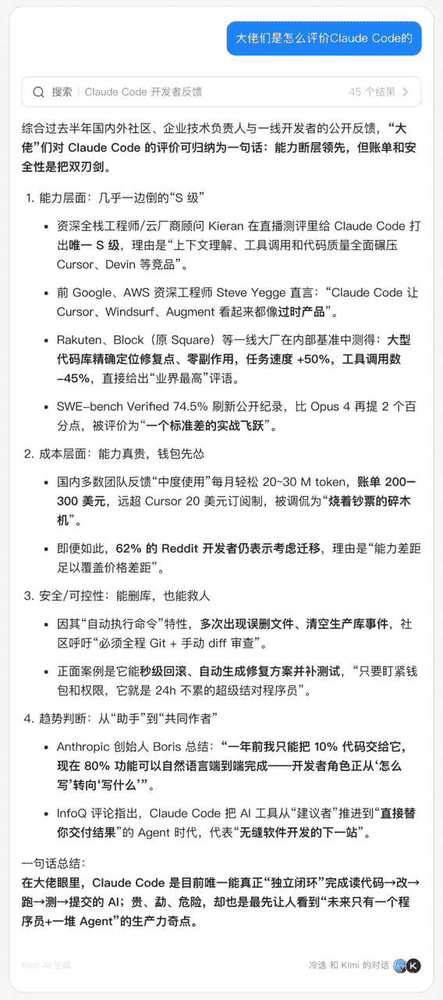

我其实很早就想写一篇 `CC` 的入门指南了，把自己这半年积累的经验和新学到的技能分享给大家，这次趁着元旦终于动笔了。

全文8000字，内容较长，建议收藏了慢慢看，也可以分享给你的朋友一起看。


## Claude Code使用指南

本篇指南主要分为10个部分：

1）前置准备  
2）安装 `CC`  
3）配置模型  
4）配置 `Plan` 套餐  
5）启动 `CC`  
6）`CC` 斜杠命令  
7）`CC` 常用技巧  
8）案例演示  
9）`MCP` 配置（进阶）  
10）`Skills` 使用（进阶）

从入门到进阶，详细梳理了 `Claude Code` 的核心用法。

需要用到的模型和工具有：

1）比较靠谱的模型API，比如 `Claude 4.5` 系列、`Gemini 3` 系列、`GLM-4.7`、`M2.1`、`K2`。  
2）环境依赖：`Node.js`，或者 `Bun`  
3）代码管理工具：`Git`  
4）`Plan` 插件：`Coding Tool Helper`  
5）一个Scienc的网络环境  

## 1）前置准备

首先，你需要有一个Scienc的网络环境，这个自行解决。

然后，在安装 `CC` 前，我们需要提前安装 `Node.js` 和 `Git` 工具。

如果已经装了 `Node.js`（`Bun` 也可以），可以在你的命令行界面（下面简称 `CLI`，Command-Line Interface）输入这段命令查看版本号。

```
node -v
```

进入命令行界面，有两种快捷方式。

一是在电脑底部搜索框输 `cmd`（哦，对了，不会有人不知道Command就是“命令”的意思吧，`cmd` 就是Command的简写）进入，Mac则输入 `Terminal`（终端）。


二是在任意文件夹的地址栏输 `cmd` 进入（这点记住了，后面要考）。

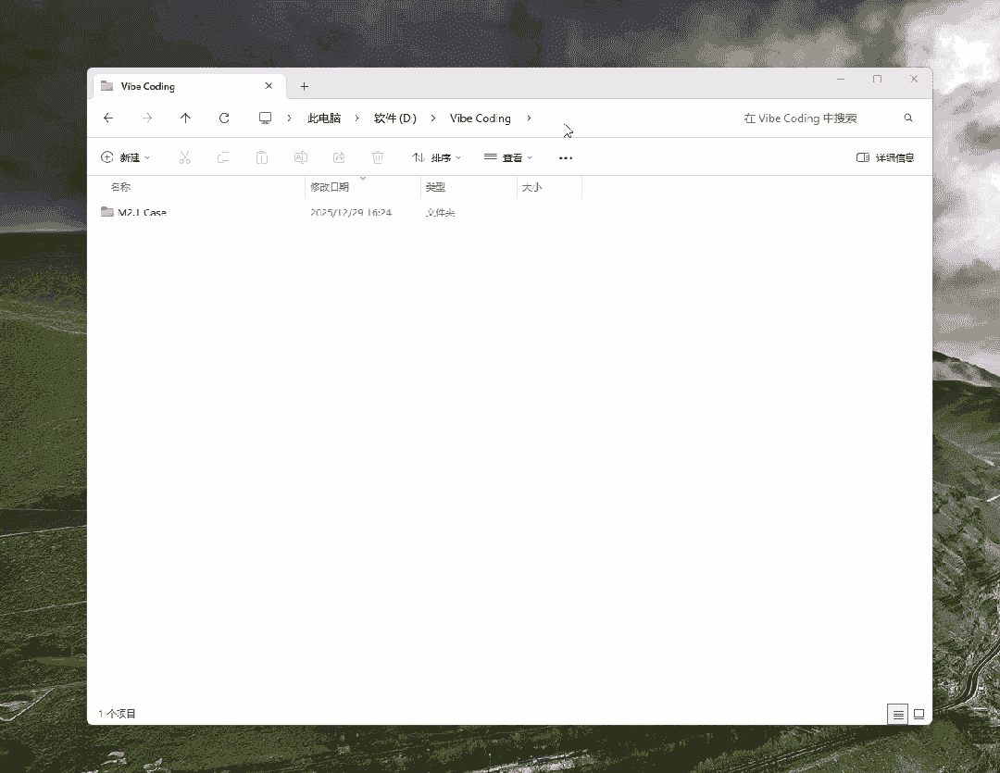

比如，我已经装了 `Node.js`，它会这样显示。

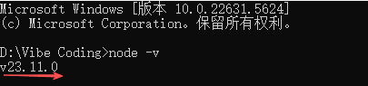

如果没有装 `Node.js`，请前往这个页面下载安装，Windows、macOS、Linux系统的安装包都在这里。

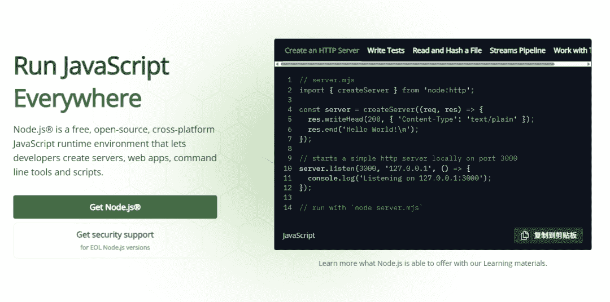

Download Node.js

https://nodejs.org/en/download

然后是 `Git` 工具，Windows用户请前往这个页面下载安装。

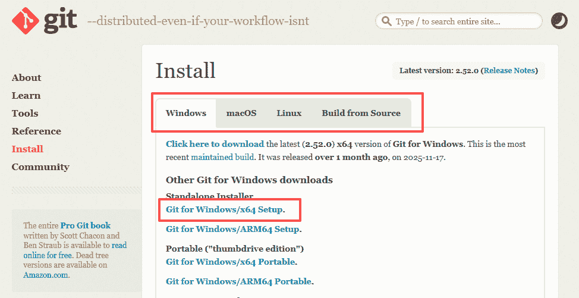

下载地址：

https://git-scm.com/install/windows

macOS可以通过 `Homebrew` / `MacPorts` 的方式进行安装。

```
#安装Homebrew，然后：$ brew install git
#安装MacPorts，然后：$ sudo port install git
```

## 2）安装 `CC`

装好 `Node.js` 和 `Git` 后，就可以正式安装 `CC` 了。

打开命令行，输入这段指令，然后按下Enter键就可以了，非常简单。

```
npm install -g @anthropic-ai/claude-code
```

Windows、macOS、Linux都是用这同一条命令。

安装完成后，输入 `Claude --version`，如果出现了版本号，则代表安装成功。

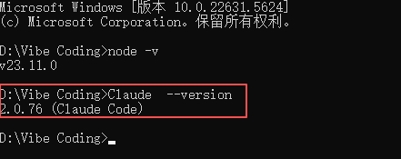

## 3）配置模型

`CC` 已经装好了，但这个时候还不能用，我们得给它配一个大模型。

`CC` 默认模型是 `Claude`，但我相信应该没几个人搞得定Anthropic的API。如果能自己搞定，应该也不会看这篇文章了。

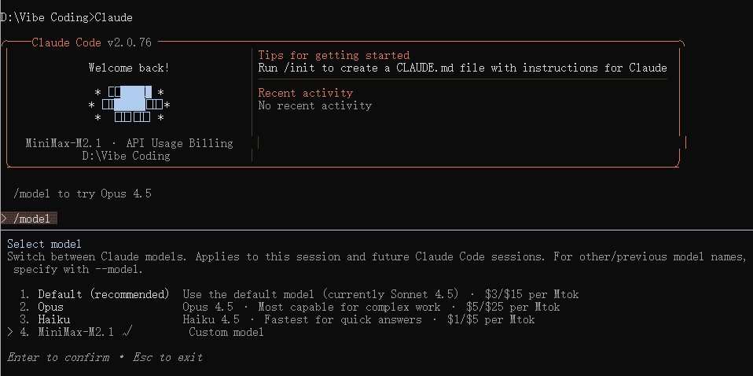

所以这里，我主要推荐大家用国产模型来替代，比如 `GLM-4.7`、`M2.1` 和 `K2`。

在Coding领域，如果 `Claude Opus 4.5` 能够打98分的话，这几个国产模型也基本都在90分以上。其实差距真的不大。

下面，我们以智谱 `GLM-4.7` 来演示，其他模型的配置过程也都大差不差。

首先，需要到智谱开放平台 bigmodel.cn 注册一个账户。注册后，点右上角账户的 API Key。


然后，在这里配置一个 API key，把这段 key 复制备用（千万不要告诉别人）。

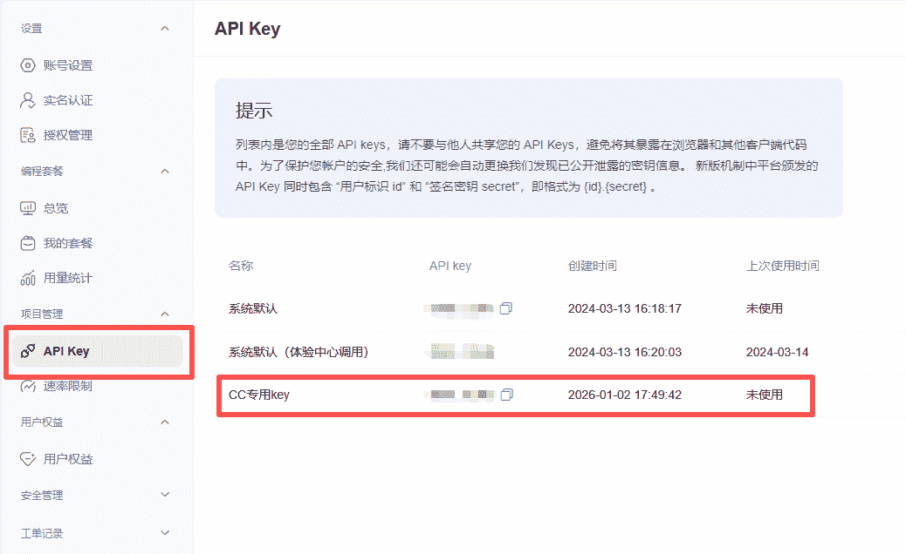

接着，订阅一个 `Coding Plan` 套餐，这样可以放心地使用 `GLM-4.7`。每个月不过一杯奶茶钱，很划算。


订阅链接：

https://www.bigmodel.cn/glm-coding?ic=NCUSKSTE🐧

现在，`API url`、`key` 和 `model` 都有了，就可以进行模型配置了。

先给大家介绍手动配置的方法，适合所有模型。

打开你的命令行，输入这段命令（注意！一个空格、引号都不能错），然后按Enter键就可以了。

```
setx ANTHROPIC_BASE_URL "https://open.bigmodel.cn/api/anthropic";
setx ANTHROPIC_AUTH_TOKEN "your_zhipu_api_key";
setx ANTHROPIC_MODEL "GLM-4.7";
```

macOS则输入：

```
export ANTHROPIC_BASE_URL=https://open.bigmodel.cn/api/anthropic
export ANTHROPIC_AUTH_TOKEN=your_zhipu_api_key
export ANTHROPIC_MODEL=GLM-4.7
```

配置好后，我们重新启动一个命令行，运行 `Claude`，可以看到模型已经从 `M2.1` 切换到 `GLM-4.7` 了。

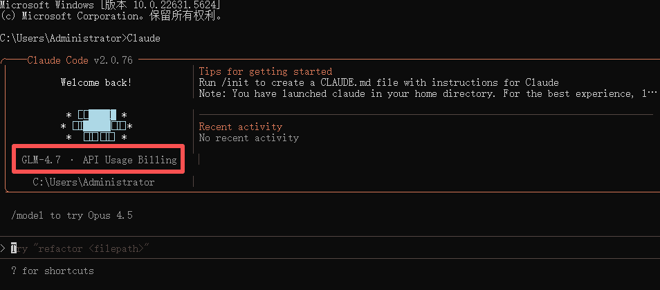

接着，随便输入一句话验证一下。如果能够正常吐 token，则代表模型配置成功。

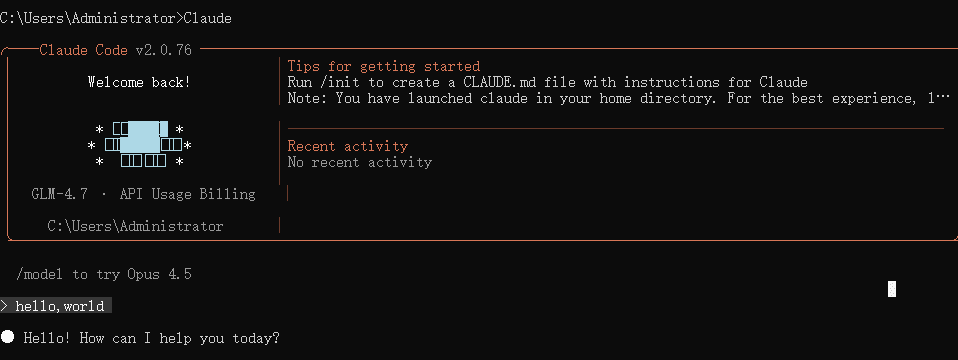

## 4）配置 `Plan` 套餐

另外，还有一种自动化助手的方式进行配置。

这里，我们要用到另一个工具（来自智谱 Z.ai）：`Coding Tool Helper`。

进入命令行，输入这个命令：

```
npx @z_ai/coding-helper
```

陆续依照步骤，设置界面语言→coding套餐→API密钥→编码工具，就可以把你的 `Coding Plan` 套餐加到 `CC` 中了。

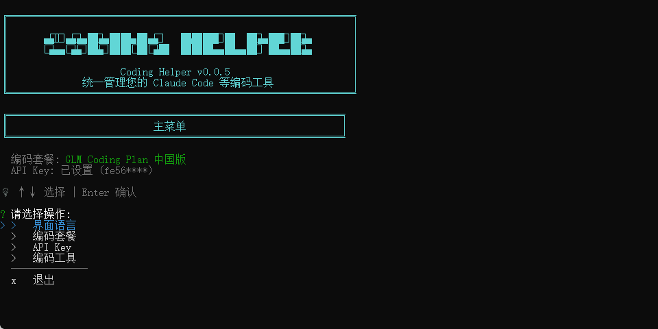

全程中文界面，非常方便。

## 5）启动 `CC`

到这里，我们就已经完成了 `CC` 的所有配置，可以启动魔法了。

怎么启动呢？还是在命令行界面，输入 `Claude`，然后按下Enter键。

试着，和它打声招呼吧。

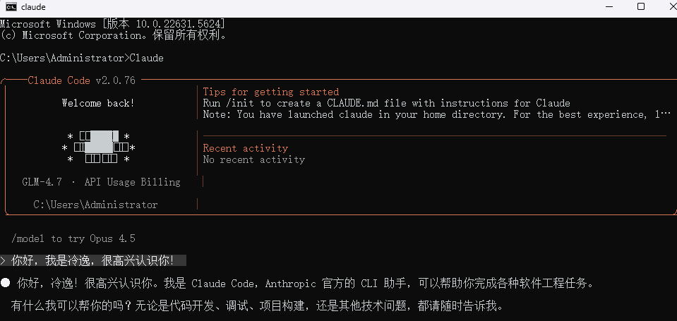

从此，它就是你形影不离的AI伙伴了。

记得，用上前面我们提到的文件夹地址栏输“`cmd`”进入命令行的方式使用 `CC`，更方便，更便捷。

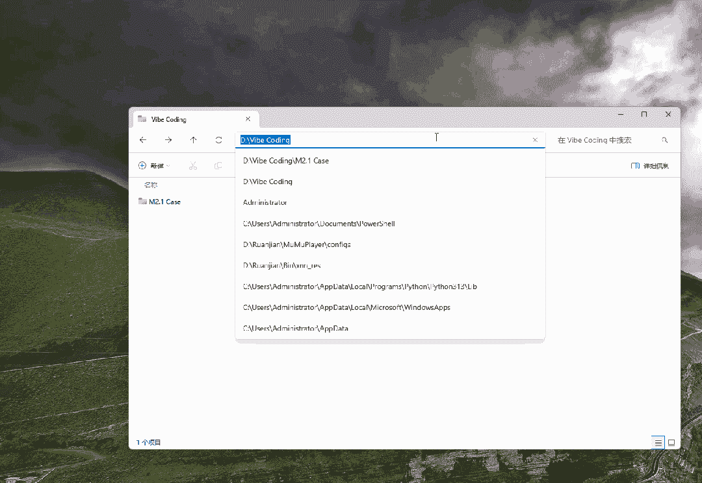

这样，你就可以随时在任意文件夹里启动 `CC` 了。

## 6）`CC` 斜杠命令

因为 `CC` 是在命令行界面（`CLI`）工作，它跟我们经常使用的图形用户界面（GUI）还不太一样。

全程靠键盘操作，不怎么需要鼠标。新手用户一开始可能还不太习惯，但请你相信我，熟悉后你一定对它爱不释手。

我们来简单认识一下它的“`/`”斜杠命令。

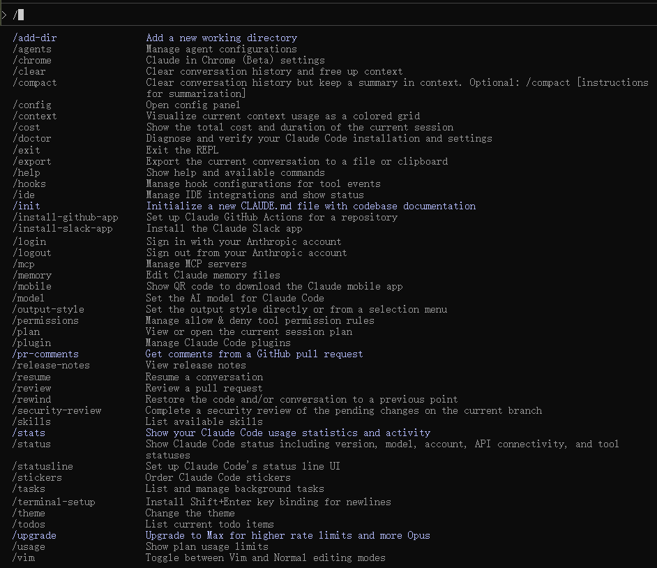

输入“`/`”调用

一共45个斜杠命令，分别是：

```
/add-dir #添加新的工作目录
/agents #管理智能体（Agent）配置
/chrome #Chrome中的Claude设置
/clear #清空对话历史并释放上下文
/compact #清空对话历史但保留摘要至上下文（可选：/compact [摘要指示]）
/config #打开配置面板
/context #以彩色网格形式可视化当前上下文使用情况
/cost #显示当前会话的总费用与时长
/doctor #诊断并验证你的Claude Code 安装与设置
/exit #退出REPL
/export #将当前对话导出到文件或剪贴板
/help #显示帮助与可用命令
/hooks #管理工具事件的钩子（hook）配置
/ide #管理IDE集成并显示状态
/init #初始化新的CLAUDE.md 文件，包含代码库文档
/install-github-app #为仓库设置Claude GitHub Actions
/install-slack-app #安装Claude Slack 应用
/login #使用你的Anthropic账户登录
/logout #从Anthropic账户登出
/mcp #管理MCP服务器
/memory #编辑Claude记忆文件
/mobile #显示二维码以下载Claude 移动应用
/model #设置Claude Code使用的AI模型
/output-style #直接或从选择菜单设置输出样式
/permissions #管理允许与拒绝工具权限规则
/plan #查看或打开当前会话的计划
/plugin #管理Claude Code插件
/pr-comments #从GitHub拉取请求获取评论
/release-notes #查看版本发布说明
/resume #恢复某个对话
/review #审查拉取请求
/rewind #回滚版本
/security-review #对当前分支的待定更改进行安全审查
/skills #列出可用技能
/stats #显示你的Claude Code使用统计与活动
/status #显示Claude Code状态（包括版本、模型、账户、API 连接性与工具状态）
/statusline #设置Claude Code的状态栏界面
/stickers #订购Claude Code贴纸
/tasks #列出并管理后台任务
/terminal-setup #安装Shift+Enter键绑定以输入换行
/theme #更换主题
/todos #列出当前待办事项
/upgrade #升级至Max版本以获得更高频率限制和更多Opus功能
/usage #显示计划使用限制
/vim #在Vim与普通编辑模式之间切换
```

这里面，我自己经常用到的斜杠命令有：

- `/clear` #开启新的任务，记得一定要 clear。
- `/compact` #清理对话历史但保留摘要至上下文，在一些长任务上会用到。
- `/context` #可视化展示当前上下文占用（token 网格）。
- `/model` #随时切换模型（第三方模型一般默认在第4个，可选不多）。
- `/export` #把当前会话导出、保存，便于复盘。
- `/add-dir` #把新文件夹拉进任务的工作区。
- `/doctor` #一键诊断本地安装环境是否正常。
- `/status` #检查账号、模型、版本等系统状态。
- `/mcp` #连接 `GitHub`、数据库等 `MCP` 服务器，扩展外部能力。
- `/cost` #长对话记得监控费用，必要时 `/compact` 或 `/clear` 控制 token 消耗。

当然，还有最重要的 `Esc` 键，按下 `Esc` 键，随时退出设置界面。

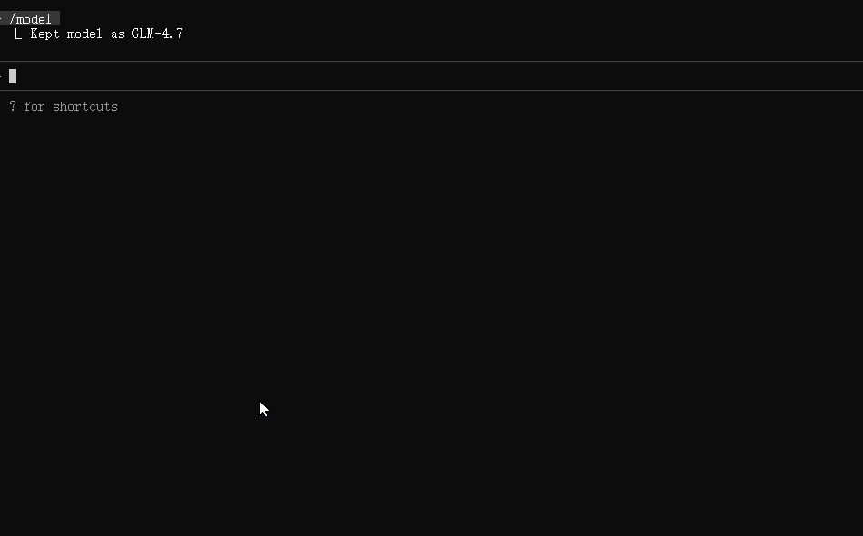

以及 `Tab` 键（最新版是 `Alt+t`），按一下模型会默认开启 `thinking` 模式（`V2.0.72` 版本已默认开启）。


## 7）`CC` 常用技巧

要想用会 `CC`，这四个基础技巧是必不可少的。

### ❶ 文件夹

你可以把“文件夹”理解为是 `CC` 的工作空间，是 `CC` 执行任务的上下文。

这里，我建议大家，每个任务都建一个单独的文件夹，这样能够保证数据独立、互不干扰。

如何在指定文件夹下启动 `CC` 呢？有两种方式：

一是先在命令行定位到新地址后，再输 `Claude` 启动 `CC`。

```
cd /你的新文件夹地址
```

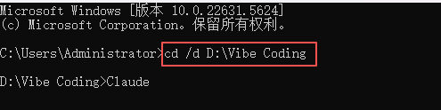

一种是直接在地址栏输“`cmd`”启动命令行，再输 `Claude` 进入。


### ❷ 拖拽文件

`CC` 支持直接拖拽文件夹和文件，你可以把想让它理解的文件夹或文件直接拖到 `CC` 的会话框里，然后跟它描述你的任务需求。

比如，我们前面的斜杠命令解释，就是直接拖给 `CC`，让它来翻译的。

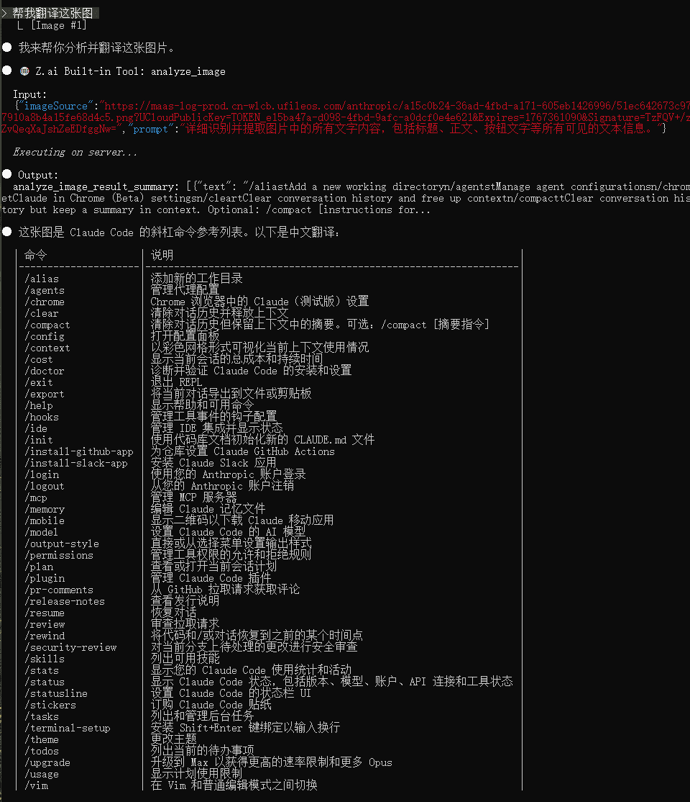

这是一个非常重要的技巧，可以极大拓展 `CC` 的上下文能力。

### ❸ 粘贴技巧

因为 `CC` 它不是像图形用户界面（GUI）那样支持键鼠操作，所以它的粘贴逻辑完全不一样。

你在其他地方通过键盘或鼠标复制的文本（通常是提示词），在 `CC` 里只能通过 鼠标右键 ，把文本粘贴进来。不要在那狂按 `Ctrl+V` 了，你把键盘按烂了都没用。

对了，如果是在非 `CC` 的命令行里，则又不支持鼠标粘贴了，只能通过 键盘 `Ctrl+C` 复制，然后 `Ctrl+V` 粘贴。这一点，一定要注意区分。

在 `CC` 里，也不能按 `Ctrl+A` 全选删掉文本，只能一直按 `BackSpace` 清掉。如果要删除部分，只能通过方向键定位。

如果要粘贴图片，这时候鼠标右键又不行了。你得先打开图片，然后右键-复制，在 `CC` 窗口按 `Alt+V`（macOS 是 `Control+V`）上传。

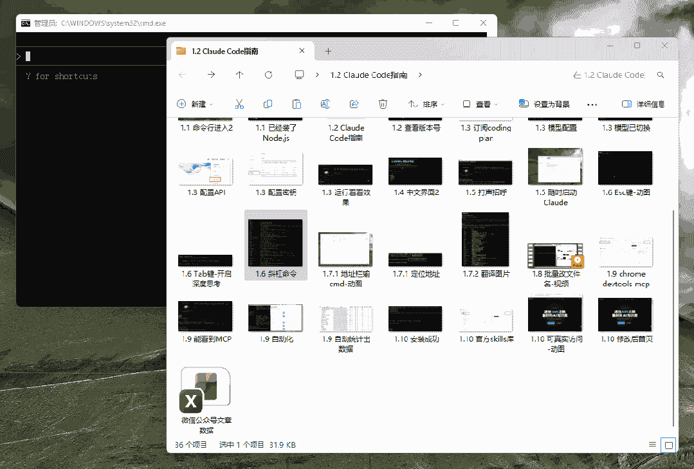

如果是在预览状态下复制的图片，即使你把 `Alt+V` 按烂了都粘贴不上去。记得一定要在图片打开的状态（截图也可以）复制，才能 `Alt+V` 粘贴上。

是不是还挺反直觉的？用多了，你就习惯了。

### ❹ 危险模式

危险模式是指，`CC` 可以自主操作你的电脑，而无需你的任何确认。

这种模式有个好处就是，你给它一个需求，它直接交付结果，你不用去管过程。

但如果不开的话，`CC` 每次的操作都需要你确认，很繁琐，也很影响效率。

建议在指定文件夹位置并备份好数据的条件下开启此模式，命令是：

```
claude --dangerously-skip-permissions
```

## 8）案例演示

接下来，我们来看一个实际案例。

写代码的案例，我就不放了。基本上，我所有 `coding` 模型的评测文章，都是在 `CC` 里接模型测的。

写代码，对于 `CC` 来说是家常便饭。但 `CC` 能做的，远不止于写代码。

比如说，我们想要批量重命名文件。这事一点都不复杂，全是重复性的工作，但如果你要让我专门去为这个事情写个脚本，我也觉得不太划算。

现在，可以直接丢给 `CC`，输入要求：

```
把文件夹“xx位置”里所有的文件名改成规范的英文名称，只改名字，不改序号。
```

不到一分钟吧，`CC` 全部搞定。我把全过程录了个屏，一帧未剪。

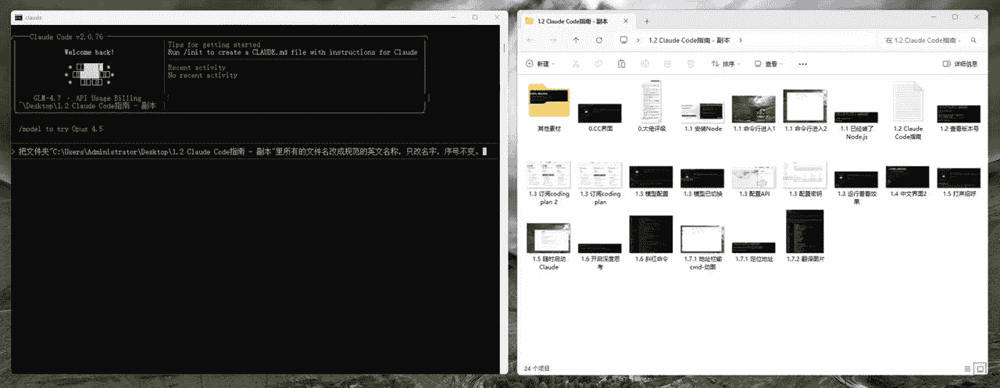

[0bc3tyakiaaavialxh2zsbuvbhwduspabjaa.f10002.mp4](https://internal-api-drive-stream.feishu.cn/space/api/box/stream/download/all/C1zqbplX1oK4KpxnZ20caLQUn9c)

效率就是有这么高。

所以，我才推荐每一个人，真的！每一个岗位的人都应该把 `CC` 用起来。

## 9）`MCP` 配置（进阶）

`MCP`（Model Context Protocol），你可以理解是“AI的拓展接口”。

通过添加 `MCP server`，可以拓展 `Claude Code` 获取外部工具、资源、服务的能力。安装方式也很简单，输入这句指令即可。

```
claude mcp add 你的mcp地址
```

比如之前很火的 `Chrome DevTools MCP`，在 `GitHub` 上已经狂揽18.5k Star。


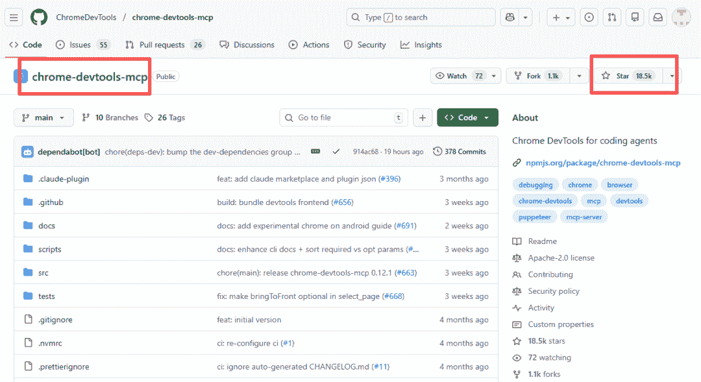

## Github地址

https://github.com/ChromeDevTools/chrome-devtools-mcp

这个`MCP`内置了26个工具，可以完成很多浏览器自动化的事情，比如输入自动化、导航自动化、自动测试以及数据自动抓取等等。

这么好的工具，必须给它接入到`CC`里，那你只需要输入这句指令：

```
claude mcp add chrome-devtools npx chrome-devtools-mcp@latest
```

这行命令的意思是，在`CC`里添加一个叫`chrome-devtools`的`MCP`服务，这个服务通过`npx`命令来启动最新版的`chrome-devtools-mcp`包。

安装好后，启动`Claude Code`，输入`/mcp`查看。如果在`mcp server`里有看到“`chrome-devtools`”，那就代表已安装成功。

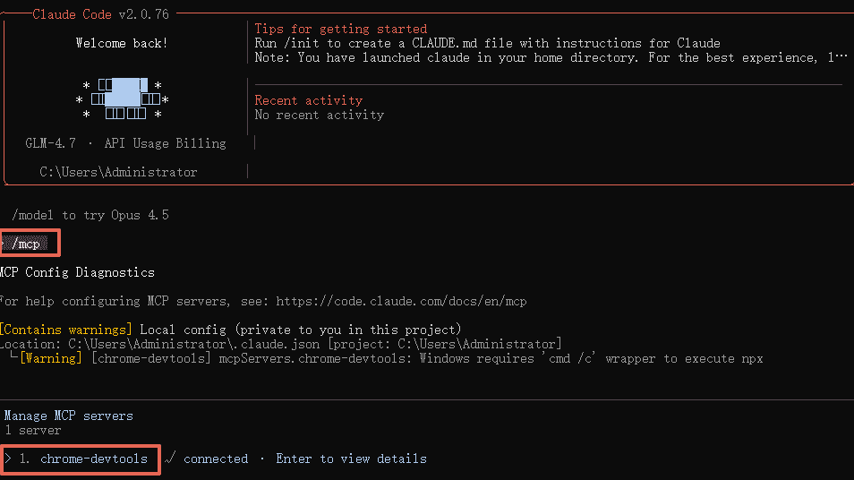

我们随便跑一个例子，来看看。

作为博主，会经常分析自己的数据，但你知道的，👸号后台的数据分析很拉。基本都要自己把数据下载，再去用`AI`进行分析。

但这个数据下载，如果是人工来统计，非常的耗时耗力。现在，可以直接让`CC`+`chrome devtools mcp`来完成了。

只需要在`CC`里输入这段`Prompt`：

```
用Chrome浏览器打开这个链接：xxxxxx（这里放你的公众号后台链接）
然后，通过`chrome devtools mcp`完成：获取第1、2、3页每篇文章的详细数据，并保存到Excel表格中。
```

可以看到，`CC`自己调用`Chrome`浏览器开始工作了。

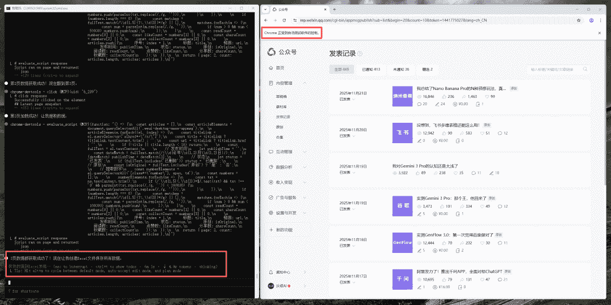

大概等了5分钟吧，这样一份详细的数据就统计好了。

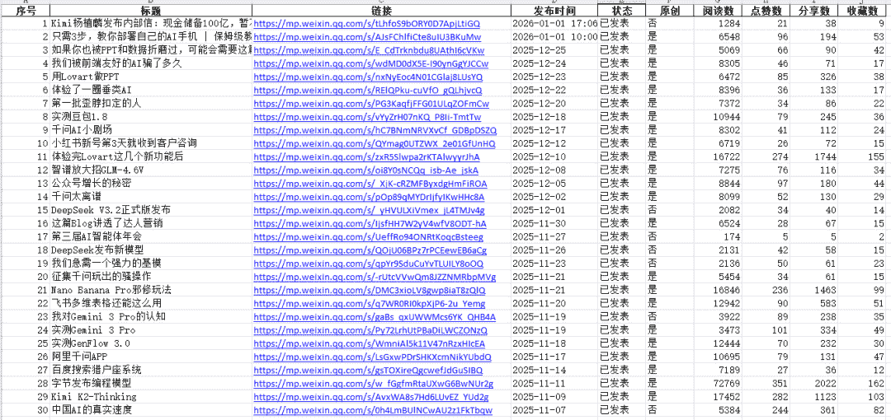

这个事情如果是人工来统计，即使是地表最强的`Pro`级牛马，没有半小时根本搞不定。

所以，有时候真的需要把思路打开，你就会发现：前路一片广阔。

## 10）Skills使用（进阶）

把`MCP`理解为`CC`的外挂，那`Skills`就是`CC`的技能包，用完即走，不占任何上下文。

它是`Claude Code`在10月推出的新功能，上线后深受开发者的喜爱。

简单的理解，你可以把`Skills`认为是别人已经封装好的工作流，你只需要借来用就可以了。

`Anthropic`在`Github`上放了个`Skill`库，狂揽32k `Star`。里面有很多官方`Skills`，你可以直接下载来使用。当然，你也可以让`CC`自己创建`skills`。

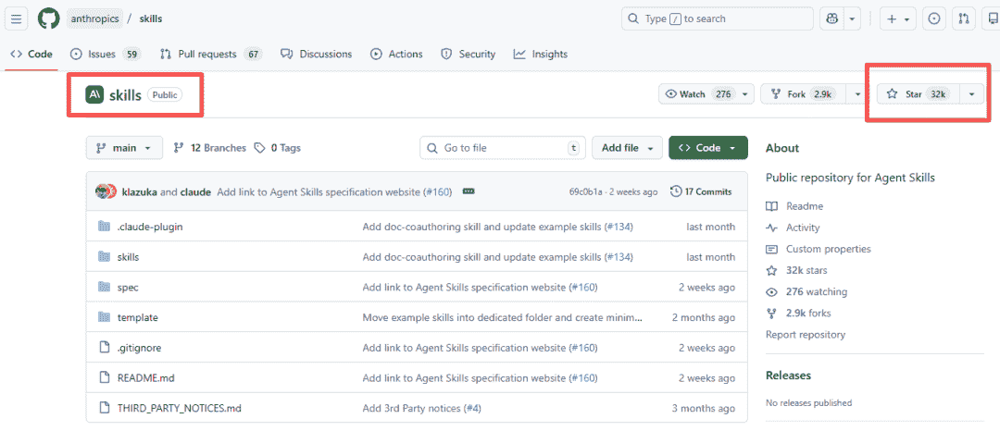

### 官方Skill指南

https://github.com/anthropics/skills

安装也很简单，一句话指令的事情。

比如这个 `前端设计skills`，对于前端优化很有用，我们把他装上。在命令行里输入这段指令：

```
npx skills-installer install @anthropics/claude-code/frontend-design --client claude-code
```

当你看见绿色`Done`的时候，就代表已经安装成功。

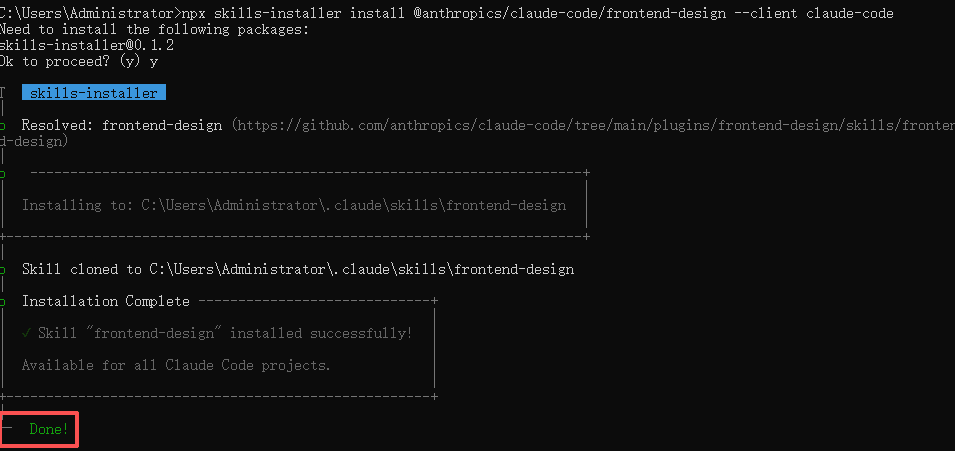

接下来，就可以在`CC`里调用这个`skills`了。比如，我们让它优化下`Waytoagi`的首页。

```
使用frontend-design skill，优化一下https://www.waytoagi.com
```

新版本是不是更美观了一些？


配合上前面我们已经安装了的`chrome-devtools-mcp`，新生成的前端网页，每个链接都是可以真实打开的。


现在，`Skills`已经不需要强制登录`Claude`账户才能使用了，对于国产模型来说，非常方便。


## 写在最后

强烈建议，每一个人都应该把`CC`用起来。

特别是随着模型`tool use`能力的日渐强大，`CC`能干的事情已经越来越多，几乎可以这么说——它就是 目前电脑里最强、也最通用的`AI Agent`。

它不只属于开发者，教师、人力、运营、市场、律师、学生等朋友，同样也值得把`CC`纳入日常工作流。

它比`Chat`工具更能够解决你的实际问题，也比`Coding`工具更能够被低门槛的使用。

只需要`Vibe`大白话，就能够高效的交付。。

一旦你开始习惯用`CC`干活，就会发现自己很难再回到只用`Chat`问问题、只靠工具点按钮的状态。

早点把它用起来，不是为了追热点。

而是为了提前适应——人与`Agent`协作的新范式。
