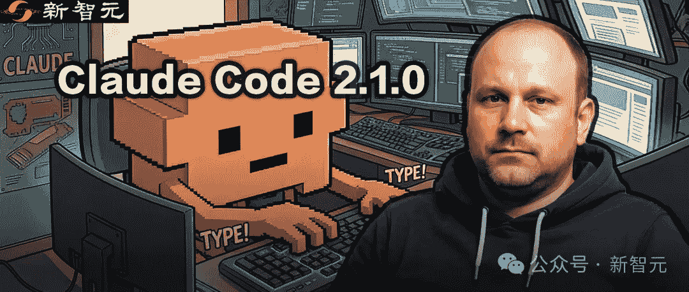
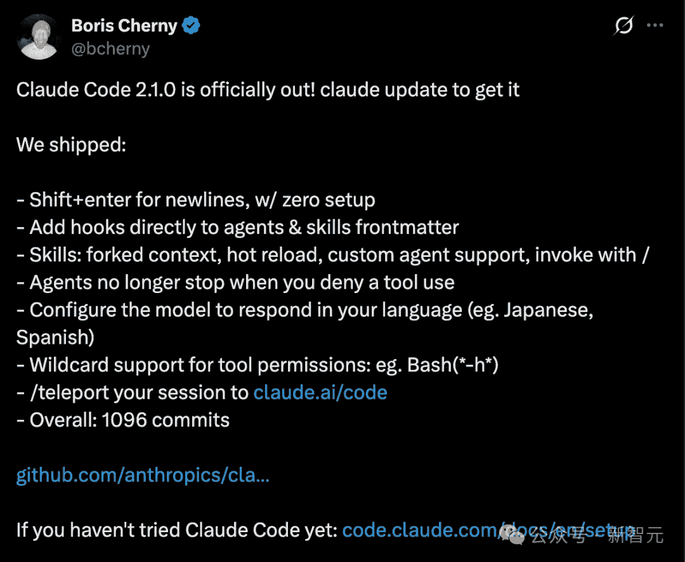
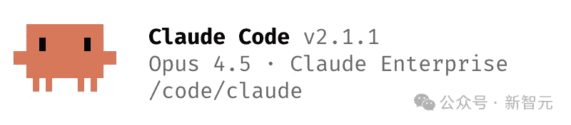
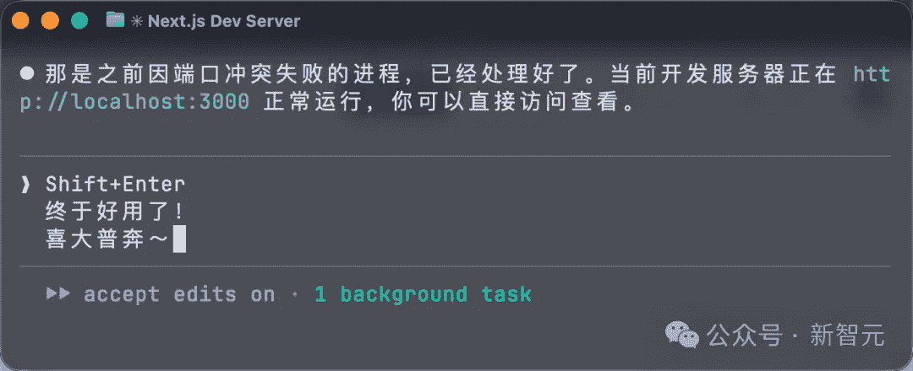
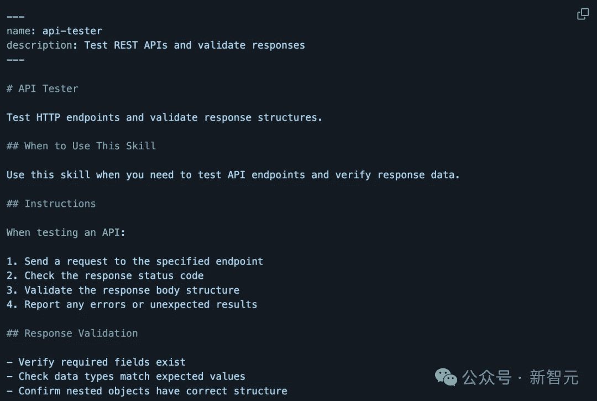
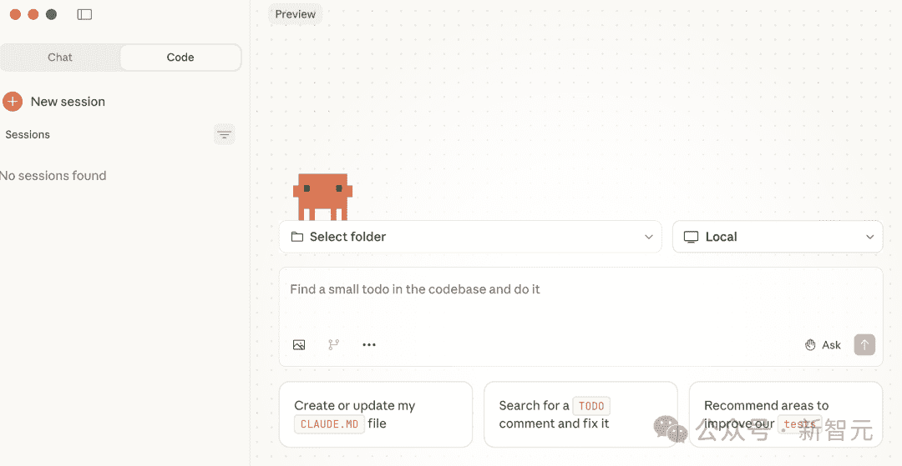
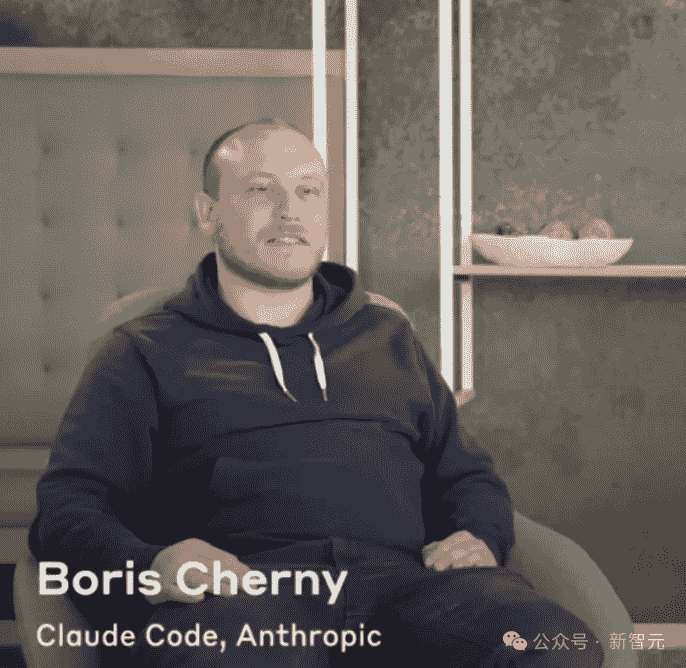
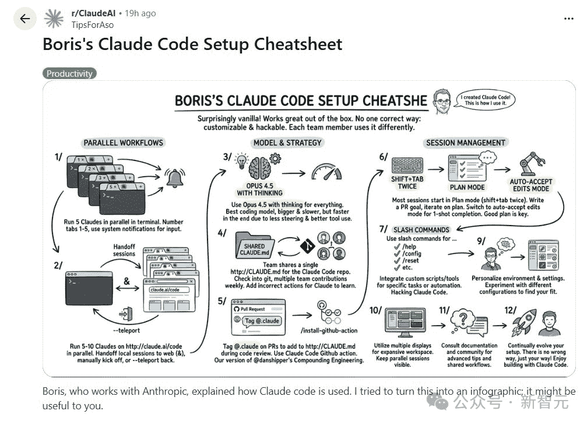
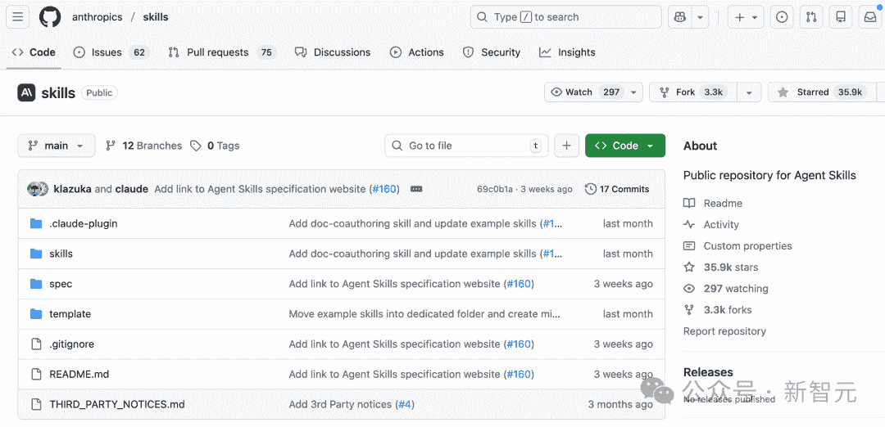

# 全球开发者狂喜！Claude Code史上最大更新，一次性1096次提交

> 来源：[https://aigcreative.feishu.cn/docx/O3SYd88ruoo2i9xLHBCclHTcnKf](https://aigcreative.feishu.cn/docx/O3SYd88ruoo2i9xLHBCclHTcnKf)

> 原文链接： https://mp.weixin.qq.com/s/93WmfW8SYfJRTGLASpupug

> 来源：👸号：新智元

---

###

###  新智元报道

编辑：定慧

##### **【新智元导读】 **全球程序员最喜欢的工具迎来最大更新。 Boris老哥不仅靠自造的Claude Code年入10亿美金，现在更是玩起了极致「套娃」，用Claud Code开发Claude Code，疯狂迭代1096次提交！

Boris Cherny 现在不写代码了。

作为Claude Code的创造者，这位Anthropic的工程师用自己造的AI工具来写代码——Claude Code去年斩获超过10亿美金的收入。

扩展阅读：30天没写一行代码，他却赚了10亿美金！

这大概是AI时代最讽刺又最美妙的事情：一个人自己不写代码，却创造了一个能替所有人写代码的工具。

而现在，这个工具刚刚迎来了史上最大的一次更新。

**Claude C**ode2.1发布了，这不是一次小修小补—— 1096次提交 ，版本从2.0.76直接跳到2.1.1。

Anthropic团队疯了吗？

不，他们只是在用Claude Code开发Claude Code。

这就是AI加速AI的正反馈循环。

Claude Code2.1更新了什么？

1. Shift+Enter终于好用了

这是用户抱怨最多的问题，现在彻底解决了。

在iTerm2、Kitty、Ghostty、WezTerm这些终端里，Shift+Enter多行输入开箱即用。

不需要改配置文件，不需要找变通方案。

想换行就按Shift+Enter，就这么简单。

如果用的是其他终端，运行/terminal-setup就能自动配置。

这个改进看起来很小，但用过CC的人都知道，没有多行输入有多痛苦。

2. Skills系统全面 升级

Skills是Claude Code最近推出的重磅功能，可以把它理解成「前人验证好的工作流」。

这次更新，Skills成了一等公民：

**热重载 **：修改`~/.claude/skills`目录下的技能文件，改完立刻生效，不用重启。

这对开发者来说太重要了。之前调试一个Skill，改一次重启一次，效率极低。现在改完就能看效果，开发体验直接起飞。

**分叉上下文 **：在Skills配置里加上`context:fork`，就能让技能在独立的「子环境」里运行。

这解决了什么问题？

之前执行复杂的Skills，中间产生的大量信息会污染主对话。问完一个问题，上下文就被塞满了乱七八糟的东西。

现在有了分叉，主对话保持干净，技能在旁边安静地干活。

**生命周期钩子 **：Skills现在支持`PreToolUse`、`PostToolUse`和`Stop`钩子。

翻译成人话就是：可以在Claude调用工具之前、之后插入自定义逻辑。

比如每次写文件之前自动备份，或者每次执行命令之后记录日志。

这已经是中间件级别的能力了。

**3. 会话传送功能**

这个功能必须单独拿出来说，因为它太酷了。

场景是这样的：在claude.ai网页上开始了一个项目，聊到一半，发现需要在本地继续。

以前怎么办？把对话复制粘贴过来？重新描述一遍需求？

现在只需要一个命令：/teleport

它会自动：

+   验证是不是在正确的代码仓库

+   拉取并切换到对应的分支

+   加载完整的对话历史

网页端的工作，无缝传送到终端。

反过来也行，终端里的会话可以传送到claude.ai/code继续。

这意味着什么？

可以在任何设备上开始工作，在任何设备上继续工作。

在公司用网页版起草，回家在终端里深度开发，第二天在咖啡厅用手机回顾进度。

Claude Code变成了一个真正意义上的「云端大脑」。

**4. 更智能的权限管理**

之前一个让人烦躁的问题是：工具调用被拒绝的时候，整个智能体就停了。

现在不会了。被拒绝之后，Claude会尝试其他方法继续推进。

另外，工具权限现在支持通配符。

比如想允许所有带-h参数的命令，可以写Bash(*-h*)。

不用一个一个地配置权限了。

**5. 多语言响应**

可以配置Claude用母语来回复。

日语、西班牙语、中文，都可以。

对于非英语母语的开发者来说，这个功能太贴心了。

为什么全球程序员都爱Claude Code？

说完更新内容，来聊聊一个更本质的问题：

Claude Code为什么能火成这样？

一年收入10亿美金，连著名的OpenAI研究员卡帕西都说自己落伍了。

这背后是什么逻辑？

**1. 它是真正的通用Agent**

虽然叫Claude Code，但它的能力远不止写代码。

问答、写作、写网页、开发软件、数据分析，甚至拆分工资条，它都能干。

它能把音频和图片快速合成视频。

可以把它理解成一个能操控电脑的智能代理。

它能看到文件系统，读取文件、分析文件、修改文件、输出文件。

而沟通方式，就是自然对话。

不需要写代码，不需要学命令，说人话就行。

**2. 文件夹思维**

Claude Code最棒的设计理念是「文件夹」。

每次启动的时候，给它指定一个文件夹，这个文件夹就是这次任务的上下文。

很多CC重度用户都有专门的Claude Code文件夹，里面分成很多子文件夹：笔记、数据分析、深度阅读、软件开发……

每个任务一个文件夹，互不干扰。

这种设计让工作天然有组织性。

不像其他AI工具，聊着聊着就乱了，不知道在做什么。

**3. 危险模式带来的效率飞跃**

什么是危险模式？

开启之后，Claude Code可以全自动操控电脑，不需要一次次确认。

听起来很危险，但不开的话，每个操作都要点确认，效率根本起不来。

当然，一定要做好备份。

**4. Skill生态**

Skills是Claude Code的杀手锏。

不需要从零开始，直接用前人验证好的工作流就行。

比如前端设计Skill，一句话就能重新设计网站首页。

这是真正的「站在巨人肩膀上」。

**聊聊Boris这个人**

说到这里，不得不聊聊Claude Code背后的男人——Boris Cherny。

Boris的履历很简单：前Meta高级工程师，现在是Anthropic的Staff Engineer，负责Claude Code。

但他最有意思的地方在于： **Claude Code100%的**代码，都是用Claude Code写的。

没错，他自己不写代码，他用自己造的AI来写代码。

这听起来像个悖论，但这恰恰证明了Claude Code的能力——如果连它的创造者都信任它到这种程度，还有什么理由怀疑呢？

Boris的工作方式也很疯狂。

他日常会同时开10-15个Claude Code会话，有的在终端里，有的在网页上，每个会话当作一个独立的「工人」来用。

他坚持用最慢但最聪明的模型，比如Opus4.5，因为他相信： 更高质量的输出最终会加速整个开发过程。

这个理念很反直觉。

大多数人追求速度，想要更快的响应。但Boris认为，如果AI能一次做对，就不需要反复修改，总时间反而更短。

还有一个细节：Claude Code的诞生其实是个「意外」。

它最初只是Anthropic Labs团队的一个原型实验，用来探索AI模型的能力边界。没想到效果太好，直接变成了正式产品。

2025年2月发布，不到一年，年收入就突破了10亿美金。

这大概就是硅谷最经典的故事模板：一个工程师的「玩具项目」，最后变成了改变行业的产品。

Boris还有一个习惯：他会维护一个CLAUDE.md文件，把它当作「团队记忆」。

每次Claude犯了错误或者做对了什么，他都会记录下来。这样下次遇到类似场景，Claude就能直接使用这些经验。

这个习惯后来变成了Claude Code的核心功能之一。

你看，好的产品经理不需要做用户调研，因为他自己就是最苛刻的用户。

**Claude Code使用技巧**

最后分享几个实用技巧：

**1. 善用Claude.md**

Claude.md是Claude Code的核心配置文件，相当于它的「宪法」。

每次启动，Claude都会自动加载这个文件。

可以在里面写：

+   这个项目是做什么的

+   偏好规则

+   需要注意的事项

+   这样Claude每次都能快速进入状态，不用反复解释。

**2. 拖拽文件**

这是最简单但很多人不知道的技巧：

直接把文件或文件夹拖到Claude Code窗口里。

它会自动读取内容。

不需要复制粘贴，不需要输入路径。

**3. 粘贴图片**

因为Claude Code运行在终端里，粘贴快捷键不是Cmd+V，而是Control+V。

遇到需要图片的问题，截图后用Control+V粘贴进去，Claude就能看到了。

4. 用/teleport无缝切换

在网页端聊到一半，需要本地继续？

直接/teleport，整个对话历史都带过来。

**5. 安装实用的Skills**

推荐去官方的Skills仓库看看： https://github.com/anthropics/skills

安装方式也很简单，然后跟Claude说「使用xxx skill，帮我做xxx」就行了。

**「编程」的终局**

Claude Code2.1 的 1096 次提交，背后是一个团队对「AI 辅助编程」这件事的极致追求。

但如果只把它当成一个「更好用的编程工具」，就太小看它了。

Claude Code真正预示的，是编程这件事本身的终局。

**程序员会消失吗？**

这是每次AI编程工具更新时都会被问到的问题。

答案是：不会消失，但会彻底改变。

Claude Code让每个人都能「写代码」，但不是每个人都能「定义问题」。

未来的程序员，不再是敲键盘的人，而是能把模糊的需求翻译成精确任务的人。

这个角色更像产品经理，又像架构师，又像项目经理。

代码变成了思想的副产品，而不是目的本身。

**自指性 AI 的哲学意义**

Boris用Claude Code来开发Claude Code，这不仅仅是一个有趣的花絮。

**这是AI发展史上的**一个里程碑： 工具开始制造自己。

想想看，人类发明了锤子，但锤子不能制造锤子。人类发明了车床，车床可以加工零件，但不能完整地复制自己。

但Claude Code可以。

它可以理解自己的代码，修改自己的功能，优化自己的性能。

这是一个自我迭代的系统。每一次更新，都让它更有能力进行下一次更新。

1096次提交，很多都是Claude自己写的。

这种正反馈循环会加速到什么程度？没人知道。

从Vibe Coding到Vibe Everything

Claude Code的成功证明了一件事：自然语言是最好的编程语言。

不是Python，不是JavaScript，而是人话。

这个逻辑可以延伸到所有领域。

设计？让AI渲染。

写作？让AI起草。

分析？让AI处理。

我们正在进入一个「Vibe Everything」的时代。

不需要学习专业软件，不需要掌握复杂工具，只需要能清晰表达自己想要什么。

这是真正意义上的 **「技术平权」。**

一个没学过编程的小商贩，可以用Claude Code做一个库存管理系统。

一个不会Photoshop的创业者，可以让AI生成完整的品牌视觉。

技能不再是壁垒，想法才是。

**开源生态的意义**

更重要的是，现在国产开源模型也跟上来了。

GLM 4.7、MiniMax M2.1、Kimi K2，都能在Claude Code里用起来。

不再需要担心封号，不再需要承受官方订阅的高昂费用。

之前Claude Code一年十亿美金的收入，都被Anthropic一家吃掉。

现在开源生态繁荣起来，每个云厂商都可以部署、售卖、盈利。

而用户得到的，是只需要百分之一的价格，就能享受到同样的智能。

这不只是商业模式的变化，而是权力结构的变化。

AI 的能力不再被几家巨头垄断，而是变成了像水电一样的基础设施。

**代码是新的文字，**

**而这次，每个人都可以执笔。**

参考资料：

https://x.com/bcherny/status/2009072293826453669

<https://aigcreative.feishu.cn/sync/K4Gvd9vUQsy9Oubwqaeclu0Fnbg>

# 知识库动态