# 不会用命令行？Claude Code图形化界面新手指南

> 来源：[https://aigcreative.feishu.cn/docx/FXWwdnbkboQ5hJxkHQicatWInnh](https://aigcreative.feishu.cn/docx/FXWwdnbkboQ5hJxkHQicatWInnh)

> 链接：[https://mp.weixin.](https://mp.weixin.qq.com/s/GlDEkOXplnyFHqvnWPAR7g)qq.com/s/GlDEkOXp...

> 来源：木马人AI

**Hi，大家好！我是木马人。**

昨天发完Claude Code的实战安装教程 Claude Code实战教程：最新安装指南（新手友好） 后，我本以为可以让大家按照教程成功用上Claude Code大干一场；

但没想后台一条粉丝的留言让我一度陷入沉思：

“ 可能有 10%的人知道有这玩意，10% 里面只有 1% 安装运行，能长久玩下去的 1% 里的。 ”

他说的没错，Claude最大的问题就是他的使用方式：

> 对于新手小白，这黑乎乎的命令行的对话框十分不友好，看着就会抵触

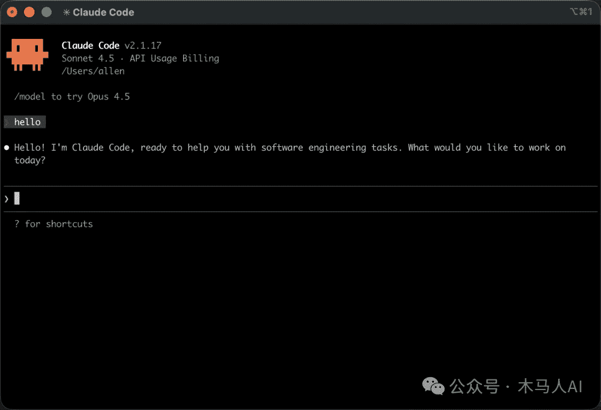

于是木马人调研了一下，看看有没有适合新手的交互式工具。

最后找了以下几个：

+   Claudia：https://claudia.so/

+   Any Code：https://github.com/anyme123/Any-code

+   Claude Code for VS Code（官方推荐的插件）:https://marketplace.cursorapi.com/items/?itemName=Anthropic.claude-code

我使用下来，发现最好用的，是VSCode的官方插件： Claude Code for VS Code 。

那今天就重点介绍一下这个插件的安装和使用。

> 接下来以VsCode为例给大家演示

---

##   **安装编辑器： **

下载 VSCode 编译器并安装：

VSCode下载地址：https://code.visualstudio.com/Download

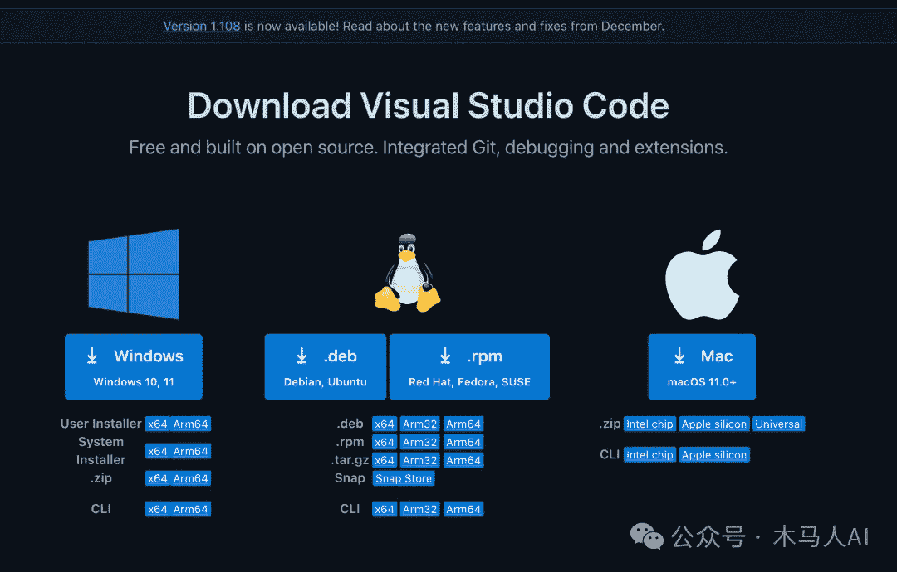

根据自己对应的平台选择对应安装包下载

Mac电脑注意选择正确的芯片架构：

+   **ARM64 **（M1/M2/M3 芯片的 Mac）

+   **x64 **（Intel 芯片的 Mac）

##   安装官方Claude Code插件

1.  点击左侧扩展市**场，输入插件名称 C**laude Code for VS Code （注意认准是 Anthropic 的那个），点击安装

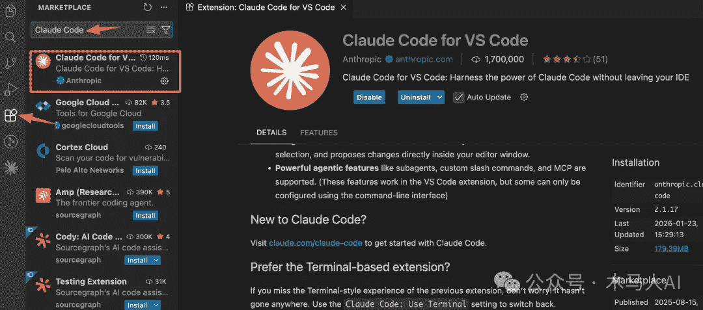

+   安装完成后，打开任意项目后，点击如下图中的右上角 Claude Code 图标，即进入 Claude Code 页面

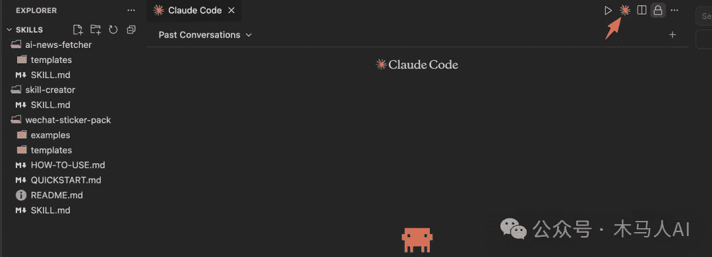

有人可能进去之后，会看到下面这个页面，那你肯定有疑问，下面的三种登录方式，要怎么选？

木马人告诉你： **一个都不要选！**

你就等3-5秒，这个界面就会自动消失了，而且如果你按照我之前文章 Claude Code实战教程：最新安装指南（新手友好） 中步骤，成功配置好GLM类似的第三方供应商的话，应该已经是登录状态，最终效果应该如下图:

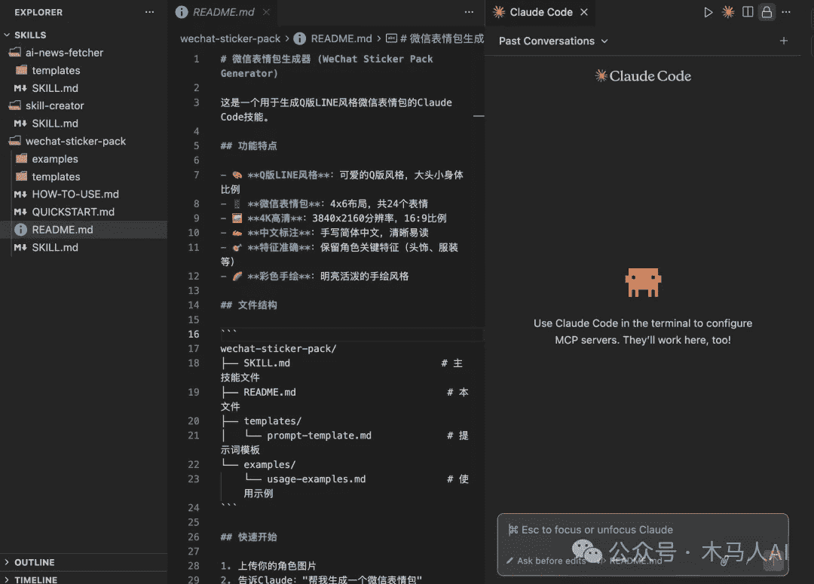

如果按照上述步骤没有成功，可以进入 Claude Code 对话框后，在对话框输入 /config 进入设置，勾选 Disable Login Prompt 配置来关闭登录页面

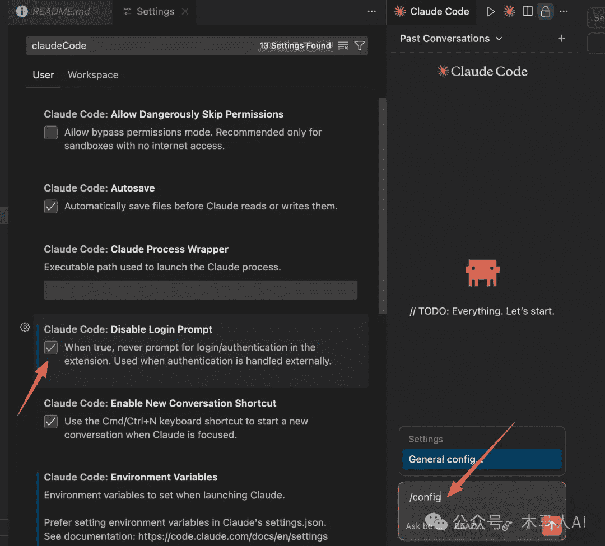

##   **如何使用 **

先简单看下界面，如下图：

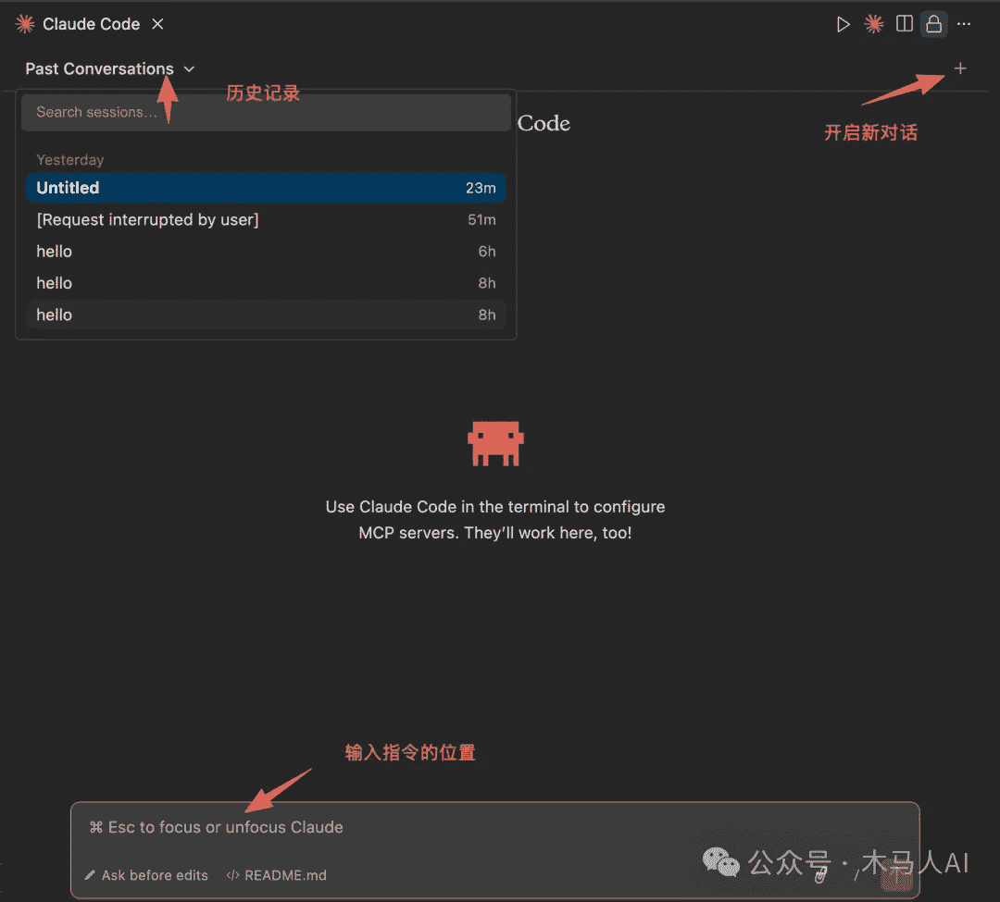

正常使用的话，我们只需要在指令框中输入自己的，通过对话的形式跟Claude Code进行对话沟通

##   **使用技巧 **

###  **多窗口开发 **

点击右上角的+号，可以实现两个窗口同时工作（一个开发，一个测试）

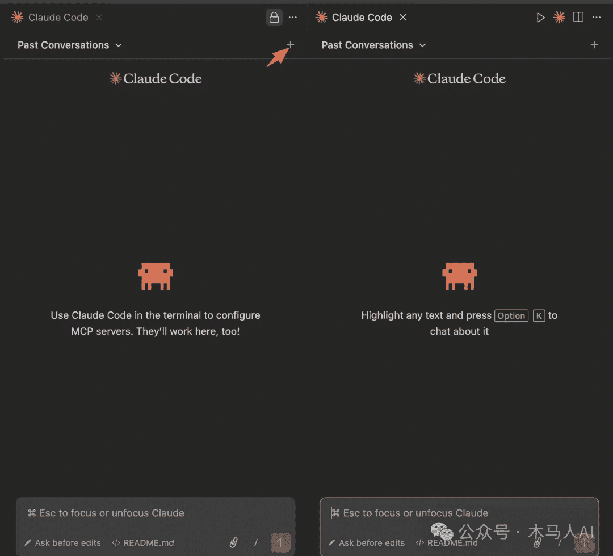

###  **多模式讲解： **

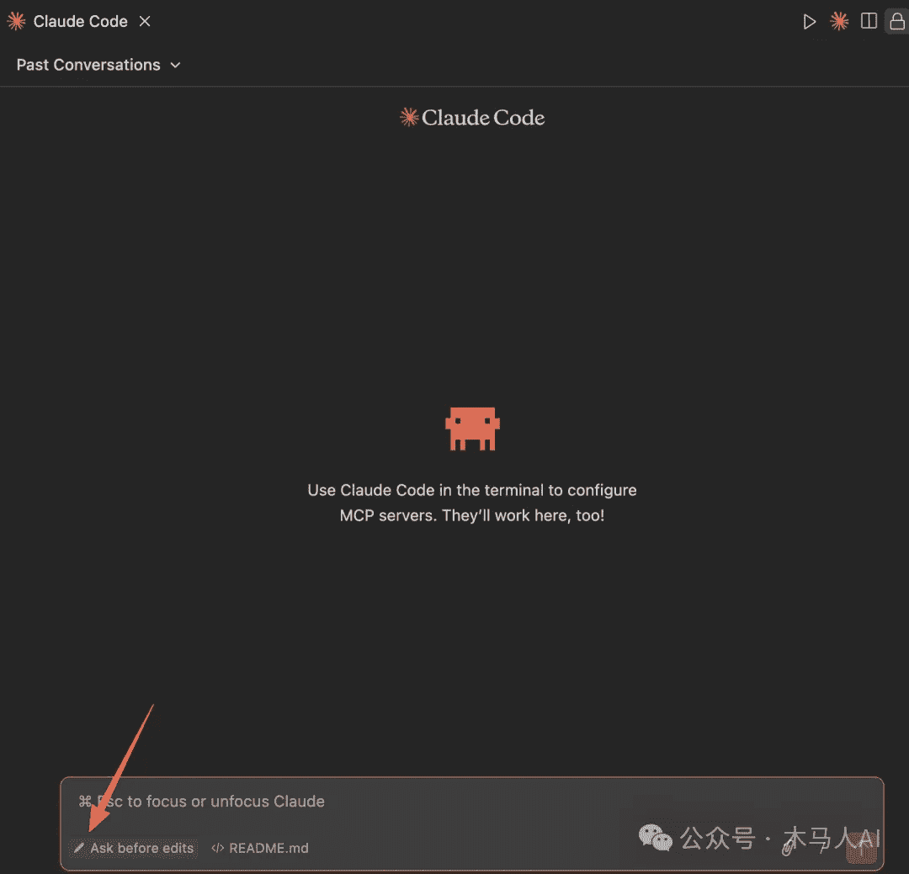

左下角这边有三种模式可以切换，详细给大家介绍一下：

1.  Ask before edits （推荐新手使用）

在执行操作前都会询问你的意见，不会随意修改代码

+   **Accept Edits **（熟练后使用）

Claude会帮你自动改代码，但遇到命令还是会询问你

+   **Plan Mode **（大型任务使用）

先将完整的计划列出来，询问你的意见，确认后再执行

###  **引用项目中文件 **

通过在命令行中@对应文件即可（最常用）

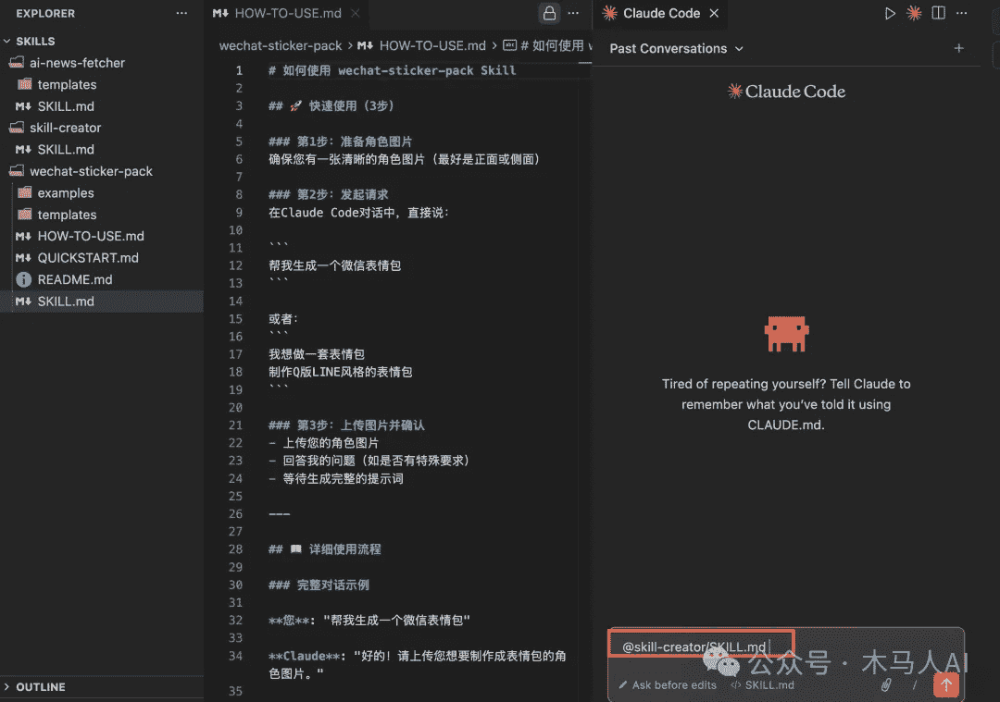

###  **上传文件 **

输入/attach file，选择要上传的文件

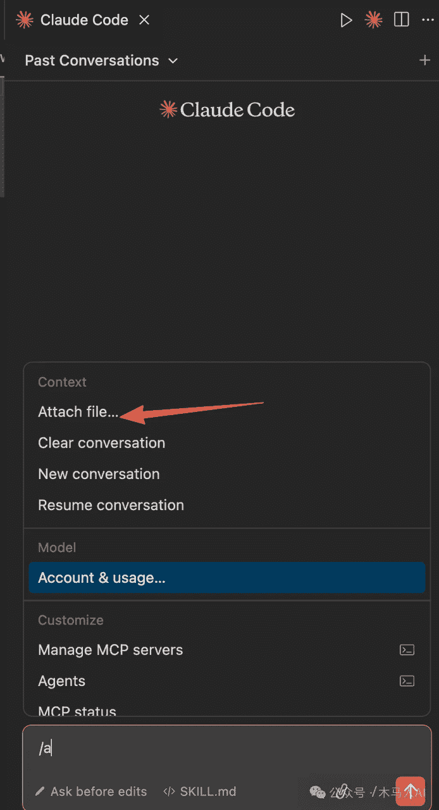

注意，有人可能看到右下角的附件，以为是上传文件，其实不是，这只是引入文件的按钮，注意区分

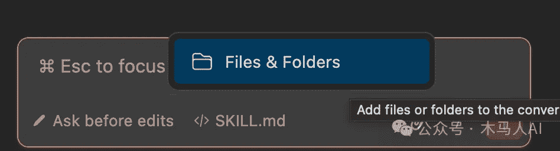

###  **切换模型 **

输入/model，选择switch model，按照自己的需求选择

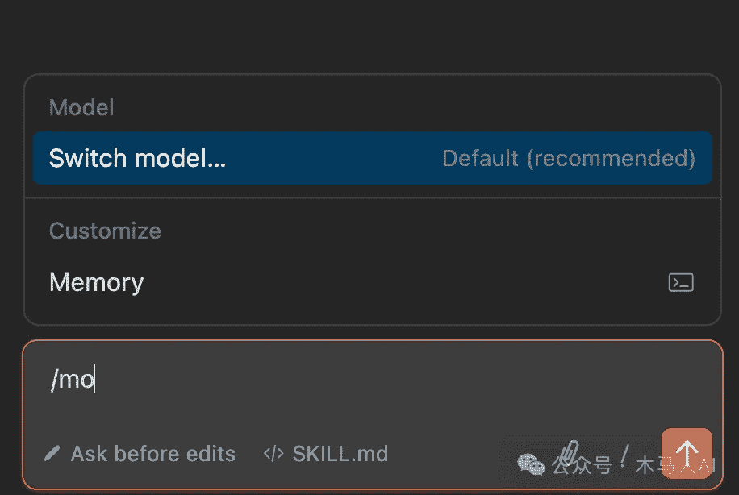

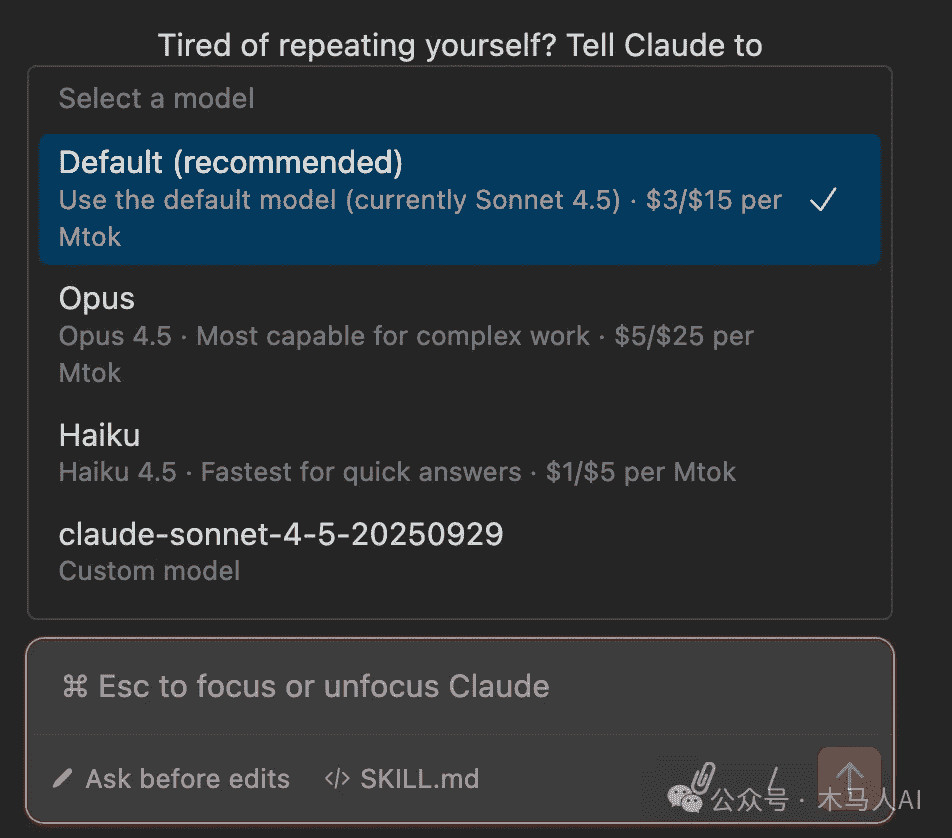

好了，以上就是本期图形化插件安装和使用的完整教程，你学废了么？

<https://aigcreative.feishu.cn/sync/K4Gvd9vUQsy9Oubwqaeclu0Fnbg>

# 知识库动态