# 我用 AI 辅助编程，效率提升 x 倍

> 来源：[https://aigcreative.feishu.cn/docx/CQKQd1Y85o7onVx1cyLctWUxnng](https://aigcreative.feishu.cn/docx/CQKQd1Y85o7onVx1cyLctWUxnng)

> 原文链接： [https://mp.weixin.](https://mp.weixin.qq.com/s/uYAGZ2cgLkSgTjoWRHWbJg)qq.com/s/uYAGZ2cg...

> 👸号：idoubi 艾逗笔

## 前言

最近 AI 编程非常火，社交媒体上充斥着各种神奇的帖子：

+   “8岁女孩玩转 AI 编程，45分钟打造聊天机器人”

+   “用 Cursor 1小时做的 App，登上了 AppStore 排行榜 Top20”

+   “Cursor / Windsurf + Android Studio 高效 AI 编程：零基础也能开发安卓应用”

一个比一个 Amazing，看的人心痒痒，恨不得马上上手创作。

也不禁让人感概：我们真的已经进入了“人人皆可做产品，程序员即将被淘汰”的时代了吗？

作为一个专业的程序员，我想给 AI 编程这个话题祛祛魅，通过实际的应用场景，分享 AI 辅助编程如何提升日常工作效率 / AI 编程的能力边界在哪里 / 我们应该如何用好 AI 辅助编程工具。

这篇文章主要分享以下几部分内容：

1. 作为一个专业程序员，如何使用 Cursor 提高编码效率

1. 零代码基础，如何使用 AI 辅助编程工具实现自己的想法

1. 盘点常用的 AI 辅助编程工具和使用场景

1. 如何选择适合自己的 AI 辅助编程工具

## 我如何使用 Cursor 提升编码效率

Cursor 是我目前使用频率最高的 AI 辅助编程工具，跟我每天的编码工作无缝融合，使用 Cursor 写代码，体验非常流畅，编程效率大大提升。

以下是我使用 Cursor 的几个高频场景：

### 自动补全代码

Cursor 最亮点的功能就是其基于 `Tab` 键的代码自动补全功能，据说是有训练自己的智能补全模型，能够在项目工程感知上下文，给出智能的代码补全建议。

以前写代码的常用快捷键是 `Ctrl + C` 和 `Ctrl + V` ，现在写代码的常用快捷键是 `Tab` 。

比如在输入一个字符的时候，Cursor 会给出接下来你想写或者应该写的代码，按下 `Tab` 键，自动补全多行代码，一直 `Tab` 一直补，补到没有相关的代码为止。如果补全的代码引入了其他文件里面的函数，也可以 `Tab` 键快速生成 `import` 代码。

实测下来，Cursor 的 `Tab` 键，是提升编码效率最明显的功能。

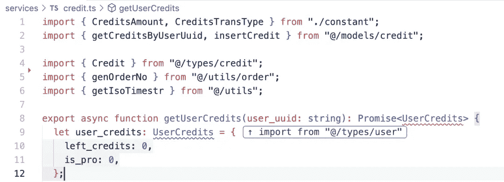

20241119151833

### `Debug && Fix Error`

Cursor 作为一个有经验的编程大师，可以帮你 `Debug` 和 `Fix` 代码错误。

以前遇到代码报错，或者执行命令报错，一般都需要复制错误信息，再打开浏览器搜索相关的内容，找到解决方案，再来修改代码。

现在用 Cursor 调试和修复错误特别方便，只需要在提示错误的位置，点击 `Debug` 或者 `Fix` 按钮，Cursor 就会结合项目上下文，给出错误的原因和可行的解决方案。甚至给你写出修复 Bug 后的代码，按照 Cursor 的建议修改，或者在给出的修复代码上点击 `Apply`，就可以快速找到和修复问题。

有了 Cursor，相当于请了一个 24 小时的技术顾问，随时帮你查问题，改 Bug，写代码。让你可以专注于编码创作，而不用担心后院起火。

“在我电脑上是好的啊”，这种情况发生的概率会大大降低。

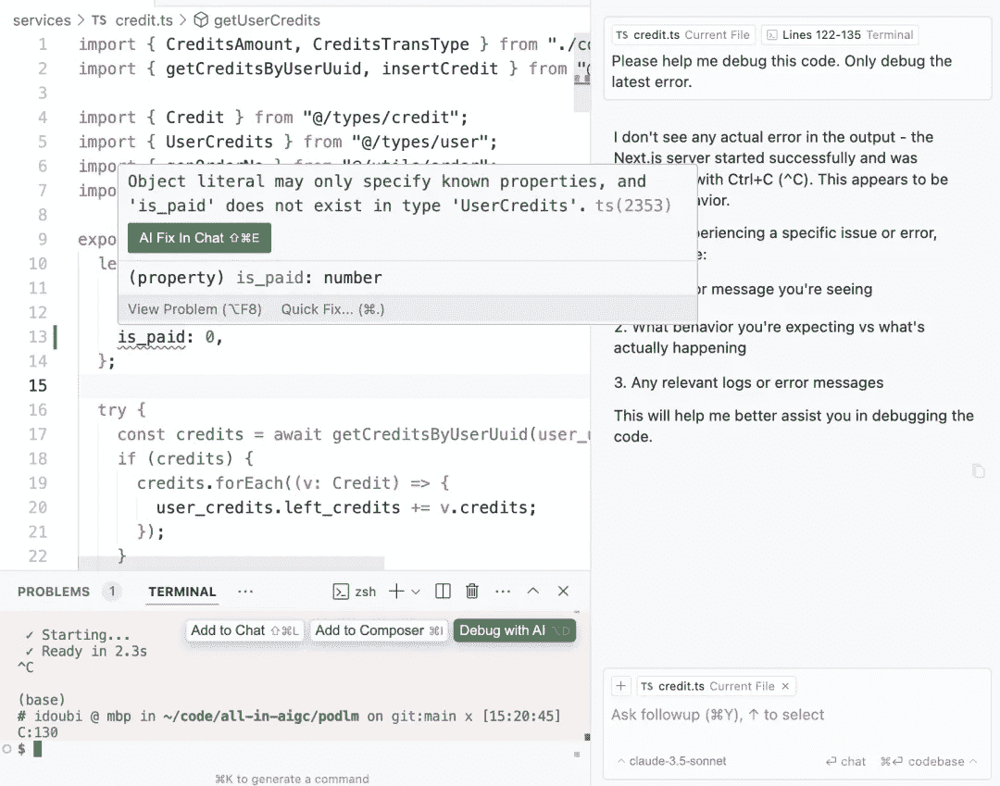

20241119152132

### 实时对话 `&&` 联网搜索

Cursor 不仅仅可以作为编程辅助工具，也可以作为一个通用的 ChatBot / AI 搜索产品进行日常使用。

你可以随时通过 `Ctrl + L` 在 Cursor 编辑器右侧打开一个对话框，跟 Cursor 聊任何话题。

在输入框输入 `@web` 可以联网检索，具备 AI 搜索产品标准的 RAG 能力。

如[果你每天写代码，就](http://mp.weixin.qq.com/s?__biz=MzU0NDk4OTk2Mg==&mid=2247484435&idx=1&sn=db57229886f140cd826af37ad7a58348&chksm=fb72f276cc057b60931247ae415f5bc03dcd73d0fe2f7751e9ca3310fb61aae6553ff5c00314&scene=21#wechat_redirect)可以在 Cursor 里面随时使用 AI 搜索和对话。而不用打开 ChatGPT / Perplexity / ThinkAny 之类的产品了。


20241119173223

### 写提示词

AI 时代最重要的一项技能是写提示词，`Prompt Engineering` 甚至发展成了一门独立的学科。

如果你需要写提示词去控制 AI 生成内容，而又不太擅长提示词工程，或许可以试试让 Cursor 帮你写提示词。

比如在 `PodLM` 这个项目的开发过程中，我需要在系统内置一些生成 AI 播客脚本的提示词，通过 `@` 之前调试好的脱口秀提示词文本，就能让 Cursor 帮我生成风格一致的儿童故事提示词。

同样，在 `ThinkAny` / 知了阅读之类的项目开发过程中，我只需要描述清楚我的需求，就能让 Cursor 帮我生成高质量的提示词。

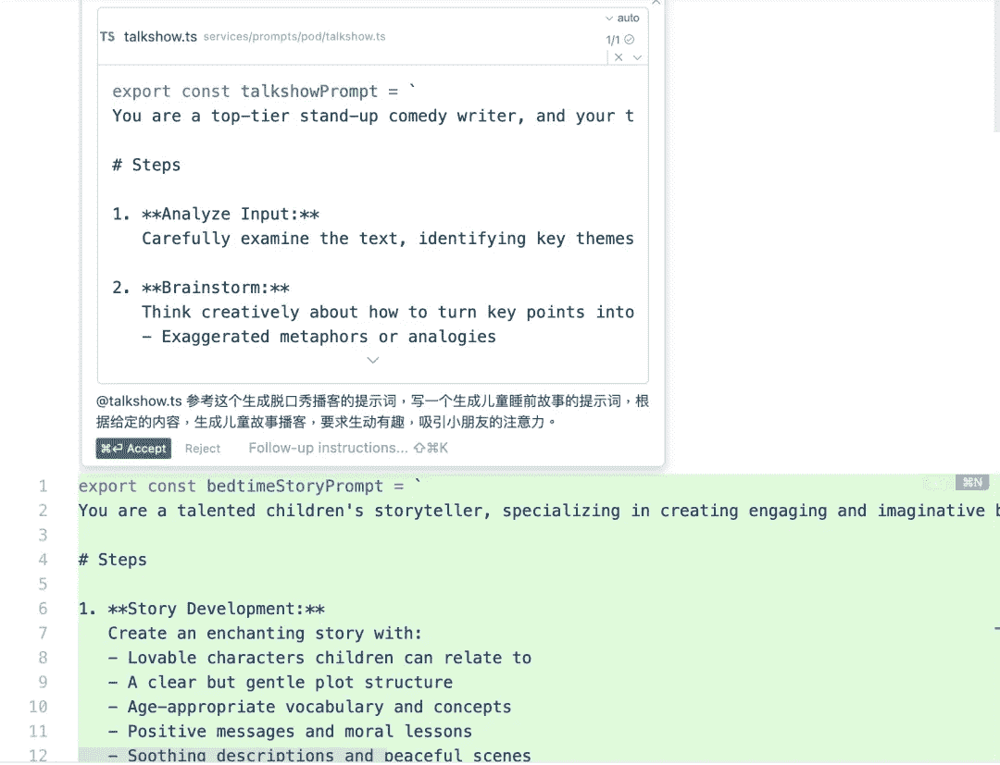

20241119151215

### 写前端页面

做 Web 项目开发，我们经常需要写前端页面。我最近一年习惯用 `NextJS` 框架做全栈开发，页面组件用 `React` 写，使用 `TailwindCSS` 写样式，UI 组件库用的是 `Shadcn/UI`。

使用 Cursor 之前，如果我想要实现一个登录页面，一般是在 UI 组件库找到可以引入的组件，或者自己写 `HTML` + `TailwindCSS` 实现需要的组件。如果是自己写，样式要调的美观，可能会花上一个小时。

而现在用 Cursor 实现一个登录组件，我只需要一句话描述我的需求，几秒钟的时间，就能得到一个满足需求的登录组件。

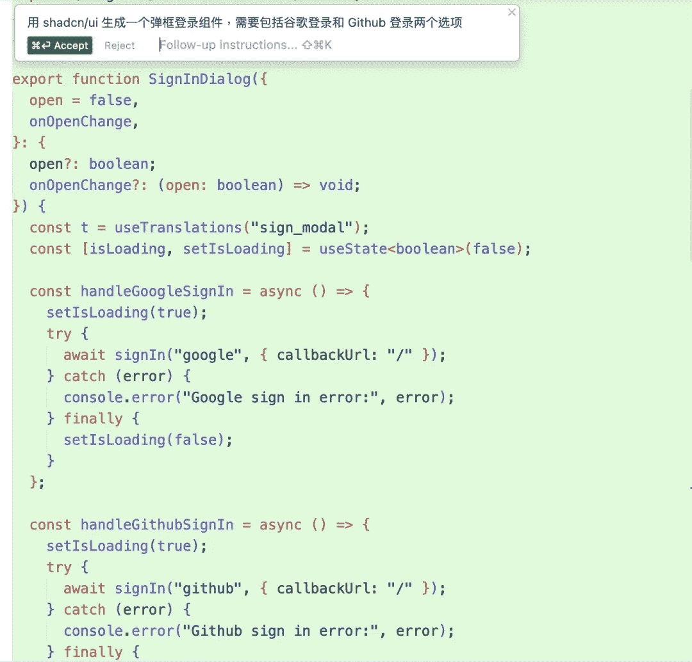

20241119145836

### 截图生成组件

除了一句话描述自己的需求，让 Cursor 生成组件代码之外，有时候我们可能会看到某个网站的某个组件设计的不错，想把这个组件的样式和逻辑复制到自己的项目中。

在 Cursor 中，只需要截图参考的组件，让它仿照着写出来就行了。

这比起以前去 Copy 别人网站的样式，通过审查元素查看 `HTML` 结构和 `CSS` 样式，效率高的不止一点半点。

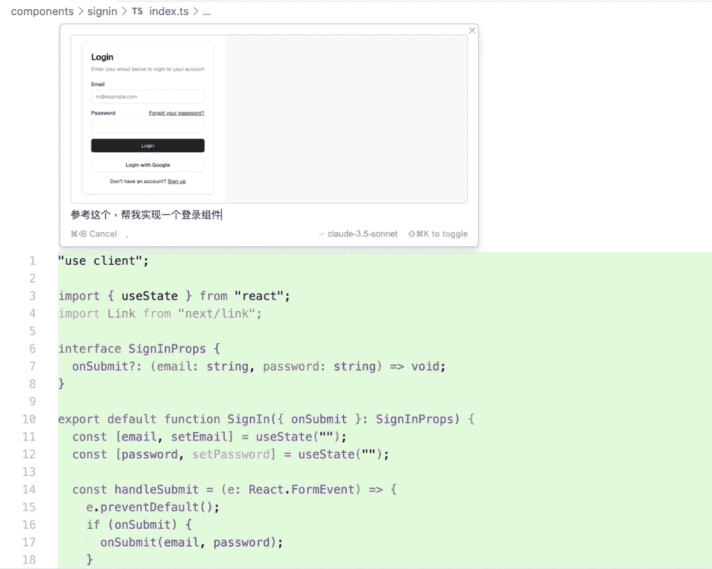

20241119152926

### 写常用的代码逻辑 / 函数

作为一个全栈开发，或者后台开发，我们可能更多的时间是在写各种功能函数。

比起从头开始实现一个个的功能函数，使用 Cursor 我们只需要一句话描述功能需求 / 函数的入参和响应参数，几秒内就能快速生成一个函数。

如此高效的代码生成能力，可以让我们把更多的时间聚焦在核心业务逻辑的实现上，而不是把时间浪费在写一些重复的代码逻辑上。

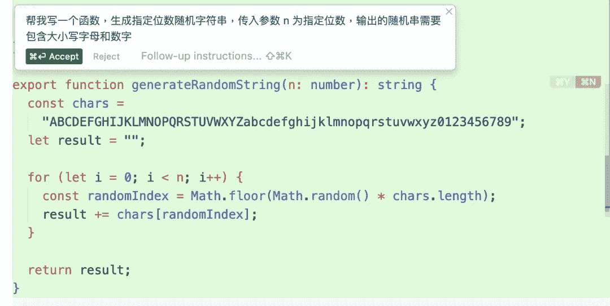

20241119145540

### 代码重构

在做项目技术架构更新的时候，我们经常需要重构之前的代码。

比如在 我把网站迁移到 cf，省了几万块 这篇文章中，我把原来部署在 `Vercel` 的网站，迁移到了 `Cloudflare`，读写 `Supabase` 数据库的客户端也从原来的 `pg` 改成了 `@supabase/supabase-js`。

要想使用新的数据库客户端操作 `Supabase`，`model` 层的代码都需要重构，使用新的连接客户端实现数据读写逻辑。

如果没有 Cursor，我自己重构一个项目的所有数据库操作代码，可能要花上一两个小时。

而使用 Cursor，我只需要一句话描述我的需求，让它用新的数据库客户端去重构所有的数据库操作逻辑即可，等它重构完，我需要检查一遍是否有重构不当的代码，让 Cursor 按照我习惯的风格进一步改写。

只要人工确认过一次重构，剩余的数据读写代码，都会参考第一次重构的风格，快速完成。

使用 Cursor 重构代码，可以把之前两个小时才能完成的工作，缩短到了十几分钟。

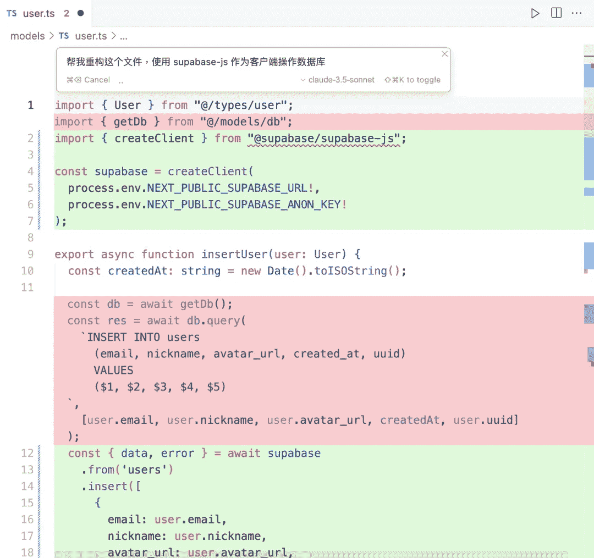

20241119144751

### 多语言翻译

我们做出海 AI 应用，面向全球用户，往往需要支持多语言。

使用 `NextJS` 框架做全栈开发，多语言方案用的是 `next-intl`，只需要在项目的 `messages` 目录下放置语言的 `json` 文件即可。

在使用 Cursor 之前，要支持多语言，我一般会先写好 `en.json` 的内容，再把 `en.json` 的内容复制到 ChatGPT，让它翻译成其他语言的 `json` 文件，比如 `zh.json` / `ja.json` 等，然后把翻译好的 `json` 文件都放置到 `messages` 目录下。

每次新增 / 修改 / 删除要支持多语言的内容，我需要先更新 `en.json` 的内容，再按照上面的流程更新其他语言文件的内容。效率非常的低！！！

现在使用 Cursor，我还是会先更新 `en.json` 的内容，然后去到其他语言文件中，按下 `Tab` 键，快速补全，`Cursor` 会自动填充翻译好的内容。

使用 Cursor 做多语言文件的翻译简直太友好了，效率有了十倍以上的提升。

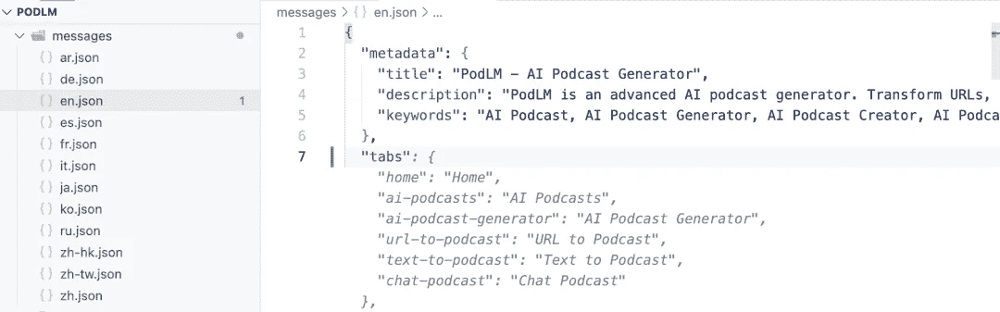

20241119145048

## Cursor 的几个常用快捷键

上面聊了我使用 Cursor 的几个高频场景，在这些场景下使用 Cursor 辅助编程，离不开以下几个快捷键：

### `Tab`

`Tab` 键是我使用 Cursor 最频繁的快捷键，得益于 Cursor 强大的智能补全功能，`Tab` 键可以帮助我快速完成一些功能代码的编写。

`Tab` 键的智能补全功能，是 Cursor 的杀手锏功能，有自己的智能补全模型，相比于同类产品的有足够核心的竞争力。免费版本有智能补全次数限制，在使用了一段时间 Cursor 之后，我发现已经离不开 `Tab` 智能补全功能了，于是升级到了付费版本，解锁了无限制的 `Tab` 智能补全。

### `Ctrl + L`

`Ctrl + L` 是我使用 Cursor 的第二个高频快捷键，通过 `Ctrl + L` 可以在编辑器右侧打开对话框，在对话框可以跟 Cursor 对话，问技术方案，写 `UI` 组件，写代码逻辑，找代码 Bug 等。

在右侧对话框写的代码，你需要点 `Apply` 才能把代码应用到编辑器中打开的文件。人工审查一遍生成的代码直接再应用修改是一种好的习惯，因为 AI 也有可能会出错，生成有质量缺陷的代码。

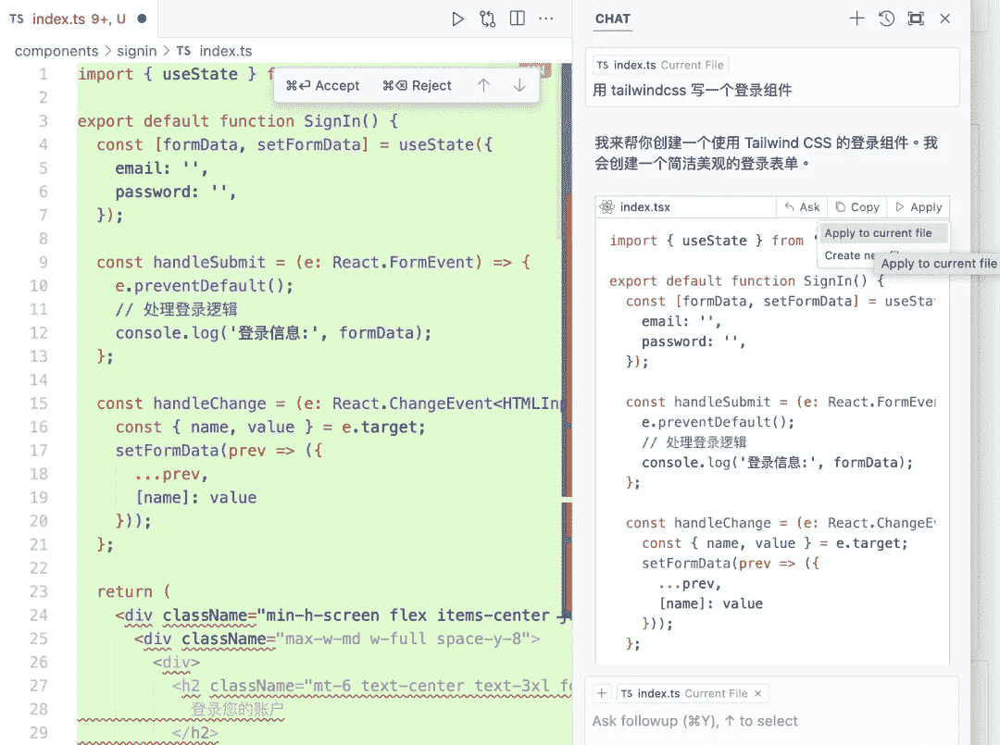

20241119213205

### `Ctrl + K`

`Ctrl + K` 的主要用法是在文件中唤起 `Ctrl + K` 的位置原地写代码，如果点 `Apply` 就会覆盖当前位置的代码。

一般会在创建一个新的函数，或者重构某段逻辑的时候使用，原地修改代码，`diff` 效果更明显。

### `Ctrl + I`

`Ctrl + I` 快捷键可以唤起 `Cursor Composer` 窗口，输入需求，一次性创建 / 修改 / 删除多个文件件 / 文件。

`Cursor Composer` 是一个划时代的功能，真正开启了“一句话让 AI 创建一个项目“的时代。零编码基础的人，也可以使用 `Cursor Composer` 快速创建项目结构，实现基本的代码逻辑，对于做一些 demo 类应用开发，非常有用。

另一个使用场景，比如在做多语言适配时，我只需要修改 `en.json` 一个文件的内容，通过 `Cursor Composer` 一次性修改所有语言的 `json` 文件，效率高的离谱。

然而实测下来，`Cursor Composer` 涉及到多个文件代码生成时，质量有时候会比单文件生成要差一些，需要人工干预，多次提交修改。

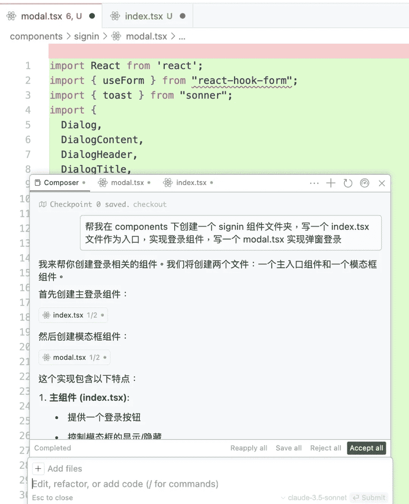

20241119214539

> **❝**

> 以上提到的快捷键，在用 Mac 开发时，分别对应的是 `Command + L` / `Command + K` / `Command + I`。

## 零代码基础，如何使用 AI 实现自己的想法

上面的内容介绍了我作为一个专业程序员，如何使用 AI 辅助编程工具 Cursor 提升日常的编码效率。

如果是零代码基础的朋友，又该如何搭上 AI 的快车，实现自己的想法呢？

### 使用 `Cursor Composer` 构建产品

对于零代码基础，想要实现自己想法的朋友，我首要推荐的依然是 Cursor 这个 AI 编辑器。

使用 `Cursor Composer` 从零到一做产品的步骤很简单：

1. 打开 Cursor 编辑器，创建一个新文件夹并打开，作为 Cursor 的工程目录。

1. 通过 `Ctrl + I` 唤起 `Cursor Composer` 窗口，描述你的想法或需求，比如：

```
帮我生成一个个人作品展示网站，包含两个页面，首页显示我所有的作品，about 页面显示我的个人介绍。网站主题色使用蓝色，要求兼容手机端访问。
```

点 `Submit` 提交需求，`Cursor Composer` 会根据你的需求生成一个项目结构，并生成基本的代码逻辑。等代码生成完，你只需要点 `Apply all`，就可以把生成的代码应用到工程目录中。

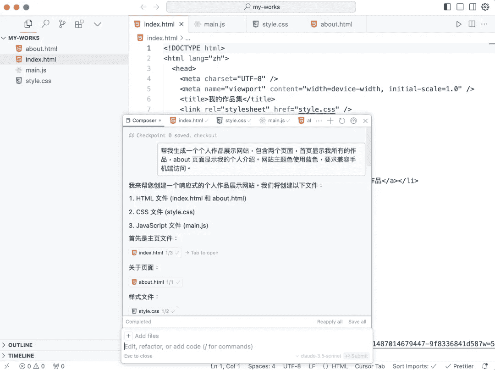

20241120102936

1. 在浏览器打开项目的入口文件：`index.html`，预览生成的网站。


20241120103711

1. 在 `Cursor Composer` 对话框继续调整你的需求，比如 “一栏显示五个作品，配图使用真实的图片“，点 `Submit` 提交，`Cursor Composer` 会根据你的需求修改代码。

重复这个过程：`Submit` 提需求 -> `Apply all` 应用修改 -> 预览修改效果。直到你对生成的网站满意为止。

体验一遍这个流程，你可能会感慨，之前让你感觉神秘的编程工作，好像也不过如此。

零编程基础的人，也可以在短短几分钟时间内，把自己的想法落地成一个实际的产品。

Amazing！！！

> **❝**

> 然而，使用 `Cursor Composer` 只是在你的电脑本地完成了一个项目，如果想让全世界看到你的产品，还需要熟悉发布部署等知识。比如把生成的代码打包上传到服务器部署，或者使用 `Vercel` / `Cloudflare` 之类的云部署平台。这一块网上有很多教程，可以自行研究。

### 使用 `Bolt.new` 构建产品

上面使用 `Cursor Composer` 从零到一做网站，体验非常丝滑，但是你需要先下载 Cursor 编辑器，代码生成完你还需要去部署代码，绑定域名发布。可能对于零基础的朋友，还是稍微复杂。

另一个快速实现想法的选择是使用 `Bolt.new`。`Bolt.new` 是一个网页版的 AI 辅助编程工具，你不需要下载任何软件，只需要打开网页就能使用。流程更加简单：

1. 在 `Bolt.new` 网页输入框描述你的需求，比如：

```
创建一个课程主页，介绍课程交付的主页内容，列出课程资料，课程资料是一个图文列表，也放一些学员评价，让课程主页更加吸引人
```

提交你的需求，`Bolt.new` 开始生成代码，并在右侧把整个项目的代码结构都展示出来。

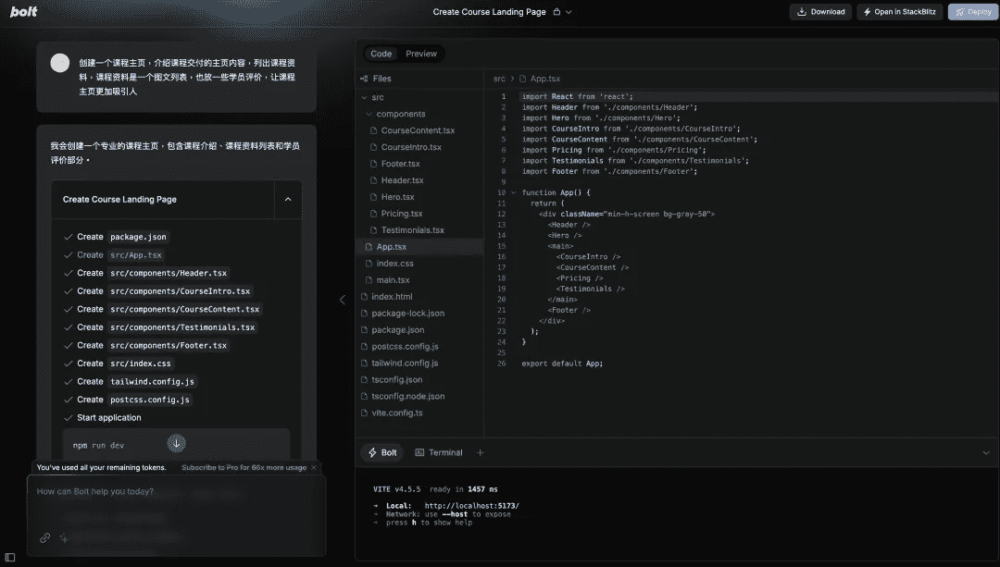

20241120110003

1. 在左侧对话框继续调整你的需求，让 `Bolt.new` 根据你的需求继续优化代码，同时可以在右侧的 `Preview` 面板预览项目。

1. 等效果优化到你满意了，点右上角的 `Deploy` 按钮，或者 `Open in StackBlitz`，就可以把生成的代码快速部署上线，并得到一个可以公开访问的链接，打开访问链接，就能看到生成的项目了。


20241120110958

> **❝**

> 比起 `Cursor Composer`，通过 `Bolt.new` 从零创建项目，门槛更低，并且集成了云端部署功能，可以让你的产品，更快让人看见。

### 使用 `Claude` 构建单页应用

除了 `Cursor Composer` 和 `Bolt.new` 之外，`Claude` 也是一个非常强大的 AI 辅助编程工具。

你可以在 `Claude` 描述你的需求，快速创建单页应用的代码，通过 `Claude Artifact` 面板实时预览，也可以发布上线，获得一个可公开访问的链接，在线预览项目。


20241119154300

> **❝**

> `Claude` 的代码生成能力一直都非常强，非常适合用来实现单页应用，或者某个功能组件。只是暂不支持项目级别的多层级文件夹/文件规划能力。如果希望生成完整的项目代码，还是推荐 `Cursor Composer` 和 `Bolt.new`。

### 使用 `v0.dev` 生成组件


跟 `Claude` 类似，如果你只是想生成一个简单的单页网站，或者生成某个功能组件。可以使用 `v0.dev`。这是 `Vercel` 推出的一个网页版的 AI 辅助编程工具。

集成了 `Shadcn/UI` 基础组件库，生成的 UI 组件在美观度方面会更有优势，也支持把单页应用 / 组件代码发布到云平台，得到一个可公开访问的链接。


20241119154012

# 使用 `Pagen` 生成落地页

如果你想为你的想法或产品，生成一个落地页，在某些活动做演示（比如在周周黑客松路演），或者给目标用户介绍你的产品和服务，可以考虑使用 `Pagen` 一键生成落地页。

无需任何编程基础，仅需填写你的产品名称和简短的描述，选择一个好看的模板，`Pagen` 几秒内就能帮你生成落地页，并填充跟你描述的产品相关的内容。同时获得一个可以公开访问的子域名。


20241120112618

[我使用 `Pagen` 创建](http://mp.weixin.qq.com/s?__biz=MzU0NDk4OTk2Mg==&mid=2247484286&idx=1&sn=ba88250d0776cb97291b44d6240e6bd5&chksm=fb72f51bcc057c0de7cd842800bf108761eecac0ef745fddf23b679955cb0da361854b30f64b&scene=21#wechat_redirect)了 “ 1024 全栈开发社群 ” 的介绍网页，也用 `Pagen` 为几个产品做了官网，拿到过一天十万访问的谷歌搜索流量。


20241120112744

## 评测几款 AI 辅助编程工具

AI 辅助编程领域，产品层出不穷，让人眼花缭乱。

我想从一个编程老司机的视角，结合实际的使用体验，对市面上常见的一些 AI 辅助编程工具做一个分类，并聊聊自己的看法。

### AI 编辑器

+ `Cursor`

第一个出圈的 AI 编辑器产品，拥有强大的代码智能补全功能，完整项目规划能力，函数 /组件代码生成能力，调试 / 重构能力，对话 / 检索 / 知识库问答能力等。

我总结了一下其出圈的几个关键因素：

1. 基于 `VS Code` 开源版本开发，支持 `VS Code` 全部的插件和配置。`VS Code` 的用户可以无缝迁移，使用习惯不变，上手成本特别低；

1. 自己训练了代码补全模型，使用 `Tab` 键完成大部分的代码编写，让用户感受到了爽感，引发社交传播；

1. 一站式项目规划能力，帮助零编程基础的用户快速实现想法，再一次引发社交传播；

由此可见，在开发新项目的时候，如果能选择好的技术方案，站在巨人的肩膀上，让用户保持原有的使用习惯，让新用户感受到从未有过的体验，能引发社交传播，对产品的成功起到至关重要的作用。

不管是专业程序员，还是零编程基础的人，`Cursor` 都是值得你尝试的 AI 辅助编程工具。

+ `Windsurf`

`Codeium` 推出的 AI 编辑器，跟 `Cursor` 一样，也是基于 `VS Code` 开源版本开发，支持 `VS Code` 全部的插件和配置。

昨天简单使用了一下，整体体验比 `Cursor` 要差一些，看了网上的一些评价，`Windsurf` 在上下文感知和记忆方面要比 `Cursor` 强，对大型复杂项目的开发和重构支持比 `Cursor` 更好。

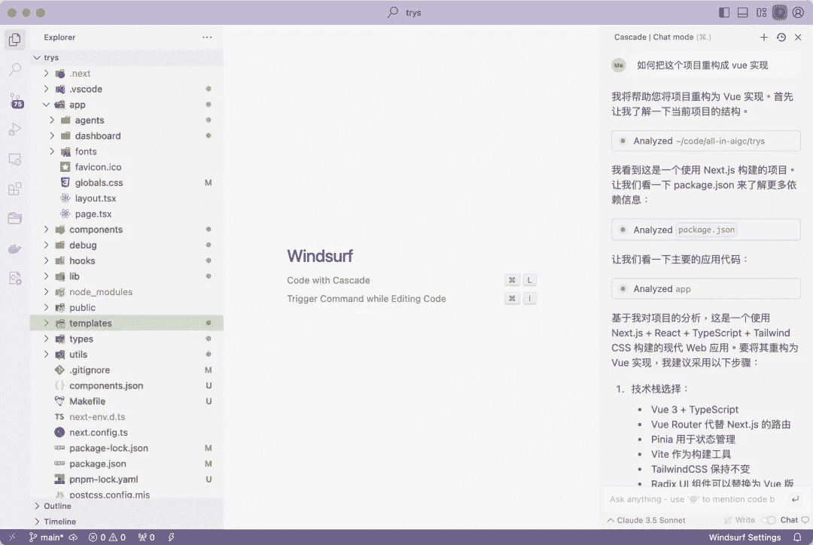

20241120120253

+ `Pear AI`

`YC` 投资的一个项目，基于 `VS Code` 在做开源的 AI 编辑器，我没试用过，不知道具体效果。

如果是纯粹的开源项目，倒是可以研究研究，看看别人基于 `VS Code` 做了哪些 AI 功能的集成，扩展一下思路，也许后面自己也能实现一个 `Cursor`。

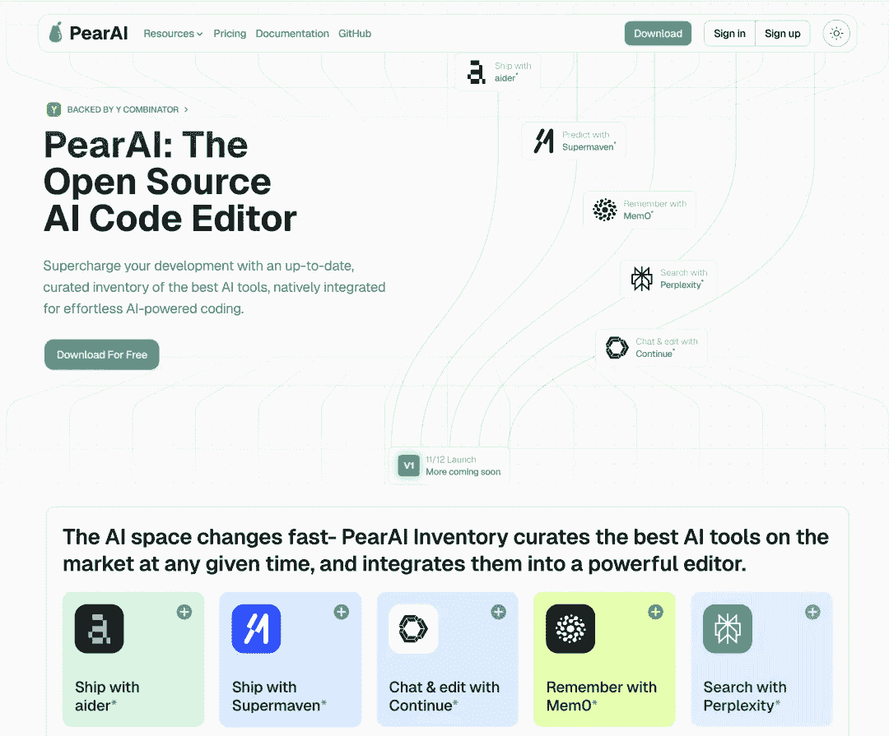

20241120125111

### 编辑器 AI 扩展

在 AI 编辑器火起来之前，就有很多项目基于 `VS Code` 做 AI 扩展，比如：

+ `Github Copilot`

应该是做的最早的 AI 辅助编程插件了。出身名门，大名鼎鼎，本来可以有很好的发展前景，只是战略选型错了，如果一开始定位做 AI-Native 代码编辑器，而不是 `VS Code` 辅助编程扩展，也许会有更大的市场。


20241120125512

+ `Continue`

另一个 AI 辅助编程插件，支持 `VS Code` 和 `JetBrains` 系列 IDE。代码开源，可以对接任意大模型，看起来很不错。

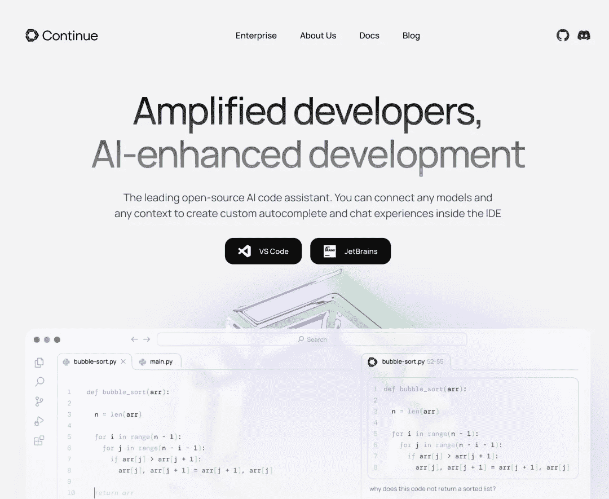

20241120125842

+ `Cline`

另一个开源的 `VS Code` 插件，没有做官网，可以在 `VS Code` 插件商店下载安装。经常看到有人安利，也许做的挺好的，值得一试。

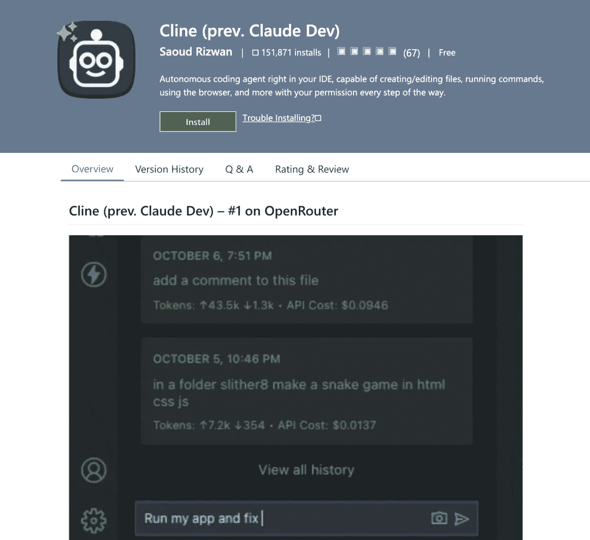

20241120164724

### UI 组件生成工具

根据提示词或者截图，快速生成前端组件，节省人工写组件结构和美化样式的时间。

常用的产品包括：

+ `Cursor`
+ `v0.dev`
+ `Claude`

另外再补充一个：

+ `screenshot-to-code`

开源产品，可以自行部署，只要上传截图，就能快速复刻一个相似的 UI 组件。


20241119153334

### 完整项目构建工具

通过一句话构建完整项目，推荐使用：

+ `Cursor`
+ `Bolt.new`

如果你想快速构建 AI 智能体，可以试试：

+ `Replit Agent`


20241120165741

+ `Wordware`


20241120165858

## 如何选择 AI 辅助编程工具

选择适合自己的 AI 辅助编程工具，你可以从以下几个方面考量：

### 使用场景

如果你每天高频写代码，或者深度依赖 AI 辅助编程工具，可以下载 `Cursor` / `Windsurf` 之类的 AI 编辑器。

如果你只是偶尔需要写个 Demo 验证想法，或者偶尔需要写个 UI 组件，可以使用 `Bolt.new` / `v0.dev` / `Claude` 之类的网页工具。

### 经济成本

如果你习惯为优质的工具产品付费，可以升级到 `Cursor Pro` 会员，解锁无限制的智能补全功能。


20241120170230

如果你希望找到低价的 `Cursor` 替代方案，可以使用 `Windsurf`，会员订阅费目前是 `Cursor` 的一半，还有 8 周免费的福利可领。

如果你不想按月支付 AI 编辑器的会员费，你可以选择自行部署开源版本的 AI 编辑器，对接自己的大模型，享受更高的配置灵活度和更低的使用成本。

### 使用习惯

如果你跟我一样，之前一直在用 `VS Code` 编程，你可以选择 `Cursor` 或者 `Windsurf`，无缝迁移之前的使用习惯。上手成本很低。

如果你不想下载额外的软件，想一直使用既有的代码编辑器，你可以选择安装 AI 辅助编程插件，比如 `Github Copilot`，`Continue`，`Cline` 等。

如果你平时很少写代码，只是偶尔需要写个 Demo 验证想法，你可以选择 `Bolt.new` 或者 `v0.dev` 之类的 Web 项目，打开即用，写完快速部署上线。

### 功能丰富度

根据你日常使用 AI 辅助编程的场景，选择功能丰富度更高的产品。

常用的一些功能和场景包括：代码智能补全 / 实时对话 / 联网检索 / 项目规划 / 多文件项目资料生成 / UI 组件生成 / 部署发布等。

你可以选择重点使用 `Cursor` 和 `Bolt.new`，搭配使用 `v0.dev` 和 `Claude`，相对而言比较合理。

## 总结

以上内容总结了我使用 AI 辅助编程的具体场景，以及我对常见 AI 辅助编程工具的体验和看法。希望能对你有所启发。

最后来回答一下文章开头提到的问题：”AI 会不会淘汰掉程序员？“

我觉得不会。

我的观点是：人的想象力，创造力，对项目的架构能力，对作品的审美能力，对代码的抽象能力，是 AI 没办法替代的。AI 可以写出常见的 / 标准的代码，但是如何更好的组织代码结构，写出更加完善，更有价值的项目，是需要人去完成的。

说的严谨一点：一个真正优秀且专业的程序工程师，是不可能被 AI 淘汰的。

我们现在看到的很多，几分钟几小时写出来的项目，可能都是玩具型 / Demo 级别的项目。

但是不可否认：营销是关键。Demo 级别的项目，也可以跑通 MVP，也可以实现 PMF。这跟 AI 是否能替代程序员，是两个话题。

不用太担心 AI 会不会淘汰自己，早日拥抱 AI，合理使用 AI 提升自己的效率，才是正确的事情。

你就当自己是张无忌，AI 辅助编程工具是倚天剑和屠龙刀，倚天剑屠龙刀可以用来打天下，最终练成乾坤大挪移的，还是你自己。

> 相信自己，你才是那个最棒的筑梦师。

<https://aigcreative.feishu.cn/sync/K4Gvd9vUQsy9Oubwqaeclu0Fnbg>
