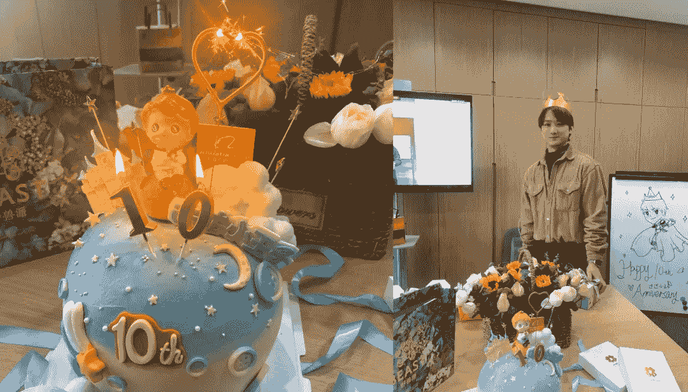
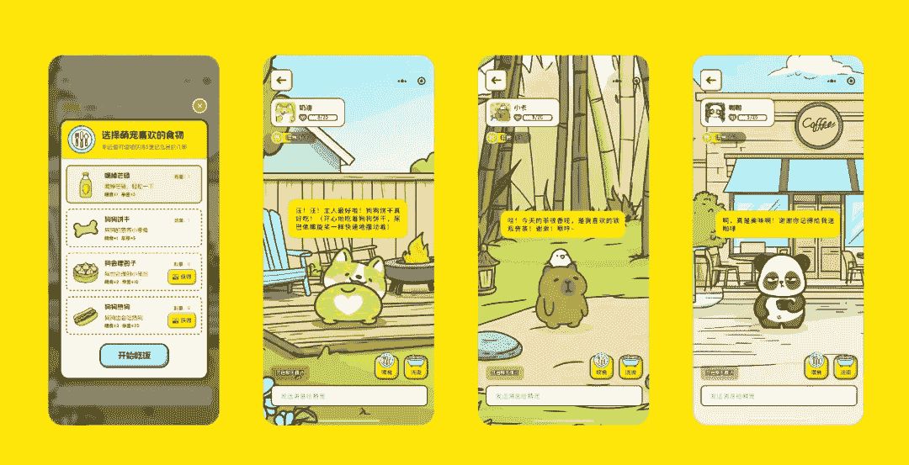
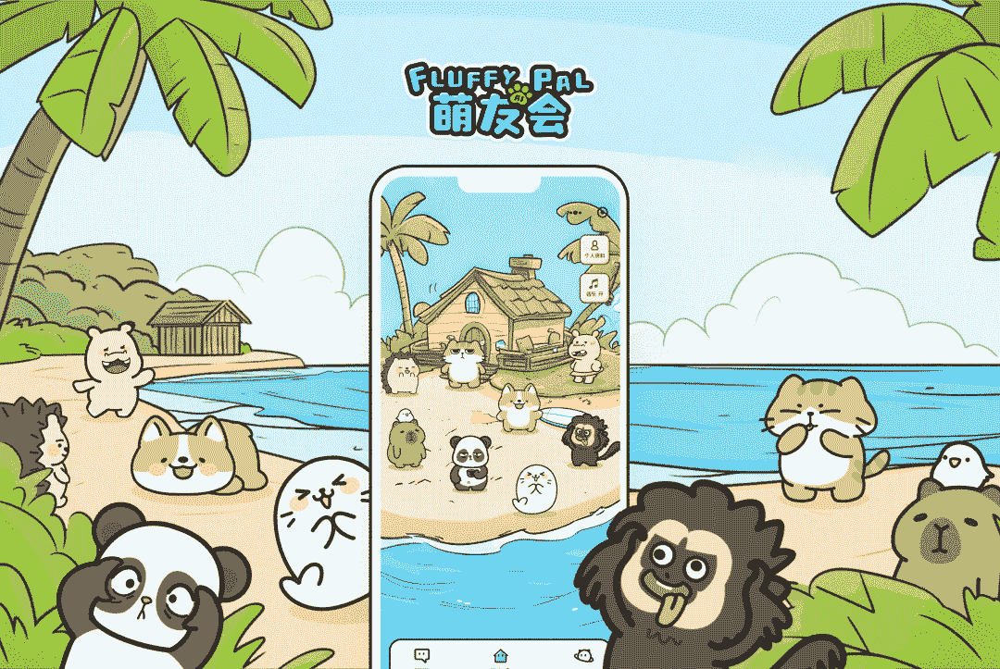
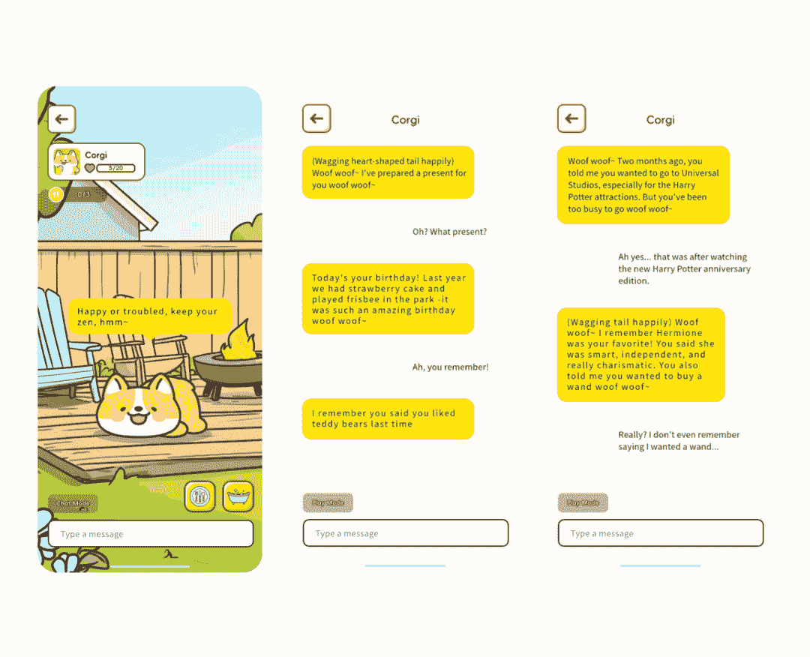
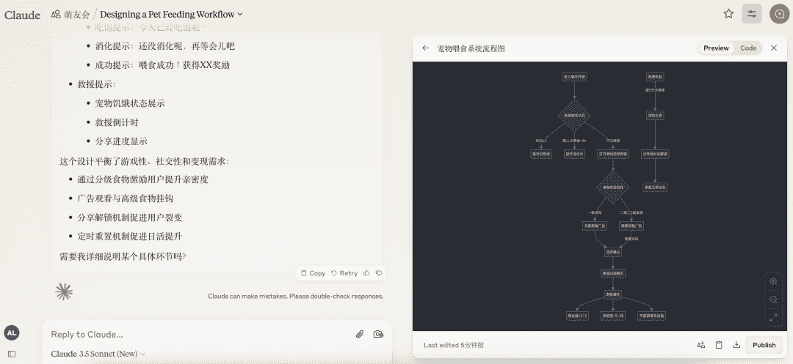
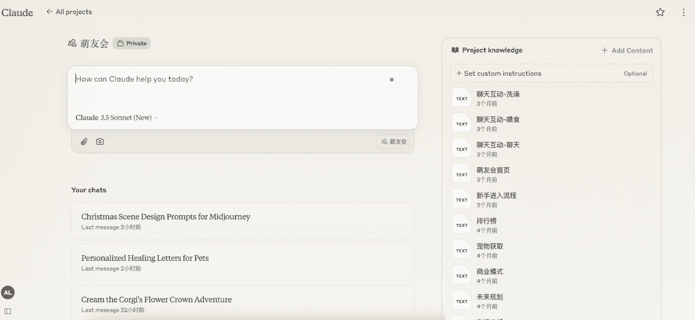
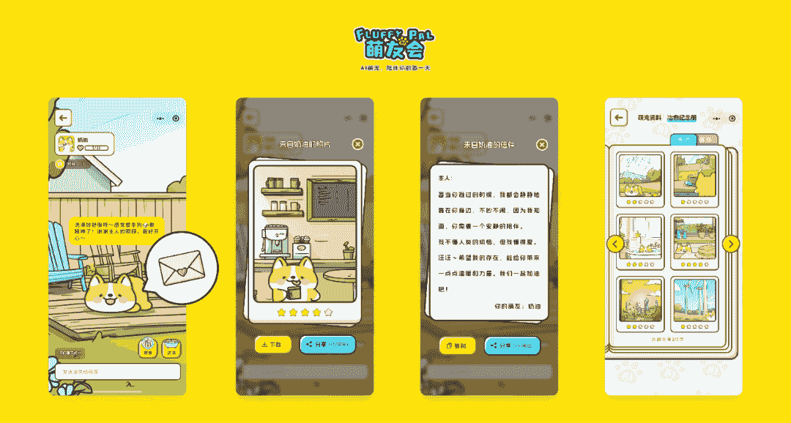
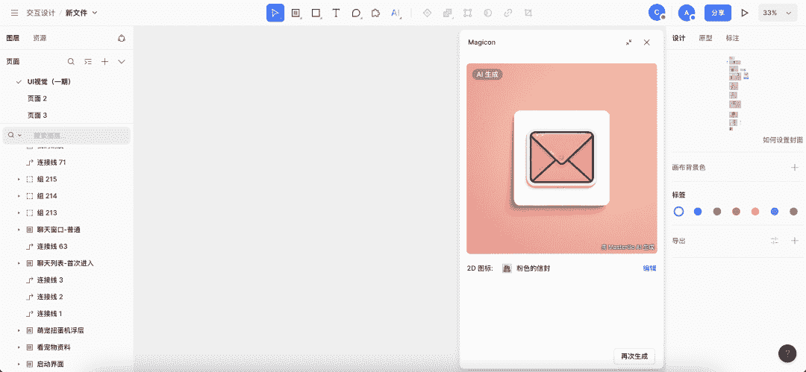
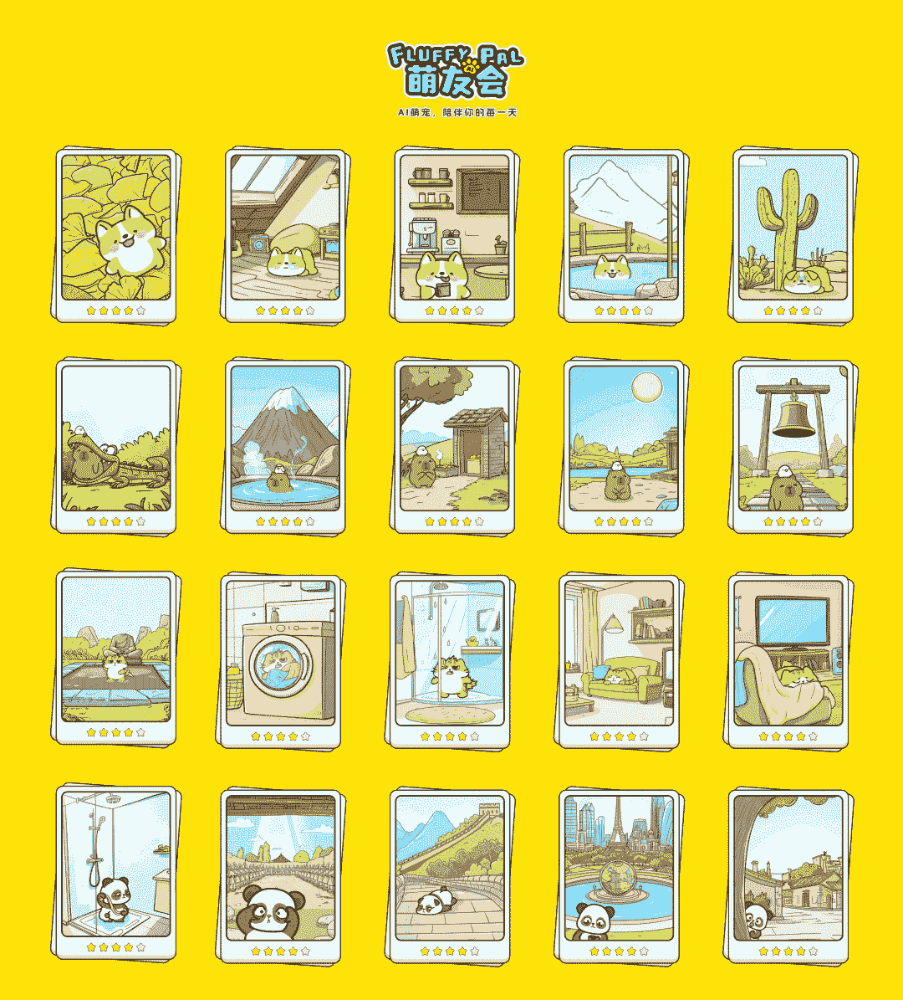
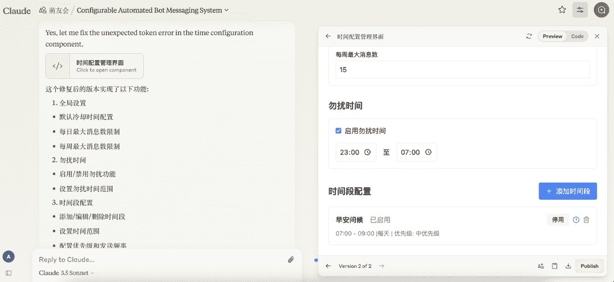

# 我和AI一起做了一个应用：从产品方案到上线的实战经验

> 来源：[https://aigcreative.feishu.cn/docx/XiFodfz1QolOYHxwJMTc9GNQn2b](https://aigcreative.feishu.cn/docx/XiFodfz1QolOYHxwJMTc9GNQn2b)

> 原文链接： [https://mp.weixin.](https://mp.weixin.qq.com/s/XcxqnOGHBKuo4YdVrNmvcA)qq.com/s/XcxqnOGH...

> 👸号：闲聊AI的阿布

# **前言**

大家好！我是abo。作为一名在阿里工作了11年的UI、体验设计师、设计Leader。我在最近的1年做了一个重要的决定：离开大厂，投身AI创业。

很多人问我："为什么要在当前的经济环境下选择创业？"说实话，这个决定我也深思熟虑了很久。但看到AI技术的迅猛发展，我意识到这可能是我职业生涯中最后一次赶上重大技术革命的机会。

现在回看，这个决定让我见证了产品研发方式的革命性变革。

#

# **AI 改变产品研发流程**

在大厂工作时，一款产品从构思到上线，往往需要几十人的团队忙活大半年：产品经理写PRD、设计师做视觉、前后端开发、测试运维...每个环节都需要专门的人力投入。

但就在最近几个月，我和两个小伙伴做了一次大胆的尝试 - 用多个AI工具协同，仅用3个月就从0到1搭建了一款治愈系小程序「萌友会」。从产品方案到界面设计，从代码开发到运营物料，我们在每个环节都深度应用了AI工具。

**我们的AI工具矩阵是这样的： **

+   Claude作为"产品经理助手"，帮我们做市场分析、写PRD、构建用户故事

+   Claude的Project功能成为我们的AI 私有文档库

+   MasterGo的AI功能用于界面设计，快速搭建原型

+   Midjourney负责视觉创作，生成各类配图和素材

+   Suno AI帮助我们生成治愈风格的背景音乐

+   Cursor AI、Claude则成了我们的"编程助手"，加速代码开发

说实话，这个过程并不轻松。如何让多个AI工具默契配合？怎样把零散的功能整合成完整的产品方案？在实际应用中会遇到哪些坑？这些都需要在实践中不断摸索和优化。

但结果证明这种尝试是值得的 - 我们不仅大大缩短了开发周期，更重要的是，这种敏捷的研发方式让我们能快速验证想法，及时调整方向。

这个经历让我深刻感受到：AI不仅仅是提升效率的工具，更是重塑整个产品研发流程的催化剂。它让小团队也能快速打造有温度的产品，这可能就是AI时代产品研发的新范式。

#

# 萌友会：用AI打造一款有温度的AI陪伴

我们的产品叫「萌友会-治愈系AI宠物」，可以通过小程序搜索找到哦～

在决定创业之前，我注意到一个令人心痛的现状：目前国内每三个年轻人中就有一个正在经历严重的心理问题。而在我身边，也经常有朋友半夜发消息倾诉："一直被领导PUA，感觉自己快撑不住了..."，"最近经常失眠，躺在床上怎么也睡不着..."。

但现实是，很多人并不愿意或不敢向他人倾诉。即使想说，身边也未必随时有合适的倾诉对象。

正好那时我在研究AI产品，突然意识到：为什么不能让AI成为这样一个朋友呢？这就是萌友会的初衷 —— 用AI打造一群暖心的动物伙伴，在你需要的时候默默陪伴。

我们在产品设计上下了很多功夫，借鉴和运用一些游戏化的设计，营造一个治愈的产品氛围，每个AI小动物都有独特的性格和故事。

正是基于这样的产品愿景，我们开始了紧张的开发历程。接下来，我将详细分享如何用AI工具，帮助我们快速实现这些产品构想...

#

# 一、AI 改变产品经理的工作方式

还记得第一次想做产品时的彷徨：不知道从哪里开始调研，不知道如何写竞品分析，不知道需求该怎么分析...

但有了Claude这样的AI产品经理后，一切都不一样了。

### **1.1 高效的产品规划流程**

在所有AI工具中，Claude是我最依赖的"产品经理助手"。Claude是一个可以媲美甚至超越ChatGPT的AI大模型，我认为它在写作方面远远超过GPT，它也是我唯二长期付费的AI工具之一。

基于Claude的特点，我总结出一套高效的产品规划方法：

**产品战略规划**

我和Claude的第一次对话是这样的："我想做一款情感陪伴类产品，帮我分析下市场机会和现有产品的问题。"

Claude立刻给出了一份完整的分析：从市场规模说起，到用户痛点、竞品优劣势、机会空间，整整5000字的报告，比很多产品经理写的还要专业。

最让我惊喜的是，它不只是简单罗列数据，而是真的理解了产品本质。比如它指出："现有产品都在模仿人类对话，但用户其实不需要一个'假人'，而是需要一个'知心朋友'。这暗示我们可以用拟人化的小动物作为载体..."

从那以后，Claude就成了我的"产品经理导师"：

> 我："帮我分析市面上主流的AI情感陪伴应用有什么异同点？"

> Claude："让我从产品定位、交互方式、商业模式三个维度进行分析..."

**需求管理与文档输出**

+   **PRD 编写 **：Claude擅长将想法转化为结构化的产品需求文档。我通常这样使用：

> 我："帮我梳理萌友会的核心功能模块，需要包含功能描述、实现方式和优先级。"

>

> Claude会输出清晰的功能列表，包括：

+   宠物选择与互动系统

+   情感识别与回应机制

+   用户画像与个性化推荐

> ...

**产品创新与优化**

+   **功能头脑风暴 **：利用Claude的发散思维能力激发创新想法：

> 我："写一个年轻职场人使用萌友会的典型场景。"

>

> Claude会生成生动的用户故事，帮助团队理解产品价值。

**产品框架思路**

流程图：Claude可以直接输出多种图表，例如常用的流程图、脑图等等，非常方便在产品方案设计的前期帮助我们梳理思路。

###

### **1.2 项目文档管理神器**

Claude最实用的功能是Projects，它可以轻松构建你的产品知识库。你把整个项目的相关文档都上传，它将基于你项目的文档内容进行回答，就像一个资深的产品经理，对你的项目的每一个细节都很了解，给以给出非常有用的建议。

例如：上传市场调研报告、竞品分析文档、产品需求文档、用户研究数据等等

# 二、UI设计环节：MasterGo的AI赋能

作为一款国产设计工具，MasterGo的AI能力给我留下了深刻印象。它不仅能提供基础的设计功能，更通过AI大大提升了设计效率。我最喜欢里面的三个功能：

**1. 设计灵感： **提供丰富的UI组件模板库，可以快速搭建页面框架 。过去要快速设计一个页面的原型，需要自己画每一个组件，或者调用组件库里的组件，或者到资源社区里找别人设计好的模版，但找起来也非常费劲。

**2. 图像增强： **集成了很多常用的图片处理的功能，比如可以将模糊的图片变高清，效果非常好。还有比如图片可以从方图变成16:9的长图，类似Photoshop AI的功能，扩图的效果也很好。还有，可以将位图转成矢量图，方便二次编辑。

**3. Magicon： **由于是游戏化的界面设计，我们在萌友会的设计中有大量的图标设计。我发现MasterGo中居然有生成图标的功能，比如我可以输入“粉色的信封”就可以生成图标，并且生成的图标挺漂亮的。

#

# 三、Midjourney：拯救了设计资源匮乏的我们

原本我们只是一个简单的想法：让宠物在每日互动后，送给用户一张暖心的照片作为礼物。然而，当我们坐下来盘点时，背后的工作量让人窒息 - 8只萌宠，每只至少要准备70-80张不同场景的照片，加起来至少需要630张！作为一个连专业设计师都没有的小团队，这几乎是一个不可能完成的任务。但这个功能实在太治愈了，我们不想放弃。

最后，我们决定试试Midjourney。通过不断调试提示词，让AI帮我们构建各种暖心场景：温暖的咖啡厅、安静的图书馆、星空下的小屋...很快，照片库就从0增长到了上百张。当我们收到用户反馈说"每天最期待收到宠物的照片了"时，那种成就感让人觉得一切努力都值得。

但Midjourney也有它的局限性。我们试过用AI来设计宠物角色，但发现两个问题：一是很难保证每次生成的角色形象完全一致，二是后期需要制作动态表情和动画，AI生成的图片不太好处理。最终我们找到了一个完美的解决方案：使用Midjourney生成的背景素材图，和设计师精心设计的宠物角色通过Photoshop进行融合，这样既保证了场景的丰富多样，又确保了角色形象的一致性。

总的来说，我觉得要把Midjourney用好，关键是要清楚它的边界。该用AI的地方就大胆用，比如批量生成背景、场景素材、图标素材；不适合用AI的地方，比如需要高度一致性或者后期制作动画的核心角色设计，就还是交给专业设计师更靠谱。这样做不仅能保证效率，还能确保产品的整体质量。

# 四、开发阶段：让Cursor AI和Claude成为你的编程助手

我们团队中有1位前端和1位后端。在开发阶段，我们也大量使用AI进行提效，但AI 并不能完全替代开发工作。

Cursor AI和Claude成了我们的得力助手。以前写代码经常要搜索、查文档、改bug，过程总是磕磕绊绊。有了AI，开发效率至少提升了40%。

它就像一个经验丰富的高级程序员，帮我们解决了很多开发难题。比如做后端接口，它能快速生成标准的API结构。特别是在处理一些复杂的业务逻辑时，Cursor AI总能给出不错的解决方案。

不过使用Cursor AI也要注意一点：它生成的代码仅供参考，需要我们理解后再使用。我们的做法是先让AI生成代码框架，然后再根据具体需求进行修改和优化。这样既保证了代码质量，又大大提升了开发速度。

最让我惊喜的是它的代码优化建议功能。当你写完一段代码，它会主动提出改进意见，比如指出潜在的性能问题、提供更优雅的写法，就像有个技术导师在身边及时指导。这对提升代码质量特别有帮助。

总的来说，Cursor AI让我们这个小团队也能快速交付高质量的代码。它不是用来完全替代程序员，而是帮助我们更高效地完成开发工作。

<https://aigcreative.feishu.cn/sync/K4Gvd9vUQsy9Oubwqaeclu0Fnbg>