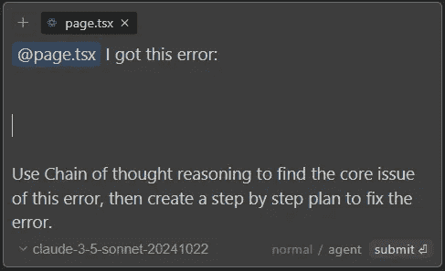
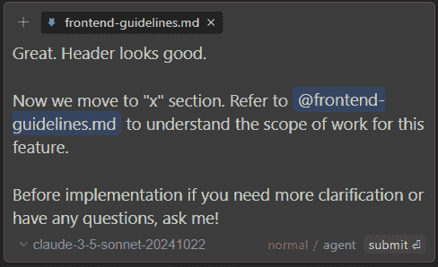
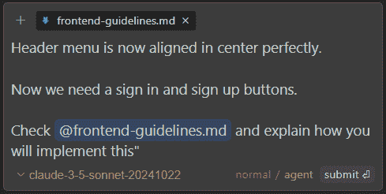
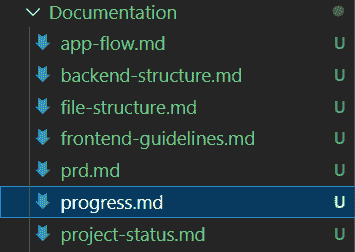
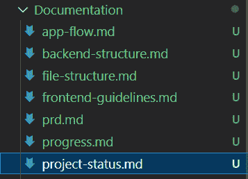
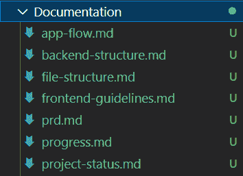
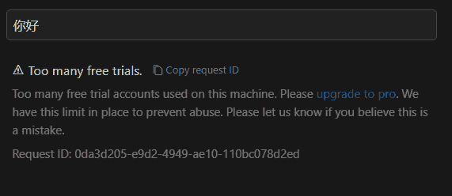
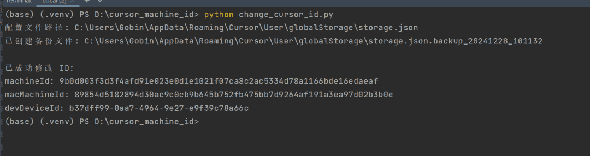
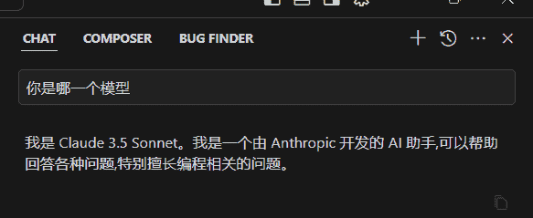

# Cursor常用提示词手册，附Cursor永久免费使用方法！

> 来源：[https://aigcreative.feishu.cn/docx/YDGidVLkFoeEG3xaTutcwFr2n1e](https://aigcreative.feishu.cn/docx/YDGidVLkFoeEG3xaTutcwFr2n1e)

> 原文链接： [https://mp.weixin.](https://mp.weixin.qq.com/s/7cy_Nslr_ylLfX_SWKw_gA)qq.com/s/7cy_Nslr...

> 公众号：极客见识 GeekSavvy

今天跟大家分享一些 Cursor 干货，Cursor 的常用提示词手册，以及我们如何重置机器码，实现 Cursor 的永久免费使用。

**Part 1**

**Cursor 常用提示词手册**

来源：https://x.com/cj_zZZz/status/1873417505550868647

01 “修复错误”（Fix Errors） 提示

像 Sonnet 3.5 这样的 AI 模型有时会忽略重要细节，这会引发一连串的错误。

使用以下提示来解决该问题。

这将有助于 AI 分析错误的根本原因，然后制定一个逐步修复错误的计划。



```
@page.tsx I got this error:
Use Chain of thought reasoning to find the core issue of this error, then create a step by step plan to fix the error.
```

02 “新功能” （New feature）提示

一旦成功执行了一个组件，你需要再次让 AI 参考文档，使其了解下一个组件的工作范围。

使用这些说明让 AI 在执行前编写一份实施计划。

标记相关文档，一旦 AI 阅读完文件，它可能会向你提问。

回答这些问题并让它执行。

这一步将消除每个组件一半的幻觉（hallucinations）（此处指错误或不合理的输出内容）。



```
Great. Header looks good.
Now we move to &quot;x&quot; section. Refer to @frontend-guidelines.md to understand the scope of work for this feature.
Before implementation if you need more clarification or have any questions, ask me!
```

03 响应结构（Response structure）

这种结构用于通知 AI：我当前的任务完成了，需要继续下一个任务。

1.  **提供更新： **Header 菜单现在已完美居中对齐。

1.  **提供下一项任务： **现在我们需要登录（sign in）和注册（sign up）按钮。

1.  **标记正确的文档： **查看 @（文档名称）并解释你将如何实现这一功能。



```
Header menu is now aligned in center perfectly.
Now we need a sign in and sign up buttons.
Check @frontend-guidelines.md and explain how you will implement this.
```

04 progress.md 文件

使用此提示来跟踪所有工作,这将为 AI 提供进度相关的背景信息，并解决重复错误的问题。

在每一个已完成步骤的结尾，将你的工作日志记录在 @progress.md 文件中。我们实现了哪些功能？遇到了哪些错误？我们是如何修复所有这些错误的。

按步骤依次回答这三个问题，不要遗漏任何信息。



05 project-status.md 文件

AI 应该从我们上次停下的地方继续开展工作。该文件将帮助 AI 记录工作日志，并了解哪些工作已经完成，哪些还未完成。

在会话结束时，将你的工作日志记录在 @project-status.md 文件中。

首先查看 @progress.md 文件，以了解我们在本次会话中已经实现的所有功能。

然后撰写一份详细的会话报告，该报告应为下一次工作会话提供详细的背景信息。



06 Cursor Agent Hack

Cursor Agent 有时候会过度的干活，乱改代码库。

阅读 @（文档名称）中的说明，以了解此功能的工作范围。

运用思维链推理（chain of thought）来创建一个逐步的实施计划。

确保你解释此功能的每个部分是如何工作的，提供宏观层面的细节。

将这些事项分解为详细的带编号的步骤。

这将为你提供人工智能即将实施的计划。你可以核实一切是否与要求相符并批准。

这将解决 Cursor Agent 进行的所有不必要的编辑操作。

**07 附件文档**

创建一个 “文档” 或 “说明” 文件夹。

然后将所有核心文档放在该文件夹下：

+   项目需求文档（PRD）

+   应用流程文档

+   前端指南文档

+   后端结构文档

+   技术栈文档

+   文件结构文档

你可以使用 01 模型，但需要在提示上多加注意（否则可能会有很多无用的内容和段落）。



PS：以下是广告


最佳解决方案是通过 @CodeGuide 完成这些文档。

我已为你将此过程自动化。它将帮助你在 20 到 30 分钟内获取所有所需文档。

使用 Sonnet 3.5、o1-preview 和 GPT4o 的组合来创建文档。

通常，我们需要 7-8 小时的工作量，才能用 ChatGPT 准备好所有文档（比如阅读、提炼、迭代每个文档）。

**Part 2**

Cursor 重置机器码实现永久免费使用方法



Cursor 有记录设备机器码， 删除账户重注册账号也会显示以上问题。

**解决方法：**

```
git clone https://github.com/fly8888/cursor_machine_id.git
python change_cursor_id.py
```



这样子就解决啦。



如果你也对 AI Coding 感兴趣，欢迎加入我们的交流群！

<https://aigcreative.feishu.cn/sync/K4Gvd9vUQsy9Oubwqaeclu0Fnbg>