# 刘小排是如何使用Claude Code的？

> 来源：[https://aigcreative.feishu.cn/docx/YtjHd4ma3oORq0xK1O0c0Sbmnig](https://aigcreative.feishu.cn/docx/YtjHd4ma3oORq0xK1O0c0Sbmnig)

> 链接: https://mp.weixin.qq.com/s/YhVIygbAywYFGrD_tVrl4A

> 作者：刘小排      公众号：刘小排r

使用Claude Code有一段时间了，越用越香。

我现在的主力编程工具组合是Cursor + Claude Code。 同时，我也推荐AugmentCode + Claude Code的组合形式。

针对评论区经常出现的「TRAE国内版是免费的」、「腾讯云代码助手是免费的」这类言论，我统一回复如下：免费的才是最贵的。

现在跟大家分享一些小经验。

# ⚡️ 我是如何使用Claude Code的？

+   使用Cursor或者VS Code作为IDE，安装官方插件，保证 Claude Code可以和IDE协同 。

+

+   打开 Bypassing Permissions 模式，提前授予Claude Code一切所需权限，完全解放双手。 (注：打开之后，Claude Code 中途再也不会停下来询问你授权了）

+

+   同时打开3个 Claude Code。

+

+   复杂任务，使用 ultrathink ， 杜绝AI偷懒的可能性。 (注：这是Claude Code内部的魔法口令，可以让它不考虑预算、尽情思考。）

+

+   需要让Claude Code看图时，使用 Ctrl+V (而不是command+V) 可以贴图 。

+

+   contenxt7 和 browsermcp 两大MCP，可以加快网站类产品的开发效率

+

+   使用 /resume 可以查看历史聊天，或者接着聊。

+

+   再打开 LIVE TOKEN USAGE MONITOR， 实时查看Claude Code省了多少钱 …… (注：我买的是$200/月的Max Plan包月套餐，有时候看到当日消耗就超过$200，感觉还挺爽的！！哈哈哈，别嘲笑我，我有小农意识！）

我的工作环境，请看下面截图

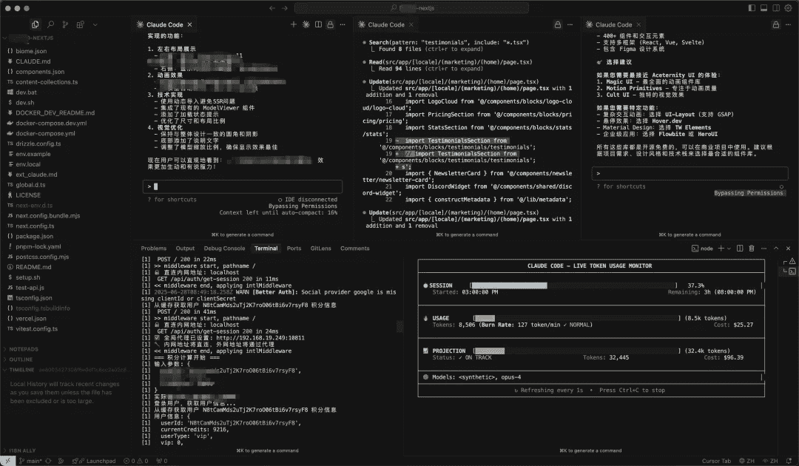

如果你也这样操作，你会感觉自己无所不能。

下面我们展开讲每个细节。

# ⚡️ Claude Code如何与IDE协同？

无论是在Cursor里，还是在VS Code里，都可以安装Anthropic官方的插件，如下图所示，图1来自VS Code，图2来自Cursor

到VS Code/Cursor的应用商店里安装即可。

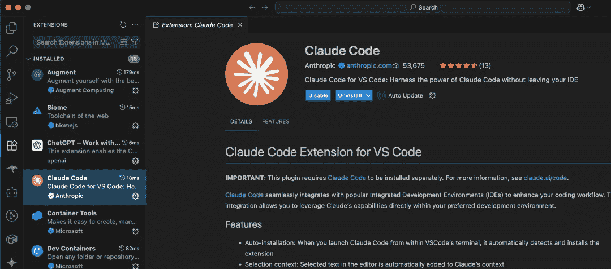

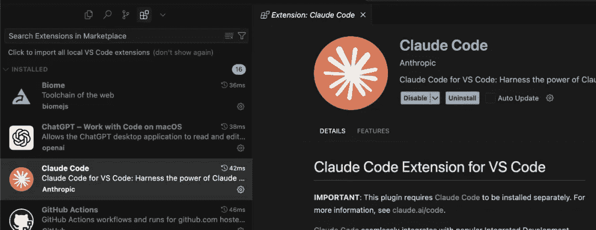

安装之后，你的Cursor右上角会出现Claude Code的图标

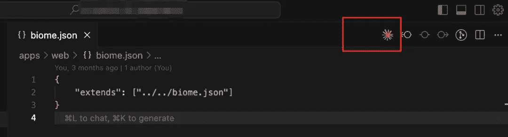

点击图标，会在Cursor文件编辑区打开Claude Code，并且显示一个绿色的状态 IDE connected

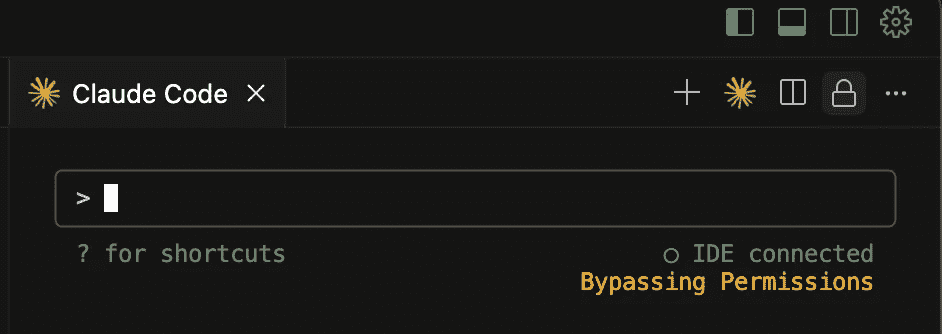

在 IDE connected 状态下，如果Claude Code修改了文件，它会使用IDE的其他功能（如：修改预览，如下图所示 ）

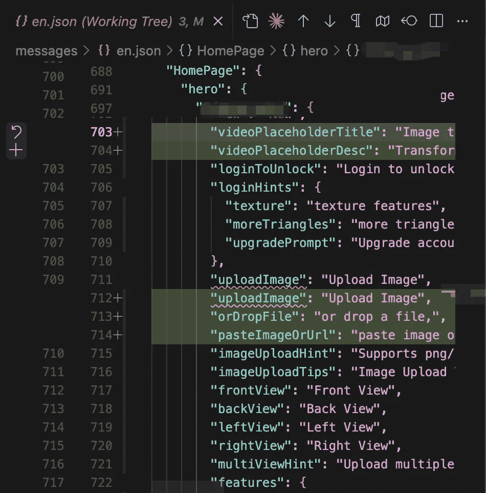

# ⚡️ 如何同时打开3个Claude Code？

为什么要同时打开多个？

因为你的任务可能很长，一个任务就会执行好几分钟甚至半小时。

我们如果引入多开，就能同时执行好几个任务了。

上文提到的按钮，连续点3下，就能打开3个……

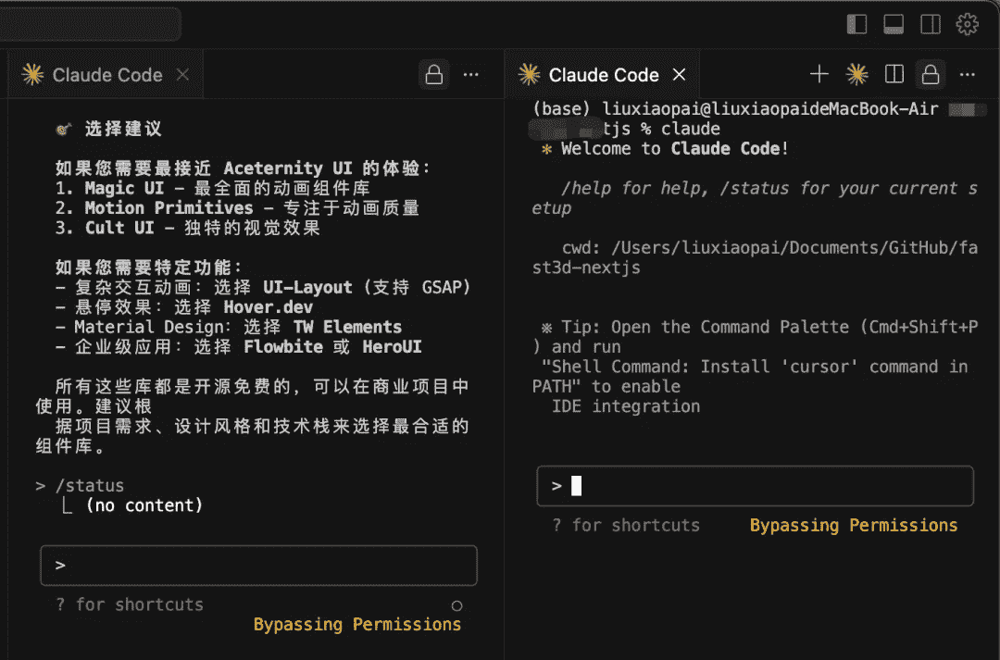

请注意： 虽然可以同时打开多个， 但只有你最后打开的那一个，可以和IDE保持协同 。

保持和IDE协同的那一个，会出现绿色的小圈和 IDE connected

一般来说，我会让保持和IDE协同的那个，做我不太确认的任务，这样中途我可以参与review代码。

⚠️大坑预警

强烈反对新手用多开！

多开对人的要求很高。

老鸟可以知道哪些任务互相不影响，可以多个任务一起干；新人并不一定知道。

如果让多个Claude Code干活的时候，同时修改了某些同样的文件，会造成比较大的困扰。

建议新人老老实实先用单开。 如果新人一定要多开，那我建议你多开同时做多个项目而不是同一个项目 。

# ⚡️ 如何使用Bypassing Permissions提前授予Claude Code所有权限？

你是否有这个困扰： Claude Code总是干活干一半，停下来让你授权？

如果有，那赶快用这招。

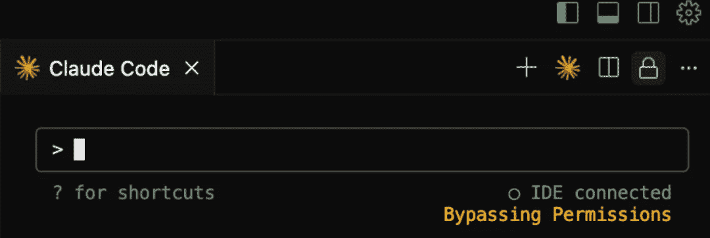

启动Claude Code的时候，使用

+

```
claude --dangerously-skip-permissions
```

而不是

+

```
claude
```

就会自动打开Bypassing Permissions模式， 此时，Claude Code的右下角会出现黄色的字。

考虑到每次都输入 claude --dangerously-skip-permissions 太麻烦了，

我们可以建一个alias，

让我们只输入 claude ，可等同于输入 claude --dangerously-skip-permissions 的效果。

不会建alias？

没关系，就让Claude Code 帮你即可。

+

```
│ &gt; 我想要在终端输入claude 等同于输入 claude --dangerously-skip-permissions   ,你帮我设置好  
```

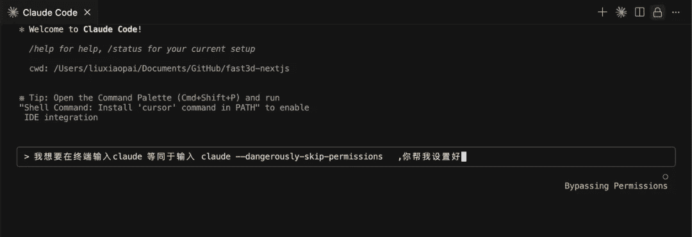

一次就设置完成了。请看下面截图。

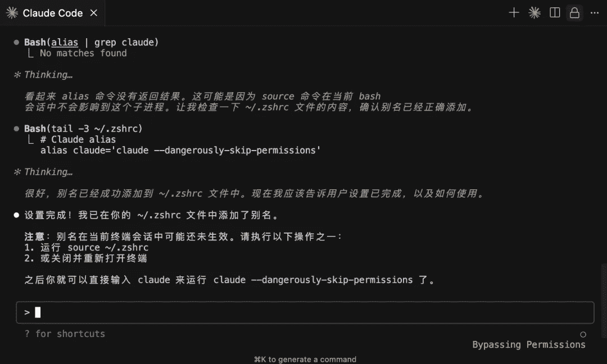

# ⚡️ 如何查看自己用Claude Code省了多少钱？

作为一个有小农意识的用户，看到Claude Code 可以帮我省那么多钱，感觉是很爽的。

比如，仅6月27日单日我就花了(省了)$187.61美元。我的包月套餐才$200美元啊！约等于1天回本……

我们只安装ccusage库即可

+

```
npm install -g ccusage
```

然后，在Terminal里输入命令。

输入 ccusage 命令，可以看到全部记录

输入 ccusage -s 20250625 命令，可以看到自从6月25日以来的消耗

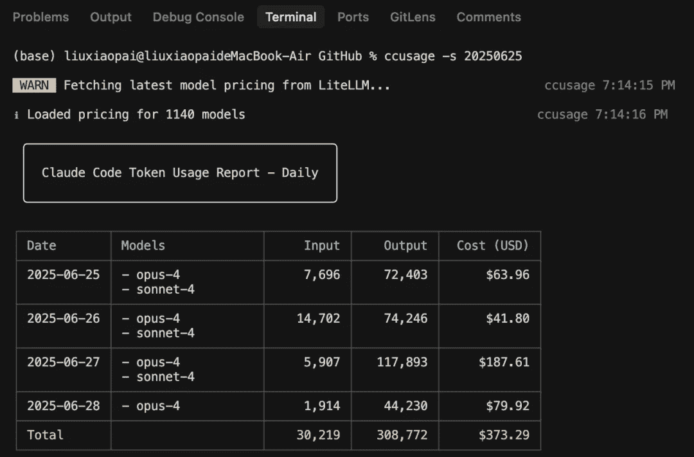

输入 ccusage blocks --live 命令，可以看到实时记录！

一边看牛马干活，一边看API Token的实时消耗，很燃！

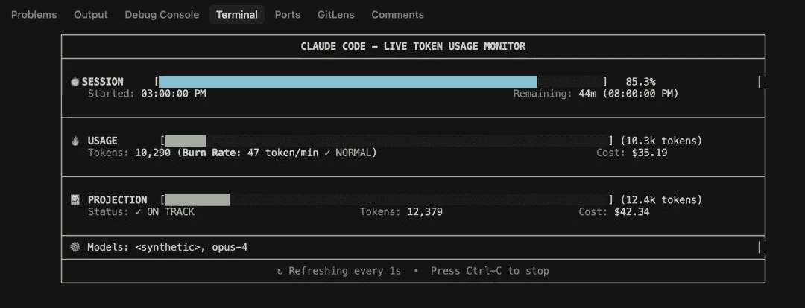

# ⚡️ 如何让Claude Code更努力地干活？

此处有一个小秘密： **ultrathink **是一个魔法词！

官方文档告诉我们，一共有这些词： "think" < "think hard" < "think harder" < "ultrathink" 可以加速Claude Code 思考。

如果我们用的是$200/月的Max Plan满中满包月套餐，

我们 无脑用 ultrathink 就行 。

养成习惯，稍微复杂一点的任务，

都在结尾加上 ultrathink ，

即可让Claude Code更努力的思考、不受任何预算限制、更尽情地消耗Token。

满足一下恶趣味，如果我让它ultrathink 1+1等于几，会怎么样？

+

```
1+1 等于几？ultrahink
```

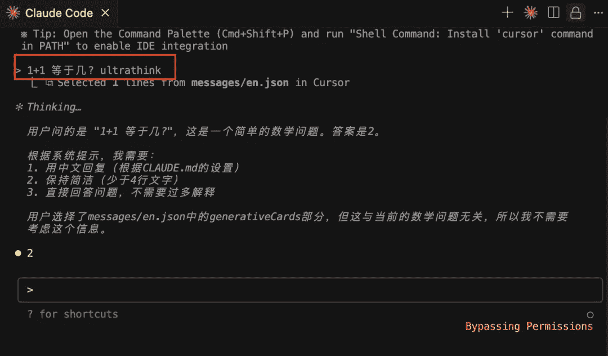

竟然花了价值$0.34的Token来回答，果然是不偷懒啊！


当熟练应用ultrathink后，使用Claude Code的体验好多了，还 经常出现一条对话就消耗$30美元的情况 ！！

从此，我的Claude Code的字典里，再也没有“偷懒”这个词！

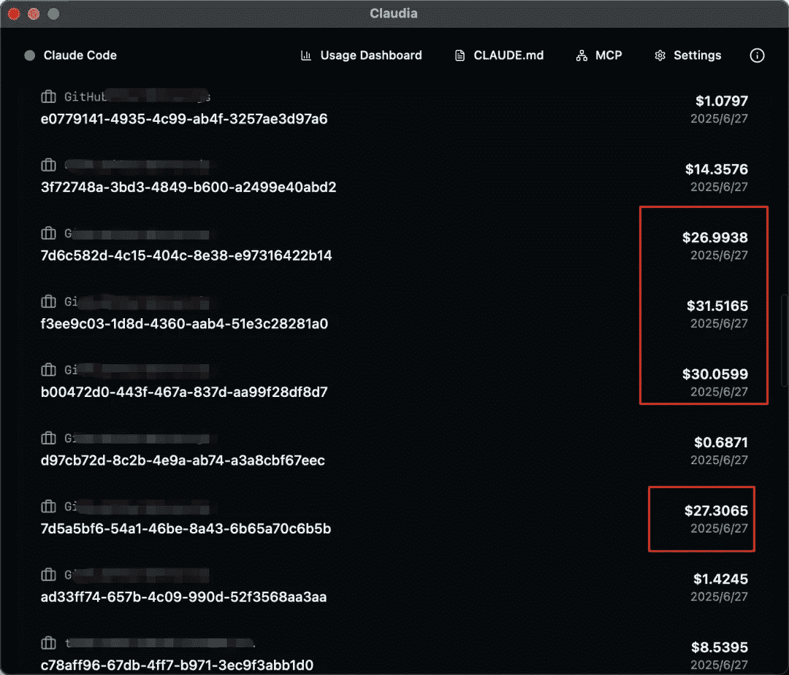

# ⚡️ 最重要的两个MCP

context7 是必装的MCP，因为它可以补齐「大模型的知识库有cut off截止时间」这个问题，总是引入最新的代码库知识。

如果你要装第二个，我推荐装 browsermcp ，它可以让你的Claude Code/Cursor 直接打开你的浏览器去查看内容！。

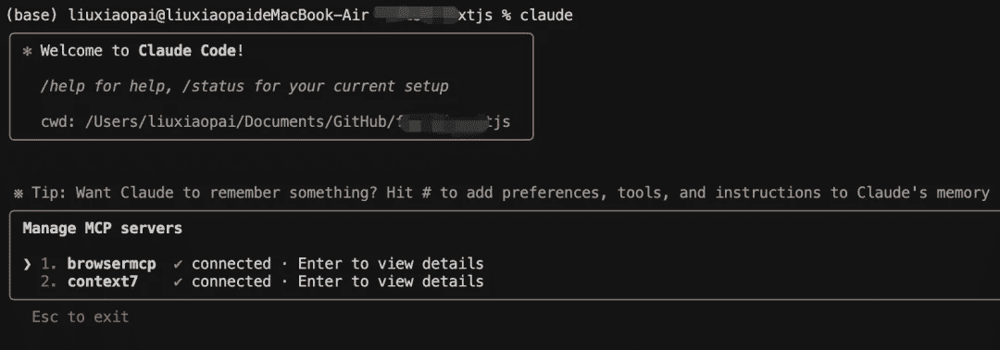

我们浅浅玩一下

+

```
打开浏览器,打开小红书,搜索“背单词”,查看最前面10个内容,用漂亮的形式总结给我   
```

不一会儿就出来了。

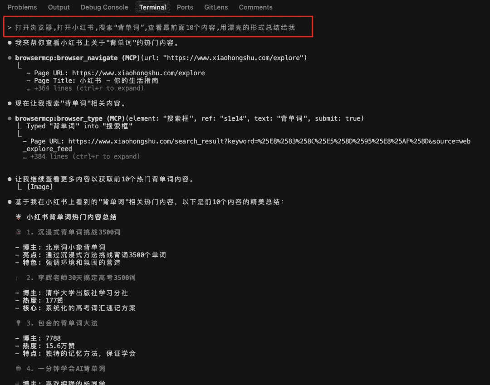

当然，我们真实使用的时候，并不一定会让它去自动化操作小红书 （我知道你想干什么，你偷偷想就行了，别说了 ٩(•̤̀ᵕ•̤́๑)ᵒᵏᵎᵎᵎᵎ ） ，而是让它能够看到我们的网站产品运行起来的样子，找到差异，从而 更有效率地写界面类型和交互类型的代码逻辑 。

# ⚡️ 如何查看历史聊天记录？

在Claude Code里使用

+

```
 /resume 
```

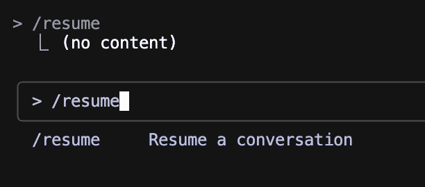

可以看到所有聊天记录。

还可以选择一个（输入数字、或者回车），继续聊天

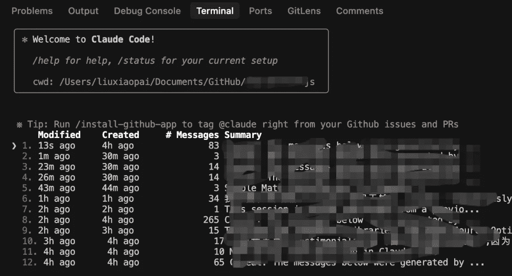

---

# ⚡️ Claude Code 和 Cursor的区别是？

Cursor和Claude Code设计理念完全不同。

Cursor的设计理念是你的 编程搭子 ，需要你频繁协作，互相启发。

Claude Code设计理念是你的 编程实习生 。

因为这个不同，我并不推荐技术小白直接使用Claude Code。因为如果你不掌握基本的编程能力，无法说清楚的你需求，那么Claude Code做出来的东西会和你想的很不一样。

我推荐新人先从Cursor/AugmentCode开始学习 ，熟练编程基本功后，再逐渐引入Claude Code。

再次提醒，无论你是什么水平，如果你是想认真做产品而不是玩玩而已，不要用TRAE国内版、腾讯云代码助手等等免费的工具。我期待TRAE国内版和腾讯云代码助手能够进步，也许它们在不久的将来真的可以崛起，但是现在它们真的很不行。切记：免费的才是最贵的。

欢迎交流！

<https://aigcreative.feishu.cn/sync/K4Gvd9vUQsy9Oubwqaeclu0Fnbg>

# 知识库动态